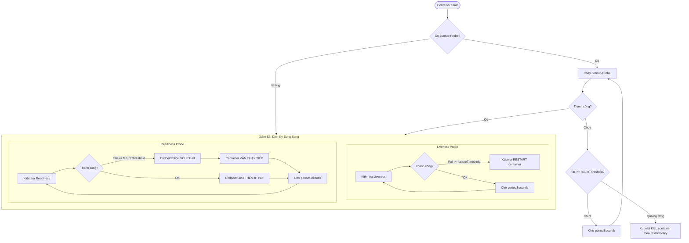

# 6_3_5 Liveness Readiness and Startup Probes

> **Khóa học**: Cloud DevOps Basic — Containers and Kubernetes  
> **Phân nhóm**: 6 Domain 6 - Containers and Kubernetes › 6_3 Kubernetes Architecture and Core Workloads  
> **Chủ đề**: 6_3_5 Liveness Readiness and Startup Probes — Cơ chế chẩn đoán container, bộ tham số điều khiển và phòng chống Cascading Failure  
> **Phiên bản áp dụng**: Kubernetes 1.37  
> **Trạng thái**: Draft  
> **Phạm vi**: [Topic README](./README.md#6_3_5-probes)  
> **Checkpoint**: [CHECKLIST](../../CHECKLIST.md#6_3-kubernetes-architecture-and-core-workloads)  

---

## 1. Khái Niệm Cốt Lõi & Bản Chất Kỹ Thuật (Core Concepts & Technical Deep Dive)

Trong Kubernetes, kubelet cung cấp **Container Probes** để chủ động chẩn đoán và điều phối trạng thái container.

---

### 1.1 Khái Niệm Cơ Chế Probe Trong Kubernetes
- **Bản chất & Trách nhiệm**: Probe là phép chẩn đoán do kubelet thực hiện định kỳ trên container qua thực thi lệnh hoặc request mạng theo Pod spec <!-- ev: R1.58 -->.
- **3 loại probe**: Kubernetes phân tách thành ba loại: `startupProbe` <!-- ev: R1.59 -->, `livenessProbe` <!-- ev: R1.62 --> và `readinessProbe` <!-- ev: R1.64 -->.

---

### 1.2 Startup Probe — Tấm Chắn Cho Khởi Động Chậm
- **Mục đích**: Xác nhận ứng dụng bên trong container đã khởi động thành công <!-- ev: R1.59 -->.
- **Che chắn**: Tạm ngừng thực thi liveness và readiness probe cho đến khi startup probe thành công, giúp app hoàn tất khởi tạo <!-- ev: R1.60 -->.
- **Thất bại**: Nếu thất bại, kubelet tiêu diệt container và áp dụng chính sách `restartPolicy` của Pod <!-- ev: R1.61 -->.
- **Thời gian**: Đặt `failureThreshold * periodSeconds` đủ lớn để bao quát thời gian khởi động tối đa <!-- ev: R1.69 R2.79 -->.

---

### 1.3 Liveness Probe — Phục Hồi Khi Bế Tắc
- **Mục đích & Bắt lỗi**: Xác định thời điểm cần khởi động lại container, phát hiện lỗi bế tắc (deadlock) khi tiến trình còn sống nhưng tê liệt <!-- ev: R1.62 -->.
- **Hành vi**: Nếu thất bại vượt quá `failureThreshold`, kubelet sẽ restart container đó <!-- ev: R1.63 R2.88 -->.
- **Phạm vi**: Kích hoạt restart container cục bộ, không can thiệp trực tiếp gỡ Service endpoint <!-- ev: R1.62 R1.63 -->.

---

### 1.4 Readiness Probe — Điều Tiết Lưu Lượng Mạng
- **Mục đích**: Xác định thời điểm container sẵn sàng tiếp nhận lưu lượng mạng <!-- ev: R1.64 -->.
- **EndpointSlice**: Khi thất bại, EndpointSlice controller gỡ địa chỉ IP Pod khỏi EndpointSlice của mọi Service liên kết; kubelet không restart container <!-- ev: R1.65 -->.
- **Vòng đời & Khôi phục**: Chạy định kỳ suốt vòng đời container; khi probe thành công trở lại, IP Pod được thêm lại vào EndpointSlice <!-- ev: R1.65 R1.66 -->.

---

### 1.5 Phối Hợp Song Song Liveness Và Readiness
- **Song song**: Readiness probe và liveness probe có thể chạy song song độc lập trên cùng một container <!-- ev: R1.70 R2.80 -->.
- **Hiệu quả**: Vừa ngăn traffic vào Pod chưa sẵn sàng, vừa tự hồi phục container khi chết <!-- ev: R1.70 -->.

---

### 1.6 Bốn Cơ Chế Thăm Dò (Probe Handlers)
- **`httpGet`**: Gửi HTTP GET request tới path và port chỉ định của container <!-- ev: R2.76 R2.82 -->.
- **`tcpSocket`**: Mở socket tới cổng TCP; kết nối thành công là healthy, thất bại là failure <!-- ev: R1.67 R2.77 R2.83 -->.
- **`exec`**: Chạy lệnh tùy ý trong container; mã 0 là healthy, khác 0 là failure <!-- ev: R2.75 R2.81 -->.
- **`grpc`**: Gửi yêu cầu kiểm tra chuẩn `gRPC HealthCheckRequest` qua gRPC Health Checking Protocol <!-- ev: R1.68 R2.78 R2.84 -->.

---

### 1.7 Bảng Tham Số Điều Khiển Chi Tiết (Probe Parameters)

<!-- ev: R2.85 R2.86 R2.87 R2.88 R2.89 -->
| Tham số | Ý nghĩa kỹ thuật | Mặc định | Giới hạn |
| :--- | :--- | :--- | :--- |
| `initialDelaySeconds` | Số giây chờ trước khi kích hoạt probe <!-- ev: R2.85 --> | `0` | Không âm <!-- ev: R2.85 --> |
| `periodSeconds` | Chu kỳ tần suất thăm dò tính bằng giây <!-- ev: R2.86 --> | `10` giây <!-- ev: R2.86 --> | Tối thiểu `1` <!-- ev: R2.86 --> |
| `timeoutSeconds` | Số giây chờ phản hồi trước khi tính timeout <!-- ev: R2.87 --> | `1` giây <!-- ev: R2.87 --> | Tối thiểu `1` <!-- ev: R2.87 --> |
| `failureThreshold` | Số lần thất bại liên tiếp trước khi coi là failed <!-- ev: R2.88 --> | `3` lần <!-- ev: R2.88 --> | Tối thiểu `1` <!-- ev: R2.88 --> |
| `successThreshold` | Số lần thành công liên tiếp để coi là khôi phục <!-- ev: R2.89 --> | `1` lần <!-- ev: R2.89 --> | Bắt buộc bằng `1` cho liveness/startup <!-- ev: R2.89 --> |

---

## 2. Ví Dụ Đời Sống Thực Tế Dễ Hiểu (Intuitive Real-World Analogies)

Quy trình quản lý nhân sự tại tòa nhà dịch vụ khách hàng:

- **Startup Probe — Học việc ban đầu**: Nhân viên mới cần thời gian đọc tài liệu học việc. Startup Probe bảo vệ nhân sự mới: không giao việc và không sa thải trong lúc học việc. Hoàn tất bài thi học việc (Startup PASS) mới mở cửa đón khách (Readiness) và bật giám sát y tế (Liveness). Hết hạn đào tạo mà không đạt sát hạch, công ty sa thải tuyển người mới (kubelet kill container theo `restartPolicy`).
- **Readiness Probe — Biển "Tạm nghỉ" trước quầy**: Giao dịch viên bận nhập liệu tồn đọng, họ lật biển "Tạm nghỉ". Người điều phối (EndpointSlice controller) tạm dừng dẫn khách vào quầy, chuyển sang quầy bên cạnh. Giao dịch viên vẫn làm việc, tuyệt đối không bị sa thải (không restart container). Xong việc, lật lại biển "Sẵn sàng", khách lại được dẫn vào tiếp.
- **Liveness Probe — Máy đo nhịp tim cấp cứu**: Mỗi nhân sự đeo máy đo nhịp tim. Nếu bị ngất hoặc tê liệt (deadlock), máy báo động để đội cấp cứu (kubelet) lập tức sốc điện hồi sức tim phổi (restart container). **Bẫy liên kết ngoại vi**: Nếu máy đo nhịp tim lại theo dõi máy chủ ngân hàng bên ngoài, khi ngân hàng nghẽn mạng, máy đo tưởng nhân viên ngừng tim nên sốc điện cấp cứu toàn bộ nhân sự cùng lúc!

---

## 3. Kiến Trúc, Luồng Hoạt Động & Hình Ảnh Trực Quan (Architecture, Diagrams & Visual Media)

### 3.1 Luồng Điều Phối Của Ba Cơ Chế Probe

<!-- ev: R1.58 R1.59 R1.60 R1.61 R1.62 R1.63 R1.64 R1.65 R1.66 R1.70 R2.80 -->


---

### 3.2 So Sánh Bản Chất Kỹ Thuật Giữa 3 Loại Probe

<!-- ev: R1.59 R1.60 R1.61 R1.62 R1.63 R1.64 R1.65 R1.66 R1.69 R1.70 R2.79 R2.80 R2.89 -->
| Tiêu chí | Startup Probe | Liveness Probe | Readiness Probe |
| :--- | :--- | :--- | :--- |
| **Mục đích** | Xác nhận khởi động xong <!-- ev: R1.59 --> | Bắt lỗi deadlock <!-- ev: R1.62 --> | Sẵn sàng nhận traffic <!-- ev: R1.64 --> |
| **Khi Fail** | Kill theo restartPolicy <!-- ev: R1.61 --> | Restart container <!-- ev: R1.63 --> | Gỡ IP khỏi Service <!-- ev: R1.65 --> |
| **Tiến trình** | Bị kill và tái tạo <!-- ev: R1.61 --> | Bị restart <!-- ev: R1.63 --> | Vẫn chạy bình thường <!-- ev: R1.65 --> |
| **Thời gian** | Dừng khi hoàn tất <!-- ev: R1.59 R1.60 --> | Chạy sau startup <!-- ev: R1.60 --> | Chạy suốt vòng đời <!-- ev: R1.66 --> |
| **Độc lập** | Hoãn liveness/readiness <!-- ev: R1.60 --> | Chạy song song readiness <!-- ev: R1.70 R2.80 --> | Chạy song song liveness <!-- ev: R1.70 R2.80 --> |
| **successThreshold** | Bằng 1 <!-- ev: R2.89 --> | Bằng 1 <!-- ev: R2.89 --> | Mặc định 1 (>= 1) <!-- ev: R2.89 --> |

---

## 4. Code Mẫu Trực Quan Hoặc Dòng Lệnh Thực Chiến (Runnable Sample Code / CLI)

> **Môi trường & Công cụ**: `Kubernetes v1.37`, `kubectl v1.37`.  
> ⚠️ Chưa chạy thử (not executed by the squad)

---

### 4.1 Manifest Mẫu: Deployment Tích Hợp Đầy Đủ Probes

<!-- ev: R1.59 R1.60 R1.62 R1.64 R1.69 R2.76 R2.77 R2.79 R2.82 R2.83 R2.85 R2.86 R2.87 R2.88 R2.89 -->
```yaml
apiVersion: apps/v1
kind: Deployment
metadata:
  name: order-service
spec:
  replicas: 3
  selector:
    matchLabels:
      app: order-service
  template:
    metadata:
      labels:
        app: order-service
    spec:
      containers:
      - name: app
        image: registry.example.com/order-service:1.2.0
        ports:
        - containerPort: 8080
        startupProbe:
          httpGet:
            path: /healthz/startup
            port: 8080
          failureThreshold: 30
          periodSeconds: 10
        livenessProbe:
          httpGet:
            path: /healthz/liveness
            port: 8080
          periodSeconds: 10
          failureThreshold: 3
        readinessProbe:
          tcpSocket:
            port: 8080
          periodSeconds: 5
          failureThreshold: 2
```

---

### 4.2 Khai Báo Cho Các Handler Còn Lại (`exec` Và `grpc`)

<!-- ev: R1.68 R2.75 R2.78 R2.81 R2.84 R2.85 R2.86 R2.88 -->
```yaml
# A. Exec handler (chạy lệnh kiểm tra trong container)
livenessProbe:
  exec:
    command: ["cat", "/tmp/healthy"]
  periodSeconds: 10
  failureThreshold: 3

# B. gRPC handler (chuẩn gRPC Health Checking Protocol)
livenessProbe:
  grpc:
    port: 9090
  initialDelaySeconds: 10
  periodSeconds: 10
```

---

### 4.3 Dòng Lệnh Khảo Sát & Chẩn Đoán Bằng `kubectl`

<!-- ev: R1.58 R1.63 R1.65 R1.66 R2.88 -->
```bash
# 1. Trạng thái READY và RESTARTS của Pod
kubectl get pods -l app=order-service -o wide

# 2. Chi tiết cấu hình Probes và Events
kubectl describe pod <pod-name> | grep -E "Liveness|Readiness|Startup|Events:" -A 10

# 3. Danh sách IP trong EndpointSlice
kubectl get endpointslices -l kubernetes.io/service-name=order-service -o yaml

# 4. Kiểm tra phản hồi HTTP trực tiếp qua port-forward
kubectl port-forward pod/<pod-name> 8080:8080 &
curl -i http://localhost:8080/healthz/liveness
```

---

### 4.4 Kết Nối Thực Hành Thực Chiến
<!-- ev: R1.58 -->
- Thực hành cấu hình và gỡ lỗi probe trong bài lab: [lab-6_3_3-probes-resources-and-oomkilled](./README.md#lab-6_3_3-probes-resources-and-oomkilled) tại mục Thực hành trong Topic README <!-- ev: R1.58 -->.

---

## 5. Cạm Bẫy Thực Tế & Thực Tiễn Sản Xuất (Production Gotchas & Best Practices)

<!-- ev: R1.62 R1.63 R1.64 R1.65 R2.87 R2.88 -->
### 5.1 Bẫy "Cascading Failure": Liveness Probe Kiểm Tra Database Ngoại Vi
- **Hiện tượng**: Database quá tải tạm thời làm toàn bộ Pod ứng dụng bị restart liên tục.
- **Nguyên nhân**: Liveness probe kiểm tra DB; khi DB chậm vượt `timeoutSeconds`, Pod fail liveness <!-- ev: R1.62 R2.87 R2.88 -->. Kubelet restart toàn bộ Pod, gây thundering herd làm DB sập hoàn toàn <!-- ev: R1.63 -->.
- **Giải pháp**: Liveness probe chỉ kiểm tra nội tại tiến trình (deadlock) <!-- ev: R1.62 -->; chỉ Readiness probe mới kiểm tra tài nguyên ngoài để tạm ngắt lưu lượng mà không restart container <!-- ev: R1.65 -->.

<!-- ev: R1.59 R1.60 R1.63 R1.69 R2.79 R2.85 -->
### 5.2 Bẫy Khởi Động Ứng Dụng Java: Vòng Lặp Crash Do Thiếu Startup Probe
- **Hiện tượng**: Ứng dụng Java khởi động chậm, Pod liên tục bị kill và rơi vào `CrashLoopBackOff`.
- **Nguyên nhân**: Dùng `livenessProbe` với `initialDelaySeconds` quá ngắn, kubelet thăm dò trước khi app sẵn sàng và kill container <!-- ev: R1.63 R2.85 -->.
- **Giải pháp**: Khai báo `startupProbe` với `failureThreshold * periodSeconds` đủ lớn để che chắn toàn bộ thời gian khởi tạo <!-- ev: R1.59 R1.60 R1.69 R2.79 -->.

<!-- ev: R1.65 R2.87 R2.88 -->
### 5.3 Nguy Cơ "Flapping Traffic" Khi Đặt Timeout Và Threshold Quá Nhạy
- **Hiện tượng**: Khi có đột biến lưu lượng, Pod liên tục bị thêm và gỡ khỏi EndpointSlice.
- **Nguyên nhân**: Đặt `timeoutSeconds: 1` và `failureThreshold: 1` cho readiness probe, một nhịp trễ đã khiến Pod bị ngắt lưu lượng <!-- ev: R1.65 R2.87 R2.88 -->.
- **Giải pháp**: Thiết lập `failureThreshold: 2-3`, kết hợp `timeoutSeconds: 2-3` để có độ dung sai ổn định <!-- ev: R2.87 R2.88 -->.

<!-- ev: R1.67 R1.68 R2.75 R2.76 R2.77 R2.78 R2.81 R2.86 -->
### 5.4 Hiểm Họa Về Tài Nguyên Khi Dùng Exec Handler Cho Probe
- **Hiện tượng**: Node cạn kiệt PID hoặc tăng đột biến tải hệ thống khi Pod chạy probe với `exec`.
- **Nguyên nhân**: Mỗi lần `exec`, kubelet tạo một tiến trình mới trong container <!-- ev: R2.75 R2.81 -->. Tần suất `periodSeconds` dày đặc trên nhiều container làm tiêu hao CPU của node <!-- ev: R2.81 R2.86 -->.
- **Giải pháp**: Ưu tiên sử dụng `httpGet`, `tcpSocket` hoặc `grpc` qua kết nối mạng nhẹ nhàng thay vì fork tiến trình bằng `exec` <!-- ev: R1.67 R1.68 R2.76 R2.77 R2.78 -->.

---

## 6. Câu Hỏi Củng Cố Kiến Thức (Active Recall Quiz)

### Câu Hỏi 1: Sự Khác Biệt Cốt Tử Về Hành Vi Giữa Readiness Probe Và Liveness Probe?
Khi container liên tiếp thất bại vượt `failureThreshold`, hệ thống xử lý thế nào trong hai trường hợp?

<details>
<summary>Đáp án</summary>

- **Liveness Probe thất bại**: Kubelet xác định container bị deadlock và trực tiếp tiêu diệt rồi restart container <!-- ev: R1.62 R1.63 -->.
- **Readiness Probe thất bại**: Kubelet và EndpointSlice controller **không restart container** <!-- ev: R1.65 -->. EndpointSlice controller lập tức gỡ IP Pod khỏi EndpointSlice của các Service để ngừng traffic <!-- ev: R1.65 -->. Container vẫn tiếp tục chạy <!-- ev: R1.65 R1.66 -->.
</details>

---

### Câu Hỏi 2: Vì Sao Dùng Startup Probe Thay Vì Tăng `initialDelaySeconds` Của Liveness Probe?
Ứng dụng Java khởi động mất 60s. Điểm yếu khi chỉ cấu hình `livenessProbe` với `initialDelaySeconds: 90` là gì?

<details>
<summary>Đáp án</summary>

- **Chậm phát hiện deadlock ban đầu**: Nếu container crash ở giây thứ 5, kubelet vẫn phải chờ hết 90 giây mới can thiệp <!-- ev: R2.85 -->.
- **Rủi ro khi app khởi động chậm đột xuất**: Nếu app mất 95 giây, container bị kill tại giây thứ 90 và rơi vào crash loop <!-- ev: R1.63 R2.85 -->.
- **Ưu thế Startup Probe**: Startup probe che chắn và tạm ngừng cả liveness và readiness <!-- ev: R1.60 -->. Đặt `failureThreshold * periodSeconds` đủ lớn, ngay khi app khởi động xong, probe thành công sẽ kích hoạt liveness và readiness lập tức <!-- ev: R1.59 R1.60 R1.69 R2.79 -->.
</details>

---

### Câu Hỏi 3: Kịch Bản "Cascading Failure" Xảy Ra Thế Nào Khi Liveness Probe Kiểm Tra DB?
Giải thích luồng sập hệ thống khi endpoint của Liveness Probe phụ thuộc vào cơ sở dữ liệu ngoại vi.

<details>
<summary>Đáp án</summary>

- Database quá tải làm phản hồi probe chậm vượt quá `timeoutSeconds` <!-- ev: R2.87 -->.
- Liveness probe của mọi Pod đồng loạt thất bại vượt ngưỡng `failureThreshold` <!-- ev: R1.62 R2.88 -->.
- Kubelet trên toàn cụm đồng loạt restart tất cả container <!-- ev: R1.63 -->.
- Hàng loạt container khởi động lại cùng lúc ồ ạt truy vấn vào DB (thundering herd), khiến DB sập hoàn toàn <!-- ev: R1.63 -->.
- **Quy tắc**: Liveness probe chỉ kiểm tra nội tại tiến trình <!-- ev: R1.62 -->; chỉ Readiness probe mới kiểm tra tài nguyên phụ thuộc để cách ly traffic mà không restart container <!-- ev: R1.64 R1.65 -->.
</details>

---

## 7. 📚 Nguồn Tài Liệu Chính Thống (Tier-1 Official References)

- [Kubernetes Documentation — Configure Probes](https://kubernetes.io/docs/tasks/configure-pod-container/configure-liveness-readiness-startup-probes/) — Hướng dẫn cú pháp và cấu hình các loại Probe.
- [Kubernetes Documentation — Container Probes](https://kubernetes.io/docs/concepts/workloads/pods/pod-lifecycle/#container-probes) — Đặc tả vòng đời Pod, cơ chế hoạt động của probe.
- [Kubernetes API Reference — Pod v1 Probe](https://kubernetes.io/docs/reference/kubernetes-api/workload-resources/pod-v1/#Probe) — Đặc tả API schema cho Probe fields, handlers và parameters.
