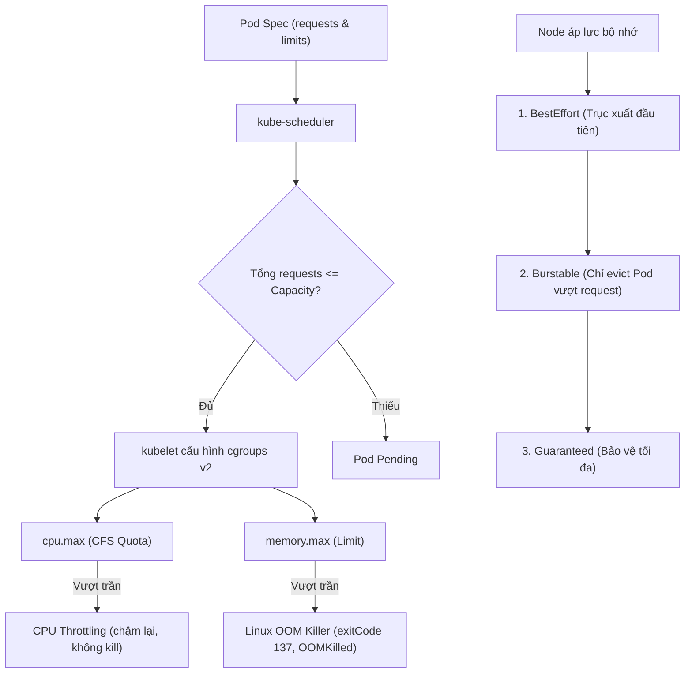

# 6_3_6 Resource Requests Limits and QoS

> **Khóa học**: Cloud DevOps Basic — Containers & Kubernetes  
> **Phân nhóm**: 6 Domain 6 - Containers and Kubernetes › 6_3 Kubernetes Architecture and Core Workloads  
> **Chủ đề**: 6_3_6 Resource Requests Limits and QoS  
> **Phiên bản áp dụng**: Kubernetes 1.37  
> **Trạng thái**: Định nghĩa (hoàn thiện lý thuyết & thực hành minh họa)  
> **Phạm vi**: [Topic README](./README.md#6_3_6-tài-nguyên-requests-limits-và-qos) · **Checkpoint**: [CHECKLIST](../../CHECKLIST.md#6_3-kubernetes-architecture-and-core-workloads)

---

## 1. Khái Niệm Cốt Lõi & Bản Chất Kỹ Thuật (Core Concepts & Technical Deep Dive)

Quản lý CPU và bộ nhớ container là nền tảng bảo đảm độ ổn định và mật độ vận hành của cụm Kubernetes. <!-- ev: R2.90 -->

### 1.1 Khái Niệm Requests, Limits & Quy Chuẩn Đo Lường Tài Nguyên

Tài nguyên container được định nghĩa qua `resources.requests` và `resources.limits`. <!-- ev: R2.90 -->
- **Requests (`resources.requests`)**: Mức tài nguyên tối thiểu. Container được cam kết bảo đảm bộ nhớ ít nhất bằng mức request. <!-- ev: R2.90 R2.100 -->
- **Limits (`resources.limits`)**: Trần tài nguyên tối đa. Container bị chặn không được vượt quá mức limit này. <!-- ev: R2.90 R2.100 -->

<!-- ev: R2.91 R2.92 R2.93 R2.94 -->
| Tài nguyên | Đơn vị chuẩn trong Kubernetes | Quy chuẩn biểu diễn & Độ mịn |
| :--- | :--- | :--- |
| **CPU** | 1 CPU = 1 physical core hoặc 1 vCPU | `0.1` tương đương `100m` (millicores). Kubernetes cấm độ mịn nhỏ hơn `1m` hoặc `0.001` CPU. |
| **Memory** | Bytes | Hậu tố thập phân (`k`, `M`, `G`, `T`) và nhị phân lũy thừa 2 (`Ki`, `Mi`, `Gi`, `Ti`). |

### 1.2 Cơ Chế Thực Thi: Scheduler vs Linux Kernel cgroups (Throttling vs OOMKilled)

Hai thông số `requests` và `limits` được xử lý ở hai tầng kiến trúc riêng biệt: <!-- ev: R1.71 R1.72 -->
- **Lập lịch (`kube-scheduler`)**: Dùng `requests` để tìm node. Scheduler bảo đảm tổng requests của các container đã xếp lịch không vượt quá dung lượng khả dụng của node. <!-- ev: R1.71 -->
- **Thực thi trên Node (Linux cgroups)**: `limits` do kubelet chuyển giao runtime cấu hình vào cgroups của Linux kernel (chi tiết cgroups v2 tại [6_1_3 Control Groups v2](../6_1%20Container%20Fundamentals/README.md#6_1_3-control-groups-v2-giới-hạn-dùng-bao-nhiêu)). <!-- ev: R1.72 -->
- **CPU Throttling**: CPU limit được thực thi bằng cơ chế throttling (`cpu.max`). Khi container tiệm cận cpu limit, kernel hạn chế quyền truy cập CPU tương ứng, làm chậm tiến trình mà không kill container. <!-- ev: R1.73 -->
- **Memory OOM Killer (exitCode 137)**: Memory limit được thực thi phản ứng bằng Out-Of-Memory (OOM) killer (`memory.max`). Khi cgroup vượt memory limit, Linux OOM subsystem kích hoạt và dừng tiến trình. Container bị kết liễu với exitCode 137 và trạng thái `OOMKilled`. Nếu tiến trình là PID 1, container bị restart. <!-- ev: R1.74 R1.75 R1.76 R2.99 -->

### 1.3 Phân Loại QoS Classes (Guaranteed, Burstable, BestEffort) & Thứ Tự Trục Xuất (Eviction)

Kubernetes tự động phân loại Pod vào ba lớp chất lượng dịch vụ (QoS): <!-- ev: R1.77 R2.95 -->
- **`Guaranteed`**: Mọi container trong Pod phải có CPU và memory request cùng limit lớn hơn 0, với memory limit bằng memory request và CPU limit bằng CPU request. <!-- ev: R1.79 R2.96 -->
- **`Burstable`**: Pod không thỏa Guaranteed và có ít nhất một container khai báo request hoặc limit về memory hoặc CPU. <!-- ev: R1.80 R2.97 -->
- **`BestEffort`**: Không thỏa Guaranteed lẫn Burstable (không container nào đặt CPU/memory request hay limit). <!-- ev: R1.81 R2.98 -->

<!-- ev: R1.77 R1.78 R2.95 -->
Khi node thiếu tài nguyên (node pressure), Kubernetes trục xuất Pod theo thứ tự: đầu tiên là `BestEffort`, tiếp theo là `Burstable`, cuối cùng mới đến `Guaranteed`. Khi xảy ra trục xuất do áp lực tài nguyên, chỉ những Pod tiêu thụ vượt quá request mới là đối tượng bị evict. <!-- ev: R1.77 R1.78 R2.95 -->

### 1.4 Quản Trị Cấp Namespace: LimitRange vs ResourceQuota

- **`LimitRange`**: Chính sách admission ràng buộc phân bổ tài nguyên tối thiểu (`min`), tối đa (`max`), hạn mức mặc định (`default`) và yêu cầu mặc định (`defaultRequest`) cho từng Pod/Container trong namespace. <!-- ev: R1.84 R2.101 -->
- **`ResourceQuota`**: Giới hạn tổng mức tiêu thụ tài nguyên gộp theo namespace dưới trường `spec.hard`. Đối với CPU và bộ nhớ, ResourceQuota bắt buộc mọi Pod mới trong namespace phải khai báo limit cho tài nguyên đó. <!-- ev: R1.85 R1.86 R2.102 -->

### 1.5 Bộ Nhớ JVM Trong Container: Heap và Non-Heap

- Cờ `UseContainerSupport` bật mặc định trên Linux, tự động nhận diện số processor và giới hạn memory container. <!-- ev: R1.82 -->
- Cờ `-XX:MaxRAMPercentage` cấu hình heap tối đa theo phần trăm container memory limit (mặc định 25%). <!-- ev: R1.83 R2.104 -->
- Cờ `-XX:InitialRAMPercentage` cấu hình heap khởi tạo theo phần trăm RAM (mặc định 1.5625%). <!-- ev: R2.103 -->
- Cgroup `memory.max` bao gồm toàn bộ tiến trình: Java Heap + Non-Heap (Metaspace, thread stacks, direct byte buffers, JIT cache, native memory). Cấu hình heap quá sát limit sẽ khiến container bị OOMKilled khi Non-Heap mở rộng. <!-- ev: R1.75 R1.76 R2.99 -->

---

## 2. Ví Dụ Đời Sống Thực Tế Dễ Hiểu (Intuitive Real-World Analogies)

Quản lý tài nguyên Kubernetes tương tự **Hạng vé máy bay và hạn mức chi tiêu**:

- **Requests = Cam kết đặt chỗ**: Phòng vé (`kube-scheduler`) kiểm tra máy bay còn đủ ghế cam kết hay không (`Pending` nếu hết chỗ).
- **Limits = Hạn mức tín dụng và bộ hãm tốc độ**:
  - Memory limit như hạn mức thẻ tín dụng: Tiêu quá hạn mức lập tức bị trục xuất (OOMKilled exit code 137).
  - CPU limit như bộ hãm tốc độ xe tải: Nhấn lún chân ga xe vẫn chỉ chạy ở tốc độ trần (CPU Throttling), không bị đuổi khỏi đường.
- **QoS Classes = Ba hạng vé**:
  - `Guaranteed` (Thương gia): Ghế và hành lý cố định (`request == limit`), bất khả xâm phạm khi máy bay quá tải.
  - `Burstable` (Phổ thông linh hoạt): Có ghế cơ bản, dùng thêm ghế trống; khi quá tải, ai dùng vượt cam kết sẽ bị mời thu gọn.
  - `BestEffort` (Vé đứng): Chờ may rủi, thiếu chỗ lập tức là nhóm đầu tiên bị mời xuống.
- **LimitRange vs ResourceQuota**: LimitRange là quy định cân nặng từng kiện vali; ResourceQuota là tổng tải trọng khoang hàng của cả đoàn.

---

## 3. Kiến Trúc, Luồng Hoạt Động & Hình Ảnh Trực Quan (Architecture, Diagrams & Visual Media)

<!-- ev: R1.71 R1.72 R1.73 R1.74 R1.75 R1.76 R1.77 R1.78 R2.90 R2.95 R2.99 -->
Luồng xử lý requests tại Scheduler, thực thi limits tại cgroups v2 và thứ tự trục xuất khi node áp lực tài nguyên: <!-- ev: R1.71 R1.72 -->

<!-- ev: R1.71 R1.72 R1.73 R1.74 R1.75 R1.76 R1.77 R1.78 R2.90 R2.95 R2.99 -->


---

## 4. Code Mẫu Trực Quan Hoặc Dòng Lệnh Thực Chiến (Runnable Sample Code / CLI)

> **Thông tin công cụ thực nghiệm**: `kind` v0.27+, `kubectl` v1.32+, Java 21 LTS <!-- ev: R2.91 -->  
> ⚠️ Chưa chạy thử (not executed by the squad)  
> *Các manifest và lệnh dưới đây minh họa chuẩn khai báo QoS, LimitRange, ResourceQuota và cấu hình JVM trong container.*

### 4.1 Khai Báo Manifest Ba Lớp QoS (Guaranteed, Burstable, BestEffort)

<!-- ev: R1.79 R1.80 R1.81 R2.90 R2.91 R2.92 R2.94 R2.96 R2.97 R2.98 -->
Manifest định nghĩa ba Pod đại diện cho ba lớp QoS:

```yaml
# pod-qos.yaml
apiVersion: v1
kind: Pod
metadata:
  name: pod-guaranteed
spec:
  containers:
  - name: app
    image: selflearn.invalid/hello-svc:1.0.0
    resources:
      requests: { cpu: "500m", memory: "256Mi" }
      limits:   { cpu: "500m", memory: "256Mi" }
---
apiVersion: v1
kind: Pod
metadata:
  name: pod-burstable
spec:
  containers:
  - name: app
    image: selflearn.invalid/hello-svc:1.0.0
    resources:
      requests: { cpu: "250m", memory: "128Mi" }
      limits:   { cpu: "1000m", memory: "512Mi" }
---
apiVersion: v1
kind: Pod
metadata:
  name: pod-besteffort
spec:
  containers:
  - name: app
    image: selflearn.invalid/hello-svc:1.0.0
```

### 4.2 Cấu Hình LimitRange & ResourceQuota Trong Namespace

<!-- ev: R1.84 R1.85 R1.86 R2.101 R2.102 -->
Quản trị viên cấu hình `LimitRange` cho từng container và `ResourceQuota` cho toàn namespace:

```yaml
# governance.yaml
apiVersion: v1
kind: LimitRange
metadata:
  name: app-limits
  namespace: staging
spec:
  limits:
  - type: Container
    default:        { cpu: "500m", memory: "256Mi" }
    defaultRequest: { cpu: "200m", memory: "128Mi" }
    max:            { cpu: "2000m", memory: "1Gi" }
    min:            { cpu: "50m", memory: "32Mi" }
---
apiVersion: v1
kind: ResourceQuota
metadata:
  name: app-quota
  namespace: staging
spec:
  hard:
    requests.cpu: "4000m"
    requests.memory: "4Gi"
    limits.cpu: "8000m"
    limits.memory: "8Gi"
    pods: "10"
```

### 4.3 Cấu Hình JVM Options Cho Container Java

<!-- ev: R1.82 R1.83 R2.103 R2.104 -->
Khai báo biến `JAVA_TOOL_OPTIONS` để điều chỉnh tỷ lệ heap, bảo lưu bộ nhớ cho non-heap:

```yaml
# pod-java.yaml
apiVersion: v1
kind: Pod
metadata:
  name: java-app
spec:
  containers:
  - name: app
    image: selflearn.invalid/hello-svc:1.0.0
    env:
    - name: JAVA_TOOL_OPTIONS
      value: "-XX:+UseContainerSupport -XX:InitialRAMPercentage=25.0 -XX:MaxRAMPercentage=75.0"
    resources:
      requests: { cpu: "500m", memory: "512Mi" }
      limits:   { cpu: "1000m", memory: "512Mi" }
```

### 4.4 Các Dòng Lệnh CLI Thanh Tra Tài Nguyên & Sự Kiện OOMKilled

<!-- ev: R1.76 R2.90 R2.95 R2.99 -->
Sử dụng `kubectl` để thanh tra QoS và lỗi OOMKilled (thực hành tại [lab-6_3_3-probes-resources-and-oomkilled](./README.md#lab-6_3_3-probes-resources-and-oomkilled)):

```bash
# 1. Liệt kê tên Pod và QoS class
kubectl get pods -o custom-columns=NAME:.metadata.name,QOS:.status.qosClass

# 2. Xem chi tiết resources và QoS của Pod
kubectl describe pod pod-guaranteed | grep -E "QoS Class|Limits|Requests" -A 4

# 3. Kiểm tra exitCode 137 và OOMKilled
kubectl get pod pod-oom -o jsonpath='{.status.containerStatuses[*].lastState.terminated}'

# 4. Kiểm tra mức sử dụng ResourceQuota
kubectl describe resourcequota app-quota -n staging
```

---

## 5. Cạm Bẫy Thực Tế & Thực Tiễn Sản Xuất (Production Gotchas & Best Practices)

### 5.1 Cạm Bẫy 1: OOMKilled Exit Code 137 Do Bỏ Quên Non-Heap Trong Ứng Dụng Java

<!-- ev: R1.75 R1.76 R1.83 R2.99 R2.104 -->
- **Hiện tượng**: Pod Java `limits.memory: 512Mi` đặt `-XX:MaxRAMPercentage=90.0` bị restart đột ngột với exitCode 137 và trạng thái `OOMKilled` dù heap mới dùng 400Mi. <!-- ev: R1.76 R2.99 -->
- **Bản chất kỹ thuật**: Cgroup `memory.max` đo toàn bộ bộ nhớ tiến trình (Heap + Metaspace + thread stacks + direct buffers + native memory). Cấu hình 90% heap khiến 10% còn lại không đủ cho non-heap, làm cgroup tràn trần và kernel kích hoạt OOM killer. <!-- ev: R1.75 R1.76 R1.83 R2.99 R2.104 -->
- **Khuyến nghị**: Đặt `-XX:MaxRAMPercentage` ở mức `70% - 75%`, bảo lưu 25% - 30% cho non-heap và hệ điều hành. <!-- ev: R1.83 R2.104 -->

### 5.2 Cạm Bẫy 2: CPU Throttling Gây Tăng Vọt Độ Trễ Dịch Vụ (Latency Spikes)

<!-- ev: R1.73 R2.91 R2.92 -->
- **Hiện tượng**: Dịch vụ API có p99 latency tăng đột biến lên hàng giây dù CPU utilization trung bình trên node vẫn thấp. <!-- ev: R1.73 -->
- **Bản chất kỹ thuật**: Cấu hình `limits.cpu` quá thấp khiến Linux CFS bóp nghẽn chu kỳ (throttling) khi ứng dụng đa luồng dùng hết quota sớm trong chu kỳ, làm chậm tiến trình mà không gây crash. <!-- ev: R1.73 R2.92 -->
- **Khuyến nghị**: Đặt `requests.cpu` theo tải trung bình, tránh đặt `limits.cpu` quá thấp hoặc để burst tự nhiên nếu chính sách cho phép. <!-- ev: R1.73 R2.92 -->

### 5.3 Cạm Bẫy 3: Namespace Có ResourceQuota Nhưng Thiếu LimitRange Làm Chặn Tạo Pod

<!-- ev: R1.84 R1.85 R1.86 R2.101 R2.102 -->
- **Hiện tượng**: Áp dụng `ResourceQuota` vào namespace khiến các Pod mới bị API server từ chối ngay tại admission. <!-- ev: R1.85 R1.86 -->
- **Bản chất kỹ thuật**: Khi ResourceQuota có giới hạn CPU/memory, Kubernetes bắt buộc mọi Pod mới phải khai báo limit cho tài nguyên đó; manifest thiếu `limits` sẽ bị từ chối. <!-- ev: R1.86 -->
- **Khuyến nghị**: Luôn tạo kèm `LimitRange` có `default` và `defaultRequest` trong namespace để tự động gán giá trị mặc định cho Pod. <!-- ev: R1.84 R1.86 R2.101 -->

---

## 6. Câu Hỏi Củng Cố Kiến Thức (Active Recall Quiz)

### Câu Hỏi 1: Phân Biệt Sự Khác Biệt Giữa Vượt Quá CPU Limit Và Memory Limit?

Vì sao một bên dẫn đến `OOMKilled` (exit code 137) còn một bên chỉ gây `CPU Throttling`?

<details>
<summary>Đáp án</summary>

1. **CPU là tài nguyên nén được (Compressible)**: Khi chạm trần CPU limit, Linux CFS áp dụng CPU Throttling, hạn chế chu kỳ CPU khiến tiến trình chạy chậm lại mà không mất dữ liệu hay dừng tiến trình.
2. **Memory là tài nguyên không nén được (Incompressible)**: RAM đã cấp phát không thể tự thu hồi. Khi cgroup vượt trần `memory.max`, kernel OOM killer gửi `SIGKILL` dừng tiến trình để bảo vệ node; container kết thúc với exitCode 137 và trạng thái `OOMKilled`.
</details>

### Câu Hỏi 2: Điều Kiện Đạt Chuẩn QoS Guaranteed Và Thứ Tự Trục Xuất Khi Node Cạn Tài Nguyên?

Trình bày điều kiện để Pod đạt chuẩn QoS Guaranteed và thứ tự trục xuất Pod của kubelet khi node gặp áp lực tài nguyên.

<details>
<summary>Đáp án</summary>

1. **Điều kiện Guaranteed**: Mọi container trong Pod phải có memory request và limit lớn hơn 0 với `memory.limit == memory.request`, đồng thời có CPU request và limit lớn hơn 0 với `cpu.limit == cpu.request`.
2. **Thứ tự trục xuất (Eviction)**:
   - **Đầu tiên**: Lớp **`BestEffort`** (không có request/limit).
   - **Thứ hai**: Lớp **`Burstable`** đang tiêu thụ tài nguyên vượt quá mức `request` đã cam kết.
   - **Sau cùng**: Lớp **`Guaranteed`** (được bảo vệ tối đa).
</details>

### Câu Hỏi 3: Pod Java Spring Boot Có `limits.memory: 1Gi`, Đặt `-XX:MaxRAMPercentage=90.0` Bị OOMKilled Dù Heap Mới Dùng 800Mi. Nguyên Nhân Do Đâu?

Phân tích nguyên nhân tầng cgroup và đề xuất phương án khắc phục.

<details>
<summary>Đáp án</summary>

1. **Nguyên nhân**: Linux cgroup `memory.max` quản lý toàn bộ bộ nhớ của tiến trình (gồm Java Heap và Non-Heap: Metaspace, thread stacks, direct buffers, native memory). Cấu hình 90% heap khiến 10% còn lại (~100Mi) không đủ cho non-heap, làm tổng bộ nhớ vượt trần 1Gi và bị kernel OOM killer kết liễu với exitCode 137.
2. **Khắc phục**: Đặt `-XX:MaxRAMPercentage` ở mức `70.0% - 75.0%` của limit (700Mi - 750Mi Heap), bảo lưu 25% - 30% cho Non-Heap và hệ điều hành.
</details>

---

## 7. 📚 Nguồn Tài Liệu Chính Thống (Tier-1 Official References)

- [Kubernetes Documentation — Resource Management for Pods and Containers](https://kubernetes.io/docs/concepts/configuration/manage-resources-containers/) — Khai báo `requests`, `limits`, đơn vị CPU/Memory và nguyên lý của kube-scheduler.
- [Kubernetes Documentation — Configure Quality of Service for Pods](https://kubernetes.io/docs/concepts/workloads/pods/pod-qos/) — Ba lớp QoS (Guaranteed, Burstable, BestEffort) và chính sách trục xuất Pod.
- [Kubernetes Tasks — Assign Memory Resources to Containers and Pods](https://kubernetes.io/docs/tasks/configure-pod-container/assign-memory-resource/) — Cấu hình bộ nhớ, kiểm soát vượt ngưỡng memory limit và phân tích exitCode 137 OOMKilled.
- [Kubernetes Documentation — Limit Ranges](https://kubernetes.io/docs/concepts/policy/limit-range/) — Chính sách giới hạn tài nguyên tối thiểu, tối đa và mặc định trong namespace.
- [Kubernetes Documentation — Resource Quotas](https://kubernetes.io/docs/concepts/policy/resource-quotas/) — Hạn mức tài nguyên gộp cấp namespace và ràng buộc khai báo limits.
- [Oracle Java SE 21 Documentation — Java Tools Reference: java Command (Linux Container Support)](https://docs.oracle.com/en/java/javase/21/docs/specs/man/java.html) — Tùy chọn JVM cho container Linux gồm `UseContainerSupport`, `-XX:MaxRAMPercentage` và `-XX:InitialRAMPercentage`.
