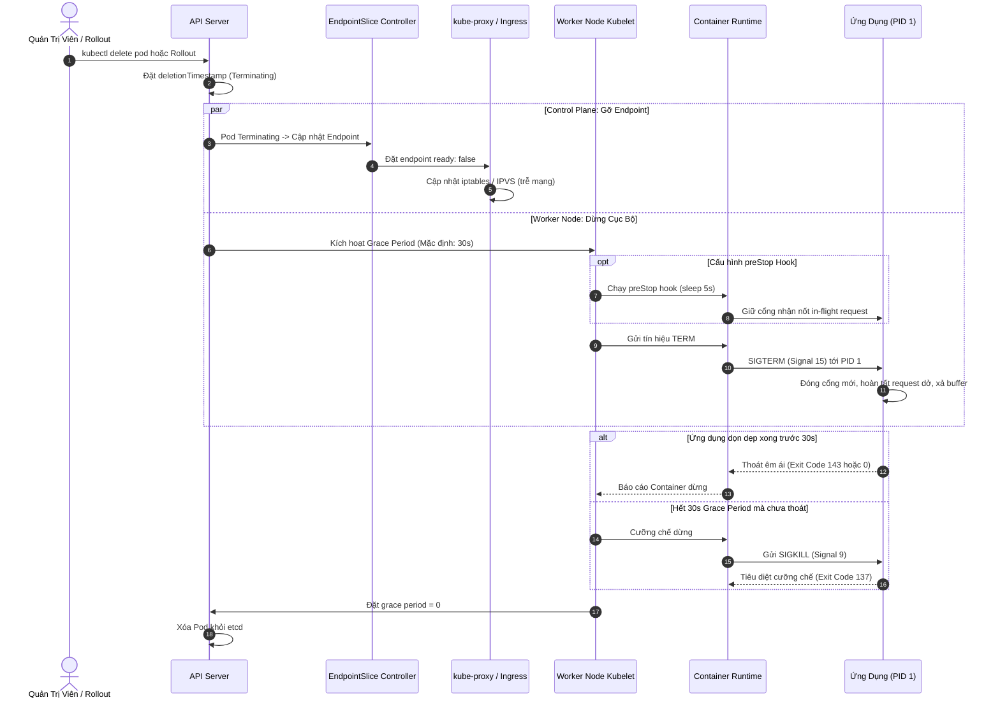

# 6_3_7 Graceful Shutdown During Rolling Updates

> **Khóa học**: Cloud DevOps Basic — Containers & Kubernetes  
> **Phân nhóm**: 6 Domain 6 - Containers and Kubernetes › 6_3 Kubernetes Architecture and Core Workloads  
> **Chủ đề**: 6_3_7 Graceful Shutdown During Rolling Updates  
> **Phiên bản áp dụng**: Kubernetes 1.37  
> **Trạng thái**: Định nghĩa (hoàn thiện lý thuyết & thực hành minh họa)  
> **Phạm vi**: [Topic README](./README.md#6_3_7-tắt-gọn-graceful-shutdown-khi-rolling-update) · **Checkpoint**: [CHECKLIST](../../CHECKLIST.md#6_3-kubernetes-architecture-and-core-workloads)

---

## 1. Khái Niệm Cốt Lõi & Bản Chất Kỹ Thuật (Core Concepts & Technical Deep Dive)

Trong cụm Kubernetes, Pod đại diện cho các tiến trình chạy trên worker node; quy trình tắt mềm (graceful termination) cho phép tiến trình dọn dẹp kết nối, hoàn tất request dở dang thay vì bị ngắt đột ngột bằng tín hiệu KILL. <!-- ev: R1.87 --> Khi thực hiện Rolling Update theo [lab-6_3_2-rolling-update-and-rollback](./README.md#lab-6_3_2-rolling-update-and-rollback), tắt Pod an toàn bảo đảm zero-downtime cho hệ thống. <!-- ev: R1.87 -->

### 1.1 Trình Tự Vòng Đời Tắt Pod (Pod Termination Lifecycle)

Khi Pod bị xóa (`kubectl delete pod` hoặc do Deployment scale down ReplicaSet cũ), quy trình tắt diễn ra qua các bước: <!-- ev: R1.89 R2.106 -->

<!-- ev: R1.88 R1.89 R1.90 R1.91 R1.92 R1.93 R1.94 R1.95 R1.96 R2.105 R2.106 R2.107 R2.108 R2.109 R2.110 R2.112 R2.114 R2.115 -->
- **Bước 1 — Đánh dấu Terminating**: API server gán `deletionTimestamp` cho Pod và đếm lùi `terminationGracePeriodSeconds` (mặc định 30 giây). Pod chuyển sang phase `Terminating`. <!-- ev: R1.88 R2.105 -->
- **Bước 2 — Hai luồng xử lý chạy song song**: <!-- ev: R1.89 R1.93 R2.106 -->
  - *Luồng Control Plane*: Đồng thời với lúc kubelet bắt đầu tắt Pod, control plane đánh giá và gỡ bỏ Pod đang tắt khỏi các đối tượng `EndpointSlice` của Service. Các terminating endpoints luôn mang `ready: false` để load balancer ngừng gửi traffic mới. <!-- ev: R1.93 R1.94 R2.106 -->
  - *Luồng Worker Node (Kubelet)*: Ngay khi thấy Pod được đánh dấu là terminating, kubelet trên node lập tức kích hoạt quy trình tắt cục bộ của Pod. <!-- ev: R1.89 -->
- **Bước 3 — Thực thi `preStop` hook**: Nếu container có `preStop` hook và `terminationGracePeriodSeconds` khác 0, kubelet chạy hook này trong container trước khi gửi tín hiệu dừng tới app. Hook `preStop` chạy đồng bộ và phải hoàn tất trước khi phát tín hiệu dừng. Kỹ sư dùng `preStop: exec` chạy shell command để dọn dẹp. <!-- ev: R1.90 R2.107 R2.112 R2.114 R2.115 -->
- **Bước 4 — Gửi tín hiệu dừng mềm `SIGTERM`**: Sau khi `preStop` xong (hoặc nếu không có hook), kubelet kích hoạt container runtime gửi tín hiệu `TERM` (`SIGTERM`) tới tiến trình PID 1 trong container. App nhận `SIGTERM`, ngừng nhận kết nối mới và xử lý nốt request dở dang. <!-- ev: R1.92 R2.108 -->
- **Bước 5 — Cưỡng chế bằng `SIGKILL` khi hết hạn**: Khi hết thời gian ân hạn, nếu còn tiến trình nào chạy trong Pod, container runtime gửi tín hiệu `SIGKILL` tới mọi tiến trình còn sót lại. <!-- ev: R1.95 R2.109 -->
- **Bước 6 — Xóa khỏi API Server**: Kubelet kích hoạt xóa đối tượng Pod khỏi API server bằng cách đặt grace period về 0 (xóa ngay lập tức). Pod được xóa khỏi etcd. <!-- ev: R1.96 -->

### 1.2 Cơ Chế Đặc Thù Của `preStop` Hook

- **Hook bị treo (Hanging hook)**: Nếu `preStop` hook bị treo, Pod giữ phase `Terminating` tới khi hết `terminationGracePeriodSeconds` rồi bị cưỡng chế tắt bởi `SIGKILL`. <!-- ev: R2.113 -->
- **Gia hạn 2 giây (Grace period extension)**: Nếu `preStop` hook vẫn còn chạy khi grace period đã hết hạn, kubelet yêu cầu thêm một khoảng gia hạn nhỏ duy nhất 2 giây. <!-- ev: R1.91 R2.110 -->
- **Điều chỉnh grace period**: Nếu `preStop` đòi hỏi nhiều thời gian hơn mức mặc định, bắt buộc phải tăng `terminationGracePeriodSeconds` trong Pod spec. <!-- ev: R2.111 -->

### 1.3 Bản Chất Tín Hiệu Linux & Mã Thoát (Exit Code 143 vs 137)

Trong Linux kernel (xem [Linux Module 4: Signals & IPC](../../../linux/README.md#module-4-linux-signals--inter-process-communication-ipc)), tín hiệu tuân theo chuẩn POSIX: <!-- ev: R1.97 R2.116 -->
- **`SIGTERM` (Signal 15)**: Tín hiệu dừng mềm chuẩn, ứng dụng có thể bắt (`catch`) để giải phóng tài nguyên. <!-- ev: R1.97 R2.116 -->
- **`SIGKILL` (Signal 9)**: Tín hiệu cưỡng chế từ kernel, không thể bắt, chặn hay bỏ qua (`cannot be caught, blocked, or ignored`). <!-- ev: R1.97 R2.117 -->

<!-- ev: R1.97 R1.98 R2.116 R2.117 R2.118 -->
Khi lệnh bị hủy bởi fatal signal $N$, Bash và Linux tính mã thoát theo công thức `128 + N`: <!-- ev: R1.98 R2.118 -->
- **Exit code 143** (`128 + 15`): Tắt mềm chuẩn mực. Tiến trình hoàn tất dọn dẹp hoặc bị ngắt theo signal 15. <!-- ev: R1.97 R1.98 R2.116 R2.118 -->
- **Exit code 137** (`128 + 9`): Bị cưỡng chế hủy diệt. Hết thời gian grace period chưa thoát, hoặc do Linux OOM Killer. <!-- ev: R1.95 R1.97 R1.98 R2.109 R2.117 R2.118 -->

### 1.4 Race Condition Khi Rolling Update & Giải Pháp `preStop` Sleep

- **Nguyên nhân lỗi 502/Connection Refused**: Kubelet gửi `SIGTERM` gần như tức thì. Nếu app đóng socket nghe ngay, nó sẽ từ chối kết nối mới. Nhưng việc gỡ IP khỏi EndpointSlice và cập nhật iptables/kube-proxy/Ingress cần độ trễ mạng. Các request đang bay tới IP cũ bị từ chối kết nối. <!-- ev: R1.92 R1.93 R2.106 R2.108 -->
- **Giải pháp `preStop` sleep**: Thêm hook `preStop: exec: command: ["/bin/sh", "-c", "sleep 5"]` (hoặc 5-10s). Hook giữ chân kubelet không gửi `SIGTERM` vội, giúp app nhận nốt request đang bay trong khi router hoàn tất gỡ IP khỏi EndpointSlice. <!-- ev: R2.112 R2.114 R2.115 -->

---

## 2. Ví Dụ Đời Sống Thực Tế Dễ Hiểu (Intuitive Real-World Analogies)

### Phép So Sánh: Quy Trình Đóng Cửa Nhà Hàng Để Sửa Chữa

Hãy tưởng tượng một nhà hàng chuẩn bị đóng cửa sửa chữa (như Pod cũ được thay thế trong Rolling Update):

1. **Gỡ biển ngoài phố (`EndpointSlice` đặt `ready: false`)**: Ban quản lý tháo bảng hiệu. Mất vài giây để người trên phố nhận biết; nếu dập cầu dao ngay, khách vừa thấy biển bước vào sẽ bị đóng sầm cửa vào mặt (lỗi `Connection Refused` / `502 Bad Gateway`).
2. **Bảo vệ giữ cửa (`preStop` Hook `sleep 5s`)**: Bảo vệ đứng cửa 5 giây đón nốt khách đã bước vào cổng, trong khi chờ biển hiệu ngoài phố được tháo dỡ hoàn toàn.
3. **Bếp trưởng dọn dẹp (`SIGTERM` tới PID 1)**: Bếp trưởng nhận lệnh tắt bếp. Bếp ngừng nhận món mới, nấu nốt món đang dở, rửa nồi và khóa gas an toàn (Graceful Shutdown).
4. **Hạn chót 30 giây (`terminationGracePeriodSeconds: 30s`)**: Tòa nhà cho 30 giây để dọn dẹp. Dọn xong và khóa cửa trước 30 giây thì ra về an toàn (Exit code **`143`**).
5. **Cưỡng chế cắt điện (`SIGKILL`)**: Sau 30 giây chưa ra ngoài, đội bảo vệ ập vào cắt cầu dao điện và trục xuất tức khắc (Exit code **`137`**).

---

## 3. Kiến Trúc, Luồng Hoạt Động & Hình Ảnh Trực Quan (Architecture, Diagrams & Visual Media)

<!-- ev: R1.88 R1.89 R1.90 R1.91 R1.92 R1.93 R1.94 R1.95 R1.96 R2.105 R2.106 R2.107 R2.108 R2.109 R2.110 R2.112 R2.114 R2.115 R2.116 R2.117 R2.118 -->


---

## 4. Code Mẫu Trực Quan Hoặc Dòng Lệnh Thực Chiến (Runnable Sample Code / CLI)

> **Môi trường & Công cụ kiểm thử**:
> - Kubernetes: v1.37+
> - kubectl: v1.37+
> - OS Node: Linux Kernel 6.x (POSIX Signals)
>
> ⚠️ Chưa chạy thử (not executed by the squad)

### 4.1 Khai Báo Deployment Với `preStop` Và Tăng Thời Gian Grace Period

Cấu hình phối hợp `preStop` sleep 5s và nâng `terminationGracePeriodSeconds` lên 45s: <!-- ev: R1.88 R1.90 R2.107 R2.111 R2.114 R2.115 -->

<!-- ev: R1.88 R1.90 R2.107 R2.111 R2.114 R2.115 -->
```yaml
apiVersion: apps/v1
kind: Deployment
metadata:
  name: web-api
  namespace: production
spec:
  replicas: 3
  selector:
    matchLabels:
      app: web-api
  template:
    metadata:
      labels:
        app: web-api
    spec:
      terminationGracePeriodSeconds: 45 # 5s preStop + 35s dọn dẹp app (mặc định 30s)
      containers:
        - name: server
          image: web-api:1.2.0
          ports:
            - containerPort: 8080
          lifecycle:
            preStop:
              exec:
                command: ["/bin/sh", "-c", "sleep 5"] # Chờ gỡ IP
```

### 4.2 Các Lệnh `kubectl` Thanh Tra Quá Trình Tắt Và Mã Thoát

Thanh tra trạng thái EndpointSlice và exit code của container: <!-- ev: R1.89 R1.94 R1.98 R2.118 -->

<!-- ev: R1.89 R1.94 R1.98 R2.118 -->
```bash
# 1. Kích hoạt rolling update và theo dõi Pod tắt
kubectl set image deployment/web-api server=web-api:1.3.0 -n production
kubectl get pods -n production -w

# 2. Quan sát EndpointSlice đặt ready: false cho Pod đang tắt
kubectl get endpointslices -l kubernetes.io/service-name=web-api -n production -o wide

# 3. Thanh tra mã thoát của container sau khi dừng
kubectl get pods -n production -o jsonpath='{range .items[*]}{.metadata.name}{"\t"}{.status.containerStatuses[*].state.terminated.exitCode}{"\n"}{end}'

# 4. Kiểm tra công thức mã thoát Bash POSIX (128 + N)
echo "Exit code SIGTERM: $((128 + 15))"  # In ra: 143
echo "Exit code SIGKILL: $((128 + 9))"   # In ra: 137
```

---

## 5. Cạm Bẫy Thực Tế & Thực Tiễn Sản Xuất (Production Gotchas & Best Practices)

### 5.1 Cạm Bẫy 1: Race Condition Giữa EndpointSlice Và SIGTERM Làm Rơi Request (502 Bad Gateway)

<!-- ev: R1.88 R1.92 R1.93 R2.105 R2.106 R2.108 R2.114 R2.115 -->
- **Hiện tượng**: Khi rolling update, client gặp lỗi `502 Bad Gateway` hoặc `Connection Refused` chập chờn dù Pod mới đã sẵn sàng. <!-- ev: R1.93 R2.106 -->
- **Bản chất kỹ thuật**: Mặc định `terminationGracePeriodSeconds` là 30 giây <!-- ev: R1.88 R2.105 -->. Việc gỡ EndpointSlice diễn ra đồng thời với việc kubelet bắt đầu shutdown Pod <!-- ev: R1.93 R2.106 -->. Không có `preStop`, kubelet gửi ngay `SIGTERM` tới PID 1 <!-- ev: R1.92 R2.108 -->. Nếu app đóng listening socket ngay khi iptables/kube-proxy chưa kịp gỡ IP, request gửi tới IP cũ bị từ chối kết nối. <!-- ev: R1.93 R2.106 -->
- **Thực tiễn**: Thêm `preStop: exec: command: ["/bin/sh", "-c", "sleep 5"]` vào container để hoãn gửi SIGTERM cho tới khi routing gỡ xong. <!-- ev: R2.114 R2.115 -->

### 5.2 Cạm Bẫy 2: Tiến Trình Ứng Dụng Không Nhận SIGTERM Do Shell Script Làm PID 1 (Exit Code 137)

<!-- ev: R1.92 R1.95 R1.98 R2.108 R2.109 R2.117 R2.118 -->
- **Hiện tượng**: App Java có shutdown hook nhưng luôn treo 30 giây rồi chết với mã thoát `137` (`SIGKILL`) thay vì `143`, mất dữ liệu bộ đệm. <!-- ev: R1.95 R1.98 R2.109 R2.118 -->
- **Bản chất kỹ thuật**: Kubelet chỉ gửi `SIGTERM` tới PID 1 của container <!-- ev: R1.92 R2.108 -->. Nếu Dockerfile dùng shell wrapper (`ENTRYPOINT ./run.sh`) mà không dùng `exec`, shell là PID 1 và không forward signal tới app Java (xem [6_1_8 Vòng Đời Container, PID 1 và Tín Hiệu](../6_1%20Container%20Fundamentals/README.md#6_1_8-vòng-đời-container-pid-1-và-tín-hiệu)). Hết 30s grace period, runtime gửi `SIGKILL` tiêu diệt cưỡng chế với exit code 137. <!-- ev: R1.95 R1.98 R2.109 R2.117 R2.118 -->
- **Thực tiễn**: Luôn dùng JSON exec array (`ENTRYPOINT ["java", "-jar", "app.jar"]`) theo chuẩn tại [lab-6_2_1-java-multistage-image](../6_2%20Container%20Image%20Engineering/labs/lab-6_2_1-java-multistage-image/README.md) hoặc thêm từ khóa `exec` trước lệnh gọi tiến trình. <!-- ev: R1.92 R2.108 -->

### 5.3 Cạm Bẫy 3: PreStop Hook Treo Hoặc Grace Period Ngắn Hơn Thời Gian Dọn Dẹp

<!-- ev: R1.88 R1.91 R1.95 R2.105 R2.110 R2.111 R2.112 R2.113 -->
- **Hiện tượng**: Pod kẹt ở `Terminating` rồi bị kill đột ngột, làm hỏng giao dịch cơ sở dữ liệu dở dang. <!-- ev: R2.113 -->
- **Bản chất kỹ thuật**: `preStop` chạy đồng bộ; nếu hook bị treo, Pod giữ phase `Terminating` tới khi hết grace period <!-- ev: R2.112 R2.113 -->. Kubelet chỉ gia hạn một lần duy nhất 2 giây nếu hook còn chạy dở <!-- ev: R1.91 R2.110 -->, sau đó runtime gửi `SIGKILL` <!-- ev: R1.95 -->. Nếu dọn dẹp cần 40s mà `terminationGracePeriodSeconds` để mặc định 30s <!-- ev: R1.88 R2.105 -->, app bị kill giữa chừng. <!-- ev: R1.95 -->
- **Thực tiễn**: Khi dọn dẹp nặng, phải tăng `terminationGracePeriodSeconds` lớn hơn tổng thời gian của `preStop` cộng với thời gian dọn dẹp của app <!-- ev: R2.111 -->.

---

## 6. Câu Hỏi Củng Cố Kiến Thức (Active Recall Quiz)

### Câu Hỏi 1: Trình Bày Hai Luồng Xử Lý Chạy Song Song Khi Pod Bị Đánh Dấu Terminating?

Khi xóa Pod, Control Plane và Worker Node Kubelet thực hiện những hành động gì song song?

<details>
<summary>Đáp án</summary>

1. **Control Plane**: Đánh giá và gỡ Pod khỏi `EndpointSlice`, gán nhãn `ready: false` để load balancer ngừng gửi lưu lượng mới.
2. **Kubelet trên Node**: Đếm ngược `terminationGracePeriodSeconds` (mặc định 30s), chạy `preStop` hook (nếu có), rồi gửi `SIGTERM` tới tiến trình PID 1.
3. **Bản chất**: Hai luồng chạy độc lập và bất đồng bộ; cần preStop sleep để tránh rơi rớt gói tin trong thời gian lan truyền mạng.
</details>

### Câu Hỏi 2: Tại Sao Cần PreStop Sleep Để Tránh Lỗi 502 Khi Rolling Update?

Vì sao ứng dụng đã bắt tín hiệu SIGTERM vẫn có thể làm rơi rớt request của người dùng?

<details>
<summary>Đáp án</summary>

1. **Nguyên nhân**: Kubelet gửi `SIGTERM` tức thì. Nếu app đóng socket ngay, kết nối đang bay bị từ chối do iptables/kube-proxy chưa kịp gỡ IP khỏi bảng routing.
2. **Khắc phục**: Dùng `preStop: exec: command: ["/bin/sh", "-c", "sleep 5"]` để hoãn `SIGTERM`, giữ app phục vụ nốt request đang bay trong khi mạng cập nhật.
</details>

### Câu Hỏi 3: Phân Biệt Ý Nghĩa Của Mã Thoát 143 Và 137 Khi Tắt Pod?

Công thức tính mã thoát trong Linux là gì và sự khác biệt giữa hai mã thoát này là gì?

<details>
<summary>Đáp án</summary>

1. **Công thức**: Mã thoát của tín hiệu chí tử $N$ là `128 + N`.
2. **Phân biệt**:
   - **Mã thoát 143** (`128 + 15`): Tắt theo `SIGTERM` (15), thể hiện quy trình tắt mềm có kiểm soát.
   - **Mã thoát 137** (`128 + 9`): Bị kernel tiêu diệt bằng `SIGKILL` (9) do hết thời gian `terminationGracePeriodSeconds` mà chưa thoát, hoặc do Linux OOM Killer.
</details>

---

## 7. 📚 Nguồn Tài Liệu Chính Thống (Tier-1 Official References)

- [Kubernetes Documentation — Pod Termination](https://kubernetes.io/docs/concepts/workloads/pods/pod-termination/) — Quy trình tắt Pod, `terminationGracePeriodSeconds` và EndpointSlice.
- [Kubernetes Documentation — Container Lifecycle Hooks](https://kubernetes.io/docs/concepts/containers/container-lifecycle-hooks/) — Cơ chế đồng bộ của `preStop` hook và quy tắc gia hạn 2 giây.
- [Kubernetes Tasks — Attach Handlers to Container Lifecycle Events](https://kubernetes.io/docs/tasks/configure-pod-container/attach-handler-lifecycle-event/) — Khai báo `preStop` handler tắt êm ái ứng dụng.
- [Linux Manual Pages — signal(7) Overview of Signals](https://man7.org/linux/man-pages/man7/signal.7.html) — Chuẩn POSIX về tín hiệu Linux, số hiệu `SIGKILL` (9) và `SIGTERM` (15).
- [Linux Manual Pages — bash(1) Reference Manual (Exit Status)](https://man7.org/linux/man-pages/man1/bash.1.html) — Mã thoát lệnh Linux Bash khi bị ngắt bởi tín hiệu chí tử (`128 + N`).
