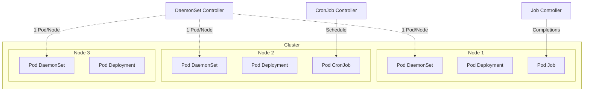
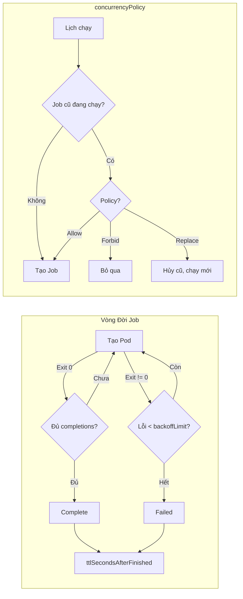

# 6_3_8 DaemonSets Jobs and CronJobs

> **Khóa học**: Cloud DevOps Basic — Containers and Kubernetes  
> **Phân nhóm**: 6 Domain 6 - Containers and Kubernetes › 6_3 Kubernetes Architecture and Core Workloads  
> **Chủ đề**: 6_3_8 DaemonSets Jobs and CronJobs  
> **Phiên bản áp dụng**: Kubernetes 1.37  
> **Trạng thái**: Định nghĩa (hoàn thiện lý thuyết & thực hành minh họa)  
> **Phạm vi**: [Topic README](./README.md#6_3_8-các-loại-workload-khác) · **Checkpoint**: [CHECKLIST](../../CHECKLIST.md#6_3-kubernetes-architecture-and-core-workloads)  
> **Lab thực hành liên quan**: [lab-6_3_4-jobs-and-cronjobs](./README.md#lab-6_3_4-jobs-and-cronjobs)  

---

## 1. Khái Niệm Cốt Lõi & Bản Chất Kỹ Thuật (Core Concepts & Technical Deep Dive)

Deployment phù hợp quản lý workload phi trạng thái (stateless) nơi mọi Pod có thể thay thế lẫn nhau tương đương. <!-- ev: R1.113 --> Kubernetes cung cấp các workload chuyên biệt: DaemonSet, Job, CronJob và StatefulSet. <!-- ev: R1.99 R1.103 R1.107 R1.114 -->

### 1.1 DaemonSet: Pod Cấp Hạ Tầng Node

DaemonSet đảm bảo tất cả (hoặc một số) Node đều chạy chính xác một bản sao của Pod. <!-- ev: R1.99 -->
- **Vòng đời**: Khi thêm node mới, Pod DaemonSet được bổ sung; khi node bị loại bỏ, Pod tương ứng được thu gom rác (garbage collected). Xóa DaemonSet sẽ dọn dẹp các Pod do nó tạo ra. <!-- ev: R1.100 -->
- **Tolerations**: DaemonSet controller tự động gắn sẵn các toleration (như `node.kubernetes.io/unschedulable:NoSchedule`) để chạy Pod trên cả node chưa sẵn sàng. <!-- ev: R1.101 -->
- **Ứng dụng**: Cluster storage daemon, logs collection daemon (Fluentd), node monitoring daemon (node-exporter, CNI) trên mỗi node. <!-- ev: R1.102 -->
- **Manifest**: Dùng `apiVersion: apps/v1` và `kind: DaemonSet`, `spec` định nghĩa selector và pod template cấp node. <!-- ev: R2.119 R2.120 -->

### 1.2 Job: Tác Vụ Chạy Một Lần Đến Khi Hoàn Tất (Run-to-Completion)

Job đại diện cho các tác vụ một lần (one-off tasks) chạy đến khi hoàn tất rồi dừng hẳn. <!-- ev: R1.103 -->
- **Hoàn thành**: Job theo dõi số lần hoàn thành thành công; khi đạt đủ completions chỉ định, tác vụ hoàn tất. Xóa Job sẽ dọn dẹp các Pod do nó tạo ra. <!-- ev: R1.104 -->
- **Manifest**: Khai báo `apiVersion: batch/v1` và `kind: Job`. <!-- ev: R2.121 -->
- **Tham số cốt lõi**:
  - `completions` & `parallelism`: Với non-parallel Job, `spec.completions` và `spec.parallelism` để trống đều nhận mặc định là 1. <!-- ev: R1.105 R2.122 --> Với fixed completion Job, `spec.completions` là số Pod thành công cần đạt; `spec.parallelism` quy định số Pod chạy song song (để trống mặc định 1). <!-- ev: R2.123 -->
  - `spec.backoffLimit`: Số lần thử lại tối đa trước khi coi Job thất bại (mặc định 6). <!-- ev: R1.106 R2.124 -->
  - `spec.ttlSecondsAfterFinished`: Tự động dọn dẹp xóa Pod và Job sau một khoảng thời gian kết thúc (giây). <!-- ev: R2.125 -->

### 1.3 CronJob: Lập Lịch Định Kỳ Theo Thời Gian (Scheduled Batch)

CronJob tạo các Job theo lịch lặp lại như một dòng trong crontab trên Unix (dùng cho backup dữ liệu, report generation). <!-- ev: R1.107 --> CronJob tạo đối tượng Job xấp xỉ một lần tại mỗi mốc thời gian của lịch biểu. <!-- ev: R1.108 -->
- **Manifest**: Dùng `apiVersion: batch/v1` và `kind: CronJob`, trường bắt buộc `spec.schedule` theo cú pháp Cron. <!-- ev: R2.126 R2.127 -->
- **Chính sách kiểm soát đồng thời (`spec.concurrencyPolicy`)**: <!-- ev: R1.109 R2.128 -->
  - `Allow` (mặc định): Cho phép các Job chạy đồng thời ngay cả khi Job cũ chưa kết thúc. <!-- ev: R1.109 R2.128 -->
  - `Forbid`: Cấm chạy đồng thời; nếu đến lịch mới mà Job trước chưa xong, CronJob bỏ qua lần chạy mới. <!-- ev: R1.110 R2.129 -->
  - `Replace`: Hủy và thay thế Job đang chạy bằng lần chạy Job mới khi đến lịch. <!-- ev: R1.111 R2.130 -->
- **Lịch sử & Hạn chót**:
  - `spec.successfulJobsHistoryLimit`: Số Job thành công được lưu giữ lại (mặc định 3). <!-- ev: R1.112 R2.131 -->
  - `spec.failedJobsHistoryLimit`: Số Job thất bại được lưu giữ lại (mặc định 1). <!-- ev: R2.132 -->
  - `spec.startingDeadlineSeconds`: Hạn chót (giây) cho phép Job bắt đầu nếu bị trễ lịch trình. <!-- ev: R2.133 -->

### 1.4 Giới Thiệu Khái Quát Về StatefulSet

StatefulSet phù hợp để chạy các Pod có lưu vết trạng thái và gắn kết chặt chẽ mỗi Pod với một PersistentVolume bền vững. <!-- ev: R1.114 --> Khác với Deployment có Pod vô danh hoán đổi được <!-- ev: R1.113 -->, StatefulSet cấp định danh mạng tuần tự (`pod-0`, `pod-1`) và ổ đĩa riêng biệt. Kiến trúc chuyên sâu về StatefulSet được học tại [6_4_7 StatefulSet và Workload Có Trạng Thái](../6_4%20Kubernetes%20Networking%20Configuration%20and%20Storage/README.md#6_4_7-statefulset-và-workload-có-trạng-thái). <!-- ev: R1.114 -->

### 1.5 Bảng Tổng Hợp Tiêu Chí Lựa Chọn Workload Controller

<!-- ev: R1.99 R1.102 R1.103 R1.107 R1.113 R1.114 -->
| Workload | Kind & API | Vòng đời Pod & Mục đích | Ứng dụng thực tế điển hình |
| :--- | :--- | :--- | :--- |
| **Deployment** | `Deployment` (`apps/v1`) | Chạy liên tục, phi trạng thái; Pod hoán đổi được. | REST API, Microservices. |
| **DaemonSet** | `DaemonSet` (`apps/v1`) | Đúng một bản sao Pod trên các node của cụm. | Logs agent (Fluentd), node monitoring, CNI. |
| **Job** | `Job` (`batch/v1`) | Chạy một lần đến khi hoàn tất (run-to-completion). | Database migration, batch calculation. |
| **CronJob** | `CronJob` (`batch/v1`) | Tạo Job định kỳ theo lịch biểu Cron. | Backup DB hàng đêm, dọn dẹp định kỳ. |
| **StatefulSet** | `StatefulSet` (`apps/v1`) | Pod lưu vết trạng thái, gắn chặt PersistentVolume. | DB phân tán (PostgreSQL HA, Kafka). |

---

## 2. Ví Dụ Đời Sống Thực Tế Dễ Hiểu (Intuitive Real-World Analogies)

Cụm Kubernetes tương tự **bảng phân công lao động trong chuỗi doanh nghiệp**:

1. **DaemonSet như Bảo Vệ Chi Nhánh**: Mỗi chi nhánh (Node) có đúng một bảo vệ trực chiến. Mở chi nhánh mới thì bảo vệ tới; giải thể thì bảo vệ rút. Bảo vệ ghi nhật ký khách vào ra (**log collection**), đo điện nước (**node monitoring**) và giữ đường mạng (**CNI**).
2. **Job như Hợp Đồng Giao Khoán Trọn Gói**: Hợp đồng yêu cầu xong đủ 3 chuyến (`completions: 3`), chạy tối đa 2 xe cùng lúc (`parallelism: 2`), hỏng xe được thay tối đa 6 lần (`backoffLimit: 6`). Đủ 3 chuyến thì thanh lý (`Complete`), sau 2 giờ giải tán bãi (`ttlSecondsAfterFinished: 7200`).
3. **CronJob như Bấm Giờ Lương Định Kỳ**: Đúng 23:00 Chủ Nhật (`schedule: "0 23 * * 0"`), kế toán kích hoạt tính lương (tạo Job):
   - `Allow`: Lần trước chưa xong, tuần này vẫn mở thêm tiến trình tính tiếp.
   - `Forbid`: Lần trước chưa xong, bỏ qua lần này để tránh tính trùng lương.
   - `Replace`: Hủy tiến trình treo cũ và chạy bản tính mới nhất.
4. **StatefulSet như Thủ Thư Có Mã Số Cố Định**: Mỗi thủ thư có mã bất biến (Thủ thư #0, #1, #2) gắn liền két sắt riêng (**PersistentVolume**). Khi đổi ca, người mới vẫn ngồi đúng bàn #0 và mở đúng két sắt #0.

---

## 3. Kiến Trúc, Luồng Hoạt Động & Hình Ảnh Trực Quan (Architecture, Diagrams & Visual Media)

### 3.1 Sơ Đồ Phân Bổ Workload



### 3.2 Vòng Đời Job & Chính Sách Đồng Thời CronJob



---

## 4. Code Mẫu Trực Quan Hoặc Dòng Lệnh Thực Chiến (Runnable Sample Code / CLI)

> **Môi trường thực nghiệm**: Kubernetes 1.37, `kubectl` 1.37, Linux x86_64.  
> Thực hành trực tiếp tại: [lab-6_3_4-jobs-and-cronjobs](./README.md#lab-6_3_4-jobs-and-cronjobs).

### 4.1 Manifest DaemonSet: Thu Thập Log Cấp Node

> ⚠️ Chưa chạy thử (not executed by the squad)

<!-- ev: R1.99 R1.100 R1.101 R1.102 R2.119 R2.120 -->
```yaml
apiVersion: apps/v1
kind: DaemonSet
metadata:
  name: fluentd-elasticsearch
  namespace: kube-system
spec:
  selector:
    matchLabels: { name: fluentd-elasticsearch }
  template:
    metadata:
      labels: { name: fluentd-elasticsearch }
    spec:
      tolerations:
      - key: node-role.kubernetes.io/control-plane
        operator: Exists
        effect: NoSchedule
      containers:
      - name: fluentd
        image: selflearn.invalid/fluentd:v1.0.0
        resources:
          limits: { memory: 200Mi, cpu: 100m }
          requests: { memory: 100Mi, cpu: 50m }
        volumeMounts:
        - name: varlog
          mountPath: /var/log
      volumes:
      - name: varlog
        hostPath: { path: /var/log }
```

### 4.2 Manifest Job: Xử Lý Lô Dữ Liệu Run-to-Completion

> ⚠️ Chưa chạy thử (not executed by the squad)

<!-- ev: R1.103 R1.104 R1.105 R1.106 R2.121 R2.122 R2.123 R2.124 R2.125 -->
```yaml
apiVersion: batch/v1
kind: Job
metadata:
  name: batch-processor
  namespace: default
spec:
  completions: 3
  parallelism: 2
  backoffLimit: 4
  ttlSecondsAfterFinished: 120
  template:
    metadata:
      labels: { app: batch-worker }
    spec:
      restartPolicy: OnFailure
      containers:
      - name: worker
        image: selflearn.invalid/busybox:1.36
        command: ["sh", "-c", "echo OK; exit 0"]
        resources:
          requests: { cpu: 50m, memory: 32Mi }
          limits: { cpu: 100m, memory: 64Mi }
```

### 4.3 Manifest CronJob: Sao Lưu Cơ Sở Dữ Liệu Định Kỳ

> ⚠️ Chưa chạy thử (not executed by the squad)

<!-- ev: R1.107 R1.108 R1.109 R1.110 R1.112 R2.126 R2.127 R2.128 R2.129 R2.131 R2.132 R2.133 -->
```yaml
apiVersion: batch/v1
kind: CronJob
metadata:
  name: db-backup-cron
  namespace: default
spec:
  schedule: "*/15 * * * *"
  concurrencyPolicy: Forbid
  successfulJobsHistoryLimit: 3
  failedJobsHistoryLimit: 1
  startingDeadlineSeconds: 200
  jobTemplate:
    spec:
      backoffLimit: 2
      template:
        spec:
          restartPolicy: OnFailure
          containers:
          - name: backup
            image: selflearn.invalid/busybox:1.36
            command: ["sh", "-c", "echo OK; exit 0"]
            resources:
              requests: { cpu: 50m, memory: 32Mi }
              limits: { cpu: 100m, memory: 64Mi }
```

### 4.4 Các Dòng Lệnh CLI Thực Chiến Quản Trị & Thanh Tra Workload

<!-- ev: R1.100 R1.104 R1.108 R2.119 R2.121 R2.126 -->
Sử dụng bộ lệnh `kubectl` để thanh tra DaemonSet, Job và CronJob (thực hành tại [lab-6_3_4-jobs-and-cronjobs](./README.md#lab-6_3_4-jobs-and-cronjobs)):

```bash
# 1. Liệt kê DaemonSet, Job và CronJob
kubectl get ds,job,cronjob
kubectl describe job batch-processor

# 2. Kích hoạt thủ công một lượt chạy Job từ CronJob
kubectl create job --from=cronjob/db-backup-cron manual-backup-01

# 3. Dọn dẹp tài nguyên (xóa controller sẽ dọn dẹp các Pod liên quan)
kubectl delete job batch-processor && kubectl delete cronjob db-backup-cron
```

---

## 5. Cạm Bẫy Thực Tế & Thực Tiễn Sản Xuất (Production Gotchas & Best Practices)

### 5.1 Cạm Bẫy 1: CronJob Chồng Chéo Do Dùng Mặc Định `concurrencyPolicy: Allow`

<!-- ev: R1.109 R1.110 R2.128 R2.129 -->
- **Hiện tượng**: CronJob backup chạy mỗi 5 phút (`*/5 * * * *`). Khi DB lớn, mỗi lần mất 15 phút, sinh 6 Job song song gây nghẽn I/O và khóa DB. <!-- ev: R1.109 R2.128 -->
- **Bản chất**: Mặc định `concurrencyPolicy` là `Allow`, cho phép các Job chạy đồng thời không giới hạn. <!-- ev: R1.109 R2.128 -->
- **Khuyến nghị**: Luôn đặt `concurrencyPolicy: Forbid` để CronJob bỏ qua lần chạy mới nếu lần trước chưa hoàn tất. <!-- ev: R1.110 R2.129 -->

### 5.2 Cạm Bẫy 2: Job Thất Bại Tích Tụ Làm Phình To etcd Do Thiếu `ttlSecondsAfterFinished`

<!-- ev: R1.104 R1.106 R2.124 R2.125 -->
- **Hiện tượng**: Job lỗi container, thử lại hết 6 lần `backoffLimit` rồi `Failed`. Sau nhiều tuần, hàng nghìn Pod/Job cũ tích tụ trong etcd. <!-- ev: R1.104 R1.106 R2.124 -->
- **Bản chất**: Job không tự xóa khi hoàn tất hoặc thất bại nếu thiếu cơ chế dọn rác tự động. <!-- ev: R1.104 R2.125 -->
- **Khuyến nghị**: Khai báo `spec.ttlSecondsAfterFinished` (ví dụ `3600` cho 1 giờ) trên mọi Job để tự động dọn dẹp. <!-- ev: R2.125 -->

### 5.3 Cạm Bẫy 3: DaemonSet Bị Bỏ Sót Node Do Taints Của Control-Plane

<!-- ev: R1.99 R1.101 -->
- **Hiện tượng**: DaemonSet log agent không có Pod trên node control plane hoặc GPU node. <!-- ev: R1.99 -->
- **Bản chất**: Node control plane có taint `node-role.kubernetes.io/control-plane:NoSchedule`, chặn Pod nếu thiếu toleration phù hợp. <!-- ev: R1.101 -->
- **Khuyến nghị**: Bổ sung `tolerations` tương ứng trong Pod template của DaemonSet nếu cần chạy trên mọi node. <!-- ev: R1.101 -->

---

## 6. Câu Hỏi Củng Cố Kiến Thức (Active Recall Quiz)

### Câu Hỏi 1: Phân Biệt Vòng Đời Container Giữa Deployment Và Job Khi Kết Thúc Với Mã Thoát 0?

Khi tiến trình kết thúc thành công (`exit 0`), Deployment và Job phản ứng thế nào? Trường hợp nào nên chọn Job?

<details>
<summary>Đáp án</summary>

- **Deployment**: Duy trì dịch vụ chạy liên tục; khi container thoát (`exit 0` hay lỗi), controller coi là sự cố và tự động tạo lại Pod mới để giữ đủ replica.
- **Job**: Thiết kế cho tác vụ chạy một lần (run-to-completion); khi container thoát với `exit 0`, Job ghi nhận một lần hoàn thành (`completion`), tăng biến đếm và dừng Pod.
- **Ứng dụng**: Chọn Job cho DB schema migration, batch script, sao lưu dữ liệu.
</details>

### Câu Hỏi 2: So Sánh 3 Chính Sách `concurrencyPolicy` Trong CronJob (`Allow`, `Forbid`, `Replace`)?

Hành vi của CronJob khi Job trước chưa xong nhưng đã đến lịch chạy tiếp theo dưới 3 chính sách? Kịch bản nào cần `Forbid`?

<details>
<summary>Đáp án</summary>

- **`Allow` (mặc định)**: Tạo Job mới chạy song song với Job cũ đang chạy.
- **`Forbid`**: Bỏ qua (skip) hoàn toàn lượt chạy mới nếu Job trước chưa hoàn tất.
- **`Replace`**: Hủy Job cũ đang chạy và khởi động lượt chạy mới thay thế.
- **Ứng dụng `Forbid`**: Dùng cho sao lưu DB hoặc tính toán tài chính định kỳ để tránh xung đột khóa và nghẽn tài nguyên.
</details>

### Câu Hỏi 3: Cơ Chế Quản Trị Node Của DaemonSet Hoạt Động Ra Sao Khi Cụm Co Giãn? Khi Xóa DaemonSet Thì Pod Được Xử Lý Thế Nào?

DaemonSet quản lý Pod ra sao khi thêm/bớt node? Khi xóa đối tượng DaemonSet thì các Pod liên quan ra sao?

<details>
<summary>Đáp án</summary>

- **Thêm node (Scale out)**: DaemonSet controller tự động tạo chính xác một bản sao Pod trên node mới.
- **Bớt node (Scale in)**: Pod trên node bị gỡ bỏ sẽ được hệ thống thu gom rác (garbage collected).
- **Xóa DaemonSet**: Tự động dọn dẹp sạch toàn bộ các Pod do DaemonSet đó tạo ra trên khắp các node.
</details>

---

## 7. 📚 Nguồn Tài Liệu Chính Thống (Tier-1 Official References)

- [Kubernetes Documentation — DaemonSet](https://kubernetes.io/docs/concepts/workloads/controllers/daemonset/) — Cơ chế chạy Pod trên mỗi node và tolerations của DaemonSet.
- [Kubernetes Documentation — Jobs](https://kubernetes.io/docs/concepts/workloads/controllers/job/) — Quản trị tác vụ run-to-completion, `completions`, `backoffLimit` và `ttlSecondsAfterFinished`.
- [Kubernetes Documentation — CronJob](https://kubernetes.io/docs/concepts/workloads/controllers/cron-jobs/) — Quản trị tác vụ định kỳ theo biểu thức Cron và chính sách `concurrencyPolicy`.
- [Kubernetes Documentation — Workload Management Overview](https://kubernetes.io/docs/concepts/workloads/) — Phân loại ứng dụng phi trạng thái (Deployment) và lưu vết trạng thái (StatefulSet).
- [Kubernetes Documentation — StatefulSets](https://kubernetes.io/docs/concepts/workloads/controllers/statefulset/) — Cơ chế gắn PersistentVolume của StatefulSet (học sâu tại 6_4_7).
