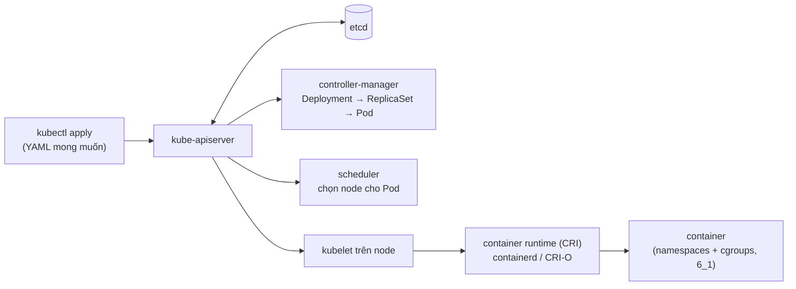

# 6_3 Kubernetes Architecture and Core Workloads

> **Khóa học**: Cloud DevOps Basic — Containers & Kubernetes
> **Phân nhóm**: 6 Domain 6 - Containers and Kubernetes › 6_3 Kubernetes Architecture and Core Workloads
> **Chủ đề**: Kiến trúc cluster, mô hình khai báo, `kubectl`, Pod, Deployment, probe, requests/limits, rolling update và rollback
> **Trạng thái**: Định nghĩa (nội dung cần học + đề bài lab + checkpoint), chưa chạy thử, 15-11-2026
> **Lộ trình tổng**: [container/README.md](../../README.md) · **Checkpoint**: [CHECKLIST.md](../../CHECKLIST.md#6_3-kubernetes-architecture-and-core-workloads)

---

## 🎯 Mục Tiêu

Hiểu Kubernetes là **một vòng lặp điều hòa (reconcile loop)**: bạn khai báo trạng thái mong muốn qua API, các controller liên tục kéo trạng thái thực tế về đúng như vậy. Sau topic này bạn deploy được `hello-svc`, nâng version không downtime, rollback, và giải thích vì sao Pod bị restart hoặc bị kill.

---

## 📚 Những Gì Cần Học

### 6_3_1 Kiến Trúc Cluster
- [ ] Control plane: `kube-apiserver` (cửa vào duy nhất), `etcd` (lưu trạng thái), `kube-scheduler`, `kube-controller-manager`, `cloud-controller-manager` (chỉ có khi chạy trên cloud).
- [ ] Node: `kubelet`, container runtime qua **CRI**, `kube-proxy` (hoặc CNI thay thế nó), CNI plugin.
- [ ] Mô hình **khai báo (declarative)** và controller pattern: desired state (`spec`) vs observed state (`status`).
- [ ] Managed Kubernetes (EKS, AKS, GKE) vs tự dựng (`kubeadm`) vs cluster cục bộ (`kind`, `minikube`, `k3d`): ai quản lý control plane.
- [ ] Chính sách phiên bản: 3 minor version mới nhất được hỗ trợ, phát hành khoảng 3 lần/năm.

### 6_3_2 `kubectl` và Đối Tượng API
- [ ] Cấu trúc object: `apiVersion`, `kind`, `metadata` (name, namespace, labels, annotations), `spec`, `status`.
- [ ] kubeconfig: cluster, user, context; `kubectl config get-contexts / use-context`.
- [ ] `apply` (khai báo) vs `create`/`run` (mệnh lệnh); `kubectl diff`; `--dry-run=client -o yaml` để sinh YAML mẫu.
- [ ] `kubectl explain deployment.spec.strategy --recursive`; `get -o wide/yaml/jsonpath`, `-l` (label selector), `-A`.
- [ ] Namespace: phạm vi đặt tên, nơi gắn RBAC/quota; object nào không thuộc namespace (Node, PV, ClusterRole...).
- [ ] Labels/selectors là "chất keo" nối Deployment → Pod → Service; nhãn khuyến nghị `app.kubernetes.io/*`.

### 6_3_3 Pod
- [ ] Pod = đơn vị nhỏ nhất, 1+ container dùng chung network namespace (cùng IP, gọi nhau qua `localhost`) và volume.
- [ ] Init container (chạy tuần tự trước app) và **sidecar container** native (init container có `restartPolicy: Always`).
- [ ] Pod phase (`Pending`, `Running`, `Succeeded`, `Failed`, `Unknown`) vs trạng thái container (`Waiting` + reason, `Running`, `Terminated` + exit code).
- [ ] `restartPolicy` và back-off tăng dần → nguồn gốc của `CrashLoopBackOff`.
- [ ] Pod là "gia súc" (cattle): không sửa tay, không tạo Pod trần cho ứng dụng thật.

### 6_3_4 ReplicaSet và Deployment
- [ ] Deployment quản lý ReplicaSet, ReplicaSet giữ đúng số Pod; mỗi lần đổi `spec.template` sinh ReplicaSet mới.
- [ ] Chiến lược `RollingUpdate` (`maxSurge`, `maxUnavailable`) vs `Recreate`.
- [ ] `kubectl rollout status / history / undo / pause / resume / restart`; `revisionHistoryLimit`; annotation `kubernetes.io/change-cause`.
- [ ] `minReadySeconds`, `progressDeadlineSeconds` và condition `Progressing=False` khi rollout bị kẹt.
- [ ] Vì sao `image: app:latest` + `imagePullPolicy` gây deploy "không đổi gì" → deploy bằng tag bất biến hoặc digest (liên hệ 6_2_7).

### 6_3_5 Probes
- [ ] **readinessProbe**: fail → Pod bị gỡ khỏi Service endpoints (không bị restart).
- [ ] **livenessProbe**: fail → kubelet restart container.
- [ ] **startupProbe**: tắt liveness/readiness tới khi app khởi động xong (app Java khởi động chậm).
- [ ] Kiểu probe: `httpGet`, `tcpSocket`, `exec`, `grpc`; tham số `initialDelaySeconds`, `periodSeconds`, `timeoutSeconds`, `failureThreshold`.
- [ ] Sai lầm kinh điển: liveness kiểm tra cả database → DB chậm làm restart toàn bộ app (cascading failure).

### 6_3_6 Tài Nguyên: Requests, Limits và QoS
- [ ] `requests` dùng để **xếp lịch (scheduling)**; `limits` được kubelet/runtime ghi thành file cgroup (`memory.max`, `cpu.max`, liên hệ 6_1_3).
- [ ] Vượt memory limit → `OOMKilled`, exit code 137; vượt CPU limit → bị **throttle**, không bị kill.
- [ ] QoS class: `Guaranteed`, `Burstable`, `BestEffort`, và thứ tự bị evict khi node thiếu bộ nhớ.
- [ ] JVM trong container: heap theo `-XX:MaxRAMPercentage`, phần non-heap (metaspace, thread stack, direct buffer) cũng tính vào limit.
- [ ] `LimitRange` (giá trị mặc định/tối đa mỗi container) và `ResourceQuota` (tổng mỗi namespace).

### 6_3_7 Tắt Gọn (Graceful Shutdown) Khi Rolling Update
- [ ] Trình tự: Pod bị đánh dấu Terminating → gỡ khỏi endpoints **song song với** `preStop` → `SIGTERM` → chờ `terminationGracePeriodSeconds` (mặc định 30s) → `SIGKILL`.
- [ ] Race condition: request vẫn tới Pod đang tắt → dùng `preStop` sleep ngắn + app xử lý `SIGTERM` (liên hệ lab 6_2_1).
- [ ] Exit code 143 (`SIGTERM`, tắt gọn) vs 137 (bị `SIGKILL`).

### 6_3_8 Các Loại Workload Khác
- [ ] **DaemonSet**: một Pod trên mỗi node (agent log, node-exporter, CNI).
- [ ] **Job** (`completions`, `parallelism`, `backoffLimit`, `ttlSecondsAfterFinished`) và **CronJob** (`schedule`, `concurrencyPolicy`).
- [ ] **StatefulSet**: giới thiệu, học sâu ở 6_4_7.
- [ ] Bảng chọn workload: stateless API → Deployment; agent mỗi node → DaemonSet; tác vụ một lần → Job; DB/Kafka → StatefulSet (hoặc Operator).

---

## 🧪 Labs

> Các lab dưới đây là **bản định nghĩa** (đề bài + checkpoint). Chưa tạo thư mục `labs/`, chưa chạy thử. Lệnh là gợi ý, output phải tự quan sát khi chạy thật.
> Chuẩn bị chung: build image bằng [build-images.sh](../../shared/scripts/build-images.sh), tạo cluster `kind create cluster --name lab`, nạp image bằng [kind-load.sh](../../shared/scripts/kind-load.sh).

| Lab | Nội dung | Thời gian | Trạng thái |
| :--- | :--- | :---: | :--- |
| lab-6_3_1-kind-cluster-and-first-deployment | Dựng kind, deploy `hello-svc`, quan sát controller tự hồi phục | 45 phút | Định nghĩa |
| lab-6_3_2-rolling-update-and-rollback | Nâng 1.0.0 → 2.0.0 không downtime, tag sai, rollback | 60 phút | Định nghĩa |
| lab-6_3_3-probes-resources-and-oomkilled | Probe sai, OOMKilled, CPU throttle, QoS class | 60 phút | Định nghĩa |
| lab-6_3_4-jobs-and-cronjobs | Job thành công/thất bại, CronJob và chính sách đồng thời | 30 phút | Định nghĩa |

### lab-6_3_1-kind-cluster-and-first-deployment
- **Mục tiêu**: Thấy tận mắt chuỗi Deployment → ReplicaSet → Pod và vòng reconcile.
- **Các bước chính**:
  1. `kind create cluster --name lab`; liệt kê Pod hệ thống trong `kube-system`, gọi tên từng thành phần control plane.
  2. Viết `deployment.yaml` (3 replica, image `selflearn.invalid/hello-svc:1.0.0`, `imagePullPolicy: Never` hoặc `IfNotPresent` vì image nạp tay) và `service.yaml` (ClusterIP, port 80 → 8080).
  3. `kubectl apply -f .`, rồi `kubectl get deploy,rs,pod -l app=hello-svc -o wide`.
  4. Xóa 1 Pod → quan sát Pod mới được tạo; `kubectl scale --replicas=5`.
  5. `kubectl port-forward svc/hello-svc 8080:80` và `curl` nhiều lần để thấy hostname khác nhau.
- **Checkpoint**:
  - [ ] Giải thích được `ownerReferences` của Pod trỏ tới ReplicaSet nào (`kubectl get pod 
 -o yaml`).
  - [ ] Pod bị xóa được thay thế mà không cần làm gì thêm.
  - [ ] Viết lại được manifest từ trí nhớ (dùng `kubectl explain` thay vì copy).

### lab-6_3_2-rolling-update-and-rollback
- **Mục tiêu**: Rolling update không làm rơi request, rollback khi bản mới hỏng.
- **Các bước chính**:
  1. Thêm `readinessProbe` (`/ready`) và đặt `STARTUP_DELAY_MS=10000` để rollout chậm, dễ quan sát.
  2. Mở một terminal chạy vòng lặp `curl` liên tục qua port-forward hoặc Pod debug; terminal khác `kubectl set image ... hello-svc=selflearn.invalid/hello-svc:2.0.0` và `kubectl rollout status`.
  3. Thử `maxSurge: 0, maxUnavailable: 1` rồi `maxSurge: 1, maxUnavailable: 0`, so sánh.
  4. Đặt image tag không tồn tại (`:9.9.9`) → quan sát `ErrImagePull`/`ImagePullBackOff`, rollout đứng lại, Pod cũ vẫn phục vụ.
  5. `kubectl rollout history`, `kubectl rollout undo --to-revision=<n>`.
- **Checkpoint**:
  - [ ] Vòng lặp `curl` không có lỗi trong lúc nâng version (khi readiness đúng).
  - [ ] Giải thích được vì sao tag sai **không** gây downtime (Pod cũ chỉ bị gỡ khi Pod mới Ready).
  - [ ] Rollback về revision cụ thể và chỉ ra ReplicaSet nào được scale lên lại.

### lab-6_3_3-probes-resources-and-oomkilled
- **Mục tiêu**: Phân biệt restart do liveness, OOMKilled và CPU throttling.
- **Các bước chính**:
  1. Liveness trỏ sai đường dẫn (`/healthz`) → đếm `RESTARTS`, đọc `kubectl describe` phần Events.
  2. `resources.limits.memory: 256Mi` + `ALLOCATE_MB_ON_START=400` → `OOMKilled`, xem `lastState.terminated.exitCode`.
  3. Đặt `limits.cpu: 100m`, gửi tải, đọc `cpu.stat` (`nr_throttled`) trong container hoặc qua `kubectl debug` (liên hệ 6_1_3).
  4. Tạo 3 Pod khác nhau để ra 3 QoS class; kiểm tra `kubectl get pod -o jsonpath='{.status.qosClass}'`.
  5. Thêm `startupProbe` để liveness không giết app khởi động chậm.
- **Checkpoint**:
  - [ ] Từ output `describe`, nói đúng nguyên nhân restart trong < 1 phút cho từng trường hợp.
  - [ ] Giải thích được vì sao heap 75% của 256Mi vẫn có thể OOMKilled.

### lab-6_3_4-jobs-and-cronjobs
- **Mục tiêu**: Biết khi nào dùng Job/CronJob (ví dụ: migrate DB, dọn dữ liệu định kỳ).
- **Các bước chính**: Job `busybox` chạy `exit 0` và `exit 1` với `backoffLimit: 2`; CronJob mỗi phút với `concurrencyPolicy: Forbid` và tác vụ dài 90 giây.
- **Checkpoint**:
  - [ ] Đọc được condition `Complete`/`Failed` của Job; giải thích tại sao CronJob bỏ qua lượt chạy.

---

## 📚 Nguồn Tài Liệu Chính Thống (Official References)
- [Kubernetes Components](https://kubernetes.io/docs/concepts/overview/components/) - Các thành phần control plane và node.
- [Pods](https://kubernetes.io/docs/concepts/workloads/pods/) và [Pod Lifecycle](https://kubernetes.io/docs/concepts/workloads/pods/pod-lifecycle/) - Phase, trạng thái container, restart policy, quá trình tắt Pod.
- [Sidecar Containers](https://kubernetes.io/docs/concepts/workloads/pods/sidecar-containers/) - Sidecar native.
- [Deployments](https://kubernetes.io/docs/concepts/workloads/controllers/deployment/) - Rolling update, rollback, `maxSurge`/`maxUnavailable`.
- [Configure Liveness, Readiness and Startup Probes](https://kubernetes.io/docs/tasks/configure-pod-container/configure-liveness-readiness-startup-probes/) - Cấu hình probe.
- [Resource Management for Pods and Containers](https://kubernetes.io/docs/concepts/configuration/manage-resources-containers/) - Requests/limits.
- [Pod Quality of Service Classes](https://kubernetes.io/docs/concepts/workloads/pods/pod-qos/) - QoS class.
- [Jobs](https://kubernetes.io/docs/concepts/workloads/controllers/job/) và [CronJob](https://kubernetes.io/docs/concepts/workloads/controllers/cron-jobs/) - Workload chạy một lần/định kỳ.
- [kubectl Quick Reference](https://kubernetes.io/docs/reference/kubectl/quick-reference/) - Lệnh `kubectl` thường dùng.
- [Kubernetes Version Skew Policy](https://kubernetes.io/releases/version-skew-policy/) - Chính sách phiên bản.
