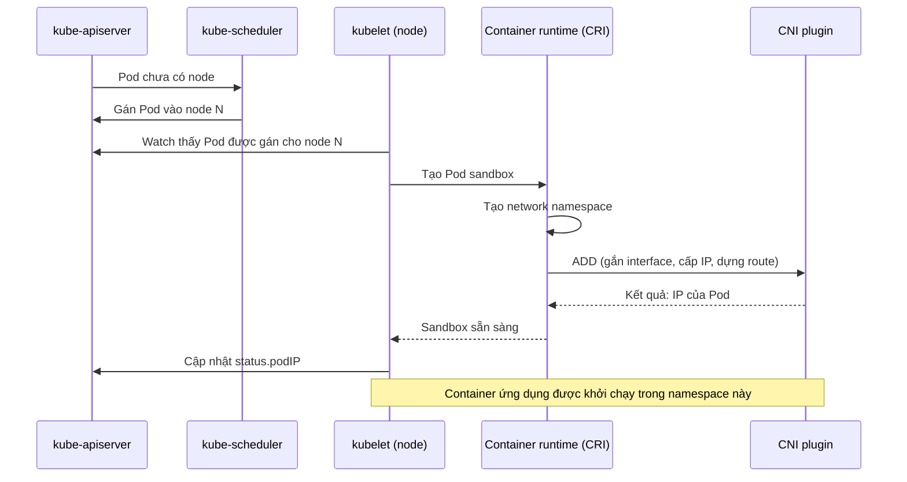
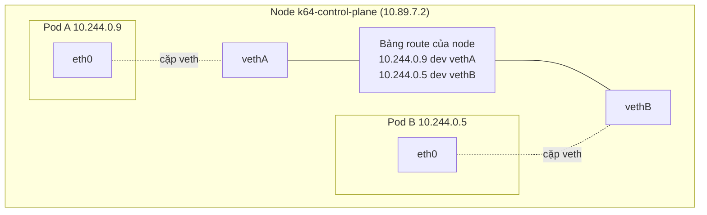
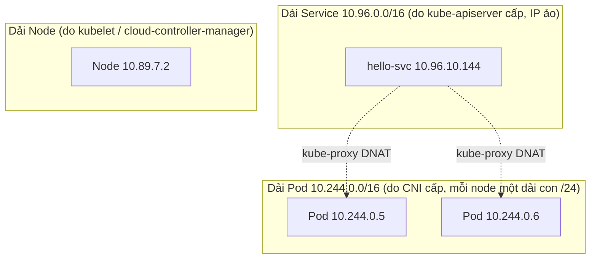

# 6_4_1 Kubernetes Network Model and CNI

> **Khóa học**: Cloud DevOps Basic — Containers and Kubernetes  
> **Phân nhóm**: 6 Domain 6 - Containers and Kubernetes › 6_4 Kubernetes Networking Configuration and Storage  
> **Chủ đề**: 6_4_1 Mô hình mạng Kubernetes, IP của Pod và vai trò của CNI plugin  
> **Phiên bản áp dụng**: Kubernetes 1.37 (kind v0.33.0, node image `kindest/node:v1.37.0`)  
> **Trạng thái**: Verified một phần (17-11-2026): lệnh quan sát trên cluster kind một node đã chạy thật; phần định tuyến **giữa nhiều node** chỉ đối chiếu tài liệu, chưa chạy thử  
> **Phạm vi**: [Topic README](./README.md#6_4_1-mô-hình-mạng-kubernetes) · **Checkpoint**: [CHECKLIST](../../CHECKLIST.md#6_4-kubernetes-networking-configuration-and-storage)  
> **Kiến thức liên quan**: [6_1_9 Container Networking Basics](<../6_1 Container Fundamentals/6_1_9 Container Networking Basics.md>) · [6_3_3 Pods](<../6_3 Kubernetes Architecture and Core Workloads/6_3_3 Pods.md>) · [6_4_2 Services and EndpointSlices](<./6_4_2 Services and EndpointSlices.md>)

---

## 1. Khái Niệm Cốt Lõi & Bản Chất Kỹ Thuật (Core Concepts & Technical Deep Dive)

### 1.1 Bốn Bài Toán Mạng Mà Kubernetes Phải Giải

Tài liệu Cluster Networking chia mạng Kubernetes thành 4 bài toán riêng biệt:

| # | Bài toán | Ai giải |
| :--- | :--- | :--- |
| 1 | Container ↔ container **trong cùng Pod** | Pod chia sẻ network namespace → gọi nhau qua `localhost` |
| 2 | **Pod ↔ Pod** | Pod network (CNI plugin), là trọng tâm của bài này |
| 3 | Pod → **Service** | Service + service proxy (xem [6_4_2](<./6_4_2 Services and EndpointSlices.md>)) |
| 4 | **Bên ngoài** → Service | Service `NodePort`/`LoadBalancer`, Ingress/Gateway API (xem [6_4_4](<./6_4_4 Ingress and Gateway API.md>)) |

### 1.2 Mô Hình Mạng: Những Điều Kubernetes Đòi Hỏi

Theo tài liệu "Services, Load Balancing, and Networking", mô hình mạng gồm các yêu cầu sau:

1. **Mỗi Pod có một địa chỉ IP duy nhất trong toàn cluster.**
2. Mọi container trong cùng Pod **dùng chung network namespace** (chung IP, chung bảng cổng) nên gọi nhau qua `localhost`.
3. **Mọi Pod nói chuyện được với mọi Pod khác** (cùng node hay khác node), **trực tiếp, không qua proxy và không qua NAT** (trừ khi bạn cố ý phân đoạn mạng bằng NetworkPolicy). Trên Windows, quy tắc này không áp dụng cho Pod dùng host network.
4. Agent trên node (kubelet, system daemon) nói chuyện được với mọi Pod trên node đó.

Hệ quả thực tế: Pod đối xử như một "máy ảo nhỏ", có IP riêng, tự chọn cổng tùy ý. Không cần `-p 8080:80` kiểu Docker, không cần "link" container giữa các host. Hai Pod cùng nghe cổng 8080 trên cùng node **không** xung đột vì mỗi Pod có IP riêng.

> **Điểm cần phân biệt với [6_1_9](<../6_1 Container Fundamentals/6_1_9 Container Networking Basics.md>)**: Docker bridge mặc định NAT ra ngoài và cần publish cổng. Kubernetes đặt yêu cầu "phẳng, không NAT giữa Pod" lên pod network. NAT chỉ xuất hiện ở những nơi khác (Service DNAT, masquerade ra Internet), không nằm giữa Pod với Pod.

### 1.3 Kubernetes Tự Làm Ít, Chủ Yếu Định Nghĩa API

Tài liệu nêu rõ: chỉ **một phần nhỏ** mô hình mạng do chính Kubernetes cài đặt, phần còn lại Kubernetes chỉ định nghĩa API và để thành phần ngoài thực thi:

| Thành phần | Do ai thực thi |
| :--- | :--- |
| Tạo network namespace cho Pod | Container runtime qua **CRI** (xem [6_1_6](<../6_1 Container Fundamentals/6_1_6 Container Runtimes and Ecosystem.md>)) |
| **Pod network** (cấp IP, định tuyến) | **Pod network implementation**, thường gọi là **CNI plugin** |
| Service proxy | `kube-proxy` mặc định, hoặc dịch vụ proxy riêng của một số CNI |
| NetworkPolicy | Thường do chính CNI plugin thực thi |
| Gateway API | Nhiều implementation khác nhau |

Trên Linux, phần lớn container runtime dùng **Container Network Interface (CNI)** để giao tiếp với pod network implementation. Quy trình, ở mức khái niệm: kubelet yêu cầu runtime tạo sandbox cho Pod → runtime tạo network namespace → runtime gọi CNI plugin theo cấu hình trong thư mục cấu hình CNI → plugin gắn interface vào namespace, **cấp IP** và dựng route.

### 1.4 Ba Dải IP Không Được Chồng Lấn

Theo Cluster Networking, cluster cần các dải địa chỉ **không chồng lấn** cho Pod, Service và Node, mỗi dải do một thành phần cấu hình:

| Dải | Cấu hình ở đâu | Ví dụ quan sát trên kind v1.37 |
| :--- | :--- | :--- |
| **Pod** | Network plugin | `10.244.0.0/16` (`clusterCIDR` trong ConfigMap `kube-proxy`); node `k64-control-plane` được cấp `podCIDR` `10.244.0.0/24` |
| **Service** | `kube-apiserver` (`--service-cluster-ip-range`) | `10.96.0.0/16` |
| **Node** | kubelet hoặc cloud-controller-manager | `10.89.7.0/24` (mạng podman của kind) |

IP của Service là **IP ảo**: không interface nào mang nó, nó chỉ tồn tại trong luật của service proxy (chi tiết ở [6_4_2](<./6_4_2 Services and EndpointSlices.md>)).

### 1.5 CNI Trong Thực Tế: Cái Gì Nằm Trên Node?

Quan sát trực tiếp trên node của kind (CNI mặc định là **kindnet**):

- **Cấu hình CNI**: `/etc/cni/net.d/10-kindnet.conflist` (plugin chuỗi `ptp` + `portmap`, IPAM `host-local` với dải `10.244.0.0/24`).
- **Binary CNI**: `/opt/cni/bin/` chứa `host-local`, `loopback`, `portmap`, `ptp`.
- **Mỗi Pod một cặp veth**: đầu trong là `eth0` của Pod, đầu ngoài là `vethXXXX` trên node, node có route `10.244.0.x dev vethXXXX scope host` cho từng Pod.

Các CNI khác (Calico, Cilium, Flannel...) khác nhau ở cách định tuyến giữa node (overlay, routing trực tiếp, eBPF...), khả năng NetworkPolicy và việc có thay thế `kube-proxy` hay không. *Mỗi plugin có cơ chế, giới hạn và phiên bản riêng, cần đối chiếu trực tiếp tài liệu của plugin bạn dùng; bài này không khẳng định chi tiết nội bộ của từng plugin.*

### 1.6 NetworkPolicy Chỉ Có Hiệu Lực Khi CNI Hỗ Trợ

Tài liệu nêu: NetworkPolicy thường do pod network implementation thực thi; một số implementation đơn giản **không** thực thi NetworkPolicy, khi đó API vẫn tồn tại nhưng **không có tác dụng**. Nghĩa là tạo NetworkPolicy thành công **không** chứng minh traffic đã bị chặn. Phần thiết kế chính sách nằm ở 6_7 (Security).

---

## 2. Ví Dụ Đời Sống Thực Tế Dễ Hiểu (Intuitive Real-World Analogies)

**Cluster như một khu chung cư có tổng đài nội bộ:**

- **Pod = một căn hộ có số phòng riêng**: ai cũng biết gọi thẳng "phòng 10.244.0.7" mà không cần qua lễ tân hay đổi số (không NAT).
- **Network namespace chung của Pod = các thành viên trong một căn hộ**: nói chuyện với nhau bằng cách quay sang nói trực tiếp (`localhost`), không cần gọi điện.
- **CNI plugin = đội thi công đường dây điện thoại**: mỗi khi có căn hộ mới (Pod mới), đội kéo dây, cấp số phòng, ghi vào bảng chỉ đường. Căn hộ dọn đi thì thu hồi số.
- **Dải IP Pod / Service / Node = ba hệ thống đánh số khác nhau** (số phòng, số hotline tổng đài, số tòa nhà) trong cùng một khu: nếu hai hệ thống dùng trùng dải số, cuộc gọi sẽ đi nhầm.
- **NetworkPolicy = quy định "phòng nào được gọi phòng nào"**, nhưng chỉ có hiệu lực khi tổng đài (CNI) thật sự có tính năng kiểm tra. Dán nội quy lên tường mà tổng đài không đọc thì ai cũng vẫn gọi được.

---

## 3. Kiến Trúc, Luồng Hoạt Động & Hình Ảnh Trực Quan (Architecture, Diagrams & Visual Media)

### 3.1 Từ "Pod được tạo" Đến "Pod có IP"



### 3.2 Pod → Pod Trên Cùng Node (Quan Sát Trên kind)



### 3.3 Ba Dải IP Trong Một Cluster



---

## 4. Code Mẫu Trực Quan Hoặc Dòng Lệnh Thực Chiến (Runnable Sample Code / CLI)

> ✅ **Đã chạy thử** ngày 17-11-2026 trên kind v0.33.0 (provider podman), Kubernetes v1.37.0, 1 control-plane node, CNI kindnet. Kết quả có thể khác trên CNI/cluster khác.  
> Thực hành chi tiết: [lab-6_4_1-service-discovery-and-dns](./README.md#lab-6_4_1-service-discovery-and-dns). Các lệnh `podman exec` dưới đây dùng tên node `<cluster>-control-plane` của kind; nếu dùng Docker thay `podman` bằng `docker`.

### 4.1 Xem IP Của Pod, Node Và Dải Địa Chỉ

```bash
kind create cluster --name lab          # (podman: KIND_EXPERIMENTAL_PROVIDER=podman)

# IP của từng Pod và node đang chạy nó
kubectl get pods -A -o wide

# Dải IP Pod được cấp cho node
kubectl get node -o jsonpath='{.items[0].spec.podCIDR}{"\n"}'

# Dải Service (tham số của kube-apiserver)
kubectl -n kube-system get pod -l component=kube-apiserver -o yaml | grep service-cluster-ip-range
```

Kết quả quan sát: `podCIDR` là `10.244.0.0/24`, `--service-cluster-ip-range=10.96.0.0/16`.

### 4.2 Nhìn Vào Bên Trong Network Namespace Của Pod

```bash
kubectl run tmp --image=docker.io/library/busybox:1.36 --restart=Never -- sleep 3600
kubectl wait --for=condition=Ready pod/tmp --timeout=60s

kubectl exec tmp -- ip addr show eth0
kubectl exec tmp -- ip route
```

Kết quả quan sát (rút gọn):

```text
2: eth0@if10: <BROADCAST,MULTICAST,UP,LOWER_UP,M-DOWN> mtu 65520 ...
    inet 10.244.0.9/24 brd 10.244.0.255 scope global eth0
default via 10.244.0.1 dev eth0
10.244.0.0/24 via 10.244.0.1 dev eth0  src 10.244.0.9
10.244.0.1 dev eth0 scope link  src 10.244.0.9
```

`eth0@if10` cho biết đầu bên kia của cặp veth là interface số 10 **trên node**.

### 4.3 Xem Cấu Hình CNI Và Veth Trên Node

```bash
# Cấu hình và binary CNI
podman exec lab-control-plane sh -c 'ls /etc/cni/net.d /opt/cni/bin && cat /etc/cni/net.d/10-kindnet.conflist'

# Route của node: mỗi Pod một dòng "dev vethXXXX"
podman exec lab-control-plane ip route
podman exec lab-control-plane sh -c 'ip -br link | grep veth'
```

Kết quả quan sát: thư mục `/etc/cni/net.d` có `10-kindnet.conflist`; `/opt/cni/bin` có `host-local loopback portmap ptp`; route của node có các dòng như `10.244.0.5 dev veth0f9cd8cb scope host`.

### 4.4 Chứng Minh Pod → Pod Không Qua NAT

```bash
# IP của Pod đích
kubectl get pods -l app=hello-svc -o wide

# Gọi thẳng IP Pod (không qua Service); server thấy IP nguồn là IP Pod gọi, không bị đổi
kubectl exec tmp -- wget -qO- -T 3 http://<IP-pod-hello-svc>:8080/
```

> ⚠️ Chưa chạy thử: kiểm tra **IP nguồn** mà server nhìn thấy, và Pod ↔ Pod **khác node** (cần kind nhiều node: thêm `nodes` kiểu `worker` vào file cấu hình kind). Tự kiểm bằng log của ứng dụng đích hoặc `tcpdump` nếu cần.

---

## 5. Cạm Bẫy Thực Tế & Thực Tiễn Sản Xuất (Production Gotchas & Best Practices)

### 5.1 Cạm Bẫy 1: Hard-code IP Của Pod

- **Hiện tượng**: Cấu hình ứng dụng trỏ tới `10.244.0.7`, Pod bị thay thế, IP đổi, ứng dụng lỗi kết nối.
- **Bản chất**: IP Pod gắn với vòng đời Pod. Quan sát ở [6_4_7](<./6_4_7 StatefulSets and Stateful Workloads.md>): xóa `web-1` thì Pod mới giữ tên nhưng **đổi IP** (`10.244.0.19` → `10.244.0.22`).
- **Khuyến nghị**: Luôn đi qua Service/DNS ([6_4_2](<./6_4_2 Services and EndpointSlices.md>), [6_4_3](<./6_4_3 Cluster DNS and Service Discovery.md>)).

### 5.2 Cạm Bẫy 2: Chồng Lấn Dải IP Với Mạng Có Sẵn

- **Hiện tượng**: Dải Pod/Service trùng với VPC, VPN hoặc mạng công ty, một số đích không truy cập được.
- **Bản chất**: Tài liệu yêu cầu các dải Pod, Service, Node không chồng lấn. Dải Pod và Service thường khó đổi sau khi cluster đã chạy.
- **Khuyến nghị**: Lập kế hoạch dải IP **trước khi** dựng cluster; ghi lại dải đã dùng ở từng môi trường.

### 5.3 Cạm Bẫy 3: Tin Rằng NetworkPolicy Đã Có Hiệu Lực

- **Hiện tượng**: Có NetworkPolicy "deny all" nhưng Pod vẫn gọi nhau được.
- **Bản chất**: Nếu CNI không thực thi NetworkPolicy, đối tượng vẫn được tạo bình thường nhưng không có tác dụng (theo tài liệu Kubernetes).
- **Khuyến nghị**: Xác nhận CNI hỗ trợ NetworkPolicy và **kiểm thử** bằng một request thật bị chặn (6_7).

### 5.4 Cạm Bẫy 4: Nhầm Lẫn "Pod Ping Được Pod" Với "Pod Truy Cập Được Service"

- **Bản chất**: Pod ↔ Pod là việc của CNI; Pod → Service còn thêm `kube-proxy`/service proxy và DNS. Hai tầng này lỗi độc lập.
- **Khuyến nghị**: Khi chẩn đoán, kiểm từng tầng: Pod IP trực tiếp → Service ClusterIP → tên DNS.

---

## 6. Câu Hỏi Củng Cố Kiến Thức (Active Recall Quiz)

### Câu Hỏi 1: Phát Biểu Mô Hình Mạng Kubernetes Trong 3 Câu (Phỏng vấn)

<details>
<summary>Đáp án</summary>

- Mỗi Pod có IP riêng, duy nhất trong cluster; container trong Pod chung network namespace.
- Mọi Pod nói chuyện trực tiếp với mọi Pod khác, không qua NAT và không qua proxy.
- Kubernetes chỉ định nghĩa yêu cầu và API; phần thực thi pod network do CNI plugin đảm nhiệm.
</details>

### Câu Hỏi 2: Ai Cấp IP Cho Pod, Ai Cấp IP Cho Service?

<details>
<summary>Đáp án</summary>

IP Pod do **network plugin (CNI)** cấp (trong kind: IPAM `host-local` từ dải `podCIDR` của node). IP Service do **kube-apiserver** cấp từ `--service-cluster-ip-range`; đó là IP ảo, không gắn vào interface nào.
</details>

### Câu Hỏi 3: Vì Sao Hai Pod Cùng Nghe Cổng 8080 Trên Cùng Node Không Xung Đột?

<details>
<summary>Đáp án</summary>

Mỗi Pod có network namespace và IP riêng, bảng cổng độc lập. Xung đột cổng chỉ xảy ra trong **một** Pod (các container dùng chung namespace) hoặc với Pod dùng `hostNetwork`.
</details>

### Câu Hỏi 4: Tạo NetworkPolicy thành công thì có chắc traffic bị chặn không?

<details>
<summary>Đáp án</summary>

Không. Nếu CNI không thực thi NetworkPolicy thì API vẫn nhận object nhưng không có tác dụng. Cần xác nhận CNI hỗ trợ và kiểm thử bằng request thật.
</details>

---

## 7. 📚 Nguồn Tài Liệu Chính Thống (Tier-1 Official References)

- [Services, Load Balancing, and Networking](https://kubernetes.io/docs/concepts/services-networking/) - Mô hình mạng Kubernetes, vai trò CNI, service proxy, NetworkPolicy.
- [Cluster Networking](https://kubernetes.io/docs/concepts/cluster-administration/networking/) - 4 bài toán mạng, các dải IP Pod/Service/Node không chồng lấn.
- [Network Plugins](https://kubernetes.io/docs/concepts/extend-kubernetes/compute-storage-net/network-plugins/) - Cách kubelet và runtime dùng CNI plugin.
- [Network Policies](https://kubernetes.io/docs/concepts/services-networking/network-policies/) - NetworkPolicy API và điều kiện có hiệu lực.
- [CNI Specification](https://github.com/containernetworking/cni/blob/main/SPEC.md) - Đặc tả Container Network Interface (kho `containernetworking/cni`).
- [kind - Quick Start](https://kind.sigs.k8s.io/docs/user/quick-start/) - Dựng cluster kind dùng cho lab.
