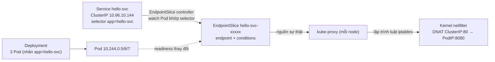
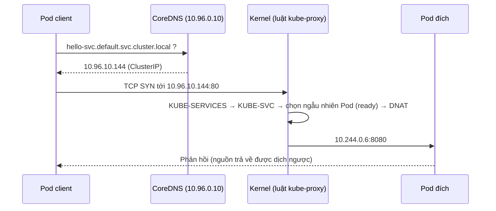
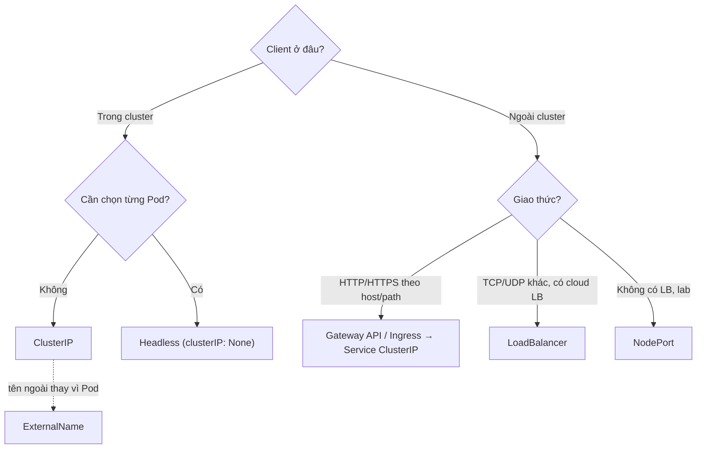

# 6_4_2 Services and EndpointSlices

> **Khóa học**: Cloud DevOps Basic — Containers and Kubernetes  
> **Phân nhóm**: 6 Domain 6 - Containers and Kubernetes › 6_4 Kubernetes Networking Configuration and Storage  
> **Chủ đề**: 6_4_2 Service (ClusterIP, NodePort, LoadBalancer, ExternalName, headless), EndpointSlice và kube-proxy  
> **Phiên bản áp dụng**: Kubernetes 1.37 (kind v0.33.0, kube-proxy chế độ `iptables`)  
> **Trạng thái**: Verified một phần (17-11-2026): ClusterIP, headless, ExternalName, NodePort, EndpointSlice và luật kube-proxy đã chạy thật trên kind; `LoadBalancer`, `externalTrafficPolicy`, `trafficDistribution` chỉ đối chiếu tài liệu  
> **Phạm vi**: [Topic README](./README.md#6_4_2-service) · **Checkpoint**: [CHECKLIST](../../CHECKLIST.md#6_4-kubernetes-networking-configuration-and-storage)  
> **Lab thực hành liên quan**: [lab-6_4_1-service-discovery-and-dns](./README.md#lab-6_4_1-service-discovery-and-dns)  
> **Kiến thức liên quan**: [6_3_5 Probes](<../6_3 Kubernetes Architecture and Core Workloads/6_3_5 Liveness Readiness and Startup Probes.md>) · [6_4_1 Network Model](<./6_4_1 Kubernetes Network Model and CNI.md>) · [6_4_3 Cluster DNS](<./6_4_3 Cluster DNS and Service Discovery.md>)

---

## 1. Khái Niệm Cốt Lõi & Bản Chất Kỹ Thuật (Core Concepts & Technical Deep Dive)

### 1.1 Service Giải Quyết Bài Toán Gì?

Pod là tài nguyên tạm thời: Deployment tạo và xóa Pod liên tục, mỗi Pod có IP riêng ([6_4_1](<./6_4_1 Kubernetes Network Model and CNI.md>)). Phía client không thể theo dõi "hiện đang có những IP nào". **Service** là abstraction cho một nhóm Pod: một **IP ảo ổn định (cluster IP)** và một **tên DNS ổn định**, kèm chính sách chọn Pod đích.

Service **không phải** tiến trình: nó là một đối tượng API. Hai thành phần thực thi nó:

1. **EndpointSlice controller** (control plane): theo dõi Pod khớp `selector` và cập nhật các **EndpointSlice**.
2. **Service proxy** (thường là `kube-proxy` trên mỗi node): theo dõi Service và EndpointSlice, rồi dựng luật chuyển tiếp trong kernel.

### 1.2 Các Loại Service

| Loại | Hành vi (theo tài liệu) | Dùng khi |
| :--- | :--- | :--- |
| **ClusterIP** (mặc định) | Cấp cluster IP từ dải Service; **chỉ truy cập được từ trong cluster** | Giao tiếp nội bộ giữa các service |
| **NodePort** | Mở một cổng tĩnh (mặc định `30000-32767`, cấu hình bằng `--service-node-port-range`) trên **mọi node**; vẫn có cluster IP | Môi trường không có load balancer, thử nghiệm |
| **LoadBalancer** | Yêu cầu load balancer bên ngoài (thường qua cloud-controller-manager); xây trên NodePort. Kubernetes **không** có sẵn thành phần load balancer | Cloud (Azure/AWS...) hoặc cluster tự cài LB |
| **ExternalName** | Ánh xạ tới một tên DNS ngoài; cluster DNS trả về bản ghi **CNAME**, **không proxy** | Trỏ tên nội bộ tới dịch vụ bên ngoài |
| **Headless** (`clusterIP: None`) | Không cấp IP, `kube-proxy` **không** xử lý; DNS trả về IP từng Pod | Cần nói chuyện với từng Pod cụ thể: StatefulSet ([6_4_7](<./6_4_7 StatefulSets and Stateful Workloads.md>)), peer discovery |

Lưu ý: `type` được thiết kế dạng **lồng nhau** (LoadBalancer ⊃ NodePort ⊃ ClusterIP), ngoại trừ `ExternalName`. Chuỗi `None` của `clusterIP` là giá trị đặc biệt, **khác** với việc bỏ trống trường.

> **Ingress không phải loại Service.** Để mở HTTP/HTTPS ra ngoài theo host/path, dùng Ingress hoặc Gateway API ([6_4_4](<./6_4_4 Ingress and Gateway API.md>)).

### 1.3 `port`, `targetPort`, `nodePort` Và Cổng Có Tên

```yaml
ports:
- name: http          # bắt buộc đặt tên khi Service có nhiều cổng
  protocol: TCP       # mặc định TCP
  port: 80            # cổng của Service (client gọi vào đây)
  targetPort: http    # cổng của Pod: số, hoặc TÊN cổng khai báo trong Pod
  # nodePort: 30007   # chỉ với NodePort/LoadBalancer; không đặt thì hệ thống tự cấp
```

- `targetPort` mặc định bằng `port` nếu bỏ trống.
- **Cổng có tên** (`containerPort.name: http` trong Pod, `targetPort: http` trong Service) cho phép đổi số cổng ở phiên bản ứng dụng mới mà không phải sửa Service.
- Tên cổng chỉ gồm chữ thường, số và `-`, bắt đầu/kết thúc bằng ký tự chữ-số.
- Service có nhiều cổng thì **bắt buộc** đặt tên cho tất cả.

### 1.4 `selector` → EndpointSlice → Chỉ Pod Ready Nhận Traffic

Khi Service có `selector`, EndpointSlice controller tạo **EndpointSlice** liệt kê các Pod khớp nhãn (kèm nhãn `kubernetes.io/service-name: <tên Service>`). EndpointSlice (GA từ v1.21) là **nguồn sự thật** cho `kube-proxy`. Mặc định mỗi slice chứa tối đa 100 endpoint.

Mỗi endpoint có 3 **conditions**:

| Condition | Ý nghĩa | Ghi chú |
| :--- | :--- | :--- |
| `serving` | Endpoint đang phục vụ được | Với Pod: tương ứng điều kiện `Ready` của Pod (stable từ v1.26) |
| `terminating` | Pod đang bị xóa (đã có deletion timestamp) | Proxy thường bỏ qua; chỉ dùng nếu **mọi** endpoint đều đang terminating mà vẫn serving, để không rơi traffic khi rolling update |
| `ready` | Cách viết tắt của "serving **và** không terminating" | Luôn `true` nếu Service đặt `publishNotReadyAddresses: true` |

> ✅ **Quan sát thực tế (17-11-2026)**: khi readinessProbe của Pod mới chưa đạt, Pod **vẫn xuất hiện trong EndpointSlice** nhưng với `ready=false serving=false`; còn `kubectl describe svc` chỉ hiện các endpoint ready. Kết quả thực tế:
> ```text
> 10.244.0.5 ready=true  serving=true  terminating=false
> 10.244.0.6 ready=true  serving=true  terminating=false
> 10.244.0.7 ready=true  serving=true  terminating=false
> 10.244.0.8 ready=false serving=false terminating=false   <- Pod mới, đang chờ Ready
> ```
> Vì vậy cách nói chính xác là: *Pod chưa Ready **không nhận traffic** vì proxy chỉ dùng endpoint `ready`*, chứ không hẳn là "bị gỡ khỏi EndpointSlice". Cột `ENDPOINTS` của `kubectl get endpointslices -o wide` liệt kê **cả** endpoint chưa ready, cần xem `conditions` để biết chính xác. API `Endpoints` cũ thì tách ra `notReadyAddresses`.

**Endpoints (API cũ) đã deprecated từ Kubernetes v1.33**: không hỗ trợ dual-stack, thiếu thông tin cho tính năng mới như `trafficDistribution`, và bị cắt bớt khi vượt 1000 endpoint. `kubectl get endpoints` in cảnh báo `v1 Endpoints is deprecated in v1.33+; use discovery.k8s.io/v1 EndpointSlice` (đã quan sát). Dùng EndpointSlice cho mọi công cụ mới.

### 1.5 Service Không Có Selector

Service không khai báo `selector` thì EndpointSlice **không** được tạo tự động; bạn tự tạo EndpointSlice với nhãn `kubernetes.io/service-name`. Dùng để trỏ Service tới backend ngoài cluster (DB bên ngoài, đang di trú dần vào Kubernetes). Ràng buộc: IP endpoint không được là loopback, link-local hay cluster IP của Service khác.

### 1.6 `kube-proxy` Biến IP Ảo Thành IP Pod Như Thế Nào?

`kube-proxy` chạy trên mỗi node (DaemonSet trong `kube-system`), theo dõi Service + EndpointSlice và lập trình luật chuyển tiếp trong kernel. Các chế độ trên Linux (theo trang *Virtual IPs and Service Proxies*, bản 1.37):

| Chế độ | Trạng thái trong Kubernetes 1.37 |
| :--- | :--- |
| `iptables` | **Mặc định hiện tại** (khi không chọn mode tường minh) |
| `nftables` | Cần kernel ≥ 5.13; thay thế cho iptables và ipvs; tài liệu cho biết **một phiên bản tương lai sẽ đổi mặc định sang nftables** |
| `ipvs` | ⚠️ **Deprecated từ v1.35**; sẽ bị tắt mặc định từ v1.40 (bật lại được bằng feature gate `KubeProxyIPVS`) và **gỡ hẳn ở v1.43** |

Trên Windows chỉ có `kernelspace`. Tài liệu khuyến nghị **khai báo mode tường minh** trong cấu hình kube-proxy để một lần nâng cấp không vô tình đổi backend.

> ✅ **Quan sát trên kind v1.37.0**: ConfigMap `kube-proxy` có `mode: iptables`; log: `Using iptables Proxier`. Một số CNI (ví dụ Cilium) có service proxy riêng thay `kube-proxy`, tính năng và phiên bản khác nhau theo từng CNI, cần đối chiếu tài liệu của chính CNI.

**Luật iptables thực tế** cho Service `hello-svc` (3 Pod, cluster IP `10.96.10.144`), rút gọn từ `iptables-nft-save -t nat` trên node:

```text
-A KUBE-SERVICES -d 10.96.10.144/32 -p tcp --dport 80 -j KUBE-SVC-QKSIC3G7NOTPH3O7
-A KUBE-SVC-QKSIC3G7NOTPH3O7 -m statistic --mode random --probability 0.33333333349 -j KUBE-SEP-KZNCILHX4DOTOX7P   # 10.244.0.5
-A KUBE-SVC-QKSIC3G7NOTPH3O7 -m statistic --mode random --probability 0.50000000000 -j KUBE-SEP-5TFA3GT76E5LUGFP   # 10.244.0.6
-A KUBE-SVC-QKSIC3G7NOTPH3O7 -j KUBE-SEP-NJW4UATVJ7SALR6V                                                            # 10.244.0.7 (còn lại)
-A KUBE-SEP-KZNCILHX4DOTOX7P -p tcp -j DNAT --to-destination 10.244.0.5:8080
```

Đọc là: gói tới `IP ảo:80` → nhảy sang chuỗi của Service → chọn **ngẫu nhiên** một Pod (xác suất 1/3, rồi 1/2 của phần còn lại, rồi phần còn lại) → **DNAT** sang `IP Pod:8080`. Không có tiến trình nào đứng giữa chuyển tiếp từng gói: đây là việc của kernel.

**Service không có endpoint**: `kube-proxy` cài luật `REJECT --reject-with icmp-port-unreachable` (comment `default/hello-svc:http has no endpoints`). Client nhận **`Connection refused` ngay lập tức** chứ không treo timeout.

### 1.7 Điều Hướng Traffic: Session, Traffic Policy, Traffic Distribution

| Trường | Tác dụng |
| :--- | :--- |
| `sessionAffinity: ClientIP` | Cùng IP client luôn tới cùng Pod; `timeoutSeconds` mặc định `10800` (3 giờ), tối đa `86400`. Mặc định `None` |
| `externalTrafficPolicy: Local` | Chỉ dùng endpoint **trên chính node nhận traffic**, **giữ IP nguồn của client**; node không có endpoint sẽ **bỏ gói**. Mặc định `Cluster` |
| `internalTrafficPolicy: Local` | Traffic nội bộ chỉ tới endpoint cùng node (stable từ v1.26); Pod trên node không có endpoint thấy Service như không có endpoint. Mặc định `Cluster` |
| `trafficDistribution` | *Ưu tiên* (không bảo đảm) về vị trí endpoint. Trong 1.37 hỗ trợ `PreferSameZone`, `PreferSameNode`; `PreferClose` là bí danh cũ, **deprecated** |

> ⚠️ `spec.externalIPs` **deprecated từ v1.36**, tài liệu khuyên chuyển sang load balancer controller hoặc Gateway API. `spec.loadBalancerIP` đã deprecated từ v1.24.

### 1.8 Hai Biến Thể Hay Gặp

- **Headless Service**: có selector thì EndpointSlice vẫn được tạo và DNS trả **A/AAAA của từng Pod**; không có load balancing. Dùng để client tự chọn Pod, và là nền tảng DNS ổn định của StatefulSet. `publishNotReadyAddresses: true` làm Pod chưa Ready vẫn có bản ghi (mục đích chính theo mô tả API: peer discovery của StatefulSet).
- **ExternalName**: tạo CNAME. Cảnh báo của tài liệu: với HTTP/HTTPS có thể lỗi vì header `Host` và chứng chỉ TLS không khớp tên ngoài. Giá trị trông như IPv4 bị coi là tên DNS toàn số, **không** phải IP.

---

## 2. Ví Dụ Đời Sống Thực Tế Dễ Hiểu (Intuitive Real-World Analogies)

**Service như số tổng đài của một cửa hàng có nhiều nhân viên trực:**

- **ClusterIP = số máy lẻ nội bộ**: khách trong tòa nhà (trong cluster) bấm số này, tổng đài nối tới một nhân viên đang rảnh. Người ngoài tòa nhà không gọi được.
- **NodePort = cùng một số ở cửa mỗi chi nhánh**: đứng ở cửa bất kỳ chi nhánh nào (node nào) và bấm số, vẫn được nối vào.
- **LoadBalancer = thuê lễ tân ngoài phố** (do nhà cung cấp cloud): lễ tân đứng sẵn ngoài phố và chỉ dẫn khách vào các cửa chi nhánh.
- **ExternalName = biển "Chi nhánh này đã chuyển, xin xem địa chỉ mới"**: không đưa khách đi tiếp, chỉ chỉ đường.
- **Headless = danh bạ nội bộ có số từng nhân viên**: bạn tự chọn gọi đúng người (cần thiết khi mỗi nhân viên giữ hồ sơ riêng, như Kafka broker).
- **EndpointSlice = bảng "ai đang có mặt"** của tổng đài. Nhân viên bấm "chưa sẵn sàng" (readiness fail) vẫn có tên trong bảng nhưng được đánh dấu **không nhận cuộc gọi**.
- **kube-proxy = kỹ thuật viên cài luật chuyển cuộc gọi** vào từng tổng đài chi nhánh. Khi không có ai trực, tổng đài phát tín hiệu "máy bận, từ chối" ngay (REJECT) thay vì để khách chờ vô tận.

---

## 3. Kiến Trúc, Luồng Hoạt Động & Hình Ảnh Trực Quan (Architecture, Diagrams & Visual Media)

### 3.1 Ba Đối Tượng Phối Hợp



### 3.2 Đường Đi Của Một Request Nội Bộ



### 3.3 Sơ Đồ Chính Thức: kube-proxy Chế Độ iptables


*Nguồn: tài liệu Kubernetes, trang Virtual IPs and Service Proxies.*

### 3.4 Chọn Loại Service



---

## 4. Code Mẫu Trực Quan Hoặc Dòng Lệnh Thực Chiến (Runnable Sample Code / CLI)

> ✅ **Đã chạy thử** ngày 17-11-2026 trên kind v0.33.0, Kubernetes v1.37.0, image `selflearn.invalid/hello-svc:1.0.0` build từ [shared/hello-svc](../../shared/hello-svc/Dockerfile) rồi nạp vào kind. Nạp image bằng Podman: `podman save -o hello.tar selflearn.invalid/hello-svc:1.0.0 && KIND_EXPERIMENTAL_PROVIDER=podman kind load image-archive hello.tar --name <cluster>`; với Docker dùng `kind load docker-image`.

### 4.1 Deployment + Service ClusterIP Có Readiness Probe

```yaml
apiVersion: apps/v1
kind: Deployment
metadata:
  name: hello-svc
spec:
  replicas: 3
  selector:
    matchLabels: { app: hello-svc }
  template:
    metadata:
      labels: { app: hello-svc }
    spec:
      containers:
      - name: hello-svc
        image: selflearn.invalid/hello-svc:1.0.0
        imagePullPolicy: IfNotPresent      # image nạp tay vào kind, không có registry thật
        ports:
        - name: http                       # cổng có tên
          containerPort: 8080
        env:
        - name: APP_VERSION
          value: "1.0.0"
        readinessProbe:
          httpGet: { path: /ready, port: http }
          periodSeconds: 2
---
apiVersion: v1
kind: Service
metadata:
  name: hello-svc
spec:
  selector:
    app: hello-svc
  ports:
  - name: http
    port: 80
    targetPort: http                       # tham chiếu cổng theo tên
```

```bash
kubectl apply -f hello.yaml
kubectl rollout status deploy/hello-svc

kubectl get svc hello-svc
kubectl get endpointslices -l kubernetes.io/service-name=hello-svc -o wide
```

Kết quả quan sát:

```text
NAME        TYPE        CLUSTER-IP     EXTERNAL-IP   PORT(S)   AGE
hello-svc   ClusterIP   10.96.10.144   <none>        80/TCP    2s
NAME              ADDRESSTYPE   PORTS   ENDPOINTS                          AGE
hello-svc-djktx   IPv4          8080    10.244.0.5,10.244.0.6,10.244.0.7   2s
```

### 4.2 Đọc `conditions` Của Endpoint

```bash
kubectl get endpointslices -l kubernetes.io/service-name=hello-svc \
  -o jsonpath='{range .items[0].endpoints[*]}{.addresses[0]} ready={.conditions.ready} serving={.conditions.serving} terminating={.conditions.terminating}{"\n"}{end}'
```

Để thấy endpoint `ready=false`, làm chậm readiness (ứng dụng `hello-svc` trả `/ready` 503 đến hết `STARTUP_DELAY_MS`):

```bash
kubectl set env deploy/hello-svc STARTUP_DELAY_MS=60000
sleep 12
kubectl get pods -l app=hello-svc -o wide                     # Pod mới 0/1 Running
kubectl get endpointslices -l kubernetes.io/service-name=hello-svc -o wide
# Trả lời: cột ENDPOINTS vẫn liệt kê 4 IP ("... + 1 more"), nhưng jsonpath ở trên cho thấy Pod mới ready=false
kubectl set env deploy/hello-svc STARTUP_DELAY_MS-            # khôi phục
```

### 4.3 Chẩn Đoán "Service Không Có Endpoint" Bằng 2 Lệnh

```bash
# Cố ý sai selector một chữ
kubectl patch svc hello-svc --type=merge -p '{"spec":{"selector":{"app":"hello-svcc"}}}'

# Lệnh 1: slice rỗng
kubectl get endpointslices -l kubernetes.io/service-name=hello-svc -o wide
# Lệnh 2: so selector của Service với nhãn của Pod
kubectl get svc hello-svc -o jsonpath='{.spec.selector}{"\n"}'; kubectl get pods --show-labels

kubectl exec tmp -- wget -qO- -T 3 hello-svc      # tmp: Pod busybox tạo ở bài 6_4_1
```

Kết quả quan sát: `ENDPOINTS <unset>`, `kubectl describe svc` ghi `Endpoints:` rỗng, và client nhận **ngay** `wget: can't connect to remote host (10.96.10.144): Connection refused`. DNS vẫn phân giải bình thường (ClusterIP vẫn tồn tại): "Service còn IP nhưng không có endpoint". Trả lại selector đúng sau khi thử.

### 4.4 Headless, ExternalName, NodePort

```yaml
apiVersion: v1
kind: Service
metadata: { name: hello-headless }
spec:
  clusterIP: None
  selector: { app: hello-svc }
  ports: [{ name: http, port: 80, targetPort: http }]
---
apiVersion: v1
kind: Service
metadata: { name: ext-db }
spec:
  type: ExternalName
  externalName: example.com
---
apiVersion: v1
kind: Service
metadata: { name: hello-np }
spec:
  type: NodePort
  selector: { app: hello-svc }
  ports: [{ port: 80, targetPort: http }]
```

```bash
kubectl exec tmp -- nslookup hello-headless.default.svc.cluster.local   # trả 3 IP Pod, không phải ClusterIP
kubectl exec tmp -- nslookup ext-db.default.svc.cluster.local           # canonical name = example.com
kubectl get svc hello-np                                                # PORT(S): 80:30885/TCP (cổng nodePort tự cấp)
```

### 4.5 Xem Luật kube-proxy Trên Node

```bash
kubectl -n kube-system get cm kube-proxy -o jsonpath='{.data.config\.conf}' | grep -n mode   # mode: iptables
podman exec lab-control-plane sh -c 'iptables-nft-save -t nat | grep "hello-svc:http"'
```

> Cổng NodePort, `iptables-nft-save` và tên node (`lab-control-plane`) phụ thuộc môi trường kind/podman của bạn. Trên kind chạy bằng Docker thay `podman` bằng `docker`.

### 4.6 Tạo Service Nhanh Bằng `kubectl expose`

> ⚠️ Chưa chạy thử lệnh này; chỉ sinh YAML (`--dry-run=client`) để bạn đọc rồi tự áp dụng.

```bash
kubectl expose deploy/hello-svc --port=80 --target-port=8080 --name=hello-svc2 --dry-run=client -o yaml
```

> ⚠️ Chưa chạy thử `externalTrafficPolicy: Local`, `sessionAffinity: ClientIP`, `type: LoadBalancer`: cần cluster nhiều node hoặc cloud. Khi dùng, đọc phần *Traffic policies* và *Session affinity* của tài liệu Service.

---

## 5. Cạm Bẫy Thực Tế & Thực Tiễn Sản Xuất (Production Gotchas & Best Practices)

### 5.1 Cạm Bẫy 1: Selector Sai Một Chữ Cho Ra "Service Chết Lặng"

- **Hiện tượng**: Service có ClusterIP, DNS phân giải tốt, nhưng mọi request bị `Connection refused`.
- **Bản chất**: EndpointSlice rỗng; kube-proxy cài luật REJECT cho Service không có endpoint.
- **Khuyến nghị**: Kiểm `kubectl get endpointslices -l kubernetes.io/service-name=<svc>` trước mọi thao tác khác; dùng nhãn chuẩn `app.kubernetes.io/name`.

### 5.2 Cạm Bẫy 2: Hiểu Nhầm "Pod Chưa Ready Bị Gỡ Khỏi EndpointSlice"

- **Hiện tượng**: Viết runbook "xem Pod có trong EndpointSlice không" để biết Pod nhận traffic.
- **Bản chất**: Pod chưa Ready vẫn nằm trong slice với `ready=false` (đã quan sát). Chỉ endpoint `ready` được proxy dùng.
- **Khuyến nghị**: Đọc `conditions.ready`; cột `ENDPOINTS` của `-o wide` **không** đủ để kết luận.

### 5.3 Cạm Bẫy 3: Dùng Endpoints API Cũ Trong Công Cụ Mới

- **Bản chất**: `Endpoints` deprecated từ v1.33, cắt tại 1000 endpoint, không có thông tin cho tính năng mới.
- **Khuyến nghị**: Dùng `discovery.k8s.io/v1` EndpointSlice trong script, controller, dashboard.

### 5.4 Cạm Bẫy 4: Để Mặc Định Mode kube-proxy Rồi Nâng Cấp

- **Bản chất**: Tài liệu cho biết mặc định hiện là `iptables` nhưng sẽ đổi sang `nftables` ở phiên bản tương lai; `ipvs` deprecated từ v1.35, tắt mặc định từ v1.40, gỡ ở v1.43.
- **Khuyến nghị**: Khai báo `mode` tường minh; nếu đang dùng `ipvs` hãy lên kế hoạch chuyển sang `nftables` hoặc `iptables`. Đọc release notes trước mỗi lần nâng cấp.

### 5.5 Cạm Bẫy 5: Lạm Dụng NodePort/LoadBalancer Cho Mọi Service

- **Khuyến nghị**: Mặc định ClusterIP; mở ra ngoài tập trung qua Gateway/Ingress ([6_4_4](<./6_4_4 Ingress and Gateway API.md>)) để giảm số LB phải trả tiền và số cổng phải quản lý.

### 5.6 Cạm Bẫy 6: `externalTrafficPolicy: Local` Làm Rơi Traffic Khi Load Balancer Gửi Nhầm Node

- **Bản chất**: Theo mô tả trường, traffic gửi tới node không có endpoint sẽ bị bỏ.
- **Khuyến nghị**: Chỉ dùng khi cần giữ IP client và LB có health check theo node; kiểm tra tài liệu LB của nhà cung cấp.

---

## 6. Câu Hỏi Củng Cố Kiến Thức (Active Recall Quiz)

### Câu Hỏi 1: Service Có Phải Là Một Tiến Trình Proxy Không? (Phỏng vấn)

<details>
<summary>Đáp án</summary>

Không. Service là đối tượng API. EndpointSlice controller giữ danh sách endpoint; `kube-proxy` (hoặc proxy riêng của CNI) lập trình luật trong kernel (iptables/nftables...) để DNAT từ ClusterIP sang IP Pod. Không có tiến trình nào chuyển tiếp từng gói trong chế độ iptables/nftables.
</details>

### Câu Hỏi 2: Phân Biệt `port`, `targetPort`, `nodePort`

<details>
<summary>Đáp án</summary>

`port`: cổng Service lắng nghe (trên ClusterIP). `targetPort`: cổng trên Pod (số hoặc tên). `nodePort`: cổng tĩnh trên mọi node (mặc định `30000-32767`) cho `NodePort`/`LoadBalancer`.
</details>

### Câu Hỏi 3: Readiness Probe Fail Thì Chuyện Gì Xảy Ra Với EndpointSlice?

<details>
<summary>Đáp án</summary>

Condition `ready` của endpoint chuyển `false` (và `serving=false`); endpoint vẫn có trong slice. Proxy không chọn endpoint không ready nên Pod ngừng nhận traffic mà **không bị restart**. Khi probe thành công lại, `ready=true`.
</details>

### Câu Hỏi 4: Headless Service Khác ClusterIP Ở Điểm Nào Và Dùng Khi Nào?

<details>
<summary>Đáp án</summary>

Headless (`clusterIP: None`) không có IP ảo, `kube-proxy` không xử lý, DNS trả A/AAAA của **từng Pod**. Dùng khi client cần tự chọn Pod hoặc cần DNS ổn định theo từng Pod (StatefulSet, Kafka, Cassandra).
</details>

### Câu Hỏi 5: Vì Sao Service Không Có Endpoint Lại Báo `Connection refused` Thay Vì Timeout?

<details>
<summary>Đáp án</summary>

Ở chế độ iptables, kube-proxy cài luật `REJECT --reject-with icmp-port-unreachable` cho Service không có endpoint, nên client nhận lỗi từ chối ngay.
</details>

---

## 7. 📚 Nguồn Tài Liệu Chính Thống (Tier-1 Official References)

- [Service](https://kubernetes.io/docs/concepts/services-networking/service/) - Các loại Service, headless, ExternalName, traffic policy, trafficDistribution, deprecation của Endpoints/externalIPs.
- [EndpointSlices](https://kubernetes.io/docs/concepts/services-networking/endpoint-slices/) - API EndpointSlice, conditions `ready`/`serving`/`terminating`.
- [Virtual IPs and Service Proxies](https://kubernetes.io/docs/reference/networking/virtual-ips/) - Các chế độ kube-proxy (iptables, ipvs, nftables) và trạng thái trong 1.37.
- [Service Internal Traffic Policy](https://kubernetes.io/docs/concepts/services-networking/service-traffic-policy/) - `internalTrafficPolicy`.
- [Connecting Applications with Services](https://kubernetes.io/docs/tutorials/services/connect-applications-service/) - Hướng dẫn thực hành chính thức.
- [Kubernetes Release Notes / Changelog](https://github.com/kubernetes/kubernetes/tree/master/CHANGELOG) - Tra cứu thay đổi kube-proxy theo từng bản.
