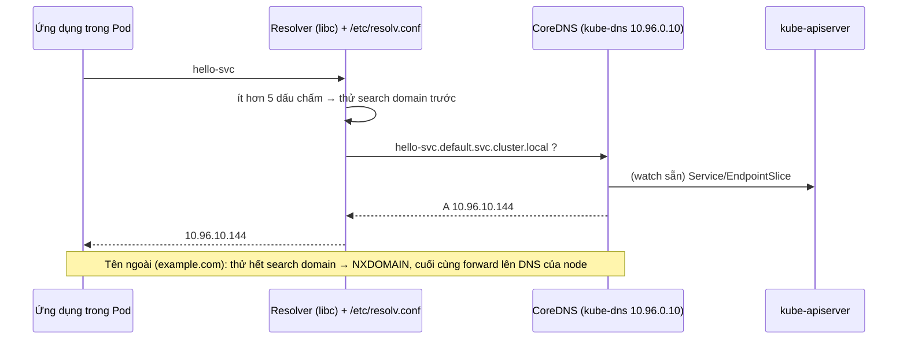
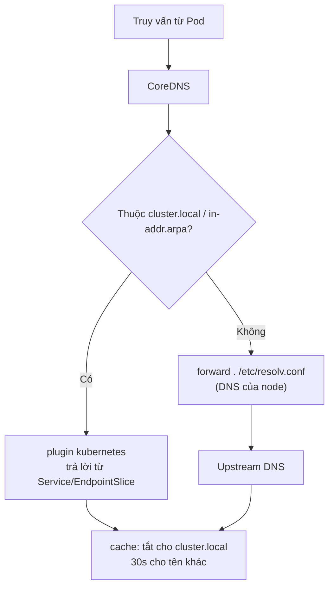
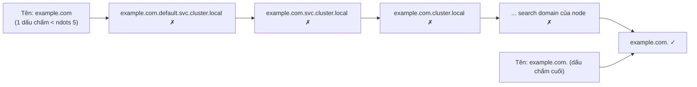

# 6_4_3 Cluster DNS and Service Discovery

> **Khóa học**: Cloud DevOps Basic — Containers and Kubernetes  
> **Phân nhóm**: 6 Domain 6 - Containers and Kubernetes › 6_4 Kubernetes Networking Configuration and Storage  
> **Chủ đề**: 6_4_3 CoreDNS, tên DNS của Service/Pod, `resolv.conf`, `search` và `ndots:5`  
> **Phiên bản áp dụng**: Kubernetes 1.37 (CoreDNS mặc định của kind v0.33.0)  
> **Trạng thái**: Verified (17-11-2026): mọi truy vấn DNS và số liệu `ndots` bên dưới đã chạy thật trên kind một node  
> **Phạm vi**: [Topic README](./README.md#6_4_3-dns-trong-cluster) · **Checkpoint**: [CHECKLIST](../../CHECKLIST.md#6_4-kubernetes-networking-configuration-and-storage)  
> **Lab thực hành liên quan**: [lab-6_4_1-service-discovery-and-dns](./README.md#lab-6_4_1-service-discovery-and-dns)  
> **Kiến thức liên quan**: [6_4_2 Services and EndpointSlices](<./6_4_2 Services and EndpointSlices.md>) · [6_4_7 StatefulSets](<./6_4_7 StatefulSets and Stateful Workloads.md>)

---

## 1. Khái Niệm Cốt Lõi & Bản Chất Kỹ Thuật (Core Concepts & Technical Deep Dive)

### 1.1 Service Discovery Bằng DNS

Pod không nên nhớ IP. Cluster chạy một **DNS server** (mặc định **CoreDNS**) theo dõi Kubernetes API và tạo bản ghi DNS cho Service. Tài liệu nêu: nếu DNS bật trong toàn cluster, mọi Pod đều phân giải được Service theo tên.

Quan sát trên kind v1.37:

- CoreDNS chạy dạng Deployment 2 replica trong `kube-system`, cấu hình trong ConfigMap `coredns` (khóa `Corefile`).
- Pod truy cập qua **Service `kube-dns`** (ClusterIP `10.96.0.10`, cổng 53/UDP, 53/TCP, 9153/TCP). Địa chỉ này xuất hiện ở dòng `nameserver` trong `/etc/resolv.conf` của mọi Pod.

Corefile quan sát được (rút gọn các phần không liên quan):

```text
.:53 {
    errors
    health { lameduck 5s }
    ready
    kubernetes cluster.local in-addr.arpa ip6.arpa {
       pods insecure
       fallthrough in-addr.arpa ip6.arpa
       ttl 30
    }
    forward . /etc/resolv.conf        # tên ngoài cluster được chuyển tiếp lên DNS của node
    cache 30 { disable success cluster.local; disable denial cluster.local }
    loop
    reload
}
```

Đọc là: plugin `kubernetes` trả lời cho miền `cluster.local`; mọi tên khác đi qua `forward` tới resolver của node; `cache 30` có bộ nhớ đệm 30 giây nhưng **tắt cache cho `cluster.local`**.

### 1.2 Các Dạng Tên DNS (theo tài liệu "DNS for Services and Pods")

| Đối tượng | Tên | Trả về |
| :--- | :--- | :--- |
| Service thường | `<service>.<namespace>.svc.<cluster-domain>` | A/AAAA = **cluster IP** |
| Service **headless** | `<service>.<namespace>.svc.<cluster-domain>` | A/AAAA = **tập IP của tất cả Pod** được chọn; client tự dùng hết hoặc round-robin |
| Cổng có tên (SRV) | `_<port-name>._<protocol>.<service>.<namespace>.svc.<cluster-domain>` | Số cổng + tên; với headless thì một bản ghi cho mỗi Pod |
| Pod bất kỳ | `<ip-pod-dạng-gạch-nối>.<namespace>.pod.<cluster-domain>`, ví dụ `10-244-0-5.default.pod.cluster.local` | IP của Pod (phụ thuộc cấu hình CoreDNS `pods`) |
| Pod có `hostname` + `subdomain` khớp headless Service | `<hostname>.<subdomain>.<namespace>.svc.<cluster-domain>` | IP của Pod (chỉ khi Pod **Ready**, trừ khi Service đặt `publishNotReadyAddresses: true`) |
| Pod của StatefulSet | `<pod>.<headless-service>.<namespace>.svc.<cluster-domain>`, ví dụ `kafka-0.kafka-headless.prod.svc.cluster.local` | IP của Pod đó (xem [6_4_7](<./6_4_7 StatefulSets and Stateful Workloads.md>)) |

`cluster-domain` mặc định là `cluster.local`. `ExternalName` Service trả về **CNAME**; chỉ DNS của Kubernetes mới truy cập được loại Service này.

### 1.3 Tên Ngắn Hoạt Động Nhờ `search` Domain

kubelet tạo `/etc/resolv.conf` cho từng Pod. Quan sát trên kind (Pod ở namespace `default`):

```text
search default.svc.cluster.local svc.cluster.local cluster.local dns.podman lan tail3a1d17.ts.net
nameserver 10.96.0.10
options ndots:5
```

- Ba domain đầu do Kubernetes thêm: `<namespace>.svc.<domain>`, `svc.<domain>`, `<domain>`.
- Ba domain cuối (`dns.podman`, `lan`, `...ts.net`) là **search domain của máy chủ của tôi**, được thừa kế vì Pod dùng `dnsPolicy: ClusterFirst`. Môi trường của bạn sẽ khác.

Hệ quả:

| Gọi từ Pod ở namespace `default` | Được mở rộng thành | Kết quả |
| :--- | :--- | :--- |
| `hello-svc` | `hello-svc.default.svc.cluster.local` | ✅ cùng namespace |
| `hello-svc.default` | `hello-svc.default.svc.cluster.local` (qua `search svc.cluster.local`) | ✅ |
| `hello-svc.default.svc.cluster.local` | giữ nguyên | ✅ |

Gọi từ namespace **khác** (quan sát từ Pod ở namespace `other`): `wget hello-svc` **thất bại** (tìm `hello-svc.other.svc.cluster.local` không tồn tại), còn `wget hello-svc.default` thành công. Quy tắc: **khác namespace phải đủ `<service>.<namespace>`**.

### 1.4 `dnsPolicy`

Đặt theo từng Pod. Mặc định (khi bỏ trống) là **`ClusterFirst`**, KHÔNG phải `Default`.

| Giá trị | Ý nghĩa (theo tài liệu) |
| :--- | :--- |
| `ClusterFirst` | Truy vấn không thuộc miền cluster được DNS server chuyển tiếp lên upstream |
| `Default` | Pod **thừa kế cấu hình DNS của node**; ⚠️ tên gây hiểu nhầm, không phải mặc định |
| `ClusterFirstWithHostNet` | Dùng cho Pod `hostNetwork: true`; nếu để `ClusterFirst` thì Pod hostNetwork rơi về hành vi `Default` |
| `None` | Bỏ qua cấu hình của Kubernetes, toàn bộ do `dnsConfig` cung cấp |

`dnsConfig` (tùy chọn, dùng được với mọi policy) cho phép đặt `nameservers`, `searches` và `options`, ví dụ ghi đè `ndots`.

### 1.5 `ndots:5` Và Chi Phí Truy Vấn

Với `options ndots:5`, resolver coi một tên là "tuyệt đối" ngay (thử nguyên văn trước) chỉ khi tên có **từ 5 dấu chấm trở lên**. Tên có **ít hơn 5 dấu chấm** sẽ được thử lần lượt với từng `search` domain **trước**, tên nguyên văn thử **sau cùng**.

> ✅ **Đo thực tế (17-11-2026)**: bật `log` trong CoreDNS, từ một Pod dùng resolver glibc (`getent hosts`) tra `example.com` (chỉ 1 dấu chấm):
> ```text
> AAAA IN example.com.default.svc.cluster.local.   NXDOMAIN
> AAAA IN example.com.svc.cluster.local.           NXDOMAIN
> AAAA IN example.com.lan.                         NXDOMAIN
> AAAA IN example.com.cluster.local.               NXDOMAIN
> AAAA IN example.com.dns.podman.                  NXDOMAIN
> AAAA IN example.com.tail3a1d17.ts.net.           NXDOMAIN
> AAAA IN example.com.                             NOERROR      <- câu trả lời thật
> ```
> **7 truy vấn** (chưa tính A/AAAA nếu app hỏi cả hai) cho một lần phân giải. Thêm **dấu chấm cuối** (`example.com.`) → **1 truy vấn** (`NOERROR`).

Đây là lý do gọi tên miền ngoài sinh ra rất nhiều truy vấn DNS. Cách giảm:

1. Dùng **FQDN có dấu chấm cuối** (`api.example.com.`) cho đích ngoài cluster khi ứng dụng cho phép.
2. Giảm `ndots` cho Pod cần gọi nhiều tên ngoài bằng `dnsConfig` (đổi lại: tên ngắn nội bộ kiểu `svc.ns` có thể không còn tự mở rộng đúng, cần kiểm thử).
3. Cache DNS cục bộ: **NodeLocal DNSCache** (xem tài liệu chính thức), và cache phía ứng dụng/client (với JVM: `networkaddress.cache.ttl`; Oracle ghi mặc định là `-1` tức cache mãi **nếu có security manager**, còn lại là "implementation-specific").

```yaml
spec:
  dnsConfig:
    options:
    - name: ndots
      value: "2"
```

### 1.6 Bộ Đệm Âm (Negative Caching) Với Pod Mới

Tài liệu StatefulSet cảnh báo: nếu client đã hỏi tên Pod **trước khi** Pod được tạo, kết quả "không tìm thấy" bị cache (CoreDNS mặc định cache khoảng 30 giây), nên tên của Pod mới có thể chưa phân giải ngay dù Pod đã chạy. Cách tránh: truy vấn trực tiếp Kubernetes API (watch), hoặc giảm thời gian cache của DNS provider.

---

## 2. Ví Dụ Đời Sống Thực Tế Dễ Hiểu (Intuitive Real-World Analogies)

**DNS cluster như quầy hướng dẫn của một khu phố có nhiều tòa nhà (namespace):**

- **CoreDNS = nhân viên quầy hướng dẫn**: ai hỏi "tiệm bánh ở đâu" thì tra danh bạ rồi chỉ số nhà.
- **Tên ngắn `hello-svc` = hỏi "tiệm bánh"**: nhân viên **tự hiểu là tiệm bánh trong cùng tòa nhà** của bạn trước (search domain `<namespace>.svc...`).
- **Hỏi sang tòa khác = phải nói rõ "tiệm bánh ở tòa `default`"** (`hello-svc.default`).
- **`search` list = tờ ghi chú "nếu không thấy thì thử tòa này, rồi khu này, rồi cả thành phố"**.
- **`ndots:5` = quy tắc "tên ngắn hơn 5 đoạn thì cứ thử ghi chú trước"**: hỏi một địa chỉ ở nước ngoài (`example.com`) mà nhân viên vẫn lần lượt hỏi 6 nơi trong khu phố trước rồi mới ra hỏi thế giới bên ngoài. Thêm **dấu chấm cuối** là nói "đây là địa chỉ đầy đủ, đừng thử ghi chú nữa".
- **Headless Service = danh bạ liệt kê số từng nhân viên**, không qua tổng đài.
- **Negative caching = nhân viên nhớ "hôm qua tòa này chưa có số"**: dù hôm nay đã có, họ vẫn trả lời "không có" cho đến khi trí nhớ hết hạn.

---

## 3. Kiến Trúc, Luồng Hoạt Động & Hình Ảnh Trực Quan (Architecture, Diagrams & Visual Media)

### 3.1 Một Truy Vấn Tên Ngắn Từ Pod Đến Câu Trả Lời



### 3.2 Hai Nhánh Của Truy Vấn: Trong Và Ngoài Cluster



### 3.3 Các Chặng `search` Cho Tên Ngắn Và Tên Ngoài



---

## 4. Code Mẫu Trực Quan Hoặc Dòng Lệnh Thực Chiến (Runnable Sample Code / CLI)

> ✅ **Đã chạy thử** ngày 17-11-2026 trên kind v0.33.0, Kubernetes v1.37.0. Cần Deployment/Service `hello-svc` từ [6_4_2](<./6_4_2 Services and EndpointSlices.md>) và Pod debug `tmp`.  
> ⚠️ **Lưu ý công cụ**: `nslookup` của **busybox 1.36** áp dụng `search` không giống resolver của ứng dụng: tên một nhãn (`hello-svc`) được mở rộng đúng, nhưng `hello-svc.default` **báo NXDOMAIN** dù `wget hello-svc.default` thành công. Hãy dùng `wget`, `getent hosts` (glibc) hoặc FQDN đầy đủ khi kiểm tra, đừng kết luận "DNS hỏng" chỉ từ busybox `nslookup`.

### 4.1 Pod Debug Và Xem `resolv.conf`

```bash
kubectl run tmp --image=docker.io/library/busybox:1.36 --restart=Never -- sleep 3600
kubectl wait --for=condition=Ready pod/tmp --timeout=60s

kubectl exec tmp -- cat /etc/resolv.conf
```

### 4.2 Phân Giải Service, Headless, SRV Và Pod

```bash
kubectl exec tmp -- nslookup hello-svc.default.svc.cluster.local
#  Name: hello-svc.default.svc.cluster.local   Address: 10.96.10.144

kubectl exec tmp -- wget -qO- -T 3 hello-svc              # đi qua DNS → ClusterIP → Pod
#  hello from hello-svc-7684f9976b-5gbgt version=1.0.0

kubectl exec tmp -- nslookup hello-headless.default.svc.cluster.local    # headless: 3 IP của 3 Pod
kubectl exec tmp -- nslookup -type=SRV _http._tcp.hello-svc.default.svc.cluster.local
#  service = 0 100 80 hello-svc.default.svc.cluster.local

kubectl exec tmp -- nslookup 10-244-0-5.default.pod.cluster.local        # tên Pod theo IP
#  Address: 10.244.0.5
```

### 4.3 Gọi Chéo Namespace

```bash
kubectl create ns other
kubectl -n other run t2 --image=docker.io/library/busybox:1.36 --restart=Never -- sleep 600
kubectl -n other wait --for=condition=Ready pod/t2 --timeout=60s

kubectl -n other exec t2 -- cat /etc/resolv.conf | head -1    # search other.svc.cluster.local svc.cluster.local ...
kubectl -n other exec t2 -- wget -qO- -T 3 hello-svc.default  # ✅ thành công
kubectl -n other exec t2 -- wget -qO- -T 3 hello-svc          # ❌ exit 1: không có hello-svc trong namespace other
```

### 4.4 Đo Số Truy Vấn Do `ndots` (Bật Log CoreDNS)

> ⚠️ Chỉ làm trên **cluster học tập**: lệnh sửa ConfigMap `coredns` và restart CoreDNS.

```bash
# Thêm dòng "log" ngay sau dòng "errors" trong Corefile, rồi restart CoreDNS
kubectl -n kube-system edit cm coredns
kubectl -n kube-system rollout restart deploy/coredns

# Pod dùng glibc (image hello-svc là JRE trên Linux glibc) → resolver giống ứng dụng thật
# (khi kiểm chứng, tôi dùng một Pod hello-svc có sẵn; lệnh tạo Pod `libc` dưới đây tương đương)
kubectl run libc --image=selflearn.invalid/hello-svc:1.0.0 --image-pull-policy=IfNotPresent \
  --restart=Never --command -- sleep 3600
kubectl wait --for=condition=Ready pod/libc --timeout=60s

kubectl exec libc -- getent hosts example.com
kubectl -n kube-system logs -l k8s-app=kube-dns --since=10s --prefix | grep example     # ~7 dòng
kubectl exec libc -- getent hosts example.com.
kubectl -n kube-system logs -l k8s-app=kube-dns --since=3s  --prefix | grep example     # 1 dòng
```

### 4.5 Ghi Đè `ndots` Cho Một Pod

```yaml
apiVersion: v1
kind: Pod
metadata:
  name: dns-ndots2
spec:
  dnsPolicy: ClusterFirst
  dnsConfig:
    options:
    - name: ndots
      value: "2"
  containers:
  - name: c
    image: docker.io/library/busybox:1.36
    command: ["sleep", "3600"]
```

```bash
kubectl apply -f dns-ndots2.yaml
kubectl exec dns-ndots2 -- cat /etc/resolv.conf    # options ndots:2
```

> ⚠️ Chưa chạy thử `dnsConfig` ở mục 4.5 (cú pháp theo tài liệu "DNS for Services and Pods"). Sau khi thử, dọn dẹp: trả Corefile về như cũ (bỏ dòng `log`) và `kubectl delete pod libc dns-ndots2 tmp`, `kubectl delete ns other`.

---

## 5. Cạm Bẫy Thực Tế & Thực Tiễn Sản Xuất (Production Gotchas & Best Practices)

### 5.1 Cạm Bẫy 1: Gọi Tên Ngắn Giữa Hai Namespace

- **Hiện tượng**: `http://payment` hoạt động ở `dev` nhưng lỗi khi service được chuyển sang namespace khác.
- **Bản chất**: tên ngắn chỉ mở rộng theo namespace của **Pod gọi** (xác nhận bằng thực nghiệm: `wget hello-svc` từ namespace `other` thất bại).
- **Khuyến nghị**: Cấu hình đích dạng `<service>.<namespace>` hoặc FQDN đầy đủ khi gọi liên namespace.

### 5.2 Cạm Bẫy 2: Một Request Ra Internet Sinh 6–7 Truy Vấn DNS

- **Hiện tượng**: CoreDNS quá tải, độ trễ cao với ứng dụng gọi nhiều API ngoài.
- **Bản chất**: `ndots:5` + `search` list dài (đo được 7 truy vấn cho `example.com`).
- **Khuyến nghị**: FQDN có dấu chấm cuối cho đích ngoài, hạ `ndots` hợp lý, NodeLocal DNSCache, cache phía client, theo dõi metric CoreDNS (cổng `9153`).

### 5.3 Cạm Bẫy 3: Chẩn Đoán DNS Bằng Công Cụ Có Hành Vi Khác Ứng Dụng

- **Bản chất**: busybox `nslookup` ≠ resolver của ứng dụng (đã quan sát lệch với `hello-svc.default`).
- **Khuyến nghị**: Kiểm tra bằng đúng thư viện/ngôn ngữ ứng dụng dùng (`getent`, `curl`, hoặc chính ứng dụng); xem tài liệu *Debugging DNS Resolution* của Kubernetes.

### 5.4 Cạm Bẫy 4: Pod `hostNetwork` Không Phân Giải Được Tên Service

- **Bản chất**: `hostNetwork: true` + `dnsPolicy: ClusterFirst` rơi về hành vi `Default` (theo tài liệu).
- **Khuyến nghị**: Đặt `dnsPolicy: ClusterFirstWithHostNet`.

### 5.5 Cạm Bẫy 5: JVM Cache DNS Lâu

- **Bản chất**: Tài liệu Oracle ghi `networkaddress.cache.ttl` mặc định `-1` (cache mãi) **khi có security manager**; khi không có thì tùy implementation. Pod IP đổi liên tục, cache DNS lâu có thể giữ IP cũ (đáng chú ý với headless Service).
- **Khuyến nghị**: Đặt TTL hợp lý cho client Java đi qua DNS động; kiểm tra bản JDK đang dùng (Java 17/21 LTS).

### 5.6 Cạm Bẫy 6: Sửa Corefile Rồi Quên Hoàn Tác

- **Khuyến nghị**: Bật `log` chỉ để chẩn đoán ngắn hạn (log mọi truy vấn rất nhiều); quản lý Corefile qua GitOps ở cluster thật.

---

## 6. Câu Hỏi Củng Cố Kiến Thức (Active Recall Quiz)

### Câu Hỏi 1: Viết Tên DNS Đầy Đủ Của Service `payment` Trong Namespace `prod`, Và Của Pod `kafka-2` Thuộc Headless Service `kafka-headless` Cùng Namespace (Phỏng vấn)

<details>
<summary>Đáp án</summary>

- Service: `payment.prod.svc.cluster.local`
- Pod StatefulSet: `kafka-2.kafka-headless.prod.svc.cluster.local`

(`cluster.local` là cluster domain mặc định, có thể khác.)
</details>

### Câu Hỏi 2: `ndots:5` Nghĩa Là Gì Và Vì Sao Gọi `api.example.com` Sinh Nhiều Truy Vấn?

<details>
<summary>Đáp án</summary>

Tên có ít hơn 5 dấu chấm được thử với từng `search` domain trước, tên nguyên văn thử sau cùng. `api.example.com` có 2 dấu chấm nên bị mở rộng qua toàn bộ search list (NXDOMAIN từng bước) trước khi được phân giải thật. Dấu chấm cuối (`api.example.com.`) hoặc hạ `ndots` giúp giảm.
</details>

### Câu Hỏi 3: Pod Ở Namespace `a` Gọi `db` Nhưng Service `db` Nằm Ở Namespace `b`. Chuyện Gì Xảy Ra? Sửa Thế Nào?

<details>
<summary>Đáp án</summary>

`db` được mở rộng thành `db.a.svc.cluster.local` nên không tồn tại → lỗi phân giải. Sửa bằng `db.b` hoặc `db.b.svc.cluster.local`.
</details>

### Câu Hỏi 4: `dnsPolicy: Default` Có Phải Mặc Định Không?

<details>
<summary>Đáp án</summary>

Không. Mặc định là `ClusterFirst`. `Default` nghĩa là thừa kế cấu hình DNS của node.
</details>

---

## 7. 📚 Nguồn Tài Liệu Chính Thống (Tier-1 Official References)

- [DNS for Services and Pods](https://kubernetes.io/docs/concepts/services-networking/dns-pod-service/) - Tên DNS Service/Pod, `dnsPolicy`, `dnsConfig`, `search`/`ndots`.
- [Debugging DNS Resolution](https://kubernetes.io/docs/tasks/administer-cluster/dns-debugging-resolution/) - Quy trình chẩn đoán DNS.
- [Customizing DNS Service](https://kubernetes.io/docs/tasks/administer-cluster/dns-custom-nameservers/) - Tùy chỉnh CoreDNS, stub domain, upstream.
- [Using NodeLocal DNSCache in Kubernetes Clusters](https://kubernetes.io/docs/tasks/administer-cluster/nodelocaldns/) - Giảm tải DNS bằng cache cục bộ trên node.
- [CoreDNS kubernetes plugin](https://coredns.io/plugins/kubernetes/) - Plugin `kubernetes` (tùy chọn `pods`, `ttl`, `fallthrough`).
- [StatefulSets - Stable Network ID](https://kubernetes.io/docs/concepts/workloads/controllers/statefulset/#stable-network-id) - DNS của Pod StatefulSet và cảnh báo negative caching.
- [Java Networking Properties (JDK 21)](https://docs.oracle.com/en/java/javase/21/docs/api/java.base/java/net/doc-files/net-properties.html) - `networkaddress.cache.ttl`.
