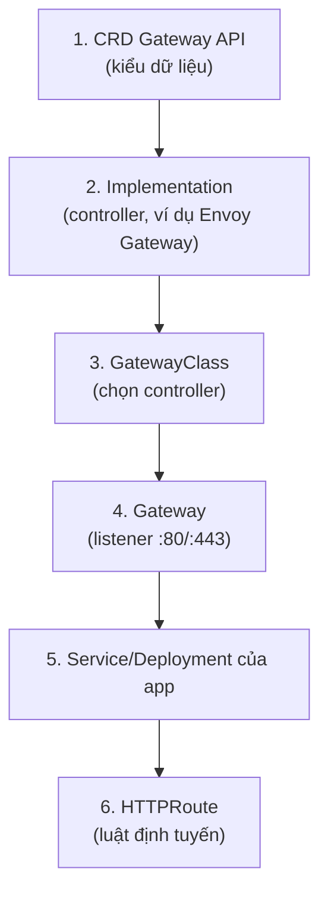
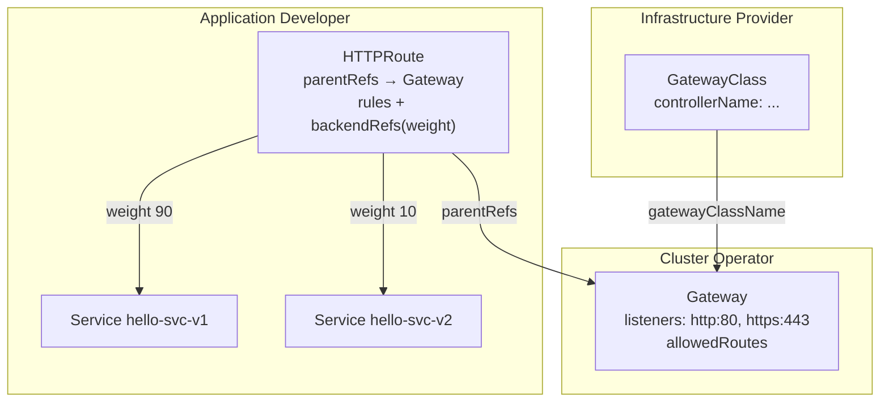
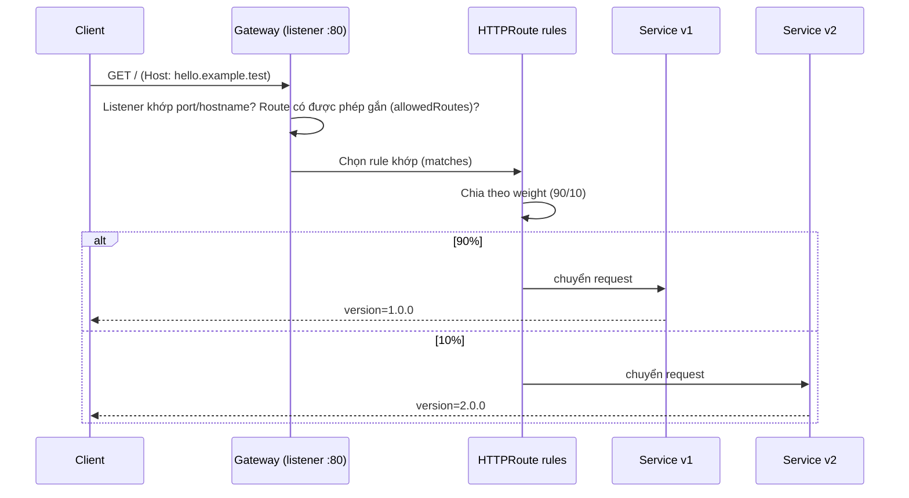

# 6_4_4 Ingress and Gateway API

> **Khóa học**: Cloud DevOps Basic — Containers and Kubernetes  
> **Phân nhóm**: 6 Domain 6 - Containers and Kubernetes › 6_4 Kubernetes Networking Configuration and Storage  
> **Chủ đề**: 6_4_4 Đưa traffic từ ngoài vào cluster: Ingress (đọc hiểu hệ thống cũ) và Gateway API (hướng đi hiện tại), chia traffic theo trọng số, TLS  
> **Phiên bản áp dụng**: Kubernetes 1.37; Gateway API v1.7.0 (phát hành 29-10-2026); Envoy Gateway v1.10.0 (ví dụ implementation)  
> **Trạng thái**: Đối chiếu tài liệu chính thức (17-11-2026), viết lại theo hướng "đi từ vấn đề" (18-11-2026). ⚠️ **Chưa chạy thử trên cluster**: manifest Gateway/HTTPRoute lấy từ tài liệu chính thức, chưa được apply thực tế. Các khối "Kỳ vọng" ở mục 4 là suy ra từ tài liệu, **không phải output đã quan sát**.  
> **Phạm vi**: [Topic README](./README.md#6_4_4-traffic-từ-ngoài-vào-ingress-và-gateway-api) · **Checkpoint**: [CHECKLIST](../../CHECKLIST.md#6_4-kubernetes-networking-configuration-and-storage)  
> **Lab thực hành liên quan**: [lab-6_4_3-gateway-api-weighted-routing](./README.md#lab-6_4_3-gateway-api-weighted-routing)  
> **Kiến thức liên quan**: [6_4_2 Services and EndpointSlices](<./6_4_2 Services and EndpointSlices.md>) · [6_4_5 ConfigMaps and Secrets](<./6_4_5 ConfigMaps and Secrets.md>)

---

## 0. Tình Huống Mở Đầu: "Cho 10% Người Dùng Thử Bản Mới"

Bạn có `hello-svc-v1` (đang chạy) và `hello-svc-v2` (bản mới). Sếp nói: *"Đẩy 10% traffic sang v2 thử xem."*

**Cách Ingress (cũ):** cần **hai** object Ingress và annotation **riêng của một controller** (ví dụ ingress-nginx):

```yaml
# Ingress chính: v1
metadata: { name: hello }
spec:
  rules: [{ host: hello.example.test, http: { paths: [{ path: /, pathType: Prefix, backend: { service: { name: hello-svc-v1, port: { number: 80 } } } }] } }]
---
# Ingress thứ hai, đánh dấu canary: v2
metadata:
  name: hello-canary
  annotations:
    nginx.ingress.kubernetes.io/canary: "true"
    nginx.ingress.kubernetes.io/canary-weight: "10"
spec:
  rules: [{ host: hello.example.test, http: { paths: [{ path: /, pathType: Prefix, backend: { service: { name: hello-svc-v2, port: { number: 80 } } } }] } }]
```

Đổi sang controller khác, hai annotation này **vô nghĩa**.

**Cách Gateway API (mới):** một `HTTPRoute`, trường chuẩn của API:

```yaml
rules:
- backendRefs:
  - { name: hello-svc-v1, port: 80, weight: 90 }
  - { name: hello-svc-v2, port: 80, weight: 10 }
```

Đây là toàn bộ lý do Gateway API ra đời: những thứ hay dùng (chia trọng số, khớp header, sửa request) **nằm trong API chuẩn**, chạy giống nhau trên mọi implementation hỗ trợ. Phần còn lại của bài giải thích mô hình đằng sau cái 6 dòng YAML này, rồi cho bạn thử.

> Nguồn annotation canary: [tài liệu ingress-nginx, mục Canary](https://kubernetes.github.io/ingress-nginx/user-guide/nginx-configuration/annotations/) (kiểm tra 18-11-2026). Trang này nêu canary là một Ingress riêng, thay thế backend cho request khớp rule của nó, tối đa một canary Ingress cho mỗi Ingress rule; ví dụ trên dùng cùng host/path là cách thiết lập thông thường, không phải điều trang nói rõ.

---

## 1. Khái Niệm Cốt Lõi & Bản Chất Kỹ Thuật (Core Concepts & Technical Deep Dive)

### 1.1 Vì Sao Cần Lớp Này Khi Đã Có Service?

Service `LoadBalancer` cho **mỗi Service một load balancer** và chỉ định tuyến L4 (xem [6_4_2](<./6_4_2 Services and EndpointSlices.md>)). Với web bạn muốn **một cửa vào** rồi chia theo host, path, header, TLS, trọng số. Kubernetes có hai API cho việc đó:

| | **Ingress** | **Gateway API** |
| :--- | :--- | :--- |
| Trạng thái | GA từ v1.19 nhưng **"frozen"**: không phát triển thêm, **không có kế hoạch gỡ** | Họ CRD đang phát triển, là **hướng dự án khuyến nghị** |
| Phạm vi | Chỉ HTTP(S) | HTTP, gRPC, TLS... |
| Phân vai | Một object cho tất cả | Tách theo vai trò: hạ tầng / vận hành / đội app |
| Tính năng nâng cao | **Annotation riêng của controller**, không portable | Có trong API chuẩn |
| Cài đặt | Cần Ingress controller | Cần cài **CRD** + một **implementation** |

Tài liệu Ingress ghi rõ: *"The Kubernetes project recommends using Gateway instead of Ingress"*.

### 1.2 Ingress Trong 60 Giây (Để Đọc Hệ Thống Cũ)

- Ingress chỉ là **cấu hình**; không có **Ingress controller** chạy thì không có tác dụng. Chọn controller bằng `ingressClassName`.
- Mỗi rule có `host` tùy chọn và `paths` với `pathType` bắt buộc: `Exact`, `Prefix`, `ImplementationSpecific`. `Prefix` khớp theo **từng đoạn** giữa các dấu `/`: `/foo` khớp `/foo/bar` nhưng **không** khớp `/foobar`.
- TLS: `spec.tls[].secretName` trỏ tới Secret `kubernetes.io/tls` ([6_4_5](<./6_4_5 ConfigMaps and Secrets.md>)).

```yaml
apiVersion: networking.k8s.io/v1
kind: Ingress
metadata:
  name: hello
spec:
  ingressClassName: nginx-example        # tên controller của bạn
  tls:
  - hosts: [hello.example.test]
    secretName: hello-tls
  rules:
  - host: hello.example.test
    http:
      paths:
      - path: /
        pathType: Prefix
        backend:
          service:
            name: hello-svc
            port:
              number: 80
```

### 1.3 Gateway API: Từ Con Số Không Đến Ba Tầng, Ba Chủ Sở Hữu

#### 1.3.1 Vì Sao Gateway API Phải "Cài" Mới Dùng Được

`Pod`, `Service`, `Ingress` là **resource có sẵn** trong mọi cluster. Gateway API thì **không**: tài liệu Kubernetes gọi nó là *"an add-on containing API kinds"*, các kind được định nghĩa dưới dạng **custom resource**. Để chạy được một route, bạn cần **ba thứ khác nhau**, và thiếu thứ nào cũng không chạy:

| # | Thành phần | Bản chất | Thiếu thì sao |
| :-- | :--- | :--- | :--- |
| 1 | **CRD của Gateway API** | "Từ điển kiểu dữ liệu": dạy API server biết `Gateway`, `HTTPRoute`... là gì | `kubectl apply` báo lỗi kiểu *no matches for kind "HTTPRoute"* |
| 2 | **Implementation** (controller) | Chương trình chạy trong cluster, **đọc** các object Gateway/HTTPRoute và **cấu hình proxy/load balancer thật** để chuyển traffic. Ví dụ: Envoy Gateway | Object tạo được nhưng nằm đó, không có `ADDRESS`/`Accepted`, không có traffic nào đi qua |
| 3 | **Object của bạn**: GatewayClass, Gateway, HTTPRoute | Cấu hình cụ thể: "mở cổng nào, route đi đâu" | Không có gì để chạy |

**Ví dụ đời thường:** CRD là *mẫu đơn in sẵn* (không có mẫu thì không điền được đơn). Implementation là *nhân viên văn phòng* đọc đơn và thực hiện (có đơn mà không có nhân viên thì đơn nằm trong ngăn kéo). Object của bạn là *tờ đơn đã điền*.

> Chỉ cài CRD **không** làm cluster biết định tuyến traffic. CRD chỉ là bước 1 trong 3.

**Cài như thế nào?** CRD và implementation đều cài bằng lệnh (`kubectl apply` hoặc `helm install`). Với bài lab, **một lệnh `helm install` của Envoy Gateway cài cả hai** (lệnh đầy đủ ở [4.1](#41-cài-crd-và-một-implementation-ví-dụ-envoy-gateway); cách tự cài riêng CRD và thứ tự các bước ở [1.3.6](#136-thứ-tự-cài-đặt-và-vì-sao-phải-theo-thứ-tự)).

#### 1.3.2 Thuật Ngữ Nền (Đọc Trước Khi Đi Tiếp)

| Thuật ngữ | Nghĩa |
| :--- | :--- |
| **CRD** (CustomResourceDefinition) | Object dùng để đăng ký thêm một **kind** mới vào Kubernetes API |
| **Custom resource** | Một object thuộc kind do CRD định nghĩa (ví dụ một `HTTPRoute` cụ thể) |
| **Implementation / controller** | Phần mềm hiện thực hóa các kind đó. Gateway API chỉ định nghĩa *API*, không tự chuyển traffic |
| **Listener** | Một "cửa nghe" của Gateway: cổng + giao thức (+ hostname, TLS) |
| **Backend** | Nơi traffic đến cuối cùng, thường là một `Service` |
| **Channel** | Cách Gateway API chia bản phát hành CRD: **Standard** (đã GA/beta) và **Experimental** (có thể thay đổi, kể cả thay đổi phá vỡ tương thích) |

#### 1.3.3 Các Kind Chính: Định Nghĩa Và Ví Dụ Tối Thiểu

Tài liệu Kubernetes liệt kê bốn kind ổn định: `GatewayClass`, `Gateway`, `HTTPRoute`, `GRPCRoute`. Tài liệu Gateway API ghi thêm `TLSRoute` là GA và thuộc **Standard channel từ v1.5.0**. Theo từng kind:

**`GatewayClass`**: *"Defines a set of gateways with common configuration and managed by a controller that implements the class."* Nói đơn giản: nó **chọn implementation nào sẽ xử lý** các Gateway thuộc class này, thông qua `controllerName`. Thường do implementation hoặc nhà cung cấp hạ tầng tạo sẵn.

```yaml
apiVersion: gateway.networking.k8s.io/v1
kind: GatewayClass
metadata:
  name: example-class
spec:
  controllerName: example.com/gateway-controller   # tên controller của implementation (giá trị minh họa)
```

**`Gateway`**: *"Defines an instance of traffic handling infrastructure, such as cloud load balancer."* Là **một cổng vào cụ thể**: nghe ở cổng nào, giao thức nào, nhận Route từ đâu. Nó chỉ ra class bằng `gatewayClassName` và khai báo `listeners`.

```yaml
apiVersion: gateway.networking.k8s.io/v1
kind: Gateway
metadata:
  name: example-gateway
  namespace: example-namespace
spec:
  gatewayClassName: example-class     # trỏ tới GatewayClass ở trên
  listeners:
  - name: http
    protocol: HTTP
    port: 80
    hostname: "www.example.com"
    allowedRoutes:                    # ai được gắn Route vào listener này
      namespaces:
        from: Same                    # chỉ Route cùng namespace (mặc định)
```

**`HTTPRoute`**: *"Defines HTTP-specific rules for mapping traffic from a Gateway listener to a representation of backend network endpoints."* Là **luật định tuyến**: request khớp điều kiện nào thì đi tới Service nào. Nó gắn vào Gateway bằng `parentRefs`.

```yaml
apiVersion: gateway.networking.k8s.io/v1
kind: HTTPRoute
metadata:
  name: example-httproute
spec:
  parentRefs:                          # gắn vào Gateway nào
  - name: example-gateway
  hostnames: ["www.example.com"]
  rules:
  - matches:                           # điều kiện khớp
    - path: { type: PathPrefix, value: /login }
    backendRefs:                       # đích đến (kèm weight nếu chia traffic)
    - name: example-svc
      port: 8080
```

Ý nghĩa: request tới `www.example.com/login` qua `example-gateway` được chuyển tới Service `example-svc` cổng 8080.

**`GRPCRoute`**: tương tự HTTPRoute nhưng cho **gRPC**. **`TLSRoute`**: định tuyến theo kết nối TLS (ví dụ chế độ `Passthrough`, xem 1.5). Hai kind này không cần cho phần lab, chỉ cần biết chúng tồn tại.

#### 1.3.4 Ba Chủ Sở Hữu (Role-Oriented)

Gateway API tách API theo **ai chịu trách nhiệm**, để đội app không phải đụng vào cấu hình hạ tầng. Tài liệu Kubernetes mô tả ba vai:

- **Infrastructure Provider**: quản lý hạ tầng cho nhiều tenant (ví dụ nhà cung cấp cloud).
- **Cluster Operator**: quản lý cluster, quan tâm chính sách, truy cập mạng, quyền của ứng dụng.
- **Application Developer**: quản lý ứng dụng, quan tâm cấu hình cấp ứng dụng và cách ghép Service.

| Kind | Chủ sở hữu | Làm gì |
| :--- | :--- | :--- |
| **GatewayClass** | Infrastructure Provider | Nhóm Gateway dùng chung cấu hình, gắn với một controller qua `controllerName` |
| **Gateway** | Cluster Operator | Một thể hiện hạ tầng nhận traffic; khai báo **listeners** (cổng, giao thức, hostname, TLS, `allowedRoutes`) |
| **HTTPRoute / GRPCRoute** | Application Developer | Luật định tuyến từ listener tới backend (thường là Service) |

#### 1.3.5 Các "Sợi Dây" Nối Các Kind Với Nhau

```text
HTTPRoute ──parentRefs──▶ Gateway ──gatewayClassName──▶ GatewayClass ──controllerName──▶ Implementation (controller)
    │                        ▲
    │                        └── allowedRoutes: Gateway lọc xem Route nào được gắn
    └──backendRefs (weight)──▶ Service ──▶ Pod
```

- Một Gateway tham chiếu **đúng một** GatewayClass; nhiều Route có thể gắn vào cùng một Gateway.
- Quan hệ **hai chiều**: Route *xin* gắn bằng `parentRefs`, Gateway *cho phép hay từ chối* bằng `allowedRoutes`. Tài liệu gọi đây là *"bidirectional trust model"*. **Mặc định chỉ nhận Route cùng namespace**; muốn khác namespace phải cấu hình `allowedRoutes`.

#### 1.3.6 Thứ Tự Cài Đặt Và Vì Sao Phải Theo Thứ Tự

Mỗi bước phụ thuộc bước trước, nên **sai thứ tự là lỗi**:



| Bước | Việc làm | Kiểm tra đã xong chưa | Lý do thứ tự |
| :-- | :--- | :--- | :--- |
| **0** | Xem cluster đã có CRD chưa | `kubectl get crd \| grep gateway.networking.k8s.io` | Tránh cài chồng (xem 1.6, 5.3) |
| **1** | Cài **CRD** | `kubectl get crd` thấy `gateways`, `httproutes`... | Chưa có CRD thì không tạo được các object sau |
| **2** | Cài **implementation** và đợi sẵn sàng | `kubectl wait ... deployment/... --for=condition=Available` | Không có controller thì không ai xử lý object |
| **3** | Có **GatewayClass** | `kubectl get gatewayclass` → `ACCEPTED` là `True` | Gateway cần một class tồn tại để biết controller nào quản lý |
| **4** | Tạo **Gateway** | `kubectl get gateway` → `PROGRAMMED`, có `ADDRESS` | Route cần một Gateway để gắn vào |
| **5** | Tạo **Deployment + Service** cho app | `kubectl get svc,endpointslice` | Route cần Service đích tồn tại (`ResolvedRefs`) |
| **6** | Tạo **HTTPRoute** | `kubectl describe httproute` → `Accepted`, `ResolvedRefs` đều `True` | Cuối cùng mới nối mọi thứ lại |

**Bước 1 có hai cách, chọn một:**

- **(a) Để implementation cài giúp.** Quickstart của Envoy Gateway: lệnh `helm install` ở 4.1 *cài cả CRD lẫn Envoy Gateway*. Đây là đường được dùng trong bài.
- **(b) Tự cài CRD bằng kubectl** (theo trang Getting started của Gateway API; ví dụ v1.7.0, kênh Standard):

  ```bash
  kubectl apply --server-side -f https://github.com/kubernetes-sigs/gateway-api/releases/download/v1.7.0/standard-install.yaml
  ```

  Kênh Experimental dùng `experimental-install.yaml`, có thể có thay đổi phá vỡ tương thích trong các bản sau. Bài học này chỉ cần kênh Standard. **Đọc nội dung file trước khi apply.**

**Bước 3 (GatewayClass) do ai tạo?** Tùy implementation. Với Envoy Gateway, trang Quickstart hướng dẫn `kubectl apply -f .../quickstart.yaml`, mô tả là cài *GatewayClass, Gateway, HTTPRoute và app ví dụ*; trang không hiển thị nội dung file, nên hãy **đọc file trước khi apply** và dùng `kubectl get gatewayclass` để biết tên class thật rồi điền vào `gatewayClassName` (ví dụ `eg` ở 4.3). Với implementation khác, đọc tài liệu của nó.

> ⚠️ Chưa chạy thử trên cluster. Thứ tự trên suy ra từ tài liệu Gateway API (Getting started), tài liệu Envoy Gateway (Quickstart) và quan hệ phụ thuộc giữa các kind.

### 1.4 `weight`: Tỉ Lệ Tương Đối, Không Phải Phần Trăm

`backendRefs[].weight` là tỉ lệ **trong một rule**; tổng các weight là mẫu số. Mặc định `1`. Rule chỉ có một backend thì nhận 100% bất kể weight. `weight: 0` = không nhận traffic (rollback nhanh).

Quy trình canary 3 bước trong tài liệu Gateway API (nền tảng cho 6_6_8):

1. **Theo header**: rule riêng khớp `traffic: test` đưa traffic thử nghiệm tới v2, người dùng thật vẫn 100% v1.
2. **Chia dần**: 90/10, theo dõi lỗi và độ trễ.
3. **Hoàn tất**: v1 `weight: 0`, v2 `weight: 1`; lỗi thì đổi trọng số quay lại.

### 1.5 TLS Termination Tại Gateway

Cấu hình theo **listener**: `protocol: HTTPS`, `tls.mode: Terminate` (mặc định), `certificateRefs` trỏ tới Secret. Kết nối **downstream** (client → Gateway) và **upstream** (Gateway → backend, qua `BackendTLSPolicy`) cấu hình **độc lập**. `Passthrough` chỉ dành cho listener `protocol: TLS`. **cert-manager** có thể cấp và gia hạn chứng chỉ tự động vào Secret đó.

### 1.6 Chọn Implementation

Có nhiều implementation (cloud riêng, bare-metal, đa dụng); xem trang Implementations của Gateway API. Mỗi implementation có yêu cầu phiên bản Kubernetes và CRD riêng; làm theo hướng dẫn chính thức của cái bạn chọn. Nếu nhà cung cấp Kubernetes đã quản lý CRD Gateway API, **đừng cài chồng** (Envoy Gateway cũng cảnh báo).

### 1.7 ⚠️ Ingress NGINX Đã Nghỉ Hưu (Tóm Tắt)

- **Ingress NGINX** (cộng đồng Kubernetes) hết bảo trì từ **tháng 3-2026**: không bản phát hành, bản sửa lỗi, vá bảo mật. Deployment cũ **vẫn chạy**. Repo `kubernetes/ingress-nginx` đã archived (kiểm tra 17-11-2026).
- Steering Committee và Security Response Committee (29-01-2026): ở lại là *"leaves you and your users vulnerable to attack"*; **không có thay thế drop-in**.
- Kiểm tra cluster có đang dùng: `kubectl get pods --all-namespaces --selector app.kubernetes.io/name=ingress-nginx`.
- **Không nhầm** với **NGINX Ingress** của F5: hai controller khác nhau.
- Di trú: công cụ `ingress2gateway`, nhưng blog "Before You Migrate" cảnh báo các hành vi bất ngờ (ví dụ regex là prefix và không phân biệt hoa thường), nên **vẫn phải kiểm thử hành vi** sau khi chuyển.

---

## 2. Ví Dụ Đời Sống Thực Tế Dễ Hiểu (Intuitive Real-World Analogies)

**Một hãng bay muốn mở đường bay mới tại sân bay.**

Hãng (đội app) không tự xây nhà ga. Họ làm việc theo thứ tự:

1. **Tập đoàn xây dựng nhà ga** đã chọn sẵn *kiểu* nhà ga: quốc tế hay nội địa, ai vận hành, tiêu chuẩn nào. Đó là **GatewayClass**.
2. **Ban quản lý sân bay** dựng *một nhà ga cụ thể*: mở cổng 80 và 443, chỉ đón các tên miền nhất định, đặt **quầy soát giấy tờ TLS** ở cửa, và quy định hãng nào được đỗ (`allowedRoutes`). Đó là **Gateway**.
3. **Hãng bay nộp lịch bay**: "chuyến `/login` ra cổng 5; 90% khách lên xe buýt A, 10% lên xe buýt B." Đó là **HTTPRoute**, và xe buýt là **Service**.

Rồi chuyện gì xảy ra tiếp theo chính là canary:

- Tuần đầu: xe buýt B (bản mới) chỉ chở **10%** khách. Nếu khách than phiền (lỗi, chậm), nhân viên đổi lại thành 100/0 trong một phút.
- Tuần sau: 50/50, rồi 0/100. Xe buýt A về garage.
- Muốn thử riêng: nhân viên có thẻ `traffic: test` được xếp vào xe buýt B ngay từ đầu (canary theo header).

**Ingress thì như cổng làng với một bảng thông báo chung.** Ai cũng ghi lên cùng một tờ giấy. Muốn quy định riêng (annotation) thì mỗi người gác cổng hiểu một kiểu; chuyển sang làng khác là vô dụng. Và **Ingress NGINX nghỉ hưu** là người gác cổng đã đóng sổ: cổng vẫn mở, người vẫn đứng đó, nhưng không ai sửa khóa hay vá hàng rào khi bị phá.

---

## 3. Kiến Trúc, Luồng Hoạt Động & Hình Ảnh Trực Quan (Architecture, Diagrams & Visual Media)

### 3.1 Quan Hệ Giữa Các Kind (Sơ Đồ Chính Thức)


*Nguồn: trang Gateway API, tài liệu Kubernetes.*

### 3.2 Luồng Request Qua Gateway Và HTTPRoute (Sơ Đồ Chính Thức)


*Nguồn: trang Gateway API, tài liệu Kubernetes.*

### 3.3 Ai Sở Hữu Từng Object



### 3.4 Một Request Đi Qua Từng Tầng (Khái Niệm)

Sơ đồ khái niệm theo mô hình tài liệu; chi tiết (ví dụ proxy là gì, nằm ở đâu) tùy implementation.



### 3.5 Hình Chính Thức Của Ingress (Để Đối Chiếu)


*Nguồn: trang Ingress, tài liệu Kubernetes.*

---

## 4. Code Mẫu Trực Quan Hoặc Dòng Lệnh Thực Chiến (Runnable Sample Code / CLI)

> ⚠️ Chưa chạy thử trên cluster (xem Trạng thái). Chỉ chạy trên cluster học tập. Bản lab đầy đủ: [lab-6_4_3-gateway-api-weighted-routing](./README.md#lab-6_4_3-gateway-api-weighted-routing).

### 4.1 Cài CRD Và Một Implementation (Ví Dụ: Envoy Gateway)

Theo Quickstart của Envoy Gateway v1.10.0 (chart cài cả CRD Gateway API lẫn Envoy Gateway; cần Helm, học ở [6_5](<../6_5 Helm Package Management/README.md>)):

```bash
helm install eg oci://docker.io/envoyproxy/gateway-helm --version v1.10.0 \
  -n envoy-gateway-system --create-namespace
kubectl wait --timeout=5m -n envoy-gateway-system deployment/envoy-gateway --for=condition=Available

kubectl get crd | grep gateway.networking.k8s.io   # bước 1 xong: có CRD
kubectl get gatewayclass                           # bước 3: cần một class ACCEPTED=True để 4.3 dùng
```

> Nếu `get gatewayclass` chưa có class nào, Quickstart của Envoy Gateway tạo nó qua `kubectl apply -f https://github.com/envoyproxy/gateway/releases/download/v1.10.0/quickstart.yaml -n default` (kèm Gateway/HTTPRoute/app ví dụ tên `eg`; **đọc file trước khi apply**). Thứ tự và lý do: xem [1.3.6](#136-thứ-tự-cài-đặt-và-vì-sao-phải-theo-thứ-tự).

> Muốn tự cài CRD: bản phát hành Gateway API có `standard-install.yaml` (ví dụ `https://github.com/kubernetes-sigs/gateway-api/releases/download/v1.7.0/standard-install.yaml`); **đọc nội dung trước khi apply** và làm theo trang *Getting started*.  
> Trên kind không có LoadBalancer: Envoy Gateway hướng dẫn `kubectl port-forward` tới Service do nó tạo (mục "Without LoadBalancer Support" của Quickstart) hoặc cài MetalLB.

### 4.2 Hai Phiên Bản Của Ứng Dụng

```yaml
# hello-v1 và hello-v2: cùng image, khác APP_VERSION; mỗi bản một Service
apiVersion: apps/v1
kind: Deployment
metadata: { name: hello-svc-v1 }
spec:
  replicas: 2
  selector: { matchLabels: { app: hello-svc, version: v1 } }
  template:
    metadata: { labels: { app: hello-svc, version: v1 } }
    spec:
      containers:
      - name: hello-svc
        image: selflearn.invalid/hello-svc:1.0.0
        imagePullPolicy: IfNotPresent
        ports: [{ name: http, containerPort: 8080 }]
        env: [{ name: APP_VERSION, value: "1.0.0" }]
        readinessProbe: { httpGet: { path: /ready, port: http } }
---
apiVersion: v1
kind: Service
metadata: { name: hello-svc-v1 }
spec:
  selector: { app: hello-svc, version: v1 }
  ports: [{ name: http, port: 80, targetPort: http }]
# hello-svc-v2: lặp lại với version: v2, APP_VERSION "2.0.0", image 2.0.0 nếu đã build bản 2.0.0
```

### 4.3 Gateway + HTTPRoute Chia 90/10 (Phần Đáng Chạy Nhất)

```yaml
apiVersion: gateway.networking.k8s.io/v1
kind: Gateway
metadata:
  name: hello-gw
spec:
  gatewayClassName: eg                 # GatewayClass phải TỒN TẠI trước (xem 1.3.6, bước 3); kiểm tra: kubectl get gatewayclass
  listeners:
  - name: http
    protocol: HTTP
    port: 80
    allowedRoutes:
      namespaces:
        from: Same                     # mặc định: chỉ nhận Route cùng namespace
---
apiVersion: gateway.networking.k8s.io/v1
kind: HTTPRoute
metadata:
  name: hello-route
spec:
  parentRefs:
  - name: hello-gw
  rules:
  - backendRefs:
    - name: hello-svc-v1
      port: 80
      weight: 90
    - name: hello-svc-v2
      port: 80
      weight: 10
```

```bash
kubectl apply -f hello-gw.yaml
kubectl get gateway,httproute
kubectl describe httproute hello-route      # đọc Status.Parents: Accepted / ResolvedRefs

# Gửi 100 request và đếm version trả về (đặt GATEWAY_URL theo cách bạn truy cập Gateway)
for i in $(seq 1 100); do curl -s "$GATEWAY_URL/"; done | grep -o 'version=[0-9.]*' | sort | uniq -c
```

**Kỳ vọng (suy ra từ tài liệu, chưa quan sát)**: số lần `version=1.0.0` **gần** 90 và `version=2.0.0` **gần** 10; mẫu nhỏ sẽ lệch. Sau đó thử `weight` `50/50`, rồi `0/1`, `kubectl apply` lại, đếm lại. Nếu số đếm không đổi, kiểm tra `Accepted` / `ResolvedRefs` trước.

### 4.4 Canary Theo Header (Từ Tài Liệu Gateway API)

```yaml
apiVersion: gateway.networking.k8s.io/v1
kind: HTTPRoute
metadata:
  name: foo-route
spec:
  hostnames: [foo.example.com]
  rules:
  - backendRefs:
    - name: foo-v1
      port: 8080
  - matches:
    - headers:
      - name: traffic
        value: test
    backendRefs:
    - name: foo-v2
      port: 8080
```

### 4.5 TLS Termination Tại Listener

```yaml
listeners:
- name: https
  protocol: HTTPS
  port: 443
  hostname: hello.example.test
  tls:
    mode: Terminate                    # mặc định khi bỏ trống
    certificateRefs:
    - kind: Secret
      group: ""
      name: hello-tls                  # Secret type kubernetes.io/tls (xem 6_4_5)
```

> Đoạn trên chỉ là phần `listeners` của một object `Gateway` (đặt vào `spec.listeners` của Gateway ở 4.3), không phải file chạy độc lập.

**Luồng mã hóa:** client → Gateway là **HTTPS** (Gateway trình chứng chỉ, giải mã TLS tại listener). Gateway → Pod mặc định là HTTP thường; mã hóa đoạn này là cấu hình riêng (`BackendTLSPolicy`, xem 1.5).

#### Cần Chuẩn Bị Gì Trước Khi Dùng

1. **Có Secret chứa chứng chỉ và private key, tạo TRƯỚC khi apply Gateway.** `certificateRefs` chỉ *trỏ tới* Secret, không tự tạo ra nó. Loại Secret là `kubernetes.io/tls` (xem [6_4_5](<./6_4_5 ConfigMaps and Secrets.md>); trang TLS của Gateway API không nêu tên loại này, nên đây là theo tài liệu Secret của Kubernetes). Tạo bằng:

   ```bash
   kubectl create secret tls hello-tls --cert=tls.crt --key=tls.key
   ```

2. **Có cặp `tls.crt` / `tls.key`.** Với lab, tạo chứng chỉ tự ký, **gói ở thư mục tạm, không đặt trong repo** (private key không được commit):

   ```bash
   d=$(mktemp -d) && cd "$d"
   openssl req -x509 -newkey rsa:2048 -nodes -days 30 \
     -keyout tls.key -out tls.crt \
     -subj "/CN=hello.example.test" \
     -addext "subjectAltName=DNS:hello.example.test"
   ```

   Chứng chỉ phải có tên khớp `hostname` của listener (`hello.example.test`). Cert tự ký thì client **không tin mặc định**: `curl` cần `--cacert tls.crt` (hoặc `-k` chỉ cho lab). Môi trường thật dùng CA thật, hoặc **cert-manager** để cấp và gia hạn tự động (xem 1.5).

3. **Secret cùng namespace với Gateway** (cách đơn giản nhất). Trang TLS của Gateway API cho thấy tham chiếu **khác namespace** (đặt `namespace` trong `certificateRefs`) chỉ hợp lệ khi có một **`ReferenceGrant`** trong namespace đích cho phép; thiếu nó thì tham chiếu không hợp lệ.

4. **Gateway có listener HTTPS và cổng 443 đến được.** Trên kind không có LoadBalancer, bạn phải `kubectl port-forward` tới Service của proxy (xem 4.1), trỏ vào **cổng 443** của nó. Thêm một listener `http` cổng 80 (như ở 4.3) nếu vẫn muốn chạy song song.

5. **HTTPRoute gắn vào listener này.** `hostnames` của HTTPRoute cần giao với `hostname` của listener, nếu không route có thể không được chấp nhận (quy tắc này theo hiểu biết về API, **chưa đối chiếu** trong tài liệu; xem `Status.Parents` của HTTPRoute để biết thực tế).

Kiểm tra (ví dụ, giả sử bạn đã port-forward proxy ra `localhost:8443`):

```bash
curl --cacert tls.crt --resolve hello.example.test:8443:127.0.0.1 https://hello.example.test:8443/
kubectl describe gateway hello-gw        # Listener https: Programmed/ResolvedRefs = True
```

Nếu `ResolvedRefs` là `False`, nghi ngờ trước tiên: Secret không tồn tại, sai tên, sai namespace, hoặc thiếu `ReferenceGrant`.

> ⚠️ Phần chuẩn bị TLS chưa chạy thử trên cluster; các lệnh `openssl` và `curl` là lệnh chuẩn nhưng chưa quan sát output trong lab này.

### 4.6 Lệnh Chẩn Đoán

```bash
kubectl get gatewayclass                       # CONTROLLER, ACCEPTED
kubectl get gateway -A                         # ADDRESS, PROGRAMMED
kubectl describe gateway hello-gw              # Conditions: Accepted, Programmed
kubectl describe httproute hello-route         # Parents: Accepted, ResolvedRefs
```

---

## 5. Cạm Bẫy Thực Tế & Thực Tiễn Sản Xuất (Production Gotchas & Best Practices)

### 5.1 Route Có Nhưng Traffic Không Vào

- **Hiện tượng**: `kubectl get httproute` thấy object, nhưng request không tới.
- **Nguyên nhân thường gặp**: Route khác namespace với Gateway (mặc định `from: Same`); `parentRefs` sai tên; backend không tồn tại.
- **Làm gì**: đọc `Status.Parents[].Conditions` của HTTPRoute (`Accepted`, `ResolvedRefs`) **trước** khi nghi ngờ proxy.

### 5.2 Weight Không Phải Phần Trăm, Và Không Bám Theo Người Dùng

- Weight là tỉ lệ tương đối **trong một rule** (xem 1.4); hãy đặt tổng bằng 100 cho dễ đọc, và để cả hai backend trong **một** rule.
- Chia theo weight là **theo request**, không bảo đảm một người dùng luôn thấy cùng một phiên bản. Canary có trạng thái phiên thì dùng định tuyến theo header/cookie hoặc cơ chế bám phiên riêng của implementation (đối chiếu tài liệu của nó).

### 5.3 Cài Chồng CRD Gateway API

Trước khi cài, chạy `kubectl get crd | grep gateway.networking.k8s.io` và kiểm tra annotation phiên bản. Nếu nhà cung cấp đã quản lý CRD, không cài thêm; tuân theo ma trận tương thích của implementation.

### 5.4 Còn Chạy Ingress NGINX Mà Không Có Kế Hoạch Di Trú

Xem 1.7: deployment cũ vẫn chạy nên dễ bị bỏ quên, trong khi không còn vá bảo mật. Kiểm tra bằng lệnh selector ở 1.7, lập kế hoạch di trú (Gateway API hoặc controller Ingress khác còn được bảo trì), và **kiểm thử hành vi** regex, rewrite, default backend sau khi chuyển.

---

## 6. Câu Hỏi Củng Cố Kiến Thức (Active Recall Quiz)

### Câu Hỏi 1: Ingress Có Bị Gỡ Bỏ Chưa? Ingress NGINX Thì Sao? (Phỏng vấn)

<details>
<summary>Đáp án</summary>

Ingress API **chưa** bị gỡ: GA nhưng "frozen" (không phát triển thêm, không có kế hoạch gỡ). **Ingress NGINX controller** đã **nghỉ hưu từ tháng 3-2026**, repo archived, không còn bản vá bảo mật. Hệ thống mới nên dùng Gateway API.
</details>

### Câu Hỏi 2: Ai Sở Hữu Từng Object, Và Một HTTPRoute Gắn Vào Gateway Bằng Cách Nào?

<details>
<summary>Đáp án</summary>

GatewayClass (Infrastructure Provider) ← Gateway (Cluster Operator) ← HTTPRoute (Application Developer) → Service. Gateway tham chiếu đúng một GatewayClass qua `gatewayClassName`; HTTPRoute gắn vào Gateway qua `parentRefs`; Gateway kiểm soát bằng `allowedRoutes` (mặc định chỉ cùng namespace).
</details>

### Câu Hỏi 3: Rule Có `weight` 90 Và 10. Thêm Backend Thứ Ba `weight: 100` Vào Cùng Rule Thì Tỉ Lệ Mới?

<details>
<summary>Đáp án</summary>

Tổng = 200, nên tỉ lệ là 45%, 5%, 50%. Weight là tỉ lệ tương đối, mẫu số là tổng weight trong rule.
</details>

---

## 7. 📚 Nguồn Tài Liệu Chính Thống (Tier-1 Official References)

- [Gateway API (Kubernetes docs)](https://kubernetes.io/docs/concepts/services-networking/gateway/) - Mô hình tài nguyên, vai trò, ví dụ `Gateway`/`HTTPRoute`, request flow.
- [HTTP traffic splitting (Gateway API)](https://gateway-api.sigs.k8s.io/guides/traffic-splitting/) - `backendRefs[].weight`, canary theo header, hoàn tất rollout.
- [TLS Configuration (Gateway API)](https://gateway-api.sigs.k8s.io/guides/tls/) - Listener TLS, `Terminate`/`Passthrough`, `BackendTLSPolicy`.
- [Gateway API Getting started](https://gateway-api.sigs.k8s.io/guides/getting-started/) - Cài CRD và bắt đầu với implementation.
- [Gateway API Implementations](https://gateway-api.sigs.k8s.io/implementations/) - Danh sách implementation và mức hỗ trợ.
- [Migrating from Ingress (Gateway API)](https://gateway-api.sigs.k8s.io/guides/getting-started/migrating-from-ingress/) và [A Welcome Guide for Ingress-NGINX Users](https://gateway-api.sigs.k8s.io/guides/getting-started/migrating-from-ingress-nginx/) - Hướng dẫn di trú.
- [Ingress](https://kubernetes.io/docs/concepts/services-networking/ingress/) - Ingress resource, `pathType`, TLS, trạng thái frozen.
- [Ingress Controllers](https://kubernetes.io/docs/concepts/services-networking/ingress-controllers/) - Danh sách controller trong tài liệu Kubernetes.
- [Ingress NGINX Retirement: What You Need to Know](https://kubernetes.io/blog/2025/11/11/ingress-nginx-retirement/) - Blog chính thức về việc nghỉ hưu.
- [Ingress NGINX: Statement from the Kubernetes Steering and Security Response Committees](https://kubernetes.io/blog/2026/01/29/ingress-nginx-statement/) - Tuyên bố 29-01-2026.
- [Before You Migrate: Five Surprising Ingress-NGINX Behaviors You Need to Know](https://kubernetes.io/blog/2026/02/27/ingress-nginx-before-you-migrate/) - Hành vi cần chú ý khi di trú.
- [Ingress-NGINX Annotations: Canary](https://kubernetes.github.io/ingress-nginx/user-guide/nginx-configuration/annotations/) - Annotation `canary`, `canary-weight` dùng ở mục 0 (controller đã nghỉ hưu, chỉ để đọc hiểu hệ thống cũ).
- [Envoy Gateway Quickstart](https://gateway.envoyproxy.io/docs/tasks/quickstart/) - Ví dụ cài một implementation.
- [cert-manager: Annotated Gateway resource](https://cert-manager.io/docs/usage/gateway/) - Cấp chứng chỉ tự động cho Gateway (trang ghi tính năng này ở trạng thái beta từ cert-manager 1.15 tại thời điểm kiểm tra; đối chiếu lại trước khi dùng).
- [kubernetes-sigs/ingress2gateway](https://github.com/kubernetes-sigs/ingress2gateway) - Công cụ hỗ trợ chuyển đổi Ingress sang Gateway API (Tier 2: kho GitHub chính thức).
