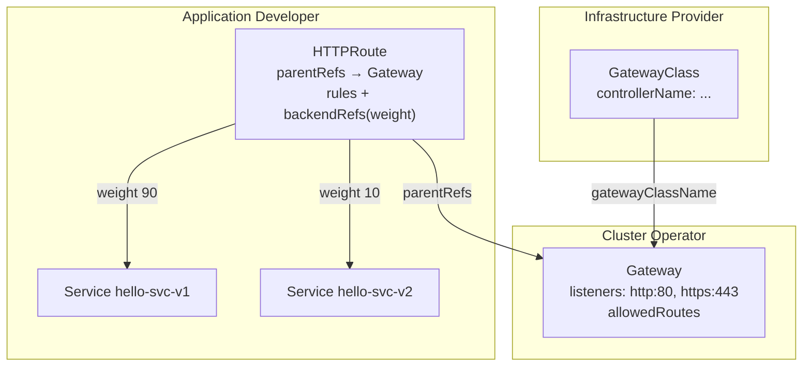
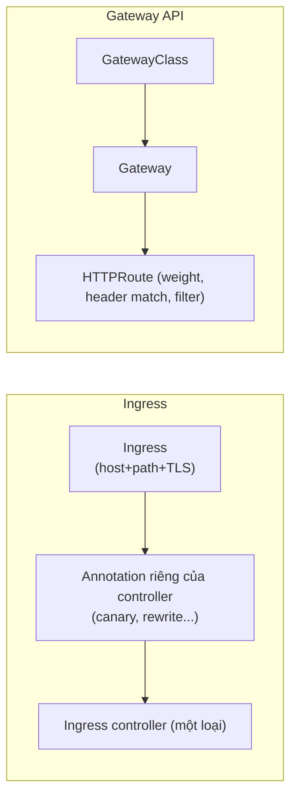

# 6_4_4 Ingress and Gateway API

> **Khóa học**: Cloud DevOps Basic — Containers and Kubernetes  
> **Phân nhóm**: 6 Domain 6 - Containers and Kubernetes › 6_4 Kubernetes Networking Configuration and Storage  
> **Chủ đề**: 6_4_4 Đưa traffic từ ngoài vào cluster: Ingress (đọc hiểu hệ thống cũ) và Gateway API (hướng đi hiện tại), chia traffic theo trọng số, TLS  
> **Phiên bản áp dụng**: Kubernetes 1.37; Gateway API v1.7.0 (phát hành 29-10-2026); Envoy Gateway v1.10.0 (ví dụ implementation)  
> **Trạng thái**: Đối chiếu tài liệu chính thức (17-11-2026). ⚠️ **Chưa chạy thử trên cluster**: tôi không cài được Gateway API implementation lên cluster kiểm chứng, nên mọi manifest Gateway/HTTPRoute dưới đây lấy từ tài liệu chính thức và chưa được apply thực tế  
> **Phạm vi**: [Topic README](./README.md#6_4_4-traffic-từ-ngoài-vào-ingress-và-gateway-api) · **Checkpoint**: [CHECKLIST](../../CHECKLIST.md#6_4-kubernetes-networking-configuration-and-storage)  
> **Lab thực hành liên quan**: [lab-6_4_3-gateway-api-weighted-routing](./README.md#lab-6_4_3-gateway-api-weighted-routing)  
> **Kiến thức liên quan**: [6_4_2 Services and EndpointSlices](<./6_4_2 Services and EndpointSlices.md>) · [6_4_5 ConfigMaps and Secrets](<./6_4_5 ConfigMaps and Secrets.md>)

---

## 1. Khái Niệm Cốt Lõi & Bản Chất Kỹ Thuật (Core Concepts & Technical Deep Dive)

### 1.1 Vì Sao Cần Lớp Này Khi Đã Có Service?

Service `LoadBalancer` mỗi cái một load balancer và chỉ định tuyến L4. Với HTTP, bạn muốn **một điểm vào duy nhất** rồi chia theo **host, path, header, TLS, trọng số**. Có hai API Kubernetes cho việc này:

| | **Ingress** | **Gateway API** |
| :--- | :--- | :--- |
| Trạng thái | GA từ v1.19, nhưng **đã "frozen"**: không còn phát triển, không có thay đổi, **không có kế hoạch gỡ khỏi Kubernetes** | Họ API mở rộng (CRD) đang phát triển, là **hướng được dự án khuyến nghị** |
| Phạm vi | Chỉ HTTP(S) | HTTP, gRPC, TLS... (xem 1.4) |
| Phân vai | Một object `Ingress` cho tất cả | Tách theo vai trò (hạ tầng / vận hành cluster / đội ứng dụng) |
| Tính năng nâng cao (header match, trọng số...) | Phải dùng **annotation riêng của từng controller**, không portable | Có trong API chuẩn |
| Cài đặt | Cần **Ingress controller** | Cần cài **CRD** + một **implementation** |

Tài liệu Ingress ghi rõ: *"The Kubernetes project recommends using Gateway instead of Ingress"*.

### 1.2 ⚠️ Ingress NGINX Đã Nghỉ Hưu (Retired)

Trạng thái theo nguồn chính thức của Kubernetes:

- Blog chính thức ngày 11-11-2025: *best-effort maintenance đến tháng 3-2026*; sau đó **không còn bản phát hành, bản sửa lỗi, hay bản vá bảo mật**. Deployment cũ **vẫn chạy**, các artifact (Helm chart, image) vẫn tải được.
- Tuyên bố của Steering Committee và Security Response Committee (29-01-2026): ở lại với Ingress NGINX sau khi nghỉ hưu *"leaves you and your users vulnerable to attack"*; **không có giải pháp thay thế nào là drop-in**, cần lên kế hoạch và công sức kỹ thuật.
- Kho `kubernetes/ingress-nginx` trên GitHub được kiểm tra ngày 17-11-2026: **đã archived** (`archived: true`, commit cuối 23-03-2026).
- Cách kiểm tra cluster có đang dùng: `kubectl get pods --all-namespaces --selector app.kubernetes.io/name=ingress-nginx` (quyền cluster admin).

> **Đừng nhầm hai sản phẩm**: **Ingress NGINX** (do cộng đồng Kubernetes duy trì, đã nghỉ hưu) và **NGINX Ingress** (của F5) là hai controller **khác nhau**, dù cùng dùng NGINX làm data plane. Blog "Before You Migrate" của Kubernetes nêu rõ điều này.

Hệ quả cho người học: **vẫn phải đọc hiểu Ingress** vì rất nhiều hệ thống cũ còn dùng (annotation `nginx.ingress.kubernetes.io/...`), nhưng hệ thống **mới** nên dùng Gateway API, và hệ thống cũ cần kế hoạch di trú. Blog "Before You Migrate" cảnh báo Ingress NGINX có nhiều hành vi "bất ngờ" (ví dụ regex là prefix và không phân biệt hoa thường) nên bản dịch sang Gateway API *có vẻ đúng* vẫn có thể gây sự cố nếu bỏ qua chúng.

### 1.3 Ingress Hoạt Động Thế Nào (Ôn Để Đọc Hệ Thống Cũ)

- Ingress là **cấu hình**: chỉ có tác dụng khi có **Ingress controller** đang chạy. Có thể có nhiều controller; chọn bằng `ingressClassName` (tham chiếu `IngressClass`). Nếu bỏ trống thì cần một IngressClass mặc định.
- Mỗi rule có `host` tùy chọn, danh sách `paths` với `pathType` bắt buộc: `Exact`, `Prefix`, `ImplementationSpecific`. `Prefix` so khớp theo **từng đoạn** phân tách bởi `/` (`/foo` khớp `/foo/bar` nhưng **không** khớp `/foobar`).
- TLS: `spec.tls[].secretName` trỏ tới Secret loại `kubernetes.io/tls` ([6_4_5](<./6_4_5 ConfigMaps and Secrets.md>)).
- Tính năng ngoài chuẩn (rewrite, canary, giới hạn tốc độ...) qua **annotation riêng của controller**, nên manifest không chuyển đổi được giữa controller.

```yaml
apiVersion: networking.k8s.io/v1
kind: Ingress
metadata:
  name: hello
spec:
  ingressClassName: nginx-example        # tên controller của bạn
  tls:
  - hosts: [hello.example.test]
    secretName: hello-tls                # Secret type kubernetes.io/tls
  rules:
  - host: hello.example.test
    http:
      paths:
      - path: /
        pathType: Prefix
        backend:
          service:
            name: hello-svc
            port:
              number: 80
```

### 1.4 Gateway API: Mô Hình Tài Nguyên Theo Vai Trò

Gateway API là **add-on gồm các CRD**, không nằm sẵn trong Kubernetes; bạn cài CRD và một **implementation**. Các nguyên tắc thiết kế (theo tài liệu): *role-oriented*, *portable*, *expressive*, *extensible*.

Bốn kind ổn định (stable) theo tài liệu Kubernetes: `GatewayClass`, `Gateway`, `HTTPRoute`, `GRPCRoute`. Tài liệu Gateway API còn ghi `TLSRoute` là GA, thuộc Standard Channel từ **v1.5.0**.

| Kind | Ai sở hữu (vai trò) | Mô tả |
| :--- | :--- | :--- |
| **GatewayClass** | **Infrastructure Provider** (nhà cung cấp hạ tầng / cloud) | Nhóm Gateway dùng chung cấu hình, gắn với một controller qua `controllerName` |
| **Gateway** | **Cluster Operator** (vận hành cluster) | Một thể hiện hạ tầng xử lý traffic (load balancer đám mây hoặc proxy trong cluster); khai báo **listeners** (cổng, giao thức, hostname, TLS, `allowedRoutes`) |
| **HTTPRoute / GRPCRoute** | **Application Developer** (đội ứng dụng) | Luật định tuyến từ listener tới backend (thường là Service) |

Quan hệ: một Gateway tham chiếu **đúng một** GatewayClass; nhiều Route gắn vào Gateway qua `parentRefs`. Gateway có thể **lọc** Route được phép gắn (`allowedRoutes`), tạo mô hình tin cậy hai chiều. **Mặc định Gateway chỉ nhận Route cùng namespace**; muốn cross-namespace phải cấu hình `allowedRoutes`.

### 1.5 `HTTPRoute` Và Chia Traffic Theo Trọng Số

`backendRefs[].weight` là **tỉ lệ tương đối**, không phải phần trăm: tổng các `weight` trong **một rule** là mẫu số. `weight` tùy chọn, mặc định `1`. Nếu rule chỉ có một backend, nó nhận 100% bất kể weight. Đặt `weight: 0` nghĩa là không nhận traffic (dùng để hoàn tất rollout hoặc rollback nhanh).

Đây là nền tảng cho canary/blue-green ở 6_6_8. Tài liệu Gateway API mô tả quy trình 3 bước:

1. **Canary theo header**: rule riêng khớp `traffic: test` đưa traffic kiểm thử tới `v2`; traffic người dùng vẫn 100% `v1`.
2. **Chia dần theo trọng số**: ví dụ `90/10`, theo dõi tín hiệu (lỗi, độ trễ).
3. **Hoàn tất**: `v1` weight `0`, `v2` weight `1`; nếu lỗi, đổi trọng số để quay lại `v1` ngay.

### 1.6 TLS Termination Tại Gateway

TLS được cấu hình theo **listener** của Gateway: `protocol: HTTPS`, `tls.mode: Terminate` (mặc định khi bỏ trống), `certificateRefs` trỏ tới Secret chứa chứng chỉ. Kết nối **downstream** (client → Gateway) và **upstream** (Gateway → backend, dùng `BackendTLSPolicy`) được cấu hình **độc lập**. Chế độ `Passthrough` chỉ dành cho listener `protocol: TLS`.

**cert-manager** là công cụ cấp và gia hạn chứng chỉ tự động, tạo Secret mà Gateway tham chiếu (mức khái niệm; xem trang "Annotated Gateway resource" của cert-manager để cấu hình).

### 1.7 Chọn Implementation Và Cảnh Báo Phiên Bản

Gateway API có **nhiều implementation** (cloud riêng, bare-metal, đa dụng). Danh sách và mức hỗ trợ tính năng nằm ở trang Implementations của Gateway API. *Mỗi implementation có yêu cầu phiên bản Kubernetes và phiên bản Gateway API CRD riêng; cách cài đặt trên kind khác nhau theo từng implementation, cần làm theo trang hướng dẫn chính thức của implementation đã chọn.* Nếu nhà cung cấp Kubernetes đã quản lý CRD Gateway API, **đừng** tự cài chồng lên (Envoy Gateway cũng cảnh báo điều này).

---

## 2. Ví Dụ Đời Sống Thực Tế Dễ Hiểu (Intuitive Real-World Analogies)

**Sân bay quốc tế (Gateway API) so với cổng làng (Ingress):**

- **GatewayClass = loại hình nhà ga** do nhà đầu tư xây (nhà ga quốc tế, nhà ga nội địa): quyết định *ai vận hành, quy chuẩn thế nào*.
- **Gateway = một nhà ga cụ thể đang hoạt động**, do ban quản lý sân bay (Cluster Operator) điều hành: mở cổng nào (listener 80/443), tên miền nào, hãng nào được đỗ (`allowedRoutes`), và đặt **quầy kiểm tra giấy tờ TLS** ở đâu.
- **HTTPRoute = lịch bay và bảng chỉ dẫn của từng hãng hàng không** (đội ứng dụng): "chuyến đi `/login` tới cổng số 5; 90% khách ra xe buýt A, 10% ra xe buýt B".
- **Weighted routing = chia luồng khách trên hai xe buýt**: 90/10, rồi 50/50, rồi 0/100 khi xe mới đã ổn. Nếu xe mới hỏng, quay lại 100/0 ngay.
- **Ingress = chiếc cổng làng với một bảng thông báo chung**: ai cũng ghi lên một tờ giấy, muốn thêm quy định riêng (annotation) thì mỗi người gác cổng (controller) hiểu một kiểu, tờ giấy chuyển sang làng khác là vô dụng.
- **Ingress NGINX nghỉ hưu = người gác cổng đã nghỉ hưu và đóng sổ**: cổng vẫn mở, người gác vẫn đứng đó, nhưng không còn ai sửa khóa hay vá hàng rào khi bị phá.

---

## 3. Kiến Trúc, Luồng Hoạt Động & Hình Ảnh Trực Quan (Architecture, Diagrams & Visual Media)

### 3.1 Quan Hệ Giữa Các Kind (Sơ Đồ Chính Thức)


*Nguồn: trang Gateway API, tài liệu Kubernetes.*

### 3.2 Luồng Request Qua Gateway Và HTTPRoute (Sơ Đồ Chính Thức)


*Nguồn: trang Gateway API, tài liệu Kubernetes.*

### 3.3 Ai Sở Hữu Từng Object



### 3.4 Ingress So Với Gateway API Cho Cùng Một Bài Toán



### 3.5 Hình Chính Thức Của Ingress (Để Đối Chiếu)


*Nguồn: trang Ingress, tài liệu Kubernetes.*

---

## 4. Code Mẫu Trực Quan Hoặc Dòng Lệnh Thực Chiến (Runnable Sample Code / CLI)

> ⚠️ **Chưa chạy thử** trên cluster (xem phần Trạng thái). Manifest `GatewayClass`/`Gateway`/`HTTPRoute` bám sát ví dụ trong tài liệu Kubernetes và Gateway API (apiVersion `gateway.networking.k8s.io/v1`).  
> ⚠️ Chỉ chạy trên cluster học tập. Thực hành chi tiết: [lab-6_4_3-gateway-api-weighted-routing](./README.md#lab-6_4_3-gateway-api-weighted-routing).

### 4.1 Cài CRD Và Một Implementation (Ví Dụ: Envoy Gateway)

Có hai cách chính thức: cài riêng CRD Gateway API theo hướng dẫn *Getting started* của Gateway API, hoặc để implementation tự cài. Envoy Gateway v1.10.0 theo trang Quickstart của họ:

```bash
# Quickstart của Envoy Gateway: chart cài cả Gateway API CRD lẫn Envoy Gateway (cần Helm)
helm install eg oci://docker.io/envoyproxy/gateway-helm --version v1.10.0 \
  -n envoy-gateway-system --create-namespace
kubectl wait --timeout=5m -n envoy-gateway-system deployment/envoy-gateway --for=condition=Available
```

> Helm sẽ học ở [6_5](<../6_5 Helm Package Management/README.md>). Nếu chọn tự cài CRD: bản phát hành chính thức của Gateway API có tệp `standard-install.yaml` (ví dụ `https://github.com/kubernetes-sigs/gateway-api/releases/download/v1.7.0/standard-install.yaml`); **hãy đọc nội dung trước khi áp dụng** và làm theo trang *Getting started* của Gateway API.  
> Trên kind không có LoadBalancer: Envoy Gateway hướng dẫn dùng `kubectl port-forward` tới Service do nó tạo (mục "Without LoadBalancer Support" của Quickstart) hoặc cài MetalLB.

### 4.2 Hai Phiên Bản Của Ứng Dụng

```yaml
# hello-v1 và hello-v2: cùng image, khác APP_VERSION; mỗi bản một Service
apiVersion: apps/v1
kind: Deployment
metadata: { name: hello-svc-v1 }
spec:
  replicas: 2
  selector: { matchLabels: { app: hello-svc, version: v1 } }
  template:
    metadata: { labels: { app: hello-svc, version: v1 } }
    spec:
      containers:
      - name: hello-svc
        image: selflearn.invalid/hello-svc:1.0.0
        imagePullPolicy: IfNotPresent
        ports: [{ name: http, containerPort: 8080 }]
        env: [{ name: APP_VERSION, value: "1.0.0" }]
        readinessProbe: { httpGet: { path: /ready, port: http } }
---
apiVersion: v1
kind: Service
metadata: { name: hello-svc-v1 }
spec:
  selector: { app: hello-svc, version: v1 }
  ports: [{ name: http, port: 80, targetPort: http }]
# hello-svc-v2: lặp lại với version: v2, APP_VERSION "2.0.0", image 2.0.0 nếu đã build bản 2.0.0
```

### 4.3 Gateway + HTTPRoute Chia 90/10

```yaml
apiVersion: gateway.networking.k8s.io/v1
kind: Gateway
metadata:
  name: hello-gw
spec:
  gatewayClassName: eg                 # tên GatewayClass do implementation của bạn tạo/yêu cầu tạo
  listeners:
  - name: http
    protocol: HTTP
    port: 80
    allowedRoutes:
      namespaces:
        from: Same                     # mặc định: chỉ nhận Route cùng namespace
---
apiVersion: gateway.networking.k8s.io/v1
kind: HTTPRoute
metadata:
  name: hello-route
spec:
  parentRefs:
  - name: hello-gw
  rules:
  - backendRefs:
    - name: hello-svc-v1
      port: 80
      weight: 90
    - name: hello-svc-v2
      port: 80
      weight: 10
```

```bash
kubectl apply -f hello-gw.yaml
kubectl get gateway,httproute
kubectl describe httproute hello-route      # đọc Status.Parents: Accepted / ResolvedRefs

# Gửi 100 request và đếm version trả về (đặt GATEWAY_URL theo cách bạn truy cập Gateway)
for i in $(seq 1 100); do curl -s "$GATEWAY_URL/"; done | grep -o 'version=[0-9.]*' | sort | uniq -c
```

Đổi tỉ lệ: sửa `weight` thành `50/50`, rồi `0/1`, `kubectl apply` lại, đếm lại. Kỳ vọng tỉ lệ **gần** với trọng số, không chính xác tuyệt đối (mẫu nhỏ sẽ lệch).

### 4.4 Canary Theo Header (Từ Tài Liệu Gateway API)

```yaml
apiVersion: gateway.networking.k8s.io/v1
kind: HTTPRoute
metadata:
  name: foo-route
spec:
  hostnames: [foo.example.com]
  rules:
  - backendRefs:
    - name: foo-v1
      port: 8080
  - matches:
    - headers:
      - name: traffic
        value: test
    backendRefs:
    - name: foo-v2
      port: 8080
```

### 4.5 TLS Termination Tại Listener

```yaml
listeners:
- name: https
  protocol: HTTPS
  port: 443
  hostname: hello.example.test
  tls:
    mode: Terminate                    # mặc định khi bỏ trống
    certificateRefs:
    - kind: Secret
      group: ""
      name: hello-tls                  # Secret type kubernetes.io/tls (xem 6_4_5)
```

### 4.6 Lệnh Chẩn Đoán Hay Dùng

```bash
kubectl get gatewayclass                       # CONTROLLER, ACCEPTED
kubectl get gateway -A                         # ADDRESS, PROGRAMMED
kubectl describe gateway hello-gw              # Conditions: Accepted, Programmed
kubectl describe httproute hello-route         # Parents: Accepted, ResolvedRefs
```

---

## 5. Cạm Bẫy Thực Tế & Thực Tiễn Sản Xuất (Production Gotchas & Best Practices)

### 5.1 Cạm Bẫy 1: Tiếp Tục Dùng Ingress NGINX Cho Hệ Thống Mới Hoặc Không Có Kế Hoạch Di Trú

- **Bản chất**: Ingress NGINX đã nghỉ hưu, repo archived, không còn bản vá bảo mật; deployment cũ vẫn chạy nên dễ bị bỏ quên.
- **Khuyến nghị**: Kiểm tra cluster bằng lệnh `kubectl get pods --all-namespaces --selector app.kubernetes.io/name=ingress-nginx`; lập kế hoạch di trú sang Gateway API hoặc controller Ingress khác còn được bảo trì. Dùng công cụ `ingress2gateway` (kho `kubernetes-sigs/ingress2gateway`) và hướng dẫn *A Welcome Guide for Ingress-NGINX Users* của Gateway API để hỗ trợ chuyển đổi, nhưng **vẫn phải kiểm thử hành vi** (regex, rewrite, default backend...).

### 5.2 Cạm Bẫy 2: Nhầm Ingress NGINX Với NGINX Ingress (F5)

- **Khuyến nghị**: Xác định chính xác controller đang chạy (image, nhãn `app.kubernetes.io/name`) trước khi kết luận rằng mình bị ảnh hưởng hay không.

### 5.3 Cạm Bẫy 3: Route Không Được Gateway Chấp Nhận

- **Hiện tượng**: `kubectl get httproute` có, nhưng traffic không vào.
- **Bản chất**: Mặc định Gateway chỉ nhận Route cùng namespace (`allowedRoutes.namespaces.from: Same`); `parentRefs` sai tên; backend không tồn tại.
- **Khuyến nghị**: Đọc `Status.Parents[].Conditions` của HTTPRoute (`Accepted`, `ResolvedRefs`) trước khi nghi ngờ proxy.

### 5.4 Cạm Bẫy 4: Hiểu `weight` Là Phần Trăm

- **Bản chất**: `weight` là tỉ lệ tương đối trong **một rule**; backend duy nhất nhận 100% bất kể weight; mặc định weight là `1`.
- **Khuyến nghị**: Khi chia canary hãy đặt tổng bằng 100 cho dễ đọc; kiểm tra Route nằm đúng **một** rule chứ không rải ở nhiều rule.

### 5.5 Cạm Bẫy 5: Cài Chồng CRD Gateway API Với Bản Do Nhà Cung Cấp Quản Lý

- **Khuyến nghị**: Kiểm tra `kubectl get crd | grep gateway.networking.k8s.io` và annotation phiên bản trước khi cài; tuân thủ ma trận tương thích của implementation.

### 5.6 Cạm Bẫy 6: Trọng Số Là Chia Theo Request Chứ Không Phải Theo Người Dùng

- **Bản chất**: Chia theo weight không tự bảo đảm "một người dùng luôn thấy cùng một phiên bản" (cần cơ chế bám phiên riêng của implementation, nếu có).
- **Khuyến nghị**: Với canary có trạng thái phiên, đối chiếu tài liệu implementation hoặc dùng định tuyến theo header/cookie.

---

## 6. Câu Hỏi Củng Cố Kiến Thức (Active Recall Quiz)

### Câu Hỏi 1: Ingress Có Bị Gỡ Bỏ Chưa? Ingress NGINX Thì Sao? (Phỏng vấn)

<details>
<summary>Đáp án</summary>

Ingress API **chưa** bị gỡ: nó GA nhưng "frozen" (không còn phát triển, dự án không có kế hoạch gỡ). **Ingress NGINX controller** (do cộng đồng Kubernetes duy trì) đã **nghỉ hưu từ tháng 3-2026**, repo archived, không còn bản vá bảo mật. Hệ thống mới nên dùng Gateway API.
</details>

### Câu Hỏi 2: Vẽ Sơ Đồ GatewayClass → Gateway → HTTPRoute → Service Và Nói Ai Sở Hữu Từng Object

<details>
<summary>Đáp án</summary>

GatewayClass (Infrastructure Provider) ← Gateway (Cluster Operator) ← HTTPRoute (Application Developer) → Service. Gateway tham chiếu đúng một GatewayClass qua `gatewayClassName`; HTTPRoute gắn vào Gateway qua `parentRefs`; Gateway kiểm soát Route nào được gắn bằng `allowedRoutes` (mặc định chỉ cùng namespace).
</details>

### Câu Hỏi 3: Với `weight: 90` Và `weight: 10`, Nếu Thêm Một Backend Thứ Ba Weight 100 Vào Cùng Rule Thì Tỉ Lệ Mới Là Bao Nhiêu?

<details>
<summary>Đáp án</summary>

Tổng weight = 200, nên tỉ lệ là 45%, 5%, 50%. `weight` là tỉ lệ tương đối trong một rule, mẫu số là tổng weight.
</details>

### Câu Hỏi 4: Ingress Không Làm Được Gì Nếu Không Có Annotation Riêng Của Controller, Mà Gateway API Có Sẵn?

<details>
<summary>Đáp án</summary>

Các thứ như chia traffic theo trọng số, so khớp theo header, filter sửa request chỉ làm được qua annotation riêng của controller với Ingress (không portable); Gateway API có sẵn trong `HTTPRoute` chuẩn (`backendRefs[].weight`, `matches`, `filters`). Tài liệu Gateway API nêu rõ các năng lực "expressive" như header matching và traffic weighting trước đây chỉ có thể làm trong Ingress bằng annotation tùy biến.
</details>

---

## 7. 📚 Nguồn Tài Liệu Chính Thống (Tier-1 Official References)

- [Gateway API (Kubernetes docs)](https://kubernetes.io/docs/concepts/services-networking/gateway/) - Mô hình tài nguyên, vai trò, ví dụ `Gateway`/`HTTPRoute`, request flow.
- [HTTP traffic splitting (Gateway API)](https://gateway-api.sigs.k8s.io/guides/traffic-splitting/) - `backendRefs[].weight`, canary theo header, hoàn tất rollout.
- [TLS Configuration (Gateway API)](https://gateway-api.sigs.k8s.io/guides/tls/) - Listener TLS, `Terminate`/`Passthrough`, `BackendTLSPolicy`.
- [Gateway API Getting started](https://gateway-api.sigs.k8s.io/guides/getting-started/) - Cài CRD và bắt đầu với implementation.
- [Gateway API Implementations](https://gateway-api.sigs.k8s.io/implementations/) - Danh sách implementation và mức hỗ trợ.
- [Migrating from Ingress (Gateway API)](https://gateway-api.sigs.k8s.io/guides/getting-started/migrating-from-ingress/) và [A Welcome Guide for Ingress-NGINX Users](https://gateway-api.sigs.k8s.io/guides/getting-started/migrating-from-ingress-nginx/) - Hướng dẫn di trú.
- [Ingress](https://kubernetes.io/docs/concepts/services-networking/ingress/) - Ingress resource, `pathType`, TLS, trạng thái frozen.
- [Ingress Controllers](https://kubernetes.io/docs/concepts/services-networking/ingress-controllers/) - Danh sách controller trong tài liệu Kubernetes.
- [Ingress NGINX Retirement: What You Need to Know](https://kubernetes.io/blog/2025/11/11/ingress-nginx-retirement/) - Blog chính thức về việc nghỉ hưu.
- [Ingress NGINX: Statement from the Kubernetes Steering and Security Response Committees](https://kubernetes.io/blog/2026/01/29/ingress-nginx-statement/) - Tuyên bố 29-01-2026.
- [Before You Migrate: Five Surprising Ingress-NGINX Behaviors You Need to Know](https://kubernetes.io/blog/2026/02/27/ingress-nginx-before-you-migrate/) - Hành vi cần chú ý khi di trú.
- [Envoy Gateway Quickstart](https://gateway.envoyproxy.io/docs/tasks/quickstart/) - Ví dụ cài một implementation.
- [cert-manager: Annotated Gateway resource](https://cert-manager.io/docs/usage/gateway/) - Cấp chứng chỉ tự động cho Gateway (trang ghi tính năng này ở trạng thái beta từ cert-manager 1.15 tại thời điểm kiểm tra; đối chiếu lại trang trước khi dùng).
- [kubernetes-sigs/ingress2gateway](https://github.com/kubernetes-sigs/ingress2gateway) - Công cụ hỗ trợ chuyển đổi Ingress sang Gateway API (Tier 2: kho GitHub chính thức).
