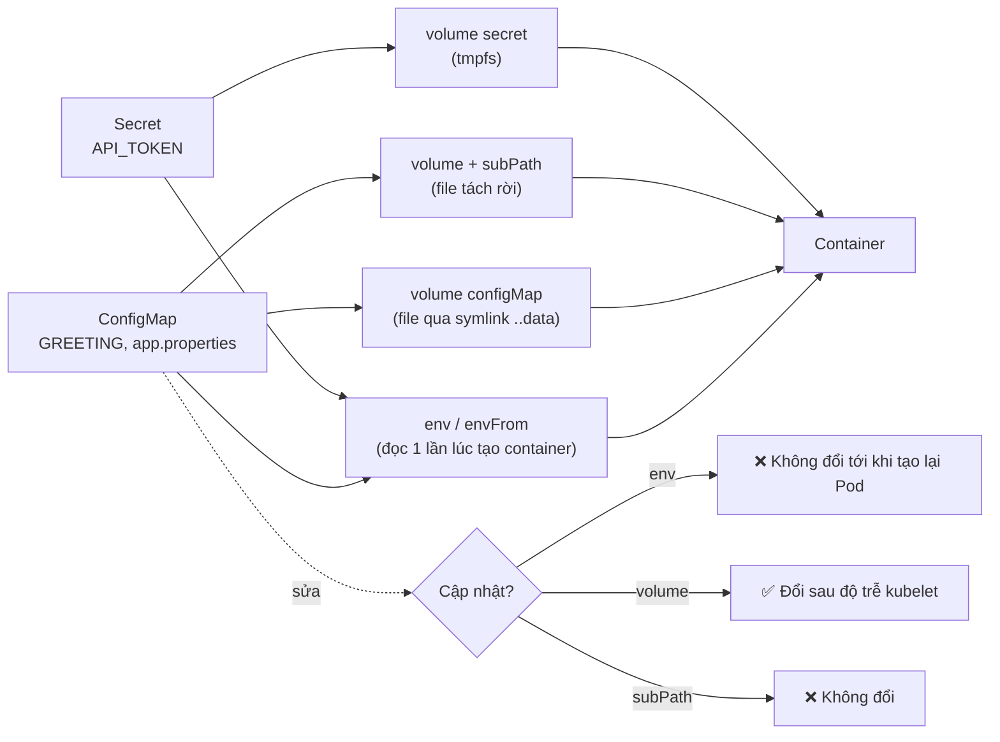
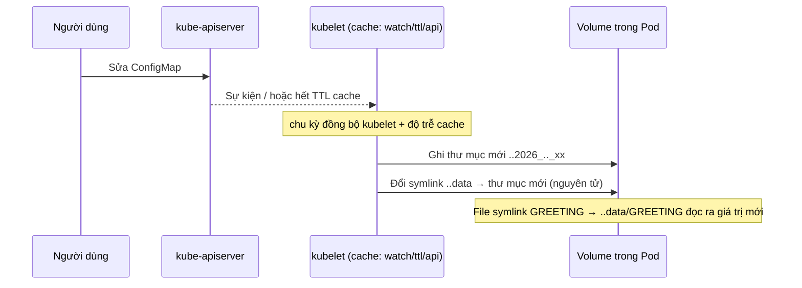
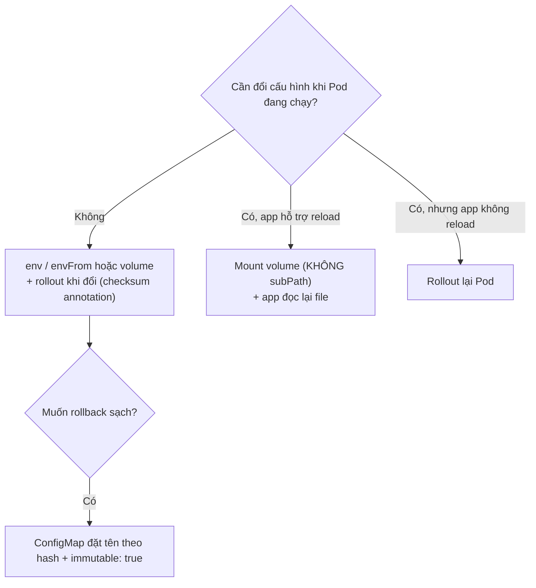

# 6_4_5 ConfigMaps and Secrets

> **Khóa học**: Cloud DevOps Basic — Containers and Kubernetes  
> **Phân nhóm**: 6 Domain 6 - Containers and Kubernetes › 6_4 Kubernetes Networking Configuration and Storage  
> **Chủ đề**: 6_4_5 Tách cấu hình khỏi image: ConfigMap, Secret, cách cấp vào Pod, cập nhật cấu hình, mức an toàn thật của Secret  
> **Phiên bản áp dụng**: Kubernetes 1.37  
> **Trạng thái**: Verified (17-11-2026): mọi hành vi cập nhật, lỗi `CreateContainerConfigError`, `immutable`, base64 đã chạy thật trên kind v1.37.0; phần Secret ở mức vận hành (encryption at rest, External Secrets...) chỉ đối chiếu tài liệu  
> **Phạm vi**: [Topic README](./README.md#6_4_5-configmap-và-secret) · **Checkpoint**: [CHECKLIST](../../CHECKLIST.md#6_4-kubernetes-networking-configuration-and-storage)  
> **Lab thực hành liên quan**: [lab-6_4_2-configmap-and-secret](./README.md#lab-6_4_2-configmap-and-secret)  
> **Kiến thức liên quan**: [6_2_1 Dockerfile Instructions](<../6_2 Container Image Engineering/6_2_1 Dockerfile Instructions.md>) · [6_3_4 Deployments](<../6_3 Kubernetes Architecture and Core Workloads/6_3_4 ReplicaSets and Deployments.md>) · [6_5 Helm Package Management](<../6_5 Helm Package Management/README.md>)

---

## 0. Tình Huống Mở Đầu: "Tôi Đã Sửa ConfigMap Rồi Mà App Không Đổi!"

> Chưa biết ConfigMap và Secret là gì? Đọc **[1.1](#11-configmap-và-secret-là-gì-vì-sao-cần-chúng)** trước, rồi quay lại đây.

Bạn có Pod đọc `GREETING` từ ConfigMap, đang trả `xin chao`. Bạn sửa ConfigMap thành `chao ban` và chờ. Kết quả thực nghiệm trên kind v1.37.0 (17-11-2026):

| Cách Pod nhận cấu hình | Sau khi sửa ConfigMap |
| :--- | :--- |
| Biến môi trường (`env`) | Vẫn `xin chao`. Chỉ đổi sau khi tạo lại Pod |
| File trong volume | Đổi sau khoảng **86 giây** |
| File mount bằng `subPath` | **Không bao giờ đổi** (vẫn `mode=blue` khi volume thường đã `mode=green`) |

Đây là câu hỏi phỏng vấn kinh điển và là nguyên nhân của rất nhiều sự cố "đổi rồi mà không ăn". Nửa còn lại của bài là chuyện **Secret**: nó **không an toàn** như tên gọi. Một lệnh `base64 -d` là ra mật khẩu, và `kubectl apply` còn tự chép plaintext vào annotation. Hai thứ này bạn sẽ tự tay tái hiện ở mục 4 (khoảng 15 phút).

---

## 1. Khái Niệm Cốt Lõi & Bản Chất Kỹ Thuật (Core Concepts & Technical Deep Dive)

### 1.1 ConfigMap Và Secret Là Gì? Vì Sao Cần Chúng?

#### 1.1.1 Bài Toán: Cùng Một Image, Nhiều Môi Trường

Một image nên **build một lần** rồi chạy được ở dev, staging, prod. Nhưng mỗi môi trường cần giá trị khác nhau: địa chỉ database, mức log, bật/tắt tính năng, mật khẩu. Nếu bạn viết thẳng các giá trị đó vào image thì:

- Muốn đổi một giá trị phải **build lại image**, và phải có một image riêng cho mỗi môi trường.
- Mật khẩu nằm **trong image**, nên ai pull được image đều đọc được.

Giải pháp: để cấu hình **nằm ngoài image**, ở một object riêng trong Kubernetes. Pod đọc nó lúc chạy. Tài liệu Kubernetes mô tả mục đích là *"decouple environment-specific configuration from your container images, so that your applications are easily portable"*. Ví dụ trong chính tài liệu: biến `DATABASE_HOST` là `localhost` khi chạy trên máy bạn, và là tên một Service khi chạy trên cloud, còn image thì giữ nguyên.

Kubernetes có **hai object** cho việc này: `ConfigMap` (cấu hình thường) và `Secret` (dữ liệu nhạy cảm).

#### 1.1.2 ConfigMap Là Gì

> *"A ConfigMap is an API object used to store non-confidential data in key-value pairs."* (tài liệu Kubernetes)

Hiểu đơn giản: **một cuốn sổ ghi các cặp `khóa: giá trị`, có đặt tên, lưu trong cluster**. Pod lấy giá trị từ cuốn sổ đó thay vì từ image.

Điểm khác với hầu hết object khác: ConfigMap **không có `spec`**, dữ liệu nằm ở trường `data` (chuỗi UTF-8) hoặc `binaryData` (nhị phân dạng base64).

```yaml
apiVersion: v1
kind: ConfigMap
metadata:
  name: hello-config          # tên cuốn sổ (phải là DNS subdomain name hợp lệ)
data:
  GREETING: "xin chao"        # khóa đơn giản: một giá trị
  app.properties: |           # khóa kiểu "file": nhiều dòng
    mode=blue
    log=info
```

Hai kiểu khóa thường gặp: **giá trị đơn** (như `GREETING`) và **nội dung cả một file** (như `app.properties`).

Tạo và xem bằng lệnh (không cần viết YAML):

```bash
kubectl create configmap hello-config --from-literal=GREETING="xin chao"
kubectl get configmap hello-config -o yaml        # thấy data: GREETING: xin chao
```

Giới hạn theo tài liệu: tên là DNS subdomain name, khóa gồm chữ-số và `-`, `_`, `.`, tổng dữ liệu **không quá 1 MiB**. ConfigMap *"is not designed to hold large chunks of data"*.

#### 1.1.3 Secret Là Gì

> *"A Secret is an object that contains a small amount of sensitive data such as a password, a token, or a key."* (tài liệu Kubernetes)

Hình dạng **giống ConfigMap** (cũng là các cặp khóa-giá trị, cũng đặt tên), nhưng dành cho dữ liệu nhạy cảm: mật khẩu, token, khóa TLS. Tài liệu nói: *"Secrets are similar to ConfigMaps but are specifically intended to hold confidential data."* Lợi ích: Secret được tạo **độc lập với Pod**, nên mật khẩu không phải nằm trong định nghĩa Pod hay trong image.

```yaml
apiVersion: v1
kind: Secret
metadata:
  name: hello-secret
type: Opaque                   # loại mặc định: dữ liệu tùy ý (các loại khác ở 1.7)
stringData:                    # tiện cho người viết: ghi chữ thường, API tự base64 khi lưu
  API_TOKEN: "s3cr3t-token"
```

Lưu ý khi đọc ra: dữ liệu Secret nằm ở trường `data` dưới dạng **base64**, không phải chữ thường. Tạo bằng lệnh:

```bash
kubectl create secret generic hello-secret --from-literal=API_TOKEN='s3cr3t-token'
kubectl get secret hello-secret -o yaml           # data: API_TOKEN: czNjcjN0LXRva2Vu (base64)
```

> ⚠️ **Tên "Secret" dễ gây hiểu lầm.** Theo tài liệu Kubernetes, Secret mặc định được lưu **không mã hóa** trong etcd, và ai có quyền API hoặc tạo được Pod trong namespace đều đọc được. Nó an toàn hơn việc nhét mật khẩu vào image, nhưng không phải két sắt. Chi tiết ở 1.7.

#### 1.1.4 Pod Dùng Chúng Thế Nào (Bản Tối Giản)

Bạn chỉ cần biết hai cách phổ biến nhất. Cách 1: biến môi trường.

```yaml
containers:
- name: app
  image: <image-của-bạn>
  env:
  - name: GREETING                          # tên biến trong container
    valueFrom:
      configMapKeyRef: { name: hello-config, key: GREETING }
  - name: API_TOKEN
    valueFrom:
      secretKeyRef: { name: hello-secret, key: API_TOKEN }
```

Cách 2: mount thành **file** trong thư mục của container (xem ví dụ đầy đủ ở 4.1). Cả bốn cách dùng ConfigMap và chuyện "sửa cấu hình thì Pod thấy gì" nằm ở 1.2 và 1.3.

> Các khối YAML trong 1.1.2–1.1.4 là bản rút gọn để học khái niệm, **chưa chạy riêng lẻ**. Ví dụ đầy đủ đã chạy thật ở mục 4.

#### 1.1.5 So Sánh Nhanh

| | **ConfigMap** | **Secret** |
| :--- | :--- | :--- |
| Dùng cho | Cấu hình **không nhạy cảm** | Dữ liệu **nhạy cảm** (mật khẩu, token, khóa) |
| Giới hạn kích thước | **1 MiB** | Nhỏ ("a small amount of sensitive data") |
| Trường dữ liệu | `data` (chuỗi UTF-8), `binaryData` (base64) | `data` (base64), `stringData` (tiện ghi, API tự mã hóa base64 khi lưu) |
| Mặc định lưu | Văn bản rõ trong etcd | **Không mã hóa** trong etcd, trừ khi bật encryption at rest |

### 1.2 Bốn Cách Dùng ConfigMap (Theo Tài Liệu)

1. Làm đối số/lệnh của container (`command`, `args`).
2. **Biến môi trường** (`env.valueFrom.configMapKeyRef`, hoặc `envFrom` để nạp toàn bộ khóa).
3. **File trong volume** chỉ đọc (mỗi khóa thành một file).
4. Tự viết code gọi Kubernetes API để đọc (và có thể **watch** để phản ứng khi đổi; truy cập được cả namespace khác).

Với ba cách đầu, **kubelet dùng dữ liệu ConfigMap tại thời điểm khởi động container**. Secret dùng tương tự (`secretKeyRef`, `envFrom.secretRef`, `volumes.secret`).

### 1.3 Khi Cấu Hình Đổi, Pod Thấy Gì? (Phần Hay Hỏi Nhất)

| Cách cấp | Cập nhật tự động? | Quan sát thực tế (17-11-2026) |
| :--- | :--- | :--- |
| **Biến môi trường** (`env`, `envFrom`) | ❌ **Không** | Sửa ConfigMap, `GREETING` trong Pod vẫn `xin chao`; chỉ đổi sau khi Pod được tạo lại (`kubectl rollout restart`) |
| **Volume** (mount cả thư mục) | ✅ **Có, sau một khoảng trễ** | File đổi sau khoảng **86 giây** (kể cả thời gian vòng lặp kiểm tra) |
| **Volume mount bằng `subPath`** | ❌ **Không** | File `subPath` vẫn giữ giá trị cũ (`mode=blue`) trong khi file ở volume thường đã thành `mode=green` |

Giải thích của tài liệu: kubelet kiểm tra ConfigMap trong mỗi chu kỳ đồng bộ và dùng **cache cục bộ**; tổng độ trễ có thể bằng *chu kỳ đồng bộ của kubelet + độ trễ truyền cache*, phụ thuộc kiểu cache cấu hình qua trường `configMapAndSecretChangeDetectionStrategy` của `KubeletConfiguration` (mặc định truyền bằng **watch**; hoặc theo **TTL**; hoặc chuyển mọi yêu cầu thẳng tới API server). Con số 86 giây của tôi chỉ là **một lần đo**, đừng coi là bảo đảm.

**Cơ chế cập nhật nguyên tử**: file trong volume là symlink qua thư mục `..data`. Mỗi lần cập nhật, kubelet ghi một thư mục mới có dấu thời gian rồi **đổi symlink `..data` một lần** (đã thấy `..data -> ..2026_11_17_15_34_02.1082945564`). Ứng dụng đọc file đi qua symlink nên không bao giờ thấy trạng thái cập nhật dở. **`subPath` bypass symlink này nên không nhận cập nhật.**

> Ứng dụng phải **tự đọc lại file** (hoặc có cơ chế reload) mới dùng được giá trị mới từ volume; Kubernetes chỉ cập nhật file, không báo cho tiến trình.

### 1.4 Hai Cách Làm Ứng Dụng Nhận Cấu Hình Mới Và Đánh Đổi

| Cách | Cơ chế | Ưu | Nhược |
| :--- | :--- | :--- | :--- |
| **Rollout lại Pod** (`kubectl rollout restart`, hoặc đổi annotation chứa checksum của config trong Pod template) | Pod mới đọc env/volume từ đầu | Chắc chắn, thay đổi **có lịch sử và rollback được**, dùng được cho cả env | Có rolling update (đúng lúc cần thì chậm hơn); phải có Deployment tốt (readiness, PDB) |
| **Mount volume + ứng dụng tự reload** | kubelet cập nhật file, app đọc lại | Không restart | Độ trễ không xác định chặt; app phải hỗ trợ reload; **không dùng được với `subPath`**; dễ gây lệch phiên bản cấu hình giữa các Pod trong cùng thời điểm |

**Mẫu "checksum annotation"**: đặt annotation trong Pod template chứa hash nội dung ConfigMap, ví dụ Helm: `checksum/config: {{ include (print $.Template.BasePath "/configmap.yaml") . | sha256sum }}`. Đổi ConfigMap → hash đổi → Pod template đổi → Deployment tự rollout. Phần Helm được học ở [6_5](<../6_5 Helm Package Management/README.md>).

> ✅ **Đã kiểm chứng**: Deployment dùng `env.valueFrom.configMapKeyRef`, sửa ConfigMap (`xin chao` → `chao ban`) → Pod đang chạy vẫn trả `xin chao`; sau `kubectl rollout restart deploy/cfg-dep` Pod mới trả `chao ban`.

### 1.5 `immutable: true`

Từ Kubernetes v1.19 có thể đặt `immutable: true` cho ConfigMap/Secret: bảo vệ khỏi sửa nhầm và **giảm tải cho API server** (kubelet không phải watch các đối tượng immutable). Sau khi đặt:

- **Không thể hoàn tác** và không sửa được `data`/`binaryData`; chỉ có thể **xóa và tạo lại**; nên tạo lại các Pod tham chiếu (vì chúng giữ mount point tới đối tượng đã xóa).
- ✅ Quan sát: `kubectl patch cm ... data` → `The ConfigMap "hello-config" is invalid: data: Forbidden: field is immutable when immutable is set`.

Mẫu thực chiến: đặt **tên theo phiên bản/hash** (`app-config-7f3a1c`) + `immutable: true`; đổi cấu hình = tạo ConfigMap mới + sửa Deployment trỏ sang tên mới (rollout tự nhiên, rollback đơn giản).

### 1.6 Lỗi Thường Gặp: `CreateContainerConfigError`

Khi Pod tham chiếu **khóa không tồn tại** trong ConfigMap/Secret (hoặc đối tượng không tồn tại) và không đặt `optional: true`, Pod kẹt ở `CreateContainerConfigError`. Chẩn đoán bằng `kubectl describe pod`:

```text
Warning  Failed  kubelet  Error: couldn't find key DB_PASSWORD in Secret default/hello-secret
Warning  Failed  kubelet  Error: configmap "nope" not found
```

Đây là lỗi **cấu hình khi tạo container**, khác `ImagePullBackOff` và `CrashLoopBackOff`.

### 1.7 Secret: Các Loại Và Sự Thật Về "Bảo Mật"

| `type` | Mục đích |
| :--- | :--- |
| `Opaque` (mặc định) | Dữ liệu tùy ý |
| `kubernetes.io/dockerconfigjson` | Cấu hình đăng nhập registry cho `imagePullSecrets` (nội dung là `~/.docker/config.json`) |
| `kubernetes.io/tls` | Chứng chỉ/khóa TLS (`tls.crt`, `tls.key`), dùng cho Ingress/Gateway |
| `kubernetes.io/basic-auth`, `kubernetes.io/ssh-auth` | Thông tin xác thực Basic/SSH |
| `kubernetes.io/service-account-token` | Token ServiceAccount |

**Sự thật quan trọng nhất (cần nói được trong phỏng vấn)**:

- **base64 chỉ là mã hóa dạng chuỗi (encoding), không phải bảo mật.** Tài liệu về `dockerconfigjson` ghi giá trị base64 là *"obscured but not secret"*; ✅ quan sát: `kubectl get secret hello-secret -o jsonpath='{.data.API_TOKEN}' | base64 -d` ra ngay `s3cr3t-token`.
- Theo tài liệu, Secret mặc định lưu **không mã hóa** trong etcd; **bất kỳ ai có quyền API** (hoặc quyền vào etcd) đọc/sửa được; và **ai được tạo Pod trong namespace thì đọc được mọi Secret của namespace đó**, gồm cả việc tạo Deployment gián tiếp.
- Biện pháp tối thiểu theo tài liệu: (1) bật **Encryption at Rest** cho Secret, (2) **RBAC** đặc quyền tối thiểu cho Secret, (3) giới hạn Secret cho đúng container cần, (4) cân nhắc **nhà cung cấp secret bên ngoài**. Xem thêm *Good practices for Kubernetes Secrets*.
- **Secret dạng volume** được mount bằng **tmpfs** (RAM, ✅ quan sát `tmpfs on /etc/secrets type tmpfs`), không ghi xuống đĩa node; file mặc định có mode `644` trong thí nghiệm của tôi, hạn chế bằng `defaultMode` nếu cần.

### 1.8 `kubectl apply` Và Rò Rỉ Plaintext Qua Annotation

> ✅ **Phát hiện khi thực nghiệm**: tạo Secret bằng `kubectl apply -f` với `stringData` khiến `kubectl` lưu **toàn bộ manifest gốc, kể cả giá trị plaintext**, vào annotation `kubectl.kubernetes.io/last-applied-configuration` của chính Secret:
> ```text
> {"apiVersion":"v1","kind":"Secret", ... "stringData":{"API_TOKEN":"s3cr3t-token"},"type":"Opaque"}
> ```
> Nghĩa là dù bạn không nhìn thấy `stringData` khi `get -o yaml`, plaintext vẫn nằm trong annotation. Tránh bằng cách tạo Secret qua `kubectl create secret ... --from-literal/--from-file`, hoặc dùng công cụ quản lý secret bên ngoài (1.9) và không commit manifest chứa plaintext vào Git.

### 1.9 Quản Lý Secret Ngoài Git (Mức Khái Niệm)

| Hướng | Ý tưởng | Đánh đổi (khái quát) |
| :--- | :--- | :--- |
| **External Secrets Operator** | Đồng bộ secret từ kho ngoài (Key Vault, Secrets Manager, Vault...) thành Secret trong cluster | Cần operator + quyền truy cập kho; Secret vẫn nằm trong etcd |
| **Secrets Store CSI Driver** | Mount secret từ kho ngoài vào Pod qua CSI volume; có thể đồng bộ sang Secret | Phụ thuộc driver/provider |
| **Sealed Secrets** | Mã hóa bất đối xứng để commit Git an toàn; controller trong cluster giải mã | Quản lý khóa của controller; kiểm tra tình trạng duy trì của dự án |
| **HashiCorp Vault** | Kho bí mật chuyên dụng, tích hợp Kubernetes | Hạ tầng vận hành riêng |

*Các công cụ này có phiên bản, mô hình quyền và giới hạn riêng; chỉ nên chọn sau khi đọc tài liệu chính thức của từng công cụ.*

---

## 2. Ví Dụ Đời Sống Thực Tế Dễ Hiểu (Intuitive Real-World Analogies)

**Một chuỗi nhà hàng, và buổi sáng thay thực đơn.**

Bếp trưởng và kỹ thuật nấu (image) giống nhau ở mọi chi nhánh. Cái khác nhau là **thực đơn hôm nay** (ConfigMap): độ mặn, giờ mở cửa, món đặc biệt. Sáng nay quản lý quyết định đổi thực đơn. Chuyện gì xảy ra ở mỗi chi nhánh?

- **Chi nhánh A (env):** quản lý dặn miệng nhân viên lúc vào ca. Giữa ca đổi thực đơn thì nhân viên đang đứng bếp **không hề biết**. Phải cho ca mới vào (restart Pod) mới nhận chỉ thị mới.
- **Chi nhánh B (volume):** thực đơn dán trên tường bếp. Có người đến dán tờ mới, nhưng **mất vài chục giây** (kubelet sync). Và đầu bếp phải **chịu khó ngẩng lên đọc lại** (app reload). Người thợ dán còn khéo léo: anh ta đổi **cả tấm bảng trong một lượt** (symlink `..data`), nên không bao giờ có cảnh một nửa tờ cũ, một nửa tờ mới.
- **Chi nhánh C (`subPath`):** đầu bếp đã **chép tờ cũ vào sổ tay riêng**. Tường có đổi bao nhiêu lần, sổ tay vẫn là bản cũ.
- **`immutable` = thực đơn ép plastic:** không sửa được; muốn đổi phải in tờ mới và treo lên.

**Còn Secret là két sắt công thức bí mật**, nhưng mặc định két **không khóa** (không encryption at rest). Ai có chìa phòng (quyền API/etcd), hoặc ai được phép mở cửa bếp (tạo Pod trong namespace), đều lấy được. **base64 giống bọc giấy báo lên tiền**: nhìn qua khó đọc, bóc ra ngay (`base64 -d`). Mount Secret bằng tmpfs là để tiền trên bàn trong ca rồi cất đi khi hết ca (chỉ trong RAM). Và `kubectl apply` làm lộ plaintext qua annotation chẳng khác gì **photocopy tờ mật mã rồi để trong ngăn kéo bên cạnh**.

---

## 3. Kiến Trúc, Luồng Hoạt Động & Hình Ảnh Trực Quan (Architecture, Diagrams & Visual Media)

### 3.1 Ba Đường Cấu Hình Vào Container



### 3.2 Chuỗi Cập Nhật File Trong Volume



### 3.3 Quyết Định: Nên Cấp Cấu Hình Bằng Gì?



---

## 4. Code Mẫu Trực Quan Hoặc Dòng Lệnh Thực Chiến (Runnable Sample Code / CLI)

> ✅ **Đã chạy thử** ngày 17-11-2026 trên kind v0.33.0, Kubernetes v1.37.0, image `selflearn.invalid/hello-svc:1.0.0` ([6_4_2](<./6_4_2 Services and EndpointSlices.md>)). `hello-svc` đọc biến môi trường `GREETING` và in ra ở `GET /`.  
> Thực hành chi tiết: [lab-6_4_2-configmap-and-secret](./README.md#lab-6_4_2-configmap-and-secret).

### 4.1 ConfigMap + Secret + Pod Dùng Cả Ba Cách

```yaml
apiVersion: v1
kind: ConfigMap
metadata:
  name: hello-config
data:
  GREETING: "xin chao"
  app.properties: |
    mode=blue
---
apiVersion: v1
kind: Secret
metadata:
  name: hello-secret
type: Opaque
stringData:                # CHỈ để học. Trong thực tế đừng commit plaintext vào Git (xem 1.8, 1.9)
  API_TOKEN: "s3cr3t-token"
---
apiVersion: v1
kind: Pod
metadata:
  name: cfg-demo
spec:
  containers:
  - name: hello-svc
    image: selflearn.invalid/hello-svc:1.0.0
    imagePullPolicy: IfNotPresent
    envFrom:
    - configMapRef: { name: hello-config }     # mỗi khóa thành 1 biến môi trường
    volumeMounts:
    - { name: cfg-vol, mountPath: /etc/config, readOnly: true }                                          # cả thư mục
    - { name: cfg-vol, mountPath: /etc/config-sub/app.properties, subPath: app.properties, readOnly: true } # subPath
    - { name: sec-vol, mountPath: /etc/secrets, readOnly: true }
  volumes:
  - name: cfg-vol
    configMap: { name: hello-config }
  - name: sec-vol
    secret: { secretName: hello-secret }
```

```bash
kubectl apply -f cm.yaml
kubectl wait --for=condition=Ready pod/cfg-demo --timeout=60s

kubectl exec cfg-demo -- sh -c 'echo GREETING=$GREETING'      # GREETING=xin chao
kubectl exec cfg-demo -- curl -s localhost:8080               # xin chao from cfg-demo version=1.0.0
kubectl exec cfg-demo -- ls -la /etc/config /etc/secrets      # thấy symlink ..data
```

### 4.2 Sửa ConfigMap Và Quan Sát 3 Cách Cấp

```bash
kubectl patch cm hello-config --type=merge \
  -p '{"data":{"GREETING":"chao ban","app.properties":"mode=green\n"}}'

# Đo thời gian file trong volume đổi (kiểm tra mỗi 2s)
start=$(date +%s)
until kubectl exec cfg-demo -- cat /etc/config/app.properties | grep -q green; do sleep 2; done
echo "volume đổi sau $(( $(date +%s) - start ))s"

kubectl exec cfg-demo -- sh -c 'echo GREETING=$GREETING'      # vẫn "xin chao" (env KHÔNG đổi)
kubectl exec cfg-demo -- cat /etc/config-sub/app.properties  # vẫn "mode=blue" (subPath KHÔNG đổi)
kubectl exec cfg-demo -- cat /etc/config/app.properties      # "mode=green" (volume đổi)
```

Kết quả quan sát: *"volume updated after 86s"*, `GREETING=xin chao`, subPath `mode=blue`, volume `mode=green`.

### 4.3 Làm Deployment Nhận Config Mới Bằng Rollout

```yaml
apiVersion: apps/v1
kind: Deployment
metadata: { name: cfg-dep }
spec:
  replicas: 1
  selector: { matchLabels: { app: cfg-dep } }
  template:
    metadata:
      labels: { app: cfg-dep }
      # Với Helm: annotations: { checksum/config: "<sha256 của configmap.yaml>" }
    spec:
      containers:
      - name: hello-svc
        image: selflearn.invalid/hello-svc:1.0.0
        imagePullPolicy: IfNotPresent
        ports: [{ name: http, containerPort: 8080 }]
        env:
        - name: GREETING
          valueFrom: { configMapKeyRef: { name: hello-config2, key: GREETING } }
```

```bash
kubectl create cm hello-config2 --from-literal=GREETING="xin chao"
kubectl apply -f cfgdep.yaml && kubectl rollout status deploy/cfg-dep
kubectl exec deploy/cfg-dep -- curl -s localhost:8080                 # xin chao ...

kubectl create cm hello-config2 --from-literal=GREETING="chao ban" --dry-run=client -o yaml | kubectl apply -f -
kubectl exec deploy/cfg-dep -- curl -s localhost:8080                 # vẫn xin chao
kubectl rollout restart deploy/cfg-dep && kubectl rollout status deploy/cfg-dep
kubectl exec deploy/cfg-dep -- curl -s localhost:8080                 # chao ban ...
```

> Lưu ý quan sát: `kubectl apply` cảnh báo thiếu annotation `last-applied-configuration` vì ConfigMap ban đầu tạo bằng `kubectl create`; kubectl tự vá, không ảnh hưởng kết quả. Hãy thống nhất cách quản lý (chỉ `apply`, hoặc chỉ `create/replace`).

### 4.4 Secret Chỉ Là base64

```bash
kubectl get secret hello-secret -o yaml                                  # data.API_TOKEN: czNjcjN0LXRva2Vu
kubectl get secret hello-secret -o jsonpath='{.data.API_TOKEN}' | base64 -d   # s3cr3t-token
kubectl get secret hello-secret -o jsonpath='{.metadata.annotations}'          # thấy cả plaintext qua last-applied-configuration (xem 1.8)

# Cách tạo Secret không để lại plaintext trong annotation
kubectl create secret generic db-cred --from-literal=DB_PASSWORD='change-me'
```

### 4.5 Tái Hiện `CreateContainerConfigError`

```yaml
apiVersion: v1
kind: Pod
metadata: { name: cfg-bad }
spec:
  containers:
  - name: c
    image: selflearn.invalid/hello-svc:1.0.0
    imagePullPolicy: IfNotPresent
    env:
    - name: DB_PASSWORD
      valueFrom:
        secretKeyRef: { name: hello-secret, key: DB_PASSWORD }   # khóa không tồn tại
```

```bash
kubectl apply -f cfg-bad.yaml
kubectl get pod cfg-bad                       # STATUS: CreateContainerConfigError
kubectl describe pod cfg-bad | grep -A6 Events
#  Error: couldn't find key DB_PASSWORD in Secret default/hello-secret
```

Sửa bằng cách thêm khóa vào Secret (Pod sẽ tạo lại container ở lần thử kế tiếp) hoặc đặt `optional: true` nếu khóa thực sự là tùy chọn.

### 4.6 `immutable: true`

```bash
kubectl patch cm hello-config --type=merge -p '{"immutable":true}'
kubectl patch cm hello-config --type=merge -p '{"data":{"GREETING":"x"}}'
#  The ConfigMap "hello-config" is invalid: data: Forbidden: field is immutable when `immutable` is set
```

### 4.7 Secret Loại `dockerconfigjson` Cho Registry Riêng

> ⚠️ Chưa chạy thử lệnh này (cần registry thật). Điền giá trị của bạn và không dán mật khẩu thật vào lịch sử shell chia sẻ.

```bash
kubectl create secret docker-registry regcred \
  --docker-server=registry.example.com \
  --docker-username=<user> --docker-password=<token>
# Pod: spec.imagePullSecrets: [{ name: regcred }]  (xem 6_2_8)
```

---

## 5. Cạm Bẫy Thực Tế & Thực Tiễn Sản Xuất (Production Gotchas & Best Practices)

> Hành vi cập nhật (env/volume/`subPath`) đã nằm ở 1.3 và bảng mở đầu; ở đây chỉ nêu cách phòng.

### 5.1 Coi "Đổi Cấu Hình" Là "Rollout"

- **Bản chất**: env không cập nhật, volume cập nhật chậm, `subPath` không cập nhật, ứng dụng còn có thể cache cấu hình trong bộ nhớ.
- **Khuyến nghị**: Dùng checksum annotation (Helm) hoặc tên ConfigMap theo hash + `immutable: true`. Cần mount file thì mount **cả thư mục** (`/etc/config/`), không dùng `subPath`; nếu bắt buộc dùng thì chấp nhận phải rollout để đổi.

### 5.2 Tin Rằng Secret "An Toàn" Vì Đã Là Secret

- **Bản chất**: Mặc định không mã hóa trong etcd; base64 là encoding; ai tạo Pod trong namespace đọc được Secret của namespace.
- **Khuyến nghị**: Bật encryption at rest; RBAC chặt (đặc biệt `get/list/watch` Secret và quyền tạo Pod); tách namespace theo mức nhạy cảm; cân nhắc nhà cung cấp secret bên ngoài; không commit Secret plaintext hoặc base64 vào Git.

### 5.3 Plaintext Rò Qua `last-applied-configuration`

- **Bản chất**: `kubectl apply` ghi manifest gốc vào annotation (đã quan sát với `stringData`).
- **Khuyến nghị**: Tạo bằng `kubectl create secret ...` hoặc công cụ quản lý secret; không `apply` manifest chứa secret plaintext.

### 5.4 Truyền Secret Qua Biến Môi Trường

- **Bản chất**: Biến môi trường dễ lọt vào log, `kubectl describe`, dump lỗi, tiến trình con. Volume (tmpfs) kiểm soát tốt hơn về quyền file.
- **Khuyến nghị**: Ưu tiên mount Secret thành file chỉ đọc khi ứng dụng hỗ trợ; đặt `defaultMode` chặt. Giữ ConfigMap/Secret đúng mục đích (giới hạn 1 MiB; dữ liệu lớn đưa vào kho lưu trữ riêng).

---

## 6. Câu Hỏi Củng Cố Kiến Thức (Active Recall Quiz)

### Câu Hỏi 1: Nêu 2 Cách Làm Ứng Dụng Nhận Config Mới Và Đánh Đổi Của Từng Cách (Phỏng vấn)

<details>
<summary>Đáp án</summary>

(1) **Rollout lại Pod** (`rollout restart` hoặc checksum annotation): chắc chắn, dùng được cho env, rollback được, đổi lại là phải restart Pod. (2) **Mount volume + app tự đọc lại file**: không restart nhưng có độ trễ (chu kỳ đồng bộ kubelet + cache), app phải hỗ trợ reload, không áp dụng cho `subPath` và env.
</details>

### Câu Hỏi 2: "Secret Của Kubernetes An Toàn Tới Đâu, Cần Thêm Gì?" (Phỏng vấn)

<details>
<summary>Đáp án</summary>

Mặc định Secret chỉ là base64 và **không mã hóa** trong etcd; ai có quyền API/etcd, hoặc tạo được Pod trong namespace, đều đọc được. Cần: encryption at rest, RBAC đặc quyền tối thiểu, hạn chế phạm vi truy cập theo container/namespace, cân nhắc kho secret ngoài (External Secrets, Secrets Store CSI, Vault), không để plaintext trong Git và trong annotation `last-applied-configuration`.
</details>

### Câu Hỏi 3: Pod Kẹt `CreateContainerConfigError`. Nguyên Nhân Thường Gặp Và Cách Chẩn Đoán?

<details>
<summary>Đáp án</summary>

Tham chiếu ConfigMap/Secret hoặc khóa không tồn tại (không đặt `optional: true`). `kubectl describe pod` cho thấy ví dụ `couldn't find key X in Secret ns/name` hoặc `configmap "x" not found`. Sửa bằng cách tạo đối tượng/khóa còn thiếu.
</details>

---

## 7. 📚 Nguồn Tài Liệu Chính Thống (Tier-1 Official References)

- [ConfigMaps](https://kubernetes.io/docs/concepts/configuration/configmap/) - Bốn cách dùng, cập nhật volume, `subPath`, `immutable`, giới hạn 1 MiB.
- [Secrets](https://kubernetes.io/docs/concepts/configuration/secret/) - Các loại Secret, cảnh báo lưu không mã hóa, biện pháp tối thiểu.
- [Good practices for Kubernetes Secrets](https://kubernetes.io/docs/concepts/security/secrets-good-practices/) - Thực hành tốt khi quản lý Secret.
- [Encrypting Confidential Data at Rest](https://kubernetes.io/docs/tasks/administer-cluster/encrypt-data/) - Bật encryption at rest cho Secret.
- [Configure a Pod to Use a ConfigMap](https://kubernetes.io/docs/tasks/configure-pod-container/configure-pod-configmap/) - Hướng dẫn thực hành chính thức.
- [Distribute Credentials Securely Using Secrets](https://kubernetes.io/docs/tasks/inject-data-application/distribute-credentials-secure/) - Cấp Secret vào Pod.
- [Pull an Image from a Private Registry](https://kubernetes.io/docs/tasks/configure-pod-container/pull-image-private-registry/) - `dockerconfigjson` và `imagePullSecrets`.
- [RBAC Good Practices](https://kubernetes.io/docs/concepts/security/rbac-good-practices/) - Giới hạn quyền đọc Secret.
- [External Secrets Operator](https://external-secrets.io/latest/) - Đồng bộ secret từ kho ngoài (Tier 3 cho khái niệm: chọn công cụ sau khi đọc tài liệu của dự án).
- [Secrets Store CSI Driver](https://secrets-store-csi-driver.sigs.k8s.io/) - Mount secret từ kho ngoài qua CSI (dự án Kubernetes SIG).
- [HashiCorp Vault on Kubernetes](https://developer.hashicorp.com/vault/docs/platform/k8s) - Tích hợp Vault với Kubernetes.
