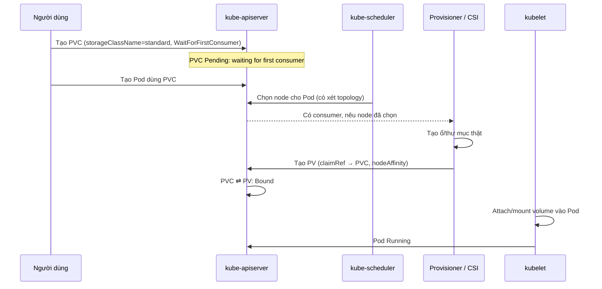
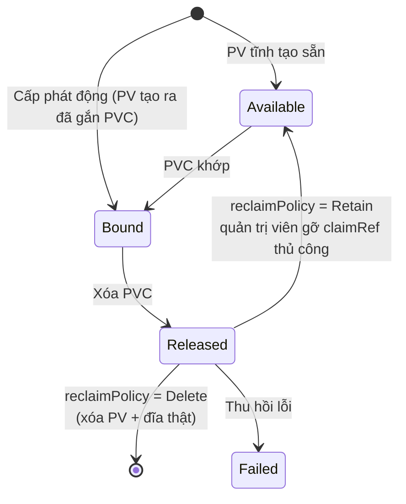
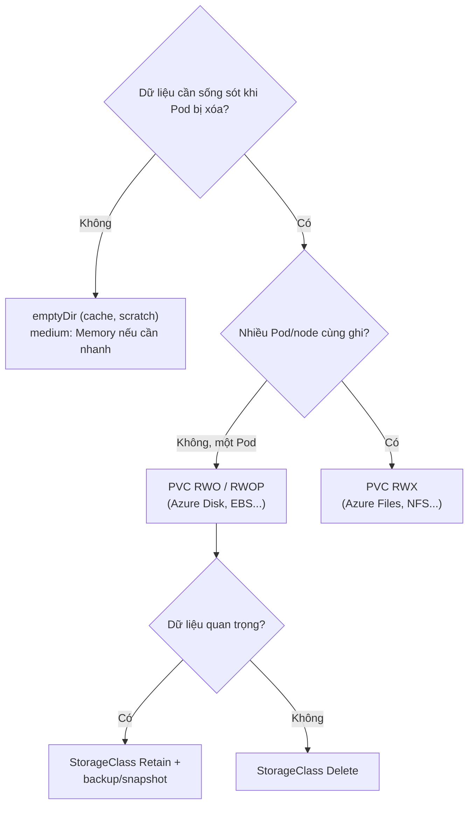

# 6_4_6 Volumes PersistentVolumes and StorageClasses

> **Khóa học**: Cloud DevOps Basic — Containers and Kubernetes  
> **Phân nhóm**: 6 Domain 6 - Containers and Kubernetes › 6_4 Kubernetes Networking Configuration and Storage  
> **Chủ đề**: 6_4_6 Volume tạm, PersistentVolume, PersistentVolumeClaim, StorageClass, access mode, reclaim policy, volume binding mode  
> **Phiên bản áp dụng**: Kubernetes 1.37 (kind v0.33.0, StorageClass `standard` dùng `rancher.io/local-path`)  
> **Trạng thái**: Verified một phần (17-11-2026): hành vi PVC/PV/StorageClass, `WaitForFirstConsumer`, `Retain`/`Delete`, access mode và không-mở-rộng-được đã chạy thật trên kind; phần AKS/Azure chỉ đối chiếu Microsoft Learn, chưa chạy trên AKS  
> **Phạm vi**: [Topic README](./README.md#6_4_6-lưu-trữ-volume-pv-pvc-storageclass) · **Checkpoint**: [CHECKLIST](../../CHECKLIST.md#6_4-kubernetes-networking-configuration-and-storage)  
> **Lab thực hành liên quan**: [lab-6_4_4-statefulset-and-pvc](./README.md#lab-6_4_4-statefulset-and-pvc)  
> **Kiến thức liên quan**: [6_1_10 Container Data Storage](<../6_1 Container Fundamentals/6_1_10 Container Data Storage.md>) · [6_4_5 ConfigMaps and Secrets](<./6_4_5 ConfigMaps and Secrets.md>) · [6_4_7 StatefulSets](<./6_4_7 StatefulSets and Stateful Workloads.md>)

---

## 1. Khái Niệm Cốt Lõi & Bản Chất Kỹ Thuật (Core Concepts & Technical Deep Dive)

### 1.1 Hai Cấp Độ Vòng Đời Của Dữ Liệu

Dữ liệu trong lớp ghi của container mất khi container bị tạo lại ([6_1_10](<../6_1 Container Fundamentals/6_1_10 Container Data Storage.md>)). Kubernetes tách hai nhu cầu:

| Nhu cầu | Giải pháp | Vòng đời |
| :--- | :--- | :--- |
| Thư mục tạm, chia sẻ giữa container trong Pod, nạp cấu hình | **Volume** gắn trong Pod spec (`emptyDir`, `configMap`, `secret`, `projected`, `downwardAPI`...) | Gắn với **Pod** |
| Dữ liệu phải sống lâu hơn Pod (database, Kafka, tệp người dùng) | **PersistentVolume (PV) / PersistentVolumeClaim (PVC)** | **Độc lập với Pod** |

### 1.2 Volume Tạm Trong Pod

| Volume | Đặc điểm |
| :--- | :--- |
| `emptyDir` | Thư mục rỗng tạo khi Pod được gán vào node, **chia sẻ giữa các container trong Pod**, **mất khi Pod bị xóa**. Mặc định nằm trên đĩa node; `medium: Memory` dùng RAM (tmpfs); có `sizeLimit` |
| `configMap`, `secret` | Nạp cấu hình/bí mật thành file ([6_4_5](<./6_4_5 ConfigMaps and Secrets.md>)); Secret dùng tmpfs |
| `projected` | Gộp nhiều nguồn (secret, configMap, downwardAPI, serviceAccountToken) vào một thư mục |
| `hostPath` | Gắn thư mục **của node** vào Pod: rủi ro bảo mật và bám node; chỉ dùng có chủ đích (DaemonSet log agent, lab) |

> ✅ **Quan sát về `emptyDir`**: container crash và được restart **trong cùng Pod** thì dữ liệu `emptyDir` **vẫn còn** (log lần chạy lại: `restart sees: 1794930553`). Dữ liệu chỉ mất khi **Pod** bị xóa/tạo lại. Tài liệu cũng lưu ý: `emptyDir`/`hostPath` **không giới hạn dung lượng** nếu không đặt `sizeLimit` và không có cô lập giữa các container.

### 1.3 PV, PVC, StorageClass: Ba Vai Trò

| Đối tượng | Vai trò | Ai tạo |
| :--- | :--- | :--- |
| **PersistentVolume (PV)** | Một phần lưu trữ **thật** trong cluster (một ổ đĩa, một thư mục NFS...) | Quản trị viên (tĩnh) hoặc hệ thống (động) |
| **PersistentVolumeClaim (PVC)** | **Yêu cầu** lưu trữ của ứng dụng: dung lượng, access mode, StorageClass | Đội ứng dụng |
| **StorageClass** | **Mẫu cấp phát**: provisioner (CSI driver), `parameters`, `reclaimPolicy`, `volumeBindingMode`, `allowVolumeExpansion` | Quản trị viên / nhà cung cấp cloud |

Quan hệ: Pod → (volume `persistentVolumeClaim`) → **PVC** ⇄ (1:1, độc quyền) **PV** → ổ đĩa thật. Bản chất giống "đặt chỗ": PVC là **đơn đặt chỗ**, PV là **chỗ ngồi thật**, StorageClass là **quy định loại ghế và cách tính tiền khi trả ghế**.

- **Binding là 1:1 và độc quyền**: một khi PVC bound với PV, không PVC nào khác dùng được PV đó (dù PV lớn hơn yêu cầu). PVC **chờ vô hạn** nếu chưa có PV phù hợp.
- **Cấp phát động**: PVC nêu `storageClassName` → provisioner của StorageClass tạo PV khớp tự động. **Cấp phát tĩnh**: quản trị viên tạo PV trước; PVC muốn dùng PV tĩnh mà không muốn rơi vào StorageClass mặc định phải đặt tường minh `storageClassName: ""`.
- **StorageClass mặc định**: gắn annotation `storageclass.kubernetes.io/is-default-class: "true"`. PVC không ghi `storageClassName` sẽ dùng nó. Cluster có thể không có default; nếu có nhiều default, bản **mới tạo nhất** được dùng.
- **Storage Object in Use Protection**: PVC đang được Pod dùng có finalizer `kubernetes.io/pvc-protection` (✅ quan sát), PV bound có `kubernetes.io/pv-protection`: xóa bị hoãn tới khi không còn dùng, tránh mất dữ liệu.

**Vòng đời PV**: `Available` (chưa gắn PVC) → `Bound` → `Released` (PVC đã xóa nhưng PV chưa được thu hồi) → `Failed`.

### 1.4 Access Modes

| Mode | Viết tắt | Ý nghĩa (theo tài liệu) |
| :--- | :--- | :--- |
| `ReadWriteOnce` | RWO | Mount read-write bởi **một node**; nhiều Pod **cùng node** vẫn có thể dùng chung |
| `ReadOnlyMany` | ROX | Mount read-only bởi **nhiều node** |
| `ReadWriteMany` | RWX | Mount read-write bởi **nhiều node** |
| `ReadWriteOncePod` | RWOP | Mount read-write bởi **đúng một Pod** trong cả cluster; stable từ v1.29; tài liệu nêu chỉ hỗ trợ với **CSI volume** |

Lưu ý quan trọng của tài liệu:

- Access mode dùng để **khớp PVC với PV**, và đôi khi giới hạn nơi PV được mount; nhưng **không bảo vệ ghi sau khi đã mount**: PV khai báo `ROX` không bảo đảm chỉ đọc. Chỉ `RWOP` thực sự ràng buộc "một Pod".
- Một volume chỉ được mount bằng **một** access mode tại một thời điểm.
- Khả năng thực tế phụ thuộc **volume plugin/CSI driver**: ví dụ tài liệu liệt kê AzureFile/NFS hỗ trợ RWX, còn HostPath chỉ RWO; với CSI thì "tùy driver".

> ✅ **Quan sát RWOP**: trên kind (provisioner `local-path`, không phải CSI), PVC `ReadWriteOncePod` vẫn được Bound và Pod thứ hai dùng cùng PVC kẹt `Pending` với sự kiện `PersistentVolumeClaim with ReadWriteOncePod access mode already in-use by another pod`. Đây là hành vi **scheduler** quan sát được trên cluster học tập của tôi; do tài liệu ghi RWOP hỗ trợ cho CSI, **đừng dựa vào nó với volume không phải CSI** ngoài môi trường thử nghiệm.

### 1.5 `reclaimPolicy`: Xóa PVC Thì Dữ Liệu Đi Đâu?

| Policy | Hành vi khi PVC bị xóa |
| :--- | :--- |
| **`Delete`** | PV **và** tài nguyên lưu trữ phía sau bị xóa. **Mặc định của StorageClass** nếu không khai báo |
| **`Retain`** | PV chuyển `Released`, dữ liệu **được giữ**; phải thu hồi **thủ công** |
| `Recycle` | ⚠️ **Deprecated**; tài liệu khuyên dùng cấp phát động |

PV cấp phát động thừa kế `reclaimPolicy` của StorageClass.

> ✅ **Quan sát**: StorageClass `standard` của kind có `reclaimPolicy: Delete`: xóa PVC `data-demo` thì PV biến mất. Tạo StorageClass `local-retain` (`reclaimPolicy: Retain`), xóa PVC `keep-me` → PV chuyển **`Released`**, `claimRef` vẫn trỏ về `default/keep-me`. Để dùng lại PV `Released`, quản trị viên phải xử lý thủ công (xem tài liệu *Persistent Volumes → Reclaiming*), ví dụ xóa `claimRef` sau khi xử lý dữ liệu. Nếu đổi `reclaimPolicy` của PV trực tiếp: dùng `kubectl patch pv`.

**Production nên nghĩ kỹ**: dữ liệu quan trọng thường dùng StorageClass `Retain` (hoặc đổi policy của PV) kèm backup/snapshot; mặc định `Delete` tiện cho dev nhưng xóa nhầm PVC là mất ổ đĩa.

### 1.6 `volumeBindingMode`

| Mode | Hành vi |
| :--- | :--- |
| `Immediate` (mặc định khi không khai báo) | Bind và cấp phát **ngay khi PVC được tạo**, chưa biết Pod sẽ chạy ở đâu → có thể tạo đĩa ở vùng/node mà Pod không thể chạy |
| **`WaitForFirstConsumer`** | **Trì hoãn** bind/cấp phát tới khi có **Pod dùng PVC** được tạo; scheduler chọn node trước rồi volume được tạo đúng topology |

Tài liệu lưu ý: dùng `WaitForFirstConsumer` thì **không đặt `nodeName`** trong Pod spec.

> ✅ **Quan sát**: PVC `data-demo` ở trạng thái `Pending` với sự kiện `waiting for first consumer to be created before binding` cho tới khi Pod được tạo; ngay sau đó PV được cấp phát và PVC `Bound`. `Pending` ở trường hợp này là **bình thường**, không phải lỗi.

### 1.7 Mở Rộng Volume (Expansion)

Chỉ mở rộng được PVC nếu StorageClass đặt `allowVolumeExpansion: true` (và driver hỗ trợ). ✅ Quan sát trên `standard` của kind: `kubectl patch pvc ... storage: 100Mi` → `Forbidden: only dynamically provisioned pvc can be resized and the storageclass that provisions the pvc must support resize`. Chỉ tăng được, không thu nhỏ.

### 1.8 CSI Và Thực Tế Trên Cloud

Cấp phát động trong cluster thật thường qua **CSI driver** do nhà cung cấp cung cấp. Trên **AKS** (theo Microsoft Learn, mục "Storage concepts"):

- Volume dữ liệu có thể là **Azure Disk, Azure Files, Azure NetApp Files, Azure Blobs**.
- **Azure Disk**: mount `ReadWriteOnce`, chỉ một node; cần nhiều node dùng chung thì dùng **Azure Files** (SMB 3.1.1 hoặc NFS 4.1). Azure Disk có giới hạn số volume mỗi node tùy VM SKU.
- StorageClass tạo sẵn khi dùng CSI: `managed-csi` (**là default**, Standard SSD LRS), `managed-csi-premium`, `managed-csi-premium-v2` (từ Kubernetes 1.35), `azurefile-csi`, `azurefile-csi-premium`, `azureblob-nfs-premium`, `azureblob-fuse-premium`. Các class tích hợp này mặc định `reclaimPolicy: Delete` và AKS **tự reconcile, ghi đè mọi chỉnh sửa**: muốn khác thì **tạo StorageClass mới**.
- Từ Kubernetes 1.29, AKS dùng **ZRS** cho disk trong class tích hợp khi cluster trải nhiều availability zone (đắt hơn LRS).
- Ví dụ chính thức: StorageClass `managed-premium-retain` với `provisioner: disk.csi.azure.com`, `skuName: Premium_ZRS`, `reclaimPolicy: Retain`, `volumeBindingMode: WaitForFirstConsumer`, `allowVolumeExpansion: true`.
- PV không được chia sẻ giữa Windows và Linux Pod.

*Bảng StorageClass, SKU và hành vi mặc định của AKS thay đổi theo phiên bản; cần đối chiếu trang Microsoft Learn tương ứng trước khi áp dụng.* Với AWS, ví dụ trong tài liệu Kubernetes dùng `provisioner: ebs.csi.aws.com`; thông số cụ thể xem tài liệu của driver.

### 1.9 StorageClass `standard` Của kind: Chỉ Để Học

Quan sát trên kind v1.37: `standard` (default) dùng `rancher.io/local-path`, `Delete`, `WaitForFirstConsumer`, **không** cho mở rộng. PV là thư mục trên **chính ổ đĩa của node container** (`/var/local-path-provisioner/pvc-..._default_<tên PVC>`), có `nodeAffinity` ghim vào node (`kubernetes.io/hostname`). Nghĩa là: không có sao lưu, không chịu được mất node, không dùng được cho production.

---

## 2. Ví Dụ Đời Sống Thực Tế Dễ Hiểu (Intuitive Real-World Analogies)

**Kho lưu trữ đồ cá nhân của một tòa nhà chung cư:**

- **`emptyDir` = cái bàn trong căn hộ**: các thành viên trong căn hộ (container cùng Pod) dùng chung; có người ra vào (container restart) thì đồ trên bàn còn, nhưng **khi dọn khỏi căn hộ (Pod bị xóa) thì bàn bị bỏ đi**.
- **PV = ngăn kho thật ở tầng hầm**. **PVC = giấy thuê kho** ghi "cần 10 GiB, một người dùng". **StorageClass = loại hình dịch vụ kho** (kho thường, kho lạnh, kho có bảo hiểm) và **chính sách khi hết hợp đồng**.
- **`Delete` = hết hợp đồng thì công ty vứt hết đồ và phá ngăn kho**. **`Retain` = hết hợp đồng thì khóa ngăn lại và treo biển "Đã trả (Released)"**; quản lý phải ra kiểm đồ và quyết định thủ công.
- **`Immediate` = thuê ngăn kho trước khi biết mình ở tầng nào**: có thể thuê nhầm kho ở tòa khác. **`WaitForFirstConsumer` = chờ biết mình ở căn hộ nào rồi mới thuê kho gần nhất**.
- **RWO = chìa khóa kho chỉ phát cho một tòa nhà (node)**; trong tòa đó nhiều căn (Pod) dùng chung được. **RWX = nhiều tòa cùng ra vào**. **RWOP = chỉ một căn hộ duy nhất giữ chìa**.
- **Finalizer `pvc-protection` = khóa chống phá kho đang có đồ bên trong**: đang dùng thì chưa cho dỡ.
- **kind `standard` = kho tạm đặt ngay trong phòng khách của bạn**: tiện cho tập dượt, nhưng cháy nhà (mất node) là mất sạch.

---

## 3. Kiến Trúc, Luồng Hoạt Động & Hình Ảnh Trực Quan (Architecture, Diagrams & Visual Media)

### 3.1 Cấp Phát Động Từ Pod Tới Đĩa



### 3.2 Vòng Đời PV Và Reclaim Policy



### 3.3 Chọn Công Cụ Lưu Trữ



---

## 4. Code Mẫu Trực Quan Hoặc Dòng Lệnh Thực Chiến (Runnable Sample Code / CLI)

> ✅ **Đã chạy thử** ngày 17-11-2026 trên kind v0.33.0 (provider podman), Kubernetes v1.37.0, 1 node, StorageClass `standard` (`rancher.io/local-path`). Hành vi trên cloud/CSI khác có thể khác (đặc biệt `allowVolumeExpansion`, access mode, `reclaimPolicy`).  
> Thực hành chi tiết: [lab-6_4_4-statefulset-and-pvc](./README.md#lab-6_4_4-statefulset-and-pvc).

### 4.1 Xem StorageClass

```bash
kubectl get storageclass
# NAME                 PROVISIONER             RECLAIMPOLICY   VOLUMEBINDINGMODE      ALLOWVOLUMEEXPANSION
# standard (default)   rancher.io/local-path   Delete          WaitForFirstConsumer   false
kubectl get sc standard -o yaml
```

### 4.2 PVC `Pending` Cho Tới Khi Có Pod, Rồi Bound

```yaml
apiVersion: v1
kind: PersistentVolumeClaim
metadata: { name: data-demo }
spec:
  accessModes: ["ReadWriteOnce"]
  resources:
    requests:
      storage: 100Mi
---
apiVersion: v1
kind: Pod
metadata: { name: pvc-pod }
spec:
  containers:
  - name: c
    image: docker.io/library/busybox:1.36
    command: ["sh","-c","echo hello > /data/file; sleep 3600"]
    volumeMounts: [{ name: d, mountPath: /data }]
  volumes:
  - name: d
    persistentVolumeClaim: { claimName: data-demo }
```

```bash
kubectl apply -f pvc.yaml                    # chỉ PVC trước
kubectl get pvc data-demo                    # Pending
kubectl describe pvc data-demo | grep -A3 Events
#  waiting for first consumer to be created before binding

kubectl apply -f pvc-pod.yaml                # thêm Pod
kubectl wait --for=condition=Ready pod/pvc-pod --timeout=60s
kubectl get pvc,pv                           # Bound; PV ... RWO Delete Bound default/data-demo standard
kubectl get pv -o jsonpath='{.items[0].spec.persistentVolumeReclaimPolicy}{"\n"}'  # Delete
```

### 4.3 `Delete` Làm PV Biến Mất

```bash
kubectl delete pod pvc-pod
kubectl delete pvc data-demo
kubectl get pv            # No resources found: PV và thư mục dữ liệu đã bị xóa
```

### 4.4 `Retain` Giữ PV Ở Trạng Thái `Released`

```yaml
apiVersion: storage.k8s.io/v1
kind: StorageClass
metadata: { name: local-retain }
provisioner: rancher.io/local-path
reclaimPolicy: Retain
volumeBindingMode: WaitForFirstConsumer
---
apiVersion: v1
kind: PersistentVolumeClaim
metadata: { name: keep-me }
spec:
  storageClassName: local-retain
  accessModes: ["ReadWriteOnce"]
  resources: { requests: { storage: 50Mi } }
```

```bash
# Tạo Pod dùng PVC keep-me, ghi file, sau đó:
kubectl delete pod keeper
kubectl delete pvc keep-me
kubectl get pv
# STATUS: Released   CLAIM: default/keep-me   RECLAIM POLICY: Retain
kubectl get pv <tên-pv> -o jsonpath='{.status.phase}{" claimRef="}{.spec.claimRef.name}{"\n"}'
```

PV vẫn giữ `claimRef`; muốn dùng lại cho PVC mới, quản trị viên xử lý dữ liệu rồi gỡ `claimRef` (làm theo mục *Reclaiming* của tài liệu Persistent Volumes).

### 4.5 `emptyDir` Qua Container Restart

```yaml
apiVersion: v1
kind: Pod
metadata: { name: ed }
spec:
  containers:
  - name: c
    image: docker.io/library/busybox:1.36
    command: ["sh","-c","[ -f /scratch/n ] && echo \"restart sees: $(cat /scratch/n)\" || echo first-start; echo $(date +%s) > /scratch/n; sleep 5; exit 1"]
    volumeMounts: [{ name: s, mountPath: /scratch }]
  volumes:
  - name: s
    emptyDir: {}
```

```bash
kubectl apply -f ed.yaml; sleep 22
kubectl logs ed          # restart sees: <số>: dữ liệu còn sau khi container restart
```

### 4.6 Không Mở Rộng Được PVC Của `standard`

```bash
kubectl patch pvc data-web-0 -p '{"spec":{"resources":{"requests":{"storage":"100Mi"}}}}'
#  Forbidden: only dynamically provisioned pvc can be resized and the storageclass that provisions the pvc must support resize
```

### 4.7 Quan Sát RWOP

```bash
kubectl apply -f rwop.yaml            # PVC ReadWriteOncePod + Pod 1
kubectl apply -f rwop2.yaml           # Pod 2 dùng cùng PVC
kubectl get pod rwop-pod rwop-pod2    # Pod 2: Pending
kubectl describe pod rwop-pod2 | grep -A3 Events
#  ... PersistentVolumeClaim with ReadWriteOncePod access mode already in-use by another pod
```

### 4.8 Dọn Dẹp

```bash
kubectl delete pod rwop-pod rwop-pod2 ed --ignore-not-found
kubectl delete pvc rwop --ignore-not-found
kubectl delete sc local-retain
# PV Released của local-retain: xóa thủ công sau khi đã xác nhận không cần dữ liệu
kubectl get pv
```

### 4.9 Azure (AKS): StorageClass Retain Từ Tài Liệu Microsoft Learn

> ⚠️ Chưa chạy thử trên AKS; manifest lấy từ trang *Storage concepts* của AKS.

```yaml
apiVersion: storage.k8s.io/v1
kind: StorageClass
metadata:
  name: managed-premium-retain
provisioner: disk.csi.azure.com
parameters:
  skuName: Premium_ZRS
reclaimPolicy: Retain
volumeBindingMode: WaitForFirstConsumer
allowVolumeExpansion: true
```

```bash
az aks show --resource-group <rg> --name <cluster> --query kubernetesVersion -o tsv
kubectl get storageclass                    # thấy managed-csi (default)...
```

---

## 5. Cạm Bẫy Thực Tế & Thực Tiễn Sản Xuất (Production Gotchas & Best Practices)

### 5.1 Cạm Bẫy 1: Hoảng Vì PVC `Pending` Khi Dùng `WaitForFirstConsumer`

- **Bản chất**: PVC chỉ bind khi có Pod dùng nó (đã quan sát).
- **Khuyến nghị**: Đọc `kubectl describe pvc`; nếu sự kiện là `WaitForFirstConsumer` thì chỉ cần tạo Pod. Nếu có Pod mà vẫn Pending, mới nghi ngờ provisioner/StorageClass/quota.

### 5.2 Cạm Bẫy 2: `reclaimPolicy: Delete` Với Dữ Liệu Quan Trọng

- **Hiện tượng**: Xóa nhầm PVC (hoặc namespace) làm mất luôn ổ đĩa.
- **Khuyến nghị**: StorageClass `Retain` hoặc đổi policy PV cho dữ liệu quan trọng; backup/snapshot định kỳ; quy trình xóa có kiểm soát; xem cả `persistentVolumeClaimRetentionPolicy` của StatefulSet ([6_4_7](<./6_4_7 StatefulSets and Stateful Workloads.md>)).

### 5.3 Cạm Bẫy 3: Dùng `standard` Của kind Hoặc `hostPath` Cho Production

- **Bản chất**: Dữ liệu nằm trên đĩa của một node, ghim vào node, không sao lưu.
- **Khuyến nghị**: Dùng CSI driver của nền tảng thật (Azure Disk/Files, EBS...) và kiểm thử khôi phục.

### 5.4 Cạm Bẫy 4: RWO Không Có Nghĩa "Một Pod"

- **Bản chất**: RWO = một **node**; nhiều Pod cùng node vẫn ghi cùng lúc. Cần "một Pod" thì dùng RWOP (khi driver hỗ trợ).
- **Khuyến nghị**: Với ứng dụng không chịu được ghi đồng thời (nhiều database), không giả định RWO tự bảo vệ.

### 5.5 Cạm Bẫy 5: Azure Disk Là RWO Và Có Giới Hạn Mỗi Node

- **Bản chất**: Theo Microsoft Learn, Azure Disk chỉ gắn một node; Azure Disk CSI driver có giới hạn số volume mỗi node tùy SKU VM.
- **Khuyến nghị**: Cần chia sẻ giữa nhiều node → Azure Files; tính giới hạn disk mỗi node khi lập kế hoạch Pod stateful dày đặc.

### 5.6 Cạm Bẫy 6: Sửa StorageClass Tích Hợp Của AKS

- **Bản chất**: AKS reconcile và ghi đè thay đổi trên các StorageClass tích hợp.
- **Khuyến nghị**: Tạo StorageClass riêng cho nhu cầu khác (ví dụ Retain, LRS thay vì ZRS).

### 5.7 Cạm Bẫy 7: Đổi Zone/Topology Khiến Pod Không Gắn Lại Được Đĩa

- **Bản chất**: Đĩa vùng/zone-bound khó di chuyển; `WaitForFirstConsumer` giúp cấp phát đúng topology ngay từ đầu.
- **Khuyến nghị**: Dùng `WaitForFirstConsumer` cho storage có topology; hiểu mô hình redundancy (LRS/ZRS) và hậu quả khi mất zone.

---

## 6. Câu Hỏi Củng Cố Kiến Thức (Active Recall Quiz)

### Câu Hỏi 1: Giải Thích PV, PVC, StorageClass Trong 3 Câu (Phỏng vấn)

<details>
<summary>Đáp án</summary>

PV là phần lưu trữ thật; PVC là yêu cầu của ứng dụng (dung lượng, access mode, class); StorageClass là mẫu để **cấp phát động** PV (provisioner, parameters, reclaimPolicy, binding mode). PVC và PV bind 1:1, độc quyền; Pod chỉ tham chiếu PVC.
</details>

### Câu Hỏi 2: `Delete` Và `Retain` Khác Nhau Thế Nào? PV `Released` Là Gì?

<details>
<summary>Đáp án</summary>

Khi PVC bị xóa: `Delete` xóa PV và đĩa thật; `Retain` giữ dữ liệu, PV chuyển `Released` (vẫn giữ `claimRef`) và phải thu hồi thủ công. Mặc định của StorageClass là `Delete`.
</details>

### Câu Hỏi 3: Vì Sao `WaitForFirstConsumer` Quan Trọng Với Storage Có Topology?

<details>
<summary>Đáp án</summary>

`Immediate` cấp phát đĩa ngay khi PVC được tạo, trước khi biết Pod chạy ở đâu, dễ tạo đĩa ở zone/node mà Pod không chạy được. `WaitForFirstConsumer` chờ scheduler chọn node rồi mới cấp phát, nên đĩa nằm đúng topology.
</details>

### Câu Hỏi 4: RWO, RWX, RWOP Khác Nhau Ra Sao? Azure Disk Hỗ Trợ Mode Nào?

<details>
<summary>Đáp án</summary>

RWO: read-write bởi một node; RWX: read-write nhiều node; RWOP: read-write bởi đúng một Pod (CSI). Theo Microsoft Learn, Azure Disk mount `ReadWriteOnce`; cần nhiều node dùng chung thì dùng Azure Files.
</details>

### Câu Hỏi 5: Dữ Liệu `emptyDir` Có Mất Khi Container Crash Không?

<details>
<summary>Đáp án</summary>

Không, nếu chỉ container được restart trong cùng Pod (đã quan sát). Dữ liệu mất khi Pod bị xóa.
</details>

---

## 7. 📚 Nguồn Tài Liệu Chính Thống (Tier-1 Official References)

- [Persistent Volumes](https://kubernetes.io/docs/concepts/storage/persistent-volumes/) - PV, PVC, access modes, reclaim policy, finalizer bảo vệ, mở rộng volume.
- [Storage Classes](https://kubernetes.io/docs/concepts/storage/storage-classes/) - `provisioner`, `reclaimPolicy`, `volumeBindingMode`, StorageClass mặc định.
- [Volumes](https://kubernetes.io/docs/concepts/storage/volumes/) - `emptyDir`, `projected`, `hostPath` và các loại volume khác.
- [Dynamic Volume Provisioning](https://kubernetes.io/docs/concepts/storage/dynamic-provisioning/) - Cấp phát động qua StorageClass.
- [Change the Reclaim Policy of a PersistentVolume](https://kubernetes.io/docs/tasks/administer-cluster/change-pv-reclaim-policy/) - Đổi `reclaimPolicy` của PV.
- [Storage concepts for Azure Kubernetes Service (AKS)](https://learn.microsoft.com/azure/aks/concepts-storage) - Azure Disk/Files/NetApp/Blobs, StorageClass tích hợp, ví dụ `managed-premium-retain`.
- [Use Container Storage Interface (CSI) Drivers on AKS](https://learn.microsoft.com/azure/aks/azure-disk-csi) - Các CSI driver (Azure Disk, Azure Files, Azure Blob) trên AKS.
- [Volume Snapshots](https://kubernetes.io/docs/concepts/storage/volume-snapshots/) - Snapshot volume (khái niệm, phục vụ sao lưu/khôi phục).
