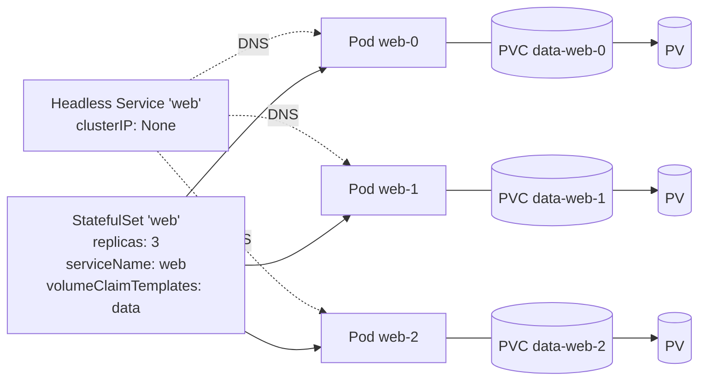
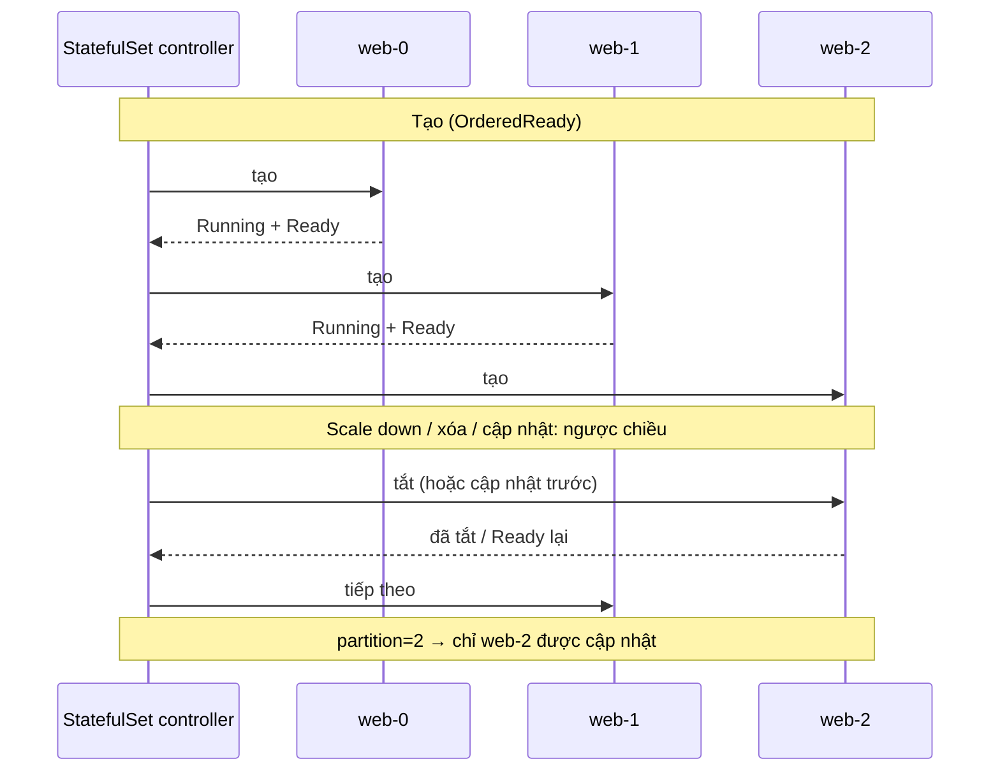
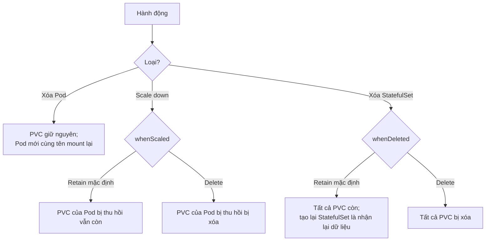

# 6_4_7 StatefulSets and Stateful Workloads

> **Khóa học**: Cloud DevOps Basic — Containers and Kubernetes  
> **Phân nhóm**: 6 Domain 6 - Containers and Kubernetes › 6_4 Kubernetes Networking Configuration and Storage  
> **Chủ đề**: 6_4_7 StatefulSet: danh tính ổn định, `volumeClaimTemplates`, thứ tự triển khai, cập nhật có `partition`, vòng đời PVC; vì sao Kafka/ZooKeeper/Cassandra cần StatefulSet hoặc Operator  
> **Phiên bản áp dụng**: Kubernetes 1.37 (kind v0.33.0); Kafka 4.x (KRaft); Strimzi 1.3.1  
> **Trạng thái**: Verified một phần (17-11-2026): danh tính, DNS, PVC sống sót, scale, `partition`, `persistentVolumeClaimRetentionPolicy` đã chạy thật trên kind v1.37.0; phần Kafka/ZooKeeper/Cassandra/Operator chỉ đối chiếu tài liệu, **chưa triển khai thật**  
> **Phạm vi**: [Topic README](./README.md#6_4_7-statefulset-và-workload-có-trạng-thái) · **Checkpoint**: [CHECKLIST](../../CHECKLIST.md#6_4-kubernetes-networking-configuration-and-storage)  
> **Lab thực hành liên quan**: [lab-6_4_4-statefulset-and-pvc](./README.md#lab-6_4_4-statefulset-and-pvc)  
> **Kiến thức liên quan**: [6_3_4 ReplicaSets and Deployments](<../6_3 Kubernetes Architecture and Core Workloads/6_3_4 ReplicaSets and Deployments.md>) · [6_3_8 DaemonSets Jobs and CronJobs](<../6_3 Kubernetes Architecture and Core Workloads/6_3_8 DaemonSets Jobs and CronJobs.md>) · [6_4_3 Cluster DNS](<./6_4_3 Cluster DNS and Service Discovery.md>) · [6_4_6 Volumes, PV, StorageClass](<./6_4_6 Volumes PersistentVolumes and StorageClasses.md>)

---

## 0. Tình Huống Mở Đầu: Xóa Một Pod, Cái Gì Mất, Cái Gì Còn?

Bạn chạy database 3 bản. Một Pod chết. Với Deployment, Pod mới có **tên ngẫu nhiên và IP mới**, và không có gì bảo đảm nó thấy lại dữ liệu cũ. Với StatefulSet, trên kind v1.37.0 (17-11-2026) đã quan sát thật khi xóa Pod `web-1`:

| | Sau khi `web-1` bị xóa và tạo lại |
| :--- | :--- |
| Tên Pod | **Giữ nguyên** `web-1` |
| Tên DNS `web-1.web.default.svc...` | **Giữ nguyên** |
| PVC `data-web-1` và dữ liệu | **Giữ nguyên**; Pod mới mount lại đúng ổ của mình |
| IP, `uid` của Pod | **Đổi** (`10.244.0.19` → `10.244.0.22`) |

Và một chuyện còn "hấp dẫn" hơn: **xóa hẳn StatefulSet thì PVC vẫn còn**, tạo lại StatefulSet cùng tên là Pod nhận lại đúng ổ cũ (kể cả dữ liệu đã lỗi thời). Đó là lý do Kafka, Cassandra, ZooKeeper cần StatefulSet: mỗi thành viên phải là **"một ai đó cố định"** có ổ đĩa riêng. Bạn sẽ tự tay tái hiện ở mục 4.

> Cảnh báo ngay: StatefulSet chỉ cho bạn **danh tính và ổ đĩa ổn định**. Replication, quorum, failover vẫn là việc của ứng dụng hoặc Operator.

---

## 1. Khái Niệm Cốt Lõi & Bản Chất Kỹ Thuật (Core Concepts & Technical Deep Dive)

### 1.1 Khi Nào Deployment Không Đủ?

Deployment ([6_3_4](<../6_3 Kubernetes Architecture and Core Workloads/6_3_4 ReplicaSets and Deployments.md>)) coi Pod là **vô danh và hoán đổi được**: tên có hậu tố ngẫu nhiên, IP thay đổi, mọi replica dùng chung template (kể cả volume). Một số ứng dụng cần:

- **Định danh mạng ổn định, duy nhất** cho từng thành viên.
- **Lưu trữ bền, riêng cho từng thành viên**.
- **Triển khai và scale theo thứ tự**.
- **Cập nhật cuốn chiếu theo thứ tự**.

Theo tài liệu StatefulSet, "ổn định" nghĩa là *bền qua các lần Pod bị lên lịch lại (reschedule)*. Nếu ứng dụng không cần các bảo đảm này, hãy dùng Deployment/ReplicaSet.

### 1.2 Bốn Bảo Đảm Của StatefulSet (Đã Kiểm Chứng)

**1) Tên Pod ổn định theo số thứ tự (ordinal).** Pod tên `<statefulset>-<ordinal>`; với N replica, ordinal chạy `0..N-1` (có thể đổi điểm bắt đầu bằng `spec.ordinals.start`, stable từ v1.31). Pod còn được gắn nhãn `statefulset.kubernetes.io/pod-name` (trỏ Service tới đúng một Pod) và `apps.kubernetes.io/pod-index` (stable từ v1.32).

**2) DNS ổn định qua headless Service.** StatefulSet **bắt buộc có headless Service** (`serviceName`) và **bạn tự tạo**. Mỗi Pod nhận tên DNS `<pod>.<service>.<namespace>.svc.<cluster-domain>`. 

> ✅ Quan sát: xóa Pod `web-1` thì Pod mới **vẫn tên `web-1`** nhưng **đổi IP** (`10.244.0.19` → `10.244.0.22`) và `uid` Pod khác; `nslookup web-0.web.default.svc.cluster.local` trả đúng IP của `web-0`. Tức **tên và DNS ổn định, IP thì không**. Ứng dụng phải dùng **tên**.

**3) Lưu trữ riêng bền vững qua `volumeClaimTemplates`.** Với mỗi entry trong `volumeClaimTemplates`, **mỗi Pod nhận một PVC riêng**, tên `<template>-<statefulset>-<ordinal>` (`data-web-0`, `data-web-1`...). Khi Pod được lên lịch lại, nó **mount lại đúng PVC của mình**.

> ✅ Quan sát: ghi `marker-web-2` vào `/data` của `web-2`, xóa Pod `web-2` → Pod mới đọc lại **đúng** `marker-web-2`.

**4) Triển khai/thu hồi theo thứ tự.** Mặc định (`podManagementPolicy: OrderedReady`): Pod tạo **tuần tự `0 → N-1`** và Pod `k` chỉ được tạo khi mọi Pod trước nó **Running và Ready** (nếu đặt `minReadySeconds`, phải *available*); thu hồi theo **thứ tự ngược `N-1 → 0`**, và Pod chỉ bị xóa khi các Pod sau nó đã tắt hoàn toàn.

> ✅ Quan sát: `web-0`, `web-1`, `web-2` có tuổi 15 s, 10 s, 5 s: tạo lần lượt.

### 1.3 `podManagementPolicy`: Nới Thứ Tự Nhưng Giữ Danh Tính

| Giá trị | Hành vi |
| :--- | :--- |
| `OrderedReady` (mặc định) | Tuần tự, chờ Ready như trên |
| `Parallel` | Tạo/xóa **tất cả cùng lúc**, không chờ Ready; giữ nguyên tên/PVC/DNS ổn định. Với cập nhật cuốn chiếu và `maxUnavailable` > 1 có thể cập nhật nhiều Pod cùng lúc ("bursting") và Pod có thể Ready **không theo thứ tự** |

> `podManagementPolicy` ảnh hưởng *scale/thu hồi* và (khi `Parallel` + `maxUnavailable`) cả cập nhật; ⚠️ chưa chạy thử `Parallel` trên cluster, nội dung theo tài liệu StatefulSet 1.37.

### 1.4 Chiến Lược Cập Nhật Và `partition`

`spec.updateStrategy.type`:

| Type | Hành vi |
| :--- | :--- |
| `RollingUpdate` (mặc định) | Xóa/tạo lại Pod **từ ordinal lớn xuống nhỏ**, mỗi lần một Pod, chờ Pod mới Running+Ready (và `minReadySeconds` nếu có) rồi mới tới Pod trước |
| `OnDelete` | Controller **không tự cập nhật**; bạn xóa Pod thủ công thì Pod mới mới theo template mới |
| `Recreate` | ⚠️ **Alpha từ v1.37, tắt mặc định** (feature gate `StatefulSetRecreateStrategy`): xóa **tất cả** Pod rồi tạo lại; có downtime |

**`rollingUpdate.partition`**: chỉ Pod có ordinal **≥ partition** được cập nhật khi template đổi; Pod ordinal < partition **giữ phiên bản cũ**, kể cả khi bị xóa (được tạo lại bằng phiên bản cũ). Dùng để **staged rollout / canary / phased rollout** (nâng `web-2` trước, quan sát, rồi hạ `partition` xuống).

> ✅ Quan sát: đặt `partition: 2`, thêm biến môi trường vào template → chỉ `web-2` sang revision mới (`web-cf6484485`), `web-0`/`web-1` giữ `web-987674669`; `status.currentRevision` và `status.updateRevision` khác nhau.

`rollingUpdate.maxUnavailable` (số hoặc %, mặc định 1, không được 0) hiện là **Beta từ v1.37, bật mặc định**. 

> ⚠️ **Lỗi "kẹt" đã biết**: với `OrderedReady` + RollingUpdate, nếu bạn cập nhật template thành cấu hình **không bao giờ Ready**, StatefulSet dừng chờ; chỉ revert template **không đủ**, phải **xóa thủ công các Pod đã chạy với cấu hình hỏng** thì controller mới tạo lại bằng template đúng (theo tài liệu "Forced rollback").

### 1.5 Vòng Đời PVC: Mặc Định Giữ, Có Thể Đổi

Theo tài liệu: **xóa Pod, xóa StatefulSet hoặc scale down đều KHÔNG xóa PVC** (an toàn dữ liệu quan trọng hơn dọn dẹp tự động). Muốn đổi, dùng `spec.persistentVolumeClaimRetentionPolicy` (stable từ v1.32):

| Trường | Giá trị (`Retain` mặc định / `Delete`) | Áp dụng khi |
| :--- | :--- | :--- |
| `whenDeleted` | `Retain` / `Delete` | StatefulSet bị **xóa** |
| `whenScaled` | `Retain` / `Delete` | **Scale down** (chỉ PVC của Pod bị thu hồi) |

> ✅ Quan sát đầy đủ:
> 1. Mặc định: scale `3 → 1` → PVC vẫn còn đủ 3 (`data-web-0..2`); scale lại `1 → 3` → dữ liệu của `web-2` quay lại.
> 2. **Xóa hẳn StatefulSet `web` → PVC `data-web-0..2` vẫn còn**. Tạo lại StatefulSet cùng tên → Pod mount lại PVC cũ, vẫn đọc được `marker-web-2`.
> 3. Đặt `whenScaled: Delete, whenDeleted: Delete`: scale `3 → 1` thì PVC `data-web-1`, `data-web-2` bị xóa (chỉ còn `data-web-0`); xóa StatefulSet thì `data-web-0` cũng bị xóa.

Bẫy rất thực tế: tạo lại StatefulSet cũ trên PVC cũ có thể **khôi phục dữ liệu lỗi thời** mà bạn tưởng đã xóa.

### 1.6 Giới Hạn Quan Trọng (Theo Tài Liệu)

- Lưu trữ phải do PV provisioner cấp theo StorageClass hoặc admin cấp sẵn ([6_4_6](<./6_4_6 Volumes PersistentVolumes and StorageClasses.md>)).
- **Bạn tự tạo** headless Service.
- Khi **xóa** StatefulSet, **không có bảo đảm** về thứ tự tắt Pod; muốn tắt có thứ tự và êm, **scale về 0 trước khi xóa**.
- `terminationGracePeriodSeconds` **không nên bằng 0** (không an toàn; xem tài liệu force-delete StatefulSet Pod).
- StatefulSet **không tự backup, không tự replicate dữ liệu, không tự "cấu hình cụm"**: nó chỉ cho bạn danh tính và ổ đĩa ổn định. Sao chép, bầu chọn leader, tái cân bằng là việc của **ứng dụng** (Kafka, Cassandra...).

### 1.7 Vì Sao Kafka, ZooKeeper, Cassandra, Elasticsearch Cần Danh Tính Ổn Định?

Các hệ thống phân tán lưu trạng thái có điểm chung: **mỗi thành viên (node) là một thực thể riêng**, biết và được biết đến bằng **tên/ID cố định**, và **sở hữu một phần dữ liệu trên đĩa riêng**.

| Nhu cầu | Vì sao Deployment không đáp ứng | StatefulSet cung cấp |
| :--- | :--- | :--- |
| **ID thành viên cố định** (ví dụ Kafka `node.id`, ZooKeeper `myid`) gắn với dữ liệu trên đĩa | Pod ngẫu nhiên: sau restart không biết "mình là ai" | Ordinal ổn định → ánh xạ ordinal sang ID |
| **Địa chỉ riêng từng thành viên** để các node và client tìm nhau (peer discovery, quorum, `advertised.listeners` của Kafka) | Một Service ClusterIP cân tải ẩn danh, client không chọn được *đúng* broker/leader | Headless Service + DNS `kafka-0.kafka-headless.<ns>.svc...` |
| **Dữ liệu riêng từng thành viên**, không chia sẻ | Volume chung hoặc mất khi Pod mới thay thế | `volumeClaimTemplates`: mỗi Pod một PVC, mount lại sau reschedule |
| **Khởi động/nâng cấp từng node một, chờ node trước khỏe** | Rolling update Deployment không biết "node nào" | `OrderedReady`, `RollingUpdate` theo ordinal, `partition` |

Ví dụ tài liệu chính thức của Kubernetes: **ZooKeeper** (headless Service `zk-hs` + StatefulSet + PodDisruptionBudget) và **Cassandra** đều có hướng dẫn riêng dùng StatefulSet.

> **Nguyên tắc**: danh tính ổn định + ổ đĩa ổn định = **điều kiện cần**. Cụm vẫn cần được cấu hình đúng (replication factor, quorum, `min.insync.replicas`...). StatefulSet không làm việc đó thay bạn.

### 1.8 ⚠️ Cập Nhật Phiên Bản: ZooKeeper Không Còn Là Mặc Định Của Kafka

Theo bài công bố chính thức của Apache Kafka (18-03-2025), **Kafka 4.0** là bản đầu tiên chạy **hoàn toàn không cần ZooKeeper**, mặc định chạy ở chế độ **KRaft**. Vì vậy:

- Kafka mới (4.x): **không có** ZooKeeper cần triển khai; bạn dựng một cụm KRaft (các node có vai trò controller/broker).
- ZooKeeper còn gặp ở Kafka **cũ (trước 4.0)** và ở các hệ thống khác dùng nó để điều phối. Vẫn phải hiểu mô hình triển khai của nó để đọc hệ thống hiện hữu.

*Chi tiết di trú ZooKeeper → KRaft và cấu hình KRaft theo từng phiên bản nằm ở tài liệu chính thức của Apache Kafka; cần đối chiếu trước khi vận hành.*

### 1.9 Trong Thực Tế: Dùng Operator

Tài liệu Strimzi (1.3.1) nêu: triển khai Kafka trực tiếp bằng `StatefulSet` và `Service` *"is often error-prone and time-consuming"*. Strimzi là **Operator** cho Kafka (khái niệm Operator sẽ học ở 6_7_9): bạn khai báo một custom resource (`Kafka`, `KafkaNodePool`) và operator lo triển khai, cấu hình, nâng cấp, quản lý topic/user.

Điểm đáng chú ý, **kiểm chứng từ tài liệu Strimzi**: Strimzi quản lý Pod Kafka bằng custom resource **`StrimziPodSet`** của riêng nó (viết tắt `sps`), *không* phải StatefulSet chuẩn; tài liệu ghi rõ **không được tạo/sửa/xóa `StrimziPodSet` thủ công**. Tức là các thuộc tính "danh tính + ổ đĩa ổn định" vẫn được giữ, nhưng cơ chế bên dưới là của operator.

Với Cassandra, Elasticsearch và các hệ thống dữ liệu khác, thực tế cũng thường dùng **Operator riêng của dự án/nhà cung cấp**; hãy tra tài liệu chính thức của từng hệ thống và đánh giá mức độ trưởng thành trước khi chọn.

> Ở các môi trường lớn, nhiều tổ chức không chạy cơ sở dữ liệu/queue trong Kubernetes mà dùng dịch vụ quản lý (ví dụ trên Azure, AWS). Đó là một quyết định kiến trúc về chi phí vận hành, không phải khả năng kỹ thuật.

---

## 2. Ví Dụ Đời Sống Thực Tế Dễ Hiểu (Intuitive Real-World Analogies)

**Hai cách tổ chức đội thủ thư của một thư viện, và một hôm có người ốm.**

**Cách 1: nhân viên thời vụ (Deployment).** Ai cũng mặc đồng phục giống nhau, ai đứng quầy cũng được. Một người ốm thì gọi người khác vào. Chẳng ai quan tâm người mới ngồi đâu hay có biết tủ hồ sơ của người cũ không, vì **quầy nào cũng như quầy nào**.

**Cách 2: thủ thư biên chế (StatefulSet).** Mỗi người có **thẻ số #0, #1, #2**, một **tủ hồ sơ riêng** (PVC) và **số máy lẻ cố định** (DNS). Thủ thư #1 nghỉ ốm, người thay thế **mang thẻ #1, ngồi đúng bàn #1, mở đúng tủ #1**. Chỉ có *chỗ ngồi vật lý* (IP) có thể khác. Với Kafka, điều này sống còn: các thủ thư khác và độc giả phải biết *chính xác* "thủ thư #1 giữ cuốn nào". Nếu mỗi lần đổi ca, tên và tủ cũng đổi, sổ mục lục hỏng.

Từ đó các quy tắc còn lại tự nhiên có nghĩa:

- **`OrderedReady` là mở ca theo thứ tự**: #0 vào chỗ và sẵn sàng thì #1 mới được vào, rồi mới tới #2; đóng ca thì #2 ra trước.
- **`partition` là thử quy trình mới trên thủ thư số cuối trước**: chỉ #2 làm theo quy trình mới, thấy ổn mới tới #1, #0.
- **Xóa StatefulSet là giải tán đội nhưng tủ hồ sơ vẫn nằm trong kho**: ai tuyển lại đội cùng tên sẽ nhận lại đúng tủ cũ, kể cả hồ sơ đã lỗi thời. Muốn dọn tủ phải dặn trước (`whenDeleted: Delete`) hoặc dọn tay.
- **Operator (Strimzi) là trưởng phòng nhân sự chuyên nghiệp** lo mọi thủ tục chuyển ca, nâng cấp, phân tủ cho những thủ thư đặc biệt như Kafka broker.

---

## 3. Kiến Trúc, Luồng Hoạt Động & Hình Ảnh Trực Quan (Architecture, Diagrams & Visual Media)

### 3.1 Cấu Trúc Một StatefulSet Hoàn Chỉnh



### 3.2 Thứ Tự Tạo, Thu Hồi Và Cập Nhật



### 3.3 Vòng Đời PVC Theo `persistentVolumeClaimRetentionPolicy`



### 3.4 So Sánh Deployment Và StatefulSet

| Tiêu chí | Deployment | StatefulSet |
| :--- | :--- | :--- |
| Tên Pod | Hậu tố băm ngẫu nhiên | `<tên>-<ordinal>` ổn định |
| IP | Đổi | **Vẫn đổi**, nhưng DNS theo tên ổn định |
| Lưu trữ | Dùng chung hoặc tạm | **Một PVC riêng mỗi Pod** (`volumeClaimTemplates`) |
| Thứ tự tạo/tắt | Không có | Có (`OrderedReady`), tùy chỉnh được |
| Cập nhật | `maxSurge`/`maxUnavailable` | Theo ordinal, `partition`, `OnDelete` |
| Cần headless Service | Không | **Có**, bạn tự tạo |
| Xóa/scale xóa PVC | Không áp dụng | **Không mặc định**; đổi bằng `persistentVolumeClaimRetentionPolicy` |

---

## 4. Code Mẫu Trực Quan Hoặc Dòng Lệnh Thực Chiến (Runnable Sample Code / CLI)

> ✅ **Đã chạy thử** ngày 17-11-2026 trên kind v0.33.0 (provider podman), Kubernetes v1.37.0, StorageClass `standard` (`rancher.io/local-path`). Các mục có ⚠️ chưa chạy thử.  
> Thực hành chi tiết: [lab-6_4_4-statefulset-and-pvc](./README.md#lab-6_4_4-statefulset-and-pvc).

### 4.1 Headless Service + StatefulSet 3 Replica

```yaml
apiVersion: v1
kind: Service
metadata:
  name: web
spec:
  clusterIP: None                 # headless: DNS trả IP từng Pod
  selector: { app: web }
  ports:
  - { name: tcp, port: 8080 }
---
apiVersion: apps/v1
kind: StatefulSet
metadata:
  name: web
spec:
  serviceName: web                # bắt buộc: tên headless Service
  replicas: 3
  selector:
    matchLabels: { app: web }
  template:
    metadata:
      labels: { app: web }
    spec:
      terminationGracePeriodSeconds: 2     # lab: busybox `sleep` làm PID 1 bỏ qua SIGTERM; đừng đặt 0 trong thực tế
      containers:
      - name: app
        image: docker.io/library/busybox:1.36
        command:
        - sh
        - -c
        - '[ -f /data/id ] || hostname > /data/id; echo "id=$(cat /data/id) host=$(hostname)"; sleep 36000'
        volumeMounts:
        - { name: data, mountPath: /data }
  volumeClaimTemplates:
  - metadata:
      name: data
    spec:
      accessModes: ["ReadWriteOnce"]
      resources:
        requests:
          storage: 50Mi
```

```bash
kubectl apply -f sts.yaml
kubectl rollout status sts/web
kubectl get pods -l app=web -o wide        # web-0, web-1, web-2 tuổi khác nhau (tạo tuần tự)
kubectl get pvc                            # data-web-0, data-web-1, data-web-2: Bound
```

### 4.2 Xóa `web-1`: Giữ Tên, Giữ Dữ Liệu, Đổi IP

```bash
kubectl exec web-2 -- sh -c 'echo marker-web-2 > /data/marker'

kubectl get pod web-1 -o jsonpath='{.status.podIP}{" uid="}{.metadata.uid}{"\n"}'
kubectl delete pod web-1
kubectl wait --for=condition=Ready pod/web-1 --timeout=60s
kubectl get pod web-1 -o jsonpath='{.status.podIP}{" uid="}{.metadata.uid}{"\n"}'   # IP và uid KHÁC

kubectl delete pod web-2 && kubectl wait --for=condition=Ready pod/web-2 --timeout=60s
kubectl exec web-2 -- cat /data/marker      # marker-web-2: dữ liệu còn
```

### 4.3 DNS Ổn Định Của Từng Pod

```bash
kubectl run tmp --image=docker.io/library/busybox:1.36 --restart=Never -- sleep 3600
kubectl exec tmp -- nslookup web-0.web.default.svc.cluster.local     # IP của web-0
kubectl exec tmp -- nslookup web.default.svc.cluster.local           # 3 IP (headless)
```

### 4.4 Scale Down Không Xóa PVC; Scale Up Lấy Lại Dữ Liệu

```bash
kubectl scale sts/web --replicas=1
kubectl get pods -l app=web                # tắt theo thứ tự ngược: web-2, rồi web-1
kubectl get pvc                            # VẪN CÒN data-web-0, data-web-1, data-web-2

kubectl scale sts/web --replicas=3
kubectl rollout status sts/web
kubectl exec web-2 -- cat /data/marker     # marker-web-2: quay lại
```

> Lưu ý: nếu StatefulSet bị scale/xóa trong khi Pod đang tắt chậm do `sleep` bỏ qua SIGTERM, bạn sẽ thấy `Terminating` kéo dài đến hết grace period (mặc định 30 giây). Đây là hành vi của ứng dụng lab, không phải lỗi Kubernetes (xem [6_1_8](<../6_1 Container Fundamentals/6_1_8 Container Lifecycle PID 1 and Signals.md>)).

### 4.5 Xóa StatefulSet: PVC Vẫn Còn, Tạo Lại Là Nhận Lại Dữ Liệu

```bash
kubectl delete sts web
kubectl get pods -l app=web                # không còn Pod
kubectl get pvc                            # data-web-0..2 VẪN CÒN

kubectl apply -f sts.yaml
kubectl rollout status sts/web
kubectl exec web-2 -- cat /data/marker     # marker-web-2: dữ liệu cũ xuất hiện lại
```

### 4.6 Cập Nhật Có `partition`

```bash
kubectl patch sts web -p '{"spec":{"updateStrategy":{"type":"RollingUpdate","rollingUpdate":{"partition":2}}}}'
kubectl patch sts web --type=json \
  -p '[{"op":"add","path":"/spec/template/spec/containers/0/env","value":[{"name":"REV","value":"2"}]}]'

kubectl get pods -l app=web -L controller-revision-hash
# chỉ web-2 mang revision mới; web-0/web-1 giữ revision cũ
kubectl get sts web -o jsonpath='{.status.currentRevision}{" "}{.status.updateRevision}{"\n"}'

# Hạ partition về 0 để cập nhật nốt (từ ordinal lớn xuống nhỏ)
kubectl patch sts web -p '{"spec":{"updateStrategy":{"rollingUpdate":{"partition":0}}}}'
```

### 4.7 Đổi Chính Sách Giữ PVC

```bash
kubectl explain sts.spec.persistentVolumeClaimRetentionPolicy
kubectl patch sts web -p '{"spec":{"persistentVolumeClaimRetentionPolicy":{"whenScaled":"Delete","whenDeleted":"Delete"}}}'

kubectl scale sts/web --replicas=1
kubectl get pvc            # chỉ còn data-web-0 (data-web-1, data-web-2 đã bị xóa)
kubectl delete sts web
kubectl get pvc            # data-web-0 cũng đã bị xóa
```

> ⚠️ `Delete` xóa **dữ liệu thật**. Chỉ dùng trong lab hoặc khi bạn đã có backup và hiểu hậu quả.

### 4.8 ⚠️ Phác Thảo Cấu Hình Kafka KRaft (Chưa Chạy Thử, Chỉ Để Hiểu)

Cấu trúc (không phải manifest hoàn chỉnh): StatefulSet `kafka` + headless Service `kafka-headless`; ordinal → ID node; địa chỉ quảng bá bằng DNS ổn định; mỗi Pod một PVC cho thư mục log. Nên dùng Operator:

```yaml
# Ý tưởng: mỗi broker tự biết mình là ai qua ordinal, quảng bá địa chỉ ổn định.
#   node.id            <- từ ordinal của hostname (kafka-0 -> 0, kafka-1 -> 1 ...)
#   advertised.listeners = ...://kafka-<ordinal>.kafka-headless.<ns>.svc.cluster.local:9092
#   log.dirs             -> thư mục gắn PVC (volumeClaimTemplates)
# Thực tế: dùng Strimzi (Kafka + KafkaNodePool), không tự viết StatefulSet:
#   kubectl get strimzi        # liệt kê StrimziPodSet, KafkaNodePool, ...
```

Tham khảo chính thức: Strimzi Overview/Deploying, ví dụ ZooKeeper và Cassandra trong tài liệu Kubernetes (mục tham khảo).

---

## 5. Cạm Bẫy Thực Tế & Thực Tiễn Sản Xuất (Production Gotchas & Best Practices)

> Chuyện "xóa StatefulSet thì PVC vẫn còn" đã nằm ở mục 0 và 1.5; ở đây chỉ nêu cách phòng.

### 5.1 Tin Rằng "StatefulSet = Database Chạy Được Ngay" (Và Áp Dụng Tài Liệu Kafka Cũ)

- **Bản chất**: StatefulSet chỉ cho danh tính + ổ đĩa. Replication, quorum, failover vẫn do ứng dụng/Operator. Kafka 4.0 trở lên chạy KRaft, không ZooKeeper.
- **Khuyến nghị**: Dùng Operator đã trưởng thành hoặc dịch vụ quản lý; có kế hoạch backup/restore **đã được diễn tập**. Xác định rõ phiên bản Kafka trước khi làm theo tài liệu (Apache Kafka/Strimzi tương ứng phiên bản).

### 5.2 Quên Headless Service Hoặc `serviceName` Sai

- **Hiện tượng**: Pod chạy nhưng không phân giải được `pod-0.svc...`.
- **Bản chất**: Bạn tự tạo headless Service; `serviceName` phải khớp; nhãn `selector` phải khớp Pod.
- **Khuyến nghị**: Kiểm tra `kubectl get svc` + `kubectl get endpointslices` ([6_4_2](<./6_4_2 Services and EndpointSlices.md>)).

### 5.3 Xóa Và Tạo Lại StatefulSet: Dữ Liệu Cũ "Hồi Sinh", Tắt Không Có Thứ Tự

- **Bản chất**: PVC không bị xóa nên StatefulSet mới cùng tên mount lại PVC cũ (đã chứng minh). Khi xóa StatefulSet cũng **không có bảo đảm** về thứ tự/êm khi tắt Pod.
- **Khuyến nghị**: Muốn tắt êm, scale về 0, chờ Pod tắt hết rồi mới xóa. Muốn bắt đầu sạch thì dọn PVC chủ động (`kubectl get pvc` rồi `kubectl delete pvc data-web-0 data-web-1 data-web-2`, kiểm tra kỹ tên trước khi xóa), hoặc dùng `persistentVolumeClaimRetentionPolicy` **sau khi** cân nhắc backup.

### 5.4 Rollout Hỏng Làm StatefulSet "Kẹt Mãi"

- **Bản chất**: Với `OrderedReady`, template không bao giờ Ready khiến rollout đứng; revert template chưa đủ (known issue trong tài liệu).
- **Khuyến nghị**: Dùng `partition`/canary để lộ lỗi sớm trên Pod ordinal cao; nếu kẹt, revert template **và** xóa các Pod đã chạy cấu hình hỏng. Cần probe đúng ([6_3_5](<../6_3 Kubernetes Architecture and Core Workloads/6_3_5 Liveness Readiness and Startup Probes.md>)).

### 5.5 RWO, Topology Và Drain Node

- **Bản chất**: PV `ReadWriteOnce` gắn một node; PV topology/`nodeAffinity` có thể ràng buộc Pod vào zone/node, nên Pod có thể kẹt `Pending` nếu nơi đó không còn chỗ. Một cụm có quorum (ZooKeeper/KRaft, Cassandra, Elasticsearch) mất quá nhiều thành viên cùng lúc khi drain node sẽ mất quorum.
- **Khuyến nghị**: Dùng `WaitForFirstConsumer`, trải đều bằng topology spread/anti-affinity (6_7), đủ dung lượng mỗi zone; với Azure Disk lưu ý giới hạn số disk mỗi node ([6_4_6](<./6_4_6 Volumes PersistentVolumes and StorageClasses.md>)). Dùng **PodDisruptionBudget** (tài liệu ZooKeeper của Kubernetes minh họa kèm StatefulSet); xem tài liệu *Disruptions*.

---

## 6. Câu Hỏi Củng Cố Kiến Thức (Active Recall Quiz)

### Câu Hỏi 1: Vì Sao Kafka Broker Cần Tên Và Ổ Đĩa Ổn Định, Không Chạy Tốt Bằng Deployment? (Phỏng vấn)

<details>
<summary>Đáp án</summary>

Mỗi broker là một thực thể riêng có **ID cố định** và **sở hữu dữ liệu (partition) trên đĩa riêng**; broker và client cần địa chỉ riêng từng broker (`advertised.listeners`), không phải một IP cân tải ẩn danh. Deployment cho Pod tên/IP ngẫu nhiên và volume không riêng từng Pod, nên sau restart broker không giữ được danh tính và dữ liệu. StatefulSet cho tên theo ordinal, DNS ổn định qua headless Service và một PVC riêng mỗi Pod; trong thực tế còn cần Operator như Strimzi để lo cấu hình/nâng cấp. (Kafka 4.0 trở lên chạy KRaft, không cần ZooKeeper.)
</details>

### Câu Hỏi 2: Xóa Một Pod StatefulSet, Xóa Cả StatefulSet, Và Scale Down: PVC Chuyện Gì Xảy Ra Theo Mặc Định?

<details>
<summary>Đáp án</summary>

Cả ba trường hợp PVC **đều được giữ nguyên** (an toàn dữ liệu). Chỉ khi cấu hình `persistentVolumeClaimRetentionPolicy` (`whenScaled`/`whenDeleted: Delete`) hoặc xóa thủ công thì PVC mới bị xóa. Đã kiểm chứng trên kind.
</details>

### Câu Hỏi 3: `partition: 2` Trên StatefulSet 3 Replica Làm Gì Khi Đổi Template?

<details>
<summary>Đáp án</summary>

Chỉ Pod có ordinal ≥ 2 (tức `web-2`) được cập nhật; `web-0`, `web-1` giữ phiên bản cũ. Hạ `partition` xuống để cập nhật tiếp (từ ordinal lớn xuống nhỏ). Dùng cho canary/phased rollout.
</details>

### Câu Hỏi 4: Pod `web-1` Bị Xóa. Cái Gì Giữ Nguyên, Cái Gì Đổi?

<details>
<summary>Đáp án</summary>

Giữ nguyên: tên `web-1`, tên DNS `web-1.web.<ns>.svc...`, PVC `data-web-1` và dữ liệu. Đổi: **IP** và `uid` của Pod.
</details>

---

## 7. 📚 Nguồn Tài Liệu Chính Thống (Tier-1 Official References)

- [StatefulSets](https://kubernetes.io/docs/concepts/workloads/controllers/statefulset/) - Danh tính ổn định, `volumeClaimTemplates`, `podManagementPolicy`, `partition`, `persistentVolumeClaimRetentionPolicy`, giới hạn, forced rollback.
- [StatefulSet Basics](https://kubernetes.io/docs/tutorials/stateful-application/basic-stateful-set/) - Hướng dẫn thực hành chính thức.
- [Running ZooKeeper, A Distributed System Coordinator](https://kubernetes.io/docs/tutorials/stateful-application/zookeeper/) - Ví dụ ZooKeeper trên StatefulSet với PodDisruptionBudget.
- [Example: Deploying Cassandra with a StatefulSet](https://kubernetes.io/docs/tutorials/stateful-application/cassandra/) - Ví dụ Cassandra trên StatefulSet.
- [Delete a StatefulSet](https://kubernetes.io/docs/tasks/run-application/delete-stateful-set/) và [Force Delete StatefulSet Pods](https://kubernetes.io/docs/tasks/run-application/force-delete-stateful-set-pod/) - Xóa StatefulSet và Pod an toàn.
- [Disruptions](https://kubernetes.io/docs/concepts/workloads/pods/disruptions/) - PodDisruptionBudget và gián đoạn tự nguyện.
- [Operator pattern](https://kubernetes.io/docs/concepts/extend-kubernetes/operator/) - Khái niệm Operator (học sâu ở 6_7_9).
- [Strimzi Overview (1.3.1)](https://strimzi.io/docs/operators/latest/overview) và [Deploying and Managing Strimzi](https://strimzi.io/docs/operators/latest/deploying) - Operator Kafka trên Kubernetes, `StrimziPodSet`, KRaft.
- [Apache Kafka 4.0.0 Release Announcement](https://kafka.apache.org/blog/2025/03/18/apache-kafka-4.0.0-release-announcement/) - Kafka 4.0 không còn ZooKeeper, mặc định KRaft.
- [Persistent Volumes](https://kubernetes.io/docs/concepts/storage/persistent-volumes/) - PV/PVC dùng bởi `volumeClaimTemplates`.
