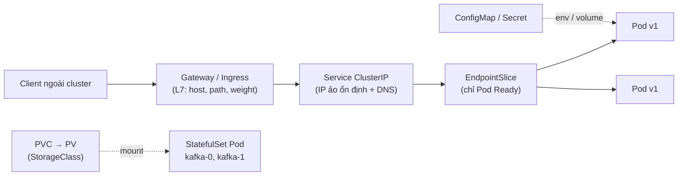

# 6_4 Kubernetes Networking, Configuration and Storage

> **Khóa học**: Cloud DevOps Basic — Containers & Kubernetes
> **Phân nhóm**: 6 Domain 6 - Containers and Kubernetes › 6_4 Kubernetes Networking Configuration and Storage
> **Chủ đề**: Service và service discovery, DNS trong cluster, Ingress/Gateway API, ConfigMap/Secret, PV/PVC/StorageClass, StatefulSet cho Kafka/ZooKeeper/Cassandra
> **Trạng thái**: Định nghĩa (nội dung cần học + đề bài lab + checkpoint), chưa chạy thử, 15-11-2026
> **Lộ trình tổng**: [container/README.md](../../README.md) · **Checkpoint**: [CHECKLIST.md](../../CHECKLIST.md#6_4-kubernetes-networking-configuration-and-storage)

---

## 🎯 Mục Tiêu

Pod có IP thay đổi liên tục, cấu hình không được nằm trong image, dữ liệu không được nằm trong lớp ghi của container. Topic này trả lời 3 câu hỏi: **làm sao tìm thấy nhau**, **cấu hình ở đâu**, **dữ liệu sống ở đâu**.

---

## 📚 Những Gì Cần Học

### 6_4_1 Mô Hình Mạng Kubernetes
- [ ] Mỗi Pod có IP riêng; Pod nói chuyện với Pod khác **không qua NAT** (yêu cầu của mô hình mạng Kubernetes).
- [ ] CNI plugin (Calico, Cilium, Flannel, kindnet...) chịu trách nhiệm cấp IP và định tuyến.
- [ ] Liên hệ kiến thức nền: veth, bridge, routing, NAT ở Domain 2 và 6_1_9.

### 6_4_2 Service
- [ ] `ClusterIP` (mặc định), `NodePort`, `LoadBalancer`, `ExternalName`, **headless** (`clusterIP: None`).
- [ ] `selector` → **EndpointSlice**: chỉ Pod **Ready** mới có mặt (nối với readinessProbe 6_3_5).
- [ ] `port` vs `targetPort` vs `nodePort`; named port.
- [ ] `kube-proxy` dịch IP ảo của Service thành IP Pod bằng quy tắc iptables/nftables (một số CNI như Cilium thay thế kube-proxy). *Trạng thái từng mode thay đổi theo phiên bản, cần đối chiếu tài liệu kube-proxy của bản bạn dùng.*
- [ ] `sessionAffinity`, `externalTrafficPolicy: Local` (giữ IP client).

### 6_4_3 DNS Trong Cluster
- [ ] CoreDNS; tên đầy đủ `<service>.<namespace>.svc.cluster.local`; gọi ngắn `<service>` trong cùng namespace.
- [ ] Headless Service trả về IP từng Pod; StatefulSet có tên Pod ổn định `kafka-0.kafka-headless.<ns>.svc.cluster.local`.
- [ ] `/etc/resolv.conf` của Pod, `search` domain và `ndots:5` (vì sao gọi tên miền ngoài sinh nhiều truy vấn DNS).

### 6_4_4 Traffic Từ Ngoài Vào: Ingress và Gateway API
- [ ] Ingress resource (host/path → Service, TLS) cần một **Ingress controller** mới hoạt động.
- [ ] **Ingress NGINX controller đã nghỉ hưu (retired) từ tháng 3-2026**: deployment cũ vẫn chạy nhưng không còn bản vá. Dự án Kubernetes khuyến nghị chuyển sang **Gateway API**. Vẫn cần đọc hiểu Ingress vì gặp nhiều trong hệ thống cũ.
- [ ] Gateway API: `GatewayClass` (hạ tầng), `Gateway` (người vận hành cluster), `HTTPRoute` (đội ứng dụng); phân vai rõ hơn Ingress.
- [ ] `HTTPRoute` hỗ trợ chia traffic theo **trọng số** (`backendRefs[].weight`) → nền tảng cho canary ở 6_6_8.
- [ ] TLS termination tại Gateway; cert-manager cấp chứng chỉ tự động (khái niệm).

### 6_4_5 ConfigMap và Secret
- [ ] Đưa vào Pod bằng biến môi trường (`env`, `envFrom`) hoặc **volume** file.
- [ ] Thay đổi ConfigMap: biến môi trường **không** tự cập nhật (cần restart Pod); volume được cập nhật sau một khoảng trễ, trừ khi mount bằng `subPath`.
- [ ] Mẫu "checksum annotation" để rollout khi config đổi (học ở Helm 6_5_10).
- [ ] Secret chỉ **mã hóa base64, không phải mã hóa bảo mật**; cần encryption at rest cho etcd và RBAC chặt (6_7_4).
- [ ] `immutable: true`; Secret loại `kubernetes.io/dockerconfigjson` cho `imagePullSecrets` (6_2_8).
- [ ] Quản lý secret ngoài Git: External Secrets Operator, Sealed Secrets, Vault (mức khái niệm).

### 6_4_6 Lưu Trữ: Volume, PV, PVC, StorageClass
- [ ] Volume tạm: `emptyDir` (mất khi Pod bị xóa), `configMap`, `secret`, `projected`.
- [ ] **PersistentVolume** (tài nguyên lưu trữ), **PersistentVolumeClaim** (yêu cầu của app), **StorageClass** (cấp phát động qua CSI driver).
- [ ] Access mode: `ReadWriteOnce`, `ReadOnlyMany`, `ReadWriteMany`, `ReadWriteOncePod`.
- [ ] `reclaimPolicy` (`Delete` vs `Retain`), `volumeBindingMode: WaitForFirstConsumer`.
- [ ] kind có sẵn StorageClass `standard` (local-path provisioner): dữ liệu nằm trên ổ của node container, chỉ để học.

### 6_4_7 StatefulSet và Workload Có Trạng Thái
- [ ] Danh tính ổn định: tên Pod có số thứ tự (`app-0`, `app-1`), DNS ổn định qua headless Service, PVC riêng qua `volumeClaimTemplates`.
- [ ] Tạo/xóa theo thứ tự (`podManagementPolicy`), cập nhật `RollingUpdate` với `partition`.
- [ ] Xóa StatefulSet hoặc scale down **không xóa PVC** mặc định (`persistentVolumeClaimRetentionPolicy` cho phép đổi).
- [ ] Vì sao Kafka, ZooKeeper, Cassandra, Elasticsearch dùng StatefulSet; thực tế thường chạy qua **Operator** (ví dụ Strimzi cho Kafka; học CRD/Operator ở 6_7_9).

---

## 🧪 Labs

> **Bản định nghĩa**: chưa tạo thư mục `labs/`, chưa chạy thử. Cluster kind và image `hello-svc` từ 6_3.

| Lab | Nội dung | Thời gian | Trạng thái |
| :--- | :--- | :---: | :--- |
| lab-6_4_1-service-discovery-and-dns | Service, EndpointSlice, DNS, readiness gỡ Pod khỏi Service | 45 phút | Định nghĩa |
| lab-6_4_2-configmap-and-secret | Cấu hình qua env và volume, cập nhật config, bẫy base64 | 45 phút | Định nghĩa |
| lab-6_4_3-gateway-api-weighted-routing | Gateway API: định tuyến theo path và chia 90/10 giữa v1 và v2 | 60–90 phút | Định nghĩa |
| lab-6_4_4-statefulset-and-pvc | Danh tính ổn định, dữ liệu sống sót khi Pod bị xóa | 45 phút | Định nghĩa |

### lab-6_4_1-service-discovery-and-dns
- **Các bước chính**:
  1. Deploy `hello-svc` 3 replica + Service ClusterIP; `kubectl get endpointslices -l kubernetes.io/service-name=hello-svc -o wide`.
  2. Chạy Pod debug (`kubectl run tmp --rm -it --image=docker.io/library/busybox:1.36 -- sh`), `nslookup hello-svc`, `nslookup hello-svc.default.svc.cluster.local`, `wget -qO- hello-svc`.
  3. `cat /etc/resolv.conf` trong Pod debug, giải thích `search` và `ndots`.
  4. Đổi `selector` sai một chữ → Service còn IP nhưng không có endpoint → client nhận lỗi kết nối.
  5. Đặt `STARTUP_DELAY_MS` lớn, xóa 1 Pod → quan sát Pod mới **không** có trong EndpointSlice tới khi Ready.
  6. Tạo headless Service, so sánh kết quả `nslookup`.
- **Checkpoint**:
  - [ ] Giải thích được đường đi gói tin: Pod debug → DNS → ClusterIP → kube-proxy → Pod.
  - [ ] Chẩn đoán được "Service không có endpoint" bằng 2 lệnh.

### lab-6_4_2-configmap-and-secret
- **Các bước chính**:
  1. ConfigMap `GREETING=xin chao` qua `envFrom`; Secret `API_TOKEN` qua volume `/etc/secrets`.
  2. Sửa ConfigMap → `curl` thấy greeting **chưa đổi**; `kubectl rollout restart` → đổi.
  3. Mount ConfigMap dạng volume, sửa, đo thời gian file trong Pod thay đổi.
  4. `kubectl get secret -o yaml` rồi `base64 -d` để thấy Secret không được "giấu".
  5. Xóa key mà Pod tham chiếu → Pod mới kẹt ở `CreateContainerConfigError`.
- **Checkpoint**:
  - [ ] Nêu được 2 cách làm app nhận config mới và đánh đổi của từng cách.
  - [ ] Giải thích được với người phỏng vấn: "Secret của Kubernetes an toàn tới đâu, cần thêm gì".

### lab-6_4_3-gateway-api-weighted-routing
- **Chuẩn bị**: cài CRD Gateway API và **một** implementation (ví dụ Envoy Gateway, Istio, Cilium, NGINX Gateway Fabric...). *Cách cài trên kind khác nhau theo từng implementation, làm theo trang hướng dẫn chính thức của implementation đã chọn.*
- **Các bước chính**:
  1. Deploy song song `hello-svc-v1` (1.0.0) và `hello-svc-v2` (2.0.0), mỗi bản một Service.
  2. Tạo `Gateway` + `HTTPRoute` với `backendRefs` trọng số 90/10.
  3. Gửi 100 request, đếm version trả về; đổi sang 50/50 rồi 0/100.
  4. (So sánh) Viết một `Ingress` tương đương và ghi lại những gì Ingress không làm được nếu không có annotation riêng của controller.
- **Checkpoint**:
  - [ ] Tỉ lệ version gần với trọng số đã đặt.
  - [ ] Vẽ được sơ đồ GatewayClass → Gateway → HTTPRoute → Service và nói ai sở hữu từng object.

### lab-6_4_4-statefulset-and-pvc
- **Các bước chính**:
  1. StatefulSet 3 replica (`busybox`) ghi hostname vào `/data/id` trên PVC từ `volumeClaimTemplates`; headless Service.
  2. Xóa `web-1` → Pod mới vẫn tên `web-1`, vẫn đọc được file cũ.
  3. Scale xuống 1 → `kubectl get pvc` thấy PVC vẫn còn; scale lên lại → dữ liệu quay về.
  4. Từ Pod khác `nslookup web-0.<headless-svc>`.
- **Checkpoint**:
  - [ ] Giải thích được vì sao broker Kafka cần tên và ổ đĩa ổn định, không chạy được tốt bằng Deployment.

---

## 📚 Nguồn Tài Liệu Chính Thống (Official References)
- [Cluster Networking](https://kubernetes.io/docs/concepts/cluster-administration/networking/) - Mô hình mạng Kubernetes.
- [Service](https://kubernetes.io/docs/concepts/services-networking/service/) và [EndpointSlices](https://kubernetes.io/docs/concepts/services-networking/endpoint-slices/) - Service và endpoint.
- [DNS for Services and Pods](https://kubernetes.io/docs/concepts/services-networking/dns-pod-service/) - Tên DNS trong cluster.
- [Gateway API](https://kubernetes.io/docs/concepts/services-networking/gateway/) và [Gateway API - Traffic splitting](https://gateway-api.sigs.k8s.io/guides/traffic-splitting/) - Tài liệu chính thức Gateway API, `HTTPRoute`, chia traffic.
- [Ingress](https://kubernetes.io/docs/concepts/services-networking/ingress/) - Ingress resource.
- [Ingress NGINX Retirement: What You Need to Know](https://kubernetes.io/blog/2025/11/11/ingress-nginx-retirement/) - Blog chính thức về việc nghỉ hưu Ingress NGINX.
- [ConfigMaps](https://kubernetes.io/docs/concepts/configuration/configmap/) và [Secrets](https://kubernetes.io/docs/concepts/configuration/secret/) - Cấu hình và dữ liệu nhạy cảm.
- [Persistent Volumes](https://kubernetes.io/docs/concepts/storage/persistent-volumes/) và [Storage Classes](https://kubernetes.io/docs/concepts/storage/storage-classes/) - Lưu trữ bền vững.
- [StatefulSets](https://kubernetes.io/docs/concepts/workloads/controllers/statefulset/) - Workload có trạng thái.
