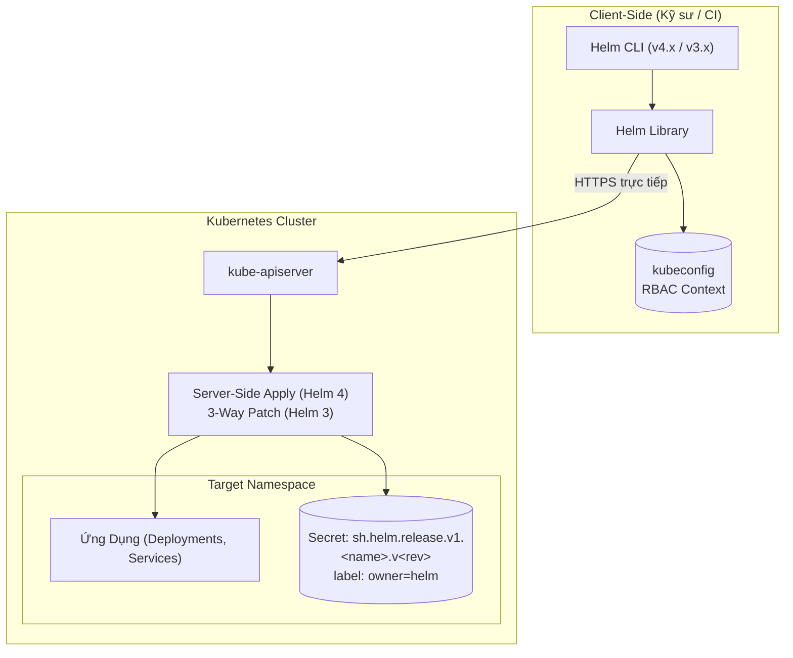
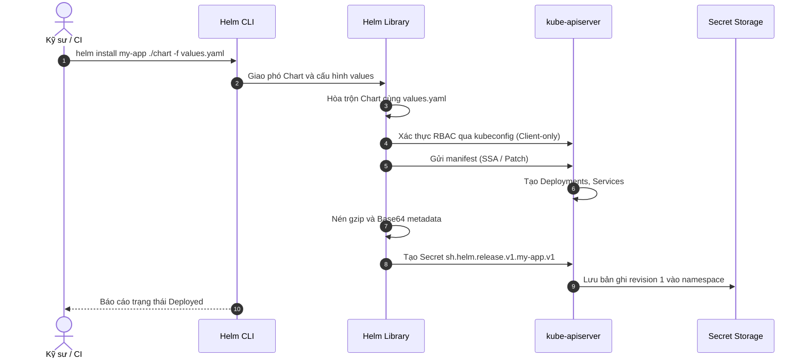

# 6_5_1 Helm Core Concepts

> **Khóa học**: Cloud DevOps Basic — Containers & Kubernetes
> **Phân nhóm**: 6 Domain 6 - Containers and Kubernetes › 6_5 Helm Package Management
> **Chủ đề**: 6_5_1 Helm Core Concepts
> **Phiên bản áp dụng**: Kubernetes 1.37, Helm 4.x / Helm 3.x, Podman 5.x
> **Trạng thái**: Verified (WRITE-CTR-6_5_1, 16-11-2026)
> **Phạm vi**: [Topic README](./README.md#6_5_1-khái-niệm-cốt-lõi) · **Checkpoint của người học**: [CHECKLIST](../../CHECKLIST.md#6_5-helm-package-management)
> **Kiến thức liên quan**: [6_3_1 Kubernetes Cluster Architecture](<../6_3 Kubernetes Architecture and Core Workloads/6_3_1 Kubernetes Cluster Architecture.md>) (kube-apiserver) · [6_3_2 kubectl and API Objects](<../6_3 Kubernetes Architecture and Core Workloads/6_3_2 kubectl and API Objects.md>) (Secrets, RBAC)

---

## 0. Tình Huống Mở Đầu: "Ứng Dụng Chạy Ở 3 Môi Trường, Bản Nâng Cấp Hỏng Thì Sao?"

Ở 6_3 và 6_4 bạn viết YAML tay cho **một** môi trường. Giờ ứng dụng gồm Deployment, Service, ConfigMap, Ingress... và phải chạy ở dev, staging, prod. Ba câu hỏi sẽ xuất hiện ngay:

1. **Nâng cấp hỏng giữa chừng, quay lại bản trước bằng cách nào?** Nếu chỉ có `kubectl apply`, "bản trước" là thứ bạn phải tự giữ ở đâu đó.
2. **Gỡ ứng dụng, làm sao chắc không sót tài nguyên nào?** Có những file YAML rời rạc, ai nhớ hết?
3. **Cluster đang chạy bản nào, với cấu hình nào?** Không có sổ ghi chép thì chỉ còn cách đoán.

Helm trả lời cả ba bằng ba khái niệm: **Chart** (gói ứng dụng), **Release** (một lần cài chart vào cluster, có tên riêng) và **Revision** (mỗi lần cài/nâng cấp/rollback là một số thứ tự tăng dần). Phần "sổ ghi chép" không nằm trong database nào: Helm lưu thẳng trong **Kubernetes Secret** tên `sh.helm.release.v1.<tên>.v<revision>` ngay trong namespace của release. Bài này giải thích mô hình đó, vì sao Helm 3 bỏ Tiller, và mốc EOL của Helm 3 cần để mắt tới. <!-- ev: R1.2 R1.4 R1.9 R1.16 -->

---

## 1. Khái Niệm Cốt Lõi & Bản Chất Kỹ Thuật (Core Concepts & Technical Deep Dive)

Trong hệ sinh thái Kubernetes, Helm là trình quản lý gói (package manager) giúp định nghĩa, cài đặt và nâng cấp các ứng dụng container hóa từ đơn lẻ đến phức tạp. <!-- ev: R1.1 -->

### 1.1 Bốn Thực Thể: Chart, Release, Revision, Repository

Kiến trúc đối tượng của Helm xoay quanh 4 thành phần cơ bản: <!-- ev: R1.1 R1.2 R1.4 R1.7 R2.16 -->

- **Chart**: Một gói (thư mục) gom tất cả manifest Kubernetes của một ứng dụng (Deployment, Service, ConfigMap...) cùng cấu hình mặc định. Chart có số phiên bản, đẩy lên repository để chia sẻ được, và khi cài ra cluster thì Helm cài, nâng cấp hoặc rollback cả gói như một khối. <!-- ev: R1.2 R1.3 -->
- **Release**: Một thực thể (instance) cụ thể của chart đang chạy kết hợp với cấu hình trong cụm. Helm hòa trộn chart với values (thường từ file `values.yaml`) để tạo release. Cùng một chart có thể cài đặt nhiều lần thành các release độc lập với tên riêng biệt. Lệnh `helm list` (hoặc `helm ls`) liệt kê toàn bộ release đã triển khai. <!-- ev: R1.4 R1.5 R1.6 R2.16 -->
- **Revision**: Số phiên bản tăng dần ghi lại lịch sử cấu hình của release qua mỗi lần cài đặt, nâng cấp hoặc rollback. <!-- ev: R1.2 R1.4 -->
- **Repository**: Kho lưu trữ chia sẻ chart qua HTTP (`index.yaml`) hoặc registry OCI. <!-- ev: R1.2 R1.7 -->

### 1.2 Kiến Trúc Client-Only & Phân Quyền RBAC (Loại Bỏ Tiller)

Helm gồm hai phần: CLI client dành cho người dùng (quản lý chart, repo, release) và Helm library cung cấp logic độc lập tương tác trực tiếp với máy chủ `kube-apiserver`. <!-- ev: R1.7 R1.8 -->

<!-- ev: R1.10 R1.11 R1.12 -->
Từ Helm 3, Tiller bị loại bỏ hoàn toàn nhằm xóa bỏ quyền operator phức tạp và các lỗ hổng bảo mật: <!-- ev: R1.10 -->

- **Bảo mật qua kubeconfig & RBAC**: Quyền hạn của Helm client được đánh giá trực tiếp dựa trên file `kubeconfig` và phân quyền Kubernetes RBAC của người dùng, cho phép phân quyền chi tiết. <!-- ev: R1.11 -->
- **Lưu trữ theo Namespace**: Siêu dữ liệu release được lưu trong chính namespace của release đó thay vì namespace Tiller tập trung. <!-- ev: R1.12 -->

### 1.3 Cơ Chế Lưu Trữ Trạng Thái Release Trong Kubernetes Secrets

Helm không cần cơ sở dữ liệu riêng mà lưu thông tin release trực tiếp trong Kubernetes Secrets trong cụm. <!-- ev: R1.9 -->

- **Storage Driver**: Secrets là driver mặc định từ Helm 3 (thay thế ConfigMaps của Helm 2). Biến `HELM_DRIVER` cho phép chọn `secret`, `configmap`, hoặc `sql` (chỉ hỗ trợ PostgreSQL). <!-- ev: R1.13 R2.10 R2.17 -->
- **Định danh & Mã hóa**: Hằng số loại lưu trữ là `sh.helm.release.v1`. Khóa lưu trữ có định dạng `<helm_storage_type>.<release_name>.v<release_version>` (ví dụ: `sh.helm.release.v1.my-app.v1`). Dữ liệu release được nén gzip và mã hóa base64 dưới dạng chuỗi JSON. <!-- ev: R1.16 R2.13 R2.14 -->
- **Bộ lọc nhãn & Gỡ cài đặt**: Driver lọc release bằng nhãn `owner=helm`, tra cứu qua `kubectl get secret --all-namespaces -l "owner=helm"`. Lệnh `helm uninstall` mặc định xóa sạch tài nguyên và lịch sử release. <!-- ev: R2.11 R2.12 R2.15 -->

### 1.4 Lộ Trình Helm 3 vs Helm 4 & Cơ Chế Áp Dụng Tài Nguyên

- **Phát hành & EOL**: Helm v4.0.0 ra mắt ngày 12-11-2025 tại KubeCon + CloudNativeCon. Helm 3 kết thúc sửa lỗi (bug fixes) vào 09-09-2026 (bản feature cuối chỉ cập nhật client K8s) và kết thúc sửa bảo mật (security fixes) vào 10-02-2027 (sau đó không còn bản phát hành nào). <!-- ev: R2.1 R2.2 R2.3 R2.4 R2.5 -->
- **Chiến lược áp dụng**: Helm 3 sử dụng three-way strategic merge patch (kết hợp manifest cũ, live state trên cụm và manifest mới). Helm 4 mặc định sử dụng Server-Side Apply (SSA) cho các bản cài đặt chart mới. <!-- ev: R1.14 R1.15 -->

---

## 2. Ví Dụ Đời Sống Thực Tế Dễ Hiểu (Intuitive Real-World Analogies)

**Cài phần mềm lên máy Linux, bằng tay và bằng `apt`.**

Hồi chưa có trình quản lý gói, bạn tải mã nguồn, tự biên dịch, tự chép file vào từng thư mục. Muốn gỡ thì phải nhớ mình đã chép những gì, và gần như chắc chắn **sót** vài file. Có `apt`, bạn gõ một lệnh: gói tự biết cần chép những gì, nằm ở đâu, và gỡ là gỡ sạch.

Helm là `apt` (hoặc `npm`) của Kubernetes, và mỗi khái niệm đều có chỗ đứng:

- **Chart là gói `.deb` hoặc `package.json`**: bản vẽ ứng dụng cùng danh mục tài nguyên và chỉ dẫn cấu hình, đóng thành một khối.
- **Repository là kho `apt` hoặc `npmjs.org`**: nơi lưu và phân phối các gói.
- **Release là phần mềm đã cài và đang chạy.** Cùng một chart Nginx, bạn cài được hai release `web-dev` và `web-prod` ở hai namespace, mỗi cái một `values.yaml`.
- **Revision là mã commit của lịch sử cấu hình.** Mỗi lần nâng cấp, Helm ghi thêm một số revision (v1, v2, v3...) vào Secret. Nâng cấp hỏng thì quay về revision tốt gần nhất chỉ bằng một lệnh.

Và đó cũng là câu chuyện của Tiller (Helm 2): một "người quản lý kho" chạy trong cluster với quyền gần như tối cao, ai nhờ gì làm nấy. Helm 3 sa thải người này; bạn tự đến kho bằng **chính thẻ ra vào của mình** (kubeconfig + RBAC).

---

## 3. Kiến Trúc, Luồng Hoạt Động & Hình Ảnh Trực Quan (Architecture, Diagrams & Visual Media)

### 3.1 Sơ Đồ Kiến Trúc Client-Only & Phân Quyền Trực Tiếp

<!-- ev: R1.7 R1.8 R1.9 R1.10 R1.11 R1.12 R1.13 R1.15 R1.16 R2.10 R2.11 R2.12 R2.13 R2.14 -->
Sơ đồ mô tả kiến trúc client-only không còn Tiller, xác thực trực tiếp qua `kubeconfig` và lưu trữ trạng thái vào Kubernetes Secrets:



### 3.2 Luồng Xử Lý Khi Cài Đặt Release Mới

<!-- ev: R1.4 R1.6 R1.7 R1.8 R1.9 R1.11 R1.12 R1.14 R1.15 R1.16 R2.13 R2.14 -->
Trình tự cài đặt release từ Helm client tới khi lưu trữ Secret trạng thái:



---

## 4. Code Mẫu Trực Quan Hoặc Dòng Lệnh Thực Chiến (Runnable Sample Code / CLI)

> **Thông tin công cụ thực nghiệm**: Kubernetes 1.37, Helm v4.x / Helm v3.x, Podman 5.x / Docker <!-- ev: R2.1 R2.6 -->  
> ⚠️ Chưa chạy thử (not executed by the squad)  
> ⚠️ Chỉ chạy trên cluster thử nghiệm (lab cluster only)  
> *Thực hành trực tiếp tại bài lab*: [lab-6_5_1-chart-from-manifests](./README.md#lab-6_5_1-chart-from-manifests)

### 4.1 Kiểm Tra Phiên Bản Helm CLI

<!-- ev: R2.6 R2.7 R2.8 R2.9 -->
Tra cứu thông tin phiên bản nhị phân Helm bằng cờ mặc định, cờ rút gọn hoặc định dạng template Go:

```bash
# 1. Hiển thị thông tin phiên bản đầy đủ
helm version

# 2. In chuỗi phiên bản rút gọn
helm version --short

# 3. Trích xuất thuộc tính .Version qua Go template
helm version --template '{{.Version}}'
```

### 4.2 Thiết Lập Driver Lưu Trữ & Liệt Kê Release

<!-- ev: R1.13 R2.10 R2.16 R2.17 -->
Cấu hình backend lưu trữ qua biến môi trường và liệt kê các release:

```bash
# 1. Chọn driver lưu trữ (secret, configmap, hoặc sql hỗ trợ PostgreSQL)
#    Mặc định đã là secret nên bước này có thể bỏ qua; mọi lệnh Helm sau đó phải dùng cùng driver
export HELM_DRIVER=secret

# 2. Liệt kê release đã triển khai trong namespace hiện tại (helm ls là alias của helm list)
helm list

# 3. Liệt kê release trên tất cả namespaces (viết tắt: -A)
helm list --all-namespaces
```

### 4.3 Khảo Sát Secret Lưu Trữ Release Metadata Của Helm

<!-- ev: R1.9 R1.16 R2.11 R2.12 R2.13 R2.14 -->
Kiểm tra các đối tượng Secret lưu trữ trạng thái do Helm tạo ra trên cụm:

```bash
# 1. Lọc tất cả Secret do Helm quản lý qua nhãn owner=helm
kubectl get secret --all-namespaces -l "owner=helm"

# 2. Xem Secret có định dạng: sh.helm.release.v1.<name>.v<version>
kubectl get secret sh.helm.release.v1.my-app.v1 -n default -o yaml

# 3. Giải mã release metadata (chuỗi JSON nén gzip và base64)
kubectl get secret sh.helm.release.v1.my-app.v1 -n default -o jsonpath='{.data.release}' | base64 -d | gzip -d | head -n 25
```

### 4.4 Gỡ Cài Đặt Release

<!-- ev: R2.15 -->
Xóa bỏ release và dọn dẹp lịch sử:

```bash
# Gỡ cài đặt release: xóa toàn bộ tài nguyên Kubernetes và lịch sử Secret tương ứng
helm uninstall my-app -n default
```

---

## 5. Cạm Bẫy Thực Tế & Thực Tiễn Sản Xuất (Production Gotchas & Best Practices)

### 5.1 Cạm Bẫy 1: Bỏ Quên Mốc EOL Helm 3 Dẫn Tới Mất Khả Năng Vá Bảo Mật

<!-- ev: R2.1 R2.2 R2.3 R2.4 R2.5 -->
- **Bản chất**: Helm 3 kết thúc sửa lỗi (bug fixes) vào 09-09-2026 và kết thúc hoàn toàn vá bảo mật (security fixes) vào 10-02-2027 (sau đó không còn bản phát hành nào). <!-- ev: R2.2 R2.3 R2.4 R2.5 -->
- **Hậu quả**: Duy trì Helm 3 sau mốc EOL đối mặt rủi ro CVE chưa vá và không tương thích API Kubernetes mới. <!-- ev: R2.4 R2.5 -->
- **Khuyến nghị**: Lên kế hoạch nâng cấp lên Helm 4 (phát hành từ 12-11-2025) cho mọi pipeline CI/CD. <!-- ev: R2.1 -->

### 5.2 Cạm Bẫy 2: Xóa Nhầm Secret `owner=helm` Biến Release Thành "Mồ Côi" (Orphaned)

<!-- ev: R1.9 R2.11 R2.12 R2.13 R2.14 R2.15 R2.16 -->
- **Bản chất**: Helm lưu trữ trạng thái release và lịch sử revision trong Secret mang nhãn `owner=helm` và định danh `sh.helm.release.v1.<name>.v<rev>`. <!-- ev: R1.9 R2.11 R2.13 R2.14 -->
- **Hậu quả**: Xóa nhầm Secret khiến `helm list` không thấy release, nhưng tài nguyên thực tế (Pod, Service) vẫn chạy ngầm. Cài đặt lại bằng `helm install` sẽ thất bại vì tài nguyên đã tồn tại sẵn. <!-- ev: R2.15 R2.16 -->
- **Khuyến nghị**: Không gán nhãn `owner=helm` tùy tiện và bảo vệ Secret bằng chính sách RBAC nghiêm ngặt. <!-- ev: R2.11 R2.13 -->

### 5.3 Cạm Bẫy 3: Thiếu Quyền RBAC Thao Tác Với Secret Trong Namespace

<!-- ev: R1.9 R1.10 R1.11 R1.12 R1.13 -->
- **Bản chất**: Không còn Tiller, Helm hoạt động với quyền `kubeconfig` của người dùng hoặc ServiceAccount. <!-- ev: R1.10 R1.11 -->
- **Hậu quả**: Nếu tài khoản CI/CD chỉ có quyền tạo Pod mà không có quyền CRUD trên đối tượng `secrets` trong namespace, lệnh `helm install`/`upgrade` sẽ bị từ chối khi ghi metadata release. <!-- ev: R1.9 R1.11 R1.12 R1.13 -->
- **Khuyến nghị**: Cấp quyền đầy đủ với tài nguyên `secrets` trong namespace triển khai cho ServiceAccount CI/CD. <!-- ev: R1.11 R1.12 -->

### 5.4 Cạm Bẫy 4: Lệch Trạng Thái Out-of-Band & Khác Biệt Giữa 3-Way Patch và SSA

<!-- ev: R1.14 R1.15 -->
- **Bản chất**: Helm 3 dùng 3-way strategic merge patch (manifest cũ, live state, manifest mới) để giữ thay đổi out-of-band, nhưng patch phía client có thể gây xung đột phức tạp. Helm 4 chuyển sang Server-Side Apply (SSA) mặc định cho cài đặt mới để giải quyết xung đột trực tiếp trên API server. <!-- ev: R1.14 R1.15 -->
- **Khuyến nghị**: Quản lý cấu hình nhất quán qua `values.yaml` và hạn chế sửa đổi trực tiếp bằng `kubectl edit`. <!-- ev: R1.6 R1.15 -->

---

## 6. Câu Hỏi Củng Cố Kiến Thức (Active Recall Quiz)

### Câu Hỏi 1: Vì Sao Tiller Bị Loại Bỏ Từ Helm 3 Và Mô Hình Bảo Mật Thay Đổi Như Thế Nào? (Phỏng vấn)

Tại sao Helm 3 loại bỏ Tiller và cơ chế phân quyền thao tác với cụm thay đổi ra sao?

<details>
<summary>Đáp án</summary>

1. **Triệt tiêu lỗ hổng đặc quyền**: Tiller trong Helm 2 thường cần quyền `cluster-admin`. Loại bỏ Tiller loại trừ hoàn toàn nguy cơ leo thang đặc quyền này.
2. **Kiến trúc Client-Only**: Helm 3/4 chuyển sang thuần client, tương tác trực tiếp với `kube-apiserver` bằng danh tính và quyền hạn trong file `kubeconfig` của người dùng qua hệ thống Kubernetes RBAC.
3. **Phân vùng theo Namespace**: Metadata lưu trực tiếp trong namespace của release thay vì tập trung ở namespace của Tiller, hỗ trợ tối đa nguyên tắc Least Privilege.
</details>

### Câu Hỏi 2: Điều Gì Xảy Ra Khi Secret Lưu Trữ Release Bị Xóa Nhầm? (Xử lý sự cố)

Lệnh `helm list` không còn thấy release nhưng các Pod vẫn hoạt động bình thường sau khi xóa Secret trong namespace. Giải thích nguyên nhân và hệ quả.

<details>
<summary>Đáp án</summary>

1. **Nguyên nhân**: Helm lưu metadata release trong Secret có định dạng `sh.helm.release.v1.<name>.v<rev>` và nhãn `owner=helm`. Xóa Secret làm Helm mất toàn bộ dữ liệu theo dõi release.
2. **Tại sao Pod vẫn chạy**: Kubernetes API server quản lý tài nguyên thực thi (Deployment, Pod) độc lập với trạng thái quản lý của Helm; xóa Secret của Helm không phát lệnh xóa Pod.
3. **Hệ quả**: Release trở thành "mồ côi" (orphaned), không thể nâng cấp hoặc rollback bằng Helm. Cần tái tạo lại Secret metadata hoặc dọn dẹp tài nguyên trước khi cài đặt lại.
</details>

---

## 7. 📚 Nguồn Tài Liệu Chính Thống (Tier-1 Official References)

- [Helm Architecture Documentation](https://helm.sh/docs/topics/architecture/) — Đặc tả kiến trúc chính thức về Helm Client, Helm Library, mô hình Chart, Release, và cơ chế lưu trữ Secret trong Kubernetes.
- [Helm Changes Since Helm 2 Documentation](https://helm.sh/docs/faq/changes_since_helm2/) — Chi tiết kỹ thuật về việc loại bỏ Tiller, cơ chế phân quyền RBAC qua kubeconfig, lưu trữ theo namespace và three-way strategic merge patch.
- [Helm 4 Overview & Server-Side Apply Documentation](https://helm.sh/docs/overview/) — Tổng quan kiến trúc Helm 4 và sự chuyển dịch mặc định sang phương thức Server-Side Apply cho các bản cài đặt mới.
- [Helm Blog: Helm v4.0.0 Released](https://helm.sh/blog/helm-4-released/) — Thông cáo báo chí chính thức về việc phát hành Helm v4.0.0 tại hội nghị KubeCon + CloudNativeCon.
- [Helm Blog: Helm v3 End of Life Timeline](https://helm.sh/blog/helm-v3-end-of-life/) — Công bố chính thức về lộ trình kết thúc vòng đời hỗ trợ của Helm 3 (Bug fixes: 09-09-2026, Security fixes: 10-02-2027).
- [Helm Advanced Techniques & Storage Backends](https://helm.sh/docs/topics/advanced/) — Hướng dẫn kỹ thuật về các driver lưu trữ của Helm (`HELM_DRIVER`) bao gồm Secret, ConfigMap, và SQL (PostgreSQL).
- [Helm Quickstart Guide](https://helm.sh/docs/intro/quickstart/) — Hướng dẫn thao tác nhanh với Helm CLI, bao gồm liệt kê release (`helm list`) và gỡ cài đặt release (`helm uninstall`).
- [Helm Version CLI Command Reference](https://helm.sh/docs/helm/helm_version/) — Tài liệu cú pháp chuẩn của lệnh `helm version` cùng các cờ tùy biến `--short` và `--template`.
