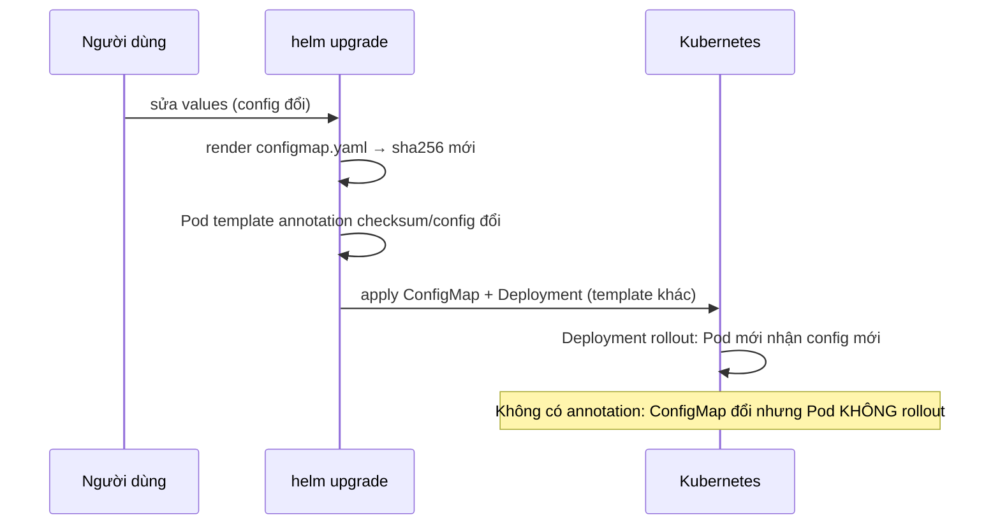
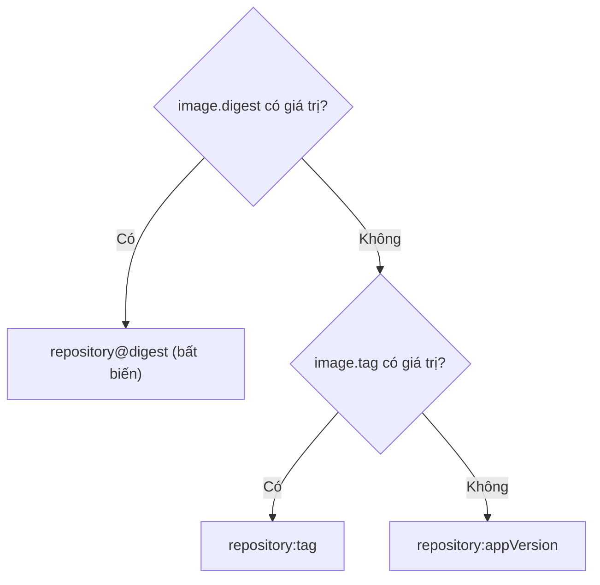
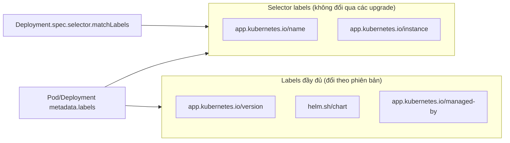

# 6_5_10 Production Patterns

> **Khóa học**: Cloud DevOps Basic — Containers & Kubernetes  
> **Phân nhóm**: 6 Domain 6 - Containers and Kubernetes › 6_5 Helm Package Management  
> **Chủ đề**: 6_5_10 Mẫu thực chiến: checksum annotation, image theo digest, nhãn chuẩn, không để secret trong values, và các mẹo sản xuất khác  
> **Phiên bản áp dụng**: Kubernetes 1.37, Helm 4.x (v4.3.2) / Helm 3.x  
> **Trạng thái**: Đối chiếu tài liệu chính thức helm.sh (17-11-2026). ⚠️ **Chưa chạy thử**: máy kiểm chứng chưa cài Helm (việc chạy binary tải về bị chặn). Các mẫu template là dạng chuẩn theo tài liệu/`helm create`; hãy `helm lint` và `helm template` trước khi dùng  
> **Phạm vi**: [Topic README](./README.md#6_5_10-mẫu-thực-chiến) · **Checkpoint của người học**: [CHECKLIST](../../CHECKLIST.md#6_5-helm-package-management)  
> **Lab thực hành liên quan**: [lab-6_5_1-chart-from-manifests](./README.md#lab-6_5_1-chart-from-manifests)  
> **Kiến thức liên quan**: [6_4_5 ConfigMaps and Secrets](<../6_4 Kubernetes Networking Configuration and Storage/6_4_5 ConfigMaps and Secrets.md>) · [6_5_3 Template Language](<./6_5_3 Template Language.md>) · [6_5_4 Values and Precedence](<./6_5_4 Values and Precedence.md>) · [6_5_9 Packaging and Distribution](<./6_5_9 Packaging and Distribution.md>)

---

## 0. Tình Huống Mở Đầu: "Upgrade Xong Mà Config Không Đổi"

Chart chạy được chưa có nghĩa là chart **dùng được trên production**. Ví dụ kinh điển: bạn sửa `values.yaml`, `helm upgrade` báo thành công, nhưng ứng dụng vẫn chạy cấu hình cũ. Lý do đã được chứng minh ở [6_4_5](<../6_4 Kubernetes Networking Configuration and Storage/6_4_5 ConfigMaps and Secrets.md>): Pod nhận cấu hình qua biến môi trường **không tự cập nhật** khi ConfigMap đổi. Và Helm chỉ cập nhật Deployment khi **Pod template của nó đổi**, còn ConfigMap đổi một mình thì Deployment không đổi.

Cách chữa là một dòng annotation, **`checksum/config`**: băm nội dung ConfigMap vào Pod template, để config đổi thì hash đổi, Pod template đổi, Deployment tự rollout.

Bài này gom thêm các "dòng nhỏ chặn sự cố lớn" cùng kiểu, mỗi mẫu giải quyết một lỗi có thật:

- Ghim image theo **digest** thay vì tag có thể bị đẩy đè.
- **Selector bất biến** (đừng đưa `version` vào `spec.selector`).
- `required` để chặn thiếu giá trị ngay lúc render.
- Không để **Secret thật** trong `values.yaml` hay lịch sử release.
- `resource-policy: keep` và vì sao đừng lạm dụng.

Toàn bộ mẫu lấy từ tài liệu Helm, **chưa chạy thử**; hãy `helm lint` và `helm template` trước khi dùng.

---

## 1. Khái Niệm Cốt Lõi & Bản Chất Kỹ Thuật (Core Concepts & Technical Deep Dive)

Bài này gom các mẫu "viết chart cho sản xuất" mà các bài trước chưa gọi tên. Mỗi mẫu giải quyết một lỗi hay gặp.

### 1.1 Checksum Annotation: Đổi ConfigMap Thì Pod Phải Rollout

**Vấn đề** (đã chứng minh ở [6_4_5](<../6_4 Kubernetes Networking Configuration and Storage/6_4_5 ConfigMaps and Secrets.md>)): ConfigMap đổi nhưng Pod đang chạy vẫn dùng biến môi trường/giá trị cũ; chỉ Pod mới mới nhận. Helm chỉ cập nhật Deployment khi **Pod template của nó đổi**; ConfigMap đổi một mình thì Deployment không đổi.

**Mẫu** (tài liệu *Chart Development Tips and Tricks → Automatically Roll Deployments*):

```yaml
kind: Deployment
spec:
  template:
    metadata:
      annotations:
        checksum/config: {{ include (print $.Template.BasePath "/configmap.yaml") . | sha256sum }}
```

Ý nghĩa: `include` render nội dung `configmap.yaml`, `sha256sum` băm thành chuỗi; **nội dung config đổi → hash đổi → annotation Pod template đổi → Deployment tự rollout**. Ưu điểm: thay đổi cấu hình thành **một revision có lịch sử và rollback được** ([6_5_5](<./6_5_5 Release Lifecycle.md>)).

Biến thể và lưu ý theo tài liệu:

- Muốn **luôn** rollout mỗi lần upgrade: `rollme: {{ randAlphaNum 5 | quote }}` (giá trị ngẫu nhiên đổi mỗi lần).
- Trong **library chart** không truy cập file qua `$.Template.BasePath`; thay bằng `include ("mylibchart.configmap") . | sha256sum` ([6_5_7](<./6_5_7 Dependencies Subcharts and Library Charts.md>)).
- Làm tương tự cho **Secret** nếu Pod nhận Secret qua env (`checksum/secret`).

### 1.2 Image Theo Digest (Có Fallback Về Tag)

Tag có thể bị đẩy đè; **digest bất biến** ([6_5_9](<./6_5_9 Packaging and Distribution.md>), [6_2 Container Image Engineering](<../6_2 Container Image Engineering/README.md>)). Mẫu: ưu tiên digest nếu có, nếu không dùng tag, nếu không có tag dùng `appVersion`:

```yaml
# values.yaml
image:
  repository: registry.example.com/team/hello-svc
  tag: ""          # để trống → dùng appVersion
  digest: ""       # ví dụ sha256:abc... do pipeline cung cấp
  pullPolicy: IfNotPresent
```

```yaml
# templates/_helpers.tpl
{{- define "hello-svc.image" -}}
{{- if .Values.image.digest -}}
{{ .Values.image.repository }}@{{ .Values.image.digest }}
{{- else -}}
{{ .Values.image.repository }}:{{ .Values.image.tag | default .Chart.AppVersion }}
{{- end -}}
{{- end -}}
```

```yaml
# templates/deployment.yaml
image: "{{ include "hello-svc.image" . }}"
```

Pipeline truyền digest bằng `--set-string image.digest=sha256:...` (dùng `--set-string` để Helm không ép kiểu, xem [6_5_4](<./6_5_4 Values and Precedence.md>)). Dạng `repo:tag@digest` cũng hợp lệ với runtime nhưng chart nên chọn **một** kiểu rõ ràng.

### 1.3 Nhãn Chuẩn

Theo *Chart Best Practices → Labels and Annotations*, các nhãn Helm khuyến nghị (`REC`) và tùy chọn (`OPT`):

| Nhãn | Mức | Giá trị gợi ý |
| :--- | :--- | :--- |
| `app.kubernetes.io/name` | REC | Tên ứng dụng |
| `helm.sh/chart` | REC | `{{ .Chart.Name }}-{{ .Chart.Version \| replace "+" "_" }}` |
| `app.kubernetes.io/managed-by` | REC | `{{ .Release.Service }}` (để tìm mọi thứ do Helm quản lý) |
| `app.kubernetes.io/instance` | REC | `{{ .Release.Name }}` (phân biệt các instance của cùng ứng dụng) |
| `app.kubernetes.io/version` | OPT | `{{ .Chart.AppVersion }}` |
| `app.kubernetes.io/component`, `app.kubernetes.io/part-of` | OPT | Vai trò; ứng dụng cấp trên |

Nguyên tắc label hay annotation: **label** nếu Kubernetes dùng để nhận diện hoặc người vận hành cần truy vấn; ngược lại là **annotation**. **Hook luôn là annotation.** Helm **không bao giờ đòi** nhãn cụ thể nào.

Tách riêng **selector labels** (bất biến, chỉ `name` + `instance`) khỏi **labels đầy đủ** (có `version`, `helm.sh/chart`) là mẫu trong `helm create`; vì `spec.selector` của Deployment **không đổi được** sau khi tạo, đặt `version` vào selector sẽ làm upgrade lỗi. *Mẫu tách helper này đến từ khung do `helm create` sinh; kiểm tra file `_helpers.tpl` của bản Helm bạn dùng.*

### 1.4 Không Đưa Secret Thật Vào Values Trong Git

`values.yaml`/`values-prod.yaml` nằm trong Git và **cũng nằm trong lịch sử release** (Helm lưu values đã cung cấp trong Secret `sh.helm.release.v1...`, xem [6_5_1](<./6_5_1 Helm Core Concepts.md>)). Đưa mật khẩu vào đó là lộ secret hai nơi. Hướng đi (mức khái niệm, xem [6_4_5](<../6_4 Kubernetes Networking Configuration and Storage/6_4_5 ConfigMaps and Secrets.md>)):

- Chart **chỉ tham chiếu** tên Secret có sẵn (`existingSecret: hello-svc-db`), Secret do **External Secrets Operator / Secrets Store CSI Driver / công cụ khác** tạo ngoài chart.
- Biến CI được bảo vệ (protected/masked) cho giá trị tạm thời, truyền bằng `--set-file`/`--set` tại thời điểm deploy; hiểu rằng giá trị vẫn đi vào lịch sử release.
- Tài liệu Helm có mẫu **tạo `imagePullSecret`** từ values (`kubernetes.io/dockerconfigjson` + `b64enc`), tiện nhưng khiến registry credential nằm trong values: dùng cẩn thận.

### 1.5 Hàm `required`, `quote` Và Chuỗi So Với Số

- **`required`**: ép giá trị bắt buộc, render lỗi với thông điệp của bạn: `{{ required "image.tag là bắt buộc" .Values.image.tag }}`. Bắt lỗi sớm ở `helm template`/`lint`, không để lọt sang cluster.
- **Chuỗi: luôn `quote`; số: không quote** (tài liệu: quote số có thể gây lỗi parse trong Kubernetes). Ví dụ `name: {{ .Values.name | quote }}` nhưng `port: {{ .Values.port }}`.
- **`include ... | nindent N`** để chèn khối YAML đúng thụt lề: `{{- include "hello-svc.labels" . | nindent 4 }}`.
- Hàm `env`/`expandenv` của Sprig **bị loại** khỏi template Helm vì lý do bảo mật.

### 1.6 Cẩn Thận Với Giá Trị Ngẫu Nhiên

Hàm tạo dữ liệu ngẫu nhiên (`randAlphaNum`...) dùng được, **nhưng template được chạy lại ở mỗi lần upgrade**: nếu kết quả khác lần trước, resource đó **bị cập nhật**. Với Secret tạo mật khẩu ngẫu nhiên trong chart, mỗi upgrade có thể **đổi mật khẩu** và làm vỡ kết nối. Tránh dùng cho secret bền; hoặc dùng `lookup` để giữ giá trị cũ (xem [6_5_3](<./6_5_3 Template Language.md>), lưu ý `lookup` không có tác dụng khi `helm template` offline) hoặc tạo secret ngoài chart.

### 1.7 `helm.sh/resource-policy: keep`

Annotation này báo Helm **không xóa** resource khi `helm uninstall`, `upgrade` hay `rollback` dẫn tới việc xóa nó (ví dụ PVC, Secret quan trọng). Tài liệu cảnh báo: resource trở thành **mồ côi**, Helm không quản lý nữa, có thể gây rắc rối khi `helm install --replace` trên release đã gỡ nhưng còn resource giữ lại.

### 1.8 Một Lệnh Cho Cả Install Và Upgrade; Archive Tái Lập Được

- **`helm upgrade --install <release> <chart> -f values.yaml`**: cài nếu chưa có, nâng cấp nếu đã có; idempotent, phù hợp CI ([6_5_5](<./6_5_5 Release Lifecycle.md>)).
- **Archive tái lập (reproducible)**: mặc định file trong `.tgz` mang thời gian sửa đổi của file nguồn, nên đóng gói lại cùng nội dung vẫn cho archive khác nhau. Helm tôn trọng biến `SOURCE_DATE_EPOCH` (Reproducible Builds): `SOURCE_DATE_EPOCH=$(git log -1 --pretty=%ct) helm package ./mychart`. Giá trị là số nguyên không âm (giây, UTC), giá trị sai làm lệnh lỗi.

### 1.9 Danh Sách Kiểm Tra Chart Sản Xuất

| Hạng mục | Cách làm |
| :--- | :--- |
| Phiên bản | `version` tăng mỗi lần đổi chart; `appVersion` = phiên bản ứng dụng |
| Image | Ghim digest (hoặc tag bất biến); `required` cho tag/digest; không `latest` |
| Cấu hình | Checksum annotation; ConfigMap/Secret theo [6_4_5](<../6_4 Kubernetes Networking Configuration and Storage/6_4_5 ConfigMaps and Secrets.md>) |
| Sức khỏe | `readinessProbe`/`livenessProbe`/`startupProbe` tham số hóa ([6_3_5](<../6_3 Kubernetes Architecture and Core Workloads/6_3_5 Liveness Readiness and Startup Probes.md>)) |
| Tài nguyên | `resources.requests/limits` có mặc định hợp lý ([6_3_6](<../6_3 Kubernetes Architecture and Core Workloads/6_3_6 Resource Requests Limits and QoS.md>)) |
| Tắt êm | `terminationGracePeriodSeconds`, `preStop` ([6_3_7](<../6_3 Kubernetes Architecture and Core Workloads/6_3_7 Graceful Shutdown During Rolling Updates.md>)) |
| Nhãn | Bộ nhãn chuẩn (1.3), selector bất biến tách riêng |
| Kiểm tra | `values.schema.json`, `helm lint --strict`, `helm template`, `helm upgrade --dry-run=server` ([6_5_6](<./6_5_6 Validating Charts Before Deploy.md>)) |
| Secret | Không trong Git/values; dùng `existingSecret` + công cụ ngoài |
| Phân phối | OCI registry, ghim digest khi cài ([6_5_9](<./6_5_9 Packaging and Distribution.md>)) |

---

## 2. Ví Dụ Đời Sống Thực Tế Dễ Hiểu (Intuitive Real-World Analogies)

**Nhà máy sản xuất đồ gia dụng:**

- **Checksum annotation = tem "đổi công thức" dán lên thùng hàng**: mỗi lần công thức (ConfigMap) đổi, tem đổi theo, dây chuyền biết "lô mới" nên sản xuất lại, không để kho tiếp tục xuất hàng theo công thức cũ.
- **Image theo digest = số serial của từng linh kiện**: "linh kiện phiên bản 2" là nhãn có thể bị dán đè, còn serial là duy nhất; kiểm tra đúng serial thì chắc chắn lắp đúng linh kiện.
- **Nhãn chuẩn = hệ thống mã vạch thống nhất** giữa mọi nhà máy: kho nào, đội kiểm định nào cũng quét được.
- **Selector bất biến = số khung xe**: khắc một lần, không đổi; còn phiên bản/ngày sản xuất là nhãn dán có thể thay.
- **Secret trong values = mật khẩu két sắt viết trong sổ giao ca**: sổ được photocopy cho nhiều người và lưu cả đời (lịch sử release). Hãy ghi "mật khẩu két nằm trong két của bộ phận bảo mật" (`existingSecret`).
- **Giá trị ngẫu nhiên trong template = đổi mật mã két mỗi lần kiểm tra định kỳ**: nhân viên đang làm việc bất ngờ không mở được két.
- **`resource-policy: keep` = khi phá dỡ nhà máy, giữ lại kho hóa chất**: nhưng nó thành "tài sản vô chủ", không ai chịu trách nhiệm.

---

## 3. Kiến Trúc, Luồng Hoạt Động & Hình Ảnh Trực Quan (Architecture, Diagrams & Visual Media)

### 3.1 Checksum Annotation Kích Hoạt Rollout



### 3.2 Chọn Image Reference



### 3.3 Selector Bất Biến Và Nhãn Đổi Được



---

## 4. Code Mẫu Trực Quan Hoặc Dòng Lệnh Thực Chiến (Runnable Sample Code / CLI)

> ⚠️ **Chưa chạy thử** (xem phần Trạng thái). `hello-svc.fullname`, `hello-svc.labels`, `hello-svc.selectorLabels` là helper do `helm create hello-svc` sinh ra (đọc `_helpers.tpl` để xác nhận tên helper trong bản Helm của bạn).  
> Thực hành chi tiết: [lab-6_5_1-chart-from-manifests](./README.md#lab-6_5_1-chart-from-manifests).

### 4.1 Deployment Có Checksum, Digest Và `required`

```yaml
# templates/deployment.yaml
apiVersion: apps/v1
kind: Deployment
metadata:
  name: {{ include "hello-svc.fullname" . }}
  labels:
    {{- include "hello-svc.labels" . | nindent 4 }}
spec:
  replicas: {{ .Values.replicaCount }}            # số: không quote
  selector:
    matchLabels:
      {{- include "hello-svc.selectorLabels" . | nindent 6 }}
  template:
    metadata:
      annotations:
        checksum/config: {{ include (print $.Template.BasePath "/configmap.yaml") . | sha256sum }}
      labels:
        {{- include "hello-svc.labels" . | nindent 8 }}
    spec:
      containers:
      - name: hello-svc
        image: "{{ include "hello-svc.image" . }}"
        imagePullPolicy: {{ .Values.image.pullPolicy }}
        ports:
        - name: http
          containerPort: 8080
        envFrom:
        - configMapRef:
            name: {{ include "hello-svc.fullname" . }}
        {{- if .Values.existingSecret }}
        - secretRef:
            name: {{ .Values.existingSecret }}
        {{- end }}
        env:
        - name: APP_VERSION
          value: {{ .Chart.AppVersion | quote }}   # chuỗi: quote
```

```yaml
# templates/configmap.yaml
apiVersion: v1
kind: ConfigMap
metadata:
  name: {{ include "hello-svc.fullname" . }}
  labels:
    {{- include "hello-svc.labels" . | nindent 4 }}
data:
  GREETING: {{ .Values.greeting | quote }}
```

> Đặt `{{ required "image.repository là bắt buộc" .Values.image.repository }}` trong helper `hello-svc.image` nếu muốn chặn deploy thiếu repository.

### 4.2 Quan Sát Checksum Đổi Theo Values

```bash
helm template demo ./hello-svc --set greeting="xin chao" | grep checksum/config
helm template demo ./hello-svc --set greeting="chao ban" | grep checksum/config
# hai dòng có hash KHÁC nhau → khi upgrade, Deployment sẽ rollout
```

### 4.3 Kiểm Tra Image Reference

```bash
helm template demo ./hello-svc | grep "image:"                                 # repo:appVersion
helm template demo ./hello-svc --set image.tag=1.2.3 | grep "image:"           # repo:1.2.3
helm template demo ./hello-svc --set-string image.digest=sha256:abc123 | grep "image:"   # repo@sha256:abc123
```

(`sha256:abc123` chỉ minh họa; digest thật dài 64 ký tự hex.)

### 4.4 `required` Chặn Thiếu Giá Trị

```yaml
# Ví dụ tối giản: bắt buộc có repository và tag
image: "{{ required "image.repository là bắt buộc" .Values.image.repository }}:{{ required "image.tag là bắt buộc" .Values.image.tag }}"
```

```bash
helm template demo ./hello-svc --set image.tag=
# kỳ vọng: lệnh dừng với lỗi chứa thông điệp "image.tag là bắt buộc" (định dạng đầy đủ do Helm quyết định)
```

> Chỉ minh họa cơ chế `required`. Với mẫu digest ở 1.2 hãy đặt `required` vào helper sao cho nhánh `@digest` hoặc nhánh `:tag` đều có kiểm tra phù hợp.

### 4.5 `existingSecret` Thay Vì Secret Trong Values

```yaml
# values-prod.yaml (an toàn để commit: chỉ tên Secret, không có giá trị)
existingSecret: hello-svc-db      # Secret này do External Secrets Operator / pipeline tạo
```

```bash
kubectl create secret generic hello-svc-db --from-literal=DB_PASSWORD='change-me' -n prod   # chỉ ví dụ lab
```

### 4.6 Đóng Gói Tái Lập

```bash
SOURCE_DATE_EPOCH=$(git log -1 --pretty=%ct) helm package ./hello-svc -d ./dist
sha256sum ./dist/hello-svc-0.1.0.tgz      # chạy lại ở máy khác với cùng commit → cùng hash (kỳ vọng theo tài liệu)
```

### 4.7 Giữ Resource Khi Gỡ Release

```yaml
metadata:
  annotations:
    helm.sh/resource-policy: keep
```

---

## 5. Cạm Bẫy Thực Tế & Thực Tiễn Sản Xuất (Production Gotchas & Best Practices)

### 5.1 Cạm Bẫy 1: Quên Checksum Annotation Rồi Than "Upgrade Xong Mà Config Không Đổi"

- **Bản chất**: ConfigMap đổi nhưng Pod template không đổi nên Deployment không rollout; env không tự cập nhật.
- **Khuyến nghị**: Thêm checksum cho mọi ConfigMap/Secret dùng qua env hoặc cần Pod restart.

### 5.2 Cạm Bẫy 2: Đưa `version` Vào Selector

- **Bản chất**: `spec.selector` của Deployment không đổi được; selector chứa nhãn thay đổi theo phiên bản làm upgrade bị từ chối hoặc phải xóa/tạo lại.
- **Khuyến nghị**: Chỉ `name` và `instance` trong selector.

### 5.3 Cạm Bẫy 3: Tag Có Thể Bị Đẩy Đè

- **Khuyến nghị**: Pipeline build image → lấy digest → deploy bằng `--set-string image.digest=...`; không dùng `latest`.

### 5.4 Cạm Bẫy 4: Secret Ngẫu Nhiên Tạo Trong Chart

- **Bản chất**: Mỗi upgrade chạy lại template; `randAlphaNum` ra giá trị mới → Secret đổi.
- **Khuyến nghị**: Tạo secret ngoài chart hoặc dùng `lookup` giữ giá trị cũ (nhớ `helm template` không có `lookup` thật).

### 5.5 Cạm Bẫy 5: Quote Số, Không Quote Chuỗi

- **Bản chất**: Tài liệu: chuỗi nên quote; số không quote (có thể gây lỗi parse).
- **Khuyến nghị**: `helm lint` + `helm template` + `values.schema.json` bắt kiểu sớm ([6_5_6](<./6_5_6 Validating Charts Before Deploy.md>)).

### 5.6 Cạm Bẫy 6: Lạm Dụng `resource-policy: keep`

- **Bản chất**: Resource mồ côi, Helm không quản lý nữa; xung đột khi cài lại.
- **Khuyến nghị**: Chỉ dùng cho dữ liệu cần giữ (PVC, Secret gốc); ghi lại quy trình dọn thủ công.

### 5.7 Cạm Bẫy 7: Secret Credentials Lọt Vào Lịch Sử Release

- **Bản chất**: Values đã cung cấp được lưu trong Secret của release; ai đọc được Secret `sh.helm.release.v1.*` thấy cả values.
- **Khuyến nghị**: Không truyền secret thật qua values; giới hạn RBAC đọc Secret trong namespace của release.

---

## 6. Câu Hỏi Củng Cố Kiến Thức (Active Recall Quiz)

### Câu Hỏi 1: Vì Sao Cần `checksum/config` Trong Pod Template? (Phỏng vấn)

<details>
<summary>Đáp án</summary>

Deployment chỉ rollout khi Pod template đổi. ConfigMap đổi một mình không làm Pod template đổi và biến môi trường không tự cập nhật. Annotation chứa hash nội dung ConfigMap làm template đổi khi config đổi, kích hoạt rollout, tạo revision có lịch sử và rollback được.
</details>

### Câu Hỏi 2: Vì Sao Không Đặt `app.kubernetes.io/version` Trong `spec.selector`?

<details>
<summary>Đáp án</summary>

`spec.selector` của Deployment không đổi được sau khi tạo; nhãn phiên bản đổi mỗi release nên upgrade sẽ lỗi. Selector chỉ nên chứa nhãn bất biến (`name`, `instance`).
</details>

### Câu Hỏi 3: Nêu Hai Rủi Ro Của Việc Đưa Secret Vào `values.yaml` Của Chart

<details>
<summary>Đáp án</summary>

(1) Lộ trong Git (và lịch sử). (2) Lộ trong lịch sử release: Helm lưu values đã cung cấp trong Secret của release, nên người đọc được Secret đó thấy cả secret. Giải pháp: `existingSecret` + công cụ quản lý secret bên ngoài.
</details>

### Câu Hỏi 4: Image Theo Tag Và Theo Digest Khác Nhau Thế Nào Trong Chart?

<details>
<summary>Đáp án</summary>

Tag có thể bị đẩy đè sang nội dung khác; digest bất biến. Chart nên cho phép `image.digest` (ưu tiên) với fallback về tag/`appVersion`, pipeline truyền digest bằng `--set-string`.
</details>

---

## 7. 📚 Nguồn Tài Liệu Chính Thống (Tier-1 Official References)

- [Chart Development Tips and Tricks](https://helm.sh/docs/howto/charts_tips_and_tricks/) - `include`, `required`, quote, `tpl`, roll deployment, `resource-policy: keep`, giá trị ngẫu nhiên, `upgrade --install`, archive tái lập.
- [Chart Best Practices: Labels and Annotations](https://helm.sh/docs/chart_best_practices/labels/) - Nhãn chuẩn và phân biệt label/annotation.
- [Chart Template Guide](https://helm.sh/docs/chart_template_guide/) - Hàm template, built-in objects.
- [Chart Best Practices](https://helm.sh/docs/chart_best_practices/) - Quy ước chart.
- [Kubernetes: Recommended Labels](https://kubernetes.io/docs/concepts/overview/working-with-objects/common-labels/) - Nhãn `app.kubernetes.io/*`.
- [Kubernetes: Good practices for Secrets](https://kubernetes.io/docs/concepts/security/secrets-good-practices/) - Quản lý Secret an toàn.
- [Reproducible Builds: SOURCE_DATE_EPOCH](https://reproducible-builds.org/docs/source-date-epoch/) - Chuẩn biến môi trường mà Helm tôn trọng.
