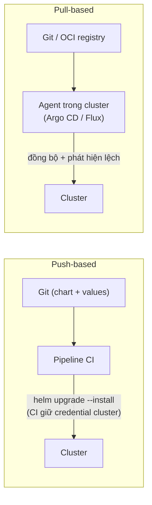
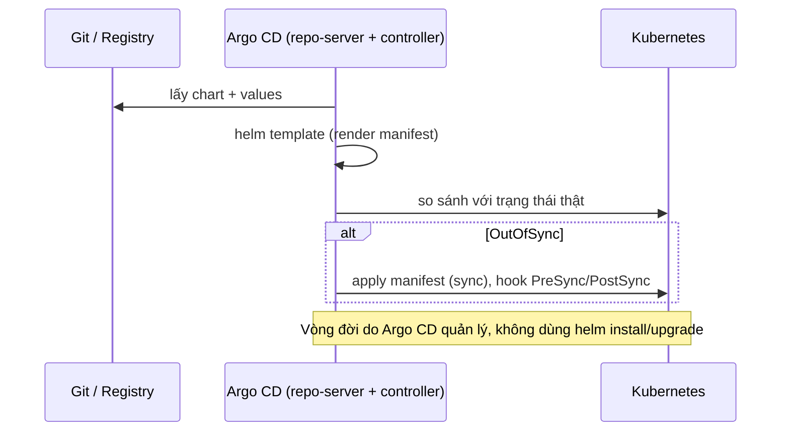
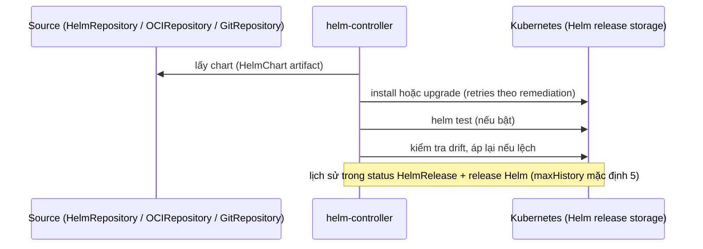
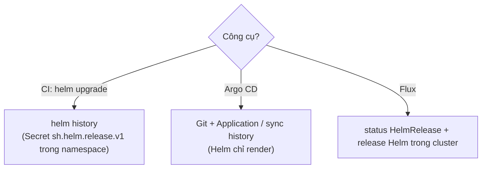

# 6_5_11 Helm in GitOps

> **Khóa học**: Cloud DevOps Basic — Containers & Kubernetes  
> **Phân nhóm**: 6 Domain 6 - Containers and Kubernetes › 6_5 Helm Package Management  
> **Chủ đề**: 6_5_11 Helm trong GitOps (khái niệm): push-based và pull-based, Argo CD, Flux  
> **Phiên bản áp dụng**: Kubernetes 1.37, Helm 4.x / 3.x; Argo CD (trang `stable` của tài liệu, 17-11-2026); Flux Helm Controller (API `helm.toolkit.fluxcd.io/v2`)  
> **Trạng thái**: Đối chiếu tài liệu chính thức Argo CD và Flux (17-11-2026), mức **khái niệm**. ⚠️ **Chưa chạy thử**: tôi không cài Argo CD hay Flux và chưa chạy Helm; các manifest dưới đây lấy từ tài liệu của hai dự án  
> **Phạm vi**: [Topic README](./README.md#6_5_11-helm-trong-gitops-khái-niệm) · **Checkpoint của người học**: [CHECKLIST](../../CHECKLIST.md#6_5-helm-package-management)  
> **Kiến thức liên quan**: [6_5_5 Release Lifecycle](<./6_5_5 Release Lifecycle.md>) · [6_5_8 Hooks and Tests](<./6_5_8 Hooks and Tests.md>) · [6_5_9 Packaging and Distribution](<./6_5_9 Packaging and Distribution.md>) · [6_6 GitLab CI-CD and Release Strategies](<../6_6 GitLab CI-CD and Release Strategies/README.md>)

---

## 1. Khái Niệm Cốt Lõi & Bản Chất Kỹ Thuật (Core Concepts & Technical Deep Dive)

### 1.1 GitOps Là Gì, Trong Một Đoạn

**GitOps**: trạng thái mong muốn của cluster được khai báo trong **Git**; một cơ chế tự động đảm bảo cluster **khớp** với Git. Mọi thay đổi đi qua Git (commit/PR/review), nên có lịch sử, kiểm toán và rollback bằng `git revert`. Bài này chỉ bàn **vai trò của Helm** trong mô hình đó.

### 1.2 Hai Mô Hình Triển Khai

| | **Push-based** | **Pull-based** |
| :--- | :--- | :--- |
| Ai áp dụng thay đổi | **Pipeline CI** chạy `helm upgrade --install ...` (hoặc `kubectl`) tới cluster | **Agent chạy trong cluster** (Argo CD, Flux) kéo cấu hình từ Git/registry và đồng bộ |
| Thông tin truy cập cluster | CI phải nắm kubeconfig/credential của cluster | Agent dùng quyền trong cluster; CI không cần quyền deploy |
| Phát hiện lệch (drift) | Chỉ khi pipeline chạy lại | Agent **liên tục so sánh** và có thể sửa lệch |
| Phản hồi | Kết quả nằm ở log pipeline | Trạng thái nằm ở object trong cluster (Application/HelmRelease) |
| Phù hợp | Đơn giản, ít thành phần, dự án nhỏ | Nhiều cluster/môi trường, cần audit và tự sửa lệch |

*Bảng này mô tả khác biệt đặc trưng của hai mô hình; mức độ áp dụng cụ thể phụ thuộc công cụ và cách bạn cấu hình.* Phần pipeline push-based với GitLab sẽ học ở [6_6](<../6_6 GitLab CI-CD and Release Strategies/README.md>).

### 1.3 Argo CD: Helm Chỉ Là Công Cụ "Render"

Theo tài liệu Argo CD (*Helm*): bạn cài chart qua UI hoặc khai báo kiểu GitOps; **Helm chỉ được dùng để "bơm" chart bằng `helm template`; vòng đời ứng dụng do Argo CD xử lý, không phải Helm.**

Hệ quả (suy ra trực tiếp từ câu trên, và tương thích với mô tả của README học phần):

- **Không có "release Helm" làm trung tâm**: lịch sử và trạng thái nằm ở **Git và Argo CD** (Application, sync history), **không** nhờ `helm history`/`helm rollback` làm công cụ vận hành chính. Muốn quay lại: dùng cơ chế của Argo CD (sync về revision cũ) hoặc `git revert`.
- Mỗi thao tác là một **`sync`**: Argo CD **không biết** đây là "install" hay "upgrade".
- **Hook**: Argo CD ánh xạ annotation Helm hook sang hook của riêng nó (`pre-install`/`pre-upgrade` → `PreSync`, `post-*` → `PostSync`, `hook-weight` → `sync-wave`); `pre-rollback`, `post-rollback` và `test-success`/`test-failure` **không hỗ trợ**; định nghĩa **bất kỳ hook Argo CD nào thì mọi hook Helm bị bỏ qua**; đây là **tương thích annotation, không bảo đảm ngữ nghĩa giống Helm** (chi tiết ở [6_5_8](<./6_5_8 Hooks and Tests.md>)). Các manifest chứa hook không được hỗ trợ (kể cả hook `test`) bị **bỏ qua** khi render.
- **Release name** mặc định bằng **tên Application**; có thể ghi đè bằng `releaseName`, nhưng tài liệu cảnh báo có thể gây vấn đề với chart dùng nhãn `app.kubernetes.io/instance` (Argo CD tự gắn nhãn này bằng tên Application để theo dõi).
- **Giá trị ngẫu nhiên**: vì Argo CD định kỳ chạy `helm template` để so với trạng thái thật, mọi chart dùng `randAlphaNum` sẽ **luôn `OutOfSync`** (giá trị đổi mỗi lần render). Tài liệu khuyên đặt giá trị cố định trong `values.yaml` hoặc override qua `argocd app set -p`. (Liên quan mục 1.6 của [6_5_10](<./6_5_10 Production Patterns.md>).)
- **Thứ tự ưu tiên values** của Argo CD (theo tài liệu): `parameters` > `valuesObject` > `values` > `valueFiles` > `values.yaml` của chart. Đây là ưu tiên **trong Argo CD**, không thay thế thứ tự ưu tiên của Helm CLI đã học ở [6_5_4](<./6_5_4 Values and Precedence.md>).
- Cho phép dùng nhiều file values (`valueFiles`), kể cả **từ repo khác** (Argo CD ≥ 2.6, qua nhiều `sources`), `ignoreMissingValueFiles`, glob pattern.
- Chart nguồn có thể là repo Helm HTTP hoặc **OCI**; với OCI, trường `repoURL` **không** có tiền tố `oci://` (ví dụ `registry-1.docker.io/bitnamicharts`).

### 1.4 Flux: Helm Controller Chạy Thật Các Hành Động Helm

Flux có **Helm Controller**, một operator quản lý **release Helm bằng custom resource `HelmRelease`**. Khác Argo CD, theo tài liệu Flux: controller **thực hiện các hành động Helm** (`install`, `upgrade`, `test`, `uninstall`, `rollback`), phát hiện và **sửa lệch trạng thái (drift)** so với trạng thái mong muốn.

| Chủ đề | Trong Flux Helm Controller (theo tài liệu) |
| :--- | :--- |
| Nguồn chart | `HelmChart` sinh ra từ `HelmRepository` hoặc `GitRepository`; ví dụ dùng `OCIRepository` (`oci://...`) với `ref.semver` |
| Hành động | `install`/`upgrade` có `remediation.retries`; có thể chạy `helm test` (`test.enable: true`) và rollback |
| Drift | `driftDetection.mode: enabled`: so sánh cluster với trạng thái mong muốn rồi áp lại |
| Lịch sử | Trạng thái và lịch sử trong `status` của `HelmRelease`; `.spec.maxHistory` (số revision Helm lưu) mặc định **5** |
| Phụ thuộc | `.spec.dependsOn` chờ HelmRelease khác Ready |

Nghĩa là với Flux, lịch sử release **vẫn gắn với release Helm trong cluster** (Helm release storage), còn với Argo CD thì Helm chỉ render. Đây là một khác biệt kiến trúc quan trọng khi bạn cần quyết định "rollback ở đâu".

### 1.5 Vai Trò Của Các Bài Trước Khi Dùng GitOps

| Kỹ năng Helm | Vai trò trong GitOps |
| :--- | :--- |
| `values-<env>.yaml` ([6_5_4](<./6_5_4 Values and Precedence.md>)) | Cấu hình môi trường nằm trong Git; PR để đổi |
| `values.schema.json`, `helm lint`, `helm template` ([6_5_6](<./6_5_6 Validating Charts Before Deploy.md>)) | Kiểm tra trong CI **trước khi** merge |
| Chart ở OCI registry, ghim digest ([6_5_9](<./6_5_9 Packaging and Distribution.md>)) | Nguồn chart bất biến cho Argo CD/Flux |
| Image digest ([6_5_10](<./6_5_10 Production Patterns.md>)) | Cập nhật bằng PR sửa values (tag/digest) |
| Hooks/tests ([6_5_8](<./6_5_8 Hooks and Tests.md>)) | Kiểm tra ánh xạ sang hook của công cụ; test thường chuyển thành bước pipeline |
| Rollback `helm rollback` ([6_5_5](<./6_5_5 Release Lifecycle.md>)) | Argo CD: revert Git/sync revision cũ; Flux: remediation/rollback do controller làm |

### 1.6 Chọn Hướng Nào?

- Một cluster, vài service, đội nhỏ, đã có CI: **push-based** với `helm upgrade --install --wait --rollback-on-failure` (Helm 4) thường đủ.
- Nhiều môi trường/cluster, cần audit, tự phát hiện và sửa lệch: **pull-based** (Argo CD hoặc Flux).
- Bất kể mô hình: **Git là nguồn sự thật**, đừng `kubectl edit` hay `helm upgrade` tay lên môi trường được GitOps quản lý (sẽ bị agent ghi đè hoặc gây lệch).

---

## 2. Ví Dụ Đời Sống Thực Tế Dễ Hiểu (Intuitive Real-World Analogies)

**Chuỗi cửa hàng và bản "Sổ quy định" ở trụ sở:**

- **Git = Sổ quy định gốc ở trụ sở**: mọi thay đổi (giá, bày hàng) phải ghi vào sổ có chữ ký duyệt.
- **Push-based = giám đốc vùng lái xe tới từng cửa hàng mang tờ quy định mới và tự tay sắp xếp lại kệ**. Nhanh với vài cửa hàng, nhưng giám đốc phải cầm **chìa khóa mọi cửa hàng**, và nếu quản lý cửa hàng tự đổi vị trí kệ sau đó, không ai biết cho đến lần ghé sau.
- **Pull-based = mỗi cửa hàng có một quản lý chuyên trách (agent)** cứ mỗi vài phút đối chiếu kệ với Sổ quy định gốc, thấy lệch là sắp lại. Giám đốc vùng không cần chìa khóa.
- **Argo CD = quản lý chỉ đọc "bản vẽ chi tiết" (render `helm template`) rồi tự xếp kệ theo bản vẽ**: nhân viên không cần biết bản vẽ do hãng thiết kế nội thất nào (Helm) vẽ; "lịch sử thay đổi" nằm trong nhật ký của quản lý và trong sổ gốc.
- **Flux Helm Controller = quản lý thuê hẳn đội thi công của hãng nội thất (chạy thật Helm)**: đội này có nhật ký thi công riêng (release history), tự thử nghiệm sau thi công (`helm test`), tự tháo lắp lại nếu hỏng (rollback).
- **Giá trị ngẫu nhiên trong template = bản vẽ mà mỗi lần mở ra lại có một con số khác**: quản lý so với kệ thật và lúc nào cũng thấy "lệch" (OutOfSync).

---

## 3. Kiến Trúc, Luồng Hoạt Động & Hình Ảnh Trực Quan (Architecture, Diagrams & Visual Media)

### 3.1 Push-based Và Pull-based



### 3.2 Argo CD: Helm Chỉ Render



### 3.3 Flux: Helm Controller Chạy Helm



### 3.4 So Sánh Nhanh Nơi Lịch Sử Nằm



---

## 4. Code Mẫu Trực Quan Hoặc Dòng Lệnh Thực Chiến (Runnable Sample Code / CLI)

> ⚠️ **Chưa chạy thử**: không có Argo CD/Flux trên máy kiểm chứng. Các manifest lấy từ tài liệu của hai dự án; kiểm tra phiên bản CRD (`apiVersion`) của bản bạn cài.  
> Đây là bài khái niệm, không có lab riêng trong README; bạn có thể áp dụng sau khi học 6_6.

### 4.1 Push-based (CI) — Nhắc Lại

```bash
helm upgrade --install hello-svc ./hello-svc \
  -n dev --create-namespace \
  -f values-dev.yaml \
  --set-string image.digest="$IMAGE_DIGEST" \
  --wait --timeout 3m --rollback-on-failure     # Helm 3: thay --rollback-on-failure bằng --atomic
```

### 4.2 Argo CD `Application` Dùng Chart Từ Helm Repo (Theo Tài Liệu Argo CD)

```yaml
apiVersion: argoproj.io/v1alpha1
kind: Application
metadata:
  name: sealed-secrets
  namespace: argocd
spec:
  project: default
  source:
    chart: sealed-secrets
    repoURL: https://bitnami.github.io/sealed-secrets
    targetRevision: 1.16.1
    helm:
      releaseName: sealed-secrets
  destination:
    server: "https://kubernetes.default.svc"
    namespace: kubeseal
```

*Đây là ví dụ nguyên văn của tài liệu Argo CD để minh họa cú pháp, không phải khuyến nghị dùng chart này.*

### 4.3 Argo CD Với Chart OCI Và Values Theo Môi Trường

```yaml
apiVersion: argoproj.io/v1alpha1
kind: Application
metadata:
  name: hello-svc-prod
  namespace: argocd
spec:
  project: default
  source:
    chart: hello-svc
    repoURL: registry.example.com/team/charts   # KHÔNG có tiền tố oci://
    targetRevision: 0.4.2
    helm:
      releaseName: hello-svc
      valueFiles:
      - values-prod.yaml          # xem tài liệu Argo CD khi values nằm ở repo khác (multiple sources)
  destination:
    name: in-cluster
    namespace: prod
```

> Cú pháp `repoURL` cho OCI và `valueFiles` theo tài liệu Argo CD; trường hợp **values nằm repo khác** cần cấu hình nhiều `sources` (Argo CD ≥ 2.6), xem tài liệu. Manifest này là minh họa ghép từ các mẩu của tài liệu, **chưa được chạy**.

### 4.4 Flux `HelmRelease` (Theo Tài Liệu Flux)

```yaml
apiVersion: helm.toolkit.fluxcd.io/v2
kind: HelmRelease
metadata:
  name: podinfo
  namespace: default
spec:
  interval: 15m
  timeout: 5m
  chart:
    kind: OCIRepository
    spec:
      interval: 5m
      url: oci://ghcr.io/stefanprodan/charts/podinfo
      ref:
        semver: '6.5.*'
  releaseName: podinfo
  install:
    remediation:
      retries: 3
  upgrade:
    remediation:
      retries: 3
  test:
    enable: true
  driftDetection:
    mode: enabled
```

*Ví dụ nguyên văn của tài liệu Flux (rút gọn phần `ignore`) để minh họa cấu trúc.*

### 4.5 Xem Trạng Thái (Khái Niệm)

```bash
# Argo CD
argocd app get hello-svc-prod
argocd app history hello-svc-prod

# Flux
kubectl get helmrelease -A
kubectl describe helmrelease podinfo -n default     # Status: History, Last Attempted Release Action
```

### 4.6 Quy Tắc Làm Việc Với Môi Trường Do GitOps Quản Lý

```bash
# ĐÚNG: đổi cấu hình bằng PR vào Git
git checkout -b bump-hello-svc && sed -i 's/tag: .*/tag: "1.0.1"/' values-prod.yaml && git commit -am "bump hello-svc" && git push

# SAI: sửa tay trên cluster, agent sẽ ghi đè hoặc gây lệch
# kubectl edit deploy hello-svc -n prod
# helm upgrade hello-svc ./hello-svc -n prod ...
```

---

## 5. Cạm Bẫy Thực Tế & Thực Tiễn Sản Xuất (Production Gotchas & Best Practices)

### 5.1 Cạm Bẫy 1: Tìm `helm history` Của Ứng Dụng Do Argo CD Quản Lý

- **Bản chất**: Với Argo CD, Helm chỉ chạy `helm template`; không có release Helm làm trung tâm.
- **Khuyến nghị**: Dùng lịch sử Git và Argo CD; chỉ dùng `helm history` cho môi trường push-based hoặc Flux.

### 5.2 Cạm Bẫy 2: Chart Dùng `randAlphaNum` Làm Ứng Dụng Luôn OutOfSync

- **Bản chất**: Mỗi lần so sánh render lại ra giá trị khác (tài liệu Argo CD).
- **Khuyến nghị**: Cố định giá trị trong values hoặc dùng secret ngoài chart.

### 5.3 Cạm Bẫy 3: Hook `pre-install`/`pre-upgrade` Chạy Cùng Lúc

- **Bản chất**: Argo CD coi mọi thao tác là sync, ánh xạ cả hai sang `PreSync`.
- **Khuyến nghị**: Hook idempotent; dùng weight/sync-wave và `before-hook-creation`; đọc kỹ bảng ánh xạ ([6_5_8](<./6_5_8 Hooks and Tests.md>)).

### 5.4 Cạm Bẫy 4: Mong `helm test`/`pre-rollback` Chạy Dưới Argo CD

- **Bản chất**: Không hỗ trợ; manifest hook không được hỗ trợ bị bỏ qua.
- **Khuyến nghị**: Chuyển smoke test thành bước pipeline sau sync hoặc hook Argo CD rõ ràng.

### 5.5 Cạm Bẫy 5: Sửa Tay Trên Cluster Do Agent Quản Lý

- **Bản chất**: Agent so sánh và có thể ghi đè (Flux `driftDetection`) hoặc báo lệch (Argo CD).
- **Khuyến nghị**: Mọi thay đổi qua Git; quyền ghi trực tiếp vào cluster hạn chế.

### 5.6 Cạm Bẫy 6: Hiểu Nhầm Thứ Tự Ưu Tiên Values Giữa Helm CLI Và Argo CD

- **Bản chất**: Argo CD có thứ tự riêng (`parameters` > `valuesObject` > `values` > `valueFiles` > values của chart).
- **Khuyến nghị**: Kiểm tra `helm template` cục bộ với cùng bộ values; đọc `Application` đã render trong UI/CLI.

### 5.7 Cạm Bẫy 7: Ghi Đè `releaseName` Trong Argo CD Với Chart Dùng Nhãn Instance

- **Bản chất**: Argo CD gắn `app.kubernetes.io/instance` = tên Application; khác `releaseName` có thể gây vấn đề (tài liệu cảnh báo).
- **Khuyến nghị**: Giữ `releaseName` mặc định nếu chart dùng nhãn này; kiểm thử trước.

---

## 6. Câu Hỏi Củng Cố Kiến Thức (Active Recall Quiz)

### Câu Hỏi 1: Khi Dùng Argo CD, Helm Đóng Vai Trò Gì Và Lịch Sử Triển Khai Nằm Ở Đâu? (Phỏng vấn)

<details>
<summary>Đáp án</summary>

Helm chỉ dùng để render (`helm template`); vòng đời ứng dụng do Argo CD quản lý. Lịch sử nằm ở Git và Argo CD, không dùng `helm history` làm công cụ chính. Rollback bằng revert Git hoặc đồng bộ về revision cũ trong Argo CD.
</details>

### Câu Hỏi 2: So Sánh Push-based Và Pull-based GitOps (Phỏng vấn)

<details>
<summary>Đáp án</summary>

Push: CI chạy `helm upgrade` tới cluster, CI giữ credential, drift chỉ lộ khi chạy lại. Pull: agent trong cluster liên tục đồng bộ từ Git/registry, phát hiện và sửa drift, CI không cần quyền deploy. Pull hợp với nhiều môi trường và audit; push đơn giản cho dự án nhỏ.
</details>

### Câu Hỏi 3: Flux Helm Controller Khác Argo CD Ở Điểm Gì Về Helm?

<details>
<summary>Đáp án</summary>

Flux Helm Controller chạy thật các hành động Helm (install, upgrade, test, rollback, uninstall) và có drift detection; lịch sử nằm trong status `HelmRelease` và release Helm trong cluster (`maxHistory` mặc định 5). Argo CD chỉ render chart bằng `helm template` và tự quản vòng đời.
</details>

### Câu Hỏi 4: Vì Sao Chart Dùng `randAlphaNum` Làm Ứng Dụng Argo CD Luôn `OutOfSync`?

<details>
<summary>Đáp án</summary>

Argo CD định kỳ chạy `helm template` để so với trạng thái thật; giá trị ngẫu nhiên khác ở mỗi lần render nên luôn khác trạng thái live. Giải pháp: cố định giá trị trong values hoặc override bằng `argocd app set -p`.
</details>

---

## 7. 📚 Nguồn Tài Liệu Chính Thống (Tier-1 Official References)

- [Argo CD: Helm](https://argo-cd.readthedocs.io/en/stable/user-guide/helm/) - Helm chỉ render, thứ tự ưu tiên values, ánh xạ hook, `OutOfSync` do giá trị ngẫu nhiên, chart OCI.
- [Flux: Helm Controller](https://fluxcd.io/flux/components/helm/) - Tổng quan Helm Controller.
- [Flux: Helm Releases (HelmRelease API)](https://fluxcd.io/flux/components/helm/helmreleases/) - `install`/`upgrade`/`test`/`rollback`, `driftDetection`, `maxHistory`, `dependsOn`.
- [Helm: Use OCI-based registries](https://helm.sh/docs/topics/registries/) - Chart OCI dùng làm nguồn cho GitOps.
- [Helm: Chart Hooks](https://helm.sh/docs/topics/charts_hooks/) - Hook gốc của Helm (để đối chiếu với ánh xạ Argo CD).
- [OpenGitOps Principles](https://opengitops.dev/) - Nguyên tắc GitOps của CNCF (tham khảo khái niệm).
