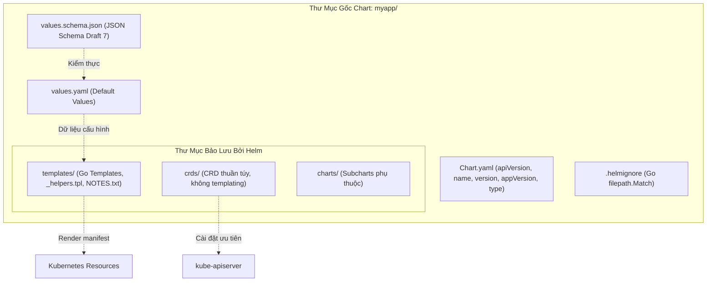
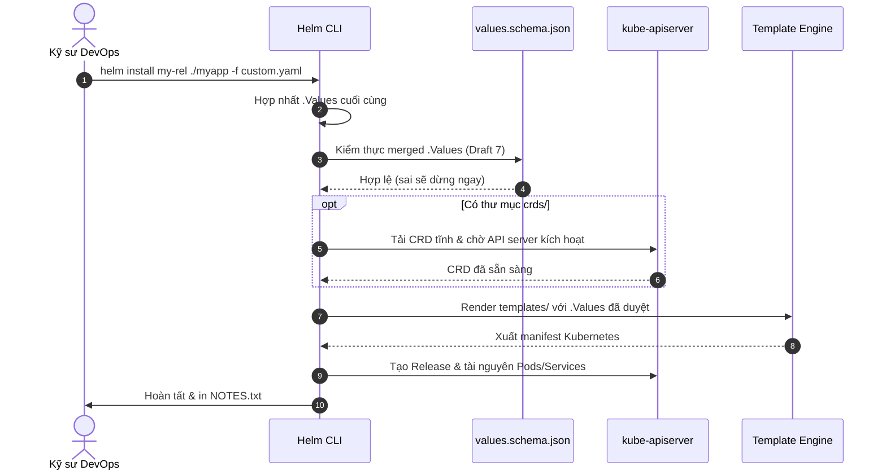

# 6_5_2 Chart Structure

> **Khóa học**: Cloud DevOps Basic — Containers & Kubernetes
> **Phân nhóm**: 6 Domain 6 - Containers and Kubernetes › 6_5 Helm Package Management
> **Chủ đề**: 6_5_2 Chart Structure
> **Phiên bản áp dụng**: Kubernetes 1.37, Helm 4.x / Helm 3.x, Podman 5.x
> **Trạng thái**: Hoàn thành (WRITE-CTR-6_5_2, 16-11-2026)
> **Phạm vi**: [Topic README](./README.md#6_5_2-cấu-trúc-chart) · **Checkpoint của người học**: [CHECKLIST](../../CHECKLIST.md#6_5-helm-package-management)

---

## 0. Tình Huống Mở Đầu: Chạy `helm create`, Rồi Ba Cái Bẫy Chờ Sẵn

`helm create myapp` sinh ra một thư mục với hàng loạt file. Điều khó không phải là nhớ tên file, mà là biết **file nào làm gì và đụng vào đâu thì "cắn"**. Ba chỗ người mới hay vấp nhất: <!-- ev: R2.31 -->

| Bạn nghĩ | Thực tế |
| :--- | :--- |
| `appVersion` và `version` là một | `version` là phiên bản **chart** (SemVer 2, bắt buộc); `appVersion` là phiên bản **ứng dụng**, chỉ mang tính mô tả. Nên bọc `appVersion` trong ngoặc kép để YAML không hiểu nhầm thành số thực <!-- ev: R1.19 R1.20 R1.21 R2.21 R2.25 R2.26 --> |
| `helm uninstall` gỡ sạch mọi thứ, kể cả CRD | CRD trong `crds/` **không bao giờ bị xóa** khi gỡ release, và cũng **không được nâng cấp** khi `upgrade`/`rollback` <!-- ev: R1.31 --> |
| `**/*.secret` trong `.helmignore` loại hết file `.secret` ở thư mục con | `.helmignore` dùng Go `filepath.Match`, **không hỗ trợ `**`** <!-- ev: R1.33 --> |

Bài này đi qua từng thành phần của chart theo đúng thứ tự Helm xử lý khi `helm install`: kiểm tra values bằng schema, nạp CRD, render template.

---

## 1. Khái Niệm Cốt Lõi & Bản Chất Kỹ Thuật (Core Concepts & Technical Deep Dive)

Trong Kubernetes, **Helm Chart** là gói tài nguyên tiêu chuẩn. Lệnh `helm create NAME` tạo nhanh thư mục chart chứa các tệp và thư mục định sẵn. <!-- ev: R2.31 --> Helm bảo lưu việc dùng các thư mục `charts/`, `crds/`, `templates/` cùng các tên tệp tiêu chuẩn; các tệp khác được giữ nguyên trạng. <!-- ev: R1.17 -->

<!-- ev: R1.17 R1.18 R1.25 R1.32 R2.18 R2.28 R2.31 R2.32 -->
| Thành phần | Loại | Bắt buộc | Vai trò kỹ thuật cốt lõi |
| :--- | :--- | :--- | :--- |
| `Chart.yaml` | Tệp | **Có** | Siêu dữ liệu định danh, phiên bản API, tên, loại chart. <!-- ev: R1.18 R2.18 --> |
| `values.yaml` | Tệp | Không | Cấu hình mặc định (xem [6_4_5 ConfigMap và Secret](<../6_4 Kubernetes Networking Configuration and Storage/README.md#6_4_5-configmap-và-secret>)). <!-- ev: R1.25 --> |
| `values.schema.json` | Tệp | Không | Schema Draft 7 kiểm thực cấu trúc values. <!-- ev: R1.25 R2.28 R2.29 --> |
| `templates/` | Thư mục | Không | Mẫu Go template sinh manifest Kubernetes. <!-- ev: R1.17 --> |
| `templates/_helpers.tpl` | Tệp | Không | Khối template và partials dùng chung. <!-- ev: R1.17 --> |
| `templates/NOTES.txt` | Tệp | Không | Bản tin in ra sau khi cài đặt. <!-- ev: R1.17 --> |
| `charts/` | Thư mục | Không | Chứa các subchart phụ thuộc. <!-- ev: R1.17 --> |
| `crds/` | Thư mục | Không | Chứa Custom Resource Definitions tĩnh. <!-- ev: R1.17 R2.32 --> |
| `.helmignore` | Tệp | Không | Danh sách tệp loại trừ khi đóng gói. <!-- ev: R1.32 --> |

### 1.1 Tệp Định Danh `Chart.yaml` & Quy Ước Phiên Bản (Chart Metadata & Versioning)

Tệp `Chart.yaml` là bắt buộc cho mọi chart và phải khai báo `apiVersion`. <!-- ev: R1.18 R2.18 -->

Các trường cốt lõi trong `Chart.yaml`: <!-- ev: R1.18 R2.18 -->
- **`apiVersion`**: Bắt buộc; giá trị `v2` cho chart yêu cầu Helm 3 trở lên. <!-- ev: R1.18 R2.19 -->
- **`name`**: Bắt buộc; chỉ định tên chart. <!-- ev: R2.20 -->
- **`version`**: Bắt buộc; phiên bản chart theo SemVer 2, quyết định token phiên bản khi chạy `helm package`. <!-- ev: R1.19 R2.21 -->
- **`appVersion`**: Tùy chọn; phiên bản ứng dụng, mang tính mô tả, không cần theo SemVer và không ảnh hưởng tính toán phiên bản chart. Khuyến nghị bọc ngoặc kép để tránh YAML parser hiểu nhầm thành số thực. <!-- ev: R1.20 R1.21 R2.25 R2.26 -->
- **`type`**: Phân loại chart thành `application` (mặc định, cài đặt đầy đủ) hoặc `library` (chỉ cung cấp tiện ích/hàm, không cài đặt độc lập, thường không chứa tài nguyên). Chart application có thể dùng làm library bằng cách đặt `type: library`. <!-- ev: R1.22 R1.23 R1.24 R2.24 -->
- **`kubeVersion`**: Tùy chọn; dải phiên bản Kubernetes tương thích theo chuẩn SemVer. <!-- ev: R2.22 -->
- **`description`**: Tùy chọn; câu mô tả ngắn gọn về dự án. <!-- ev: R2.23 -->
- **`deprecated`**: Tùy chọn; cờ boolean đánh dấu chart lỗi thời. <!-- ev: R2.27 -->
- Mọi trường không xác định trong `Chart.yaml` đều bị bỏ qua và không truyền vào templates. <!-- ev: R2.33 -->

### 1.2 Cấu Hình `values.yaml` & Kiểm Thực với `values.schema.json`

Tệp `values.schema.json` áp đặt định nghĩa JSON Schema lên các giá trị cấu hình chart: <!-- ev: R1.25 R2.28 -->
- **Tiêu chuẩn**: Sử dụng chuẩn JSON Schema Draft 7 (`https://json-schema.org/draft-07/schema#`). <!-- ev: R2.29 -->
- **Kích hoạt tự động**: Tự động chạy khi gọi `helm install`, `upgrade`, `lint`, hoặc `template`. <!-- ev: R1.26 R2.30 -->
- **Kiểm thực trên merged values**: Áp dụng lên đối tượng `.Values` cuối cùng sau khi hợp nhất, không chỉ riêng tệp `values.yaml` thô. <!-- ev: R1.27 -->
- **Toàn vẹn subchart**: Đối tượng `.Values` cuối cùng được kiểm tra đối chiếu với schema của mọi subchart, ngăn chart cha vượt qua ràng buộc của subchart. <!-- ev: R1.28 -->

### 1.3 Thư Mục Mẫu `templates/`, `_helpers.tpl` & `NOTES.txt`

Thư mục `templates/` là thư mục bảo lưu của Helm để render manifest Kubernetes: <!-- ev: R1.17 -->
- **`_helpers.tpl`**: Chứa các khối template dùng chung, không sinh manifest Kubernetes độc lập. <!-- ev: R1.17 -->
- **`NOTES.txt`**: Tệp văn bản hiển thị chỉ dẫn vận hành sau khi cài đặt thành công. <!-- ev: R1.17 -->

### 1.4 Thư Mục `charts/` & Loại Trừ Tệp với `.helmignore`

- **Thư mục `charts/`**: Thư mục bảo lưu chứa các subchart phụ thuộc. <!-- ev: R1.17 -->
- **Vị trí `.helmignore`**: Bắt buộc đặt tại thư mục gốc cạnh `Chart.yaml`. <!-- ev: R1.32 -->
- **Thuật toán khớp**: Dùng Go `filepath.Match`, không hỗ trợ cú pháp đệ quy `**`. <!-- ev: R1.33 -->

### 1.5 Xử Lý CRD với Thư Mục `crds/`

Quản lý Custom Resource Definitions qua thư mục bảo lưu `crds/`: <!-- ev: R1.17 R2.32 -->
- **Tài liệu tĩnh**: Tệp trong `crds/` phải là YAML thuần túy, không được phép templating. <!-- ev: R1.29 -->
- **Trình tự nạp khi install**: Khi chạy `helm install`, Helm nạp CRD lên cluster trước, tạm dừng chờ API server kích hoạt rồi mới render templates. <!-- ev: R1.30 R2.32 -->
- **Giới hạn an toàn**: CRD không được cài lại hay nâng cấp khi `upgrade` hoặc `rollback`, và Helm không bao giờ xóa CRD khi gỡ release để bảo vệ dữ liệu cụm. <!-- ev: R1.31 -->

---

## 2. Ví Dụ Đời Sống Thực Tế Dễ Hiểu (Intuitive Real-World Analogies)

**Bạn là tổng thầu nhận một bộ hồ sơ thiết kế để xây nhà, và Helm là đội thi công.**

Mở bộ hồ sơ ra, thứ đầu tiên là **trang bìa** (`Chart.yaml`): tên công trình (`name`), số hiệu bản vẽ (`version`, SemVer 2), phiên bản thiết bị (`appVersion`), loại công trình (`type: application | library`). Ghi chú ngoài lề không thuộc mẫu thì bị gạch bỏ.

Bên trong có:

- **Bảng vật liệu mặc định** (`values.yaml`): dự toán do kiến trúc sư lập, chủ nhà có thể điều chỉnh.
- **Thanh tra kiểm định đầu vào** (`values.schema.json`): trước khi động thổ, vật tư bị kiểm theo chuẩn Draft 7. Vật liệu sai chuẩn thì **dừng ngay**, và tổng thầu (parent chart) cũng không thể làm lệch ràng buộc của xưởng con (subchart).
- **Khung dầm cột chờ đổ bê tông** (`templates/`): khuôn đúc sẵn nhận vật liệu từ `.Values` để đổ thành phòng ốc hoàn chỉnh (Pods, Services). `_helpers.tpl` là cẩm nang công thức dùng chung cho mọi tổ thợ.
- **Móng cọc khoan nhồi** (`crds/`): phải đóng cọc và chờ đông kết **trước**, rồi mới xây tầng trên. Sơn sửa nhà (`upgrade`/`rollback`) không động tới móng, và bán nhà (`uninstall`) cũng không nhổ móng.
- **Hàng rào chắn rác** (`.helmignore`): ngăn bản vẽ nháp lọt vào kiện hàng đóng gói.

---

## 3. Kiến Trúc, Luồng Hoạt Động & Hình Ảnh Trực Quan (Architecture, Diagrams & Visual Media)

### 3.1 Sơ Đồ Cây Cấu Trúc Helm Chart

<!-- ev: R1.17 R1.22 R1.25 R1.32 R2.18 R2.28 R2.32 -->
Phân định ranh giới giữa định danh, kiểm thực cấu hình, tài nguyên tĩnh và mẫu sinh manifest:



### 3.2 Trình Tự Thực Thi Cài Đặt Release (`helm install`)

<!-- ev: R1.26 R1.27 R1.28 R1.30 R2.29 R2.30 R2.32 -->
Trình tự kiểm thực schema, nạp tài nguyên tĩnh và sinh manifest:



---

## 4. Code Mẫu Trực Quan Hoặc Dòng Lệnh Thực Chiến (Runnable Sample Code / CLI)

> **Môi trường thực nghiệm**: Kubernetes 1.37, Helm 4.x / Helm 3.x, Podman 5.x. <!-- ev: R2.19 -->  
> ⚠️ Chưa chạy thử (not executed by the squad)  
> ⚠️ Chỉ chạy trên cluster thử nghiệm (lab cluster only)  
> *Thực hành chi tiết tại lab [lab-6_5_1-chart-from-manifests](./README.md#lab-6_5_1-chart-from-manifests).*

### 4.1 Khởi Tạo Khung Chart

Tạo khung thư mục chart chuẩn bằng lệnh `helm create`: <!-- ev: R1.17 R2.31 -->

```bash
helm create webapp
tree webapp/
```

### 4.2 Thiết Lập `Chart.yaml` Định Danh Chuẩn Mực

Khai báo định danh và phiên bản tuân thủ quy chuẩn: <!-- ev: R1.18 R1.19 R1.20 R1.21 R1.22 R2.18 R2.19 R2.20 R2.21 R2.22 R2.23 R2.24 R2.25 R2.26 R2.27 R2.33 -->

```yaml
apiVersion: v2
name: webapp
description: "Dịch vụ webapp"
type: application
version: 1.0.0
appVersion: "2.4.1"
kubeVersion: ">=1.28.0-0"
deprecated: false
```

### 4.3 Khai Báo Ràng Buộc với `values.schema.json`

Áp đặt định nghĩa JSON Schema Draft 7 lên values: <!-- ev: R1.25 R2.28 R2.29 -->

```json
{
  "$schema": "https://json-schema.org/draft-07/schema#",
  "type": "object",
  "required": ["replicaCount", "image"],
  "properties": {
    "replicaCount": { "type": "integer", "minimum": 1, "maximum": 50 },
    "image": {
      "type": "object",
      "required": ["repository", "tag"],
      "properties": {
        "repository": { "type": "string" },
        "tag": { "type": "string" }
      }
    }
  }
}
```

### 4.4 Kiểm Tra Cú Pháp & Render Ngoại Tuyến

Kiểm tra cú pháp và kích hoạt schema validation: <!-- ev: R1.26 R1.27 R2.30 -->

```bash
# Kiểm tra chart và schema
helm lint webapp/

# Render manifest ngoại tuyến
helm template preview webapp/

# Thử nghiệm giá trị vi phạm schema (replicaCount là chuỗi)
helm template preview webapp/ --set replicaCount="hai"
# Kết quả: Báo lỗi schema validation failed và dừng render
```

### 4.5 Cấu Hình `.helmignore` & Thư Mục `crds/`

Tệp `.helmignore` đặt tại thư mục gốc cạnh `Chart.yaml` (dùng Go `filepath.Match`): <!-- ev: R1.32 R1.33 -->

```text
.git/
*.swp
*.bak
secrets.txt
```

Nếu chart cung cấp CRD, đặt tệp YAML thuần túy vào thư mục `crds/`: <!-- ev: R1.29 R1.30 R2.32 -->

```bash
mkdir -p webapp/crds
cat << 'EOF' > webapp/crds/mycrds.yaml
apiVersion: apiextensions.k8s.io/v1
kind: CustomResourceDefinition
metadata:
  name: widgets.example.com
spec:
  group: example.com
  scope: Namespaced
  names:
    plural: widgets
    singular: widget
    kind: Widget
  versions:
    - name: v1
      served: true
      storage: true
      schema:
        openAPIV3Schema:
          type: object
EOF
```

> **Lưu ý Helm 4 và Helm 3**: Cấu trúc chart `apiVersion: v2`, kiểm thực JSON Schema Draft 7 và cơ chế nạp ưu tiên `crds/` hoàn toàn nhất quán giữa Helm 3 và Helm 4. <!-- ev: R1.18 R2.19 R2.29 -->

---

## 5. Cạm Bẫy Thực Tế & Thực Tiễn Sản Xuất (Production Gotchas & Best Practices)

### 5.1 Cạm Bẫy CRD trong `crds/`: Không Nâng Cấp & Không Xóa

<!-- ev: R1.29 R1.30 R1.31 R2.32 -->
- **Hành vi**: Helm chỉ nạp tệp trong `crds/` khi chạy `helm install` lần đầu. Trong `helm upgrade` hoặc `rollback`, Helm không bao giờ cài lại hay nâng cấp CRD. Khi chạy `helm uninstall`, Helm không bao giờ xóa CRD để tránh cascading delete làm mất dữ liệu tài nguyên trên toàn cụm. <!-- ev: R1.30 R1.31 R2.32 -->
- **Giải pháp**: Quản trị vòng đời CRD độc lập; cập nhật CRD thủ công qua lệnh `kubectl apply -f crds/` trước khi upgrade hoặc qua Operator chuyên dụng. <!-- ev: R1.31 -->

### 5.2 Cạm Bẫy Phiên Bản: SemVer `version` vs Chuỗi `appVersion`

<!-- ev: R1.19 R1.20 R1.21 R2.21 R2.25 R2.26 -->
- **Khác biệt**: `version` bắt buộc theo SemVer 2 và quyết định tên gói khi đóng gói (`helm package`). `appVersion` chỉ là thông tin mô tả ứng dụng và không tham gia tính toán phiên bản chart. <!-- ev: R1.19 R1.20 R2.21 R2.25 -->
- **Lỗi cú pháp YAML**: Không bọc ngoặc kép cho `appVersion: 1.10` khiến parser hiểu nhầm thành số thực `1.1`. Luôn viết `appVersion: "1.10"`. <!-- ev: R1.21 R2.26 -->

### 5.3 Cạm Bẫy Khớp Mẫu `.helmignore`: Không Hỗ Trợ `**`

<!-- ev: R1.32 R1.33 -->
- **Bản chất**: `.helmignore` sử dụng Go `filepath.Match`, không hỗ trợ cú pháp hai dấu sao `**` như Git. Dòng `**/*.pem` sẽ không loại trừ các tệp trong thư mục con, dẫn đến nguy cơ lộ khóa bảo mật vào gói chart. <!-- ev: R1.33 -->
- **Giải pháp**: Khai báo rõ ràng từng cấp đường dẫn như `*.pem` hoặc `tests/*`. <!-- ev: R1.32 R1.33 -->

### 5.4 Cạm Bẫy Schema: Kiểm Thực Toàn Diện Trên Merged `.Values`

<!-- ev: R1.27 R1.28 -->
- **Phạm vi áp dụng**: Schema kiểm thực trên đối tượng `.Values` cuối cùng sau khi gộp, nên mọi giá trị từ `--set` hoặc `-f` đều bị kiểm tra nghiêm ngặt. <!-- ev: R1.27 -->
- **Ràng buộc subchart**: Cấu hình từ chart cha không thể vượt qua schema của subchart. <!-- ev: R1.28 -->

---

## 6. Câu Hỏi Củng Cố Kiến Thức (Active Recall Quiz)

### Câu Hỏi 1: Tại Sao Helm Không Xóa CRD Trong `crds/` Khi Chạy `helm uninstall`?

Khi gỡ bỏ một release, tại sao Helm chủ động giữ lại các CRD đã cài đặt từ thư mục `crds/`?

<details>
<summary>Đáp án</summary>

Vì lý do an toàn dữ liệu: xóa một CRD sẽ tự động kích hoạt xóa lan truyền (cascading delete) tiêu diệt mọi Custom Resource instances thuộc định nghĩa đó trên toàn bộ mọi namespace trong cụm. Giữ lại CRD giúp bảo vệ dữ liệu của các ứng dụng khác đang cùng chia sẻ tài nguyên.
</details>

### Câu Hỏi 2: Phân Biệt `version` Và `appVersion` Trong `Chart.yaml`? Trường Nào Bắt Buộc SemVer 2?

Trình bày sự khác biệt giữa hai trường phiên bản trong `Chart.yaml` và lý do cần bọc ngoặc kép cho `appVersion`?

<details>
<summary>Đáp án</summary>

- `version`: Bắt buộc, phải tuân thủ chuẩn SemVer 2 (`x.y.z`). Biểu thị phiên bản gói chart và được `helm package` dùng đặt tên tệp nén.
- `appVersion`: Tùy chọn, biểu thị phiên bản phần mềm chứa bên trong, không bắt buộc SemVer và không ảnh hưởng tính toán phiên bản chart.
- Bọc ngoặc kép cho `appVersion` để ép YAML parser hiểu là kiểu chuỗi, tránh hiểu nhầm thành số thực (ví dụ `1.10` thành `1.1`).
</details>

### Câu Hỏi 3: Tại Sao Quy Tắc `**/*.secret` Trong `.helmignore` Không Loại Trừ Được Tệp Trong Thư Mục Con?

Kỹ sư đặt `**/*.secret` vào `.helmignore` nhưng tệp `configs/db.secret` vẫn bị đóng gói. Nguyên nhân do đâu?

<details>
<summary>Đáp án</summary>

Vì `.helmignore` sử dụng thư viện `filepath.Match` của ngôn ngữ Go, không hỗ trợ cú pháp hai dấu sao `**` để duyệt đệ quy như Git. Cần khai báo trực tiếp `*.secret` hoặc chỉ định cụ thể `configs/*.secret`.
</details>

---

## 7. 📚 Nguồn Tài Liệu Chính Thống (Tier-1 Official References)

- [Helm Documentation — The Chart File Structure & Chart.yaml](https://helm.sh/docs/topics/charts/#chart-file-structure) — Đặc tả chuẩn cấu trúc thư mục, trường `Chart.yaml`, và kiểm thực schema.
- [Helm Documentation — The .helmignore File](https://helm.sh/docs/chart_template_guide/helm_ignore_file/#the-helmignore-file) — Chi tiết thuật toán khớp mẫu `filepath.Match` trong `.helmignore`.
- [Helm Documentation — Custom Resource Definitions in Helm](https://helm.sh/docs/chart_best_practices/custom_resource_definitions/#method-1-let-helm-do-it-for-you) — Quản lý CRD qua thư mục `crds/` và giới hạn an toàn.
- [Helm CLI Documentation — helm create](https://helm.sh/docs/helm/helm_create/#synopsis) — Cú pháp khởi tạo cấu trúc chart chuẩn mực.
