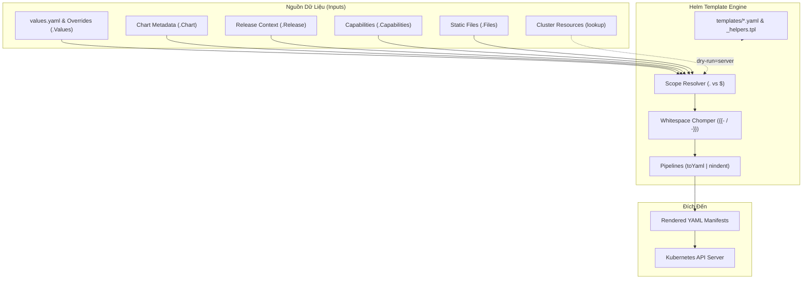

# 6_5_3 Template Language

> **Khóa học**: Cloud DevOps Basic — Containers and Kubernetes  
> **Phân nhóm**: 6 Domain 6 - Containers and Kubernetes › 6_5 Helm Package Management  
> **Chủ đề**: 6_5_3 Template Language — Go Template, Built-in Objects, Control Structures, Named Templates, Functions và Whitespace Chomping  
> **Phiên bản áp dụng**: Kubernetes 1.37, Helm 4.x / Helm 3.x, Podman 5.x  
> **Trạng thái**: Verified (WRITE-CTR-6_5_3, 16-11-2026)  
> **Phạm vi**: [Topic README](./README.md#6_5_3-ngôn-ngữ-template) · **Checkpoint của người học**: [CHECKLIST](<../../CHECKLIST.md#6_5-helm-package-management>)  

---

## 1. Khái Niệm Cốt Lõi & Bản Chất Kỹ Thuật (Core Concepts & Technical Deep Dive)

Trong Helm, template language biến đổi các file định nghĩa tham số hóa thành manifest Kubernetes chuẩn (như Pods tại [6_3_3 Pods](<../6_3 Kubernetes Architecture and Core Workloads/6_3_3 Pods.md>)) trước khi gửi tới API Server.

---

### 1.1 Nền Tảng Go Template & Thư Viện Hàm Sprig

- **Go Template & Sprig**: Ngôn ngữ template của Helm dựa trên Go template chuẩn và mở rộng bằng thư viện Sprig <!-- ev: R1.34 -->.
- **Pipeline biến đổi**: Pipeline xâu chuỗi tuần tự các lệnh biến đổi bằng cú pháp toán tử UNIX pipe `|` <!-- ev: R1.35 -->.
- **Cú pháp hàm**: Các hàm nhận tham số theo cú pháp chuẩn `functionName arg1 arg2` <!-- ev: R2.45 -->.
- **Hàm `quote`**: Nhận dữ liệu đầu vào và bọc giá trị trong dấu ngoặc kép qua pipeline `{{ .Values.image.tag | quote }}` <!-- ev: R2.46 -->.

---

### 1.2 Các Đối Tượng Tích Hợp Sẵn (Built-in Objects)

Helm tự động cung cấp các đối tượng ngữ cảnh toàn cục khi bắt đầu render:

<!-- ev: R1.40 R1.41 R1.42 R1.43 R1.44 R1.18 R1.20 R2.174 -->
| Đối tượng | Dữ liệu & Hàm tiện ích | Ví dụ cú pháp |
| :--- | :--- | :--- |
| **`.Values`** | Giá trị từ `values.yaml` và cờ ghi đè, mặc định rỗng <!-- ev: R1.41 -->. | `{{ .Values.replicaCount }}` <!-- ev: R1.41 --> |
| **`.Release`** | Metadata bản phát hành: `Release.Name`, `Release.Namespace`, `Release.IsUpgrade`, `Release.Revision` <!-- ev: R1.40 -->. | `{{ .Release.Namespace }}` <!-- ev: R1.40 --> |
| **`.Chart`** | Metadata từ tệp `Chart.yaml` (chi tiết tại [6_5_2 Chart Structure](<./6_5_2 Chart Structure.md>)) <!-- ev: R1.18 -->; trường `appVersion` <!-- ev: R1.20 --> qua `{{ .Chart.AppVersion }}` cho nhãn `app.kubernetes.io/version` <!-- ev: R2.174 -->. | `{{ .Chart.AppVersion }}` <!-- ev: R2.174 --> |
| **`.Capabilities`** | Năng lực cụm Kubernetes, gồm kiểm tra phiên bản API qua `Capabilities.APIVersions.Has` <!-- ev: R1.43 -->. | `{{ .Capabilities.APIVersions.Has "apps/v1" }}` <!-- ev: R1.43 --> |
| **`.Files`** | Hàm tiện ích truy cập file: `Files.Get`, `Files.GetBytes`, `Files.Glob`, `Files.Lines`, `Files.AsSecrets`, `Files.AsConfig` <!-- ev: R1.42 -->. | `{{ .Files.Get "config.ini" }}` <!-- ev: R1.42 --> |
| **`.Template`** | Metadata template đang chạy: tên tệp `Template.Name` và thư mục `Template.BasePath` <!-- ev: R1.44 -->. | `{{ .Template.BasePath }}` <!-- ev: R1.44 --> |

---

### 1.3 Cấu Trúc Điều Khiển & Quản Lý Scope

- **Cấu trúc rẽ nhánh**: Sử dụng các chỉ thị `if`, `else if`, `else`, và kết thúc bằng `end` <!-- ev: R2.34 -->.
- **Quy tắc false**: Pipeline đánh giá là `false` khi mang giá trị boolean `false`, số `0`, chuỗi rỗng `""`, `nil`, hoặc collection rỗng (map, slice, tuple, dict, array) <!-- ev: R2.35 -->.
- **Thay đổi scope bằng `with`**: Hành động `with` chuyển ngữ cảnh dot (`.`) trỏ vào đối tượng chỉ định <!-- ev: R1.45 R2.39 -->; biến `.` khôi phục về scope trước đó sau `{{ end }}` <!-- ev: R1.45 -->.
- **Vòng lặp `range`**: Toán tử `range` duyệt qua collection <!-- ev: R2.40 -->; mỗi lần lặp, biến `.` được gán lại trỏ vào phần tử hiện tại <!-- ev: R2.41 -->.
- **Biến gốc `$` (Root Scope)**: Ký hiệu `$` ánh xạ tới root scope khi bắt đầu chạy và không thay đổi suốt quá trình thực thi, cho phép truy xuất đối tượng gốc từ trong `with` hoặc `range` <!-- ev: R1.46 -->.
- **Lỗi nil-pointer**: Truy cập field lồng nhau khi đối tượng cha là `nil` sẽ gây ngắt render; dùng `with` hoặc kiểm tra điều kiện an toàn giúp ngăn ngừa lỗi này <!-- ev: R1.45 R2.35 -->.

---

### 1.4 Named Templates & Các Hàm Tái Sử Dụng

- **Khai báo bằng `define`**: Hành động `define` tạo named template partial bên trong tệp template mà không trực tiếp sinh output <!-- ev: R1.48 R2.52 -->.
- **Nhúng bằng `include`**: Hàm `include` được ưu tiên hơn directive `template` vì kết quả của nó có thể pipe tiếp sang các hàm định dạng văn bản YAML <!-- ev: R1.49 R2.53 -->.
- **Hàm `toYaml` & `toYamlPretty`**: Hàm `toYaml` mã hóa đối tượng thành chuỗi YAML có thụt lề <!-- ev: R2.42 -->; `toYamlPretty` bổ sung thêm thụt lề cho phần tử danh sách <!-- ev: R2.43 -->.
- **Hàm `nindent`**: Hàm `nindent` thụt lề văn bản giống `indent` nhưng tự động chèn thêm ký tự xuống dòng (`\n`) vào đầu chuỗi <!-- ev: R2.44 -->.
- **Hàm `default`**: Cú pháp `default DEFAULT_VALUE GIVEN_VALUE` cung cấp giá trị mặc định dự phòng khi giá trị đưa vào bị bỏ trống hoặc rỗng <!-- ev: R1.36 R2.47 -->.
- **Hàm `required`**: Cú pháp `required "thông báo" .Bar` ngắt render và trả về thông báo tùy biến nếu giá trị bị thiếu hoặc rỗng <!-- ev: R1.50 R2.48 -->.
- **Hàm `tpl`**: Lượng giá một chuỗi văn bản như một template bên trong template, như cú pháp `tpl .Values.template .` <!-- ev: R2.49 -->.
- **Hàm `lookup`**: Cú pháp `lookup apiVersion, kind, namespace, name -> resource or resource list` truy vấn tài nguyên đang chạy trên cụm Kubernetes <!-- ev: R1.37 R2.50 -->. Nếu không tìm thấy, trả về giá trị rỗng <!-- ev: R1.38 -->. Cần cờ `--dry-run=server` để liên hệ API Server <!-- ev: R2.51 -->.

---

### 1.5 Kiểm Soát Khoảng Trắng (Whitespace Chomping `{{-` / `-}}`)

- **Chomp trái (`{{-`)**: Ký hiệu `{{-` chỉ thị xóa sạch khoảng trắng bên trái của tag <!-- ev: R1.47 R2.36 -->.
- **Chomp phải (`-}}`)**: Ký hiệu `-}}` tiêu thụ toàn bộ khoảng trắng và ký tự xuống dòng bên phải <!-- ev: R1.47 R2.37 -->.
- **Dấu cách bắt buộc**: Giữa dấu gạch nối và câu lệnh bắt buộc có khoảng trắng; `{{- 3 }}` xóa khoảng trắng trái và in 3, còn `{{-3 }}` in ra số âm -3 <!-- ev: R2.38 -->.

---

## 2. Ví Dụ Đời Sống Thực Tế Dễ Hiểu (Intuitive Real-World Analogies)

Go template trong Helm giống như một dây chuyền cắt ráp thiệp mời tự động:

1. **Dấu chấm `.` — Vị trí đứng máy**: Khi đứng ở sảnh trung tâm (root context), người thợ có thể với tay lấy khay thông số `.Values`, mã đơn hàng `.Release`, hay phôi thiệp `.Chart`. Nhưng khi bước vào buồng dán tem `with` hoặc phòng chia thư `range`, người thợ đổi vị trí nên chỉ thấy đồ vật trong buồng đó (biến `.` trỏ vào đối tượng con).
2. **Chiếc chìa khóa vạn năng `$` — Cửa thông gió về sảnh chính**: Đang đứng trong buồng dán tem kín mà cần lấy mã đơn hàng ở sảnh tiếp tân, biến `.` không còn thấy `.Release`. Chiếc chìa khóa vạn năng `$` mở cánh cửa thông gió trỏ thẳng về root context, giúp lấy `$.Release.Name` hay `$.Values.global` dễ dàng.
3. **Chiếc kéo laser xén giấy `{{-` và `-}}`**: Mỗi lần dập khuôn một lệnh logic (`if` hay `end`), template engine để lại mẩu giấy thừa hoặc dòng trống. Kéo laser `{{-` xén phăng khoảng trắng thừa bên trái, còn `-}}` gọt sạch dòng trống bên phải, giúp mép thiệp YAML ráp khít từng milimet, không làm lệch lề gây kẹt máy in Kubernetes.

---

## 3. Kiến Trúc, Luồng Hoạt Động & Hình Ảnh Trực Quan (Architecture, Diagrams & Visual Media)

<!-- ev: R1.37 R2.50 R2.51 -->
Sơ đồ luồng xử lý dữ liệu và render template trong Helm:



---

## 4. Code Mẫu Trực Quan Hoặc Dòng Lệnh Thực Chiến (Runnable Sample Code / CLI)

> ⚠️ Chưa chạy thử (not executed by the squad)  
> ⚠️ Chỉ chạy trên cluster thử nghiệm (lab cluster only)  
> **Môi trường**: Kubernetes 1.37, Helm 4.x / Helm 3.x, Podman 5.x. Thực hành chi tiết tại [lab-6_5_1-chart-from-manifests](./README.md#lab-6_5_1-chart-from-manifests).

### 4.1 Khai Báo Helper Trong `templates/_helpers.tpl`

Tệp helper khai báo named template partials bằng `define` <!-- ev: R1.48 R2.52 -->:

<!-- ev: R1.40 R1.48 R2.52 R2.174 -->
```yaml
{{/* Tên ứng dụng chuẩn hóa */}}
{{- define "mychart.name" -}}
{{- default .Chart.Name .Values.nameOverride | trunc 63 | trimSuffix "-" -}}
{{- end -}}

{{/* Nhãn chuẩn (Standard Labels) */}}
{{- define "mychart.labels" -}}
helm.sh/chart: {{ printf "%s-%s" .Chart.Name .Chart.Version | replace "+" "_" | trunc 63 | trimSuffix "-" }}
app.kubernetes.io/name: {{ include "mychart.name" . }}
app.kubernetes.io/instance: {{ .Release.Name }}
app.kubernetes.io/version: {{ .Chart.AppVersion | quote }}
app.kubernetes.io/managed-by: {{ .Release.Service }}
{{- end -}}
```

### 4.2 Template Hoàn Chỉnh `templates/deployment.yaml`

Template kết hợp `include`, `nindent`, `required`, `default`, `toYaml`, `with`, `range`, và `$` <!-- ev: R1.36 R1.45 R1.46 R1.49 R1.50 R2.40 R2.42 R2.44 -->:

<!-- ev: R1.35 R1.36 R1.40 R1.41 R1.45 R1.46 R1.47 R1.49 R1.50 R2.34 R2.36 R2.37 R2.39 R2.40 R2.41 R2.42 R2.44 R2.46 R2.47 R2.48 R2.53 -->
```yaml
apiVersion: apps/v1
kind: Deployment
metadata:
  name: {{ include "mychart.name" . }}
  namespace: {{ .Release.Namespace }}
  labels:
    {{- include "mychart.labels" . | nindent 4 }}
spec:
  replicas: {{ default 1 .Values.replicaCount }}
  selector:
    matchLabels:
      app.kubernetes.io/name: {{ include "mychart.name" . }}
      app.kubernetes.io/instance: {{ .Release.Name }}
  template:
    metadata:
      labels:
        {{- include "mychart.labels" . | nindent 8 }}
    spec:
      containers:
        - name: {{ .Chart.Name }}
          image: "{{ .Values.image.repository }}:{{ required "A valid image.tag is required!" .Values.image.tag }}"
          imagePullPolicy: {{ default "IfNotPresent" .Values.image.pullPolicy | quote }}
          ports:
            - name: http
              containerPort: {{ default 8080 .Values.service.port }}
              protocol: TCP
          {{- with .Values.resources }}
          resources:
            {{- toYaml . | nindent 12 }}
          {{- end }}
          {{- if .Values.envVars }}
          env:
            {{- range .Values.envVars }}
            - name: {{ .name }}
              value: {{ .value | quote }}
            {{- end }}
            - name: RELEASE_REVISION
              value: {{ $.Release.Revision | quote }}
          {{- end }}
```

### 4.3 Kiểm Thử Render Bằng Helm CLI

<!-- ev: R1.37 R2.50 R2.51 -->
```bash
# 1. Render template offline ở client (không nối cluster)
helm template demo-app ./mychart --dry-run=client

# 2. Render và kiểm tra trực tiếp với API Server (khi dùng hàm lookup)
helm template demo-app ./mychart --dry-run=server

# 3. Thử nghiệm thiếu giá trị bắt buộc để quan sát required chặn đứng render
helm template demo-app ./mychart --set image.tag=""
```

---

## 5. Cạm Bẫy Thực Tế & Thực Tiễn Sản Xuất (Production Gotchas & Best Practices)

<!-- ev: R1.49 R2.42 R2.44 R2.53 -->
### 5.1 Cạm Bẫy Thụt Lề: `indent` vs `nindent` Khi Kết Hợp Với `toYaml`
- **Hiện tượng**: Dùng `{{ toYaml .Values.resources | indent 8 }}` khiến dòng đầu thụt lề sai vị trí, làm hỏng cú pháp YAML <!-- ev: R2.42 -->.
- **Nguyên nhân**: Hàm `indent N` không chèn ký tự xuống dòng trước dòng đầu; trong khi `nindent N` tự động chèn `\n` trước khi thụt lề toàn bộ <!-- ev: R2.44 -->.
- **Thực tiễn**: Luôn kết hợp `toYaml` và `include` với `nindent` (ví dụ `{{- toYaml . | nindent 8 }}`) <!-- ev: R1.49 R2.44 R2.53 -->.

<!-- ev: R1.40 R1.45 R1.46 R2.39 R2.41 -->
### 5.2 Mất Root Scope Trong `with` / `range` Và Lỗi Nil Pointer
- **Hiện tượng**: Trong khối `with .Values.service`, gọi `{{ .Release.Name }}` gây lỗi nil pointer hoặc trả về rỗng <!-- ev: R1.40 R1.45 -->.
- **Nguyên nhân**: Chỉ thị `with` đã chuyển biến dot (`.`) trỏ sang `.Values.service` nên không còn thấy `.Release` <!-- ev: R1.40 R1.45 R2.39 -->.
- **Thực tiễn**: Luôn dùng tiền tố `$` để truy xuất các đối tượng root như `$.Release.Name` hay `$.Values.global` <!-- ev: R1.40 R1.46 R2.41 -->.

<!-- ev: R1.37 R1.38 R2.50 R2.51 -->
### 5.3 Lạm Dụng Hàm `lookup` Trong GitOps & Dry-Run
- **Hiện tượng**: Chart triển khai qua GitOps hoặc `helm template` bị thiếu tài nguyên do `lookup` trả về rỗng <!-- ev: R1.38 -->.
- **Nguyên nhân**: Hàm `lookup` không liên hệ API Server khi render offline hay dry-run thông thường <!-- ev: R1.38 -->; chỉ chạy khi có kết nối thật hoặc với `--dry-run=server` <!-- ev: R1.37 R2.50 R2.51 -->.
- **Thực tiễn**: Luôn cung cấp giá trị mặc định dự phòng khi dùng `lookup` và kiểm thử với `--dry-run=server` <!-- ev: R2.51 -->.

---

## 6. Câu Hỏi Củng Cố Kiến Thức (Active Recall Quiz)

### Câu Hỏi 1: Tại Sao Nên Dùng `include` Thay Vì `template` Khi Nhúng Named Template?
Trong file YAML của Helm chart, vì sao nên dùng `{{- include "mychart.labels" . | nindent 4 }}` thay vì `{{- template "mychart.labels" . }}`?

<details>
<summary>Đáp án</summary>

- **Bản chất của `template`**: `template` là action trong Go template, output không thể truyền qua toán tử pipeline `|` để xử lý tiếp <!-- ev: R1.49 -->.
- **Ưu thế của `include`**: `include` là một hàm trả về chuỗi văn bản, cho phép pipe kết quả sang `nindent N` để căn chỉnh thụt lề YAML chuẩn xác <!-- ev: R1.49 R2.44 R2.53 -->.
</details>

---

### Câu Hỏi 2: Phân Tích Lỗi Đổi Scope Và Lỗi Whitespace Chomping
Chỉ ra 2 lỗi trong đoạn mã sau:
```yaml
{{- with .Values.ingress }}
metadata:
  name: {{ .Release.Name }}-ingress
{{-3 }}
```

<details>
<summary>Đáp án</summary>

1. **Lỗi mất Root Scope trong `with`**: Biến `.` bị chuyển trỏ vào `.Values.ingress`, khiến `.Release.Name` bị nil hoặc rỗng <!-- ev: R1.40 R1.45 R2.39 -->. Sửa thành: `{{ $.Release.Name }}-ingress` <!-- ev: R1.40 R1.46 -->.
2. **Lỗi cú pháp Chomping `{{-3 }}`**: Thiếu dấu cách sau gạch nối khiến template engine in ra số âm -3 thay vì chomp khoảng trắng <!-- ev: R2.38 -->. Sửa thành `{{- 3 }}` hoặc lệnh đóng khối `{{- end }}` <!-- ev: R2.34 R2.38 -->.
</details>

---

### Câu Hỏi 3: Khi Nào Dùng `default` Và Khi Nào Bắt Buộc Dùng `required`?
Tiêu chí kỹ thuật nào quyết định việc chọn lựa giữa hàm `default` và hàm `required`?

<details>
<summary>Đáp án</summary>

- **Dùng `default`**: Cho các tham số có thể suy luận giá trị an toàn hợp lý nếu vắng mặt (như replica mặc định 1, port mặc định 8080) <!-- ev: R1.36 R2.47 -->.
- **Dùng `required`**: Bắt buộc cho tham số định danh sống còn không có giá trị mặc định an toàn (như `image.tag` trong CI/CD pipeline) <!-- ev: R1.50 R2.48 -->. Hàm `required` ngắt ngay quá trình render với thông báo lỗi rõ ràng nếu thiếu giá trị <!-- ev: R1.50 R2.48 -->.
</details>

---

## 7. 📚 Nguồn Tài Liệu Chính Thống (Tier-1 Official References)

- [Helm Documentation — Template Functions and Pipelines](https://helm.sh/docs/chart_template_guide/functions_and_pipelines/) — Hướng dẫn chính thức về Go template, Sprig, pipelines và hàm lookup.
- [Helm Documentation — Built-in Objects](https://helm.sh/docs/chart_template_guide/builtin_objects/) — Đặc tả chi tiết về các đối tượng tích hợp sẵn: `.Values`, `.Release`, `.Chart`, `.Files`, `.Capabilities`, `.Template`.
- [Helm Documentation — Flow Control](https://helm.sh/docs/chart_template_guide/control_structures/) — Cú pháp điều khiển luồng `if`/`else`, quản lý ngữ cảnh scope bằng `with`, `range`, và whitespace chomping `{{-` / `-}}`.
- [Helm Documentation — Named Templates](https://helm.sh/docs/chart_template_guide/named_templates/) — Hướng dẫn định nghĩa named template với `define` và nhúng với `include`.
- [Helm Documentation — Template Function List](https://helm.sh/docs/chart_template_guide/function_list/) — Danh mục tra cứu đầy đủ các hàm: `toYaml`, `nindent`, `required`, `default`, `tpl`.
