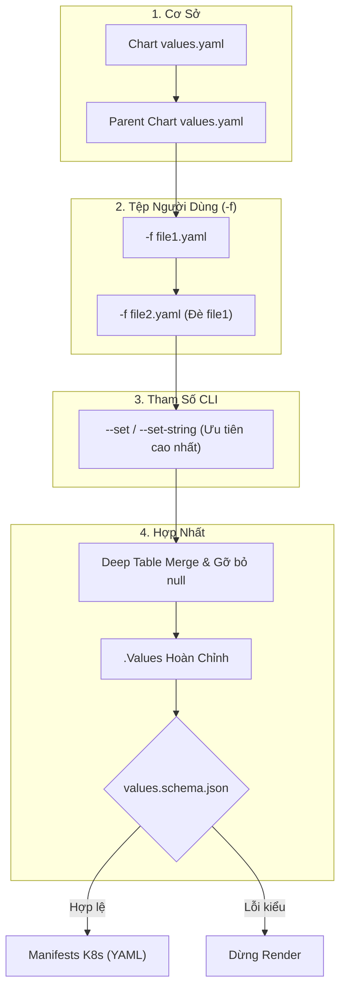

# 6_5_4 Values and Precedence

> **Khóa học**: Cloud DevOps Basic — Containers and Kubernetes  
> **Phân nhóm**: 6 Domain 6 - Containers and Kubernetes › 6_5 Helm Package Management  
> **Chủ đề**: 6_5_4 Values and Precedence — Nguồn Cấu Hình Values, Thứ Tự Ưu Tiên, Deep Coalescing, Quản Trị Đa Môi Trường và Truy Vết helm get values  
> **Phiên bản áp dụng**: Kubernetes 1.37, Helm 4.x / Helm 3.x, Podman 5.x  
> **Trạng thái**: Verified (WRITE-CTR-6_5_4, 16-11-2026)  
> **Phạm vi**: [Topic README](./README.md#6_5_4-values-và-thứ-tự-ưu-tiên) · **Checkpoint của người học**: [CHECKLIST](<../../CHECKLIST.md#6_5-helm-package-management>)  

---

## 0. Tình Huống Mở Đầu: `replicaCount` Có Ở Bốn Nơi, Ai Thắng?

Bạn có `replicaCount: 1` trong `values.yaml` của chart, `replicaCount: 5` trong `values-prod.yaml`, rồi chạy:

```bash
helm upgrade --install web ./web -f values.yaml -f values-prod.yaml --set replicaCount=3
```

Giá trị cuối cùng là **3**. Theo quy tắc của Helm: `--set` thắng mọi file, và giữa các file `-f` thì **file bên phải thắng**. <!-- ev: R1.51 R1.52 R2.56 --> (Đây là suy ra từ quy tắc trong tài liệu, chưa chạy thử trên cluster.)

Hai điều làm nhiều người ngạc nhiên hơn, và là lý do bài này đáng đọc:

- **List bị thay thế nguyên khối, không merge.** Khai báo một danh sách trong `values-prod.yaml` làm mất **toàn bộ** phần tử của danh sách đó trong `values.yaml`, vì Helm chỉ deep merge **map**. Muốn ghi đè từng mục, hãy dùng map có key thay cho list. <!-- ev: R1.54 R1.55 -->
- **`--set config.port=8080` biến thành số nguyên**, không phải chuỗi. Cần chuỗi thì dùng `--set-string`. <!-- ev: R2.58 R2.59 -->

Phần còn lại của bài là bản đồ đầy đủ: 4 nguồn values, họ cờ `--set-*`, cách xóa khóa mặc định bằng `null`, values trong subchart, và `helm get values` để biết release đang chạy với cấu hình nào.

---

## 1. Khái Niệm Cốt Lõi & Bản Chất Kỹ Thuật (Core Concepts & Technical Deep Dive)

Trong kiến trúc Helm chart ([6_5_2 Chart Structure](<./6_5_2 Chart Structure.md>)), template engine nhận cấu hình từ nhiều nguồn và được giải thuật hợp nhất bảng (table coalesce) xử lý theo thứ tự ưu tiên trước khi render manifest Kubernetes.

---

### 1.1 Bốn Nguồn Cung Cấp Values & Thứ Tự Ưu Tiên Tuyệt Đối (Values Sources & Precedence Order)

Dữ liệu values cung cấp cho chart xuất phát từ 4 nguồn chính: <!-- ev: R2.54 -->
- Tệp `values.yaml` mặc định bên trong chart <!-- ev: R2.54 -->.
- Tệp `values.yaml` của chart cha (parent chart) nếu đang triển khai subchart <!-- ev: R2.54 -->.
- Các tệp values do người dùng chỉ định qua cờ `-f` hoặc `--values` <!-- ev: R2.54 -->.
- Các tham số dòng lệnh truyền trực tiếp qua họ cờ `--set` <!-- ev: R2.54 -->.

Thứ tự ưu tiên tăng dần theo độ cụ thể (order of specificity): `values.yaml` chart < `values.yaml` cha < tệp `-f` < tham số `--set` <!-- ev: R1.51 R2.55 -->.
- **Quyền ưu tiên tuyệt đối của CLI**: Các tham số thiết lập với `--set` có quyền ưu tiên cao nhất, đè lên mọi tệp values <!-- ev: R1.52 -->.
- **Quy tắc tệp ngoài cùng bên phải (Right-most File)**: Cờ `-f` / `--values` có thể chỉ định nhiều lần; quyền ưu tiên cao nhất thuộc về tệp ngoài cùng bên phải <!-- ev: R2.56 -->.
- **Quy tắc tham số ngoài cùng bên phải (Right-most Parameter)**: Cờ `--set` có thể lặp lại nhiều lần; tham số ngoài cùng bên phải giành ưu tiên cao nhất <!-- ev: R2.57 -->.

---

### 1.2 Họ Tham Số Dòng Lệnh Nạp Values (`--set`, `--set-string`, `--set-file`, `--set-json`, `--set-literal`)

Helm hỗ trợ họ cờ dòng lệnh chuyên dụng để nạp cấu hình khi chạy lệnh cài đặt hoặc nâng cấp: <!-- ev: R2.58 R2.59 R2.60 R2.61 R2.62 -->

<!-- ev: R2.58 R2.59 R2.60 R2.61 R2.62 -->
| Cờ CLI | Đặc tả kỹ thuật | Ví dụ cú pháp thực tế |
| :--- | :--- | :--- |
| **`--set`** | Gán cặp key-value trực tiếp trên CLI, phân tách bằng dấu phẩy <!-- ev: R2.58 -->. | `--set replicaCount=3,image.tag=v1.2.0` <!-- ev: R2.58 --> |
| **`--set-string`** | Ép kiểu dữ liệu bắt buộc sang chuỗi String <!-- ev: R2.59 -->. | `--set-string service.port="8080"` <!-- ev: R2.59 --> |
| **`--set-file`** | Nạp nội dung từ file trên đĩa vào khóa chỉ định <!-- ev: R2.60 -->. | `--set-file appConfig=./config.json` <!-- ev: R2.60 --> |
| **`--set-json`** | Truyền cấu trúc JSON (scalars, objects, arrays) <!-- ev: R2.61 -->. | `--set-json 'resources={"limits":{"cpu":"1"}}'` <!-- ev: R2.61 --> |
| **`--set-literal`** | Truyền chuỗi nguyên bản (literal string) không qua parser <!-- ev: R2.62 -->. | `--set-literal note="raw:text[value]"` <!-- ev: R2.62 --> |

---

### 1.3 Cơ Chế Hợp Nhất Bảng (Deep Coalescing) & Xóa Khóa Mặc Định Bằng `null`

- **Deep Map Coalescing**: Khi ghi đè map lồng nhau, Helm gộp (coalesce) khóa mặc định và khóa bị ghi đè thành một cây YAML duy nhất <!-- ev: R1.54 -->.
- **Favor Flatness**: Helm khuyến nghị giữ cây values nông (shallow), ưu tiên độ phẳng (flatness) hơn là lồng quá sâu <!-- ev: R1.55 -->.
- **Xóa khóa mặc định bằng `null`**: Để loại bỏ một khóa mặc định khỏi kết quả hợp nhất, người dùng gán giá trị khóa đó thành `null` (qua file values hoặc cờ `--set`); Helm sẽ gỡ bỏ hoàn toàn khóa đó khỏi cây values hợp nhất <!-- ev: R1.53 R2.63 -->.
- **Phạm vi JSON Schema**: Kiểm thực schema áp dụng trực tiếp lên đối tượng `.Values` cuối cùng sau khi đã hợp nhất toàn bộ, không chỉ riêng tệp `values.yaml` thô <!-- ev: R2.68 -->.

---

### 1.4 Quản Lý Values Trong Subchart & Cấu Hình Biến Toàn Cục (`global`)

- **Subchart độc lập**: Đứng độc lập (stand-alone), không bao giờ phụ thuộc tường minh vào chart cha <!-- ev: R1.56 -->; không đọc được values của cha, nhưng cha có quyền ghi đè values của subchart <!-- ev: R1.57 -->.
- **Cha ghi đè cấu hình con**: Chart cha đẩy cấu hình sang subchart bằng cách khai báo section trùng tên subchart trong `values.yaml` của cha <!-- ev: R1.58 -->; template con truy xuất qua scope cục bộ `.Values.<key>` <!-- ev: R1.59 -->.
- **Biến toàn cục (`global`)**: Global values được truy xuất xuyên suốt mọi chart cha và subchart dưới cùng tên gọi <!-- ev: R1.60 -->; bắt buộc khai báo tường minh <!-- ev: R1.61 --> trong phân vùng `Values.global` <!-- ev: R1.62 -->.
- **Cơ chế `exports` & thư mục `charts/`**: Tệp `values.yaml` của subchart có thể chứa trường `exports` ở gốc để nạp trực tiếp giá trị vào values của cha <!-- ev: R1.63 -->; subchart trong thư mục `charts/` tiếp tục hoạt động mà không cần sửa đổi khi render dependency <!-- ev: R1.64 -->.

---

### 1.5 Truy Vết Trạng Thái Cấu Hình Thực Tế Với `helm get values`

Helm lưu trữ cấu hình release trong Kubernetes Secret và cung cấp lệnh kiểm tra chuyên biệt: <!-- ev: R2.64 R2.65 R2.66 R2.67 -->
- **Lệnh `helm get values`**: Tải về tệp values do người dùng cung cấp của release chỉ định <!-- ev: R2.64 -->.
- **Cờ `-a` / `--all`**: Kết xuất toàn bộ giá trị đã tính toán (all computed values) sau khi hợp nhất <!-- ev: R2.65 -->.
- **Cờ `--revision`**: Truy xuất cấu hình values của một revision lịch sử cụ thể <!-- ev: R2.66 -->.
- **Cờ `-o` / `--output`**: Định dạng xuất kết quả gồm `table`, `json`, hoặc `yaml` (mặc định là `table`) <!-- ev: R2.67 -->.

> **Note: làm sao biết tên release và revision để dùng với `helm get values`?** Lệnh này cần **tên release** (`helm get values <RELEASE_NAME>`), và `--revision` cần một **số revision** có thật. Hai lệnh hỗ trợ tra cứu:
> - `helm list` (alias `helm ls`): liệt kê release trong namespace hiện tại để lấy tên release. Thêm `-n <namespace>` để chọn namespace khác, hoặc `--all-namespaces` (viết tắt `-A`) để liệt kê trên mọi namespace.
> - `helm history <RELEASE_NAME>`: liệt kê các revision của một release để biết số nào dùng cho `--revision`.
>
> Nếu release nằm ở namespace khác namespace hiện tại thì `helm get values` cũng phải kèm `-n <namespace>`, nếu không Helm sẽ tìm trong namespace hiện tại và không thấy release.
>
> ```bash
> helm list --all-namespaces            # 1. Tìm tên release và namespace của nó
> helm history payment-prod -n prod     # 2. Xem các revision của release
> helm get values payment-prod -n prod --revision 1   # 3. Xem values do người dùng cung cấp ở revision 1
> ```

---

## 2. Ví Dụ Đời Sống Thực Tế Dễ Hiểu (Intuitive Real-World Analogies)

Thứ tự ưu tiên values giống như các lớp kính màu xếp chồng trong xưởng vẽ đồ án kiến trúc:

1. **Bản vẽ phôi gốc (`values.yaml` của Chart)**: Khung sườn mặc định an toàn cơ bản (chiều dày tường, số phòng tối thiểu).
2. **Tấm decal của nhà thầu cha (Parent Chart Override)**: Nhà thầu cha dán decal lên khu vực của thầu phụ (subchart) để chỉnh kích thước mà không sửa bản vẽ gốc của thầu phụ.
3. **Các tấm kính màu môi trường (`-f`)**: Đặt đè lên bản vẽ; kính `dev` giảm máy lạnh, kính `prod` tăng máy lạnh. Xếp nhiều kính (`-f f1.yaml -f f2.yaml`), tấm kính sau cùng (bên phải nhất) sẽ che phủ tấm trước nó.
4. **Chiếc bút dạ dầu viết tay (`--set` trên CLI)**: Người giám sát viết lên mặt kính ngoài cùng lúc bàn giao. Bút dạ có quyền ưu tiên cao nhất, dùng cho thông số tức thời của pipeline (commit SHA, image tag).
5. **Cục tẩy xóa nét (Gán `null`)**: Khi bản phôi có chi tiết mặc định không dùng (bãi đỗ trực thăng), dùng cục tẩy gán `null` để xóa sạch khỏi bản thiết kế cuối.

---

## 3. Kiến Trúc, Luồng Hoạt Động & Hình Ảnh Trực Quan (Architecture, Diagrams & Visual Media)

Quá trình hợp nhất giá trị (Coalescing Merge) và giải quyết xung đột thứ tự ưu tiên: <!-- ev: R1.51 R1.54 R2.54 R2.55 R2.56 R2.57 R2.68 -->



<!-- ev: R1.51 R1.52 R2.54 R2.55 R2.56 R2.57 -->
Thang phân cấp thứ tự ưu tiên từ thấp đến cao:

<!-- ev: R1.51 R1.52 R2.54 R2.55 R2.56 R2.57 -->
| Tầng ưu tiên | Nguồn cấu hình | Hành vi giải quyết xung đột |
| :---: | :--- | :--- |
| **Mức 1** | `values.yaml` của chart | Mặc định cơ sở dự phòng <!-- ev: R1.51 R2.55 -->. |
| **Mức 2** | `values.yaml` chart cha | Đè vào section subchart hoặc `global` <!-- ev: R1.58 R1.60 -->. |
| **Mức 3** | Tệp `-f file1.yaml` | Đè lên giá trị mặc định của chart <!-- ev: R1.51 R2.54 -->. |
| **Mức 4** | Tệp kế tiếp `-f file2.yaml` | Tệp ngoài cùng bên phải đè tệp bên trái <!-- ev: R2.56 -->. |
| **Mức 5** | Cờ CLI `--set` | Đè lên mọi tệp; cờ ngoài cùng bên phải thắng <!-- ev: R1.52 R2.57 -->. |

---

## 4. Code Mẫu Trực Quan Hoặc Dòng Lệnh Thực Chiến (Runnable Sample Code / CLI)

> **Môi trường thực nghiệm**: Kubernetes 1.37, Helm 4.x / Helm 3.x, Podman 5.x.  
> ⚠️ Chưa chạy thử (not executed by the squad)  
> ⚠️ Chỉ chạy trên cluster thử nghiệm (lab cluster only)  
> *Thực hành chi tiết tại lab [lab-6_5_2-multi-environment-values](./README.md#lab-6_5_2-multi-environment-values).*

### 4.1 Cấu Trúc File Values Đa Môi Trường Theo Chuẩn DRY

Tổ chức bộ values microservice phân tách giữa mặc định an toàn và ghi đè môi trường: <!-- ev: R1.54 R1.55 R1.58 R1.60 R1.62 -->

<!-- ev: R1.54 R1.55 R1.60 R1.62 -->
Cấu hình mặc định cơ sở trong `values.yaml`:
```yaml
replicaCount: 2
image: { repository: example.com/apps/payment, tag: "", pullPolicy: IfNotPresent }
service: { type: ClusterIP, port: 8080 }
resources: { limits: { cpu: 500m, memory: 512Mi } }
livenessProbe: { httpGet: { path: /healthz, port: 8080 } }
global: { environment: local }
```

<!-- ev: R1.54 R1.55 R1.60 -->
Cấu hình môi trường phát triển trong `values-dev.yaml`:
```yaml
replicaCount: 1
resources: { limits: { cpu: 200m, memory: 256Mi } }
global: { environment: development }
```

<!-- ev: R1.53 R1.54 R1.55 R1.60 R2.63 -->
Cấu hình sản xuất trong `values-prod.yaml` (xóa probe mặc định bằng `null`):
```yaml
replicaCount: 5
resources: { limits: { cpu: 2000m, memory: 2Gi } }
livenessProbe:
  httpGet: null
  exec: { command: [/bin/sh, -c, /app/check-health.sh] }
global: { environment: production }
```

---

### 4.2 Lệnh Triển Khai Kết Hợp Nhiều Tệp Values & Cờ Dòng Lệnh

Kết hợp các cờ `-f`, `--set`, `--set-string`, `--set-file` khi thực thi cài đặt hoặc nâng cấp: <!-- ev: R1.51 R1.52 R2.56 R2.57 R2.58 R2.59 R2.60 R2.63 -->

<!-- ev: R1.51 R1.52 R2.56 R2.57 R2.58 R2.59 R2.60 R2.63 -->
```bash
# Triển khai Dev: values-dev.yaml và image tag tức thời
helm upgrade --install payment-dev ./payment-chart \
  -f ./payment-chart/values.yaml -f ./payment-chart/values-dev.yaml \
  --set image.tag="commit-a1b2c3d" --set-string service.port="8080" \
  -n dev --create-namespace

# Triển khai Prod: xóa probe mặc định bằng null và nạp license
helm upgrade --install payment-prod ./payment-chart \
  -f ./payment-chart/values.yaml -f ./payment-chart/values-prod.yaml \
  --set image.tag="v2.4.0" --set livenessProbe.httpGet=null \
  --set-file appLicenseKey=./secrets/license.txt \
  -n prod --create-namespace
```

---

### 4.3 Thực Hành Kiểm Tra & Truy Vết Cấu Hình Với `helm get values`

Sử dụng `helm get values` để kiểm tra giá trị thực tế đã nạp hoặc truy vết cấu hình lịch sử của bản release: <!-- ev: R2.64 R2.65 R2.66 R2.67 -->

<!-- ev: R2.64 R2.65 R2.66 R2.67 -->
```bash
# Xem values tùy biến do người dùng nạp vào release
helm get values payment-prod -n prod

# Xuất toàn bộ computed values sau hợp nhất (YAML)
helm get values payment-prod -a -o yaml -n prod

# Truy xuất values của revision lịch sử cụ thể (JSON)
helm get values payment-prod --revision 1 -o json -n prod
```

---

## 5. Cạm Bẫy Thực Tế & Thực Tiễn Sản Xuất (Production Gotchas & Best Practices)

<!-- ev: R1.54 R1.55 -->
### 5.1 Cạm Bẫy Danh Sách: List Replacement Thay Vì Merge Từng Phần Tử
- **Hiện tượng**: Khai báo danh sách trong `values-prod.yaml` làm mất toàn bộ phần tử trong `values.yaml` <!-- ev: R1.54 -->.
- **Nguyên nhân**: Helm chỉ deep merge map; kiểu list luôn bị thay thế nguyên khối <!-- ev: R1.54 -->.
- **Thực tiễn**: Giữ cấu trúc phẳng (favor flatness) <!-- ev: R1.55 -->; dùng map có key định danh thay vì list nếu cần ghi đè từng mục <!-- ev: R1.54 R1.55 -->.

<!-- ev: R1.52 R2.56 R2.57 R2.58 -->
### 5.2 Cạm Bẫy Lạm Dụng `--set` Cho Cấu Hình Tĩnh & Mất Kiểm Soát GitOps
- **Hiện tượng**: Truyền tham số hạ tầng qua `--set` làm lệch cấu hình (drift) <!-- ev: R2.58 -->.
- **Nguyên nhân**: Cờ `--set` ưu tiên cao nhất <!-- ev: R1.52 R2.57 --> nhưng không được lưu trong Git.
- **Thực tiễn**: Chỉ dùng `--set` cho giá trị động từ CI (`image.tag`, digest) <!-- ev: R1.52 R2.58 -->; cấu hình tĩnh bắt buộc lưu trong file values qua cờ `-f` <!-- ev: R2.56 -->.

<!-- ev: R2.58 R2.59 R2.62 -->
### 5.3 Cạm Bẫy Tự Động Ép Kiểu Dữ Liệu Với `--set` & Cần Thiết Dùng `--set-string`
- **Hiện tượng**: Cú pháp `--set config.port=8080` bị ép kiểu sang số nguyên thay vì chuỗi <!-- ev: R2.58 -->.
- **Nguyên nhân**: Cờ `--set` tự động diễn giải kiểu nguyên thủy <!-- ev: R2.58 -->.
- **Thực tiễn**: Dùng `--set-string` khi cần chuỗi <!-- ev: R2.59 -->, hoặc `--set-literal` khi chứa ký tự đặc biệt <!-- ev: R2.62 -->.

<!-- ev: R2.68 -->
### 5.4 Cạm Bẫy Xác Thực Schema Trên Final Coalesced Values
- **Hiện tượng**: File `values.yaml` hợp lệ nhưng cài đặt lỗi schema khi nạp thêm `-f values-prod.yaml` <!-- ev: R2.68 -->.
- **Nguyên nhân**: JSON Schema kiểm thực trên đối tượng `.Values` cuối cùng sau khi merge <!-- ev: R2.68 -->.
- **Thực tiễn**: Luôn chạy `helm template -f values-prod.yaml` trong CI để kiểm tra <!-- ev: R2.68 -->.

---

## 6. Câu Hỏi Củng Cố Kiến Thức (Active Recall Quiz)

### Câu Hỏi 1: Thứ Tự Đè Khi Kết Hợp Nhiều Tệp Values Và Cờ Dòng Lệnh
Cho lệnh: `helm upgrade --install demo ./chart -f v-base.yaml -f v-prod.yaml --set replicaCount=5 --set replicaCount=3`. Với `values.yaml` có `replicaCount: 1`, `v-base.yaml` có `2`, `v-prod.yaml` có `4`. Giá trị `replicaCount` cuối cùng là bao nhiêu?

<details>
<summary>Đáp án</summary>

- **Kết quả**: `replicaCount` là **`3`**.
- **Giải thích**: Tham số `--set` luôn đè lên mọi tệp values (`-f` và mặc định) <!-- ev: R1.51 R1.52 R2.55 -->; với nhiều cờ `--set`, tham số ngoài cùng bên phải giành ưu tiên cao nhất <!-- ev: R2.57 -->.
</details>

---

### Câu Hỏi 2: Câu Hỏi Phỏng Vấn — Vô Hiệu Hóa Khóa Mặc Định Khi Triển Khai
Làm thế nào để vô hiệu hóa một probe mặc định (như `livenessProbe.httpGet`) mà không sửa mã nguồn chart?

<details>
<summary>Đáp án</summary>

- **Giải pháp**: Gán giá trị khóa thành **`null`** trong file values hoặc qua CLI: `helm upgrade --install app ./chart --set livenessProbe.httpGet=null` <!-- ev: R1.53 R2.63 -->.
- **Bản chất**: Helm loại bỏ hoàn toàn khóa có giá trị `null` khỏi cây values hợp nhất <!-- ev: R1.53 R2.63 -->.
</details>

---

### Câu Hỏi 3: Subchart Overrides So Với Phân Vùng Biến Toàn Cục `Values.global`
Phân biệt cách truyền URL API chung cho 2 subchart qua section subchart so với dùng `Values.global`.

<details>
<summary>Đáp án</summary>

- **Section subchart**: Cha phải khai báo lặp lại cho từng subchart (`backend.apiUrl`, `frontend.apiUrl`) <!-- ev: R1.58 -->; subchart đọc qua `.Values.apiUrl` <!-- ev: R1.59 -->.
- **`Values.global`**: Khai báo một lần dưới `global.apiUrl` <!-- ev: R1.60 R1.62 -->; mọi chart đọc qua `.Values.global.apiUrl` <!-- ev: R1.60 R1.62 -->, chuẩn DRY <!-- ev: R1.60 -->.
</details>

---

## 7. 📚 Nguồn Tài Liệu Chính Thống (Tier-1 Official References)

- [Helm Documentation — Values Files](https://helm.sh/docs/chart_template_guide/values_files/) — Tệp values, cơ chế hợp nhất và thứ tự ưu tiên cấu hình.
- [Helm Documentation — Subcharts and Global Values](https://helm.sh/docs/chart_template_guide/subcharts_and_globals/) — Subchart, cha ghi đè con và biến toàn cục `Values.global`.
- [Helm Documentation — Schema Files](https://helm.sh/docs/topics/charts/#schema-files) — Kiểm thực values bằng JSON Schema trên đối tượng hợp nhất cuối cùng.
- [Helm CLI Documentation — helm get values](https://helm.sh/docs/helm/helm_get_values/) — Lệnh kiểm tra và kết xuất giá trị cấu hình của release.
- [Helm CLI Documentation — helm install Options](https://helm.sh/docs/helm/helm_install/#options) — Danh mục tra cứu đầy đủ các cờ dòng lệnh `--set`.
