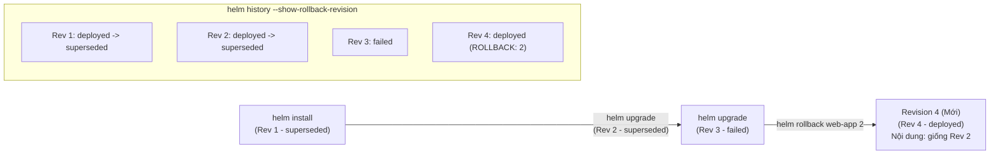
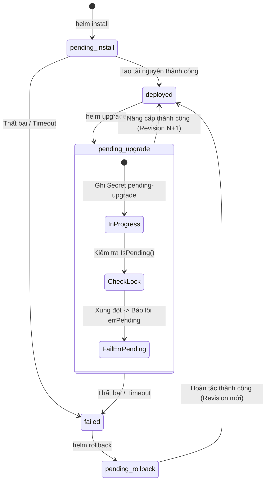

# 6_5_5 Release Lifecycle

> **Khóa học**: Cloud DevOps Basic — Containers & Kubernetes  
> **Phân nhóm**: 6 Domain 6 - Containers and Kubernetes › 6_5 Helm Package Management  
> **Chủ đề**: 6_5_5 Release Lifecycle  
> **Phiên bản áp dụng**: Kubernetes 1.37, Helm 4.x / Helm 3.x, Podman 5.x  
> **Trạng thái**: Verified (WRITE-CTR-6_5_5)  
> **Phạm vi**: [Topic README](./README.md#6_5_5-vòng-đời-release) · **Checkpoint của người học**: [CHECKLIST](../../CHECKLIST.md#6_5-helm-package-management)  
> **Kiến thức liên quan**: [6_3_4 ReplicaSets and Deployments](<../6_3 Kubernetes Architecture and Core Workloads/6_3_4 ReplicaSets and Deployments.md>) · [6_8_2 Common Failure Catalog](<../6_8 Kubernetes Observability and Troubleshooting/README.md#6_8_2-danh-mục-lỗi-thường-gặp>)  

---

## 0. Tình Huống Mở Đầu: Pipeline Deploy Đột Nhiên Fail Mãi Mãi

Khi cập nhật ứng dụng Kubernetes trên production, xóa đi cài lại sẽ gây sập dịch vụ (downtime); sửa tay bằng `kubectl edit` sẽ làm trôi dạt cấu hình (config drift) và mất dấu vết lịch sử.

Để tự động hóa, kỹ sư DevOps dùng pipeline CI/CD chạy `helm upgrade --install`. Nhưng nếu runner CI bị kill hoặc timeout giữa chừng, mọi lần deploy tiếp theo đều thất bại với lỗi: <!-- ev: R5.14 R5.15 -->

```text
another operation (install/upgrade/rollback) is in progress
```

Nguyên nhân: thao tác bị cắt ngang để lại Secret của release ở trạng thái `pending-upgrade`, kích hoạt **khóa bi quan (pessimistic lock)** từ chối mọi thao tác sau. <!-- ev: R5.10 R5.13 R5.14 R5.15 -->

Để làm chủ việc triển khai, bạn cần hiểu rõ **máy trạng thái của release** (`deployed`, `superseded`, `failed`, `pending-*`) và vòng đời bản phát hành theo từng revision bất biến. <!-- ev: R5.2 R5.10 R5.11 R5.12 R5.13 -->

---

## 1. Khái Niệm Cốt Lõi & Bản Chất Kỹ Thuật (Core Concepts & Technical Deep Dive)

Vòng đời bản phát hành kiểm soát toàn bộ chu kỳ ứng dụng từ khởi tạo, nâng cấp đến khôi phục.

### 1.1 Bộ Lệnh Quản Trị Vòng Đời Release

Quản lý release trong Helm gồm các lệnh CLI chuẩn mực: <!-- ev: R5.1 R5.3 R5.4 R5.5 R5.6 R5.9 -->

- **Khởi tạo (`helm install`)**: Lệnh `helm install` cài đặt một chart archive lên Kubernetes cluster, tạo ra release mới và khởi tạo Revision 1. <!-- ev: R5.1 R5.2 -->
- **Nâng cấp (`helm upgrade`)**: Khi có phiên bản chart mới hoặc cần thay đổi cấu hình, ta dùng `helm upgrade`. <!-- ev: R5.4 --> Helm tiếp nhận release hiện có và thực hiện nâng cấp xâm lấn tối thiểu (least invasive upgrade), chỉ cập nhật những gì thay đổi kể từ release trước đó để tránh downtime. <!-- ev: R5.3 -->
- **CI/CD lũy đẳng (`helm upgrade --install`)**: Cờ `-i, --install` mang tính lũy đẳng (idempotent): cài mới nếu chưa có, nâng cấp nếu đã có. <!-- ev: R5.5 --> Cờ `--create-namespace` tự động tạo namespace đích nếu chưa có. <!-- ev: R5.6 -->
- **Lịch sử (`helm history`)**: Cú pháp `helm history RELEASE_NAME` in ra các revision, với cờ `--max` cấu hình số revision tối đa hiển thị (mặc định 256). <!-- ev: R5.9 -->

### 1.2 Cơ Chế Revision Tăng Dần & Bản Chất Rollback Không Xóa Lịch Sử

Lịch sử phát hành tuân thủ nguyên lý bất biến: <!-- ev: R5.2 -->

- **Revision tăng tuần tự (Incremental Revision)**: Mỗi lần `install`, `upgrade` hoặc `rollback`, số revision luôn tăng thêm 1 chứ không ghi đè lịch sử (bắt đầu từ 1). <!-- ev: R5.2 -->
- **Khôi phục (`helm rollback`)**: Cú pháp `helm rollback <RELEASE> [REVISION] [flags]`. Bỏ qua revision hoặc đặt bằng 0 sẽ rollback về release liền trước. <!-- ev: R5.7 -->
- **Bản chất rollback**: Helm không xóa revision lỗi mà tạo ra Revision mới mang cấu hình của revision cũ (ví dụ: từ rev 3 rollback về rev 1 sẽ sinh ra Revision 4). <!-- ev: R5.2 R5.7 -->
- **Cờ `--show-rollback-revision`**: Khi xem `helm history`, cờ `--show-rollback-revision` thêm cột `ROLLBACK` hiển thị revision nguồn gốc của thao tác rollback. <!-- ev: R5.8 -->

### 1.3 Máy Trạng Thái Release (Release State Machine)

Trạng thái release báo cáo qua `helm status` gồm: `unknown`, `deployed`, `uninstalled`, `superseded`, `failed`, `uninstalling`, `pending-install`, `pending-upgrade`, hoặc `pending-rollback`. <!-- ev: R5.10 -->

- **`deployed`**: Release đã áp dụng thành công lên Kubernetes cluster. <!-- ev: R5.11 -->
- **`superseded`**: Revision cũ đã lỗi thời và bị thay thế bởi revision mới hơn. <!-- ev: R5.12 -->
- **Trạng thái chuyển tiếp**: `pending-install`, `pending-upgrade`, `pending-rollback`. Hàm nội bộ `IsPending()` xác định xem release có đang trong trạng thái chuyển tiếp hay không. <!-- ev: R5.13 -->

### 1.4 Khóa Bi Quan (Pessimistic Lock) & Deadlock CI/CD

Để chống xung đột khi nhiều tiến trình chạy đồng thời, Helm dùng cơ chế khóa bi quan: <!-- ev: R5.14 R5.15 -->

- **Khóa qua `errPending`**: Biến `errPending` đại diện cho khóa hoạt động với thông báo: `another operation (install/upgrade/rollback) is in progress`. <!-- ev: R5.14 -->
- **Xung đột & Deadlock**: Lệnh `helm upgrade` đồng thời đóng vai trò khóa bi quan và thất bại ngay với `errPending` nếu revision gần nhất đang ở pending (`if lastRelease.Info.Status.IsPending()`). <!-- ev: R5.15 --> Khi job CI bị hủy ngang, Secret metadata bị kẹt ở `pending-upgrade`, khóa cứng mọi đợt deploy tiếp theo. <!-- ev: R5.10 R5.13 R5.14 R5.15 -->

### 1.5 Điều Khiển Triển Khai: `--wait`, `--timeout`, `--rollback-on-failure` & Cờ Helm 4

Cờ điều khiển đảm bảo việc triển khai an toàn và tự phục hồi: <!-- ev: R5.16 R5.17 R5.18 R5.19 -->

- **`--wait`**: Chờ toàn bộ tài nguyên sẵn sàng (ready) tối đa trong thời gian `--timeout`. Dùng `--wait` đơn lẻ áp dụng chiến lược mặc định là `watcher`. <!-- ev: R5.16 -->
- **`--timeout`**: Thời gian tối đa chờ các thao tác Kubernetes hoàn tất, mặc định là `5m0s`. <!-- ev: R5.17 -->
- **`--rollback-on-failure`**: Tự động rollback về release thành công trước đó khi nâng cấp lỗi, đồng thời tự đặt `--wait` sang `watcher`. <!-- ev: R5.18 -->
- **Cờ Helm 4**: Helm 4 đổi tên `--atomic` thành `--rollback-on-failure`, và `--force` thành `--force-replace` (cờ cũ vẫn dùng được kèm cảnh báo deprecated). <!-- ev: R5.19 -->

### 1.6 Xử Lý Drift Cấu Hình: 3-Way Merge vs Server-Side Apply

Khi cluster bị sửa ngoài luồng (như qua `kubectl edit` hoặc do HPA tự đổi replicas): <!-- ev: R5.20 R5.21 -->

- **Three-Way Merge (Helm 3)**: Khi nâng cấp, Three-Way Strategic Merge Patch đánh giá đồng thời manifest cũ, live state trên cluster và manifest mới, giúp không làm mất các thay đổi ngoài luồng. <!-- ev: R5.20 -->
- **Server-Side Apply (Helm 4)**: Helm 4 mặc định sử dụng Server-Side Apply (SSA) khi cài đặt chart mới, tối ưu hóa phân giải xung đột trường trực tiếp tại Kubernetes API Server. <!-- ev: R5.21 -->

> [!TIP]
> **Quan sát Drift như `terraform plan` bằng plugin `helm-diff`**:  
> Helm mặc định không có lệnh `plan`. Cộng đồng Kubernetes sử dụng plugin `helm-diff` để xem trước các thay đổi dạng diff trước khi thực hiện `helm upgrade`. Mặc định, `helm diff upgrade <release> <chart>` chỉ so sánh manifest của release đã triển khai gần nhất với manifest render từ chart mới; để kiểm tra drift với tài nguyên đang chạy thực tế trên cluster theo cơ chế three-way merge, cần thêm cờ `--three-way-merge` (hoặc đặt `HELM_DIFF_THREE_WAY_MERGE=true`). <!-- ev: R5.22 -->

---

## 2. Ví Dụ Đời Sống Thực Tế Dễ Hiểu (Intuitive Real-World Analogies)

Vòng đời Release của Helm giống như **Tòa nhà văn phòng và Sổ hồng quản lý bảo trì**:

```
[Bàn giao nhà]               [Sửa tầng 2]                 [Sự cố chập điện]
helm install                 helm upgrade                 helm rollback
      │                            │                            │
      ▼                            ▼                            ▼
Sổ hồng: Revision 1         Phụ lục: Revision 2          Phụ lục: Revision 3
(Móng, điện ban đầu)        (Chỉ sửa 3 phòng họp)        (Khôi phục theo mẫu Revision 1)
```

1. **Bàn giao ban đầu (`helm install`)**: Cơ quan quản lý cấp cuốn Sổ hồng đầu tiên (**Revision 1**), ghi nhận kết cấu móng và sơ đồ cấp điện nước ban đầu.
2. **Nâng cấp từng tầng (`helm upgrade`)**: Bạn cần ngăn thêm 3 phòng họp ở tầng 2. Đội thợ không đập bỏ tòa nhà, mà chỉ sửa đúng 3 phòng theo bản vẽ mới. Cơ quan quản lý ghi thêm một trang phụ lục: **Revision 2**.
3. **Bảo trì tự động (`helm upgrade --install`)**: Đơn vị bảo trì tự kiểm tra: nếu tòa nhà chưa có hồ sơ thì cấp mới, nếu đã có thì làm thủ tục sửa chữa phụ lục.
4. **Hoàn tác an toàn (`helm rollback`)**: Đèn ở Revision 2 bị chập. Bạn yêu cầu khôi phục cách bài trí an toàn của Revision 1. Đội quản lý viết tiếp trang **Revision 3**: *"Khôi phục theo nguyên mẫu trang Revision 1"*. Lịch sử không bị mất!
5. **Khóa thi công dở dang (`pending-upgrade`)**: Thợ đang sửa dở thì mất điện, cửa bị dán biển niêm phong thi công dở dang. Đội thợ sau tới thấy biển báo liền dừng lại: *"Công trình đang có thao tác dở dang, không được vào!"* (`another operation is in progress`). Bạn phải gỡ biển niêm phong thì thợ mới vào được.

---

## 3. Kiến Trúc, Luồng Hoạt Động & Hình Ảnh Trực Quan (Architecture, Diagrams & Visual Media)

### 3.1 Dòng Thời Gian Revision Bất Biến (Revision Timeline)

Sơ đồ thể hiện chuỗi revision tăng dần qua từng thao tác, và lệnh rollback tạo revision mới: <!-- ev: R5.1 R5.2 R5.3 R5.7 R5.8 R5.11 R5.12 -->

<!-- ev: R5.1 R5.2 R5.3 R5.7 R5.8 R5.11 R5.12 -->


### 3.2 Máy Trạng Thái Release & Khóa Bi Quan Pessimistic Lock

<!-- ev: R5.10 R5.11 R5.12 R5.13 R5.14 R5.15 -->


---

## 4. Code Mẫu Trực Quan Hoặc Dòng Lệnh Thực Chiến (Runnable Sample Code / CLI)

Toàn bộ các ví dụ dưới đây chạy được trên môi trường Kubernetes với Helm 3 hoặc Helm 4.

### 4.1 Triển Khai Idempotent An Toàn Trong CI/CD

Trong pipeline CI/CD, sử dụng `helm upgrade --install` kết hợp các cờ bảo vệ: <!-- ev: R5.5 R5.6 R5.16 R5.17 R5.18 R5.19 -->

<!-- ev: R5.5 R5.6 R5.16 R5.17 R5.18 R5.19 -->
```bash
# Lệnh chuẩn CI/CD: Cài mới nếu chưa có, nâng cấp nếu đã có
# Tự động rollback nếu sau 3 phút Pod không đạt Ready
helm upgrade --install web-store ./my-web-chart \
  --namespace production \
  --create-namespace \
  --set image.tag="v1.1.0" \
  --set replicaCount=4 \
  --wait \
  --timeout 3m0s \
  --rollback-on-failure
```

<!-- ev: R5.2 R5.9 R5.11 R5.12 -->
Quan sát trạng thái và lịch sử revision:
```bash
# Kiểm tra trạng thái hiện tại của release
helm status web-store -n production

# Xem lịch sử các revision đã phát hành
helm history web-store -n production
```

<!-- ev: R5.2 R5.11 R5.12 -->
Đầu ra hiển thị revision tăng tuần tự:
```text
REVISION  UPDATED                   STATUS      CHART               APP VERSION  DESCRIPTION
1         Wed Nov 20 10:00:00 2026  superseded  my-web-chart-0.1.0  1.0.0        Install complete
2         Wed Nov 20 10:05:00 2026  deployed    my-web-chart-0.1.0  1.1.0        Upgrade complete
```

### 4.2 Giám Sát, Tra Cứu & Rollback Thủ Công

Khi phát hiện phiên bản tại Revision 2 gây lỗi, thực hiện rollback về Revision 1: <!-- ev: R5.7 R5.8 -->

<!-- ev: R5.7 R5.8 -->
```bash
# 1. Khôi phục release về cấu hình của revision 1
helm rollback web-store 1 -n production

# 2. Kiểm tra lịch sử với cờ --show-rollback-revision
helm history web-store -n production --show-rollback-revision
```

<!-- ev: R5.2 R5.7 R5.8 -->
Đầu ra hiển thị Revision 3 mới được tạo ra:
```text
REVISION  UPDATED                   STATUS      CHART               APP VERSION  DESCRIPTION       ROLLBACK
1         Wed Nov 20 10:00:00 2026  superseded  my-web-chart-0.1.0  1.0.0        Install complete  
2         Wed Nov 20 10:05:00 2026  superseded  my-web-chart-0.1.0  1.1.0        Upgrade complete  
3         Wed Nov 20 10:10:00 2026  deployed    my-web-chart-0.1.0  1.0.0        Rollback to 1     1
```

### 4.3 Giải Cứu Khóa Bi Quan Kẹt `pending-upgrade` Khi CI Bị Hủy Ngang

Khi job CI bị hủy đột ngột, release bị kẹt ở `pending-upgrade`, sinh ra lỗi: <!-- ev: R5.10 R5.14 R5.15 -->
`Error: UPGRADE FAILED: another operation (install/upgrade/rollback) is in progress` <!-- ev: R5.14 -->

<!-- ev: R5.10 R5.13 R5.14 R5.15 -->
Quy trình gỡ khóa bi quan thực chiến:
```bash
# Bước 1: Liệt kê các Secret lưu metadata của Helm trong namespace
kubectl get secrets -n production -l owner=helm
# sh.helm.release.v1.web-store.v1   helm.sh/release.v1   1   15m
# sh.helm.release.v1.web-store.v2   helm.sh/release.v1   1   10m
# sh.helm.release.v1.web-store.v3   helm.sh/release.v1   1   1m  <-- Kẹt pending

# Bước 2: Xóa Secret của revision bị kẹt dở dang
kubectl delete secret sh.helm.release.v1.web-store.v3 -n production

# Bước 3: Chạy lại lệnh deploy trong pipeline bình thường
helm upgrade --install web-store ./my-web-chart -n production
```

---

## 5. Cạm Bẫy Thực Tế & Thực Tiễn Sản Xuất (Production Gotchas & Best Practices)

### 5.1 Cạm Bẫy 1: Chạy `helm upgrade` Không `--wait` Và `--rollback-on-failure`

- **Vấn đề**: Không có `--wait`, Helm báo thành công ngay khi manifest vừa gửi đi. Nếu sau đó Pod bị `CrashLoopBackOff`, pipeline vẫn báo xanh giả tạo. <!-- ev: R5.16 -->
- **Thực tiễn tốt nhất**: Luôn kết hợp `--wait`, `--timeout 5m0s` và `--rollback-on-failure` (hoặc `--atomic` trên Helm 3). <!-- ev: R5.16 R5.17 R5.18 R5.19 -->

### 5.2 Cạm Bẫy 2: Deadlock Pipeline Khi Job CI Bị Hủy Kẹt `pending-upgrade`

- **Vấn đề**: Nhiều commit chạy đồng thời hoặc runner bị ngắt ngang làm release kẹt ở pending và khóa cứng pipeline bởi `errPending`. <!-- ev: R5.14 R5.15 -->
- **Thực tiễn tốt nhất**: Cấu hình concurrency giới hạn 1 job deploy tại một thời điểm cho mỗi namespace. <!-- ev: R5.15 -->

### 5.3 Cạm Bẫy 3: Xung Đột Cấu Hình Drift Do Can Thiệp Bằng `kubectl edit`

- **Vấn đề**: Sửa tay bằng `kubectl edit` tạo ra sự trôi dạt cấu hình so với Git repo. <!-- ev: R5.20 -->
- **Thực tiễn tốt nhất**: Tận dụng Three-Way Merge (Helm 3) và SSA (Helm 4) để bảo toàn điều chỉnh tự động từ controller (như HPA). <!-- ev: R5.20 R5.21 -->

### 5.4 Cạm Bẫy 4: Lạm Dụng Cờ `--force-replace` Gây Gián Đoạn Dịch Vụ

- **Vấn đề**: Cờ `--force-replace` (trước đây là `--force`) ép xóa đi tạo lại tài nguyên thay vì rolling update, có nguy cơ gây đứt kết nối. <!-- ev: R5.19 -->
- **Thực tiễn tốt nhất**: Chỉ dùng khi cần sửa các trường bất biến (immutable) của Kubernetes. <!-- ev: R5.19 R5.20 -->

---

## 6. Câu Hỏi Củng Cố Kiến Thức (Active Recall Quiz)

### Câu Hỏi 1: Giải Thích Lỗi Khóa Bi Quan Khi Release Kẹt Pending (Phỏng vấn)
Khi pipeline deploy báo lỗi `another operation (install/upgrade/rollback) is in progress`, bản chất lỗi là gì và xử lý thế nào?

<details>
<summary>👉 Xem đáp án & giải thích kỹ thuật</summary>

Thao tác trước đó bị hủy ngang khiến Secret metadata của revision gần nhất bị kẹt ở trạng thái `pending-*` <!-- ev: R5.10 R5.13 -->. Helm coi đây là khóa bi quan và hàm `IsPending()` sẽ chặn mọi thao tác tiếp theo bằng `errPending` <!-- ev: R5.14 R5.15 -->. Cách giải cứu: xóa Secret của revision bị kẹt (`kubectl delete secret sh.helm.release.v1.<NAME>.v<REV> -n <NAMESPACE>`), sau đó deploy lại.
</details>

---

### Câu Hỏi 2: Bản Chất Thao Tác Rollback Và Quản Lý Số Revision
Khi ứng dụng đang ở Revision 4 và bạn chạy `helm rollback <RELEASE> 2`, số revision mới nhất sẽ là bao nhiêu? Cờ nào giúp tra nguồn gốc?

<details>
<summary>👉 Xem đáp án & giải thích kỹ thuật</summary>

Số revision mới nhất sẽ là **Revision 5** <!-- ev: R5.2 -->. Rollback không xóa lịch sử và không lùi số thứ tự, mà tạo Revision mới mang cấu hình của revision mục tiêu <!-- ev: R5.2 R5.7 -->. Cờ `--show-rollback-revision` khi dùng với `helm history` sẽ thêm cột `ROLLBACK` hiển thị số revision nguồn gốc (ở đây là số `2`) <!-- ev: R5.8 -->.
</details>

---

### Câu Hỏi 3: Khác Biệt Giữa Three-Way Merge (Helm 3) Và SSA (Helm 4) Khi Drift
Tại sao Three-Way Merge của Helm 3 và SSA của Helm 4 lại quan trọng khi cluster xuất hiện cấu hình trôi dạt (config drift)?

<details>
<summary>👉 Xem đáp án & giải thích kỹ thuật</summary>

Three-Way Merge trong Helm 3 so sánh 3 nguồn: manifest cũ, live state trên cluster và manifest mới, giúp không ghi đè mất các trường do controller (như HPA) tự điều chỉnh <!-- ev: R5.20 -->. Trong khi đó, Helm 4 mặc định sử dụng Server-Side Apply (SSA), quản lý quyền sở hữu trường trực tiếp tại Kubernetes API Server, giúp giải quyết xung đột cấu hình minh bạch hơn <!-- ev: R5.21 -->.
</details>

---

## 7. 📚 Nguồn Tài Liệu Chính Thống (Tier-1 Official References)

- [Helm CLI: helm install](https://helm.sh/docs/helm/helm_install/) - Tài liệu chính thức về cú pháp và cách khởi tạo chart archive của lệnh `helm install`.
- [Helm CLI: helm upgrade](https://helm.sh/docs/helm/helm_upgrade/) - Tài liệu chính thức về nâng cấp bản phát hành, các cờ `--install`, `--wait`, `--timeout`, `--rollback-on-failure`.
- [Helm CLI: helm rollback](https://helm.sh/docs/helm/helm_rollback/) - Tài liệu chính thức về hoàn tác bản phát hành về revision trước đó.
- [Helm CLI: helm history](https://helm.sh/docs/helm/helm_history/) - Tài liệu chính thức về tra cứu lịch sử revision và cờ `--show-rollback-revision`.
- [Helm CLI: helm status](https://helm.sh/docs/helm/helm_status/) - Tài liệu chính thức về hiển thị trạng thái release và danh sách các trạng thái hợp lệ.
- [Using Helm: Upgrading a Release and Recovering on Failure](https://helm.sh/docs/intro/using_helm/#helm-upgrade-and-helm-rollback-upgrading-a-release-and-recovering-on-failure) - Hướng dẫn chính thức về cơ chế revision tăng dần và chiến lược phục hồi sự cố.
- [Helm 4 Overview: Server-Side Apply & CLI Flags Renamed](https://helm.sh/docs/overview/) - Tài liệu chính thức của Helm 4 về việc đổi tên cờ `--atomic`, `--force` và mặc định Server-Side Apply (SSA).
- [Changes Since Helm 2: 3-way Strategic Merge Patches](https://helm.sh/docs/faq/changes_since_helm2/#improved-upgrade-strategy-3-way-strategic-merge-patches) - Giải thích chi tiết về Three-Way Strategic Merge Patch trong Helm 3 khi xử lý config drift.
- [Helm GitHub Source: Action SDK & Release Status](https://raw.githubusercontent.com/helm/helm/main/pkg/release/common/status.go) - Mã nguồn định nghĩa trạng thái release, phương thức `IsPending()` và khóa bi quan `errPending`.
