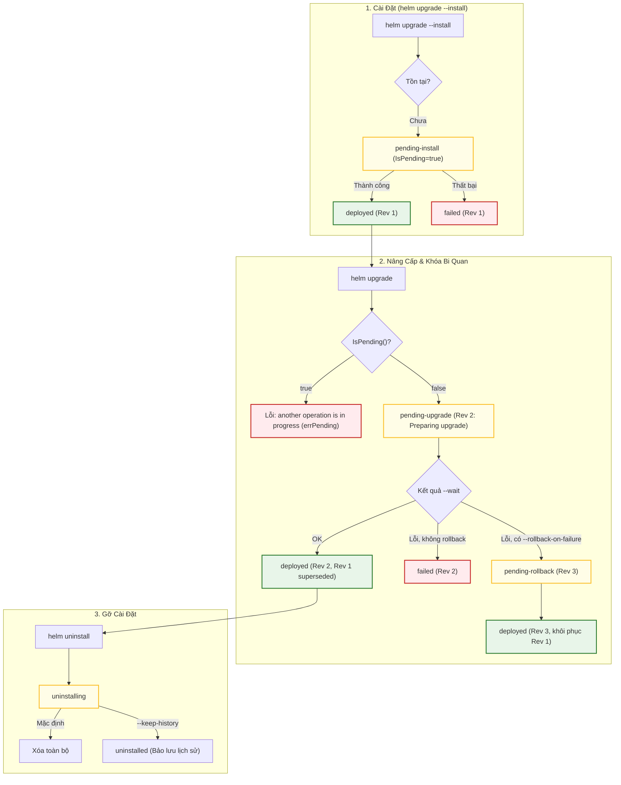

# 6_5_5 Release Lifecycle

> **Khóa học**: Cloud DevOps Basic — Containers & Kubernetes  
> **Phân nhóm**: 6 Domain 6 - Containers and Kubernetes › 6_5 Helm Package Management  
> **Chủ đề**: 6_5_5 Release Lifecycle  
> **Phiên bản áp dụng**: Kubernetes 1.37, Helm 4.x / Helm 3.x, Podman 5.x  
> **Trạng thái**: Verified (WRITE-CTR-6_5_5, 16-11-2026)  
> **Phạm vi**: [Topic README](./README.md#6_5_5-vòng-đời-release) · **Checkpoint của người học**: [CHECKLIST](../../CHECKLIST.md#6_5-helm-package-management)  
> **Kiến thức liên quan**: [6_3_4 ReplicaSets and Deployments](<../6_3 Kubernetes Architecture and Core Workloads/6_3_4 ReplicaSets and Deployments.md>) · [6_8_2 Common Failure Catalog](<../6_8 Kubernetes Observability and Troubleshooting/README.md#6_8_2-danh-mục-lỗi-thường-gặp>)  

---

## 0. Tình Huống Mở Đầu: Pipeline Deploy Đột Nhiên Fail Mãi Mãi

Bạn deploy bằng CI: `helm upgrade --install ...`. Một đêm runner bị kill giữa chừng (hoặc job hết timeout). Sáng hôm sau mọi lần deploy đều thất bại với đúng một thông báo: <!-- ev: R1.73 R1.74 R2.90 R2.91 -->

```text
another operation (install/upgrade/rollback) is in progress
```

Code không lỗi, cluster không lỗi. Nguyên nhân: lần upgrade bị cắt ngang để lại Secret của release ở trạng thái `pending-upgrade`, và Helm coi đó là **khóa bi quan**: thấy trạng thái gần nhất đang pending thì từ chối mọi thao tác sau. <!-- ev: R1.73 R1.74 R2.90 R2.91 -->

Đây là lý do bài này không chỉ liệt kê lệnh. Bạn cần hiểu **máy trạng thái của release** (`deployed`, `superseded`, `failed`, `pending-*`...), vì mỗi lần `install`, `upgrade`, `rollback` đều tạo một revision mới, và trạng thái của revision gần nhất quyết định bạn được làm gì tiếp. <!-- ev: R1.76 R2.78 --> Cách giải cứu nằm ở mục 4.3.

---

## 1. Khái Niệm Cốt Lõi & Bản Chất Kỹ Thuật (Core Concepts & Technical Deep Dive)

Quản trị vòng đời Release (Release Lifecycle) kiểm soát toàn bộ chu kỳ ứng dụng trên Kubernetes từ cài đặt, nâng cấp, kiểm tra, khôi phục đến gỡ bỏ tài nguyên. <!-- ev: R1.76 R2.69 R2.71 R2.73 R2.77 -->

### 1.1 Bộ Lệnh Quản Trị Vòng Đời Release

Quản lý release trong Helm gồm các lệnh CLI chuẩn: <!-- ev: R2.69 R2.70 R2.71 R2.73 R2.75 R2.77 R2.79 R2.87 -->

- **`helm upgrade --install`**: Cú pháp `helm upgrade [RELEASE] [CHART] [flags]`. Cờ `-i`/`--install` kích hoạt tính idempotent (cài mới nếu release chưa có); cờ `--create-namespace` tự động tạo namespace nếu chưa có. <!-- ev: R2.69 R2.70 R2.87 -->
- **Tra cứu & kiểm tra**: Cú pháp `helm status RELEASE_NAME [flags]` hiển thị trạng thái; `helm get manifest RELEASE_NAME [flags]` tải manifest đã render. <!-- ev: R2.77 R2.79 -->
- **Lịch sử & gỡ bỏ**: Cú pháp `helm history RELEASE_NAME [flags]` in revision (cờ `--max` mặc định 256); cú pháp `helm uninstall RELEASE_NAME [...] [flags]` gỡ bỏ release (cờ `--keep-history` xóa tài nguyên nhưng giữ lịch sử). <!-- ev: R2.73 R2.74 R2.75 R2.76 -->

### 1.2 Cơ Chế Revision Tăng Dần & Bản Chất Rollback Không Xóa Lịch Sử

Lịch sử phát hành tuân theo nguyên lý bất biến: <!-- ev: R1.76 -->

- **Revision tăng tuần tự (Incremental Revision)**: Mỗi lần `install`, `upgrade` hoặc `rollback`, số revision luôn tăng thêm 1 chứ không ghi đè lịch sử (bắt đầu từ 1). <!-- ev: R1.76 -->
- **Khôi phục bản phát hành (`helm rollback`)**: Cú pháp `helm rollback <RELEASE> [REVISION] [flags]` (bỏ qua revision hoặc bằng 0 sẽ về revision liền trước). Rollback không xóa lịch sử mà tạo revision mới; cờ `--show-rollback-revision` trên `helm history` thêm cột `ROLLBACK` hiển thị revision nguồn gốc. <!-- ev: R1.76 R1.77 R2.71 R2.72 -->

### 1.3 Máy Trạng Thái Release (Release State Machine)

Trạng thái release báo cáo qua `helm status` gồm: `unknown`, `deployed`, `uninstalled`, `superseded`, `failed`, `uninstalling`, `pending-install`, `pending-upgrade`, `pending-rollback`. <!-- ev: R2.78 -->

<!-- ev: R1.65 R1.66 R1.67 R1.68 R1.69 R1.70 R1.71 R1.72 R1.75 -->
- **Trạng thái ổn định & kết thúc**: `deployed` (thành công trên cụm), `uninstalled` (đã gỡ bỏ), `superseded` (thay thế bởi revision mới), `failed` (thất bại). <!-- ev: R1.65 R1.66 R1.67 R1.68 -->
- **Trạng thái chuyển tiếp**: `pending-install`, `pending-upgrade`, `pending-rollback`. Hàm `IsPending()` trả về `true` cho các trạng thái này. Khi upgrade bắt đầu, trạng thái gán `pending-upgrade` kèm mô tả `Preparing upgrade`. <!-- ev: R1.69 R1.70 R1.71 R1.72 R1.75 -->

### 1.4 Khóa Bi Quan (Pessimistic Lock) & Deadlock CI/CD

Để ngăn xung đột khi nhiều tiến trình chạy đồng thời, Helm dùng cơ chế khóa bi quan: <!-- ev: R1.73 R1.74 R2.90 R2.91 -->

- **Cơ chế khóa bi quan qua `errPending`**: Lỗi `errPending` đại diện cho khóa release đang hoạt động; chuỗi lỗi chính xác là: `another operation (install/upgrade/rollback) is in progress`. <!-- ev: R1.73 R2.90 -->
- **Xung đột & Deadlock**: Lệnh `helm upgrade` đồng thời đóng vai trò khóa bi quan và thất bại ngay với `errPending` nếu trạng thái release gần nhất đang ở pending (`if lastRelease.Info.Status.IsPending()`). Khi job CI bị ngắt đột ngột (runner bị kill, timeout), Secret bị bỏ lại ở `pending-upgrade`, khóa cứng mọi đợt deploy sau. <!-- ev: R1.74 R2.90 R2.91 -->

### 1.5 Điều Khiển Triển Khai: `--wait`, `--timeout`, `--rollback-on-failure` & Cờ Helm 4

<!-- ev: R2.80 R2.81 R2.82 R2.83 R2.84 R2.85 R2.86 -->
- **Chờ sẵn sàng & Timeout**: Cờ `--wait WaitStrategy[=watcher]` chờ tài nguyên sẵn sàng tối đa trong `--timeout` (`5m0s` mặc định). Dùng `--wait` đơn lẻ áp dụng chiến lược `watcher`; các chiến lược gồm `watcher`, `hookOnly`, `legacy` (bỏ qua cờ mặc định là `hookOnly`). <!-- ev: R2.80 R2.81 -->
- **Tự động phục hồi & Cờ Helm 4**: Cờ `--rollback-on-failure` tự động rollback về bản thành công trước đó khi lỗi (tự đặt `--wait` sang `watcher`). Helm 4 đổi tên `--atomic` thành `--rollback-on-failure` và `--force` thành `--force-replace` (ép cập nhật bằng thay thế); cờ cũ giữ lại kèm cảnh báo deprecated. <!-- ev: R2.82 R2.83 R2.84 R2.85 R2.86 -->

### 1.6 Xử Lý Drift Cấu Hình: 3-Way Merge vs Server-Side Apply

Khi cấu hình trên cụm bị sửa ngoài luồng (như qua `kubectl edit`), drift phát sinh: <!-- ev: R1.78 R1.79 R1.80 R2.88 R2.89 -->

- **Three-Way Merge (Helm 3)**: Đánh giá đồng thời manifest cũ, live state trên cụm và manifest mới. Trong Helm 2, thay đổi ngoài luồng bị bỏ qua khi rollback do không đánh giá live state. <!-- ev: R1.78 R1.79 -->
- **Server-Side Apply (Helm 4)**: Mặc định SSA cho chart mới, tối ưu hóa phân giải xung đột khi nhiều controller cùng quản lý tài nguyên. Khi upgrade/rollback, Helm tuân theo phương thức áp dụng đã chốt (latched) trước đó. <!-- ev: R1.80 R2.88 -->

---

## 2. Ví Dụ Đời Sống Thực Tế Dễ Hiểu (Intuitive Real-World Analogies)

Hãy liên tưởng vòng đời Release như **Cuốn sổ công chứng bất động sản**:

- **Nâng cấp (Upgrade) là trang sổ mới (Revision N+1)**: Khi bạn sửa đổi điều khoản, công chứng viên lật sang trang số 2 ghi toàn bộ điều khoản mới, giữ nguyên trang 1 bất biến.
- **Rollback không xé trang, mà mở trang mới khôi phục (Revision N+2)**: Khi cần quay về điều khoản cũ, công chứng viên mở trang số 3 sao chép nguyên văn điều khoản từ trang số 1 sang và ghi chú mục tiêu khôi phục (tương tự cờ `--show-rollback-revision`).
- **Người nộp hồ sơ bỏ chạy gây kẹt khóa (`pending lock`)**: Khi công chứng viên vừa ghi *"Đang xử lý dở dang"* (`pending-upgrade`, `Preparing upgrade`), người nộp hồ sơ bỏ chạy (job CI bị hủy). Cuốn sổ rơi vào khóa thẩm định (`errPending`), từ chối người sau (`another operation in progress`). Chỉ khi công chứng viên trưởng hủy giao dịch cũ (xóa Secret pending), sổ mới mở lại.

---

## 3. Kiến Trúc, Luồng Hoạt Động & Hình Ảnh Trực Quan (Architecture, Diagrams & Visual Media)

<!-- ev: R1.72 R1.74 R2.78 R2.90 -->
Sơ đồ máy trạng thái minh họa chu trình chuyển dịch trạng thái release, cơ chế khóa bi quan và luồng tự động rollback:



---

## 4. Code Mẫu Trực Quan Hoặc Dòng Lệnh Thực Chiến (Runnable Sample Code / CLI)

> ⚠️ Chưa chạy thử (not executed by the squad)  
> ⚠️ Chỉ chạy trên cluster thử nghiệm (lab cluster only)  
> **Môi trường**: Kubernetes 1.37, Helm 4.x / Helm 3.x, Podman 5.x. Thực hành chi tiết tại bài lab [lab-6_5_3-upgrade-rollback-and-failure](./README.md#lab-6_5_3-upgrade-rollback-and-failure).

### 4.1 Triển Khai Idempotent An Toàn Trong CI/CD

<!-- ev: R2.69 R2.70 R2.80 R2.81 R2.82 R2.83 R2.87 -->
Lệnh nâng cấp kết hợp cài đặt chuẩn mực cho pipeline CI/CD: <!-- ev: R2.69 R2.70 R2.82 -->

<!-- ev: R2.69 R2.70 R2.80 R2.81 R2.82 R2.83 R2.87 -->
```bash
# Helm 4: --rollback-on-failure (Helm 3: thay bằng --atomic)
helm upgrade --install my-service ./charts/my-service \
  -n production \
  --create-namespace \
  --wait \
  --timeout 5m0s \
  --rollback-on-failure
```

### 4.2 Giám Sát, Tra Cứu & Rollback Thủ Công

<!-- ev: R1.76 R1.77 R2.71 R2.72 R2.73 R2.74 R2.75 R2.76 R2.77 R2.79 R2.80 R2.81 -->
Giám sát trạng thái, truy vết revision và khôi phục khi phát sinh sự cố: <!-- ev: R1.76 R2.71 R2.75 R2.77 R2.79 -->

<!-- ev: R1.76 R1.77 R2.71 R2.72 R2.73 R2.74 R2.75 R2.76 R2.77 R2.79 R2.80 R2.81 -->
```bash
# Tra cứu trạng thái và manifest
helm status my-service -n production
helm get manifest my-service -n production > current-manifest.yaml

# Lịch sử revision (tối đa 50 bản ghi kèm cột ROLLBACK)
helm history my-service -n production --max 50 --show-rollback-revision

# Rollback về Revision 1 (chờ 3m) và gỡ cài đặt giữ lịch sử
helm rollback my-service 1 -n production --wait --timeout 3m0s
helm uninstall my-service -n production --keep-history
```

### 4.3 Giải Cứu Khóa Bi Quan Kẹt `pending-upgrade` Khi CI Bị Hủy Ngang

<!-- ev: R1.70 R1.73 R1.74 R2.77 R2.90 R2.91 -->
Quy trình giải phóng release khi pipeline báo lỗi `another operation (install/upgrade/rollback) is in progress`: <!-- ev: R2.90 -->

<!-- ev: R1.70 R1.74 R2.77 R2.90 R2.91 -->
```bash
# 1. Xác nhận release kẹt pending-upgrade
helm status my-service -n production

# 2. Liệt kê các Secret do Helm quản lý trong namespace
kubectl get secrets -n production -l "owner=helm"

# 3. Xóa Secret của revision pending đang bị kẹt để giải phóng pessimistic lock
kubectl delete secret sh.helm.release.v1.my-service.v3 -n production

# 4. Kích hoạt lại deploy CI/CD bình thường
helm upgrade --install my-service ./charts/my-service -n production --wait --rollback-on-failure
```

---

## 5. Cạm Bẫy Thực Tế & Thực Tiễn Sản Xuất (Production Gotchas & Best Practices)

### 5.1 Cạm Bẫy 1: Chạy `helm upgrade` Không `--wait` Và `--rollback-on-failure`

<!-- ev: R1.65 R2.80 R2.81 R2.82 R2.83 -->
- **Bản chất**: Không có `--wait`, Helm gửi manifest rồi thoát mã 0. Khi Pod bị `CrashLoopBackOff`, CI vẫn báo xanh giả tạo. <!-- ev: R2.80 -->
- **Hậu quả**: Release mang trạng thái `deployed` dù Pod lỗi. <!-- ev: R1.65 R2.80 -->
- **Khuyến nghị**: Luôn kết hợp `--wait` (`watcher`), `--timeout` (`5m0s`) và bật `--rollback-on-failure` (Helm 4) hoặc `--atomic` (Helm 3). <!-- ev: R2.80 R2.81 R2.82 R2.83 -->

### 5.2 Cạm Bẫy 2: Deadlock Pipeline Khi Job CI Bị Hủy Kẹt `pending-upgrade`

<!-- ev: R1.70 R1.74 R1.75 R2.77 R2.90 R2.91 -->
- **Bản chất**: Upgrade gán `pending-upgrade` (`Preparing upgrade`) làm khóa bi quan. Khi runner bị ngắt, Secret kẹt ở pending. <!-- ev: R1.70 R1.74 R1.75 -->
- **Hậu quả**: Các đợt deploy sau thất bại với `another operation (install/upgrade/rollback) is in progress`. <!-- ev: R2.90 R2.91 -->
- **Khuyến nghị**: Kiểm tra bằng `helm status` và xóa đúng Secret của revision pending kẹt để giải phóng khóa. <!-- ev: R1.74 R2.77 R2.91 -->

### 5.3 Cạm Bẫy 3: Xung Đột Cấu Hình Drift Do Can Thiệp Bằng `kubectl edit`

<!-- ev: R1.78 R1.80 R2.88 -->
- **Bản chất**: Sửa bằng `kubectl edit` gây lệch manifest. Helm 3 dùng 3-way merge giữ lại thay đổi; Helm 4 dùng SSA theo dõi quyền sở hữu trường. <!-- ev: R1.78 R1.80 R2.88 -->
- **Hậu quả**: Thay đổi tay có thể bị ghi đè hoặc gây xung đột trường khi nâng cấp. <!-- ev: R1.78 R1.80 R2.88 -->
- **Khuyến nghị**: Không sửa tay bằng `kubectl edit` trên production; quản lý cấu hình qua `values.yaml`. <!-- ev: R1.78 R2.88 -->

### 5.4 Cạm Bẫy 4: Lạm Dụng Cờ `--force-replace` Gây Gián Đoạn Dịch Vụ

<!-- ev: R2.84 R2.85 R2.86 -->
- **Bản chất**: Cờ `--force-replace` (Helm 3 là `--force`) ép buộc cập nhật bằng cách xóa và tạo lại (replacement). <!-- ev: R2.84 R2.85 -->
- **Hậu quả**: Xóa và tạo lại tiêu diệt Pod ngay lập tức, bỏ qua rolling update gây gián đoạn kết nối. <!-- ev: R2.84 -->
- **Khuyến nghị**: Chỉ dùng `--force-replace` khi bắt buộc phải sửa đổi các trường bất biến trong Kubernetes. <!-- ev: R2.84 R2.85 -->

---

## 6. Câu Hỏi Củng Cố Kiến Thức (Active Recall Quiz)

### Câu Hỏi 1: Giải Thích Lỗi Khóa Bi Quan Khi Release Kẹt Pending (Phỏng vấn)

Pipeline CI/CD deploy thất bại liên tục với lỗi `another operation (install/upgrade/rollback) is in progress`. Phân tích cơ chế và cách xử lý?

<details>
<summary>Đáp án</summary>

1. **Cơ chế**: `helm upgrade` tạo revision mới gán `pending-upgrade` (`Preparing upgrade`). Trạng thái `pending-*` kích hoạt khóa bi quan qua `IsPending()`, từ chối thao tác đồng thời bằng `errPending`. Khi runner CI bị hủy ngang (kill, timeout), Helm chưa kịp cập nhật trạng thái kết thúc, bỏ lại Secret ở `pending-upgrade`.
2. **Xử lý**: Kiểm tra qua `helm status <release> -n <namespace>`. Xóa đúng Secret của revision pending kẹt (`sh.helm.release.v1.<name>.v<rev>`) bằng `kubectl delete secret`, sau đó chạy lại pipeline.
</details>

### Câu Hỏi 2: Bản Chất Thao Tác Rollback Và Quản Lý Số Revision

Hệ thống ở Revision 2, nâng cấp lên Revision 3 bị lỗi. Kỹ sư chạy `helm rollback my-service 2`. Số Revision mới là bao nhiêu? Giải thích bản chất lưu trữ và cách kiểm tra revision nguồn gốc?

<details>
<summary>Đáp án</summary>

1. **Số Revision mới**: Là **Revision 4** (không lùi về 2).
2. **Bản chất**: Helm tuân thủ nguyên tắc append-only. Rollback tạo Revision 4 với cấu hình sao chép từ Revision 2.
3. **Kiểm tra**: Dùng lệnh `helm history my-service --show-rollback-revision`, cột `ROLLBACK` hiển thị `2`.
</details>

### Câu Hỏi 3: Khác Biệt Giữa Three-Way Merge (Helm 3) Và SSA (Helm 4) Khi Drift

Khi tài nguyên bị sửa trực tiếp bằng `kubectl edit`, giải thuật cập nhật của Helm 3 và Helm 4 xử lý drift khác nhau ra sao?

<details>
<summary>Đáp án</summary>

1. **Helm 3 (Three-way merge)**: Tạo patch client từ 3 nguồn: manifest cũ, live state, manifest mới; bảo tồn sửa đổi thủ công nếu không xung đột.
2. **Helm 4 (Server-Side Apply)**: Mặc định SSA cho cài đặt mới; API server theo dõi sở hữu qua `managedFields`, phát hiện và phân xử xung đột rõ ràng.
</details>

---

## 7. 📚 Nguồn Tài Liệu Chính Thống (Tier-1 Official References)

- [Helm Docs: Upgrading and Recovering](https://helm.sh/docs/intro/using_helm/#helm-upgrade-and-helm-rollback-upgrading-a-release-and-recovering-on-failure) — Tăng revision tuần tự, rollback và cờ `--show-rollback-revision`.
- [Helm CLI: helm upgrade](https://helm.sh/docs/helm/helm_upgrade/) — Cú pháp và cờ `--install`, `--wait`, `--timeout`, `--rollback-on-failure`, `--create-namespace`, `--force-replace`.
- [Helm CLI: helm rollback](https://helm.sh/docs/helm/helm_rollback/) — Cú pháp `helm rollback` và hành vi mặc định khi bỏ qua revision.
- [Helm CLI: helm status](https://helm.sh/docs/helm/helm_status/) — Cú pháp lệnh `helm status` và danh mục trạng thái release.
- [Helm CLI: helm history](https://helm.sh/docs/helm/helm_history/) — Cú pháp `helm history` và cờ `--max`.
- [Helm CLI: helm get manifest](https://helm.sh/docs/helm/helm_get_manifest/) — Tải manifest Kubernetes đã render.
- [Helm CLI: helm uninstall](https://helm.sh/docs/helm/helm_uninstall/) — Cú pháp `helm uninstall` và cờ `--keep-history`.
- [Helm 4 Overview](https://helm.sh/docs/overview/) — Server-Side Apply mặc định và cờ đổi tên.
- [Helm 3 FAQ: 3-way Strategic Merge](https://helm.sh/docs/faq/changes_since_helm2/#improved-upgrade-strategy-3-way-strategic-merge-patches) — Three-way strategic merge patch trong Helm 3.
- [Helm Source: status.go](https://raw.githubusercontent.com/helm/helm/main/pkg/release/common/status.go) — Hằng số trạng thái release và hàm `IsPending()`.
- [Helm Source: upgrade.go](https://raw.githubusercontent.com/helm/helm/main/pkg/action/upgrade.go) — Khóa bi quan và lỗi `errPending`.
