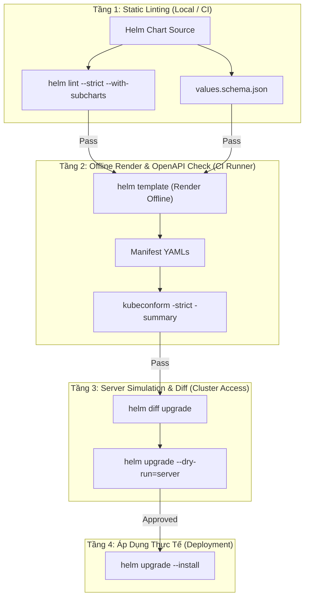

# 6_5_6 Validating Charts Before Deploy

> **Khóa học**: Cloud DevOps Basic — Containers & Kubernetes
> **Phân nhóm**: 6 Domain 6 - Containers and Kubernetes › 6_5 Helm Package Management
> **Chủ đề**: 6_5_6 Validating Charts Before Deploy
> **Phiên bản áp dụng**: Kubernetes 1.37, Helm 4.x / Helm 3.x, Podman 5.x
> **Trạng thái**: Verified (WRITE-CTR-6_5_6, 16-11-2026)
> **Phạm vi**: [Topic README](./README.md#6_5_6-kiểm-tra-trước-khi-deploy) · **Checkpoint của người học**: [CHECKLIST](../../CHECKLIST.md#6_5-helm-package-management)
> **Kiến thức liên quan**: [6_5_2 Chart Structure](<./6_5_2 Chart Structure.md>) (values.schema.json)

---

## 1. Khái Niệm Cốt Lõi & Bản Chất Kỹ Thuật (Core Concepts & Technical Deep Dive)

Chiến lược **Shift-Left Validation** trong CI/CD phát hiện lỗi cấu hình và cú pháp ngay từ máy trạm hoặc pipeline trước khi áp dụng vào cụm Kubernetes. <!-- ev: R1.81 R1.85 R2.101 -->

### 1.1 Kiểm Tra Tĩnh & Chuẩn Hóa Với `helm lint`

Lệnh `helm lint` quét một thư mục chart để chạy các bài test xác thực chart có đúng cấu trúc hay không (`well-formed`). <!-- ev: R1.81 -->

- **Phát hiện lỗi cú pháp và ngữ nghĩa**: Rà soát các vấn đề tiềm ẩn về cú pháp, cấu trúc tệp và ngữ nghĩa của chart. <!-- ev: R2.92 -->
- **Phân loại thông báo**: `helm lint` phát ra `[ERROR]` cho lỗi nghiêm trọng khiến chart không thể cài đặt, và `[WARNING]` cho vi phạm quy ước khuyến nghị. <!-- ev: R1.82 R2.96 -->
- **Cờ dừng khi có cảnh báo (`--strict`)**: Khiến lệnh thất bại ngay (exit code lỗi) nếu có bất kỳ lint warning nào. <!-- ev: R1.83 R2.93 -->
- **Quét đệ quy Subchart (`--with-subcharts`)**: Kiểm tra linter đệ quy cho toàn bộ subchart phụ thuộc trong thư mục `charts/`. <!-- ev: R1.84 R2.94 -->
- **Kiểm tra phiên bản cụm (`--kube-version`)**: Chỉ định phiên bản Kubernetes mục tiêu để kiểm tra capabilities và cảnh báo API bị deprecate. <!-- ev: R2.95 -->

### 1.2 Ràng Buộc Kiểu Dữ Liệu Với `values.schema.json`

- **Áp đặt cấu trúc dữ liệu**: `values.schema.json` áp đặt định nghĩa JSON Schema lên chart values để kiểm tra tính hợp lệ cấu hình người dùng cung cấp. <!-- ev: R1.25 -->
- **Tệp tùy chọn chuẩn hóa**: Cung cấp JSON Schema tùy chọn nhằm áp đặt cấu trúc lên tệp `values.yaml`. <!-- ev: R2.28 -->
- **Tiêu chuẩn Draft 7**: Tệp schema sử dụng tiêu chuẩn JSON Schema Draft 7 (`https://json-schema.org/draft-07/schema#`). <!-- ev: R2.29 -->
- **Bắt lỗi sớm**: Kiểm tra kiểu dữ liệu tự động kích hoạt khi chạy `helm install` hoặc `helm template`. <!-- ev: R1.25 R1.85 -->

### 1.3 Kết Xuất Manifest Ngoại Tuyến Với `helm template`

Lệnh `helm template [NAME] [CHART] [flags]` render các template cục bộ mà không kết nối cluster và in manifest ra stdout. <!-- ev: R1.85 R2.97 -->

- **Giả lập giá trị nội cụm**: Các giá trị vốn tra cứu từ cluster sẽ được giả lập (faked) cục bộ; lệnh bỏ qua toàn bộ kiểm tra tính hợp lệ API phía server. <!-- ev: R1.86 -->
- **Mô phỏng client-side (`--dry-run`)**: Cờ `--dry-run` nhận `client` hoặc `server`, mặc định là `client`. `--dry-run=client` mô phỏng phía client và tránh mọi kết nối tới cluster. <!-- ev: R1.88 R2.98 -->
- **Bộ lọc kết xuất (`--show-only`)**: Chỉ xuất manifest sinh ra từ file template chỉ định. <!-- ev: R1.89 -->
- **Tùy chọn CRD và xuất đĩa**: Cờ `--include-crds` đưa CRD vào output; cờ `--output-dir` ghi manifest ra các tệp trên đĩa thay vì stdout. <!-- ev: R2.99 R2.100 -->
- **Bỏ qua kiểm tra OpenAPI**: Cờ `--disable-openapi-validation` ngăn cản việc kiểm tra template đã render đối chiếu với Kubernetes OpenAPI Schema. <!-- ev: R1.87 -->

### 1.4 Kiểm Thẩm Định Manifest Bằng `kubeconform`

- **OpenAPI trong Kubernetes**: API của Kubernetes được định nghĩa bằng đặc tả OpenAPI trong kho mã nguồn chính của Kubernetes. <!-- ev: R1.90 -->
- **Chuyển đổi sang JSON Schema**: Công cụ chuyển đổi OpenAPI schemas thành JSON Schemas để kiểm tra manifest tốc độ cao. <!-- ev: R1.91 -->
- **Cú pháp vận hành**: Cú pháp lệnh là `kubeconform [OPTION]... [FILE OR FOLDER]...`. <!-- ev: R2.102 -->
- **Cờ kiểm tra nghiêm ngặt**: Cờ `-strict` từ chối các thuộc tính không có trong schema và loại bỏ khóa bị trùng lặp. <!-- ev: R2.103 -->
- **Báo cáo tổng kết**: Cờ `-summary` in báo cáo tổng kết chi tiết tài nguyên hợp lệ và không hợp lệ. <!-- ev: R2.105 -->
- **Vị trí schema**: Mặc định `-schema-location` trỏ tới kho `yannh/kubernetes-json-schema`. Hỗ trợ vị trí schema từ xa hoặc cục bộ để kiểm tra CRD và chạy ngoại tuyến. <!-- ev: R1.93 R2.104 -->
- **Giới hạn kỹ thuật**: Kubeconform chỉ thẩm định OpenAPI spec tĩnh, không đánh giá được các bước kiểm tra động ở runtime của Kubernetes controllers. <!-- ev: R1.92 -->

### 1.5 Mô Phỏng Phía Server Với `--dry-run=server` & Plugin `helm-diff`

- **Kiểm tra phía server (`--dry-run=server`)**: Helm hỗ trợ cờ `--dry-run=server` để xác thực thao tác với Kubernetes API server trực tiếp mà không lưu lại thay đổi trên cụm. <!-- ev: R1.88 R2.101 -->
- **Cài đặt plugin `helm-diff`**: Cài đặt bằng lệnh `helm plugin install https://github.com/databus23/helm-diff`. <!-- ev: R2.106 -->
- **So sánh nâng cấp (`helm diff upgrade`)**: Hiển thị khác biệt giữa release đang chạy trên cụm và manifest dự kiến render từ chart template. <!-- ev: R1.94 R2.107 -->
- **So sánh revision (`helm diff revision`)**: So sánh manifest giữa revision mới nhất và một revision chỉ định, hoặc giữa hai revision lịch sử (`helm diff revision [flags] RELEASE REVISION1 REVISION2`). <!-- ev: R1.95 R2.108 R2.109 -->

---

## 2. Ví Dụ Đời Sống Thực Tế Dễ Hiểu (Intuitive Real-World Analogies)

Quy trình kiểm tra Helm Chart trước khi deploy tương tự **Kiểm định an toàn hàng không đa tầng**:

- **`helm lint` giống kiểm tra vỏ máy bay bằng mắt**: Rà soát vết nứt hay đinh ốc lỏng. Lốp mòn nhẹ (`[WARNING]`) chưa gây rơi máy bay, nhưng bật `--strict` sẽ đình chỉ bay để xử lý dứt điểm.
- **`values.schema.json` giống khung cân đo hành lý tại quầy check-in**: Chặn hành lý quá cỡ hoặc chất lỏng vượt mức, loại bỏ dữ liệu sai kiểu trước khi vào băng chuyền.
- **`helm template` & `kubeconform` giống buồng lái mô phỏng ngắt mạng**: Phi công kiểm tra sơ đồ bay trên máy tính độc lập ngoại tuyến mà không cần cất cánh thật.
- **`--dry-run=server` & `helm-diff` giống liên lạc đài không lưu duyệt lộ trình giả định**: Gửi yêu cầu tới `kube-apiserver` kiểm tra đường băng mà không lưu dữ liệu, kèm bảng so sánh `helm-diff` trước khi máy bay lăn bánh.

---

## 3. Kiến Trúc, Luồng Hoạt Động & Hình Ảnh Trực Quan (Architecture, Diagrams & Visual Media)

### 3.1 Sơ Đồ Quy Trình Shift-Left Validation Đa Tầng

<!-- ev: R1.81 R1.83 R1.85 R1.90 R1.91 R1.92 R1.94 R2.93 R2.101 R2.103 R2.107 -->
Quy trình xác thực đa tầng từ kiểm tra tĩnh cục bộ đến mô phỏng phía máy chủ:



---

## 4. Code Mẫu Trực Quan Hoặc Dòng Lệnh Thực Chiến (Runnable Sample Code / CLI)

> **Môi trường thực nghiệm**: Kubernetes 1.37, Helm 4.x / Helm 3.x, Podman 5.x. <!-- ev: R2.95 -->  
> ⚠️ Chưa chạy thử (not executed by the squad)  
> ⚠️ Chỉ chạy trên cluster thử nghiệm (lab cluster only)  
> *Thực hành chi tiết tại lab [lab-6_5_2-multi-environment-values](./README.md#lab-6_5_2-multi-environment-values).*

### 4.1 Kiểm Tra Cấu Trúc Chart Với `helm lint`

Thực thi kiểm tra cấu trúc nghiêm ngặt và quét toàn bộ subchart: <!-- ev: R1.81 R1.83 R1.84 R2.93 R2.94 R2.95 -->

```bash
# Kiểm tra chart cơ bản kèm phiên bản Kubernetes mục tiêu
helm lint ./my-chart --kube-version 1.37.0

# Bật cờ dừng khi có cảnh báo và quét subcharts
helm lint ./my-chart --strict --with-subcharts --kube-version 1.37.0
```

### 4.2 Thiết Lập Schema Ràng Buộc Dữ Liệu `values.schema.json`

Khai báo file `values.schema.json` theo chuẩn Draft 7 kiểm soát giá trị đầu vào: <!-- ev: R1.25 R2.28 R2.29 -->

```json
{
  "$schema": "https://json-schema.org/draft-07/schema#",
  "type": "object",
  "required": ["replicaCount", "service"],
  "properties": {
    "replicaCount": { "type": "integer", "minimum": 1, "maximum": 20 },
    "service": {
      "type": "object",
      "required": ["port", "type"],
      "properties": {
        "port": { "type": "integer", "minimum": 1, "maximum": 65535 },
        "type": { "type": "string", "enum": ["ClusterIP", "NodePort", "LoadBalancer"] }
      }
    }
  }
}
```

### 4.3 Render Ngoại Tuyến Bằng `helm template`

Kết xuất manifest YAML ra ổ đĩa và áp dụng bộ lọc chuyên biệt: <!-- ev: R1.85 R1.87 R1.89 R2.97 R2.99 R2.100 -->

```bash
helm template my-release ./my-chart
helm template my-release ./my-chart --output-dir ./rendered --include-crds
helm template my-release ./my-chart --show-only templates/deployment.yaml
helm template my-release ./my-chart --disable-openapi-validation
```

### 4.4 Kiểm Thẩm Định Manifest Bằng `kubeconform`

Thẩm định manifest theo OpenAPI/JSON Schema với cú pháp chuẩn: <!-- ev: R1.93 R2.102 R2.103 R2.104 R2.105 -->

```bash
kubeconform -strict -summary ./rendered/
helm template my-release ./my-chart | kubeconform -strict -summary
kubeconform -strict -summary \
  -schema-location 'default' \
  -schema-location '/opt/schemas/{{ .ResourceKind }}_{{ .ResourceAPIVersion }}.json' \
  ./rendered/
```

### 4.5 Kiểm Tra Khác Biệt & Mô Phỏng Server Với `helm-diff`

Cài đặt plugin và kiểm tra thay đổi trước khi nâng cấp: <!-- ev: R1.88 R1.94 R1.95 R2.101 R2.106 R2.107 R2.108 R2.109 -->

```bash
helm plugin install https://github.com/databus23/helm-diff
helm diff upgrade my-release ./my-chart --values values-production.yaml
helm diff revision my-release 2 3
helm upgrade my-release ./my-chart --values values-production.yaml --dry-run=server
```

---

## 5. Cạm Bẫy Thực Tế & Thực Tiễn Sản Xuất (Production Gotchas & Best Practices)

### 5.1 Cảm Giác An Toàn Giả Tạo Giữa Client-Side Dry-Run Và Server-Side Dry-Run

<!-- ev: R1.86 R1.88 R2.98 R2.101 -->
Lệnh `helm template` và `--dry-run=client` hoạt động ngoại tuyến, tự giả lập dữ liệu nội cụm mà không kết nối `kube-apiserver`. <!-- ev: R1.86 R1.88 R2.98 -->

- Nếu chart chứa Custom Resource của CRD chưa cài trên cụm hoặc gọi API đã bị xóa, `helm template` vẫn hoàn thành mà không báo lỗi. <!-- ev: R1.86 -->
- Chỉ khi kiểm tra với `--dry-run=server`, máy chủ API mới gửi phản hồi từ chối. Vì vậy CI/CD luôn cần bước `--dry-run=server` trước khi triển khai thật. <!-- ev: R1.88 R2.101 -->

### 5.2 Giới Hạn Của Kubeconform Trước Ràng Buộc Động Phía Controller

<!-- ev: R1.91 R1.92 R1.93 R2.104 -->
Kubeconform kiểm tra manifest dựa trên OpenAPI/JSON Schema tĩnh, không đánh giá được các bước kiểm tra động ở runtime của Kubernetes controllers: <!-- ev: R1.91 R1.92 -->

- Lỗi tham chiếu tới ConfigMap/Secret không tồn tại, vượt hạn ngạch ResourceQuota hoặc bị chặn bởi Admission Webhook sẽ không bị Kubeconform phát hiện. <!-- ev: R1.92 -->
- Cần kết hợp Kubeconform ở tầng CI tĩnh cùng `helm upgrade --dry-run=server` ở tầng tiền kiểm tra môi trường. <!-- ev: R1.92 R2.101 -->

### 5.3 Bỏ Sót Cảnh Báo Và Subcharts Khi Quản Trị Pipeline

<!-- ev: R1.82 R1.83 R1.84 R2.93 R2.94 R2.96 -->
Nếu chạy `helm lint` không cờ `--strict`, các cảnh báo `[WARNING]` vẫn cho exit code 0 khiến lỗi quy chuẩn lọt vào nhánh chính. <!-- ev: R1.82 R1.83 R2.93 R2.96 -->

- Nếu thiếu cờ `--with-subcharts`, linter bỏ qua các lỗi tiềm ẩn trong thư mục `charts/`. Pipeline luôn bắt buộc cấu hình `helm lint --strict --with-subcharts`. <!-- ev: R1.84 R2.94 -->

---

## 6. Câu Hỏi Củng Cố Kiến Thức (Active Recall Quiz)

### Câu hỏi 1: Sự Cố An Toàn Ảo Trong CI/CD Pipeline

Trong GitLab CI, lệnh `helm template my-app ./chart | kubeconform -strict -summary` báo thành công với `Errors: 0`. Khi chạy `helm upgrade --install my-app ./chart` trên cụm Kubernetes 1.37 thì lỗi `no matches for kind "Certificate" in version "cert-manager.io/v1"`. Nguyên nhân là gì và giải pháp khắc phục?

<details>
<summary>Đáp án</summary>

**Nguyên nhân**:
`helm template` render cục bộ bỏ qua kiểm tra API phía server; `kubeconform` chỉ thẩm định schema tài nguyên lõi từ kho mặc định nên không nhận biết CRD `Certificate` chưa cài trên cụm. <!-- ev: R1.86 R1.92 R2.98 R2.104 -->

**Giải pháp**:
1. Cấu hình `-schema-location` trong `kubeconform` nạp schema CRD. <!-- ev: R1.93 -->
2. Bổ sung bước kiểm tra với `helm upgrade --dry-run=server` gửi manifest lên `kube-apiserver` thật để kiểm chứng trước khi deploy. <!-- ev: R1.88 R2.101 -->
</details>

---

### Câu hỏi 2: Ngăn Chặn Sai Kiểu Dữ Liệu Ngay Tại Máy Trạm

Một lập trình viên nhập nhầm giá trị port thành chuỗi ký tự trong `values-production.yaml`. Làm thế nào để bắt lỗi này ngay khi chạy `helm lint` hoặc `helm template` mà không cần kết nối tới cụm Kubernetes?

<details>
<summary>Đáp án</summary>

**Giải pháp**:
Tạo tệp `values.schema.json` tại thư mục gốc của chart theo tiêu chuẩn JSON Schema Draft 7, khai báo trường port với ràng buộc `"type": "integer"`. Helm sẽ tự động kích hoạt schema validation khi chạy `helm lint`, `helm template` hoặc `helm install`, chặn đứng cấu hình sai kiểu dữ liệu ngay tại máy trạm. <!-- ev: R1.25 R1.81 R1.85 R2.28 R2.29 -->
</details>

---

### Câu hỏi 3: Phỏng Vấn DevOps / SRE — Vai Trò Bộ Công Cụ Shift-Left

Phân biệt vai trò kỹ thuật, môi trường thực thi và giới hạn của `helm lint --strict`, `kubeconform -strict` và `helm upgrade --dry-run=server` trong GitOps pipeline?

<details>
<summary>Đáp án</summary>

| Công cụ | Môi trường | Mục tiêu xác thực | Giới hạn kỹ thuật |
| :--- | :--- | :--- | :--- |
| **`helm lint --strict`** | Ngoại tuyến (Local/CI) | Kiểm tra cấu trúc thư mục, cú pháp tệp `Chart.yaml` và quy ước chart. <!-- ev: R1.81 R1.83 R2.92 R2.93 --> | Không kiểm tra tính hợp lệ của manifest YAML sau khi render template. <!-- ev: R1.81 --> |
| **`kubeconform -strict`** | Ngoại tuyến (CI Runner) | Thẩm định cú pháp manifest đối chiếu với OpenAPI/JSON Schema của Kubernetes API. <!-- ev: R1.91 R2.102 R2.103 --> | Không đánh giá được các bước kiểm tra động ở runtime của Kubernetes controllers. <!-- ev: R1.92 --> |
| **`--dry-run=server`** | Trực tuyến (Cluster) | Gửi manifest lên `kube-apiserver` để xác thực toàn diện mà không ghi đè dữ liệu. <!-- ev: R1.88 R2.101 --> | Cần kết nối mạng và quyền RBAC tới cụm Kubernetes đích. <!-- ev: R1.88 R2.101 --> |
</details>

---

## 7. 📚 Nguồn Tài Liệu Chính Thống (Tier-1 Official References)

- [Helm Docs - helm lint](https://helm.sh/docs/helm/helm_lint/) - Tài liệu chính thức về lệnh kiểm tra cấu trúc Chart từ Helm Docs.
- [Helm Docs - helm template](https://helm.sh/docs/helm/helm_template/) - Hướng dẫn chi tiết về kết xuất manifest ngoại tuyến và các cờ vận hành từ Helm Docs.
- [Helm Docs - Chart Schema Files](https://helm.sh/docs/topics/charts/#schema-files) - Quy chuẩn tệp values.schema.json và đặc tả Draft 7 Schema từ Helm Docs.
- [Kubeconform GitHub Documentation](https://github.com/yannh/kubeconform) - Bộ công cụ kiểm thử manifest Kubernetes theo OpenAPI/JSON Schema chính thức từ tác giả Yann Hamon.
- [Helm Diff Plugin Documentation](https://github.com/databus23/helm-diff) - Plugin hiển thị khác biệt manifest giữa release đang chạy và phiên bản triển khai mới từ Databus23.
