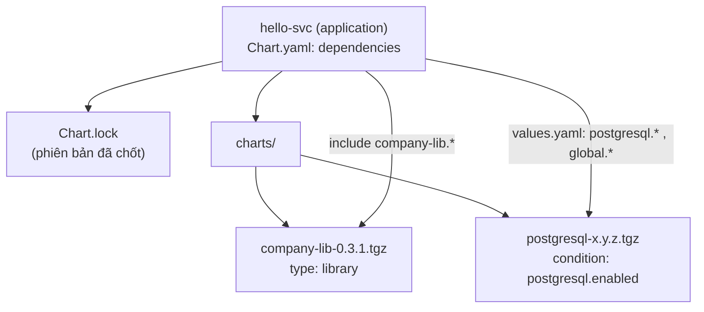
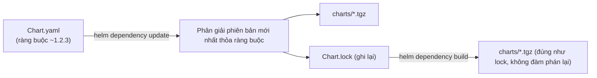
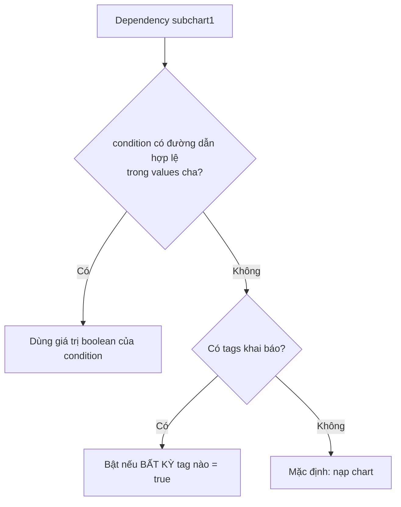
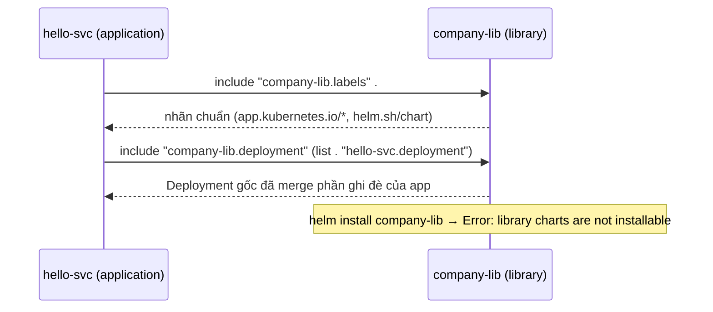

# 6_5_7 Dependencies Subcharts and Library Charts

> **Khóa học**: Cloud DevOps Basic — Containers & Kubernetes  
> **Phân nhóm**: 6 Domain 6 - Containers and Kubernetes › 6_5 Helm Package Management  
> **Chủ đề**: 6_5_7 Dependency, Subchart và Library Chart  
> **Phiên bản áp dụng**: Kubernetes 1.37, Helm 4.x / Helm 3.x  
> **Trạng thái**: Đã kiểm chứng (verifier PASS, 21-11-2026)  
> **Phạm vi**: [Topic README](./README.md#6_5_7-dependency-subchart-và-library-chart) · **Checkpoint của người học**: [CHECKLIST](../../CHECKLIST.md#6_5-helm-package-management)  
> **Kiến thức liên quan**: [6_5_2 Chart Structure](<./6_5_2 Chart Structure.md>) · [6_5_3 Template Language](<./6_5_3 Template Language.md>) · [6_5_4 Values and Precedence](<./6_5_4 Values and Precedence.md>) (subchart/`global`)

---

## 0. Tình Huống Mở Đầu: Cùng Một Commit, Hai Lần Build, Hai Kết Quả

Khi quản lý hệ thống phân tán gồm hàng chục microservices trên Kubernetes, việc cài đặt thủ công từng chart riêng lẻ sẽ làm trôi dạt cấu hình và khiến việc đồng bộ giữa các môi trường trở nên phức tạp.

Mô hình Umbrella Chart (Parent Chart) đóng vai trò điều phối tổng thể: trường `dependencies` trong `Chart.yaml` giúp gom cụm toàn bộ microservices thành một gói phát hành duy nhất, điều khiển bật hoặc tắt linh hoạt từng thành phần bằng `condition` hoặc `tags`, đồng thời dùng library chart để DRY hóa các mẫu cấu hình dùng chung giữa các service.

Tuy nhiên, nếu khai báo phụ thuộc mở dạng `version: "~1.2.3"` và pipeline CI luôn chạy `helm dependency update` trong mỗi lần build, một bản vá mới được phát hành trên repository có thể vô tình được kéo về khiến hai lần build cùng commit sinh ra kết quả khác nhau. Để xây dựng pipeline tin cậy và có khả năng tái lập, kỹ sư DevOps cần nắm vững cơ chế chốt phiên bản `Chart.lock`, cách phân cấp cấu hình giá trị cha–con và nguyên lý hoạt động của library chart.

---

## 1. Khái Niệm Cốt Lõi & Bản Chất Kỹ Thuật (Core Concepts & Technical Deep Dive)

Quản lý phụ thuộc trong Helm cho phép một chart liên kết và điều phối nhiều chart khác nhau để triển khai một hệ thống ứng dụng đồng bộ.

### 1.1 Chart Có Thể Phụ Thuộc Chart Khác

Một chart có thể phụ thuộc vào nhiều chart khác; chart phụ thuộc được gọi là subchart. Trong Helm 3 và Helm 4, các gói phụ thuộc được khai báo dưới trường `dependencies` trong file `Chart.yaml` thay thế hoàn toàn cho tệp `requirements.yaml` thời Helm 2. <!-- ev: C7.1 -->

<!-- ev: C7.1 -->
```yaml
dependencies:
  - name: nginx
    version: "~1.2.3"                  # SemVer hoặc khoảng phiên bản
    repository: "https://example.com/charts"
    condition: nginx.enabled           # Bật/tắt theo values
    tags: [front-end]
    alias: web                         # Dùng tên khác cho dependency
    import-values: [data]              # Kéo giá trị của con lên cha
```

Ý nghĩa chi tiết của từng trường trong khối khai báo phụ thuộc:

- **`name`**: Tên của chart phụ thuộc, bắt buộc phải trùng khớp chính xác với trường `name` trong `Chart.yaml` của subchart đích. <!-- ev: C7.2 -->
- **`version`**: Biểu thức ràng buộc phiên bản SemVer; ký hiệu tilde `~1.2.3` chấp nhận các bản vá trong cùng minor (`>= 1.2.3, < 1.3.0`), trong khi caret `^1.2.3` cho phép nâng cấp tính năng tương thích ngược trong cùng major (`>= 1.2.3, < 2.0.0`). <!-- ev: C7.3 -->
- **`repository`**: Địa chỉ kho lưu trữ chart (HTTP/HTTPS URL), alias repo dạng `@tên-repo`, đường dẫn thư mục nội bộ `file://...`, hoặc registry OCI `oci://...`. <!-- ev: C7.4 -->
- **`alias`**: Cho phép định danh subchart bằng một tên gọi khác, hỗ trợ tái sử dụng cùng một chart nhiều lần với cấu hình độc lập. <!-- ev: C7.8 -->

### 1.2 `condition` và `tags`: Quy Tắc Phân Giải

Quy tắc kích hoạt động subchart dựa trên cấu hình giá trị từ chart cha:

- **`condition`**: Nhận một hoặc nhiều đường dẫn YAML (phân tách bằng dấu phẩy); nếu đường dẫn tồn tại trong values của chart cha trên cùng và trả về giá trị boolean, subchart sẽ được bật hoặc tắt theo boolean đó. <!-- ev: C7.5 -->
- **`tags`**: Danh sách nhãn cho subchart; trong values của chart cha, một khóa cấp cao nhất dạng `tags.<nhãn>: true/false` sẽ bật hoặc tắt đồng loạt tất cả các chart mang nhãn đó. <!-- ev: C7.6 -->
- **Thứ tự ưu tiên**: `condition` luôn có mức ưu tiên cao hơn và ghi đè `tags`, đồng thời chỉ đường dẫn hợp lệ đầu tiên trong danh sách condition được phân giải. <!-- ev: C7.7 -->
- Khóa `tags:` trong values bắt buộc phải là khóa cấp cao nhất (top-level key), không hỗ trợ định dạng lồng nhau hay đặt trong global. <!-- ev: C7.6 -->
- Thao tác điều khiển trên CLI thực hiện linh hoạt qua tham số: `--set tags.front-end=true --set subchart2.enabled=false`. <!-- ev: C7.5 C7.6 -->
- Thực tiễn khuyến nghị của Helm: mọi phụ thuộc tùy chọn (optional dependency) nên được gắn kèm `condition` dạng `<subchart>.enabled`. <!-- ev: C7.5 -->

### 1.3 Quản Lý `charts/`: `update`, `build`, `Chart.lock`

Các lệnh CLI quản lý phụ thuộc và vai trò của file khóa:

- **`helm dependency update`**: Quét `Chart.yaml`, tải phiên bản mới nhất thỏa mãn ràng buộc SemVer về thư mục `charts/` dưới dạng file nén `.tgz`, đồng thời sinh ra hoặc cập nhật tệp `Chart.lock`. <!-- ev: C7.10 -->
- **`helm dependency build`**: Tái thiết lập chính xác các tệp trong thư mục `charts/` dựa theo `Chart.lock` mà không đàm phán lại phiên bản (không kéo bản mới hơn); nếu chưa có lock, lệnh tự động chuyển hướng hành vi như `update`. <!-- ev: C7.11 -->
- **`helm dependency list`**: Liệt kê các phụ thuộc đã khai báo trong chart gồm NAME, VERSION constraint, REPOSITORY và STATUS (`ok`, `missing`, hoặc `wrong version`). <!-- ev: C7.12 -->
- **`Chart.lock`**: Lưu phiên bản cụ thể, repo của các dependency và mã băm digest (SHA-256) của khai báo dependencies để đồng bộ với Chart.yaml, tái thiết lập chính xác trạng thái phụ thuộc. <!-- ev: C7.13 -->

### 1.4 Quan Hệ Cha–Con Với Values

Cơ chế phân tách và truyền tải cấu hình giữa chart cha và các subcharts theo tài liệu Subcharts and Global Values:

- **Tính độc lập của subchart**: Subchart hoạt động độc lập và không bao giờ phụ thuộc tường minh vào chart cha, do đó không thể tự truy cập trực tiếp các giá trị của chart cha. <!-- ev: C7.14 -->
- **Ghi đè giá trị**: Chart cha có thể ghi đè values của subchart bằng cách nhóm cấu hình dưới khóa trùng tên subchart hoặc trùng `alias` đã khai báo. <!-- ev: C7.14 -->

<!-- ev: C7.14 -->
```yaml
# values.yaml của chart cha
mysubchart:
  dessert: ice cream      # template của con vẫn đọc là .Values.dessert
```

Template của subchart không thay đổi: trong phạm vi xử lý của subchart, `.Values` chỉ chứa phần dành riêng cho nó. <!-- ev: C7.14 -->

- **Cơ chế `global`**: Khóa dành riêng `.Values.global` cung cấp không gian dữ liệu chia sẻ chung mà cả chart cha và mọi subchart đều có thể truy cập qua cùng một cú pháp `.Values.global.<khóa>`. <!-- ev: C7.15 -->
- Giá trị global bắt buộc phải được khai báo tường minh; không thể dùng một value thông thường như thể nó là global. <!-- ev: C7.15 -->

Thứ tự ưu tiên chi tiết đã học ở [6_5_4](<./6_5_4 Values and Precedence.md>).

### 1.5 `import-values` và `exports`

Cơ chế chuyển giao cấu hình từ subchart ngược lên parent chart:

Chart con có thể công bố dữ liệu ở khóa `exports` trong `values.yaml` của nó; chart cha liệt kê khóa cần nhập trong `import-values` và dữ liệu sẽ xuất hiện trực tiếp ở values của cha: <!-- ev: C7.9 -->

<!-- ev: C7.9 -->
```yaml
# Chart.yaml của cha
dependencies:
  - name: subchart
    repository: http://localhost:10191
    version: 0.1.0
    import-values: [data]
# values.yaml của con
exports:
  data:
    myint: 99          # => values của cha có myint: 99
```

Ngoài ra còn có cú pháp child/parent để ánh xạ các giá trị không nằm trong `exports` trực tiếp vào cây values của cha. <!-- ev: C7.9 -->

### 1.6 Library Chart: Chia Sẻ Template Giữa Nhiều Microservice

Đặc tính và vai trò của loại chart thư viện dùng chung:

- **Định nghĩa thư viện**: Library chart được thiết lập bằng thuộc tính `type: library` trong `Chart.yaml`, đóng vai trò cung cấp các named template và hàm tiện ích dùng chung cho các chart ứng dụng khác để DRY hóa mã nguồn. <!-- ev: C7.16 -->
- **Ngăn chặn cài đặt độc lập**: Library chart không thể triển khai trực tiếp như một ứng dụng độc lập; lệnh `helm install` trên một library chart sẽ trả về lỗi `Error: library charts are not installable`. <!-- ev: C7.17 -->
- **Không tự render manifest**: Mọi template trong library chart không tự chuyển đổi thành Kubernetes manifest trừ khi được chart ứng dụng gọi tường minh thông qua cú pháp `include` hoặc `template`. <!-- ev: C7.18 -->
- Cho phép chart phụ thuộc kế thừa và tận dụng ngữ cảnh (context) của chart nhập khi thực thi render template. <!-- ev: C7.16 C7.18 -->
- **Quy trình tạo và chuyển đổi thực tế**: Để tạo một library chart, có thể khởi tạo bằng `helm create <tên-chart>`, sau đó mở `Chart.yaml` và đổi trường `type: application` thành `type: library`, đồng thời dọn dẹp thư mục `templates/` để chỉ lưu các named template trong các tệp quy ước `_*.tpl` (bọc trong khối `{{- define ... -}}`). <!-- ev: C7.16 C7.18 -->
- **Cách thức tiêu thụ trong chart ứng dụng**: Chart microservice khai báo library chart trong trường `dependencies` (sử dụng đường dẫn local `file://...` hoặc Helm/OCI repo), chạy `helm dependency build` để kéo gói thư viện về thư mục `charts/`, sau đó triệu gọi template trong file manifest bằng cú pháp `{{- include "<tên-library>.<tên-template>" . -}}` với dấu `.` để truyền toàn bộ context `.Values`. <!-- ev: C7.4 C7.11 C7.16 C7.18 -->

Quy ước: named template đặt trong file bắt đầu bằng dấu gạch dưới (`_*.tpl`, `_*.yaml`) vì file này không xuất ra manifest độc lập. <!-- ev: C7.18 -->

Áp dụng cho hệ thống microservices: xây dựng library chart nền (base chart) chứa Deployment, Service, nhãn chuẩn, probe mặc định và security context để các service tái sử dụng mà không lặp lại code. <!-- ev: C7.16 -->

---

## 2. Ví Dụ Đời Sống Thực Tế Dễ Hiểu (Intuitive Real-World Analogies)

Mô hình quản lý phụ thuộc trong Helm có thể hình dung sinh động qua các ví dụ quen thuộc trong đời sống và kỹ thuật phần mềm:

- **Parent/Umbrella Chart như `package.json` trong Node.js hoặc `pom.xml` trong Maven**: Chart cha đóng vai trò như nhạc trưởng điều phối, khai báo danh sách các gói phụ thuộc và kéo toàn bộ các gói subchart về thư mục `charts/` để triển khai đồng bộ thành một hệ thống duy nhất.
- **`alias` như Import với bí danh**: Giống như cú pháp `import * as web from nginx` trong lập trình, alias cho phép đặt tên thay thế cho subchart để nạp cùng một chart nhiều lần với cấu hình khác nhau mà không sợ xung đột tên.
- **`Chart.lock` như biên bản nhập kho đã chốt**: Hôm nay biên bản chốt đúng lô hàng phiên bản v1.2.7; mọi kỹ sư hay runner CI khi dựng môi trường theo biên bản này (`dependency build`) đều nhận được đúng linh kiện đó mà không bị thay đổi ngẫu nhiên. Lệnh `dependency update` tương đương với việc đi chợ chọn phiên bản mới nhất thỏa tiêu chuẩn rồi ghi lại biên bản mới.
- **Subchart như nhà cung cấp độc lập**: Nhà cung cấp có công thức riêng và không được phép xem sổ tay quản lý nội bộ của bếp trưởng (values của chart cha). Bếp trưởng chỉ có thể yêu cầu điều chỉnh qua ô đặt hàng riêng dành cho nhà cung cấp (khóa mang tên subchart hoặc alias).
- **`global` như bảng thông báo chung dán giữa xưởng**: Mọi bộ phận (từ cha đến các con) đều đọc được cùng một thông tin dán ở đây.
- **Library Chart như cuốn cẩm nang công thức tiêu chuẩn (Utility Library)**: Tương tự như một thư viện hàm tiện ích trong code, nó chỉ chứa các template dùng chung (chuẩn hóa nhãn, probe, bảo mật) chứ không bao giờ có thể tự chạy hay đem ra bán độc lập như một sản phẩm hoàn chỉnh. Nếu sửa cẩm nang nền mà không kiểm soát, mọi chi nhánh áp dụng đều sẽ bị ảnh hưởng.
- **Quan hệ Cha–Con như Composition trong Lập trình hướng đối tượng (`User HAS-A Wallet`)**: Subchart giống như một object thành phần độc lập (`wallet`); nó chỉ thao tác trên trạng thái nội bộ của mình (`this.balance` tương ứng với `.Values.balance`) mà không thể gọi ngược lên object cha (`user`). Chart cha có thể truy cập và ghi đè giá trị của con (`user.wallet.balance`), nhưng con không bao giờ giữ tham chiếu ngược lên cha để đảm bảo tính đóng gói (encapsulation) và tái sử dụng (reusability). Trong khi đó, không gian `.Values.global` đóng vai trò như biến `static` toàn cục hoặc Global Context (`AppConfig.ENVIRONMENT`) mà cả cha lẫn mọi subchart đều truy cập trực tiếp được.

---

## 3. Kiến Trúc, Luồng Hoạt Động & Hình Ảnh Trực Quan (Architecture, Diagrams & Visual Media)

### 3.1 Cây Chart Có Dependency



### 3.2 `update` Và `build`



### 3.3 `condition` Thắng `tags`



### 3.4 Application Chart Gọi Library Chart



---

## 4. Code Mẫu Trực Quan Hoặc Dòng Lệnh Thực Chiến (Runnable Sample Code / CLI)

> ⚠️ Cú pháp theo chuẩn Helm 3 và Helm 4 (`helm.sh/docs`). Khi triển khai thực tế, luôn kiểm tra manifest bằng `helm lint` và `helm template` trước.

### 4.1 Chart Ứng Dụng Có Dependency Tùy Chọn

Khai báo file `Chart.yaml` và `values.yaml` của parent chart `hello-svc`: <!-- ev: C7.1 -->

```yaml
# hello-svc/Chart.yaml
apiVersion: v2
name: hello-svc
version: 0.2.0
dependencies:
  - name: company-lib
    version: "~0.3.0"
    repository: "file://../company-lib"
  - name: postgresql
    version: "~16.0.0"
    repository: "oci://registry.example.com/charts"
    condition: postgresql.enabled
```

```yaml
# hello-svc/values.yaml
postgresql:
  enabled: false        # Tắt mặc định; bật khi cần deploy
global:
  environment: dev
```

Thao tác tải và kiểm tra gói phụ thuộc:

```bash
helm dependency update ./hello-svc      # Tải vào charts/, sinh Chart.lock
helm dependency list ./hello-svc        # Kiểm tra trạng thái gói
helm dependency build ./hello-svc       # Dựng lại theo Chart.lock trong CI/CD
```

### 4.2 Library Chart Tối Giản

Khai báo library chart `company-lib` cung cấp named template: <!-- ev: C7.16 -->

```yaml
# company-lib/Chart.yaml
apiVersion: v2
name: company-lib
type: library
version: 0.3.1
```

```yaml
{{/* company-lib/templates/_labels.tpl */}}
{{- define "company-lib.labels" -}}
app.kubernetes.io/name: {{ .Chart.Name }}
app.kubernetes.io/instance: {{ .Release.Name }}
helm.sh/chart: {{ printf "%s-%s" .Chart.Name .Chart.Version | replace "+" "_" }}
{{- end -}}
```

```yaml
# hello-svc/templates/configmap.yaml: nhúng template từ library
apiVersion: v1
kind: ConfigMap
metadata:
  name: {{ .Release.Name }}-config
  labels:
    {{- include "company-lib.labels" . | nindent 4 }}
data:
  environment: {{ .Values.global.environment | quote }}
```

Xác nhận library chart không thể cài đặt độc lập:

```bash
helm install company-lib ./company-lib
# Trả về lỗi: Error: library charts are not installable
```

### 4.3 Bật/Tắt Subchart Bằng CLI

```bash
helm template demo ./hello-svc --set postgresql.enabled=true
helm template demo ./hello-svc --set tags.front-end=false --set subchart2.enabled=true
```

### 4.4 Đóng Gói Kèm Cập Nhật Dependency

Cờ `--dependency-update` (viết tắt `-u`) tự động kích hoạt cập nhật các gói phụ thuộc trước khi đóng gói chart thành file `.tgz`: <!-- ev: C7.19 -->

<!-- ev: C7.19 -->
```bash
helm package ./hello-svc --dependency-update     # -u: chạy dependency update trước khi đóng gói
```

---

## 5. Cạm Bẫy Thực Tế & Thực Tiễn Sản Xuất (Production Gotchas & Best Practices)

### 5.1 Cạm Bẫy 1: Chỉ Commit `Chart.yaml`, CI Chạy `update` Mỗi Lần

- **Hiện tượng**: Hai lần build cùng một mã nguồn commit nhưng lại tải về hai phiên bản subchart khác nhau. <!-- ev: C7.10 -->
- **Bản chất**: Lệnh `update` luôn đàm phán và kéo phiên bản mới nhất thỏa mãn dải SemVer đã khai báo. <!-- ev: C7.10 -->
- **Khuyến nghị**: Bắt buộc commit `Chart.lock` vào Git repository; cấu hình pipeline CI luôn chạy `helm dependency build` để tái lập bản dựng; chỉ chủ động nâng cấp bằng `update` khi kiểm soát rõ ràng diff. <!-- ev: C7.11 C7.13 -->

### 5.2 Cạm Bẫy 2: Subchart Không Đọc Được Values Của Cha

- **Hiện tượng**: Template của subchart tham chiếu trực tiếp `.Values.global.x` hoặc giá trị cha nhưng nhận kết quả rỗng. <!-- ev: C7.14 C7.15 -->
- **Bản chất**: Subchart có tính độc lập cao; nó chỉ nhận dữ liệu từ khóa trùng tên subchart hoặc từ khối `global` khai báo tường minh. <!-- ev: C7.14 C7.15 -->
- **Khuyến nghị**: Truyền cấu hình từ cha xuống bằng khóa tên subchart (hoặc alias), hoặc khai báo trường dùng chung vào khối `global`. <!-- ev: C7.14 C7.15 -->

### 5.3 Cạm Bẫy 3: `tags`/`condition` Đặt Sai Chỗ

- **Bản chất**: Chỉ values của chart cha trên cùng mới được xét để giải quyết điều kiện; khóa `tags:` phải nằm ở cấp cao nhất; `condition` luôn ghi đè `tags`. <!-- ev: C7.5 C7.6 C7.7 -->
- **Khuyến nghị**: Ưu tiên sử dụng `condition` với đường dẫn dạng `<subchart>.enabled` để quản lý bật tắt tường minh. <!-- ev: C7.5 -->

### 5.4 Cạm Bẫy 4: Đổi `alias` Làm Sai Khóa Values

- **Bản chất**: Khóa values tương ứng của subchart sẽ chuyển sang mang tên `alias` thay vì tên gốc; nếu đổi alias mà không đổi khóa values trong cha, cấu hình sẽ không tới đích. <!-- ev: C7.8 C7.14 -->
- **Khuyến nghị**: Sau khi định nghĩa hoặc đổi alias, luôn kiểm tra manifest xuất ra bằng `helm template` để xác nhận values được nạp chuẩn xác. <!-- ev: C7.8 -->

### 5.5 Cạm Bẫy 5: Library Chart Thay Đổi Phá Vỡ Tất Cả Service

- **Bản chất**: Named template dùng chung sẽ lan truyền trực tiếp toàn bộ thay đổi tới mọi chart phụ thuộc ngay khi họ nâng phiên bản thư viện. <!-- ev: C7.16 -->
- **Khuyến nghị**: Thực thi nghiêm ngặt nguyên tắc SemVer cho library chart, duy trì changelog chi tiết, ghim ràng buộc dạng `~x.y.z`, và kiểm thử kỹ bằng `helm template` trên các microservice trọng yếu trước khi phát hành rộng rãi. <!-- ev: C7.16 -->

### 5.6 Cạm Bẫy 6: Dùng `file://` Trong Chart Phát Hành

- **Bản chất**: Giao thức `file://` là trường hợp đặc biệt cho môi trường lắp ráp nội bộ hoặc kiểm thử cục bộ; đường dẫn tương đối sẽ gãy khi chart được đẩy lên kho lưu trữ từ xa. <!-- ev: C7.4 -->
- **Khuyến nghị**: Chart phát hành production bắt buộc dùng kho lưu trữ chuẩn với giao thức `https://` hoặc registry `oci://`. <!-- ev: C7.4 -->

---

## 6. Câu Hỏi Củng Cố Kiến Thức (Active Recall Quiz)

### Câu Hỏi 1: `helm dependency update` Và `build` Khác Nhau Thế Nào? Dùng Cái Nào Trong CI? (Phỏng vấn)

<details>
<summary>Đáp án</summary>

`update` đọc `Chart.yaml`, tải bản mới nhất thỏa ràng buộc và **sinh/ghi đè `Chart.lock`**. `build` dựng lại `charts/` **đúng theo `Chart.lock`**, không đàm phán lại phiên bản (không có lock thì giống `update`). CI nên dùng `build` để build lặp lại được; `update` dùng khi chủ động nâng cấp.
</details>

### Câu Hỏi 2: Subchart Có Đọc Được Values Của Chart Cha Không? Làm Sao Truyền Cấu Hình Xuống?

<details>
<summary>Đáp án</summary>

Không; subchart độc lập. Cha truyền xuống bằng khóa trùng tên subchart (hoặc `alias`) trong values của cha, hoặc dùng `global` (phải khai báo tường minh). Trong template của con, giá trị vẫn đọc là `.Values.<khóa>`.
</details>

### Câu Hỏi 3: `condition` Và `tags` Cùng Có Mặt Thì Cái Nào Thắng? Tags Đánh Giá Thế Nào?

<details>
<summary>Đáp án</summary>

`condition` thắng. Tags: bật chart nếu **bất kỳ** tag của chart là `true`. Cả hai phải đặt trong values của chart cha trên cùng; `tags:` phải là khóa cấp cao nhất.
</details>

### Câu Hỏi 4: Library Chart Là Gì Và Vì Sao Không Cài Được?

<details>
<summary>Đáp án</summary>

Chart `type: library` chỉ chứa named template dùng lại, không tạo manifest. Helm chặn cài đặt (`Error: library charts are not installable`). Dùng bằng cách khai báo là dependency của chart ứng dụng rồi `include` các named template. Phù hợp để chuẩn hóa template giữa nhiều microservice, đánh đổi là thêm lớp gián tiếp và rủi ro thay đổi lan rộng.
</details>

---

## 7. 📚 Nguồn Tài Liệu Chính Thống (Tier-1 Official References)

- [Charts (Helm Docs)](https://helm.sh/docs/topics/charts/) - `dependencies`, `condition`, `tags`, `alias`, `import-values`, `charts/`.
- [Subcharts and Global Values](https://helm.sh/docs/chart_template_guide/subcharts_and_globals/) - Subchart độc lập, cha ghi đè con, `global`.
- [Library Charts](https://helm.sh/docs/topics/library_charts/) - `type: library`, không cài được, mẫu `include` + merge.
- [helm dependency](https://helm.sh/docs/helm/helm_dependency/), [helm dependency build](https://helm.sh/docs/helm/helm_dependency_build/), [helm dependency update](https://helm.sh/docs/helm/helm_dependency_update/) - Lệnh quản lý dependency và `Chart.lock`.
- [Chart Best Practices: Dependencies](https://helm.sh/docs/chart_best_practices/dependencies/) - Khoảng phiên bản, URL kho, `condition`/`tags` (trang ghi chú chưa cập nhật cho Helm 4).
- [Use OCI-based registries](https://helm.sh/docs/topics/registries/) - Dependency từ registry OCI (`repository: oci://...`).
- [Helm 4 Overview](https://helm.sh/docs/overview/) - Thay đổi của Helm 4 (phân giải dependency nhanh hơn, content-based caching).
