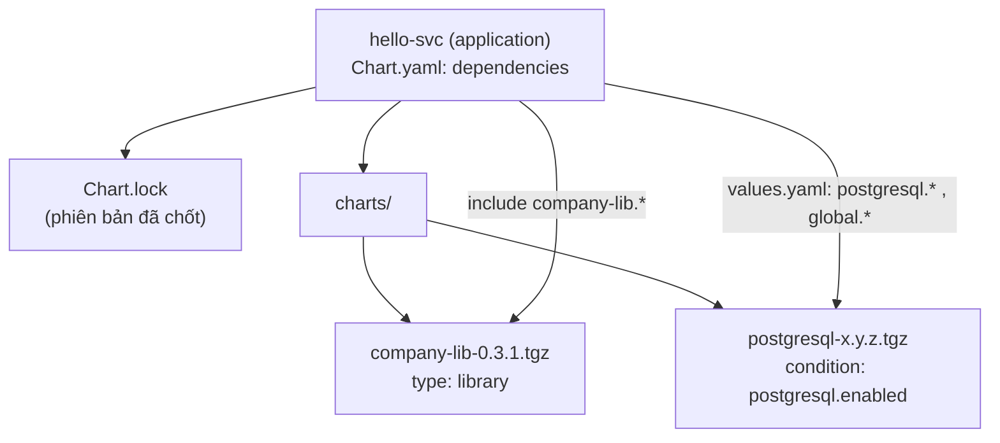
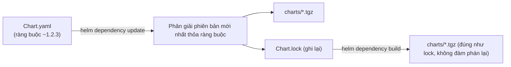
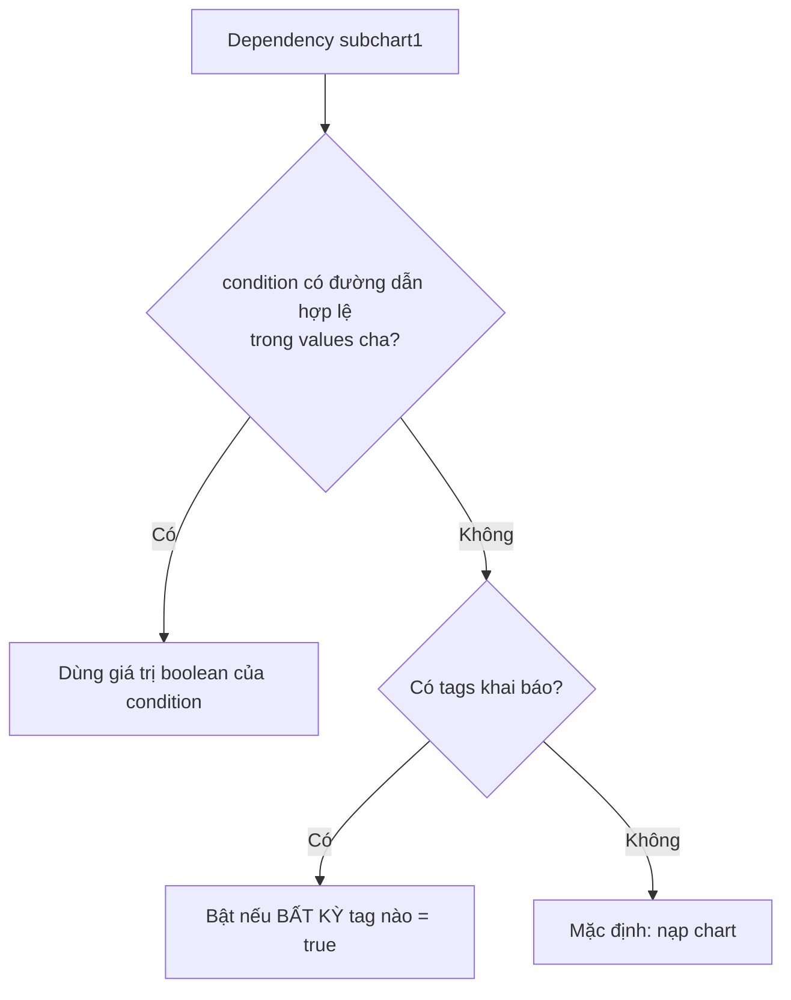
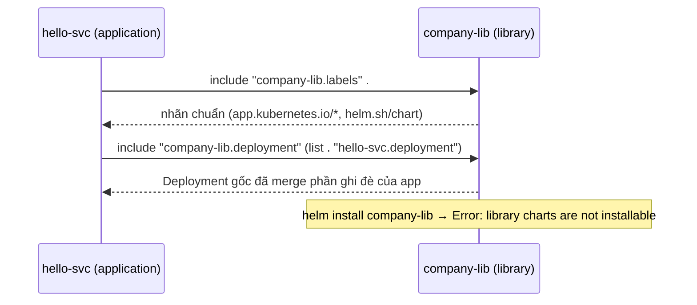

# 6_5_7 Dependencies Subcharts and Library Charts

> **Khóa học**: Cloud DevOps Basic — Containers & Kubernetes  
> **Phân nhóm**: 6 Domain 6 - Containers and Kubernetes › 6_5 Helm Package Management  
> **Chủ đề**: 6_5_7 Dependency, Subchart và Library Chart  
> **Phiên bản áp dụng**: Kubernetes 1.37, Helm 4.x (bản mới nhất khi kiểm tra: v4.3.2, 13-11-2026) / Helm 3.x  
> **Trạng thái**: Đối chiếu tài liệu chính thức helm.sh (17-11-2026). ⚠️ **Chưa chạy thử**: máy kiểm chứng chưa cài Helm và việc chạy binary tải về bị chặn, nên mọi lệnh/manifest dưới đây lấy từ tài liệu Helm và chưa được thực thi  
> **Phạm vi**: [Topic README](./README.md#6_5_7-dependency-subchart-và-library-chart) · **Checkpoint của người học**: [CHECKLIST](../../CHECKLIST.md#6_5-helm-package-management)  
> **Kiến thức liên quan**: [6_5_2 Chart Structure](<./6_5_2 Chart Structure.md>) · [6_5_3 Template Language](<./6_5_3 Template Language.md>) · [6_5_4 Values and Precedence](<./6_5_4 Values and Precedence.md>) (subchart/`global`)

---

## 0. Tình Huống Mở Đầu: Cùng Một Commit, Hai Lần Build, Hai Kết Quả

Chart của bạn kèm một subchart (ví dụ Redis) khai báo `version: "~1.2.3"`. CI chạy `helm dependency update` ở mỗi lần build. Tuần trước build ra subchart `1.2.3`; hôm nay, **cùng commit**, build ra `1.2.7` và hành vi khác đi. Vì sao? Vì `update` luôn tải **bản mới nhất thỏa ràng buộc** (`~1.2.3` ≡ `>= 1.2.3, < 1.3.0`). Chốt phiên bản thì phải commit `Chart.lock` và để CI dùng `helm dependency build`, lệnh dựng lại `charts/` **đúng như lock**, không đàm phán lại phiên bản.

Đó mới là câu chuyện thứ nhất. Câu chuyện thứ hai là quy mô: công ty có hàng chục microservice, và mỗi service lặp lại cùng Deployment, nhãn chuẩn, probe, security context. Sửa tiêu chuẩn một lần phải sửa mấy chục chart. **Library chart** (`type: library`) ra đời để gom phần chung đó vào một chỗ; nó không cài được (`Error: library charts are not installable`) nhưng mọi chart ứng dụng có thể gọi các named template của nó.

Cái giá phải trả là một lớp gián tiếp: một thay đổi phá vỡ trong library lan ra mọi service nếu nâng version bừa. Bài này dạy cả cách dùng lẫn cách không tự bắn vào chân. Toàn bộ lệnh và manifest lấy từ tài liệu Helm, **chưa chạy thử** (xem Trạng thái).

---

## 1. Khái Niệm Cốt Lõi & Bản Chất Kỹ Thuật (Core Concepts & Technical Deep Dive)

### 1.1 Chart Có Thể Phụ Thuộc Chart Khác

Một chart có thể phụ thuộc vào bao nhiêu chart khác tùy ý; chart được phụ thuộc gọi là **subchart**. Ví dụ: chart ứng dụng của bạn kèm một chart Redis/PostgreSQL, hoặc kèm một **library chart** chứa template dùng chung của công ty.

Khai báo trong `Chart.yaml` (`apiVersion: v2`) ở trường `dependencies`:

```yaml
dependencies:
  - name: nginx
    version: "~1.2.3"                  # semver hoặc khoảng phiên bản
    repository: "https://example.com/charts"
    condition: nginx.enabled           # bật/tắt theo values
    tags: [front-end]
    alias: web                         # (tùy chọn) dùng tên khác cho dependency
    import-values: [data]              # (tùy chọn) kéo giá trị của con lên cha
```

| Trường | Ý nghĩa (theo tài liệu Helm) |
| :--- | :--- |
| `name` | Tên chart cần, **phải khớp** `name` trong `Chart.yaml` của chart đó |
| `version` | Phiên bản semver **hoặc khoảng phiên bản** |
| `repository` | URL kho chart (Helm lấy `<URL>/index.yaml`), hoặc alias dạng `@tên-repo` / `alias:tên-repo` (cần `helm repo add` trước), hoặc **`file://đường/dẫn/cục/bộ`**, hoặc **`oci://registry/path`** (tham chiếu registry **không** kèm tên chart; Helm lấy `oci://.../<name>:<version>`). Để **trống** thì Helm giả định chart nằm trong thư mục con của `charts/` và **không thể** quản lý dependency đó bằng lệnh `helm dependency` |
| `condition` | Một hoặc nhiều đường dẫn YAML (phân tách bằng dấu phẩy); nếu đường dẫn tồn tại trong values của **chart cha trên cùng** và là boolean thì bật/tắt chart. **Chỉ đường dẫn hợp lệ đầu tiên** được xét |
| `tags` | Danh sách nhãn; trong values của chart cha, một khóa `tags.<nhãn>: true/false` bật/tắt mọi chart mang nhãn đó |
| `alias` | Cho phép dùng **cùng một chart nhiều lần** dưới các tên khác nhau |
| `import-values` | Đưa giá trị của chart con vào values của cha (xem 1.5) |

### 1.2 `condition` và `tags`: Quy Tắc Phân Giải

- Mặc định **mọi dependency đều được nạp**. `condition`/`tags` chỉ có tác dụng khi được khai báo **và** có giá trị tương ứng.
- **`condition` luôn thắng `tags`.**
- Tags: *bật nếu **bất kỳ** tag nào của chart là `true`*.
- `condition` và `tags` phải đặt trong values của **chart cha trên cùng**; khóa `tags:` phải là khóa **cấp cao nhất** (không hỗ trợ `tags` lồng hay trong `global`).
- Điều khiển bằng CLI như bình thường: `--set tags.front-end=true --set subchart2.enabled=false`.
- Best practice của Helm: dependency **tùy chọn** nên có `condition` (dạng khuyến nghị: `<tên-subchart>.enabled`).

### 1.3 Quản Lý `charts/`: `update`, `build`, `Chart.lock`

| Lệnh | Việc làm |
| :--- | :--- |
| `helm dependency update CHART` (`helm dep up`) | Đọc `Chart.yaml`, **tải phiên bản mới nhất thỏa ràng buộc** về `charts/` dạng `.tgz`, dọn dependency cũ sai phiên bản, và **sinh `Chart.lock`** |
| `helm dependency build CHART` | **Dựng lại `charts/` đúng như `Chart.lock`**, **không đàm phán lại phiên bản**; nếu **không có** lock thì hành xử như `update` |
| `helm dependency list CHART` | Liệt kê dependency và trạng thái |

Ý nghĩa: `Chart.lock` ghi **phiên bản đã phân giải** để build **lặp lại được**. Trong CI, dùng `helm dependency build` để cùng một commit luôn cho cùng dependency; dùng `update` khi **chủ động** nâng cấp. Có thể gộp vào đóng gói: `helm package --dependency-update` (`-u`).

Khuyến nghị của Helm cho khoảng phiên bản: dùng khoảng thay vì ghim cứng, mặc định theo **patch**: `~1.2.3` ≡ `>= 1.2.3, < 1.3.0`; khoảng như vậy **không khớp bản pre-release**, muốn khớp thêm dùng `~1.2.3-0`. Ưu tiên URL `https://`; `file://` được coi là **trường hợp đặc biệt** cho chart lắp ráp bởi pipeline cố định.

> ⚠️ Trang *Chart Best Practices → Dependencies* của Helm có ghi chú *"chưa cập nhật cho Helm 4"*; khi nghi ngờ, ưu tiên các trang `helm dependency` và `Charts`.

### 1.4 Quan Hệ Cha–Con Với Values

Theo tài liệu *Subcharts and Global Values*:

- Subchart là **độc lập (stand-alone)**: nó **không bao giờ phụ thuộc tường minh vào chart cha**, nên **không đọc được values của cha**. Có thể `helm install`/`--dry-run` riêng subchart.
- Cha **có thể ghi đè values của con** bằng cách đặt chúng dưới **khóa trùng tên subchart** (hoặc `alias`):

```yaml
# values.yaml của chart cha
mysubchart:
  dessert: ice cream      # template của con vẫn đọc là .Values.dessert
```

  Template của con **không đổi**: trong phạm vi của con, `.Values` chỉ chứa phần dành cho nó.
- **`global`**: khóa dành riêng `.Values.global`, mọi chart (cha và con) đọc bằng **cùng tên** `.Values.global.<khóa>`. Global **phải khai báo tường minh**; không thể dùng một value không-global như thể nó là global.

Thứ tự ưu tiên chi tiết đã học ở [6_5_4](<./6_5_4 Values and Precedence.md>).

### 1.5 `import-values` và `exports`

Chart con có thể công bố giá trị ở khóa `exports` trong `values.yaml` của nó; chart cha liệt kê khóa cần nhập trong `import-values` và giá trị sẽ **xuất hiện ở values của cha**:

```yaml
# Chart.yaml của cha
dependencies:
  - name: subchart
    repository: http://localhost:10191
    version: 0.1.0
    import-values: [data]
# values.yaml của con
exports:
  data:
    myint: 99          # => values của cha có myint: 99
```

Có thêm dạng `child`/`parent` để nhập giá trị **không** nằm trong `exports`. Lợi ích của `exports`: công cụ tương lai có thể "soi" các values người dùng chỉnh được.

### 1.6 Library Chart: Chia Sẻ Template Giữa Nhiều Microservice

**Library chart** (`type: library` trong `Chart.yaml`) định nghĩa các **named template** (primitive) để **chart khác dùng lại**, giữ chart "DRY". Helm đảm bảo (theo tài liệu):

- Phân biệt rõ chart chung và chart ứng dụng.
- **Chặn cài đặt**: `helm install` một library chart báo `Error: library charts are not installable`.
- **Không render** template của library chart thành manifest.
- Cho phép chart phụ thuộc dùng **context của chart nhập**.

Quy ước: named template đặt trong file bắt đầu bằng dấu gạch dưới (`_*.tpl`, `_*.yaml`): file như vậy **không** được kỳ vọng xuất ra manifest.

Mẫu của tài liệu: library `mylibchart` định nghĩa ConfigMap rỗng + hàm gộp `merge`; chart ứng dụng gọi `include "mylibchart.configmap" (list . "mychart.configmap")` và **ghi đè** phần `data`. Cầu nối là khai báo `dependencies` (kể cả `repository: file://../mylibchart`) rồi `helm dependency update`.

Áp dụng thực tế cho công ty có hàng chục microservice: một library chart "base" (nhãn chuẩn, Deployment/Service/probe mặc định, security context). Mỗi service chỉ khai báo khác biệt. Đổi tiêu chuẩn (ví dụ thêm `securityContext`) ở một chỗ.

**Đánh đổi**: thêm một lớp gián tiếp, khó debug hơn (phải đọc cả chart và library); thay đổi phá vỡ trong library lan ra mọi service nếu nâng version bừa; cần quy trình phát hành library (semver nghiêm). Với vài service, đừng vội thêm library chart.

> Lưu ý trong tài liệu Tips & Tricks: trong **library chart** bạn **không** truy cập được file qua `$.Template.BasePath` (mẫu checksum ở [6_5_10](<./6_5_10 Production Patterns.md>)); thay vào đó dùng `include ("mylibchart.configmap") . | sha256sum`.

---

## 2. Ví Dụ Đời Sống Thực Tế Dễ Hiểu (Intuitive Real-World Analogies)

**Chart như một món ăn trong chuỗi nhà hàng:**

- **Dependency/subchart = món phụ đi kèm** (món chính kèm salad, kèm nước sốt mua sẵn). Nhà hàng ghi trong thực đơn: "salad phiên bản `~1.2.3`" (khoảng phiên bản), và "chỉ phục vụ nếu khách chọn combo" (`condition`).
- **`Chart.lock` = biên bản nhập hàng chốt**: hôm nay chốt đúng lô salad v1.2.7; bếp nào dựng món theo biên bản này (`dependency build`) cũng cho cùng vị. `dependency update` là đi chợ **chọn lô mới nhất** rồi ghi lại biên bản.
- **Subchart độc lập** = nhà cung cấp salad có công thức riêng; **không đọc được sổ tay riêng của bếp trưởng** (values của cha). Bếp trưởng chỉ có thể **đưa yêu cầu** ("ít dầu giấm") qua khung dành cho nhà cung cấp (khóa trùng tên subchart).
- **`global` = bảng thông báo chung dán giữa bếp**: ai cũng đọc được ("hôm nay giảm muối").
- **Library chart = cuốn công thức nền của cả chuỗi** (cách làm nước dùng, cách trình bày đĩa): **không thể đem ra bán như một món**, nhưng mọi chi nhánh dựa vào đó để món nào cũng đạt chuẩn. Đổi cuốn công thức nền (nhưng không báo trước) thì **mọi chi nhánh bị ảnh hưởng**.

---

## 3. Kiến Trúc, Luồng Hoạt Động & Hình Ảnh Trực Quan (Architecture, Diagrams & Visual Media)

### 3.1 Cây Chart Có Dependency



### 3.2 `update` Và `build`



### 3.3 `condition` Thắng `tags`



### 3.4 Application Chart Gọi Library Chart



---

## 4. Code Mẫu Trực Quan Hoặc Dòng Lệnh Thực Chiến (Runnable Sample Code / CLI)

> ⚠️ **Chưa chạy thử** (xem phần Trạng thái). Cú pháp theo tài liệu Helm 4 (`helm.sh/docs`). Khi chạy thật, kiểm tra bằng `helm lint` và `helm template` trước ([6_5_6](<./6_5_6 Validating Charts Before Deploy.md>)).  
> Thực hành tổng hợp: [lab-6_5_1](./README.md#lab-6_5_1-chart-from-manifests) (mở rộng với subchart/library nếu muốn).

### 4.1 Chart Ứng Dụng Có Dependency Tùy Chọn

```yaml
# hello-svc/Chart.yaml
apiVersion: v2
name: hello-svc
description: Chart ví dụ cho hello-svc
type: application
version: 0.2.0
appVersion: "1.0.0"
dependencies:
  - name: company-lib
    version: "~0.3.0"
    repository: "file://../company-lib"     # lab cục bộ; thực tế dùng https:// hoặc oci://
  - name: postgresql
    version: "~16.0.0"                       # minh họa: tra phiên bản thật ở kho bạn dùng
    repository: "oci://registry.example.com/charts"
    condition: postgresql.enabled
```

```yaml
# hello-svc/values.yaml
postgresql:
  enabled: false        # tắt mặc định; môi trường cần thì bật bằng -f hoặc --set
global:
  environment: dev
```

```bash
helm dependency update ./hello-svc      # tải vào charts/, sinh Chart.lock
helm dependency list ./hello-svc
helm dependency build ./hello-svc       # dựng lại đúng như Chart.lock (dùng trong CI)

helm template demo ./hello-svc --set postgresql.enabled=true | grep -i "# Source"
```

### 4.2 Library Chart Tối Giản

```bash
helm create company-lib
rm -rf company-lib/templates/* company-lib/values.yaml
```

```yaml
# company-lib/Chart.yaml (sửa dòng type)
apiVersion: v2
name: company-lib
description: Template dùng chung
type: library
version: 0.3.1
```

```yaml
{{/* company-lib/templates/_labels.tpl */}}
{{- define "company-lib.labels" -}}
app.kubernetes.io/name: {{ .Chart.Name }}
app.kubernetes.io/instance: {{ .Release.Name }}
app.kubernetes.io/managed-by: {{ .Release.Service }}
helm.sh/chart: {{ printf "%s-%s" .Chart.Name .Chart.Version | replace "+" "_" }}
{{- end -}}
```

```yaml
# hello-svc/templates/configmap.yaml: dùng library
apiVersion: v1
kind: ConfigMap
metadata:
  name: {{ .Release.Name }}-config
  labels:
    {{- include "company-lib.labels" . | nindent 4 }}
data:
  environment: {{ .Values.global.environment | quote }}
```

> Khi gọi `include "company-lib.labels"` từ chart ứng dụng, `.Chart` là chart **ứng dụng** (context của chart nhập), không phải library. Đây là hành vi "dùng context của chart nhập" đã nêu ở mục 1.6; cần xác nhận lại bằng `helm template` khi chạy thật.

```bash
helm install company-lib ./company-lib
# Error: library charts are not installable
```

### 4.3 Bật/Tắt Subchart Bằng CLI

```bash
helm template demo ./hello-svc --set postgresql.enabled=true
helm template demo ./hello-svc --set tags.front-end=false --set subchart2.enabled=true
```

### 4.4 Đóng Gói Kèm Cập Nhật Dependency

```bash
helm package ./hello-svc --dependency-update     # -u: chạy dependency update trước khi đóng gói
```

---

## 5. Cạm Bẫy Thực Tế & Thực Tiễn Sản Xuất (Production Gotchas & Best Practices)

### 5.1 Cạm Bẫy 1: Chỉ Commit `Chart.yaml`, CI Chạy `update` Mỗi Lần

- **Hiện tượng**: Hai lần build cùng commit cho hai phiên bản subchart khác nhau.
- **Bản chất**: `update` luôn chọn bản mới nhất thỏa ràng buộc.
- **Khuyến nghị**: Commit `Chart.lock`; CI dùng `helm dependency build`; nâng cấp có chủ đích bằng `update` + review diff của lock.

### 5.2 Cạm Bẫy 2: Subchart Không Đọc Được Values Của Cha

- **Hiện tượng**: Template của subchart tham chiếu `.Values.global.x` hay giá trị cha nhưng nhận rỗng/nil.
- **Bản chất**: Subchart độc lập; chỉ nhận phần dưới khóa tên subchart và `global`.
- **Khuyến nghị**: Truyền qua khóa tên subchart hoặc `global` (khai báo tường minh).

### 5.3 Cạm Bẫy 3: `tags`/`condition` Đặt Sai Chỗ

- **Bản chất**: Chỉ values của **chart cha trên cùng** được xét; `tags:` phải là khóa cấp cao nhất; `condition` thắng `tags`.
- **Khuyến nghị**: Dùng `condition` cho đơn giản; kiểm tra bằng `helm template ... | grep "# Source"`.

### 5.4 Cạm Bẫy 4: Đổi `alias` Làm Sai Khóa Values

- **Bản chất**: Khóa values dành cho subchart là **tên dependency hoặc `alias`**. Đổi `alias` mà không đổi khóa values khiến cấu hình không tới nơi.
- **Khuyến nghị**: Sau khi đổi `alias`, chạy `helm template` và so sánh.

### 5.5 Cạm Bẫy 5: Library Chart Thay Đổi Phá Vỡ Tất Cả Service

- **Bản chất**: Template dùng chung lan thay đổi tới mọi chart phụ thuộc khi họ nâng version.
- **Khuyến nghị**: Semver nghiêm cho library, ghi changelog, ràng buộc `~x.y.z`, kiểm thử bằng `helm template` trên vài service tiêu biểu trước khi phát hành.

### 5.6 Cạm Bẫy 6: Dùng `file://` Trong Chart Phát Hành

- **Bản chất**: Tài liệu coi `file://` là trường hợp đặc biệt cho chart lắp ráp bởi pipeline cố định; đường dẫn tương đối không còn đúng khi chart ở registry.
- **Khuyến nghị**: Chart phát hành dùng `https://` hoặc `oci://`; `file://` chỉ cho phát triển cục bộ.

---

## 6. Câu Hỏi Củng Cố Kiến Thức (Active Recall Quiz)

### Câu Hỏi 1: `helm dependency update` Và `build` Khác Nhau Thế Nào? Dùng Cái Nào Trong CI? (Phỏng vấn)

<details>
<summary>Đáp án</summary>

`update` đọc `Chart.yaml`, tải bản mới nhất thỏa ràng buộc và **sinh/ghi đè `Chart.lock`**. `build` dựng lại `charts/` **đúng theo `Chart.lock`**, không đàm phán lại phiên bản (không có lock thì giống `update`). CI nên dùng `build` để build lặp lại được; `update` dùng khi chủ động nâng cấp.
</details>

### Câu Hỏi 2: Subchart Có Đọc Được Values Của Chart Cha Không? Làm Sao Truyền Cấu Hình Xuống?

<details>
<summary>Đáp án</summary>

Không; subchart độc lập. Cha truyền xuống bằng khóa trùng tên subchart (hoặc `alias`) trong values của cha, hoặc dùng `global` (phải khai báo tường minh). Trong template của con, giá trị vẫn đọc là `.Values.<khóa>`.
</details>

### Câu Hỏi 3: `condition` Và `tags` Cùng Có Mặt Thì Cái Nào Thắng? Tags Đánh Giá Thế Nào?

<details>
<summary>Đáp án</summary>

`condition` thắng. Tags: bật chart nếu **bất kỳ** tag của chart là `true`. Cả hai phải đặt trong values của chart cha trên cùng; `tags:` phải là khóa cấp cao nhất.
</details>

### Câu Hỏi 4: Library Chart Là Gì Và Vì Sao Không Cài Được?

<details>
<summary>Đáp án</summary>

Chart `type: library` chỉ chứa named template dùng lại, không tạo manifest. Helm chặn cài đặt (`Error: library charts are not installable`). Dùng bằng cách khai báo là dependency của chart ứng dụng rồi `include` các named template. Phù hợp để chuẩn hóa template giữa nhiều microservice, đánh đổi là thêm lớp gián tiếp và rủi ro thay đổi lan rộng.
</details>

---

## 7. 📚 Nguồn Tài Liệu Chính Thống (Tier-1 Official References)

- [Charts (Helm Docs)](https://helm.sh/docs/topics/charts/) - `dependencies`, `condition`, `tags`, `alias`, `import-values`, `charts/`.
- [Subcharts and Global Values](https://helm.sh/docs/chart_template_guide/subcharts_and_globals/) - Subchart độc lập, cha ghi đè con, `global`.
- [Library Charts](https://helm.sh/docs/topics/library_charts/) - `type: library`, không cài được, mẫu `include` + merge.
- [helm dependency](https://helm.sh/docs/helm/helm_dependency/), [helm dependency build](https://helm.sh/docs/helm/helm_dependency_build/), [helm dependency update](https://helm.sh/docs/helm/helm_dependency_update/) - Lệnh quản lý dependency và `Chart.lock`.
- [Chart Best Practices: Dependencies](https://helm.sh/docs/chart_best_practices/dependencies/) - Khoảng phiên bản, URL kho, `condition`/`tags` (trang ghi chú chưa cập nhật cho Helm 4).
- [Use OCI-based registries](https://helm.sh/docs/topics/registries/) - Dependency từ registry OCI (`repository: oci://...`).
- [Helm 4 Overview](https://helm.sh/docs/overview/) - Thay đổi của Helm 4 (phân giải dependency nhanh hơn, content-based caching).
