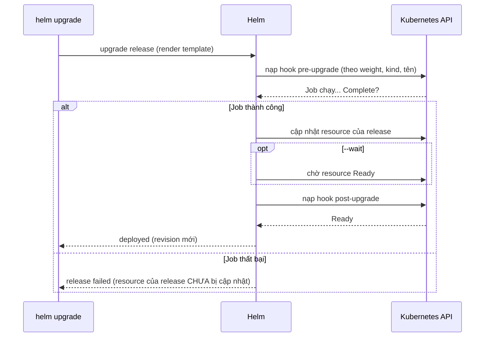
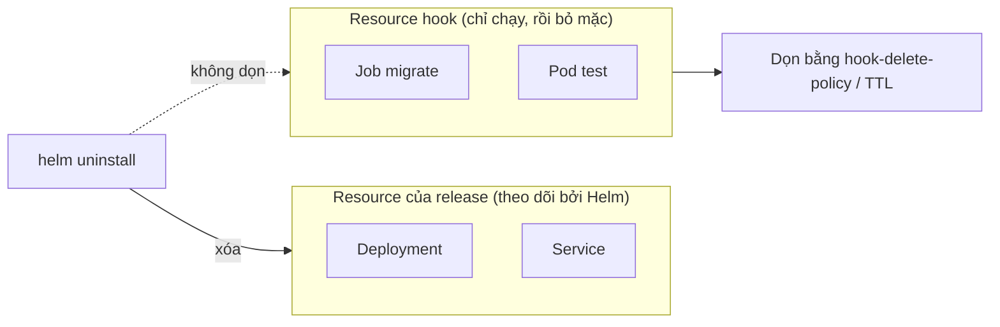
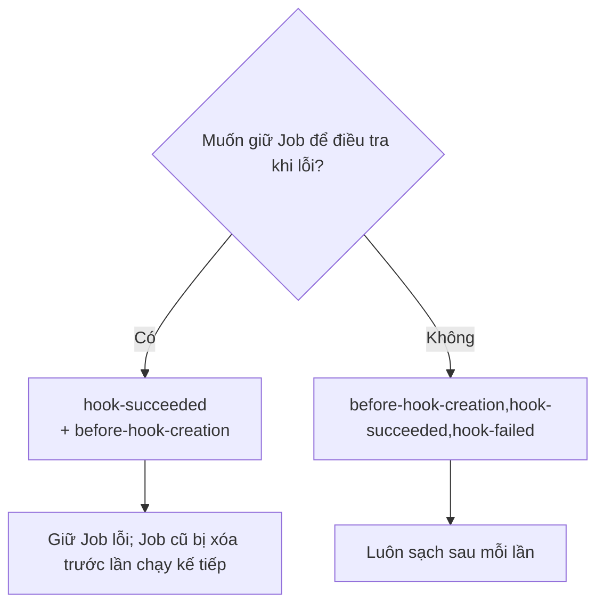

# 6_5_8 Hooks and Tests

> **Khóa học**: Cloud DevOps Basic — Containers & Kubernetes  
> **Phân nhóm**: 6 Domain 6 - Containers and Kubernetes › 6_5 Helm Package Management  
> **Chủ đề**: 6_5_8 Hooks và Tests: can thiệp vòng đời release, Job migrate database, `helm test`  
> **Phiên bản áp dụng**: Kubernetes 1.37, Helm 4.x / Helm 3.x  
> **Trạng thái**: Đối chiếu tài liệu chính thức helm.sh và Argo CD (17-11-2026). ⚠️ **Chưa chạy thử**: máy kiểm chứng chưa cài Helm (việc chạy binary tải về bị chặn). Các hành vi dưới đây là lời của tài liệu; những chỗ là suy luận của tôi được đánh dấu rõ  
> **Phạm vi**: [Topic README](./README.md#6_5_8-hooks-và-tests) · **Checkpoint của người học**: [CHECKLIST](../../CHECKLIST.md#6_5-helm-package-management)  
> **Lab thực hành liên quan**: [lab-6_5_5-hooks-and-helm-test](./README.md#lab-6_5_5-hooks-and-helm-test)  
> **Kiến thức liên quan**: [6_5_5 Release Lifecycle](<./6_5_5 Release Lifecycle.md>) · [6_3_8 DaemonSets Jobs and CronJobs](<../6_3 Kubernetes Architecture and Core Workloads/6_3_8 DaemonSets Jobs and CronJobs.md>) · [6_5_11 Helm Trong GitOps](<./6_5_11 Helm in GitOps.md>)

---

## 0. Tình Huống Mở Đầu: Migration Database Phải Chạy Trước Code Mới

Bản mới của ứng dụng cần thêm một cột vào database. Nếu Pod mới khởi động trước khi migration chạy, nó sẽ lỗi. Nếu migration chạy tách riêng bằng tay, sớm muộn có người quên. Câu trả lời của Helm là **hook**: một Job migration gắn annotation `helm.sh/hook: pre-upgrade`, chạy **sau khi render template, trước khi cập nhật bất kỳ resource nào**.

Điểm mấu chốt nằm ở chữ "chặn":

- Với Job hoặc Pod, Helm **chờ hook chạy xong thành công**. Hook **thất bại thì release thất bại**, upgrade dừng, và Pod của ứng dụng cũ **vẫn chạy** (chưa bị cập nhật). Vì ứng dụng cũ còn phục vụ trong lúc migration chạy, migration phải **tương thích ngược** (expand/contract) và **idempotent**.
- Nhưng có một cái bẫy: tài nguyên do hook tạo **không thuộc release**. `helm uninstall` **không dọn** chúng. Muốn dọn phải dùng `helm.sh/hook-delete-policy` hoặc TTL cho Job.

Bài này còn có `helm test` (smoke test sau deploy). Lưu ý: toàn bộ nội dung dưới đây lấy từ tài liệu Helm và Argo CD, **chưa chạy thử trên cluster**; những chỗ là suy luận được đánh dấu rõ.

---

## 1. Khái Niệm Cốt Lõi & Bản Chất Kỹ Thuật (Core Concepts & Technical Deep Dive)

### 1.1 Hook Là Gì?

Theo tài liệu *Chart Hooks*, hook cho người viết chart **chen vào các điểm xác định trong vòng đời release**. Ví dụ: chạy Job sao lưu DB trước khi cài/nâng cấp; chạy Job thứ hai sau nâng cấp; đưa service ra khỏi luồng traffic trước khi xóa release.

**Hook chỉ là manifest Kubernetes thông thường có annotation đặc biệt.** Vì là file template nên dùng đủ `.Values`, `.Release`, `.Template`. Không có annotation `helm.sh/hook` thì resource là một phần của release.

```yaml
metadata:
  annotations:
    "helm.sh/hook": pre-upgrade
    "helm.sh/hook-weight": "-5"
    "helm.sh/hook-delete-policy": before-hook-creation,hook-succeeded
```

### 1.2 Các Hook Có Sẵn

| Giá trị `helm.sh/hook` | Khi nào chạy (theo tài liệu) |
| :--- | :--- |
| `pre-install` | Sau khi render template, **trước khi** tạo bất kỳ resource nào |
| `post-install` | Sau khi **mọi** resource đã nạp vào Kubernetes |
| `pre-upgrade` | Khi upgrade: sau render, **trước khi** cập nhật resource |
| `post-upgrade` | Sau khi mọi resource đã được nâng cấp |
| `pre-rollback` / `post-rollback` | Trước/sau khi rollback |
| `pre-delete` / `post-delete` | Khi xóa release: trước khi xóa / sau khi xóa hết resource |
| `test` | Khi chạy `helm test` |

- Một resource có thể gắn **nhiều hook**: `"helm.sh/hook": post-install,post-upgrade`.
- Nhiều resource có thể cùng một hook (ví dụ một Secret và một ConfigMap đều `pre-install`).
- Hook `crd-install` **đã bị gỡ** từ Helm 3, thay bằng thư mục `crds/` ([6_5_2](<./6_5_2 Chart Structure.md>)).
- Hook khai báo trong **subchart cũng được thực thi**; chart cha **không có cách** vô hiệu hóa hook của subchart.

### 1.3 Hook Và Vòng Đời Release: Chặn (Blocking)

Với `helm install` có hook `pre-install`/`post-install`, thứ tự theo tài liệu là: cài CRD trong `crds/` → render → chuẩn bị chạy hook `pre-install` (nạp resource hook) → **sắp xếp hook theo weight** (mặc định `0`, từ âm đến dương), rồi theo kind, rồi theo tên → nạp hook weight thấp nhất trước → **chờ hook "Ready"** → nạp các resource của release (nếu có `--wait` thì chờ chúng Ready trước khi chạy `post-install`) → chạy `post-install` → chờ Ready → trả kết quả.

"Ready" của hook phụ thuộc kind:

- **Job hoặc Pod**: Helm **chờ chạy xong thành công**. Nếu hook **thất bại thì release thất bại**. Đây là thao tác **chặn**: client Helm tạm dừng trong lúc Job chạy.
- **Kind khác**: Ready ngay khi Kubernetes đánh dấu đã nạp.
- Nhiều resource trong cùng hook chạy **tuần tự**, theo weight.

Từ Helm 3.2.0, hook cùng weight được cài theo cùng thứ tự với resource thường; trước đó thứ tự không bảo đảm. Tài liệu khuyến nghị **luôn đặt weight** (đặt `0` nếu không quan trọng). Weight là **chuỗi** (`"5"`, `"-5"`), không phải số.

### 1.4 `helm.sh/hook-delete-policy`

| Giá trị | Ý nghĩa |
| :--- | :--- |
| `before-hook-creation` | Xóa resource hook **cũ trước khi** chạy hook mới (**mặc định** nếu không khai báo) |
| `hook-succeeded` | Xóa resource **sau khi hook thành công** |
| `hook-failed` | Xóa resource **nếu hook thất bại** |

Có thể ghi nhiều giá trị, phân tách bằng dấu phẩy. Chú ý: nếu bạn **khai báo tường minh** policy mà **không** gồm `before-hook-creation`, thì hook từ lần chạy trước (ví dụ Job lỗi được giữ lại) **không được xóa trước khi** hook mới khởi chạy. *Suy luận của tôi (chưa kiểm chứng): vì tên đối tượng Kubernetes phải duy nhất, hook Job cùng tên còn sót lại có thể gây lỗi "already exists" ở lần upgrade sau. Đó là lý do lab README hỏi về cách hook cũ có thể chặn upgrade; cần chạy thử để xác nhận thông báo lỗi cụ thể.*

### 1.5 Resource Của Hook **Không** Thuộc Release

Tài liệu nêu rõ: tài nguyên do hook tạo **không được theo dõi/quản lý như một phần của release**. Khi Helm xác nhận hook đã Ready thì **bỏ mặc** resource đó. Hệ quả thực tế: **`helm uninstall` không dọn hook resource**. Muốn dọn: dùng `helm.sh/hook-delete-policy`, hoặc đặt **TTL** cho Job (`ttlSecondsAfterFinished`, xem [6_3_8](<../6_3 Kubernetes Architecture and Core Workloads/6_3_8 DaemonSets Jobs and CronJobs.md>)). Hook resource cần giữ mãi thì annotate `helm.sh/resource-policy: keep`.

### 1.6 Ví Dụ Điển Hình: Job Migrate Database `pre-upgrade`

Chạy migration **trước** khi Pod phiên bản mới nhận traffic: Job `pre-upgrade` với `restartPolicy: Never` (hoặc `OnFailure`), `backoffLimit` hợp lý. Nếu Job thất bại, Helm **dừng upgrade và đánh dấu release thất bại**: ứng dụng cũ vẫn chạy (Pod chưa bị cập nhật). Cần thiết kế migration **tương thích ngược** (expand/contract) vì ứng dụng cũ vẫn phục vụ trong lúc migration chạy; và **idempotent** vì Job có thể chạy lại.

Lưu ý **kết hợp** với `--wait` và `--rollback-on-failure` (Helm 4; Helm 3 là `--atomic`, xem [6_5_5](<./6_5_5 Release Lifecycle.md>)): hook thất bại khiến release thất bại và cờ này kích hoạt rollback tự động.

### 1.7 `helm test`: Smoke Test Sau Deploy

- Test là một **workload (thường Pod hoặc Job)** nằm trong `templates/`, có container chạy lệnh; **thoát mã 0 = thành công**. Bắt buộc có annotation `helm.sh/hook: test`. (Trước Helm 3 dùng `test-success`/`test-failure`; `test-success` vẫn được chấp nhận để tương thích.)
- Chạy bằng `helm test <RELEASE>` trên release đã **deployed**. Cờ hữu ích: `--logs` (in log Pod test sau khi chạy xong, trước khi dọn dẹp), `--filter name=...` (chọn test theo tên), `--timeout` (mặc định `5m0s`).
- `helm create` sinh sẵn `templates/tests/test-connection.yaml` (Pod `busybox` chạy `wget <service>:<port>`).
- Cảnh báo của tài liệu: nếu test **ngay sau install**, có thể gặp **lỗi tạm thời** vì Pod chưa sẵn sàng; hãy chờ rồi chạy lại. Trong CI hãy `helm upgrade --install --wait` trước, sau đó `helm test`.
- Gợi ý nội dung test: kiểm cấu hình từ `values.yaml` được đưa vào đúng; đăng nhập đúng/sai; Service phản hồi và cân tải.

### 1.8 Hook Và GitOps (Argo CD)

Khi Argo CD render chart (chỉ dùng `helm template`), hook **không** được Helm thực thi mà được Argo CD ánh xạ sang hook riêng, theo tài liệu Argo CD:

| Helm | Argo CD |
| :--- | :--- |
| `pre-install`, `pre-upgrade` | `PreSync` |
| `post-install`, `post-upgrade` | `PostSync` |
| `pre-delete` / `post-delete` | `PreDelete` / `PostDelete` |
| `helm.sh/hook-weight` | `sync-wave` |
| `pre-rollback`, `post-rollback`, `test` (`test-success`/`test-failure`) | **Không hỗ trợ** (bị bỏ qua) |

Tài liệu cảnh báo: đây là **tương thích annotation, không bảo đảm ngữ nghĩa giống hệt**; nếu bạn định nghĩa **bất kỳ hook Argo CD nào thì mọi hook Helm bị bỏ qua**; Argo CD không biết đang "install" hay "upgrade" (mọi thao tác là `sync`) nên `pre-install` và `pre-upgrade` **chạy cùng lúc** theo mặc định. Chi tiết ở [6_5_11](<./6_5_11 Helm in GitOps.md>).

---

## 2. Ví Dụ Đời Sống Thực Tế Dễ Hiểu (Intuitive Real-World Analogies)

**Nâng cấp một nhà hàng đang hoạt động:**

- **`pre-upgrade` = kiểm tra và dọn kho trước khi thay đổi thực đơn**: nếu phát hiện kho không đạt chuẩn (Job migrate lỗi), **cuộc cải tạo dừng ngay**, nhà hàng tiếp tục hoạt động với thực đơn cũ.
- **`post-upgrade` = gửi thông báo "thực đơn mới" cho khách** sau khi mọi thứ đã sẵn sàng.
- **`pre-delete` = treo biển "Đóng cửa" và dọn khách ra khỏi sảnh** trước khi tháo dỡ.
- **Hook weight = thứ tự các bước kiểm tra** ghi trong biên bản (số âm làm trước).
- **Hook resource không thuộc release = giấy tờ do đội kiểm tra để lại**: khi nhà hàng đóng cửa vĩnh viễn (`uninstall`), đội cải tạo không dọn giấy tờ đó. Cần dặn trước "dọn sau khi xong" (`hook-delete-policy`) hoặc đặt hạn tự hủy (TTL).
- **`helm test` = thực khách bí mật gọi món thử** sau khi mở cửa: nếu phục vụ trôi chảy (exit 0) thì đạt. Nhưng đừng gọi đúng lúc mới mở bếp (Pod chưa Ready) rồi kết luận nhà hàng tệ.

---

## 3. Kiến Trúc, Luồng Hoạt Động & Hình Ảnh Trực Quan (Architecture, Diagrams & Visual Media)

### 3.1 Vòng Đời `helm upgrade` Có Hook



### 3.2 Hook Resource Không Nằm Trong Release



### 3.3 Chọn Hook Delete Policy



---

## 4. Code Mẫu Trực Quan Hoặc Dòng Lệnh Thực Chiến (Runnable Sample Code / CLI)

> ⚠️ **Chưa chạy thử**. Manifest theo mẫu *Chart Hooks* và *Chart Tests* của Helm. Chạy `helm lint`, `helm template` trước khi dùng ([6_5_6](<./6_5_6 Validating Charts Before Deploy.md>)).  
> Thực hành chi tiết: [lab-6_5_5-hooks-and-helm-test](./README.md#lab-6_5_5-hooks-and-helm-test).

### 4.1 Job Migrate `pre-upgrade` (và `pre-install`)

```yaml
# templates/migrate-job.yaml
apiVersion: batch/v1
kind: Job
metadata:
  name: {{ include "hello-svc.fullname" . }}-migrate-{{ .Release.Revision }}
  labels:
    app.kubernetes.io/managed-by: {{ .Release.Service | quote }}
    app.kubernetes.io/instance: {{ .Release.Name | quote }}
    helm.sh/chart: "{{ .Chart.Name }}-{{ .Chart.Version }}"
  annotations:
    "helm.sh/hook": pre-install,pre-upgrade
    "helm.sh/hook-weight": "-5"
    "helm.sh/hook-delete-policy": before-hook-creation,hook-succeeded
spec:
  backoffLimit: 1
  ttlSecondsAfterFinished: 600          # dọn ngay cả khi Job lỗi (hook-failed không bị xóa theo policy trên)
  template:
    spec:
      restartPolicy: Never
      containers:
      - name: migrate
        image: "{{ .Values.image.repository }}:{{ .Values.image.tag | default .Chart.AppVersion }}"
        command: ["sh", "-c", "echo migrate v{{ .Chart.AppVersion }}; sleep 5"]
```

Ghi chú: tên Job có `{{ .Release.Revision }}` để mỗi lần chạy một tên khác (tránh va chạm tên với hook còn sót); `helper` `hello-svc.fullname` do `helm create` sinh sẵn. Đổi lệnh thành `["sh","-c","exit 1"]` để thử kịch bản hook thất bại: kỳ vọng `helm upgrade` thất bại và Pod ứng dụng chưa bị cập nhật.

### 4.2 Pod Test

```yaml
# templates/tests/test-connection.yaml (dạng do helm create sinh ra, chỉnh cho hello-svc)
apiVersion: v1
kind: Pod
metadata:
  name: "{{ include "hello-svc.fullname" . }}-test-health"
  labels:
    {{- include "hello-svc.labels" . | nindent 4 }}
  annotations:
    "helm.sh/hook": test
spec:
  restartPolicy: Never
  containers:
  - name: wget
    image: busybox
    command: ['wget']
    args: ['-qO-', 'http://{{ include "hello-svc.fullname" . }}:{{ .Values.service.port }}/health']
```

> Mẫu gốc của `helm create` dùng `image: busybox`; ở môi trường thật hãy ghim tag/digest cụ thể ([6_5_10](<./6_5_10 Production Patterns.md>)). `/health` là endpoint của `hello-svc` ([shared/hello-svc](../../shared/hello-svc/Dockerfile)).

### 4.3 Chạy Release Và Test

```bash
helm upgrade --install demo ./hello-svc -n dev --create-namespace --wait --timeout 3m
helm test demo -n dev --logs           # Phase: Succeeded nếu wget thoát 0
helm test demo -n dev --filter name=demo-hello-svc-test-health
```

### 4.4 Dọn Hook Resource Còn Sót

```bash
helm uninstall demo -n dev
kubectl get job,pod -n dev              # Job/Pod hook có thể vẫn còn: không thuộc release
kubectl delete job -n dev -l app.kubernetes.io/instance=demo
```

### 4.5 Kiểm Tra Hook Sẽ Chạy Thế Nào (Không Cần Cluster)

```bash
helm template demo ./hello-svc --show-only templates/migrate-job.yaml
```

---

## 5. Cạm Bẫy Thực Tế & Thực Tiễn Sản Xuất (Production Gotchas & Best Practices)

### 5.1 Cạm Bẫy 1: Migration Không Tương Thích Ngược

- **Bản chất**: `pre-upgrade` chạy khi ứng dụng cũ **vẫn đang phục vụ**; migration xóa cột làm phiên bản cũ lỗi.
- **Khuyến nghị**: Expand/contract: bước 1 thêm (tương thích cả hai bản), bước 2 (release sau) mới dọn.

### 5.2 Cạm Bẫy 2: Hook Job Cũ Còn Sót Làm Upgrade Sau Thất Bại

- **Bản chất**: Hook resource không thuộc release và không bị `helm uninstall` dọn; policy tường minh thiếu `before-hook-creation` có thể giữ Job cũ (suy luận, cần thử).
- **Khuyến nghị**: Luôn có `before-hook-creation`; đặt `ttlSecondsAfterFinished`; hoặc đưa `.Release.Revision` vào tên.

### 5.3 Cạm Bẫy 3: Hook Dài Làm Pipeline Treo

- **Bản chất**: Hook Job/Pod là thao tác chặn; `--timeout` áp dụng cho các thao tác Kubernetes (như chờ Job hook).
- **Khuyến nghị**: Đặt `--timeout` hợp lý; đặt `activeDeadlineSeconds`/`backoffLimit` cho Job.

### 5.4 Cạm Bẫy 4: Thiếu Idempotency

- **Bản chất**: Hook có thể chạy lại (retry, nhiều revision); `pre-install` và `pre-upgrade` cùng gắn một Job sẽ chạy ở cả hai tình huống.
- **Khuyến nghị**: Viết migration idempotent; dùng công cụ migrate có bảng phiên bản (Flyway/Liquibase) thay vì script thô.

### 5.5 Cạm Bẫy 5: `helm test` Ngay Sau `install` Báo Lỗi Giả

- **Bản chất**: Pod chưa sẵn sàng (tài liệu cảnh báo).
- **Khuyến nghị**: `--wait` ở bước deploy trước khi test; test nên có retry ngắn.

### 5.6 Cạm Bẫy 6: Mong Hook `test`/`pre-rollback` Chạy Dưới Argo CD

- **Bản chất**: Argo CD không hỗ trợ `test-*`, `pre-rollback`, `post-rollback`; định nghĩa Argo hook riêng sẽ khiến mọi hook Helm bị bỏ qua.
- **Khuyến nghị**: Nếu dùng Argo CD, chuyển smoke test thành bước pipeline hoặc Argo hook rõ ràng; đọc kỹ bảng ánh xạ.

### 5.7 Cạm Bẫy 7: Hook Subchart Không Tắt Được

- **Bản chất**: Chart cha không thể vô hiệu hóa hook của subchart.
- **Khuyến nghị**: Đọc template của subchart trước khi thêm dependency; chọn subchart cho phép cấu hình hook.

---

## 6. Câu Hỏi Củng Cố Kiến Thức (Active Recall Quiz)

### Câu Hỏi 1: Hook Job `pre-upgrade` Thất Bại Thì Chuyện Gì Xảy Ra Với Release Và Với Ứng Dụng Đang Chạy? (Phỏng vấn)

<details>
<summary>Đáp án</summary>

Hook Job/Pod được Helm chờ chạy xong; thất bại thì **release thất bại** và Helm **chưa cập nhật** các resource của release, nên Pod phiên bản cũ vẫn phục vụ. Kết hợp `--rollback-on-failure` (Helm 4; Helm 3 `--atomic`) để Helm rollback tự động. Vì ứng dụng cũ còn chạy trong lúc migrate, migration phải tương thích ngược.
</details>

### Câu Hỏi 2: Hook Resource Có Bị Xóa Khi `helm uninstall` Không? Làm Sao Dọn?

<details>
<summary>Đáp án</summary>

Không; hook resource không thuộc release. Dọn bằng `helm.sh/hook-delete-policy` (`before-hook-creation`, `hook-succeeded`, `hook-failed`), hoặc `ttlSecondsAfterFinished` của Job; resource cần giữ thì `helm.sh/resource-policy: keep`.
</details>

### Câu Hỏi 3: Giải Thích `hook-weight` Và Chính Sách Xóa Mặc Định

<details>
<summary>Đáp án</summary>

Weight là chuỗi số, có thể âm; hook sắp theo weight tăng dần (âm trước), rồi theo kind, rồi theo tên; hook cùng weight (từ Helm 3.2.0) cài theo thứ tự như resource thường. Mặc định delete policy là `before-hook-creation` (xóa hook cũ trước khi tạo hook mới).
</details>

### Câu Hỏi 4: Một `helm test` Cần Gì Để Được Coi Là Đạt?

<details>
<summary>Đáp án</summary>

Một Pod/Job trong `templates/` có annotation `helm.sh/hook: test` mà container thoát mã **0**. Chạy bằng `helm test <release>` trên release đã deployed; dùng `--logs` để xem log.
</details>

---

## 7. 📚 Nguồn Tài Liệu Chính Thống (Tier-1 Official References)

- [Chart Hooks](https://helm.sh/docs/topics/charts_hooks/) - Các hook, weight, delete policy, hook resource không thuộc release.
- [Chart Tests](https://helm.sh/docs/topics/chart_tests/) - `helm.sh/hook: test`, ví dụ `test-connection.yaml`.
- [helm test](https://helm.sh/docs/helm/helm_test/) - Cờ `--logs`, `--filter`, `--timeout`.
- [Argo CD: Helm (Helm Hooks)](https://argo-cd.readthedocs.io/en/stable/user-guide/helm/) - Ánh xạ Helm hook sang Argo CD hook và các hạn chế.
- [Kubernetes: Jobs](https://kubernetes.io/docs/concepts/workloads/controllers/job/) - `backoffLimit`, `ttlSecondsAfterFinished`, `activeDeadlineSeconds`.
- [Helm 4 Overview](https://helm.sh/docs/overview/) - Cờ mới của Helm 4 liên quan `--rollback-on-failure`.
