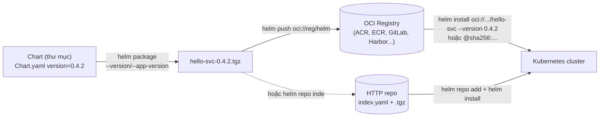
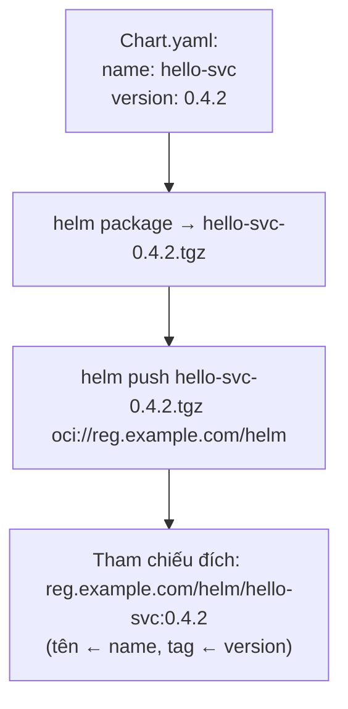
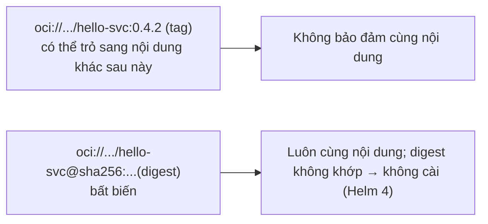

# 6_5_9 Packaging and Distribution

> **Khóa học**: Cloud DevOps Basic — Containers & Kubernetes  
> **Phân nhóm**: 6 Domain 6 - Containers and Kubernetes › 6_5 Helm Package Management  
> **Chủ đề**: 6_5_9 Đóng gói và phân phối chart: `helm package`, repo HTTP (`index.yaml`) so với registry OCI, GitLab, Azure Container Registry  
> **Phiên bản áp dụng**: Kubernetes 1.37, Helm 4.x (v4.3.2, 13-11-2026) / Helm 3.x (≥ 3.8 cho OCI không còn experimental)  
> **Trạng thái**: Đối chiếu tài liệu chính thức Helm, GitLab, Microsoft Learn (17-11-2026). ⚠️ **Chưa chạy thử**: máy kiểm chứng chưa cài Helm (việc chạy binary tải về bị chặn) và chưa có registry thật; nhiều tài liệu Helm liên quan còn ghi *"chưa cập nhật cho Helm 4"* nên cần đối chiếu `helm <lệnh> --help` của bản bạn dùng  
> **Phạm vi**: [Topic README](./README.md#6_5_9-đóng-gói-và-phân-phối) · **Checkpoint của người học**: [CHECKLIST](../../CHECKLIST.md#6_5-helm-package-management)  
> **Lab thực hành liên quan**: [lab-6_5_4-package-and-push-oci](./README.md#lab-6_5_4-package-and-push-oci)  
> **Kiến thức liên quan**: [6_5_2 Chart Structure](<./6_5_2 Chart Structure.md>) (`version` vs `appVersion`) · [6_2_2 Build Context and dockerignore](<../6_2 Container Image Engineering/6_2_2 Build Context and dockerignore.md>) · [6_5_7 Dependencies](<./6_5_7 Dependencies Subcharts and Library Charts.md>)

---

## 1. Khái Niệm Cốt Lõi & Bản Chất Kỹ Thuật (Core Concepts & Technical Deep Dive)

### 1.1 Chart Cũng Là Một "Artifact" Có Phiên Bản

Chart trong thư mục chỉ phục vụ phát triển. Để **chia sẻ và cài lặp lại được**, bạn đóng gói chart thành **chart archive** (`.tgz`) có phiên bản, rồi đưa lên nơi lưu trữ. Giống image container: build một lần, gắn phiên bản, đẩy lên registry, môi trường nào cũng kéo về dùng cùng một artifact.

### 1.2 `helm package`

`helm package [CHART_PATH]` đóng chart thành archive có phiên bản; tên file theo mẫu `<name>-<version>.tgz` (ví dụ `hello-svc-0.1.0.tgz`).

| Cờ | Ý nghĩa |
| :--- | :--- |
| `--version <semver>` | Đặt `version` của chart trong archive |
| `--app-version <str>` | Đặt `appVersion` |
| `-u`, `--dependency-update` | Chạy cập nhật dependency từ `Chart.yaml` vào `charts/` trước khi đóng gói |
| `-d`, `--destination` | Thư mục ghi archive (mặc định `.`) |
| `--sign`, `--key`, `--keyring`, `--passphrase-file` | Ký bằng PGP (tạo file `.prov`) |

Quy ước phiên bản ([6_5_2](<./6_5_2 Chart Structure.md>)): **`version`** là phiên bản **chart** (SemVer 2), **phải tăng mỗi khi đổi bất kỳ thứ gì trong chart** (template, values mặc định, dependency); **`appVersion`** là phiên bản **ứng dụng** được triển khai. Hai thứ độc lập: sửa template mà không đổi code ứng dụng thì tăng `version`, giữ `appVersion`.

> CI thường ghi đè khi đóng gói: `helm package ./hello-svc --version 0.4.2 --app-version 1.7.3` (lấy từ tag git/pipeline). Đừng để hai giá trị này lệch khỏi ý định mà không ai kiểm soát.

### 1.3 Hai Cách Phân Phối: Repo HTTP Và Registry OCI

| | **Chart repository (HTTP)** | **Registry OCI** |
| :--- | :--- | :--- |
| Cấu trúc | Một máy chủ HTTP có `index.yaml` (mục lục) + các file `.tgz` (+ `.prov`) | Registry container dùng chung với image |
| Dùng | `helm repo add <tên> <URL>`, `helm repo update`, `helm install <tên>/<chart>` | `helm install <release> oci://<registry>/<path>/<chart> --version X` |
| Công cụ tạo | `helm repo index` sinh `index.yaml` | `helm push` |
| Đánh giá của tài liệu Helm | Vẫn hỗ trợ; **hướng dẫn repo ghi: cân nhắc dùng OCI registry thay thế** | **Khuyến nghị**: *"recommended to use container registries with OCI support to store and share chart packages"* |

Ưu điểm thực tế của OCI: **chung một hạ tầng** với image (xác thực, RBAC, quét bảo mật, replication, mirror), **không cần dựng và duy trì `index.yaml`**, và có **digest bất biến**.

### 1.4 Làm Việc Với Registry OCI (Theo Tài Liệu Helm)

**Đăng nhập** (`helm registry login`): **host chỉ gồm tên miền (có thể kèm cổng)**, không có scheme hoặc path:

| Ví dụ | Hợp lệ? |
| :--- | :--- |
| `ghcr.io` | ✅ |
| `localhost:5000` | ✅ |
| `https://ghcr.io` | ❌ không cho phép scheme |
| `ghcr.io/myrepo` | ❌ không cho phép path |

Tài liệu *Helm 4 Overview* nêu đây là **breaking change** ở Helm 4: `helm registry login` chỉ nhận **tên miền**, không nhận URL đầy đủ.

**Đẩy chart** (`helm push`):

```bash
helm push mychart-0.1.0.tgz oci://localhost:5000/helm-charts
# Pushed: localhost:5000/helm-charts/mychart:0.1.0
# Digest: sha256:...
```

- Chỉ đẩy được file **`.tgz` đã tạo trước bằng `helm package`**.
- Tham chiếu đích **bắt buộc có tiền tố `oci://`** và **không chứa tên chart lẫn tag**: tên (basename) suy ra từ `name` trong chart, **tag suy ra từ `version`** (đây là yêu cầu nghiêm ngặt hiện tại).
- Một số registry yêu cầu **tạo trước repository/namespace**, nếu không `helm push` báo lỗi.
- Nếu có file provenance `.prov` cạnh `.tgz`, nó **được đẩy kèm** (thêm một layer).
- Cờ liên quan kết nối: `--plain-http` (HTTP không TLS), `--insecure-skip-tls-verify`, `--ca-file`, `--cert-file`, `--key-file`, `--username`, `--password`.

**Dùng chart từ OCI**: `helm pull`, `helm show`, `helm template`, `helm install`, `helm upgrade` đều hỗ trợ `oci://`. Khi **tải** chart, đường dẫn **có tên chart** (khác `push`), và chọn phiên bản bằng `--version`:

```bash
helm pull     oci://localhost:5000/helm-charts/mychart --version 0.1.0
helm show all oci://localhost:5000/helm-charts/mychart --version 0.1.0
helm install myrelease oci://localhost:5000/helm-charts/mychart --version 0.1.0
helm upgrade myrelease oci://localhost:5000/helm-charts/mychart --version 0.2.0
```

**Cài theo digest**: *"Installing a chart with a digest is more secure than a tag because digests are immutable"*:

```bash
helm install myrelease oci://localhost:5000/helm-charts/mychart@sha256:<digest>
```

Helm 4 nêu thêm: chart có **digest không khớp thì không được cài** (hỗ trợ supply chain). Tag có thể bị đẩy đè; digest thì không.

**Dependency từ OCI** (xem [6_5_7](<./6_5_7 Dependencies Subcharts and Library Charts.md>)): `repository: "oci://localhost:5000/myrepo"` (không kèm tên chart).

**Registry lưu chart ở dạng OCI manifest** với `mediaType` riêng của Helm: config `application/vnd.cncf.helm.config.v1+json` và layer nội dung `application/vnd.cncf.helm.chart.content.v1.tar+gzip`, nên mọi công cụ OCI-compliant (quét, mirror, replication) làm việc được với chart.

> Registry chạy ngay trên máy phát triển (Docker Registry hoặc zot) theo tài liệu Helm **chỉ nên dùng để kiểm thử**.

### 1.5 Repo HTTP Truyền Thống (Để Đọc Hệ Thống Cũ)

Chart repository là một máy chủ HTTP có `index.yaml` và (thường) các `.tgz`. Bạn có thể host trên GCS/S3, GitHub Pages hay web server riêng. Cộng đồng có **Artifact Hub** làm nơi tìm chart công khai. Quy trình:

```bash
helm package ./hello-svc -d ./public
helm repo index ./public --url https://charts.example.com     # sinh/cập nhật index.yaml
# upload thư mục public/ lên máy chủ HTTP
helm repo add mycharts https://charts.example.com
helm repo update
helm install demo mycharts/hello-svc --version 0.1.0
```

> ⚠️ `helm repo index --url` và luồng upload ở trên là quy trình chuẩn nhưng **chưa chạy thử**; đối chiếu trang *The Chart Repository Guide* của Helm.

### 1.6 GitLab (Cho Pipeline GitLab CI Ở 6_6)

Theo tài liệu GitLab có hai đường:

1. **Package registry kiểu Helm repository** (tài liệu *Helm charts in the package registry*): xác thực bằng **personal access token** (scope `api`), **deploy token** (`read_package_registry`/`write_package_registry`) hoặc **CI/CD job token**. Chart được đẩy lên một **channel** (ví dụ `stable`, `devel`) bằng `curl` (`POST` form `chart=@mychart-0.1.0.tgz` tới `.../api/v4/projects/<project_id>/packages/helm/api/<channel>/charts`) hoặc plugin `helm cm-push`. Trong CI dùng `CI_JOB_TOKEN` (user `gitlab-ci-token`). Cài bằng `helm repo add --username ... --password ... <tên> https://gitlab.example.com/api/v4/projects/<project_id>/packages/helm/<channel>`. Nếu có chart trùng tên/phiên bản, GitLab luôn trả bản **mới nhất**.
2. **Container registry của GitLab dùng như OCI registry**: tài liệu *GitLab container registry* ghi registry tuân thủ OCI distribution spec và cho phép lưu các định dạng OCI như **Helm 3+ chart packages**. Đường dẫn cụ thể (`oci://registry...`) và cách xác thực cần lấy từ tài liệu GitLab của phiên bản bạn dùng.

Lưu ý tên plugin: `helm cm-push` là tên mới của plugin trước đây gọi `helm-push` (đổi tên từ v0.10.0 vì xung đột với lệnh `helm push` tích hợp sẵn).

### 1.7 Azure Container Registry (ACR)

Theo Microsoft Learn *Push and pull Helm charts to an Azure container registry*:

- ACR lưu chart dạng **OCI artifact** (hỗ trợ GA). Tài liệu viết cho Helm 3; yêu cầu Helm **≥ 3.8.0** vì OCI trước đó còn experimental (tài liệu có chỗ ghi 3.7, chỗ ghi 3.8.0: lấy mốc cao hơn). Tài liệu này chưa nói về Helm 4; các lệnh `registry login/push/install` trùng với tài liệu Helm 4, nhưng hãy kiểm tra `--help` của bản bạn dùng.
- ⚠️ Nhóm lệnh `az acr helm` (kho Helm cũ) **đã bị gỡ từ 15-09-2025**: dùng OCI.
- Xác thực qua `helm registry login <registry>.azurecr.io` với một trong: service principal (vai trò **AcrPush**, hoặc **Container Registry Repository Writer** nếu registry bật ABAC), danh tính Microsoft Entra (`az acr login --name <acr> --expose-token`, user `00000000-0000-0000-0000-000000000000`), hoặc repository-scoped token.
- Đẩy: `helm push hello-world-0.1.0.tgz oci://<acr>.azurecr.io/helm`; cài: `helm install <release> oci://<acr>.azurecr.io/helm/hello-world --version 0.1.0`.
- Tên chart: chữ thường và chữ-số (theo hướng dẫn trong tài liệu).
- Có thể xem bằng `az acr repository show` và `az acr manifest list-metadata` (thấy `configMediaType: application/vnd.cncf.helm.config.v1+json`).

### 1.8 Toàn Vẹn Và Chữ Ký

- **Provenance**: `helm package --sign` tạo `.prov` (chữ ký PGP). Helm cho phép đẩy `.prov` kèm chart OCI.
- **Sigstore**: plugin `helm-sigstore` cho phép ký chart OCI bằng cùng công cụ ký image, thay cho provenance GPG.
- **Digest** (1.4) là cách pin đơn giản nhất.

*Chi tiết xác minh chữ ký (`helm verify`, `--verify`) xem trang Provenance and Integrity của Helm; chưa chạy thử ở bài này.*

---

## 2. Ví Dụ Đời Sống Thực Tế Dễ Hiểu (Intuitive Real-World Analogies)

**Chart như một cuốn sách xuất bản:**

- **`helm package` = in sách ra bản in có số phiên bản** ("Công thức nấu ăn, tái bản lần 0.4.2"). Nội dung đổi (dù chỉ một dấu phẩy) thì **phải tăng số tái bản** (`version`); còn "món ăn" ghi trong sách là món phiên bản nào (`appVersion`) là chuyện khác.
- **Repo HTTP + `index.yaml` = một nhà sách tự quản có cuốn mục lục viết tay**: bạn phải cập nhật mục lục mỗi khi nhập sách mới.
- **Registry OCI = nhập sách vào chính hệ thống kho/vận chuyển chuyên nghiệp** đang chở "thùng hàng" (image): dùng chung xe tải, nhân viên kiểm soát, hệ thống an ninh, không cần cuốn mục lục riêng.
- **Tag = nhãn dán "tái bản mới nhất"** (có thể bị dán đè sang cuốn khác); **digest = mã vạch duy nhất của đúng cuốn sách đó**, đổi nội dung là đổi mã vạch.
- **Ký provenance/sigstore = con dấu của nhà xuất bản** để người đọc biết sách không bị tráo ruột.
- **`oci://host` đăng nhập chỉ bằng tên miền = bảo vệ chỉ cần biết "tòa nhà nào"**, không cần số phòng (path).

---

## 3. Kiến Trúc, Luồng Hoạt Động & Hình Ảnh Trực Quan (Architecture, Diagrams & Visual Media)

### 3.1 Từ Source Đến Cluster



### 3.2 `helm push` Suy Ra Tên Và Tag Như Thế Nào



### 3.3 Tag So Với Digest



---

## 4. Code Mẫu Trực Quan Hoặc Dòng Lệnh Thực Chiến (Runnable Sample Code / CLI)

> ⚠️ **Chưa chạy thử** (xem phần Trạng thái). Các lệnh bám theo tài liệu Helm, GitLab, Microsoft Learn. Dùng registry cục bộ **chỉ cho kiểm thử**.  
> Thực hành chi tiết: [lab-6_5_4-package-and-push-oci](./README.md#lab-6_5_4-package-and-push-oci).

### 4.1 Đóng Gói

```bash
helm lint ./hello-svc
helm package ./hello-svc --version 0.1.0 --app-version 1.0.0 -d ./dist
# Successfully packaged chart and saved it to: ./dist/hello-svc-0.1.0.tgz
tar -tzf ./dist/hello-svc-0.1.0.tgz | head
```

### 4.2 Registry Cục Bộ Để Thử (Podman)

```bash
podman run -d --name reg -p 5000:5000 docker.io/library/registry:2     # registry không TLS, chỉ để thử

helm push ./dist/hello-svc-0.1.0.tgz oci://localhost:5000/charts --plain-http
helm show chart oci://localhost:5000/charts/hello-svc --version 0.1.0 --plain-http
helm install demo oci://localhost:5000/charts/hello-svc --version 0.1.0 --plain-http -n dev --create-namespace
```

> Cờ `--plain-http` có trong tài liệu `helm push`, `helm package`, `helm install`, `helm show chart` và `helm registry login` (Helm 4.3). Bản Helm cũ hơn có thể khác: xác nhận bằng `--help`. Lab 6_2_2 đã dựng registry cục bộ: dùng lại.

### 4.3 Registry Có Xác Thực (GHCR/GitLab/Harbor...)

```bash
# Chỉ tên miền, không có https:// hay path
echo "$REGISTRY_TOKEN" | helm registry login registry.example.com -u "$REGISTRY_USER" --password-stdin
helm push ./dist/hello-svc-0.1.0.tgz oci://registry.example.com/team/charts
helm registry logout registry.example.com
```

> `--password-stdin` (đọc mật khẩu/token từ stdin) có trong tài liệu `helm registry login`; dùng nó để không đưa token vào dòng lệnh/lịch sử shell. Registry không TLS có thêm `--plain-http` và `--insecure`.

### 4.4 Azure Container Registry (Theo Microsoft Learn)

```bash
ACR_NAME=<tên-acr>
# Danh tính Microsoft Entra của bạn:
USER_NAME="00000000-0000-0000-0000-000000000000"
PASSWORD=$(az acr login --name $ACR_NAME --expose-token --output tsv --query accessToken)
helm registry login $ACR_NAME.azurecr.io --username $USER_NAME --password $PASSWORD

helm push hello-svc-0.1.0.tgz oci://$ACR_NAME.azurecr.io/helm
az acr repository show --name $ACR_NAME --repository helm/hello-svc
helm install demo oci://$ACR_NAME.azurecr.io/helm/hello-svc --version 0.1.0
```

### 4.5 Cài Theo Digest

```bash
helm pull oci://localhost:5000/charts/hello-svc --version 0.1.0 --plain-http   # in ra Digest: sha256:...
helm install demo oci://localhost:5000/charts/hello-svc@sha256:<digest-vừa-in> --plain-http
```

### 4.6 GitLab CI: Đẩy Chart Lên Package Registry (Theo Tài Liệu GitLab)

```yaml
publish-chart:
  stage: upload
  image: curlimages/curl:latest
  script:
    - 'curl --fail-with-body --request POST --user gitlab-ci-token:$CI_JOB_TOKEN --form "chart=@dist/hello-svc-0.1.0.tgz" "${CI_API_V4_URL}/projects/${CI_PROJECT_ID}/packages/helm/api/stable/charts"'
```

> Phần pipeline GitLab đầy đủ học ở 6_6. Image `curlimages/curl:latest` lấy nguyên từ tài liệu GitLab; trong sản xuất hãy ghim tag/digest.

---

## 5. Cạm Bẫy Thực Tế & Thực Tiễn Sản Xuất (Production Gotchas & Best Practices)

### 5.1 Cạm Bẫy 1: Quên Tăng `version` Khi Đổi Chart

- **Hiện tượng**: Đẩy lại cùng `version` với nội dung khác; môi trường kéo bản cũ từ cache, hoặc registry từ chối ghi đè.
- **Bản chất**: Tag của OCI suy ra từ `version`; tag có thể bị trỏ lại.
- **Khuyến nghị**: Tăng `version` mỗi lần đổi chart, tự động hóa từ CI (`--version`); production ghim digest.

### 5.2 Cạm Bẫy 2: Truyền `oci://` Kèm Tên Chart Hoặc Tag Cho `helm push`

- **Bản chất**: `push` suy ra tên và tag; tham chiếu đích không được chứa basename hoặc tag (yêu cầu nghiêm ngặt).
- **Khuyến nghị**: `helm push x-0.1.0.tgz oci://registry/path`; còn `pull/install` thì dùng đường dẫn đầy đủ **có tên chart**.

### 5.3 Cạm Bẫy 3: `helm registry login` Bằng URL Đầy Đủ (Helm 4)

- **Bản chất**: Helm 4 chỉ nhận **tên miền** (breaking change); script cũ viết cho Helm 3 có thể truyền `https://...` hay có path.
- **Khuyến nghị**: Kiểm tra và sửa mọi script CI khi nâng lên Helm 4.

### 5.4 Cạm Bẫy 4: Registry Chưa Có Repository/Namespace

- **Bản chất**: Một số registry yêu cầu tạo trước repository/namespace, nếu không `push` lỗi.
- **Khuyến nghị**: Đọc tài liệu của registry bạn dùng (ACR, GitLab, Harbor, ECR...) để biết có cần tạo repository/namespace trước không, và thử `helm push` trên môi trường thử.

### 5.5 Cạm Bẫy 5: Dùng Registry Cục Bộ Không TLS Ngoài Môi Trường Thử

- **Bản chất**: Tài liệu Helm chỉ khuyến cáo dùng cho kiểm thử.
- **Khuyến nghị**: Production dùng registry có TLS, xác thực, RBAC, quét và sao lưu.

### 5.6 Cạm Bẫy 6: Dùng `az acr helm` Hoặc Quy Trình Repo Cũ Trên ACR

- **Bản chất**: `az acr helm` đã bị gỡ từ 15-09-2025.
- **Khuyến nghị**: Chuyển sang OCI (`helm registry login/push/install`).

### 5.7 Cạm Bẫy 7: Nhầm Plugin `helm-push` (ChartMuseum) Với Lệnh Tích Hợp

- **Bản chất**: Plugin cũ xung đột với `helm push` tích hợp; đã đổi tên thành `cm-push` từ v0.10.0.
- **Khuyến nghị**: Với GitLab package registry dạng repo, dùng `helm cm-push` hoặc `curl`.

---

## 6. Câu Hỏi Củng Cố Kiến Thức (Active Recall Quiz)

### Câu Hỏi 1: `helm push` Suy Ra Tên Và Tag Của Chart Từ Đâu? (Phỏng vấn)

<details>
<summary>Đáp án</summary>

Từ chính chart: **tên** từ `name`, **tag** từ `version` trong `Chart.yaml`. Vì vậy tham chiếu đích (`oci://registry/path`) không được chứa tên chart hay tag. Muốn đổi tag phải đổi `version` (hoặc `helm package --version`).
</details>

### Câu Hỏi 2: Tag Và Digest Khác Nhau Thế Nào Khi Cài Chart? Vì Sao Production Nên Ghim Digest?

<details>
<summary>Đáp án</summary>

Tag là nhãn có thể bị đẩy đè sang nội dung khác; digest (`@sha256:...`) bất biến, xác định đúng nội dung. Ghim digest bảo đảm triển khai tái lập được và chống tráo chart; Helm 4 không cài nếu digest không khớp.
</details>

### Câu Hỏi 3: OCI Registry Hơn Repo HTTP + `index.yaml` Ở Điểm Nào?

<details>
<summary>Đáp án</summary>

Dùng chung hạ tầng với image (xác thực, RBAC, quét, replication), không cần dựng/duy trì `index.yaml`, có digest bất biến; tài liệu Helm khuyến nghị dùng registry OCI để lưu và chia sẻ chart.
</details>

### Câu Hỏi 4: `version` Và `appVersion` Khác Nhau, Và Khi Nào Tăng Từng Cái?

<details>
<summary>Đáp án</summary>

`version` là phiên bản chart, tăng mỗi khi đổi bất cứ thứ gì trong chart; `appVersion` là phiên bản ứng dụng được triển khai. Sửa template mà không đổi ứng dụng: tăng `version`, giữ `appVersion`. Đổi image ứng dụng: đổi `appVersion` (thường kéo theo tăng `version` vì chart đã đổi).
</details>

---

## 7. 📚 Nguồn Tài Liệu Chính Thống (Tier-1 Official References)

- [Use OCI-based registries](https://helm.sh/docs/topics/registries/) - `registry login`, `push`, `pull`, cài theo digest, dependency OCI, media type (trang ghi chú chưa cập nhật cho Helm 4).
- [helm package](https://helm.sh/docs/helm/helm_package/) - Cờ `--version`, `--app-version`, `--dependency-update`, `--sign`.
- [helm push](https://helm.sh/docs/helm/helm_push/) - Cờ `--plain-http`, `--ca-file`...
- [The Chart Repository Guide](https://helm.sh/docs/topics/chart_repository/) - Repo HTTP, `index.yaml`.
- [Helm Provenance and Integrity](https://helm.sh/docs/topics/provenance/) - Ký và xác minh chart.
- [Helm 4 Overview](https://helm.sh/docs/overview/) - `registry login` chỉ nhận tên miền, cài theo digest, thay đổi khác.
- [Helm charts in the package registry (GitLab)](https://docs.gitlab.com/user/packages/helm_repository/) - Publish/cài chart qua package registry, channel, token.
- [GitLab container registry](https://docs.gitlab.com/user/packages/container_registry/) - Hỗ trợ OCI, bao gồm chart Helm 3+.
- [Push and pull Helm charts to an Azure container registry](https://learn.microsoft.com/azure/container-registry/container-registry-helm-repos) - Lưu chart dạng OCI trong ACR; `az acr helm` đã retire.
