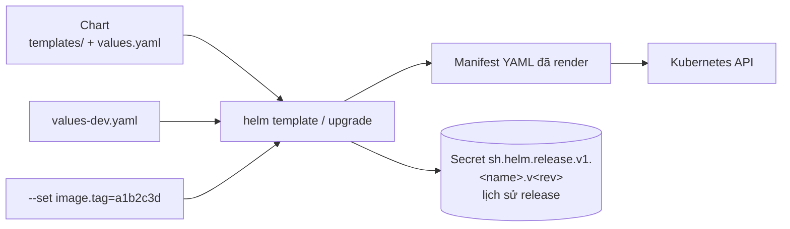

# 6_5 Helm Package Management

> **Khóa học**: Cloud DevOps Basic — Containers & Kubernetes
> **Phân nhóm**: 6 Domain 6 - Containers and Kubernetes › 6_5 Helm Package Management
> **Chủ đề**: Chart, template, values cho nhiều môi trường, vòng đời release (install/upgrade/rollback), hook, dependency, phân phối chart qua registry OCI
> **Trạng thái**: Định nghĩa (nội dung cần học + đề bài lab + checkpoint), chưa chạy thử, 15-11-2026
> **Lộ trình tổng**: [container/README.md](../../README.md) · **Checkpoint**: [CHECKLIST.md](../../CHECKLIST.md#6_5-helm-package-management)

---

## 🎯 Mục Tiêu

Ở 6_3/6_4 bạn viết YAML tay cho một môi trường. Thực tế có hàng chục service × nhiều môi trường. Helm giải quyết bằng **template + values + release có lịch sử**. Nếu bạn quen Terraform: chart ≈ module, `values.yaml` ≈ variables, release revision ≈ state có lịch sử để rollback.

> ⚠️ **Phiên bản**: Mặc định học **Helm 4** (phát hành 12-11-2025). Helm 3 chỉ còn vá bảo mật tới 10-02-2027 theo blog Helm. Khác biệt cần nhớ: `--atomic` → `--rollback-on-failure`, `--force` → `--force-replace` (cờ cũ vẫn chạy nhưng báo deprecated); release **mới** dùng server-side apply mặc định. Tài liệu, blog và CI cũ bạn đọc phần lớn vẫn viết cho Helm 3.

---

## 📚 Những Gì Cần Học

### 6_5_1 Khái Niệm Cốt Lõi
- [ ] **Chart** (gói), **Release** (một lần cài chart vào namespace), **Revision** (mỗi lần upgrade/rollback), **Repository** (HTTP `index.yaml` hoặc registry OCI).
- [ ] Helm là client-only từ Helm 3 (không còn Tiller); quyền là quyền của kubeconfig đang dùng.
- [ ] Lịch sử release lưu thành Secret trong namespace của release.
- [ ] Khác biệt Helm 3 vs Helm 4 nêu ở cảnh báo phía trên.

### 6_5_2 Cấu Trúc Chart
- [ ] `Chart.yaml`: `apiVersion: v2`, `name`, **`version`** (phiên bản chart, SemVer) vs **`appVersion`** (phiên bản ứng dụng), `type: application | library`, `dependencies`.
- [ ] `values.yaml`, `values.schema.json` (kiểm tra kiểu dữ liệu values), `templates/`, `templates/_helpers.tpl`, `templates/NOTES.txt`, `charts/`, `.helmignore`.
- [ ] `helm create` sinh khung chart: đọc hiểu từng file trước khi xóa bớt.

### 6_5_3 Ngôn Ngữ Template
- [ ] Go template + hàm Sprig; object có sẵn: `.Values`, `.Release`, `.Chart`, `.Capabilities`, `.Files`, `.Template`.
- [ ] `if` / `with` / `range`, biến `$`, scope và lỗi "nil pointer" khi value thiếu.
- [ ] `include` + `define` (helper đặt tên, nhãn chung), `toYaml | nindent N`, `quote`, `default`, **`required`**, `tpl`, `lookup`.
- [ ] Kiểm soát khoảng trắng `{{-` / `-}}`: nguồn lỗi YAML phổ biến nhất.

### 6_5_4 Values và Thứ Tự Ưu Tiên
- [ ] Thứ tự đè: `values.yaml` của chart < values của chart cha < các file `-f` (file sau đè file trước) < `--set` / `--set-string` / `--set-file`.
- [ ] Mẫu tổ chức: `values.yaml` (mặc định an toàn) + `values-dev.yaml` / `values-staging.yaml` / `values-prod.yaml` (chỉ phần khác).
- [ ] `--set` cho giá trị do pipeline sinh ra (image tag/digest), không cho cấu hình lâu dài.
- [ ] `helm get values <release> [--all]` để biết release đang chạy với values nào.

### 6_5_5 Vòng Đời Release
- [ ] `helm install`, **`helm upgrade --install`** (idempotent, dùng trong CI), `helm rollback <release> <rev>`, `helm uninstall`, `helm history`, `helm status`, `helm get manifest`.
- [ ] `--wait`, `--timeout`, `--rollback-on-failure` (Helm 4; Helm 3 là `--atomic`), `--create-namespace`, `-n`.
- [ ] Rollback tạo **revision mới** (không xóa lịch sử).
- [ ] Lỗi `another operation (install/upgrade/rollback) is in progress`: release kẹt ở trạng thái `pending-*` khi job CI bị hủy giữa chừng, cách xử lý.
- [ ] Sửa tay bằng `kubectl edit` gây lệch (drift) so với release; three-way merge / server-side apply xử lý drift ra sao.

### 6_5_6 Kiểm Tra Trước Khi Deploy
- [ ] `helm lint` (`--strict`), `helm template` (render offline), `helm upgrade --dry-run=server` (gửi lên API để kiểm tra nhưng không lưu).
- [ ] Kiểm tra schema manifest đã render (ví dụ kubeconform, công cụ cộng đồng) và so sánh thay đổi (plugin `helm-diff`, cộng đồng).
- [ ] `values.schema.json` bắt lỗi kiểu dữ liệu ngay khi `install`/`template`.

### 6_5_7 Dependency, Subchart và Library Chart
- [ ] `dependencies` trong `Chart.yaml`, `helm dependency update/build`, `Chart.lock`.
- [ ] Bật/tắt subchart bằng `condition`; truyền values cho subchart qua khóa tên subchart; `global`.
- [ ] **Library chart**: chia sẻ template chung cho nhiều microservice (một "umbrella"/"base chart" của công ty).

### 6_5_8 Hooks và Tests
- [ ] Hook annotation `helm.sh/hook`: `pre-install`, `pre-upgrade`, `post-upgrade`, `pre-delete`...; `helm.sh/hook-weight`, `helm.sh/hook-delete-policy`.
- [ ] Ví dụ thực tế: Job migrate database chạy `pre-upgrade`; hook thất bại làm upgrade thất bại.
- [ ] `helm test` với Pod có annotation `helm.sh/hook: test` (smoke test sau deploy).

### 6_5_9 Đóng Gói và Phân Phối
- [ ] `helm package` (tạo `.tgz`), `helm push <chart>.tgz oci://<registry>/<path>`, `helm install ... oci://...`.
- [ ] Repo HTTP truyền thống (`helm repo add/update`, `index.yaml`) vs registry OCI (cùng chỗ với image).
- [ ] GitLab: lưu chart trong package registry hoặc container registry dạng OCI.
- [ ] Tăng `version` của chart mỗi khi đổi template; tách biệt với `appVersion`.

### 6_5_10 Mẫu Thực Chiến
- [ ] Annotation `checksum/config: {{ include (print $.Template.BasePath "/configmap.yaml") . | sha256sum }}` để Pod rollout khi ConfigMap đổi.
- [ ] Image theo digest: `image: "{{ .Values.image.repository }}@{{ .Values.image.digest }}"` khi có digest, fallback về tag.
- [ ] Nhãn chuẩn `app.kubernetes.io/name`, `instance`, `version`, `managed-by`, `helm.sh/chart`.
- [ ] Không đưa secret thật vào values trong Git (dùng External Secrets / Sealed Secrets / biến CI được bảo vệ).

### 6_5_11 Helm Trong GitOps (Khái Niệm)
- [ ] Push-based (CI chạy `helm upgrade`) vs pull-based (Argo CD / Flux render chart và đồng bộ từ Git).
- [ ] Khi dùng Argo CD, Helm chỉ đóng vai trò render template; lịch sử nằm ở Git và Argo CD, không ở `helm history`.

---

## 🧪 Labs

> **Bản định nghĩa**: chưa tạo thư mục `labs/`, chưa chạy thử. Dùng lại manifest từ 6_3/6_4 làm đầu vào.

| Lab | Nội dung | Thời gian | Trạng thái |
| :--- | :--- | :---: | :--- |
| lab-6_5_1-chart-from-manifests | Biến manifest `hello-svc` thành chart, helper, `required` | 60–90 phút | Định nghĩa |
| lab-6_5_2-multi-environment-values | `values-dev`/`values-prod`, schema, so sánh output render | 45 phút | Định nghĩa |
| lab-6_5_3-upgrade-rollback-and-failure | Upgrade, upgrade lỗi tự rollback, release kẹt `pending-upgrade` | 60 phút | Định nghĩa |
| lab-6_5_4-package-and-push-oci | Package, push chart lên registry cục bộ, cài từ `oci://` | 30 phút | Định nghĩa |
| lab-6_5_5-hooks-and-helm-test | Job migrate `pre-upgrade`, `helm test` smoke test | 45 phút | Định nghĩa (nâng cao) |

### lab-6_5_1-chart-from-manifests
- **Các bước chính**:
  1. `helm create hello-svc`, đọc từng file sinh ra, xóa phần không dùng (HPA, Ingress, ServiceAccount nếu chưa cần).
  2. Tham số hóa: `replicaCount`, `image.repository/tag/digest/pullPolicy`, `resources`, `probes`, `env`, `service.port`.
  3. Dùng `required "image.tag là bắt buộc"` để chặn deploy thiếu tag.
  4. `helm lint --strict`, `helm template demo ./hello-svc | less`, so với manifest gốc của 6_3.
  5. `helm upgrade --install demo ./hello-svc -n dev --create-namespace --set image.tag=1.0.0 --wait`.
- **Checkpoint**:
  - [ ] `helm template` không truyền `image.tag` → báo lỗi rõ ràng.
  - [ ] Manifest render ra tương đương manifest viết tay.

### lab-6_5_2-multi-environment-values
- **Các bước chính**:
  1. `values-dev.yaml` (1 replica, resource nhỏ, log DEBUG) và `values-prod.yaml` (3 replica, resource lớn hơn, `podAntiAffinity` mềm).
  2. `diff <(helm template x . -f values-dev.yaml) <(helm template x . -f values-prod.yaml)`.
  3. Thêm `values.schema.json` yêu cầu `replicaCount` là số nguyên ≥ 1; thử truyền `--set replicaCount=abc`.
  4. Kiểm tra thứ tự ưu tiên: cùng một khóa đặt ở `values.yaml`, `-f`, `--set`.
- **Checkpoint**:
  - [ ] Giải thích được thứ tự ưu tiên values mà không cần tra tài liệu.

### lab-6_5_3-upgrade-rollback-and-failure
- **Các bước chính**:
  1. Cài 1.0.0 → upgrade 2.0.0 → `helm history`; `kubectl get secret -l owner=helm`.
  2. Upgrade với tag không tồn tại, **không** có `--wait` → Helm báo thành công dù Pod lỗi. Ghi lại vì sao.
  3. Lặp lại với `--wait --timeout 2m --rollback-on-failure` (Helm 3: `--atomic`) → tự rollback.
  4. `helm rollback demo <rev>`; quan sát revision mới được tạo.
  5. Ngắt (Ctrl+C) giữa một lần upgrade có `--wait` → thử upgrade lại, đọc lỗi `another operation ... in progress`, tìm cách gỡ (rollback về revision tốt gần nhất).
  6. `kubectl scale` tay rồi `helm upgrade` lại: quan sát drift.
- **Checkpoint**:
  - [ ] Giải thích được vì sao pipeline CI **phải** dùng `--wait` (hoặc kiểm tra rollout) mới biết deploy hỏng.
  - [ ] Gỡ được release kẹt `pending-upgrade` và nói được nguyên nhân.

### lab-6_5_4-package-and-push-oci
- **Các bước chính**: chạy registry cục bộ (như lab 6_2_2), `helm package`, `helm push hello-svc-0.1.0.tgz oci://localhost:5000/charts` (registry không TLS cần cờ phù hợp, xem `helm push --help`), `helm show values oci://...`, cài từ OCI.
- **Checkpoint**:
  - [ ] Cài được chart chỉ bằng đường dẫn `oci://` với `--version` cố định.

### lab-6_5_5-hooks-and-helm-test
- **Các bước chính**: Job `pre-upgrade` in ra "migrate v<appVersion>" và `sleep 5`; thử cho Job `exit 1` → upgrade fail; thêm Pod test gọi `wget -qO- http://<service>/health`, chạy `helm test`.
- **Checkpoint**:
  - [ ] Giải thích được `hook-delete-policy` và vì sao hook Job cũ có thể chặn lần upgrade sau.

---

## 📚 Nguồn Tài Liệu Chính Thống (Official References)
- [Helm - Overview (Helm 4)](https://helm.sh/docs/overview/) - Thay đổi trong Helm 4: đổi tên cờ, server-side apply.
- [Helm 4 Released](https://helm.sh/blog/helm-4-released) và [Helm 3 End of Life](https://helm.sh/blog/helm-v3-end-of-life) - Blog chính thức về phát hành và lịch hỗ trợ.
- [Charts](https://helm.sh/docs/topics/charts/) - Cấu trúc chart, `Chart.yaml`, dependency, schema.
- [Chart Template Guide](https://helm.sh/docs/chart_template_guide/) - Template, built-in objects, hàm, named template.
- [Values Files](https://helm.sh/docs/chart_template_guide/values_files/) - Values và thứ tự ưu tiên.
- [Chart Hooks](https://helm.sh/docs/topics/charts_hooks/) và [Chart Tests](https://helm.sh/docs/topics/chart_tests/) - Hook và `helm test`.
- [Use OCI-based registries](https://helm.sh/docs/topics/registries/) - Push/pull chart qua OCI.
- [Chart Best Practices](https://helm.sh/docs/chart_best_practices/) - Quy ước đặt tên, nhãn, values.
- [Helm commands](https://helm.sh/docs/helm/) - Tham chiếu lệnh `helm upgrade`, `rollback`, `push`.
- [GitLab Helm charts in the package registry](https://docs.gitlab.com/user/packages/helm_repository/) - Lưu chart trong GitLab.
