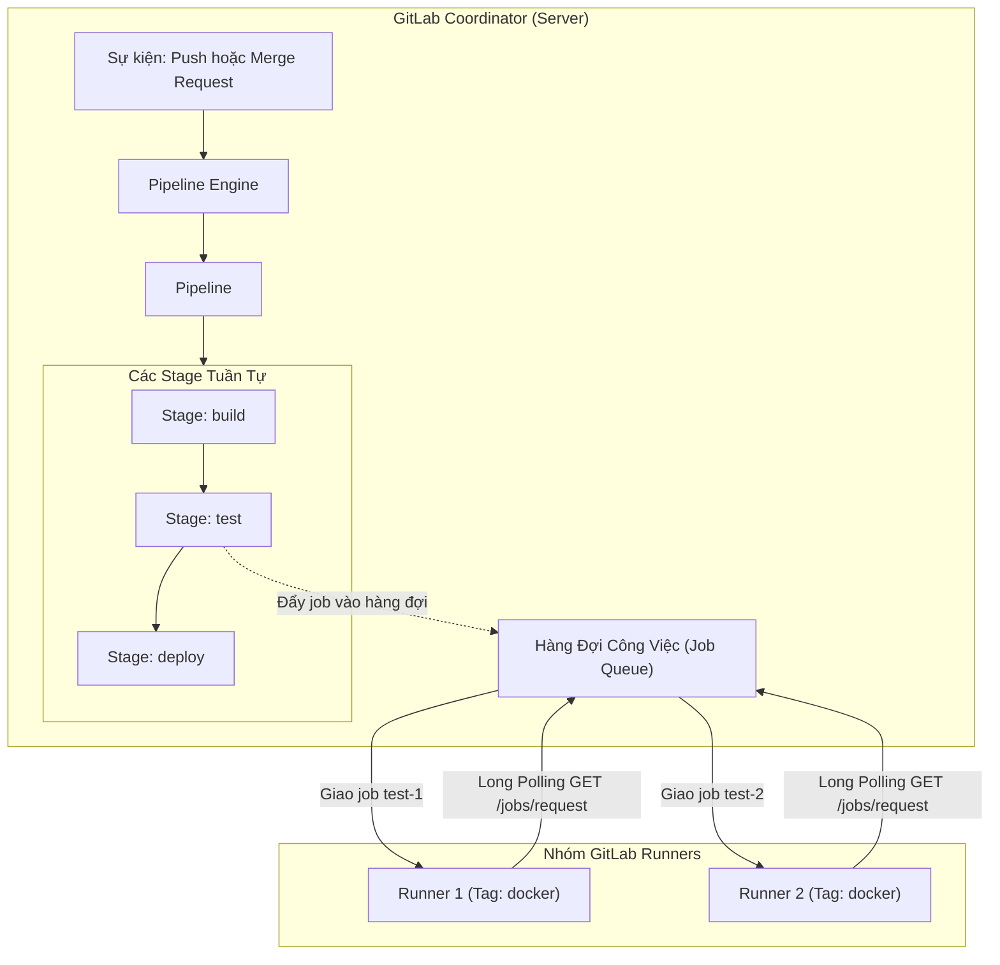
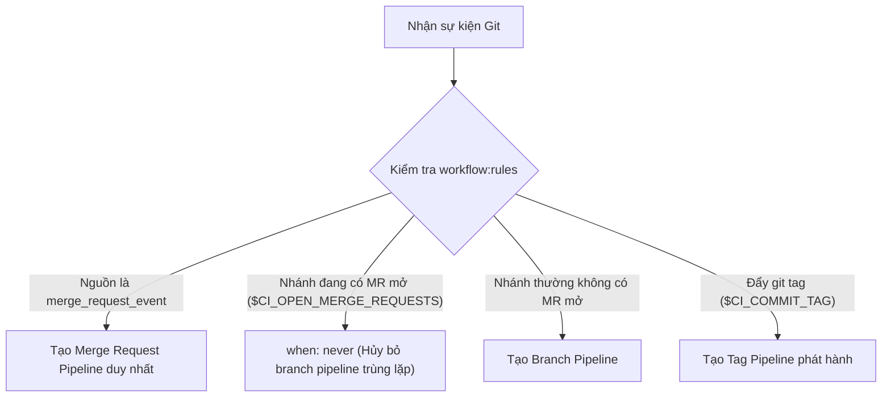

# 6_6_1 GitLab CI/CD Fundamentals

- **Khóa học**: Cloud & DevOps Basic
- **Phân nhóm**: Domain 6 - Containers and Kubernetes / 6_6 GitLab CI-CD and Release Strategies
- **Chủ đề**: 6_6_1 GitLab CI-CD Fundamentals
- **Trạng thái**: Đã kiểm chứng (verifier PASS, 21-11-2026)
- **Checklist đối chiếu**: [CHECKLIST](../../CHECKLIST.md)

---

## 1. Khái Niệm Cốt Lõi & Bản Chất Kỹ Thuật (Core Concepts & Technical Deep Dive)

Quy trình tự động hóa tích hợp và phát hành liên tục (CI/CD) trong GitLab được điều khiển bởi tệp cấu hình YAML đặt tại thư mục gốc của kho mã nguồn. Kỹ sư DevOps cần nắm vững cấu trúc phân tầng thực thi, kiến trúc giao tiếp của tác tử chạy lệnh, và cơ chế định tuyến sự kiện kích hoạt để xây dựng pipeline tối ưu.

### 1.1 Cấu Trúc Phân Cấp: Pipeline, Stage và Job

Trong GitLab CI/CD, quy trình thực thi được cấu trúc theo mô hình phân cấp gồm ba tầng cơ bản: Pipeline chứa các Stage, và mỗi Stage chứa một hoặc nhiều Job. <!-- ev: C1.1 -->

- **Pipeline**: Đại diện cho toàn bộ quy trình CI/CD được khởi tạo cho một lần kích hoạt, quản lý chu trình từ tiếp nhận mã nguồn đến kiểm thử và phát hành.
- **Stage**: Xác định trình tự thực thi logic trong pipeline (như biên dịch, kiểm thử, đóng gói, triển khai). Các stage được điều phối thực thi nối tiếp nhau theo thứ tự khai báo.
- **Job**: Đơn vị thực thi nhỏ nhất chạy các câu lệnh kịch bản trong môi trường biệt lập (container hoặc máy ảo), định nghĩa rõ hình ảnh hệ điều hành, lệnh kịch bản và tệp bàn giao.

Theo mặc định trong GitLab CI/CD, các job nằm trong cùng một stage sẽ được điều phối thực thi song song nếu hệ thống có đủ runner đáp ứng. <!-- ev: C1.2 -->

Trong mô hình pipeline phân tầng theo giai đoạn, tất cả các job trong stage trước phải hoàn thành thành công thì các job thuộc stage kế tiếp mới được kích hoạt. <!-- ev: C1.3 -->

### 1.2 Mô Hình Thực Thi Của GitLab Runner (Runner Execution Model)

GitLab tách biệt giữa máy chủ điều phối trung tâm (GitLab Coordinator) và máy chủ thực thi tác vụ (GitLab Runner).

GitLab Runner là một ứng dụng độc lập hoạt động theo cơ chế kéo (pull model), liên tục thăm dò (long polling) qua HTTP tới GitLab API để nhận job mà không yêu cầu GitLab server kết nối ngược lại. <!-- ev: C1.4 -->

Ưu điểm vận hành của cơ chế kéo:
- **Bảo mật mạng**: Không yêu cầu mở cổng kết nối từ Internet vào máy chủ Runner; Runner chỉ cần chiều kết nối ra máy chủ GitLab.
- **Khả năng co giãn**: Dễ dàng bổ sung thêm các Runner mới trong mạng nội bộ hoặc đám mây để tăng công suất xử lý.
- **Định tuyến linh hoạt**: Phân bổ tác vụ chính xác đến từng loại Runner dựa trên hệ thống nhãn nhận diện.

### 1.3 Phân Loại Pipeline Theo Nguồn Kích Hoạt ($CI_PIPELINE_SOURCE)

Mỗi pipeline được sinh ra đều mang thông tin ngữ cảnh về sự kiện tạo ra nó.

Biến môi trường định sẵn `$CI_PIPELINE_SOURCE` chỉ định phương thức kích hoạt pipeline, nhận các giá trị như `push`, `merge_request_event`, `schedule`, `web`, `trigger` hoặc `parent_pipeline`. <!-- ev: C1.5 -->

<!-- ev: C1.5 -->
- Nguồn `push`: Đẩy commit mới lên nhánh hoặc đẩy git tag.
- Nguồn `merge_request_event`: Tạo hoặc cập nhật mã nguồn trong Merge Request.
- Nguồn `schedule`: Chạy tự động theo lịch hẹn giờ định kỳ.
- Nguồn `web`: Kích hoạt thủ công từ giao diện đồ họa.
- Nguồn `trigger`: Kích hoạt qua việc gọi API webhook bằng mã token.
- Nguồn `parent_pipeline`: Kích hoạt từ một pipeline cha sang pipeline con.

Khi một commit được đẩy kèm git tag, pipeline được khởi tạo với nguồn `push` đồng thời biến định sẵn `$CI_COMMIT_TAG` được thiết lập lưu tên của tag đó. <!-- ev: C1.6 -->

### 1.4 Phân Biệt Branch Pipeline, Merge Request Pipeline & Hiện Tượng Pipeline Kép

Branch pipeline được kích hoạt khi đẩy commit lên nhánh Git thông thường, chạy trên ref của nhánh đó và không chứa các biến định sẵn dành riêng cho Merge Request. <!-- ev: C1.7 -->

Merge Request pipeline chạy trên ref `refs/merge-requests/:iid/head` và cung cấp các biến định sẵn đặc thù của MR như `$CI_MERGE_REQUEST_IID` cùng `$CI_MERGE_REQUEST_TARGET_BRANCH_NAME`. <!-- ev: C1.8 -->

Khi đẩy commit lên một nhánh đang mở Merge Request mà không cấu hình quy tắc lọc, GitLab sẽ tự động tạo đồng thời cả branch pipeline lẫn merge request pipeline cho cùng một commit, gây ra hiện tượng chạy trùng lặp (duplicate pipelines). <!-- ev: C1.9 -->

Từ khóa `workflow:rules` được đặt ở cấp độ cao nhất của file `.gitlab-ci.yml` để quyết định việc toàn bộ pipeline có được tạo ra hay không dựa trên sự kiện kích hoạt. <!-- ev: C1.10 -->

Để ngăn chặn hoàn toàn pipeline trùng lặp, `workflow:rules` cấu hình bỏ qua branch pipeline (`when: never`) khi biến `$CI_OPEN_MERGE_REQUESTS` tồn tại trên nhánh có Merge Request đang mở. <!-- ev: C1.11 -->

### 1.5 Bảng Đối Chiếu Khái Niệm Azure DevOps Và GitLab CI/CD

Đối với kỹ sư đã quen thuộc với Azure DevOps, bảng sau ánh xạ trực tiếp các khái niệm tương đương:

<!-- ev: C1.12 C1.13 C1.14 C1.15 -->
| Thành phần / Khái niệm | Azure DevOps Pipelines | GitLab CI/CD | Bản chất kỹ thuật tương đương |
| :--- | :--- | :--- | :--- |
| **Cấu trúc giai đoạn** | `stages` | `stages` | Chia quy trình thành các chặng tuần tự logic |
| **Đơn vị thực thi** | `jobs` | `jobs` | Khối lệnh thực thi độc lập trên môi trường máy chạy |
| **Tác vụ kịch bản** | `steps` (script, task) | `script`, `before_script`, `after_script` | Danh sách câu lệnh Shell trực tiếp trong job |
| **Máy thực thi job** | Self-hosted / Microsoft-hosted Agent | GitLab Runner (Shared / Specific / Group) | Ứng dụng kéo job từ máy chủ điều phối về xử lý |
| **Định tuyến máy chạy** | `pool: name` và `demands` | `tags` | Điều kiện gán nhãn ghép job với máy chạy tương ứng |
| **Kho biến cấu hình** | Variable Groups (Library) | CI/CD Variables (Project / Group level) | Quản lý tập trung biến môi trường và bí mật bảo mật |
| **Tệp khai báo** | `azure-pipelines.yml` | `.gitlab-ci.yml` | Khai báo toàn bộ quy trình theo chuẩn Pipeline-as-Code |

---

## 2. Ví Dụ Đời Sống Thực Tế Dễ Hiểu (Intuitive Real-World Analogies)

Hãy hình dung toàn bộ hệ thống GitLab CI/CD như một **dây chuyền sản xuất lắp ráp xe hơi tự động trong nhà máy công nghiệp**:

- **Pipeline (Dây chuyền sản xuất khép kín)**: Khi một đơn hàng hoặc bản thiết kế mới được phê duyệt, một dây chuyền tự động từ dập khung thép đến kiểm định xuất xưởng được khởi động.
- **Stage (Phân xưởng chuyên môn)**: Nhà máy chia thành các xưởng nối tiếp: Phân xưởng Dập khung, Phân xưởng Sơn vỏ, Phân xưởng Lắp máy và Phân xưởng Thử nghiệm an toàn. Xe chưa qua xưởng sơn thì dứt khoát không thể chuyển sang xưởng lắp máy.
- **Job (Bàn làm việc của từng tốp thợ)**: Trong xưởng sơn, có bàn sơn cửa xe và bàn sơn thân vỏ làm việc đồng thời cùng lúc để đẩy nhanh tiến độ hoàn thành phân xưởng.
- **Runner (Công nhân kéo việc về làm)**: Người thợ lành nghề không ngồi chờ quản đốc gọi tên. Thợ chủ động theo dõi bảng phân công điện tử của nhà máy; khi thấy có phiếu việc vừa sức và khớp với chuyên môn của mình, thợ nhận phiếu kéo việc về bàn gia công rồi gửi báo cáo nghiệm thu.
- **Nguồn trigger ($CI_PIPELINE_SOURCE)**: Lệnh xuất xưởng từ giám đốc tương đương với việc đẩy mã lên nhánh chính, trong khi hồ sơ nghiệm thu thử nghiệm tương đương với sự kiện đề xuất hợp nhất mã nguồn.
- **Ban điều phối (workflow:rules)**: Nếu kỹ sư vừa gửi bản vẽ vào kho lưu trữ vừa nộp hồ sơ xin nghiệm thu, nhà máy có thể vô tình mở hai dây chuyền trùng lắp cho cùng một chiếc xe. Ban điều phối sẽ quy định rõ chỉ mở một dây chuyền duy nhất theo hồ sơ nghiệm thu để không lãng phí nhân công.

---

## 3. Kiến Trúc, Luồng Hoạt Động & Hình Ảnh Trực Quan (Architecture, Diagrams & Visual Media)

### 3.1 Luồng Phân Bổ Tác Vụ Và Giao Tiếp Kéo Của Runner

Sơ đồ thể hiện cách GitLab Coordinator quản lý hàng đợi và cách các GitLab Runner kéo job về thực thi độc lập:



### 3.2 Cơ Chế Lọc Sự Kiện Của workflow:rules

Quy trình đánh giá sự kiện kích hoạt để ngăn chặn chạy trùng lặp pipeline:



---

## 4. Code Mẫu Trực Quan Hoặc Dòng Lệnh Thực Chiến (Runnable Sample Code / CLI)

Cấu hình mẫu YAML chuẩn mực cho quy trình CI/CD, tích hợp lọc sự kiện chống pipeline trùng lặp và phân chia giai đoạn:

```yaml
# Ngăn chặn hoàn toàn hiện tượng duplicate pipelines
workflow:
  rules:
    - if: '$CI_PIPELINE_SOURCE == "merge_request_event"'
    - if: '$CI_COMMIT_BRANCH && $CI_OPEN_MERGE_REQUESTS'
      when: never
    - if: '$CI_COMMIT_BRANCH'
    - if: '$CI_COMMIT_TAG'

# Khai báo danh sách các giai đoạn thực thi tuần tự
stages:
  - build
  - test
  - deploy

default:
  image: alpine:latest
  tags:
    - docker

# Stage build
compile-app:
  stage: build
  script:
    - echo "Đang biên dịch mã nguồn..."
    - mkdir -p build
    - echo "build-output-v1" > build/artifact.txt
  artifacts:
    paths:
      - build/
    expire_in: 1 hour

# Stage test: Hai job chạy song song đồng thời
unit-tests:
  stage: test
  script:
    - echo "Chạy kiểm thử đơn vị..."
    - test -f build/artifact.txt

lint-check:
  stage: test
  script:
    - echo "Kiểm tra định dạng mã nguồn..."

# Stage deploy: Chỉ kích hoạt trên nhánh mặc định hoặc tag
deploy-env:
  stage: deploy
  script:
    - echo "Triển khai bản dựng hoàn tất!"
  rules:
    - if: '$CI_COMMIT_BRANCH == $CI_DEFAULT_BRANCH'
    - if: '$CI_COMMIT_TAG'
```

---

## 5. Cạm Bẫy Thực Tế & Thực Tiễn Sản Xuất (Production Gotchas & Best Practices)

### 5.1 Lãng Phí Hạn Ngạch Thời Gian Do Pipeline Kép
Nếu thiếu cấu hình kiểm soát luồng sự kiện ở cấp cao nhất của tệp cấu hình, mỗi commit đẩy lên nhánh đang có Merge Request sẽ kích hoạt đồng thời hai pipeline độc lập. Tình trạng này làm tiêu hao gấp đôi hạn ngạch tính toán của hệ thống máy chạy và làm kéo dài thời gian phản hồi kết quả kiểm thử. Cần chuẩn hóa cấu hình quy tắc luồng công việc trên toàn bộ kho mã nguồn của tổ chức.

### 5.2 Xử Lý Sự Cố Job Rơi Vào Trạng Thái Pending

Một job trong GitLab CI/CD sẽ rơi vào trạng thái `pending` nếu không có bất kỳ runner khả dụng nào khớp với nhãn `tags` được yêu cầu hoặc tất cả runner đều đã hết năng lực xử lý. <!-- ev: C1.16 -->

<!-- ev: C1.16 -->
- Nhãn không khớp: Job yêu cầu nhãn định tuyến nhưng không có máy chạy nào trực tuyến mang nhãn đó.
- Quá tải năng lực: Toàn bộ máy chạy đều đã đạt mức tải tối đa của thông số xử lý đồng thời.
- Quyền hạn dự án: Máy chạy riêng biệt chưa được kích hoạt cho kho mã nguồn hiện tại.

### 5.3 Kiểm Soát Ngắt Quãng Pipeline Khi Tác Vụ Thất Bại

Nếu một job thất bại mà không được gắn thuộc tính `allow_failure: true`, toàn bộ stage chứa job đó bị đánh dấu thất bại và các stage tiếp theo trong pipeline sẽ bị dừng lại. <!-- ev: C1.17 -->

<!-- ev: C1.17 -->
- Với các tác vụ kiểm tra phụ trợ không ảnh hưởng tính đúng đắn bản dựng (như cảnh báo cú pháp, quét chính tả), hãy thiết lập `allow_failure: true` để tránh làm gián đoạn chu trình phát hành.
- Với các tác vụ kiểm thử hồi quy hoặc kiểm tra an ninh trọng yếu, luôn giữ nguyên quy tắc dừng ngay lập tức để bảo vệ chất lượng hệ thống.

### 5.4 Tối Thiểu Hóa Quyền Hạn Cho Runner
Không phân quyền quản trị cao cho các máy chạy phục vụ nhánh kiểm thử của lập trình viên. Cần tách bạch giữa máy chạy dùng chung cho môi trường kiểm thử và máy chạy chuyên dụng có chứng chỉ triển khai môi trường sản xuất.

---

## 6. Câu Hỏi Củng Cố Kiến Thức (Active Recall Quiz)

### Câu hỏi 1: Ngăn chặn hiện tượng pipeline trùng lặp
Một kỹ sư nhận thấy mỗi khi đẩy commit vào nhánh đang mở Merge Request, hệ thống luôn sinh ra hai pipeline chạy cùng lúc cho một commit. Nguyên nhân do đâu và xử lý như thế nào?

<details>
<summary>Đáp án</summary>

- **Nguyên nhân**: GitLab đồng thời khởi tạo một Branch Pipeline từ sự kiện đẩy nhánh và một Merge Request Pipeline từ sự kiện cập nhật trên Merge Request.
- **Giải pháp**: Khai báo khối cấu hình `workflow:rules` ở đầu tệp cấu hình; thiết lập quy tắc `when: never` cho Branch Pipeline khi biến `$CI_OPEN_MERGE_REQUESTS` tồn tại.
</details>

### Câu hỏi 2: Gỡ lỗi tác vụ bị kẹt ở trạng thái pending
Một tác vụ trong pipeline không chịu khởi chạy mà liên tục ở trạng thái chờ đợi tài nguyên. Những nguyên nhân kỹ thuật hàng đầu là gì?

<details>
<summary>Đáp án</summary>

1. Trường nhãn (`tags`) của tác vụ không khớp với bất kỳ Runner nào đang trực tuyến trong hệ thống.
2. Các Runner sẵn có đều đã chạm ngưỡng giới hạn thực thi đồng thời và đang bận xử lý tác vụ khác.
3. Runner chưa được liên kết quyền phục vụ cho dự án trong phần cài đặt quản trị.
</details>

### Câu hỏi 3: Lợi thế bảo mật của kiến trúc kéo từ Runner
Tại sao GitLab Runner lại kết nối ra máy chủ trung tâm qua cơ chế kéo thay vì nhận lệnh điều phối trực tiếp từ máy chủ?

<details>
<summary>Đáp án</summary>

1. Cho phép đặt Runner an toàn bên trong mạng nội bộ phía sau tường lửa mà không cần mở bất kỳ cổng kết nối nào từ Internet vào.
2. Cho phép dễ dàng co giãn số lượng Runner trên đám mây mà không cần gán địa chỉ IP tĩnh cố định lên máy chủ trung tâm.
3. Tránh việc máy chủ trung tâm quá tải hoặc dồn việc vào một máy chạy đang cạn kiệt tài nguyên phần cứng.
</details>

---

## 7. 📚 Nguồn Tài Liệu Chính Thống (Tier-1 Official References)

- [GitLab CI/CD Pipelines](https://docs.gitlab.com/ci/pipelines/) - Tài liệu chính thức từ GitLab về kiến trúc tổng quan, các giai đoạn (stages) và tác vụ (jobs).
- [Pipeline architectures](https://docs.gitlab.com/ci/pipelines/pipeline_architectures/) - Hướng dẫn chi tiết từ GitLab Docs về các mô hình kiến trúc pipeline cơ bản, DAG và multi-project pipelines.
- [Predefined CI/CD variables reference](https://docs.gitlab.com/ci/variables/predefined_variables/) - Danh mục tra cứu đầy đủ các biến môi trường định sẵn của GitLab CI/CD như `$CI_PIPELINE_SOURCE`, `$CI_COMMIT_BRANCH`, `$CI_COMMIT_TAG`.
- [Merge request pipelines](https://docs.gitlab.com/ci/pipelines/merge_request_pipelines/) - Hướng dẫn cấu hình Merge Request pipelines và tích hợp kiểm thử tự động vào quy trình kiểm duyệt mã nguồn.
- [Prevent duplicate pipelines with workflow:rules](https://docs.gitlab.com/ci/yaml/workflow/) - Tài liệu chính thức về cấu hình từ khóa `workflow:rules` và các mẫu cú pháp ngăn chặn pipeline chạy trùng lặp.
- [GitLab Runner Overview](https://docs.gitlab.com/runner/) - Tài liệu tổng quan về kiến trúc, cơ chế hoạt động và mô hình giao tiếp của GitLab Runner.
