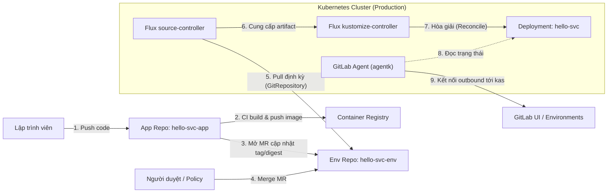

# 6_6_10 GitOps Concepts

> **Khóa học**: Cloud DevOps Basic — Containers & Kubernetes
> **Phân nhóm**: [6_6 GitLab CI-CD and Release Strategies](./README.md)
> **Chủ đề**: Khái niệm GitOps, 4 nguyên tắc OpenGitOps, so sánh Push-based CI/CD vs Pull-based GitOps, kiến trúc 2 repository và tích hợp GitLab Agent với Flux CD
> **Trạng thái**: Bản nháp, chờ kiểm chứng
> **Checklist đối chiếu**: [CHECKLIST.md](../../CHECKLIST.md#6_6-gitlab-ci-cd-and-release-strategies)

---

## 1. Khái Niệm Cốt Lõi & Bản Chất Kỹ Thuật (Core Concepts & Technical Deep Dive)

Trong bài 6_6_7, pipeline CI/CD chạy lệnh `helm upgrade` hoặc `kubectl apply` để trực tiếp đẩy thay đổi vào Kubernetes cluster. <!-- ev: C10.5 --> Cách làm đó hoạt động tốt khi hệ thống nhỏ, nhưng khi có nhiều môi trường và nhiều cụm cluster, việc trao quyền quản trị cluster cho máy chủ CI tạo ra rủi ro bảo mật và dễ phát sinh tình trạng cấu hình thực tế bị lệch so với Git khi có người sửa tay trên cluster. **GitOps** giải quyết vấn đề này bằng cách đảo ngược luồng triển khai: thay vì CI đẩy từ ngoài vào, một phần mềm bên trong cluster tự động kéo cấu hình từ Git và giữ cho cluster luôn khớp với Git. <!-- ev: C10.6 -->

### 1.1. GitOps và 4 nguyên tắc cốt lõi của OpenGitOps

**GitOps** là một phương pháp vận hành hạ tầng và ứng dụng hiện đại, trong đó Git đóng vai trò là **Nguồn Sự Thật Duy Nhất (Single Source of Truth)** cho toàn bộ trạng thái mong muốn của hệ thống. Để chuẩn hóa khái niệm này, nhóm **OpenGitOps** (thuộc CNCF) định nghĩa 4 nguyên tắc bắt buộc sau:

1. **Declarative (Khai báo trạng thái mong muốn)**: Toàn bộ trạng thái mong muốn của hệ thống phải được biểu diễn dưới dạng khai báo (ví dụ các file YAML của Kubernetes), mô tả kết quả cuối cùng thay vì viết chuỗi câu lệnh tuần tự từng bước. <!-- ev: C10.1 -->
2. **Versioned and Immutable (Có phiên bản và bất biến)**: Trạng thái mong muốn phải được lưu trong hệ thống lưu trữ có quản lý phiên bản và lịch sử đầy đủ, bất biến (thực tế phổ biến nhất là Git), giúp truy vết mọi thay đổi và khôi phục phiên bản cũ dễ dàng. <!-- ev: C10.2 -->
3. **Pulled Automatically (Tự động kéo về)**: Các tác nhân phần mềm (software agent/controller) tự động kéo bản khai báo trạng thái mong muốn từ kho lưu trữ nguồn mà không cần công cụ bên ngoài đẩy vào. <!-- ev: C10.3 -->
4. **Continuously Reconciled (Liên tục hòa giải)**: Các tác nhân phần mềm liên tục quan sát trạng thái thực tế đang chạy trong hệ thống và tự động điều chỉnh để đưa hệ thống về đúng trạng thái mong muốn đã khai báo. <!-- ev: C10.4 -->

> **Giải thích thuật ngữ cho người mới**:
> - **Controller / Operator**: Là một chương trình chạy ngầm ngay bên trong Kubernetes cluster, có nhiệm vụ theo dõi tài nguyên và tự động thực hiện hành động khi có thay đổi.
> - **Reconciliation (Hòa giải)**: Là vòng lặp đối chiếu liên tục: *Trạng thái mong muốn (trong Git) ≠ Trạng thái thực tế (trong Cluster) → Tự động sửa Cluster cho khớp với Git*.
> - **Configuration Drift (Độ lệch cấu hình)**: Là tình huống trạng thái đang chạy thực tế trên cluster bị khác với cấu hình lưu trong Git (ví dụ có người chạy `kubectl edit` hoặc `kubectl scale` trực tiếp trên prod để chữa cháy).

### 1.2. So sánh Push-based CI/CD vs Pull-based GitOps

Ở **mô hình Push-based CI/CD** truyền thống, máy chủ CI (như GitLab Runner hoặc Jenkins) sau khi build xong image sẽ chủ động chạy lệnh triển khai (như `helm upgrade` hoặc `kubectl apply`) từ bên ngoài để đẩy cấu hình vào cluster. <!-- ev: C10.5 --> Ngược lại, ở **mô hình Pull-based GitOps** (với các công cụ tiêu biểu như **Flux CD** hoặc **Argo CD**), controller nằm sẵn bên trong Kubernetes cluster sẽ tự kéo manifest từ kho Git và đồng bộ vào cluster. <!-- ev: C10.6 -->

Bảng dưới đây tóm tắt các đánh đổi kỹ thuật quan trọng giữa hai mô hình:

<!-- ev: C10.7 C10.8 C10.9 -->
| Tiêu chí so sánh | Push-based CI/CD | Pull-based GitOps (Argo CD / Flux) |
| :--- | :--- | :--- |
| **Hướng kết nối & Bảo mật** | CI server cần giữ thông tin xác thực có quyền ghi (kubeconfig / agent access) và truy cập được vào API server của cluster. | CI server không cần quyền ghi vào cluster production; cluster tự kết nối ra ngoài để đọc Git, giúp giảm rủi ro khi CI bị xâm nhập. |
| **Phát hiện độ lệch (Drift Detection)** | Không tự phát hiện nếu có người sửa tay trên cluster giữa hai lần chạy pipeline. | Controller kiểm tra liên tục; nếu có độ lệch cấu hình (drift), hệ thống tự động cảnh báo hoặc ghi đè lại theo Git. |
| **Khả năng kiểm toán (Auditability)** | Lịch sử thay đổi nằm rải rác giữa log pipeline CI và thao tác tay trên cluster. | Mọi thay đổi hợp lệ đều nằm trong lịch sử commit của Git (ai sửa, sửa lúc nào, vì sao). |
| **Rollback (Quay lui)** | Chạy lại job pipeline cũ hoặc chạy lệnh `helm rollback` từ máy/CI. | Dùng `git revert` trên kho cấu hình; controller tự kéo commit cũ và đưa cluster về trạng thái trước đó. |

### 1.3. Kiến trúc 2 Repository: Application Repo vs Environment/Config Repo

Khi mới làm GitOps, nhiều người thường gộp cả mã nguồn ứng dụng và file YAML Kubernetes vào chung một repository. Tuy nhiên trong thực tế sản xuất, người ta thường tách làm **2 repository riêng biệt** để tránh vòng lặp CI vô tận (khi pipeline tự commit tag image mới vào chính repo vừa kích hoạt nó) và tách bạch quyền phê duyệt code với quyền thay đổi môi trường. <!-- ev: C10.10 -->

1. **Application Repository (Kho mã nguồn ứng dụng — ví dụ `hello-svc-app`)**: Chứa mã nguồn Java/Node/Go, `Dockerfile`, và pipeline CI để test, build container image, đẩy lên Container Registry, rồi mở Merge Request (hoặc cập nhật) tag/digest image mới sang Environment Repo. <!-- ev: C10.11 -->
2. **Environment / Config Repository (Kho cấu hình môi trường — ví dụ `hello-svc-env`)**: Chứa các file Kubernetes manifest hoặc Helm values phân theo từng môi trường (`dev`, `staging`, `prod`) và đóng vai trò là Nguồn Sự Thật Duy Nhất mà GitOps controller theo dõi. <!-- ev: C10.12 -->

Nhờ cấu trúc này, khi muốn **promote** (thăng cấp) một phiên bản đã kiểm chứng từ `dev` lên `staging` hay `prod`, nhóm vận hành chỉ cần cập nhật đúng tag hoặc digest của image đó trong thư mục/nhánh tương ứng của Environment Repo mà không phải build lại image. <!-- ev: C10.13 -->

### 1.4. Tích hợp GitOps của GitLab với Flux CD qua GitLab Agent

Trước đây, GitLab từng có tính năng đồng bộ manifest tích hợp sẵn trong GitLab Agent for Kubernetes, nhưng GitLab đã ngừng hỗ trợ tính năng đó và khuyến nghị sử dụng **Flux CD** kết hợp với GitLab Agent cho các quy trình GitOps. <!-- ev: C10.14 -->

Trong kiến trúc tích hợp này:
- **Flux CD** (gồm các controller như `source-controller`, `kustomize-controller`, `helm-controller`) chạy trong cluster Kubernetes để kéo manifest từ kho Git trên GitLab và liên tục hòa giải trạng thái. <!-- ev: C10.15 -->
- **GitLab Agent for Kubernetes** (`agentk` chạy trong cluster) duy trì kết nối chiều đi (outbound) an toàn tới GitLab Agent Server (`kas`) mà không cần mở cổng Kubernetes API server ra Internet, đồng thời giúp GitLab hiển thị trạng thái tài nguyên và môi trường đồng bộ từ Flux ngay trên giao diện web. <!-- ev: C10.18 -->

---

## 2. Ví Dụ Đời Sống Thực Tế Dễ Hiểu (Intuitive Real-World Analogies)

Để dễ nhớ sự khác biệt giữa hai mô hình triển khai, hãy hình dung căn nhà của bạn chính là **Kubernetes Cluster**, còn bản danh sách đồ đạc chuẩn đặt tại văn phòng gia đình chính là **Git Repository**:

- **Push-based CI/CD giống như người giao hàng đi gõ cửa từng nhà**: Mỗi khi có món đồ mới, nhân viên giao hàng (CI server) phải giữ sẵn chìa khóa cổng hoặc mật khẩu cửa nhà bạn (kubeconfig/quyền ghi), tự mở cửa đi vào đặt đồ lên bàn rồi đi ra. Nếu bạn làm mất chìa khóa của người giao hàng, kẻ xấu có thể vào nhà. Ngoài ra, nếu người trong nhà tự ý dời cái bàn ra chỗ khác (drift), người giao hàng không hề biết cho đến lần giao hàng tiếp theo.
- **Pull-based GitOps giống như hệ thống tiếp nhận bưu phẩm tự động đặt sẵn bên trong nhà**: Bên trong nhà có một robot quản gia (Flux/Argo CD controller). Robot này định kỳ tự đi ra hộp thư trung tâm (Git) kiểm tra xem danh sách đồ đạc có thay đổi gì không. Nếu thấy có món mới, robot tự mang vào nhà đặt đúng vị trí. Nếu có ai trong nhà lỡ tay dời cái bàn đi chỗ khác, vài phút sau robot kiểm tra lại danh sách chuẩn và tự kê cái bàn về đúng chỗ cũ. Người gửi đồ (CI pipeline) chỉ cần cập nhật danh sách ở hộp thư trung tâm chứ không bao giờ cần giữ chìa khóa nhà bạn.

---

## 3. Kiến Trúc, Luồng Hoạt Động & Hình Ảnh Trực Quan (Architecture, Diagrams & Visual Media)

Sơ đồ dưới đây minh họa trọn vẹn vòng đời một thay đổi của dịch vụ `hello-svc` đi qua mô hình **2 repository** và được **Flux CD** đồng bộ vào Kubernetes cluster, kết hợp **GitLab Agent** để quan sát trạng thái trên giao diện GitLab. <!-- ev: C10.11 C10.15 C10.18 -->



Giải thích luồng dữ liệu từ trái sang phải:
1. Lập trình viên đẩy code mới vào `hello-svc-app`. <!-- ev: C10.11 -->
2. GitLab CI kiểm thử, build container image gắn tag SHA/digest và đẩy lên Container Registry. <!-- ev: C10.11 -->
3. Pipeline CI của `hello-svc-app` không chạm vào cluster mà chỉ tạo một Merge Request cập nhật phiên bản image mới sang `hello-svc-env`. <!-- ev: C10.11 -->
4. Sau khi Merge Request được duyệt và gộp vào nhánh chính của `hello-svc-env`, trạng thái mong muốn mới chính thức được ghi nhận trong Git. <!-- ev: C10.12 -->
5. `source-controller` của Flux bên trong cluster tự động kéo bản khai báo mới từ `hello-svc-env`, rồi `kustomize-controller` đối chiếu và cập nhật `Deployment: hello-svc`. <!-- ev: C10.15 -->
6. Song song đó, `agentk` gửi trạng thái tài nguyên từ cluster ra ngoài về GitLab để đội ngũ phát triển theo dõi trực tiếp trên giao diện GitLab. <!-- ev: C10.18 -->

---

## 4. Code Mẫu Trực Quan Hoặc Dòng Lệnh Thực Chiến (Runnable Sample Code / CLI)

Ví dụ dưới đây minh họa cấu trúc 2 repository cho dịch vụ `hello-svc` cùng tài nguyên Flux v2 (`source.toolkit.fluxcd.io/v1` và `kustomize.toolkit.fluxcd.io/v1`). <!-- ev: C10.16 -->

### 4.1. Input: Thay đổi image tag trong Environment Repo (`hello-svc-env`)

Trong kho cấu hình `hello-svc-env`, tệp `apps/prod/hello-svc/deployment.yaml` lưu phiên bản image cố định. <!-- ev: C10.12 --> Khi pipeline của `hello-svc-app` build xong bản mới `a1b2c3d`, bước cập nhật chỉ đổi đúng dòng tag (hoặc digest) trong Merge Request sang `hello-svc-env`: <!-- ev: C10.11 -->

```yaml
# hello-svc-env/apps/prod/hello-svc/deployment.yaml
apiVersion: apps/v1
kind: Deployment
metadata:
  name: hello-svc
  namespace: prod
spec:
  replicas: 2
  selector:
    matchLabels:
      app: hello-svc
  template:
    metadata:
      labels:
        app: hello-svc
    spec:
      containers:
        - name: hello-svc
          # Chỉ dòng tag/digest này được cập nhật qua MR từ App Repo
          image: registry.gitlab.com/my-group/hello-svc:a1b2c3d
          ports:
            - containerPort: 8080
```

### 4.2. Khai báo Flux `GitRepository` và `Kustomization` trong Cluster

Flux sử dụng tài nguyên `GitRepository` để chỉ định kho GitLab nguồn cần theo dõi (kèm tần suất kéo và nhánh) và tài nguyên `Kustomization` để chỉ định thư mục manifest cần áp dụng vào cluster. <!-- ev: C10.16 --> Nếu repository GitLab ở chế độ riêng tư (private), `GitRepository` sẽ tham chiếu tới một Kubernetes `Secret` chứa deploy token hoặc SSH key thông qua trường `spec.secretRef`. <!-- ev: C10.17 -->

<!-- ev: C10.16 C10.17 -->
```yaml
# 1. Tạo Secret chứa GitLab deploy token để Flux đọc repo private
# (Khuyến nghị tạo bằng lệnh kubectl thay vì commit Secret thô lên Git)
# kubectl create secret generic gitlab-auth \
#   --namespace=flux-system \
#   --from-literal=username=flux-reader \
#   --from-literal=password=<GITLAB_DEPLOY_TOKEN>

---
# 2. Khai báo kho Git nguồn (Environment Repo)
apiVersion: source.toolkit.fluxcd.io/v1
kind: GitRepository
metadata:
  name: hello-svc-env
  namespace: flux-system
spec:
  interval: 1m0s
  url: https://gitlab.com/my-group/hello-svc-env.git
  ref:
    branch: main
  secretRef:
    name: gitlab-auth

---
# 3. Khai báo thư mục manifest cần hòa giải vào cluster
apiVersion: kustomize.toolkit.fluxcd.io/v1
kind: Kustomization
metadata:
  name: hello-svc-prod
  namespace: flux-system
spec:
  interval: 5m0s
  sourceRef:
    kind: GitRepository
    name: hello-svc-env
  path: ./apps/prod/hello-svc
  prune: true
  targetNamespace: prod
```

Giải thích các tham số quan trọng:
- `interval: 1m0s` ở `GitRepository`: Flux kiểm tra kho Git mỗi 1 phút để xem có commit mới hay không. <!-- ev: C10.16 -->
- `prune: true` ở `Kustomization`: Nếu bạn xóa một file manifest khỏi thư mục `./apps/prod/hello-svc` trong Git, Flux sẽ tự động xóa tài nguyên tương ứng trên cluster để đảm bảo không còn rác cấu hình. <!-- ev: C10.16 -->

### 4.3. Lệnh kiểm tra luồng Input → Command → Output với Flux CLI

Sau khi commit trên `hello-svc-env` được merge, bạn có thể dùng Flux CLI (phiên bản Flux v2) để kích hoạt kéo repo và hòa giải ngay lập tức trên cluster mà không cần đợi hết chu kỳ `interval`: <!-- ev: C10.19 -->

<!-- ev: C10.19 -->
```bash
# Yêu cầu Flux kéo ngay commit mới nhất từ GitLab và hòa giải Kustomization
flux reconcile kustomization hello-svc-prod --with-source
```

Output quan sát được trên terminal khi đồng bộ thành công sẽ tương tự như sau:

```text
► annotating GitRepository hello-svc-env in flux-system namespace
✔ GitRepository annotated
◎ waiting for GitRepository reconciliation
✔ fetched revision main@sha1:9f8e7d6c5b4a3210...
► annotating Kustomization hello-svc-prod in flux-system namespace
✔ Kustomization annotated
◎ waiting for Kustomization reconciliation
✔ applied revision main@sha1:9f8e7d6c5b4a3210...
```

> **Nâng cao: có thể bỏ qua ở lần đọc đầu**
>
> Trong môi trường thực tế, đội ngũ thường dùng thêm **Flux Image Automation** (`ImageRepository`, `ImagePolicy`, `ImageUpdateAutomation`) để tự động phát hiện tag mới trên Registry và tạo commit vào Env Repo, hoặc dùng **GitLab Webhook** kích hoạt **Flux Receiver** để cluster đồng bộ ngay lập tức thay vì chờ `interval`. Với người mới bắt đầu, cách để CI của App Repo mở Merge Request sang Env Repo vẫn dễ kiểm soát và minh bạch nhất vì có bước con người xem xét (`review`) trước khi chạy lên `prod`.

---

## 5. Cạm Bẫy Thực Tế & Thực Tiễn Sản Xuất (Production Gotchas & Best Practices)

1. **Cạm bẫy lưu Secret dạng văn bản thuần (Plaintext Secret) trong Git**: Git là bất biến và lưu lịch sử mãi mãi; nếu bạn commit Kubernetes `Secret` chưa mã hóa lên Environment Repo, mật khẩu sẽ bị lộ trong toàn bộ lịch sử Git. <!-- ev: C10.2 --> *Giải pháp*: Chỉ lưu Secret đã mã hóa (như Sealed Secrets hoặc Mozilla SOPS) hoặc dùng công cụ kéo secret động từ secret manager bên ngoài (như External Secrets Operator). <!-- ev: C10.20 -->
2. **Cạm bẫy vòng lặp CI vô tận khi gộp chung 1 repo**: Nếu bạn đặt file manifest chung trong Application Repo và để CI tự động commit tag image mới vào chính repo đó, commit mới lại kích hoạt tiếp một pipeline build mới lặp đi lặp lại. *Giải pháp*: Tách 2 repo như mục 1.3 (hoặc buộc phải dùng `[ci skip]` / `rules:changes` rất cẩn thận nếu dùng chung repo). <!-- ev: C10.10 -->
3. **Sửa tay trên cluster (`kubectl edit`) rồi ngạc nhiên vì cấu hình tự quay lại**: Khi đã bật GitOps với controller chạy liên tục, mọi thao tác sửa nóng trực tiếp bằng `kubectl` trên cluster sẽ bị controller ghi đè lại theo Git ở chu kỳ hòa giải tiếp theo. <!-- ev: C10.4 C10.9 --> *Giải pháp*: Luôn sửa qua Merge Request trên Environment Repo; chỉ tạm dừng đồng bộ (`flux suspend`) trong tình huống khẩn cấp cần điều tra sự cố.
4. **Cấp quyền ghi quá rộng cho Flux / GitLab Deploy Token**: Nếu dùng token cá nhân (Personal Access Token) thay vì Project/Group Deploy Token chỉ có quyền đọc (`read_repository`), khi nhân viên nghỉ việc hoặc bị thu hồi tài khoản, toàn bộ luồng triển khai cluster sẽ ngừng hoạt động. *Giải pháp*: Luôn dùng Deploy Token có quyền tối thiểu (`read_repository`) để cấp cho `Secret` mà Flux sử dụng. <!-- ev: C10.17 -->

---

## 6. Câu Hỏi Củng Cố Kiến Thức (Active Recall Quiz)

**Câu hỏi 1**: Trong một sự cố lúc nửa đêm, kỹ sư trực hệ thống chạy lệnh `kubectl scale deployment hello-svc --replicas=5 -n prod` trực tiếp trên terminal để cứu tải, trong khi file YAML trên Git vẫn ghi `replicas: 2`. Điều gì sẽ xảy ra ở mô hình Push-based CI/CD so với mô hình Pull-based GitOps?

<details>
<summary>Đáp án</summary>

- Ở mô hình **Push-based CI/CD**, cluster vẫn giữ nguyên `5` replicas cho đến khi có người chạy lại pipeline CI hoặc sửa tay lần nữa, khiến cấu hình thực tế bị lệch khỏi Git (configuration drift) mà hệ thống không tự phát hiện. <!-- ev: C10.9 -->
- Ở mô hình **Pull-based GitOps**, controller bên trong cluster liên tục đối chiếu trạng thái thực tế với Git và sẽ tự động kéo số replicas về lại `2` theo đúng khai báo trong Git. <!-- ev: C10.4 C10.9 --> Vì vậy, thay đổi đúng chuẩn trong GitOps phải là sửa `replicas: 5` qua commit/MR trên Environment Repo.

</details>

**Câu hỏi 2**: Tại sao GitOps khuyến nghị tách riêng **Application Repository** và **Environment Repository**, và luồng thăng cấp (promotion) bản build lên `prod` diễn ra như thế nào?

<details>
<summary>Đáp án</summary>

- Việc tách 2 repo giúp tránh vòng lặp CI vô tận khi pipeline tự commit tag image mới vào repo nguồn và tách bạch quyền duyệt code ứng dụng với quyền thay đổi hạ tầng sản xuất. <!-- ev: C10.10 -->
- Khi promote lên `prod`, ta không build lại image từ mã nguồn mà chỉ tạo Merge Request cập nhật đúng tag/digest image đã kiểm chứng vào thư mục/nhánh `prod` trong Environment Repo để controller kéo về. <!-- ev: C10.13 -->

</details>

**Câu hỏi 3**: Khi dùng GitLab kết hợp Flux CD và GitLab Agent for Kubernetes, thành phần nào chịu trách nhiệm thực tế kéo manifest và áp dụng vào cluster?

<details>
<summary>Đáp án</summary>

- Các controller của **Flux CD** chạy trong cluster chịu trách nhiệm kéo manifest từ GitLab repository và hòa giải trạng thái vào cluster. <!-- ev: C10.15 -->
- **GitLab Agent** (`agentk`) đóng vai trò kết nối an toàn chiều đi từ cluster về GitLab để hiển thị trạng thái tài nguyên và môi trường trên giao diện GitLab (vì tính năng đồng bộ manifest cũ tích hợp sẵn trong GitLab Agent đã được thay thế bằng tích hợp Flux). <!-- ev: C10.14 C10.18 -->

</details>

---

## 7. 📚 Nguồn Tài Liệu Chính Thống (Tier-1 Official References)

- [OpenGitOps Principles](https://opengitops.dev/) - Định nghĩa chuẩn của CNCF OpenGitOps về 4 nguyên tắc cốt lõi của GitOps.
- [GitOps with Kubernetes (GitLab Docs)](https://docs.gitlab.com/user/clusters/agent/gitops/) - Tài liệu chính thức của GitLab về kiến trúc GitOps trên Kubernetes và định hướng sử dụng Flux.
- [Using Flux for GitOps (GitLab Docs)](https://docs.gitlab.com/user/clusters/agent/gitops/flux/) - Hướng dẫn chính thức của GitLab về tích hợp Flux CD với GitLab Agent for Kubernetes.
- [Flux GitRepository Specification](https://fluxcd.io/flux/components/source/gitrepositories/) - Tài liệu chính thức của Flux CD về cấu hình nguồn `GitRepository` và xác thực bằng `secretRef`.
- [Argo CD Core Concepts](https://argo-cd.readthedocs.io/en/stable/core_concepts/) - Tài liệu chính thức của Argo CD về mô hình Pull-based GitOps và cơ chế hòa giải.
