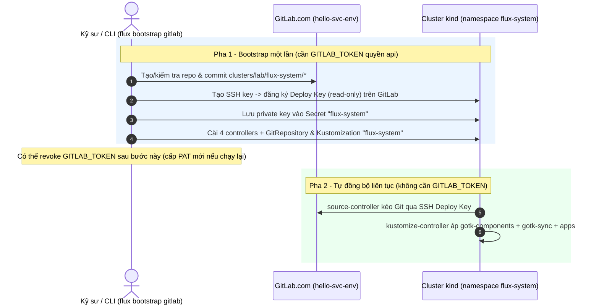

# 6_6_10_1 Flux Installation and Bootstrap

> **Khóa học**: Cloud DevOps Basic — Containers & Kubernetes
> **Phân nhóm**: 6 Domain 6 - Containers and Kubernetes › 6_6 GitLab CI-CD and Release Strategies
> **Chủ đề**: Cài đặt Flux thủ công (`flux install`) vs `flux bootstrap gitlab`, cấu trúc repo đa môi trường, bảo mật token/deploy key, vận hành Day-2 và các lựa chọn doanh nghiệp
> **Lộ trình**: [Mục lục chủ đề 6_6](./README.md#6_6_10_1-cài-đặt-flux-và-bootstrap-thực-chiến) · **Bài trước**: [6_6_10 GitOps Concepts](<./6_6_10 GitOps Concepts.md>) · **Checkpoint**: [CHECKLIST.md](../../CHECKLIST.md#6_6-gitlab-ci-cd-and-release-strategies)
> **Phiên bản áp dụng**: Flux CLI v2, Kubernetes trên `kind`, GitLab.com Free
> **Trạng thái**: Đã kiểm chứng (verifier PASS, 22-11-2026)

---

## 1. Khái Niệm Cốt Lõi & Bản Chất Kỹ Thuật (Core Concepts & Technical Deep Dive)

Ở bài [6_6_10](<./6_6_10 GitOps Concepts.md>), bạn đã học mô hình pull-based GitOps: thay vì CI pipeline đẩy manifest vào cluster, một agent trong cluster tự kéo cấu hình từ Git về. Nhưng khi mở một cluster trắng, ai sẽ cài đặt và cập nhật chính agent đó? Nếu chỉ cài bằng tay, ứng dụng nằm trong Git nhưng bản thân agent lại nằm ngoài Git. Cơ chế **bootstrap** giải quyết vấn đề này để toàn bộ cluster, gồm cả Flux, đều dựng lại được từ Git và một dòng lệnh. <!-- ev: C101.101 -->

### 1.1. Flux Cài Gì Vào Cluster & Kiểm Tra Tiền Điều Kiện

Khi cài Flux v2 vào Kubernetes, công cụ tạo namespace `flux-system`, cài các **CRD** (*Custom Resource Definition* — tài nguyên mở rộng như `GitRepository`, `Kustomization`, `HelmRelease`) và chạy 4 **controller** (*bộ điều khiển*) mặc định: `source-controller` (kéo mã nguồn Git/Helm/OCI), `kustomize-controller` (áp manifest Kustomize), `helm-controller` (quản lý Helm chart) và `notification-controller` (sự kiện và webhook). <!-- ev: C101.1 -->

Ngoài 4 controller cốt lõi, Flux có 3 controller tùy chọn không cài mặc định (thêm qua `--components-extra`): `image-reflector-controller` (quét metadata/tag image từ registry), `image-automation-controller` (tự động commit tag mới về Git) và `source-watcher` (tổng hợp/tách nguồn `ArtifactGenerator`). <!-- ev: C101.2 -->

Trước khi cài, chạy `flux check --pre` (lệnh đang ở trạng thái *preview and under development*) để kiểm tra kết nối cluster, phiên bản Kubernetes tối thiểu và xem có bản Flux CLI mới hơn hay không. <!-- ev: C101.3 -->

### 1.2. Cài Thủ Công (`flux install`) vs Khuyến Nghị Chính Thức

Lệnh `flux install` chỉ áp manifest CRD, controller, RBAC và NetworkPolicy vào namespace `flux-system`, không tạo `GitRepository`, `Kustomization` gốc hay lưu cấu hình Flux vào Git. <!-- ev: C101.4 --> Sau đó bạn phải tự tạo deploy-token `Secret`, `GitRepository` và `Kustomization` trỏ tới repo `hello-svc-env` như ở [6_6_10 §4.2](<./6_6_10 GitOps Concepts.md>). Hạn chế là **bản thân Flux không được Git quản lý**: muốn nâng cấp hoặc đổi cấu hình controller, bạn phải chạy tay `flux install` trên từng cluster. <!-- ev: C101.4 -->

Vì vậy, tài liệu cài đặt chính thức của Flux khuyến nghị dùng **`flux bootstrap`** thay cho `flux install` thủ công. <!-- ev: C101.11 -->

### 1.3. `flux bootstrap gitlab`: Cơ Chế, Cờ Lệnh và Kết Quả

**Bootstrap** là quy trình một bước vừa cài Flux lên cluster, vừa commit manifest của chính Flux vào Git để Flux tự quản lý bản thân. Để chạy `flux bootstrap gitlab`, Flux CLI đọc biến môi trường `GITLAB_TOKEN` chứa GitLab **Personal Access Token (PAT)** có quyền `api` (tài liệu Flux yêu cầu PAT; Group/Project Access Token không có trên GitLab.com Free). <!-- ev: C101.5 --> Nếu project trên GitLab chưa tồn tại, `flux bootstrap gitlab` tự tạo mới project đó. <!-- ev: C101.7 -->

Các cờ chính của lệnh này: <!-- ev: C101.6 -->

| Cờ lệnh | Ý nghĩa & Mục đích sử dụng | Ví dụ |
| :--- | :--- | :--- |
| `--owner` | User hoặc group/subgroup sở hữu repo | `--owner=my-user` |
| `--repository` | Tên project GitLab chứa cấu hình GitOps | `--repository=hello-svc-env` |
| `--branch` | Nhánh Git Flux theo dõi | `--branch=main` |
| `--path` | Thư mục lưu manifest riêng của cluster | `--path=clusters/lab` |
| `--personal` | Dùng cho repo thuộc tài khoản cá nhân | `--personal` |
| `--visibility` | Đặt mức hiển thị repo khi tạo mới (mặc định `private`; thay cho `--private` đã deprecated) | `--visibility=private` |
| `--components-extra` | Cài thêm controller tùy chọn | `--components-extra=image-reflector-controller,image-automation-controller` |
| `--hostname` | Domain cho GitLab tự host (self-managed) | `--hostname=gitlab.company.local` |
| `--token-auth` | Dùng HTTPS + PAT thay cho SSH deploy key | `--token-auth` |
| `--read-write-key` | Cấp quyền ghi cho SSH deploy key | `--read-write-key` |

Kết quả tạo ra đồng bộ hai phía:
- **Trong Git** (`<path>/flux-system/`): commit 3 file là `gotk-components.yaml` (CRD và controller), `gotk-sync.yaml` (`GitRepository` và `Kustomization` tên `flux-system`), và `kustomization.yaml`. <!-- ev: C101.8 -->
- **Trên GitLab & Cluster**: tạo SSH deploy key trên GitLab project (trừ khi dùng `--token-auth` để dùng trực tiếp PAT, hoặc `--deploy-token-auth` để tạo Project Deploy Token), lưu khóa/token vào `Secret` tên `flux-system` trong namespace `flux-system`, và áp các controller cùng `GitRepository`/`Kustomization` `flux-system` lên cluster. <!-- ev: C101.9 -->

`flux bootstrap` có tính **idempotent**: nâng cấp `flux` CLI rồi chạy lại đúng lệnh bootstrap sẽ cập nhật `gotk-components.yaml` trong Git để Flux tự nâng cấp chính mình. <!-- ev: C101.10 --> Với Git server khác không có subcommand riêng, dùng `flux bootstrap git` kèm `--url`. <!-- ev: C101.14 -->

### 1.4. Bảo Mật Khi Bootstrap & Giải Mã Secret Lúc Khởi Tạo

Bạn không nên giữ token quyền cao trong cluster suốt vòng đời hệ thống:
- Mặc định, `flux bootstrap gitlab` tạo SSH **deploy key chỉ đọc** (*read-only*); chỉ thêm `--read-write-key` khi dùng image automation cần Flux push commit về Git. <!-- ev: C101.12 -->
- Ở chế độ SSH deploy key mặc định, Secret `flux-system` lưu SSH private key nên Flux vẫn đồng bộ bình thường sau khi thu hồi `GITLAB_TOKEN` (cả `--token-auth` lẫn `--deploy-token-auth` đều lưu token vào Secret để kéo qua HTTPS); tuy nhiên sau khi nâng cấp CLI, khi chạy lại `flux bootstrap gitlab` để nâng cấp Flux thì vẫn cần cấp một `GITLAB_TOKEN` (PAT) hợp lệ để gọi GitLab API. <!-- ev: C101.13 -->

Với file mã hóa SOPS (xem bài `6_4_5`, chuẩn bị cho `capstone-2-platform`), nếu `Kustomization` dùng `spec.decryption` với `secretRef` (như `sops-age` trong `flux-system`), bạn phải tạo sẵn `Secret` chứa khóa giải mã cùng namespace trước khi reconcile; riêng xác thực cloud KMS không dùng Secret (`serviceAccountName` / IAM Role) thì không cần `Secret` này. <!-- ev: C101.17 -->

### 1.5. Cấu Trúc Repo Đa Môi Trường & Phụ Thuộc `dependsOn`

Theo repo mẫu chính thức `flux2-kustomize-helm-example`, cấu trúc GitOps tách `clusters/<tên-cluster>/` (chứa `flux-system/` và các `Kustomization` trỏ ra ngoài) khỏi `infrastructure/` (hạ tầng chung) và `apps/` (ứng dụng): <!-- ev: C101.15 -->

```text
hello-svc-env/
├── clusters/lab/
│   ├── flux-system/        # gotk-components.yaml, gotk-sync.yaml, kustomization.yaml
│   ├── infrastructure.yaml # Kustomization -> ./infrastructure
│   └── apps.yaml           # Kustomization -> ./apps (dependsOn: infrastructure)
├── infrastructure/         # Gateway API controller, Strimzi, monitoring...
└── apps/                   # Manifest hoặc HelmRelease của hello-svc
```

Khai báo `spec.dependsOn` trên `Kustomization` của `apps` trỏ tới `infrastructure` giúp Flux đợi hạ tầng đạt `Ready` trước khi áp ứng dụng. <!-- ev: C101.16 -->

### 1.6. Các Lựa Chọn Trong Doanh Nghiệp *(Nâng cao: có thể bỏ qua ở lần đọc đầu)*

1. **Terraform / OpenTofu Provider (`fluxcd/flux`)**: resource `flux_bootstrap_git` gộp bước tạo cluster và bootstrap Flux trong cùng pipeline IaC. <!-- ev: C101.21 -->
2. **Flux Operator (`FluxInstance`)**: dự án do đội ngũ CNCF Flux thuộc **ControlPlane** phát triển tại `controlplaneio-fluxcd/flux-operator` (**không nằm trong repo `fluxcd/flux2`**); tài liệu của operator khuyến nghị cài bằng Helm hoặc Terraform trong production, và trang cài đặt Flux giới thiệu đây là **phương án thay thế** (*alternative*) trong khi quy trình được **khuyến nghị** vẫn là `bootstrap`. <!-- ev: C101.22 -->
3. **Multi-Tenancy**: gán `spec.serviceAccountName` trên `Kustomization` (mạo danh ServiceAccount quyền hẹp của từng team, liên hệ `6_7_1`) kèm cờ `--no-cross-namespace-refs=true` để chặn tham chiếu chéo giữa các namespace. <!-- ev: C101.23 -->

### Bảng So Sánh Các Phương Pháp Cài Đặt Flux
<!-- ev: C101.4 C101.9 C101.10 C101.21 C101.22 -->
| Tiêu chí | `flux install` | `flux bootstrap gitlab` | Terraform (`flux_bootstrap_git`) | Flux Operator (`FluxInstance`) |
| :--- | :--- | :--- | :--- | :--- |
| **Ai giữ credential?** | Tự tạo Secret rời | Secret `flux-system` | Terraform tạo Secret `flux-system` | Secret qua `spec.sync.pullSecret` |
| **Flux nằm trong Git?** | Không | Có (`<path>/flux-system/`) | Có (commit khi `apply`) | Quản lý qua `FluxInstance` |
| **Cách nâng cấp** | Chạy tay `flux install` | Nâng CLI, chạy lại bootstrap | Nâng provider, chạy `apply` | Cập nhật Operator rồi đổi `spec.distribution.version` |

---

## 2. Ví Dụ Đời Sống Thực Tế Dễ Hiểu (Intuitive Real-World Analogies)

Hãy tưởng tượng chuỗi nhà hàng mở một chi nhánh mới:

- **Cài thủ công** giống như cử quản lý chi nhánh đến tự chép tay quy trình vận hành rồi dán lên tường bếp. Khi có món mới, quản lý tự lấy thực đơn từ trụ sở; nhưng khi quy trình làm việc của chính người quản lý đổi, trụ sở không sửa được tờ giấy dán tường đó mà phải cử người xuống dán lại.
- **Bootstrap** giống như trụ sở chính (HQ) cử quản lý đến **và ghi luôn bản mô tả công việc của quản lý vào sổ tay tổng tại HQ**. Muốn nâng cấp quy trình của quản lý, HQ chỉ sửa sổ tay tổng, các chi nhánh tự đọc và cập nhật theo.
- **Token vs Deploy Key**: ngày khai trương, HQ mang **chìa khóa tổng** đến mở két sắt, lắp ổ khóa và cấp cho quản lý một **thẻ chỉ đọc kho sổ tay**. Xong việc, HQ thu hồi chìa khóa tổng; quản lý vẫn đọc sổ tay bình thường bằng thẻ riêng (trừ khi chi nhánh cần ghi chú ngược lại kho sổ tay).

---

## 3. Kiến Trúc, Luồng Hoạt Động & Hình Ảnh Trực Quan (Architecture, Diagrams & Visual Media)

Sơ đồ dưới đây mô tả luồng 2 pha: pha bootstrap một lần cần token quyền cao, và pha tự đồng bộ chỉ dùng SSH deploy key. <!-- ev: C101.8 C101.9 C101.13 -->



---

## 4. Code Mẫu Trực Quan Hoặc Dòng Lệnh Thực Chiến (Runnable Sample Code / CLI)

Kịch bản xuyên suốt: cluster thử nghiệm `kind` tên `lab` và project `hello-svc-env` trên GitLab.com Free (từ `6_6_10` §4.1; bài tập chi tiết xem [lab-6_6_7-flux-install-and-bootstrap](./README.md#lab-6_6_7-flux-install-and-bootstrap)). <!-- ev: C101.5 -->

> ⚠️ Chưa chạy thử (not executed by the squad). Kết quả đầu ra dưới đây là *(ví dụ minh họa)*.

### Bước 1: Kiểm tra tiền điều kiện cluster
<!-- ev: C101.3 -->
```bash
kubectl config current-context
flux check --pre   # lệnh đang ở trạng thái preview and under development
```
*(Ví dụ minh họa output)*:
```text
► checking prerequisites
✔ Kubernetes 1.31.0 >=1.28.0-0
✔ prerequisites checks passed
```

### Bước 2: Thử cài thủ công để thấy giới hạn
> ⚠️ Chỉ chạy trên cluster thử nghiệm (lab cluster only).
<!-- ev: C101.4 -->
```bash
flux install
kubectl get pods -n flux-system
```
Lệnh này cài 4 controller mặc định vào `flux-system` <!-- ev: C101.1 -->, nhưng `flux get sources git -A` trống vì chưa có `GitRepository` <!-- ev: C101.102 -->. Chạy `flux uninstall` ở Bước 4 để dọn sạch trước khi bootstrap.

### Bước 3: Bootstrap với GitLab (`flux bootstrap gitlab`)
Tạo Personal Access Token trên GitLab.com với quyền `api` và thời hạn ngắn, xuất vào biến môi trường (không commit token vào Git): <!-- ev: C101.5 -->
> ⚠️ Chỉ chạy trên cluster thử nghiệm (lab cluster only).
<!-- ev: C101.5 C101.6 C101.7 -->
```bash
export GITLAB_TOKEN=<token>

flux bootstrap gitlab \
  --owner=<gitlab-username> \
  --repository=hello-svc-env \
  --branch=main \
  --path=clusters/lab \
  --personal \
  --visibility=private
```
*(Ví dụ minh họa output)*:
```text
► connecting to https://gitlab.com
✔ cloned repository
✔ committed component manifests to "main"
✔ installed components
► configuring deploy key for "https://gitlab.com/<user>/hello-svc-env.git"
✔ applying source secret "flux-system/flux-system"
✔ committed sync manifests to "main"
✔ bootstrap finished
```

Sau đó `git pull` repo sẽ thấy 3 file `gotk-components.yaml`, `gotk-sync.yaml`, `kustomization.yaml` trong `clusters/lab/flux-system/` <!-- ev: C101.8 -->. Với chế độ SSH deploy key mặc định, bạn có thể thu hồi `GITLAB_TOKEN` mà Flux vẫn đồng bộ được; khi nâng cấp CLI, cấp lại một PAT hợp lệ vào `GITLAB_TOKEN` rồi chạy lại đúng lệnh `flux bootstrap gitlab` để thấy tính idempotent <!-- ev: C101.10 C101.13 -->.

### Bước 4: Các lệnh vận hành Day-2 thiết yếu
<!-- ev: C101.18 -->
```bash
# 1. Xem trạng thái tài nguyên Flux (lệnh `flux get all` đang ở trạng thái preview and under development;
#    bản ổn định dùng `flux get sources git -A`, `flux get kustomizations -A`, `flux get helmreleases -A`)
flux get all -A

# 2. Ép Flux kéo commit mới từ Git và áp dụng ngay không cần đợi chu kỳ interval
flux reconcile kustomization flux-system --with-source
```

<!-- ev: C101.19 -->
```bash
# 3. Tạm dừng đồng bộ để debug/sửa tay khẩn cấp, sau đó bật lại
flux suspend kustomization flux-system
flux resume kustomization flux-system

# 4. Đọc log của controller (lệnh `flux logs` đang ở trạng thái preview and under development;
#    tác vụ ổn định dùng `kubectl logs -n flux-system`)
flux logs --level=error --all-namespaces
```

<!-- ev: C101.20 -->
```bash
# 5. Gỡ bỏ Flux khỏi cluster (giữ nguyên các app đã deploy ở namespace khác trừ khi xóa riêng)
# ⚠️ Chỉ chạy trên cluster thử nghiệm (lab cluster only).
flux uninstall --namespace=flux-system
```

---

## 5. Cạm Bẫy Thực Tế & Thực Tiễn Sản Xuất (Production Gotchas & Best Practices)

1. **Giữ token bootstrap quá lâu**: Dùng PAT ngắn hạn cho bước bootstrap qua SSH deploy key (sau đó có thể thu hồi mà Flux vẫn sync; khi nâng cấp cần PAT mới); chỉ bật `--read-write-key` khi dùng image automation. <!-- ev: C101.12 C101.13 -->
2. **Quên tạo SOPS decryption Secret trước khi reconcile**: Nếu `Kustomization` có `spec.decryption.secretRef` mà chưa tạo Secret chứa khóa giải mã (như `sops-age` trong `flux-system`), quá trình reconcile sẽ báo lỗi giải mã (trừ khi dùng cloud KMS qua `serviceAccountName` không cần Secret). <!-- ev: C101.17 -->
3. **Nhầm lẫn tác dụng của `flux uninstall`**: `flux uninstall` gỡ controller, CRD và namespace `flux-system`, còn các workload mà Flux đã áp dụng ở namespace khác vẫn giữ nguyên trừ khi xóa riêng. <!-- ev: C101.20 -->
4. **Dùng chung quyền cluster-admin cho mọi team**: Trên cluster multi-tenant, khóa từng `Kustomization` bằng `spec.serviceAccountName` và bật `--no-cross-namespace-refs=true`. <!-- ev: C101.23 -->

---

## 6. Câu Hỏi Củng Cố Kiến Thức (Active Recall Quiz)

**Câu 1**: Sau khi chạy `flux bootstrap gitlab` mặc định thành công, nếu thu hồi `GITLAB_TOKEN` vừa dùng thì Flux có mất khả năng kéo code mới không?

<details><summary>Đáp án</summary>

**Không.** Với cấu hình mặc định (SSH deploy key), `GITLAB_TOKEN` chỉ dùng lúc bootstrap để tạo deploy key chỉ đọc; sau đó Flux kéo Git bằng SSH private key lưu trong Secret `flux-system` <!-- ev: C101.12 C101.13 -->. (Cả `--token-auth` lẫn `--deploy-token-auth` đều lưu token vào Secret `flux-system` để kéo qua HTTPS).

</details>

**Câu 2**: Khi muốn nâng cấp Flux cho cluster đã bootstrap, vì sao không nên chạy `flux install` đè lên và cách đúng là gì?

<details><summary>Đáp án</summary>

`flux install` không cập nhật Git nên controller có thể kéo `gotk-components.yaml` cũ ghi đè lại <!-- ev: C101.4 C101.8 -->. Cách đúng là nâng cấp `flux` CLI rồi chạy lại đúng lệnh `flux bootstrap gitlab` để cập nhật `gotk-components.yaml` trong Git một cách idempotent <!-- ev: C101.10 -->.

</details>

**Câu 3**: Cần `kubectl edit` nóng để xử lý sự cố trong 15 phút mà không bị Flux ghi đè lại thì dùng cặp lệnh nào?

<details><summary>Đáp án</summary>

Chạy `flux suspend kustomization <tên>` để tạm dừng reconciliation, rồi sau khi đưa thay đổi lên Git thì chạy `flux resume kustomization <tên>` (có thể kèm `flux reconcile kustomization <tên> --with-source`) <!-- ev: C101.18 C101.19 -->.

</details>

---

## 7. 📚 Nguồn Tài Liệu Chính Thống (Tier-1 Official References)

- [Flux Installation](https://fluxcd.io/flux/installation/) - Phương pháp cài đặt và khuyến nghị chính thức.
- [Flux Bootstrap for GitLab](https://fluxcd.io/flux/installation/bootstrap/gitlab/) - `flux bootstrap gitlab`, `GITLAB_TOKEN` và deploy key.
- [Flux Bootstrap for Generic Git](https://fluxcd.io/flux/installation/bootstrap/generic-git-server/) - Dùng `flux bootstrap git` với Git server bất kỳ.
- [Flux CLI Reference](https://fluxcd.io/flux/cmd/flux/) - Tham chiếu lệnh `check`, `install`, `bootstrap`, `get`, `reconcile`, `suspend`, `resume`, `logs`, `uninstall`.
- [Upgrading Flux](https://fluxcd.io/flux/installation/upgrade/) - Nâng cấp Flux bằng cách chạy lại bootstrap.
- [Flux Security & Multi-tenancy](https://fluxcd.io/flux/security/) - Bảo mật bootstrap, `serviceAccountName` và `--no-cross-namespace-refs`.
- [Manage Kubernetes secrets with Mozilla SOPS](https://fluxcd.io/flux/guides/mozilla-sops/) - Giải mã SOPS và tạo Secret khóa trước khi reconcile.
- [GitLab Deploy Keys](https://docs.gitlab.com/user/project/deploy_keys/) và [Personal Access Tokens](https://docs.gitlab.com/user/profile/personal_access_tokens/) - Deploy key và quyền token trên GitLab.
- [flux2-kustomize-helm-example (GitHub)](https://github.com/fluxcd/flux2-kustomize-helm-example) - Repo mẫu cấu trúc `clusters/`, `infrastructure/`, `apps/` và `dependsOn`.
- [Terraform Provider for Flux](https://registry.terraform.io/providers/fluxcd/flux/latest/docs) - Provider `fluxcd/flux` và resource `flux_bootstrap_git`.
- [Flux Operator (ControlPlane)](https://github.com/controlplaneio-fluxcd/flux-operator) - Dự án Flux Operator và `FluxInstance`.
