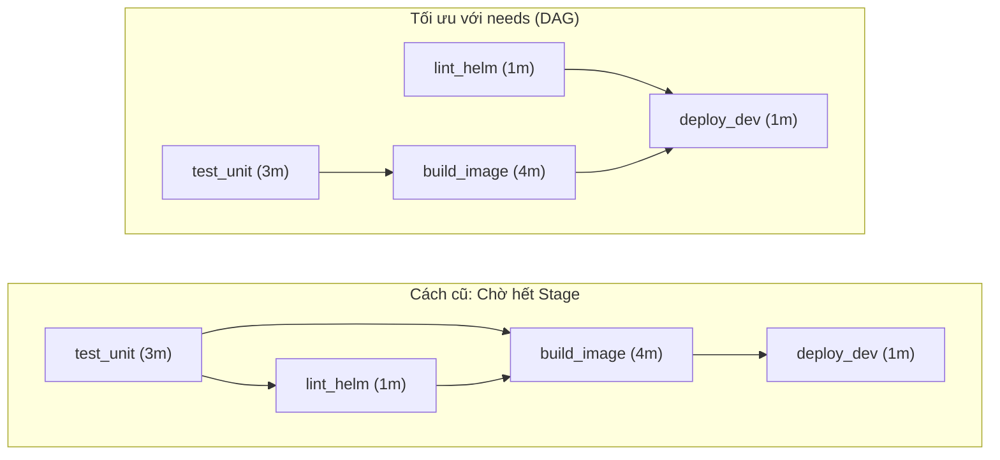
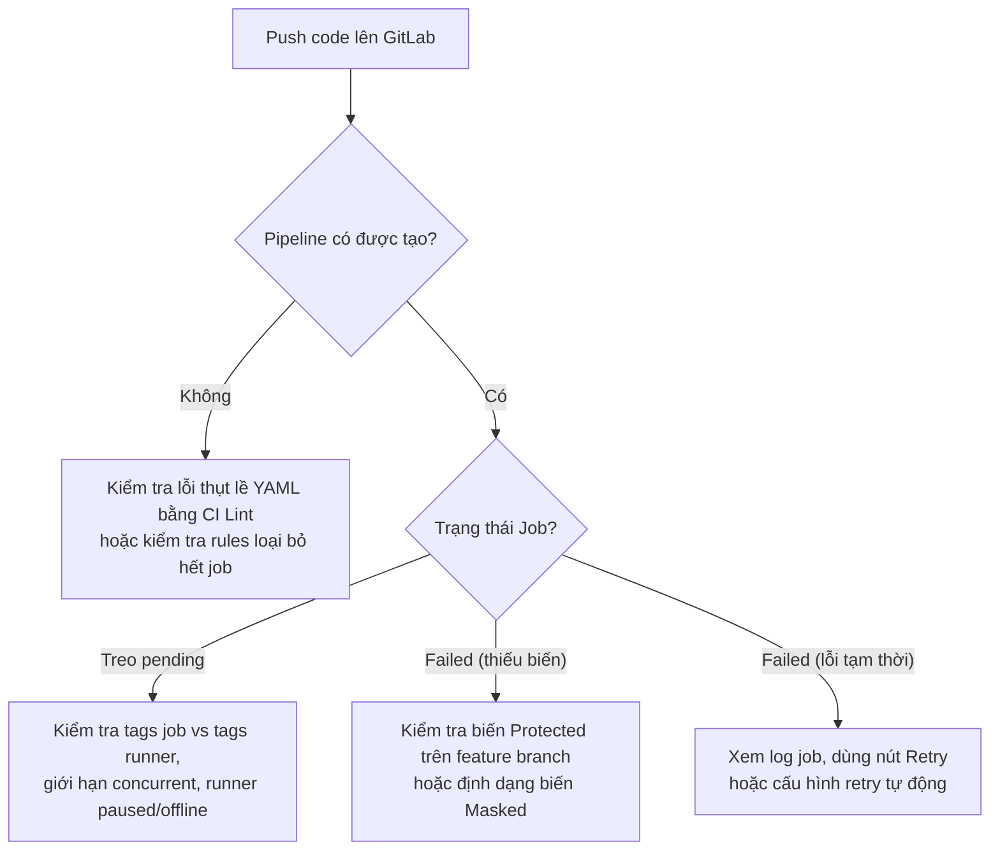

# 6_6_11 Pipeline Optimization and Troubleshooting

> **Khóa học**: Cloud DevOps Basic — Containers & Kubernetes
> **Phân nhóm**: 6 Domain 6 - Containers and Kubernetes › 6_6 GitLab CI-CD and Release Strategies
> **Chủ đề**: Tối ưu hóa tốc độ Pipeline (`needs`, `cache:key:files`, `rules:changes`, `interruptible`) và xử lý sự cố (job `pending`, lỗi YAML/`rules`, biến `protected`/`masked`, đọc log)
> **Trạng thái**: Bản nháp, chờ kiểm chứng
> **Tài liệu chủ đề**: [6_6 GitLab CI-CD and Release Strategies](./README.md) · **Checkpoint**: [CHECKLIST.md](../../CHECKLIST.md#6_6-gitlab-ci-cd-and-release-strategies)

---

## 1. Khái Niệm Cốt Lõi & Bản Chất Kỹ Thuật (Core Concepts & Technical Deep Dive)

Khi dự án lớn dần, pipeline CI/CD thường gặp hai vấn đề lớn: **chạy quá chậm** (chờ đợi tuần tự và tải lại thư viện từ đầu) và **lỗi khó hiểu** (job treo mãi không chạy, pipeline không tự kích hoạt, hoặc thiếu biến môi trường). Nếu không tối ưu và gỡ lỗi đúng cách, lập trình viên phải chờ hàng chục phút cho mỗi lần sửa nhỏ, làm chậm nhịp phát hành phần mềm. Bài học này giúp bạn chuyển tư duy từ việc "chạy được pipeline" sang "vận hành pipeline nhanh, tiết kiệm tài nguyên và chẩn đoán sự cố trong vài phút".

Để làm được điều đó, chúng ta chia làm hai mảng chính: **Xử lý sự cố (Troubleshooting)** và **Tối ưu hóa tốc độ (Optimization)**.

### 1.1. Gỡ lỗi Job bị treo ở trạng thái `pending`

**Trạng thái `pending`** nghĩa là GitLab đã tạo job nhưng chưa có **Runner** (máy thực thi job) nào nhận chạy job đó <!-- ev: C11.1 -->.

- **Không khớp `tags`**: Job chỉ được gửi tới runner có danh sách nhãn (`tags`) bao trùm toàn bộ tag mà job yêu cầu; nếu không có runner nào đang bật khớp với các tag này, job sẽ treo `pending` <!-- ev: C11.1 -->. Nếu job không khai báo `tags`, nhưng mọi runner khả dụng đều tắt tùy chọn chạy job không gắn tag (`run_untagged: false`), job cũng sẽ bị treo tương tự <!-- ev: C11.1 -->.
- **Hết giới hạn đồng thời (`concurrent`), runner bị `paused` hoặc mất kết nối**: Trong file cấu hình `config.toml` của runner, tham số `concurrent` quy định tổng số job chạy song song tối đa; khi đạt ngưỡng này, các job mới phải xếp hàng chờ ở trạng thái `pending` <!-- ev: C11.2 -->. Ngoài ra, nếu runner bị người quản trị tạm dừng (paused) hoặc mất kết nối mạng tới GitLab server (hiển thị trạng thái offline), job cũng không thể bắt đầu <!-- ev: C11.2 -->.
- **Đọc log và chạy lại (`Retry`)**: Khi job đã chạy và thất bại, GitLab ghi lại đầu ra theo thời gian thực của `before_script`, `script` và `after_script` trong khung log job; bạn có thể nhấn nút **Retry** để chạy lại riêng job đó mà không cần kích hoạt lại cả pipeline <!-- ev: C11.3 -->.

### 1.2. Gỡ lỗi Pipeline không được tạo

Đôi khi bạn đẩy code lên nhánh làm việc nhưng không thấy pipeline mới nào xuất hiện trong danh sách pipeline.

- **Lỗi cú pháp YAML**: Định dạng YAML phụ thuộc chặt chẽ vào thụt lề bằng dấu cách (space); chỉ cần lệch cấp thụt lề, dùng phím Tab thay cho dấu cách, hoặc khai báo sai kiểu dữ liệu của từ khóa, GitLab sẽ từ chối tạo pipeline và báo lỗi cú pháp <!-- ev: C11.4 -->.
- **Kiểm tra bằng CI Lint**: Trước khi push, bạn có thể dùng **CI Lint** (hoặc tab **Validate** trong **Pipeline Editor**) để kiểm tra cú pháp, logic từ khóa và mô phỏng xem pipeline có được tạo hay không <!-- ev: C11.5 -->.
- **Điều kiện `rules` loại bỏ hết job**: Trong một pipeline, nếu mọi job đều có điều kiện `rules` đánh giá không khớp (hoặc rơi vào `when: never`), pipeline sẽ không có job nào để chạy nên GitLab không khởi tạo pipeline đó <!-- ev: C11.6 -->.

### 1.3. Gỡ lỗi Biến Môi Trường (`Protected` và `Masked`)

Biến hoạt động tốt trên nhánh chính nhưng bỗng nhiên rỗng hoặc lỗi khi chuyển sang nhánh tính năng là tình huống rất hay gặp.

- **Biến `Protected` vắng mặt trên feature branch**: Biến CI/CD được đánh dấu **Protected** chỉ được truyền vào các pipeline chạy trên **protected branches** (như `main`) hoặc **protected tags**; trên các nhánh tính năng thông thường, giá trị biến này sẽ không được nạp vào job <!-- ev: C11.7 -->.
- **Biến `Masked` sai định dạng**: Tùy chọn **Masked** giúp che dấu giá trị bí mật (như token) bằng chuỗi `[MASKED]` trong job log, nhưng yêu cầu giá trị phải đạt độ dài tối thiểu 8 ký tự, không chứa khoảng trắng và chỉ gồm các ký tự hợp lệ theo quy chuẩn masking của GitLab; nếu không đạt, GitLab sẽ báo lỗi không cho lưu hoặc không thể mask biến đó <!-- ev: C11.8 -->.

### 1.4. Các kỹ thuật tối ưu hóa tốc độ Pipeline

Thay vì để các stage chờ nhau một cách cứng nhắc và tải lại thư viện từ internet mỗi lần build, GitLab cung cấp bốn công cụ cốt lõi để rút ngắn thời gian chờ.

#### 1. Phá vỡ mô hình tuần tự bằng DAG (`needs`)
- **Ý nghĩa & tác dụng**: `needs` thiết lập đồ thị phụ thuộc có hướng không chu trình (DAG), cho phép job chạy ngay khi các job tiền điều kiện chỉ định hoàn thành thay vì chờ toàn bộ stage trước kết thúc <!-- ev: C11.9 -->.
- **Kiểm soát tải artifact**: Mặc định `needs` sẽ tải về artifacts của các job mà nó phụ thuộc; nếu không cần file đầu ra đó, hãy đặt `artifacts: false` trong `needs` để tiết kiệm thời gian truyền tải <!-- ev: C11.10 -->.

#### 2. Cache thông minh theo file khóa (`cache:key:files` và `policy`)
- **Ý nghĩa & tác dụng**: `cache:key:files` tạo khóa cache dựa trên giá trị băm của các file khai báo thư viện (như `pom.xml`, `package-lock.json`), giúp chỉ dựng lại cache khi phụ thuộc thay đổi <!-- ev: C11.11 -->.
- **Chính sách `policy: pull`**: Các job chỉ đọc thư viện (như test, lint) nên đặt `policy: pull` để bỏ qua bước nén và tải cache ngược lên server ở cuối job, rút ngắn thời gian chạy <!-- ev: C11.12 -->.

#### 3. Bỏ qua job không liên quan (`rules:changes`)
- **Ý nghĩa & tác dụng**: `rules:changes` kiểm tra danh sách file thay đổi để quyết định có chạy job hay không, giúp tránh chạy build/test thừa khi chỉ sửa tài liệu (`README.md`) hoặc một module riêng lẻ <!-- ev: C11.13 -->.
- **Lưu ý quan trọng**: Trên branch pipeline khi vừa đẩy một nhánh mới lên (new branch) hoặc đẩy tag (không phải Merge Request pipeline), `rules:changes` mặc định luôn đánh giá là `true` trừ khi bạn cấu hình thêm `compare_to` <!-- ev: C11.14 -->.

#### 4. Tự động hủy pipeline cũ (`interruptible` + Auto-cancel)
- **Ý nghĩa & tác dụng**: Đặt `interruptible: true` kết hợp bật **Auto-cancel redundant pipelines** trong cài đặt project giúp GitLab tự động hủy pipeline cũ đang chờ hoặc đang chạy khi có commit mới trên cùng nhánh, nếu các job đã chạy đều cho phép ngắt ngang <!-- ev: C11.15 -->.
- **Bảo vệ job quan trọng**: Mặc định `interruptible` là `false`; một khi job có `interruptible: false` (như deploy production) đã bắt đầu chạy, GitLab sẽ không tự động hủy pipeline đó nữa <!-- ev: C11.16 -->.

*(Nâng cao: có thể bỏ qua ở lần đọc đầu)* Với các lỗi hạ tầng ngẫu nhiên (như đứt mạng tạm thời từ runner), bạn có thể cấu hình `retry` (ví dụ `max: 2` với điều kiện `when: runner_system_failure` hoặc `stuck_or_timeout_failure`) để job tự động thử lại <!-- ev: C11.17 -->, kết hợp cùng `timeout` để ngắt sớm các job bị treo vô thời hạn nhằm tránh cạn kiệt slot runner và hạn mức phút CI <!-- ev: C11.18 -->.

### 1.5. Tổ chức hàng chục pipeline ở quy mô Enterprise: `include:` vs `trigger: include` vs `trigger: project`

Khi hệ thống Enterprise phát triển lên hàng chục microservice hoặc hàng chục pipeline, nhồi nhét toàn bộ job vào một tệp cấu hình CI duy nhất khiến file khó bảo trì, giao diện pipeline phình to và dễ đụng giới hạn cấu hình. GitLab giải quyết bài toán này bằng 3 cơ chế khác nhau về số lượng pipeline tạo ra và phạm vi repository (xem thêm cú pháp cơ bản tại [6_6_2 Cú Pháp Chi Tiết Pipeline GitLab CI-CD](./6_6_2%20GitLab%20CI-CD%20Pipeline%20Syntax.md)):

- **`include:` (Gộp nhiều file YAML vào pipeline chính)**: Dùng `include` với các nguồn `local`, `project`, `remote`, `template` hoặc `component` để lấy các đoạn YAML bên ngoài; toàn bộ nội dung được **gộp chung** vào chính pipeline đang chạy ngay lúc phân tích cấu hình, nên mọi job vẫn thuộc một pipeline duy nhất, dùng chung `stages` và ngữ cảnh biến <!-- ev: C11.21 -->. Cách này phù hợp để chia sẻ template hoặc chuẩn CI chung cho nhiều nhóm mà không sinh thêm pipeline phụ.
- **`trigger: include` (Parent-Child Pipeline — tách pipeline con trong cùng project)**: Thay vì gộp job vào pipeline chính, job khai báo `trigger: include` sẽ khởi tạo một **pipeline con (child pipeline)** độc lập nằm trong **cùng repository** (thường đi kèm `rules:changes` cho monorepo), có danh sách job và đồ thị chạy riêng <!-- ev: C11.22 -->. Từ GitLab 18.2+, bạn nên đặt `strategy: mirror` để job ở pipeline cha chờ và phản ánh chính xác mọi trạng thái của pipeline con; tùy chọn `strategy: depend` (ở các phiên bản GitLab cũ hơn trước 18.2) không còn được khuyến nghị vì trạng thái trigger job không phải lúc nào cũng khớp với pipeline con <!-- ev: C11.23 -->.
- **`trigger: project` (Multi-Project Pipeline — kích hoạt pipeline ở project khác)**: Dùng khi kiến trúc tách thành nhiều repository riêng (ví dụ repo ứng dụng build xong image sẽ kích hoạt pipeline ở repo hạ tầng/GitOps hoặc repo kiểm thử E2E). Job nguồn sẽ tạo một pipeline độc lập ở **project khác** và có thể chỉ định nhánh mục tiêu qua `branch` (nên dùng `strategy: mirror` từ GitLab 18.2+ thay cho `strategy: depend` nếu cần chờ và phản ánh trạng thái kết quả) <!-- ev: C11.24 -->, giúp giữ nguyên ranh giới phân quyền và biến bí mật CI/CD riêng của từng project <!-- ev: C11.25 -->.

<!-- ev: C11.21 C11.22 C11.23 C11.24 C11.25 -->
| Cơ chế | Số pipeline được tạo | Phạm vi Repo | Khi nào dùng ở Enterprise |
| :--- | :--- | :--- | :--- |
| **`include:`** | **1 pipeline** duy nhất (gộp YAML trước khi chạy) | Cùng repo hoặc kéo template từ repo/URL khác | Dùng chung bộ rule/template CI chuẩn hóa giữa nhiều đội mà không muốn tách pipeline |
| **`trigger: include`** | **Nhiều pipeline** (1 cha + các pipeline con) | Trong **cùng một repo** (monorepo) | Monorepo có nhiều microservice; mỗi service chỉ chạy pipeline con riêng khi code service đó đổi |
| **`trigger: project`** | **Nhiều pipeline** (trên nhiều project) | **Khác repo / project** | Kiến trúc multi-repo (ví dụ repo App build xong kích hoạt repo GitOps/E2E test riêng biệt) |

---

## 2. Ví Dụ Đời Sống Thực Tế Dễ Hiểu (Intuitive Real-World Analogies)

Hãy tưởng tượng việc xây dựng phần mềm giống như **vận hành một dây chuyền lắp ráp ô tô** tại nhà máy:

- **Mô hình Stage truyền thống vs. DAG (`needs`)**: Theo cách cũ, cả phân xưởng phải đợi đội sơn sơn xong *toàn bộ* 100% chi tiết vỏ xe thì đội lắp đèn mới được bắt tay vào làm. Với **DAG (`needs`)**, ngay khi khung gầm vừa hàn xong, đội lắp động cơ làm việc ngay, đồng thời đội lắp ghế làm song song nếu không phụ thuộc vào động cơ — không ai phải ngồi chờ công đoạn không liên quan.
- **Kho linh kiện tạm (`cache:key:files` & `policy: pull`)**: Thay vì mỗi sáng phải chạy ra chợ mua từng con ốc vít (tải thư viện Maven/npm từ đầu), nhà máy giữ một kho tạm (`cache`) gắn mã khóa theo bản kê vật tư (`pom.xml`). Chỉ khi kỹ sư thay đổi bản kê vật tư, kho mới nhập lại đồ mới. Những tổ chỉ lấy linh kiện ra kiểm tra (`policy: pull`) không cần đóng gói trả ngược về kho cuối ca.
- **Hủy đơn hàng lỗi thời (`interruptible`)**: Khi dây chuyền đang lắp khung xe theo bản thiết kế v1 nhưng kỹ sư trưởng vừa gửi bản sửa lỗi v2, quản đốc lập tức bấm nút hủy khung xe v1 đang làm dở để dồn máy móc sang làm v2 ngay lập tức — ngoại trừ trường hợp xe đã đưa vào công đoạn sơn phủ hoàn thiện (`interruptible: false`) thì không được cắt ngang.
- **Sự cố tắc nghẽn (`pending` & `Protected variable`)**: Job treo `pending` giống như đơn hàng yêu cầu thợ hàn chuyên dụng (`tags: [gpu-runner]`), nhưng cả xưởng chỉ có thợ mộc hoặc các thợ hàn đều đang bận hết công suất (`concurrent`). Còn biến `Protected` bị thiếu trên feature branch giống như két sắt chứa con dấu công ty: chỉ phòng giám đốc (`main` branch) mới có chìa khóa mở, còn phòng thử nghiệm (`feature/*`) sẽ thấy két trống rỗng.

---

## 3. Kiến Trúc, Luồng Hoạt Động & Hình Ảnh Trực Quan (Architecture, Diagrams & Visual Media)

Sơ đồ dưới đây minh họa cách pipeline chuyển từ chạy tuần tự theo stage sang chạy song song theo đồ thị phụ thuộc và quy trình chẩn đoán khi pipeline gặp sự cố.



*(Hình 1: `lint_helm` không cần chờ `test_unit` và có thể chạy song song ngay từ đầu; `build_image` chỉ phụ thuộc `test_unit`, giúp rút ngắn tổng thời gian thực thi.)* <!-- ev: C11.9 -->

Khi gặp sự cố pipeline hoặc job bất thường, hãy đi theo cây quyết định chẩn đoán sau:



*(Hình 2: Quy trình khoanh vùng sự cố từ bước khởi tạo pipeline, phân phối tới runner cho đến thực thi biến môi trường.)* <!-- ev: C11.1 C11.2 C11.4 C11.5 C11.6 C11.7 C11.8 -->

---

## 4. Code Mẫu Trực Quan Hoặc Dòng Lệnh Thực Chiến (Runnable Sample Code / CLI)

Xét ví dụ xuyên suốt với dự án Java Maven (kèm Helm chart) theo luồng **Input** (cấu hình) → **Kiểm tra** → **Output** (hành vi quan sát được).

*(Lưu ý: Ví dụ sử dụng cấu hình chuẩn GitLab CI/CD YAML hiện hành và tệp cấu hình runner `config.toml` <!-- ev: C11.2 -->.)*

### 4.1. Cấu hình `.gitlab-ci.yml` tối ưu tốc độ và tự phục hồi

```yaml
# File: .gitlab-ci.yml (Ví dụ tối ưu cho dự án hello-svc)
stages:
  - test
  - build
  - deploy

default:
  # Cho phép tự động hủy job nếu có commit mới trên cùng nhánh (cần bật Auto-cancel ở Project Settings)
  interruptible: true
  timeout: 15m
  retry:
    max: 2
    when:
      - runner_system_failure
      - stuck_or_timeout_failure

variables:
  MAVEN_OPTS: "-Dmaven.repo.local=$CI_PROJECT_DIR/.m2/repository"

# Template dùng chung để đọc cache thư viện Maven dựa theo file pom.xml
.maven_cache_read:
  cache:
    key:
      files:
        - pom.xml
    paths:
      - .m2/repository
    policy: pull

test-unit:
  stage: test
  image: maven:3.9-eclipse-temurin-21
  extends: .maven_cache_read
  # Chỉ job test-unit đầu tiên được phép ghi cập nhật cache nếu pom.xml đổi
  cache:
    key:
      files:
        - pom.xml
    paths:
      - .m2/repository
    policy: pull-push
  script:
    - mvn test -B
  rules:
    - changes:
        - src/**/*
        - pom.xml

lint-helm:
  stage: test
  image: alpine/helm:3.14
  script:
    - helm lint charts/hello-svc
  rules:
    - changes:
        - charts/**/*

build-jar:
  stage: build
  image: maven:3.9-eclipse-temurin-21
  extends: .maven_cache_read
  # Chạy ngay khi test-unit xong, không cần chờ lint-helm; vẫn cần artifact hoặc build lại gọn
  needs:
    - job: test-unit
      artifacts: false
  script:
    - mvn package -DskipTests -B
  artifacts:
    paths:
      - target/*.jar
    expire_in: 1 day
  rules:
    - changes:
        - src/**/*
        - pom.xml

deploy-prod:
  stage: deploy
  image: alpine/helm:3.14
  # Không cho phép tự hủy giữa chừng khi đang deploy production
  interruptible: false
  needs:
    - job: build-jar
    - job: lint-helm
      artifacts: false
  script:
    - echo "Deploying $CI_COMMIT_SHORT_SHA to production..."
  rules:
    - if: $CI_COMMIT_BRANCH == $CI_DEFAULT_BRANCH
      when: manual
```
<!-- ev: C11.9 C11.10 C11.11 C11.12 C11.13 C11.15 C11.16 C11.17 C11.18 -->

**Quan sát Input → Hành vi → Output**:
- **Input 1 (Sửa file `charts/hello-svc/values.yaml` trong Merge Request)**: `test-unit` và `build-jar` không chạy nhờ `rules:changes`; chỉ `lint-helm` thực thi, giúp tiết kiệm toàn bộ thời gian biên dịch Java <!-- ev: C11.13 -->.
- **Input 2 (Sửa code Java trong `src/`, giữ nguyên `pom.xml`, đẩy 2 commit liên tiếp cách nhau 10 giây)**: Pipeline của commit 1 đang chạy `test-unit` sẽ tự động chuyển sang trạng thái **Canceled** (vì `interruptible: true`), nhường slot runner ngay cho pipeline của commit 2 <!-- ev: C11.15 -->. Ở commit 2, job `build-jar` lấy thẳng thư viện từ `.m2/repository` qua `policy: pull` và không tải lại artifact không cần thiết từ `test-unit` nhờ `artifacts: false` <!-- ev: C11.10 C11.12 -->.

### 4.2. Kiểm tra lỗi thụt lề YAML và cấu hình Runner khi job `pending`

1. **Khi pipeline không tạo**: Dán nội dung `.gitlab-ci.yml` vào **Build > Pipeline editor > Validate** (CI Lint) hoặc dùng lệnh kiểm tra cấu trúc cục bộ bằng công cụ kiểm tra YAML trước khi push <!-- ev: C11.5 -->.
   - *Output mẫu khi sai thụt lề*: `jobs:test-unit config contains unknown keys` hoặc `YAML syntax error: did not find expected key` <!-- ev: C11.4 -->.
2. **Khi job `pending` trên self-managed runner**: Kiểm tra file `/etc/gitlab-runner/config.toml` trên máy chạy runner để xác nhận tham số `concurrent` và trạng thái đăng ký tag <!-- ev: C11.1 C11.2 -->.

```toml
# Trích đoạn /etc/gitlab-runner/config.toml
concurrent = 4 # Tăng số lượng nếu nhiều job bị kẹt pending do hết slot đồng thời
check_interval = 0

[[runners]]
  name = "local-docker-runner"
  executor = "docker"
```
<!-- ev: C11.2 -->

### 4.3. Ví dụ ngắn: Phân tách pipeline quy mô Enterprise

Ví dụ cấu hình dưới đây minh họa cách kết hợp cả 3 cơ chế trong một hệ thống lớn:

<!-- ev: C11.13 C11.21 C11.22 C11.23 C11.24 -->
```yaml
# 1. include: local — gộp file YAML cùng repo vào ngay pipeline hiện tại
include:
  - local: 'ci/common-lint.yml'

stages:
  - lint
  - trigger-child
  - trigger-deploy

# 2. trigger: include — tạo child pipeline độc lập trong cùng repo
payment-service-pipeline:
  stage: trigger-child
  rules:
    - changes:
        - services/payment/**/*
  trigger:
    include: services/payment/.gitlab-ci.yml
    strategy: mirror

# 3. trigger: project — tạo downstream pipeline ở một project khác
gitops-deploy-pipeline:
  stage: trigger-deploy
  trigger:
    project: platform/gitops-manifests
    branch: main
    strategy: mirror
```

**Quan sát Input → Hành vi**:
- **Input 1 (Chạy `include: local`)**: Các job trong `ci/common-lint.yml` xuất hiện trực tiếp trong danh sách job của pipeline gốc và không sinh ra pipeline con nào thêm <!-- ev: C11.21 -->.
- **Input 2 (Thay đổi file trong `services/payment/` và push)**: Job `payment-service-pipeline` kích hoạt một pipeline con mới ngay trong cùng repository; nhờ `strategy: mirror` (GitLab 18.2+), job cha sẽ chờ và phản ánh chính xác trạng thái của pipeline con <!-- ev: C11.22 C11.23 -->.
- **Input 3 (Tới stage `trigger-deploy`)**: Job `gitops-deploy-pipeline` khởi tạo một pipeline mới trên nhánh `main` của project `platform/gitops-manifests`, sử dụng biến và phân quyền riêng của repo hạ tầng đó <!-- ev: C11.24 C11.25 -->.

---

## 5. Cạm Bẫy Thực Tế & Thực Tiễn Sản Xuất (Production Gotchas & Best Practices)

- **Bẫy `rules:changes` trên nhánh mới**: Khi bạn tạo một nhánh tính năng mới tinh (`git checkout -b feat/new`) và push lần đầu (trên branch pipeline, chưa tạo Merge Request), GitLab không có commit gốc trên nhánh đó để so sánh nên `rules:changes` mặc định trả về `true` và chạy toàn bộ job; để khắc phục, hãy ưu tiên chạy trên Merge Request pipeline hoặc cấu hình thêm `compare_to` <!-- ev: C11.14 -->.
- **Bẫy bật `CI_DEBUG_TRACE` rồi quên tắt**: Khi gỡ lỗi biến môi trường bị rỗng hoặc sai giá trị, nhiều người đặt biến `CI_DEBUG_TRACE: "true"` để xem log chi tiết. Tuy nhiên, cờ này làm runner in toàn bộ lệnh và biến môi trường (bao gồm cả secret nếu không được mask) ra job log, gây rủi ro lộ thông tin nhạy cảm nếu log công khai hoặc nhiều người có quyền đọc; chỉ bật tạm thời khi debug và xóa ngay sau đó <!-- ev: C11.19 -->.
- **Bẫy lạm dụng `cache` thay cho `artifacts`**: Cache chỉ mang tính chất tăng tốc (không được đảm bảo luôn tồn tại nếu chuyển runner hoặc hết hạn) nên không dùng để truyền file biên dịch bắt buộc sang job sau; dữ liệu bắt buộc giữa các job phải dùng `artifacts` <!-- ev: C11.20 -->.
- **Cảnh giác biến `Protected` khi test trên feature branch**: Đừng cấu hình các biến cần cho môi trường dev/test ở trạng thái **Protected** nếu lập trình viên cần chạy pipeline kiểm thử trên nhánh `feat/*`, vì giá trị sẽ rỗng và gây lỗi khó hiểu <!-- ev: C11.7 -->.
- **Đặt `timeout` và giới hạn `retry` hợp lý**: Luôn đặt `timeout` cho job (hoặc mức project) và chỉ cho `retry` trên các lỗi hệ thống (`runner_system_failure`), tránh retry mù quáng khi lỗi do test code fail làm lãng phí phút CI và làm nghẽn hàng đợi `pending` <!-- ev: C11.17 C11.18 -->.

---

## 6. Câu Hỏi Củng Cố Kiến Thức (Active Recall Quiz)

**Câu 1**: Bạn vừa đẩy một commit mới lên nhánh `feat/login`, pipeline được tạo nhưng job `build-docker` đứng im ở trạng thái `pending` suốt 10 phút dù máy chủ GitLab Runner vẫn đang bật. Hãy nêu ít nhất 3 nguyên nhân khả dĩ nhất và cách kiểm tra.

<details>
<summary>Đáp án</summary>

1. **Lệch `tags`**: Job yêu cầu tag (ví dụ `tags: [docker-build]`) nhưng runner đang chạy lại không có tag đó, hoặc job không có tag nhưng runner tắt `run_untagged`. Kiểm tra phần **Settings > CI/CD > Runners** trên GitLab.
2. **Hết slot `concurrent`**: Runner đang chạy đủ số job tối đa được cấu hình ở trường `concurrent` trong `config.toml`, nên job mới phải xếp hàng.
3. **Runner bị `paused` hoặc mất kết nối**: Runner tạm ngừng nhận job (biểu tượng Pause) hoặc container/service `gitlab-runner` bị lỗi mạng (Offline).

</details>

**Câu 2**: Pipeline của dự án có stage `test` gồm `unit-test` (chạy 5 phút) và `helm-lint` (chạy 20 giây), tiếp theo là stage `deploy` chỉ cần file manifest từ `helm-lint` (không cần output của `unit-test`). Làm thế nào để `deploy` chạy sớm hơn? Có bẫy nào về tải artifact không?

<details>
<summary>Đáp án</summary>

- Đặt `needs: [{ job: helm-lint }]` (hoặc `needs: [helm-lint]`) trong job `deploy` (nếu logic nghiệp vụ cho phép deploy dev không cần đợi `unit-test`) hoặc kết hợp `needs` giữa các nhánh độc lập để không phải chờ các job không liên quan trong stage trước kết thúc.
- Nếu `deploy` có `needs: [unit-test]` chỉ để đảm bảo test đã pass mà không cần file report của `unit-test`, hãy thêm `artifacts: false` vào mục `needs` của `unit-test` để tránh tải xuống dữ liệu thừa làm chậm job.

</details>

**Câu 3**: Tại sao khi chạy pipeline trên nhánh `feat/payment`, biến `PROD_API_KEY` (đã khai báo trong Settings > CI/CD > Variables) lại có giá trị rỗng, và khi cố đặt một token có chứa dấu cách làm biến **Masked**, GitLab báo lỗi không cho lưu?

<details>
<summary>Đáp án</summary>

- `PROD_API_KEY` đang bị đánh dấu **Protected**, nên GitLab chỉ nạp biến này trên các **protected branches** hoặc **protected tags**; nhánh `feat/payment` chưa được bảo vệ sẽ không nhận được biến này.
- Biến **Masked** bắt buộc phải thỏa mãn quy chuẩn định dạng của GitLab (tối thiểu 8 ký tự, **không chứa khoảng trắng**, chỉ dùng các ký tự được phép) để hệ thống đảm bảo che được hoàn toàn giá trị đó trong log.

</details>

---

## 7. 📚 Nguồn Tài Liệu Chính Thống (Tier-1 Official References)

- [GitLab CI/CD Jobs](https://docs.gitlab.com/ci/jobs/) - Tài liệu chính thức về vòng đời job, trạng thái `pending`, `tags`, log và retry.
- [Pipeline Troubleshooting](https://docs.gitlab.com/ci/pipelines/pipeline_troubleshooting/) - Hướng dẫn chính thức gỡ lỗi job `pending`, lỗi cú pháp YAML, CI Lint và `rules`.
- [Caching in GitLab CI/CD](https://docs.gitlab.com/ci/caching/) - Tài liệu chính thức về `cache:key:files`, `policy: pull` / `pull-push` và tối ưu hóa cache.
- [GitLab CI/CD YAML Syntax — `needs`](https://docs.gitlab.com/ci/yaml/#needs) - Tài liệu chính thức về DAG, `needs`, và `artifacts: false`.
- [GitLab CI/CD YAML Syntax — `interruptible`](https://docs.gitlab.com/ci/yaml/#interruptible) - Tài liệu chính thức về `interruptible` và cơ chế tự động hủy pipeline dư thừa.
- [GitLab CI/CD Variables](https://docs.gitlab.com/ci/variables/) - Tài liệu chính thức về biến `Protected`, `Masked` và gỡ lỗi với `CI_DEBUG_TRACE`.
- [Include external YAML files](https://docs.gitlab.com/ci/yaml/includes/) - Tài liệu chính thức về `include` (`local`, `project`, `remote`, `template`, `component`) và cách gộp cấu hình YAML.
- [Downstream pipelines](https://docs.gitlab.com/ci/pipelines/downstream_pipelines/) - Tài liệu chính thức về Parent-Child pipelines (`trigger: include`), Multi-Project pipelines (`trigger: project`), `strategy: depend` và `strategy: mirror`.
