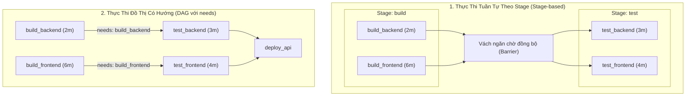
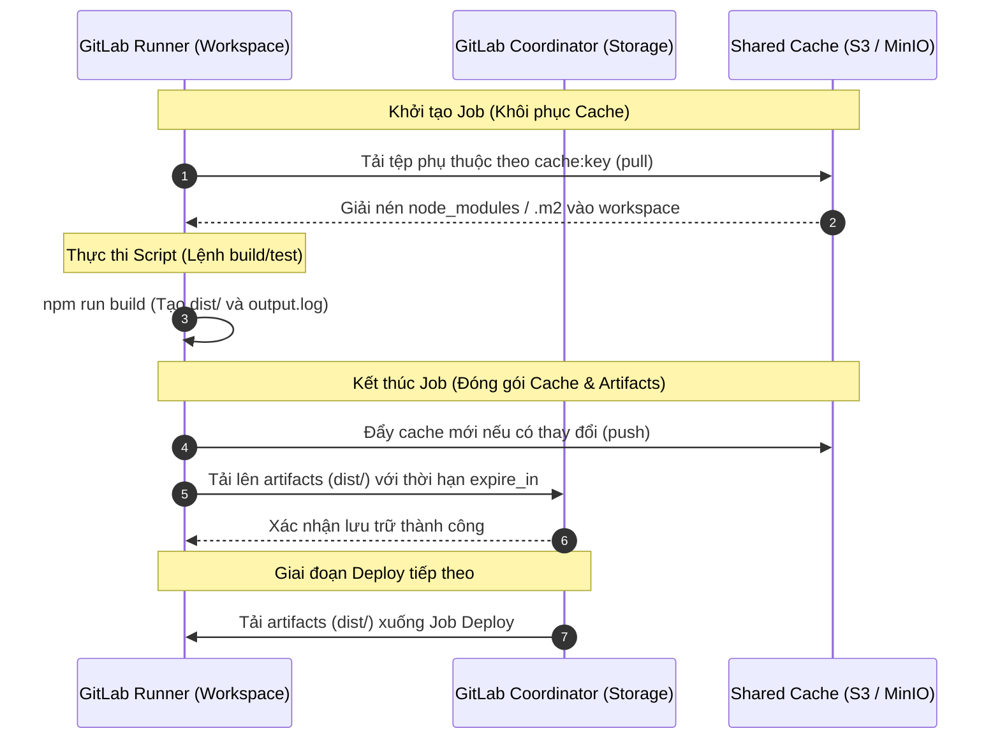

# 6_6_2 Cú Pháp Chi Tiết Pipeline GitLab CI-CD (.gitlab-ci.yml Syntax)

- **Khóa học**: Cloud DevOps Basic
- **Phân nhóm**: 6 Domain 6 - Containers and Kubernetes
- **Chủ đề**: 6_6 GitLab CI-CD and Release Strategies
- **Trạng thái**: Đã kiểm chứng (verifier PASS, 21-11-2026)
- **Checklist đối chiếu**: [CHECKLIST.md](../../CHECKLIST.md)

---

## 1. Khái Niệm Cốt Lõi & Bản Chất Kỹ Thuật (Core Concepts & Technical Deep Dive)

Trong hệ sinh thái DevOps hiện đại, quy trình tích hợp và phân phối liên tục được quản lý hoàn toàn dưới dạng mã nguồn (Pipeline as Code). Hiểu sâu từng từ khóa cấu hình giúp kỹ sư DevOps xây dựng các luồng tự động hóa tối ưu về tốc độ, bảo mật và khả năng mở rộng.

### 1.1 Cấu Trúc Cơ Bản & Khối Thuộc Tính Toàn Cục

File cấu hình `.gitlab-ci.yml` được đặt tại thư mục gốc (root) của kho lưu trữ git, đóng vai trò là điểm chỉ dẫn duy nhất cho GitLab Runner khi khởi tạo quy trình tự động hóa. <!-- ev: C2.1 -->

Từ khóa `default` định nghĩa các thông số mặc định được áp dụng tự động cho tất cả các job trong pipeline, bao gồm các cấu hình phổ biến như `image`, `before_script`, `after_script`, `retry`, `timeout`, và `artifacts`. <!-- ev: C2.2 -->

Từ khóa `stages` xác định thứ tự thực hiện tuần tự của các giai đoạn trong pipeline. Khi người dùng không khai báo tường minh từ khóa `stages`, GitLab áp dụng danh sách stage mặc định gồm năm giai đoạn: `.pre`, `build`, `test`, `deploy`, và `.post`. <!-- ev: C2.3 -->

### 1.2 Điều Khiển Luồng Thực Thi Hiện Đại Với `rules`

Khối cấu hình `rules` cung cấp khả năng kiểm soát điều kiện thực thi linh hoạt, thay thế các cơ chế lọc điều kiện cũ. <!-- ev: C2.4 -->

Mảng `rules` trong mỗi job được hệ thống đánh giá tuần tự từ trên xuống dưới (top-to-bottom); khi bắt gặp điều kiện đầu tiên thỏa mãn (first match), trạng thái thực thi của job được xác định ngay lập tức và toàn bộ các rule còn lại phía dưới sẽ bị bỏ qua. <!-- ev: C2.4 -->

Bên trong `rules`, thuộc tính `changes` kiểm tra sự thay đổi của các tệp hoặc đường dẫn chỉ định thông qua biểu thức mẫu glob, còn thuộc tính `exists` kiểm tra sự hiện diện của tệp cụ thể trong repository. <!-- ev: C2.5 -->

Thuộc tính `when` bên trong khối `rules` quyết định cách thức job được kích hoạt, hỗ trợ các giá trị: `on_success` (mặc định), `manual`, `always`, `never`, `on_failure`, và `delayed`. <!-- ev: C2.6 -->

### 1.3 Tối Ưu Tốc Độ Với DAG (`needs`) Và Kiểm Soát Phụ Thuộc

Mô hình pipeline phân tầng theo stage truyền thống buộc mọi job ở stage sau phải chờ toàn bộ job ở stage trước hoàn tất. GitLab giải quyết điểm nghẽn này bằng cơ chế Đồ thị có hướng không chu trình (DAG). <!-- ev: C2.101 -->

Từ khóa `needs` cho phép job thực thi theo mô hình DAG, chạy ngay khi các job phụ thuộc được liệt kê hoàn thành mà không cần chờ toàn bộ stage phía trước kết thúc. <!-- ev: C2.7 -->

Theo mặc định, một job sử dụng `needs: [job_name]` sẽ tự động tải artifacts từ các job được khai báo; nếu không cần tải dữ liệu này, kỹ sư có thể vô hiệu hóa bằng cách thiết lập `artifacts: false` bên trong object của job cần phụ thuộc. <!-- ev: C2.8 -->

Khác với `needs`, từ khóa `dependencies` xác định danh sách các job tiền nhiệm thuộc các stage trước mà job hiện tại sẽ tải artifacts về không gian làm việc; việc thiết lập `dependencies: []` chỉ thị cho runner bỏ qua hoàn toàn việc tải artifacts. <!-- ev: C2.9 -->

### 1.4 Phân Biệt Tuyệt Đối Giữa `artifacts` Và `cache`

Phân định đúng vai trò giữa lưu trữ thành phẩm bàn giao và bộ nhớ tạm là yếu tố quyết định để duy trì hiệu năng cũng như độ ổn định:

- **`artifacts` (Bàn giao thành phẩm)**: Dùng để lưu trữ và chuyển giao các tệp kết quả tạo ra sau khi build (như file `.jar`, thư mục `dist/`, báo cáo kiểm thử) giữa các stage khác nhau hoặc để tải về máy cục bộ qua giao diện GitLab; dữ liệu artifacts được tải lên GitLab Coordinator với thời gian lưu trữ được kiểm soát bởi từ khóa `expire_in` (mặc định là 30 ngày nếu không chỉ định). <!-- ev: C2.10 -->
- **`cache` (Tăng tốc xử lý)**: Dùng để tăng tốc độ pipeline bằng cách tái sử dụng các tệp phụ thuộc của bên thứ ba (như `node_modules/`, `.m2/repository`) giữa các lần chạy pipeline trên runner hoặc lưu trữ tại object storage, hỗ trợ thiết lập `policy` với ba giá trị: `pull`, `push`, hoặc `pull-push` (mặc định). <!-- ev: C2.11 -->

### 1.5 Tái Sử Dụng Cấu Hình & Modular Hóa Pipeline

Khi số lượng microservice và pipeline gia tăng, việc lặp lại mã YAML gây khó khăn cho bảo trì:

- **`extends`**: Cho phép một job kế thừa toàn bộ cấu hình từ một template job ẩn (thường bắt đầu bằng dấu chấm `.`), hỗ trợ cơ chế merge cấu hình đệ quy và cho phép ghi đè các khóa trùng lặp. <!-- ev: C2.12 -->
- **`!reference`**: Cú pháp thẻ tùy chỉnh của GitLab YAML cho phép nhúng trực tiếp từng khối thuộc tính cụ thể (chẳng hạn như mảng `before_script` hoặc `rules`) từ job khác mà không cần kế thừa toàn bộ cấu trúc của job đó. <!-- ev: C2.13 -->
- **`include`**: Hỗ trợ nhập và ghép nối các tệp cấu hình CI từ bên ngoài thông qua các từ khóa nguồn: `local`, `project`, `remote`, `template`, và `component`. <!-- ev: C2.14 -->
- **CI/CD Components & Catalog**: Cho phép đóng gói các đoạn cấu hình CI/CD thành các module tái sử dụng có gắn nhãn phiên bản, được phát hành lên CI/CD Catalog và nhúng vào pipeline thông qua cú pháp `include: component: 'gitlab.com/.../component-name@version'`. <!-- ev: C2.15 -->

### 1.6 Điều Khiển Thực Thi & Pipeline Đa Dự Án

- **`parallel:matrix`**: Cho phép nhân bản một job thành nhiều job con chạy song song đồng thời với các tổ hợp biến số môi trường khác nhau trong ma trận thử nghiệm. <!-- ev: C2.16 -->
- **`interruptible: true`**: Cho phép hệ thống tự động hủy các job đang chạy trong pipeline cũ khi có commit mới được đẩy lên cùng nhánh hoặc merge request, giúp tiết kiệm tài nguyên runner. <!-- ev: C2.17 -->
- **`resource_group`**: Đảm bảo tính tuần tự bằng cách giới hạn mức độ tương tranh thành một cho các job cùng chia sẻ một nhóm tài nguyên, loại bỏ xung đột khi triển khai đồng thời vào một môi trường đích. <!-- ev: C2.18 -->
- **Parent-Child Pipeline**: Sử dụng từ khóa `trigger: include` để khởi chạy một pipeline con độc lập nằm trong cùng một repository, tối ưu cho kiến trúc monorepo. <!-- ev: C2.19 -->
- **Multi-Project Pipeline**: Sử dụng từ khóa `trigger: project` kết hợp thuộc tính `branch` để kích hoạt một pipeline độc lập trên một dự án GitLab khác. <!-- ev: C2.20 -->

---

## 2. Ví Dụ Đời Sống Thực Tế Dễ Hiểu (Intuitive Real-World Analogies)

Để hình dung toàn bộ bức tranh kiến trúc của `.gitlab-ci.yml`, hãy liên tưởng tới quy trình vận hành của một **Bếp ăn Công nghiệp phục vụ Tiệc cưới lớn**:

1. **Bản vẽ công thức `.gitlab-ci.yml`**: Là cuốn sổ tay quy trình vận hành tiêu chuẩn của toàn bộ nhà bếp. Mỗi khâu được phân bổ rõ ràng: sơ chế (build), nêm nếm & kiểm tra vệ sinh (test), bày biện lên mâm tiệc (deploy).
2. **Bộ quy tắc `rules` (Phân loại thực đơn)**: Mỗi sáng, bếp trưởng nhìn vào đơn hàng nguyên liệu. Nếu hôm nay là tiệc cưới thuần chay (`changes: ["menu/vegan/**"]`), bếp chỉ khởi động khu nấu món chay; khu làm thịt cá sẽ được tắt lửa hoàn toàn (`when: never`).
3. **Mô hình DAG `needs` (Nấu nướng song song không chờ đợi)**: Trong bếp truyền thống theo stage tuần tự, người nấu canh bắt buộc phải đứng đợi người nướng bánh làm xong mới được bật bếp canh. Với `needs`, đầu bếp nấu canh chỉ cần người sơ chế rau củ thái xong (`needs: [so_che_rau]`) là có thể nhóm lửa nấu ngay lập tức, bỏ qua việc người nướng bánh mất 40 phút nhào bột.
4. **`artifacts` vs `cache` (Món ăn thành phẩm vs Tủ gia vị dự trữ)**:
   - **`artifacts` (Món ăn chín giao ra sảnh tiệc)**: Đĩa cá hồi áp chảo thơm ngon phải được đóng hộp cẩn thận chuyển giao sang cho tổ bồi bàn bày tiệc (`deploy`). Nếu đĩa cá bị thất lạc, bữa tiệc bị hủy. Món ăn này có thời hạn dùng ngon nhất trong buổi tiệc (`expire_in`).
   - **`cache` (Tủ đựng gia vị hạt nêm, tiêu ớt)**: Đầu bếp cất hũ tiêu và hũ đường vào ngăn tủ sau ca trưa để ca tối lấy ra nêm tiếp mà không cần chạy ra chợ mua lại. Tuy nhiên, nếu vô tình tạp vụ dọn sạch tủ (cache miss), đầu bếp chỉ mất thêm chút thời gian ra cửa hàng mua hũ gia vị mới chứ bữa tiệc không hề bị hỏng.
5. **`extends` và CI/CD Components (Quy chuẩn nhượng quyền)**: Chuỗi nhà hàng có 10 chi nhánh. Quy tắc rửa tay và tiệt trùng dao thớt được đóng gói thành tiêu chuẩn dùng chung (`extends` hoặc `component`). Từng bếp trưởng chi nhánh chỉ việc áp dụng lại nguyên văn mà không cần tự sáng tác quy trình.

---

## 3. Kiến Trúc, Luồng Hoạt Động & Hình Ảnh Trực Quan (Architecture, Diagrams & Visual Media)

### 3.1 So Sánh Tiến Trình Tuần Tự (Stage-based) vs Đồ Thị Có Hướng (DAG `needs`)

Sơ đồ dưới đây minh họa sự khác biệt đột phá về thời gian hoàn thành pipeline khi ứng dụng mô hình DAG:



*Nhận xét*: Với `needs`, `test_backend` bắt đầu chạy ngay khi `build_backend` hoàn thành mà không phải chờ đợi các job khác cùng stage kết thúc. <!-- ev: C2.7 -->

### 3.2 Luồng Lưu Trữ & Vòng Đời Của Artifacts vs Cache



---

## 4. Code Mẫu Trực Quan Hoặc Dòng Lệnh Thực Chiến (Runnable Sample Code / CLI)

Dưới đây là ví dụ cấu hình pipeline hoàn chỉnh chuẩn sản xuất, tích hợp đầy đủ các từ khóa cốt lõi:

```yaml
# Định nghĩa các thông số mặc định cho toàn bộ pipeline
default:
  image: node:20-alpine
  before_script:
    - echo "Bắt đầu thực thi job trên runner: $(hostname)"
  retry:
    max: 1
    when:
      - runner_system_failure

# Định nghĩa các giai đoạn thực thi
stages:
  - build
  - test
  - downstream
  - deploy

# Template ẩn định nghĩa cấu hình cache chung cho Node.js
.node_cache_template:
  cache:
    key:
      files:
        - package-lock.json
    paths:
      - .npm/
    policy: pull-push

# Job 1: Build Backend ứng dụng (chạy nhanh)
build_backend:
  stage: build
  image: maven:3.9-eclipse-temurin-17
  extends: .node_cache_template
  script:
    - mvn clean package -DskipTests
  artifacts:
    name: "backend-binary-$CI_COMMIT_SHORT_SHA"
    paths:
      - target/*.jar
    expire_in: 7 days

# Job 2: Build Frontend ứng dụng (chạy lâu hơn)
build_frontend:
  stage: build
  extends: .node_cache_template
  script:
    - npm ci --cache .npm --prefer-offline
    - npm run build
  artifacts:
    paths:
      - dist/
    expire_in: 1 day

# Job 3: Test Backend với DAG (chỉ cần backend build xong là chạy ngay)
test_backend:
  stage: test
  image: maven:3.9-eclipse-temurin-17
  needs:
    - job: build_backend
      artifacts: true
  script:
    - mvn test
  rules:
    - if: '$CI_PIPELINE_SOURCE == "merge_request_event"'
      changes:
        - src/backend/**/*
      when: on_success
    - if: '$CI_COMMIT_BRANCH == $CI_DEFAULT_BRANCH'
      when: on_success
    - when: never

# Job 4: Kiểm thử Frontend đa trình duyệt với parallel:matrix
test_frontend_matrix:
  stage: test
  needs:
    - job: build_frontend
      artifacts: true
  parallel:
    matrix:
      - BROWSER: [chrome, firefox, edge]
        NODE_VERSION: ["18", "20"]
  interruptible: true
  script:
    - echo "Chạy kiểm thử frontend trên trình duyệt $BROWSER với Node $NODE_VERSION"

# Job 5: Kích hoạt Pipeline con (Parent-Child) cho Monorepo
trigger_services_child:
  stage: downstream
  rules:
    - changes:
        - services/billing/**/*
  trigger:
    include: services/billing/.gitlab-ci.yml
    strategy: depend

# Job 6: Triển khai môi trường Production được kiểm soát tương tranh
deploy_production:
  stage: deploy
  resource_group: production_environment
  environment:
    name: production
    url: https://api.example.com
  rules:
    - if: '$CI_COMMIT_BRANCH == "main"'
      when: manual
      allow_failure: false
  script:
    - echo "Triển khai an toàn vào cụm máy chủ Production..."
```

---

## 5. Cạm Bẫy Thực Tế & Thực Tiễn Sản Xuất (Production Gotchas & Best Practices)

### 5.1 Cạm Bẫy Lạm Dụng Cache Để Bàn Giao Artifacts
- **Hiện tượng**: Lập trình viên cấu hình thư mục build (`dist/` hoặc `target/`) vào `cache`, sau đó kỳ vọng job ở stage sau sẽ lấy ra để triển khai. <!-- ev: C2.11 -->
- **Hậu quả**: Cache không được thiết kế có tính bảo đảm tính sẵn sàng 100%. Nếu cache bị dọn dẹp (cache eviction) trên runner mới, job sau sẽ bị lỗi do không tìm thấy file. <!-- ev: C2.11 -->
- **Giải pháp**: Luôn dùng `artifacts` cho bất kỳ tệp dữ liệu đầu ra nào cần chuyển giao giữa các job. Chỉ dùng `cache` cho các thư viện phụ thuộc có thể tải lại nếu cache miss. <!-- ev: C2.10 C2.11 -->

### 5.2 Bẫy Thứ Tự Đánh Giá Trong Khối `rules`
- **Hiện tượng**: Đặt rule kiểm tra nhánh chung chung `$CI_COMMIT_BRANCH` lên trước rule kiểm tra thay đổi tệp `changes`. <!-- ev: C2.4 -->
- **Hậu quả**: Do cơ chế First-Match-Wins, biểu thức nhánh chung sẽ luôn khớp trước, khiến điều kiện `changes` tinh tế phía dưới không bao giờ được kiểm tra. <!-- ev: C2.4 C2.5 -->
- **Giải pháp**: Xếp các rule có điều kiện cụ thể, nghiêm ngặt (như `changes`, `exists`, tag) lên đầu, và để các rule mang tính bao quát (nhánh mặc định, fallback `when: never`) ở cuối mảng `rules`. <!-- ev: C2.4 C2.5 -->

### 5.3 Nguy Cơ Phình Dung Lượng Lưu Trữ Vì Quên `expire_in`
- **Hiện tượng**: Không khai báo `expire_in` trong khối `artifacts` khi build liên tục cho các merge request hoặc nhánh phát triển. <!-- ev: C2.10 -->
- **Hậu quả**: Các tệp nén artifacts có dung lượng hàng trăm Megabytes sẽ tồn tại mặc định 30 ngày, làm cạn kiệt dung lượng ổ cứng của máy chủ GitLab nội bộ hoặc đội chi phí lưu trữ object storage. <!-- ev: C2.10 -->
- **Giải pháp**: Luôn thiết lập `expire_in: 1 day` hoặc `expire_in: 1 hour` cho các job kiểm thử và build tạm trên merge request. Chỉ giữ artifacts lâu dài (ví dụ `1 month` hoặc `never`) cho các bản phát hành chính thức (Release Tags). <!-- ev: C2.10 -->

### 5.4 Xung Đột Triển Khai (Race Condition) Khi Thiếu `resource_group`
- **Hiện tượng**: Hai lập trình viên cùng merge mã nguồn vào nhánh chính cách nhau vài giây. Hai pipeline chạy song song và cùng kích hoạt job deploy vào cùng một môi trường máy chủ.
- **Hậu quả**: Hai tiến trình deploy ghi đè cấu hình lẫn nhau, gây lỗi downtime hệ thống hoặc đưa ứng dụng về trạng thái bất định.
- **Giải pháp**: Khai báo `resource_group: <environment_name>` để khóa phiên triển khai, ép các job deploy phải xếp hàng tuần tự. <!-- ev: C2.18 -->

---

## 6. Câu Hỏi Củng Cố Kiến Thức (Active Recall Quiz)

### Câu hỏi 1: Tối ưu pipeline với DAG
Một kỹ sư DevOps nhận thấy pipeline mất 15 phút để hoàn thành. Trong đó stage `build` có `build_docs` mất 12 phút và `build_app` mất 2 phút. Stage `test` có `test_unit` chỉ cần mã nguồn của `build_app` nhưng đang phải chờ 12 phút mới được chạy. Giải pháp cấu hình tối ưu nhất là gì?

<details>
<summary>Đáp án</summary>

Sử dụng từ khóa `needs` trong job `test_unit`:
```yaml
test_unit:
  stage: test
  needs:
    - job: build_app
      artifacts: true
```
Khi khai báo cấu hình này, `test_unit` sẽ chuyển sang thực thi theo mô hình DAG, kích hoạt ngay ở phút thứ 2 khi `build_app` hoàn thành, hoàn toàn không phải chờ đợi job `build_docs` kết thúc.
</details>

---

### Câu hỏi 2: Phân biệt `dependencies` vs `needs`
Nếu một job khai báo `dependencies: []` thì điều gì sẽ xảy ra đối với các tệp artifacts được tạo ra từ các stage phía trước?

<details>
<summary>Đáp án</summary>

Khi job khai báo `dependencies: []`, GitLab Runner sẽ không tải bất kỳ tệp artifact nào được tạo ra từ các stage trước đó về không gian làm việc của job hiện tại. Điều này giúp tối ưu hóa băng thông mạng và rút ngắn thời gian khởi tạo workspace khi job không yêu cầu dữ liệu đầu ra từ các bước trước.
</details>

---

### Câu hỏi 3: Thiết kế quy trình Monorepo với Parent-Child Pipeline
Trong một kho lưu trữ Monorepo chứa 10 microservice độc lập, làm thế nào để khi lập trình viên chỉ sửa đổi thư mục `services/payment/` thì chỉ có pipeline kiểm thử của riêng `payment` được kích hoạt, tránh lãng phí thời gian chạy lại 9 dịch vụ còn lại?

<details>
<summary>Đáp án</summary>

Sử dụng kết hợp `rules:changes` và Parent-Child Pipeline với `trigger:include`:
```yaml
trigger_payment_pipeline:
  stage: downstream
  rules:
    - changes:
        - services/payment/**/*
  trigger:
    include: services/payment/.gitlab-ci.yml
    strategy: depend
```
Cấu hình này đảm bảo chỉ khi có tệp trong thư mục `services/payment/` thay đổi, pipeline con độc lập của payment mới được khởi tạo và chạy.
</details>

---

## 7. 📚 Nguồn Tài Liệu Chính Thống (Tier-1 Official References)

- [GitLab CI/CD YAML syntax reference](https://docs.gitlab.com/ci/yaml/) - Tài liệu tham khảo toàn diện về mọi từ khóa và cấu trúc cấu hình `.gitlab-ci.yml`.
- [Directed Acyclic Graph (DAG) in GitLab CI/CD](https://docs.gitlab.com/ci/yaml/needs/) - Hướng dẫn tối ưu hóa luồng thực thi pipeline với từ khóa `needs`.
- [GitLab CI/CD Caching](https://docs.gitlab.com/ci/caching/) - Hướng dẫn kiến trúc cache, cơ chế key và policy trong GitLab CI.
- [Job Artifacts in GitLab CI/CD](https://docs.gitlab.com/ci/jobs/job_artifacts/) - Tài liệu về việc bàn giao dữ liệu, báo cáo kiểm thử và vòng đời của artifacts.
- [Downstream pipelines: Multi-project and Parent-child](https://docs.gitlab.com/ci/pipelines/downstream_pipelines/) - Hướng dẫn kiến trúc pipeline con và pipeline đa dự án.
- [CI/CD Components and Catalog](https://docs.gitlab.com/ci/components/) - Chuẩn modular hóa và tái sử dụng cấu hình CI/CD trong GitLab.
