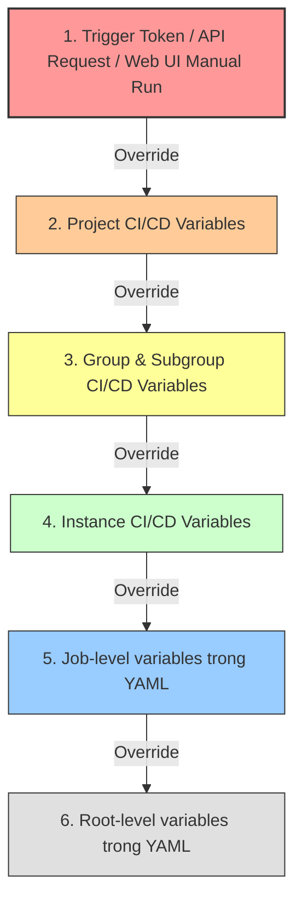
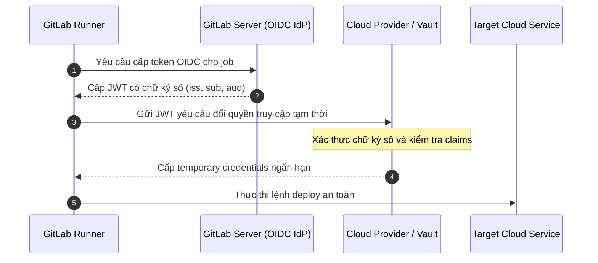

# 6_6_3 Variables and Secrets Management

> **Khóa học**: Cloud DevOps Basic — Containers and Kubernetes  
> **Phân nhóm**: 6 Domain 6 - Containers and Kubernetes › 6_6 GitLab CI-CD and Release Strategies  
> **Chủ đề**: 6_6_3 Variables and Secrets Management — Quản Trị Biến Định Sẵn, Protected, Masked, File Variables, Thứ Tự Ưu Tiên và Xác Thực OIDC id_tokens  
> **Trạng thái**: Đã kiểm chứng (verifier PASS, 21-11-2026)  
> **Checklist đối chiếu**: [CHECKLIST](<../../CHECKLIST.md#6_6-gitlab-ci-cd-and-release-strategies>) · [Topic README](./README.md#6_6_3-biến-và-secret)  

---

## 1. Khái Niệm Cốt Lõi & Bản Chất Kỹ Thuật (Core Concepts & Technical Deep Dive)

Trong tự động hóa quy trình CI/CD, nguyên tắc kiến trúc căn bản là phân tách hoàn toàn giữa mã nguồn logic và dữ liệu cấu hình hoặc thông tin bí mật. Việc lưu cứng mật khẩu, private key hoặc token truy cập vào kho mã nguồn tiềm ẩn nguy cơ bảo mật nghiêm trọng. GitLab CI/CD cung cấp hệ sinh thái biến số toàn diện, giúp tham số hóa quy trình build, test, đóng gói và triển khai ứng dụng.

Hệ thống biến của GitLab CI/CD bao gồm ba trụ cột chính: các biến định sẵn do hệ thống tự động cung cấp, các biến cấu hình tùy chỉnh ở cấp project và group với cơ chế bảo vệ nghiêm ngặt, cùng giải pháp xác thực danh tính hiện đại thông qua chuẩn OpenID Connect (OIDC).

### 1.1 Biến Định Sẵn Cốt Lõi (Core Predefined Variables)

Khi một pipeline khởi chạy, GitLab Runner tự động nạp tập hợp các biến môi trường chuẩn xác của hệ thống vào môi trường thực thi mà không cần bất kỳ khai báo nào trong file cấu hình. <!-- ev: C3.1 -->

Các biến định sẵn này cung cấp thông tin ngữ cảnh thời gian thực về commit, nhánh, tag và tài nguyên tích hợp:

- **Ngữ cảnh Commit và Nhánh**:
  - `CI_COMMIT_SHA`: Chứa mã hash SHA đầy đủ gồm 40 ký tự của commit kích hoạt pipeline, còn `CI_COMMIT_SHORT_SHA` chứa 8 ký tự đầu tiên của commit hash, phù hợp làm tag định danh duy nhất cho image. <!-- ev: C3.2 -->
  - `CI_COMMIT_REF_SLUG`: Tên nhánh hoặc tag rút gọn ở dạng chữ thường, giới hạn tối đa 63 ký tự, chỉ gồm ký tự chữ, số và dấu gạch ngang, an toàn khi sử dụng làm DNS, URL hoặc tên tài nguyên container. <!-- ev: C3.3 -->
  - `CI_COMMIT_TAG`: Tên của git tag kích hoạt pipeline; biến này chỉ tồn tại trong các tag pipeline và hoàn toàn vắng mặt trong pipeline chạy trên nhánh thông thường. <!-- ev: C3.4 -->
  - `CI_DEFAULT_BRANCH`: Tên nhánh mặc định của dự án (thông thường là `main` hoặc `master`), giúp thiết lập điều kiện rẽ nhánh logic tự động. <!-- ev: C3.5 -->

- **Ngữ cảnh Container Registry và Xác thực**:
  - `CI_REGISTRY` và `CI_REGISTRY_IMAGE`: `CI_REGISTRY` là địa chỉ FQDN của GitLab Container Registry, còn `CI_REGISTRY_IMAGE` là đường dẫn gốc của kho image thuộc dự án hiện tại. `CI_REGISTRY_USER` và `CI_REGISTRY_PASSWORD` được cung cấp sẵn để đăng nhập registry. <!-- ev: C3.6 -->
  - `CI_JOB_TOKEN`: Token ngắn hạn sinh tự động cho từng job, có vòng đời gắn liền với thời gian thực thi của job; giá trị của token này được nạp mặc định vào `CI_REGISTRY_PASSWORD` để tương tác an toàn với API và Registry của GitLab. <!-- ev: C3.7 -->

- **Ngữ cảnh Môi trường và Thư mục Thực thi**:
  - `CI_ENVIRONMENT_NAME` và `CI_PROJECT_DIR`: `CI_ENVIRONMENT_NAME` chứa tên môi trường đích được chỉ định trong job, còn `CI_PROJECT_DIR` là đường dẫn tuyệt đối trên runner nơi mã nguồn repository được clone vào và job thực thi câu lệnh. <!-- ev: C3.8 -->

### 1.2 Biến Quản Trị Cấp Project và Group (Project & Group CI/CD Variables)

Kỹ sư quản trị biến số và thông tin bí mật tập trung qua giao diện web tại mục Settings > CI/CD > Variables ở cấp độ Group hoặc Project. GitLab cung cấp bốn cơ chế điều khiển hạt nhân:

- **Thuộc tính Protected**: Biến được đánh dấu Protected chỉ được runner nạp vào môi trường thực thi của những pipeline chạy trên nhánh được bảo vệ hoặc tag được bảo vệ, ngăn chặn rò rỉ secret sang các nhánh tính năng thông thường. <!-- ev: C3.9 -->
- **Thuộc tính Masked**: Biến có thuộc tính Masked sẽ tự động được runner lọc và thay thế bằng chuỗi `[MASKED]` mỗi khi giá trị của biến xuất hiện trong console log của job. <!-- ev: C3.10 -->
- **Điều kiện Masking**: Để được masked, giá trị của biến phải đáp ứng quy định kỹ thuật nghiêm ngặt của GitLab: nằm trên một dòng đơn không chứa bất kỳ khoảng trắng nào (no spaces), có độ dài từ 8 ký tự trở lên. <!-- ev: C3.11 -->
- **Kiểu Biến File**: Khi chọn kiểu File, runner không đưa trực tiếp nội dung vào biến shell mà tự động ghi nội dung ra một file tạm trên đĩa của runner, sau đó gán đường dẫn tuyệt đối của file tạm đó vào tên biến, rất phù hợp cho chứng chỉ số và file cấu hình nhiều dòng. <!-- ev: C3.12 -->
- **Phạm vi Environment Scope**: Giới hạn sự tồn tại của biến chỉ trong các job có khai báo môi trường khớp chính xác với phạm vi được cấu hình hoặc khớp mẫu ký tự đại diện wildcard. <!-- ev: C3.13 -->

### 1.3 Thứ Tự Ưu Tiên Biến (Variable Precedence Hierarchy)

Khi xảy ra trùng lặp tên biến giữa các tầng cấu hình, GitLab CI/CD áp dụng quy tắc phân giải rõ ràng: giá trị truyền vào tại thời điểm kích hoạt ghi đè cấu hình tĩnh, và phạm vi hẹp ghi đè phạm vi rộng.

<!-- ev: C3.14 -->
1. Biến từ Trigger token, API request, hoặc chạy thủ công từ giao diện Web (ưu tiên cao nhất).
2. Biến cấp Project (cấu hình trong Settings > CI/CD > Variables của dự án).
3. Biến cấp Group (kế thừa từ các nhóm và phân nhóm cha).
4. Biến cấp Instance (cấu hình toàn hệ thống do quản trị viên đặt).
5. Biến định nghĩa ở cấp job trong file cấu hình pipeline.
6. Biến định nghĩa ở cấp root trong file cấu hình pipeline (ưu tiên thấp nhất).

### 1.4 Xác Thực Phi Mật Khẩu Qua OIDC id_tokens

Thay vì lưu trữ khóa truy cập dài hạn tiềm ẩn nguy cơ rò rỉ, GitLab CI/CD hỗ trợ xác thực không cần mật khẩu thông qua chuẩn OpenID Connect bằng từ khóa `id_tokens`. GitLab đóng vai trò là một nhà cung cấp danh tính đáng tin cậy. <!-- ev: C3.18 -->

<!-- ev: C3.19 -->
- Runner nhận một JSON Web Token có chữ ký số chứa các claim chuẩn như `iss`, `sub`, `aud`.
- Token chứa các claim mở rộng như `project_path` và `ref_type` giúp nhà cung cấp đám mây đối chiếu và cấp quyền truy cập tạm thời theo đúng nguyên tắc Least Privilege mà không cần lưu bất kỳ secret tĩnh nào.

---

## 2. Ví Dụ Đời Sống Thực Tế Dễ Hiểu (Intuitive Real-World Analogies)

Hãy liên tưởng quy trình quản trị biến và bảo mật trong GitLab CI/CD với hệ thống an ninh đa tầng của một **Ngân hàng Thương mại**:

1. **Biến Thông Thường — Bảng Tên Quầy Giao Dịch**:
   Bảng tên ghi thông tin số quầy được đặt công khai ngay tại sảnh chờ. Mọi nhân viên và khách hàng đều có thể nhìn thấy rõ ràng. Nó tương đương với các biến cấu hình công khai như cổng dịch vụ hoặc tên ứng dụng.

2. **Biến Masked — Màn Hình Nhập Mã PIN ATM**:
   Khi bạn bấm mã PIN rút tiền tại cây ATM, máy nhận diện đầy đủ các con số để xử lý, nhưng màn hình bên ngoài chỉ vẽ ra các ký tự hoa thị. Người đứng phía sau quan sát màn hình sẽ không thể đọc được mật mã thực sự. Tính năng Masked hoạt động tương tự bằng cách thay thế chuỗi bí mật thành `[MASKED]` trên console log.

3. **Biến Protected — Chìa Khóa Kho Tiền Trung Tâm**:
   Chìa khóa mở cửa hầm kho tiền không bao giờ được giao cho nhân viên thực tập hay người làm việc thời vụ. Chiếc chìa khóa này chỉ được xuất kho khi có mặt của cấp quản lý trong phiên làm việc chính thức. Biến Protected từ chối xuất hiện trên các nhánh phụ, chỉ kích hoạt khi chạy trên nhánh chính được bảo vệ.

4. **Biến File Type — Két An Toàn Chứa Hồ Sơ Bản Gốc**:
   Khi nộp hồ sơ pháp lý dày hàng trăm trang, nhân viên không cầm theo cả xấp giấy trong túi áo. Hồ sơ được đặt vào một ngăn tủ bảo mật, và nhân viên chỉ cầm một phiếu ghi số ngăn tủ. Biến kiểu File lưu nội dung chứng chỉ nhiều dòng vào một file tạm và trao đường dẫn file cho các câu lệnh xử lý.

5. **Xác Thực OIDC id_tokens — Thẻ Từ Khách Tự Hủy Sau 15 Phút**:
   Thay vì đánh một chiếc chìa khóa vạn năng bằng đồng trao vĩnh viễn cho đối tác, phòng an ninh quét căn cước và in ra một thẻ từ tạm thời có hiệu lực đúng 15 phút. Sau 15 phút, thẻ hoàn toàn vô giá trị. OIDC cấp token ngắn hạn dùng một lần, xóa bỏ hoàn toàn rủi ro thất lạc khóa dài hạn.

---

## 3. Kiến Trúc, Luồng Hoạt Động & Hình Ảnh Trực Quan (Architecture, Diagrams & Visual Media)

### 3.1 Sơ Đồ Phân Giải Thứ Tự Ưu Tiên Biến

Lược đồ thể hiện thứ tự ưu tiên phân giải khi biến trùng tên xuất hiện ở nhiều tầng cấu hình:



### 3.2 Sơ Đồ Trao Đổi Danh Tính OIDC Giữa GitLab Runner Và Đám Mây

Lược đồ tuần tự mô tả quy trình trao đổi token OIDC ngắn hạn giữa GitLab Runner và hạ tầng đám mây độc lập:



---

## 4. Code Mẫu Trực Quan Hoặc Dòng Lệnh Thực Chiến (Runnable Sample Code / CLI)

Dưới đây là file cấu hình pipeline hoàn chỉnh kết hợp biến định sẵn, biến kiểu File và xác thực OIDC:

```yaml
stages:
  - build
  - deploy

default:
  image: docker:27-cli

variables:
  APP_NAME: "payment-service"

build_image:
  stage: build
  services:
    - docker:27-dind
  script:
    - echo "$CI_REGISTRY_PASSWORD" | docker login -u "$CI_REGISTRY_USER" --password-stdin "$CI_REGISTRY"
    - docker build -t "$CI_REGISTRY_IMAGE:$CI_COMMIT_SHORT_SHA" -t "$CI_REGISTRY_IMAGE:$CI_COMMIT_REF_SLUG" "$CI_PROJECT_DIR"
    - docker push "$CI_REGISTRY_IMAGE:$CI_COMMIT_SHORT_SHA"
    - docker push "$CI_REGISTRY_IMAGE:$CI_COMMIT_REF_SLUG"
  rules:
    - if: '$CI_COMMIT_BRANCH'

deploy_to_cloud:
  stage: deploy
  image: amazon/aws-cli:2.17.50
  environment:
    name: production
  id_tokens:
    AWS_JWT_TOKEN:
      aud: "sts.amazonaws.com"
  variables:
    ROLE_ARN: "arn:aws:iam::123456789012:role/GitLabDeployRole"
  script:
    - >
      CREDS=$(aws sts assume-role-with-web-identity \
        --role-arn "$ROLE_ARN" \
        --role-session-name "GitLab-$CI_PIPELINE_ID" \
        --web-identity-token "$AWS_JWT_TOKEN" \
        --duration-seconds 900 \
        --query "Credentials.[AccessKeyId,SecretAccessKey,SessionToken]" \
        --output text)
    - export AWS_ACCESS_KEY_ID=$(echo "$CREDS" | awk '{print $1}')
    - export AWS_SECRET_ACCESS_KEY=$(echo "$CREDS" | awk '{print $2}')
    - export AWS_SESSION_TOKEN=$(echo "$CREDS" | awk '{print $3}')
    - aws sts get-caller-identity
    - test -f "$KUBECONFIG" && echo "Cấu hình cluster hợp lệ tại: $KUBECONFIG"
  rules:
    - if: '$CI_COMMIT_BRANCH == $CI_DEFAULT_BRANCH'
```

### Minh Họa Dòng Dữ Liệu Thực Tế: Input → Lệnh Thực Thi → Output

Khối lệnh minh họa dữ liệu đầu vào và kết quả in ra màn hình của runner:

<!-- ev: C3.10 C3.12 -->
- Đầu vào gồm biến mật mã có bật tính năng Masked và biến chứng chỉ kiểu File.
- Lệnh kiểm tra trong script đọc trực tiếp hai biến trên:
```bash
echo "Database password là: $DATABASE_SECRET"
echo "Đường dẫn file chứng chỉ là: $PROD_CERT"
```
- Kết quả in ra console log cho thấy mật khẩu được che thành chuỗi masked và biến file trỏ tới đường dẫn tạm:
```text
Database password là: [MASKED]
Đường dẫn file chứng chỉ là: /builds/group/project.tmp/PROD_CERT
```

---

## 5. Cạm Bẫy Thực Tế & Thực Tiễn Sản Xuất (Production Gotchas & Best Practices)

Trong môi trường triển khai thực tế của các doanh nghiệp, lỗi rò rỉ secret hoặc pipeline hỏng hóc thường bắt nguồn từ những hiểu lầm tinh vi về cơ chế vận hành của biến.

### Cạm Bẫy 1: Sự Ngộ Nhận Về Tính Năng Masked và Rò Rỉ Do Mã Hóa

<!-- ev: C3.15 -->
- Runner chỉ thực hiện so khớp chuỗi thô nguyên bản để làm mặt nạ. Lệnh in giá trị ra console (như dùng echo hoặc print) đối với secret bị mã hóa dạng base64 hoặc bị cắt chuỗi con sẽ khiến giá trị bí mật bị lộ hoàn toàn vì chuỗi biến đổi không còn khớp với chuỗi gốc để runner che chắn.
- Không bao giờ sử dụng lệnh in trực tiếp các biến bí mật ra màn hình log.

### Cạm Bẫy 2: Thảm Họa Rò Rỉ Secret Từ Biến Gỡ Lỗi CI_DEBUG_TRACE

<!-- ev: C3.16 -->
- Thiết lập biến `CI_DEBUG_TRACE: "true"` kích hoạt chế độ shell execution trace, in toàn bộ các câu lệnh cùng giá trị tham số đã phân giải ra job log, dẫn đến nguy cơ làm lộ các biến bảo mật trong môi trường chia sẻ.
- Chỉ kích hoạt cờ gỡ lỗi này trong kho lưu trữ kiểm thử nội bộ và gỡ bỏ ngay sau khi khắc phục xong sự cố.

### Cạm Bẫy 3: Đưa Tệp Tin Chứa Secret Vào Mục Build Artifacts

<!-- ev: C3.17 -->
- Mọi file và thư mục nằm trong danh sách `artifacts: paths:` đều được runner nén thành file zip và tải lên lưu trữ trên máy chủ GitLab, khiến bất kỳ ai có quyền truy cập job đều có thể tải về và trích xuất các file nhạy cảm.
- Không bao giờ đặt file cấu hình chứa mật mã vào artifacts; chỉ xuất các gói nhị phân đã biên dịch hoặc mã nguồn tĩnh sạch.

### Cạm Bẫy 4: Biến Protected Không Khả Dụng Trên Nhánh Tính Năng

<!-- ev: C3.9 -->
- Biến cấu hình có bật thuộc tính Protected sẽ bị runner từ chối nạp vào pipeline nếu nhánh chạy không thuộc danh sách protected branches, gây ra lỗi xác thực khó hiểu trên các nhánh phát triển thông thường.
- Cần sử dụng kết hợp Environment Scope để phân tách biến giữa môi trường kiểm thử và môi trường sản xuất thay vì chỉ dựa vào thuộc tính Protected.

---

## 6. Câu Hỏi Củng Cố Kiến Thức (Active Recall Quiz)

### Câu 1: Tình huống lỗi biến Protected trên nhánh tính năng
Nhóm phát triển của bạn đang làm việc trên nhánh `feature/checkout-service`. Một lập trình viên viết thêm job kiểm thử kết nối cơ sở dữ liệu và gọi biến `$STAGING_DB_PASSWORD`. Biến này đã được khai báo ở cấp Project trong **Settings > CI/CD > Variables**. Tuy nhiên, khi pipeline thực thi trên nhánh feature, giá trị của biến hoàn toàn rỗng khiến job thất bại. Điều gì đã xảy ra và giải pháp chuẩn xác là gì?

<details>
<summary>Đáp án</summary>

**Nguyên nhân**: Biến `$STAGING_DB_PASSWORD` đã được đánh dấu thuộc tính **Protected**. Theo quy tắc an ninh của GitLab, biến Protected chỉ được truyền vào môi trường thực thi của pipeline khi pipeline đó chạy trên một nhánh được bảo vệ (protected branch, ví dụ `main`) hoặc protected tag. Nhánh `feature/checkout-service` là nhánh thường nên runner từ chối nạp biến này.

**Giải pháp**:
1. Nếu nhánh feature cần truy cập biến staging, người quản trị dự án cần vào **Settings > Repository > Protected branches** để thêm mẫu nhánh vào danh sách protected (nếu phù hợp với chính sách bảo mật).
2. Hoặc giải pháp tối ưu hơn: Tắt thuộc tính Protected đối với biến staging này và sử dụng **Environment scope** (gán scope là `staging` hoặc `review/*`) để cô lập phạm vi sử dụng, đảm bảo biến chỉ được nạp cho các job deploy đúng môi trường staging mà không lo rò rỉ biến production.
</details>

---

### Câu 2: Lựa chọn loại biến cho Private Key SSL/SSH
Bạn cần đưa một chứng chỉ SSL định dạng PEM dài hơn 40 dòng vào runner để công cụ `deploy-tool` sử dụng thông qua tham số `--cert-file <đường_dẫn_tệp>`. Bạn nên cấu hình biến này trong GitLab CI/CD như thế nào để vừa an toàn vừa thuận tiện nhất?

<details>
<summary>Đáp án</summary>

**Giải pháp chuẩn xác**:
1. Trong giao diện **Settings > CI/CD > Variables**, nhập tên biến (ví dụ `SSL_CLIENT_CERT`) và chọn **Type: File** (thay vì type mặc định là `Variable`).
2. Dán toàn bộ nội dung PEM nhiều dòng của chứng chỉ vào ô Value. Đánh dấu chọn **Protected** và gán **Environment scope** tương ứng.
3. Khi job chạy, GitLab Runner sẽ tự động ghi nội dung chứng chỉ ra một file tạm thời trên ổ đĩa của runner và gán đường dẫn file đó vào biến `$SSL_CLIENT_CERT`.
4. Trong câu lệnh `script` của file cấu hình pipeline, bạn chỉ cần gọi trực tiếp: `deploy-tool --cert-file "$SSL_CLIENT_CERT"`. Bạn không cần phải dùng lệnh `echo "$CERT" > cert.pem` thủ công (vốn dễ gây lỗi ký tự xuống dòng và lộ dữ liệu).
</details>

---

### Câu 3: So sánh rủi ro giữa Long-lived Static Secret và OIDC id_tokens
Tại sao xu hướng kiến trúc CI/CD hiện đại trên Cloud (AWS, GCP, Azure, Kubernetes) lại khuyến khích loại bỏ hoàn toàn việc lưu trữ các khóa cố định như AWS Access Key ID / Secret Access Key trong CI/CD Variables để chuyển sang xác thực qua OIDC `id_tokens`?

<details>
<summary>Đáp án</summary>

**So sánh và Phân tích**:
1. **Rủi ro của Static Secrets**:
   - Khóa có giá trị vĩnh viễn (cho đến khi bị xóa thủ công). Nếu vô tình bị in ra log, bị lộ qua artifact hoặc bị nhân viên sao chép trái phép, kẻ tấn công có thể truy cập hệ thống từ bất kỳ máy tính nào bên ngoài.
   - Chi phí quản trị và xoay vòng khóa (key rotation) định kỳ rất lớn và dễ gây gián đoạn pipeline khi cập nhật key.
2. **Ưu điểm vượt trội của OIDC `id_tokens`**:
   - **Xác thực phi mật mã (Keyless)**: Không có mật khẩu hay secret key nào được lưu trữ cố định trên GitLab.
   - **Thời gian sống ngắn (Short-lived)**: Token được cấp phát tự động cho từng job và chỉ có hiệu lực tạm thời (thường từ 15 đến 60 phút).
   - **Kiểm soát truy cập hạt nhân (Granular Least Privilege)**: Cloud provider kiểm tra các claims trong JWT do GitLab ký số (như `iss`, `project_path`, `ref`). Bạn có thể phân quyền chặt chẽ: chỉ job chạy từ nhánh `main` của đúng project `org/payment` mới được cấp quyền ghi vào hạ tầng production, còn các nhánh khác bị từ chối tuyệt đối.
</details>

---

## 7. 📚 Nguồn Tài Liệu Chính Thống (Tier-1 Official References)

- [GitLab Predefined CI/CD variables reference](https://docs.gitlab.com/ci/variables/predefined_variables/) - Danh mục toàn diện các biến môi trường định sẵn của GitLab Runner và hệ thống CI/CD.
- [GitLab CI/CD variables documentation](https://docs.gitlab.com/ci/variables/) - Hướng dẫn chi tiết cấu hình biến cấp Project, Group, các thuộc tính Protected, Masked và File-type variables.
- [GitLab CI/CD variable precedence hierarchy](https://docs.gitlab.com/ci/variables/#cicd-variable-precedence) - Quy tắc kỹ thuật về thứ tự ưu tiên phân giải khi có sự xung đột giữa các nguồn định nghĩa biến.
- [OpenID Connect (OIDC) authentication in GitLab CI/CD](https://docs.gitlab.com/ci/secrets/id_token_authentication/) - Tài liệu chính thức về cấu hình từ khóa `id_tokens` để xác thực phi mật khẩu với AWS, GCP, Azure và HashiCorp Vault.
