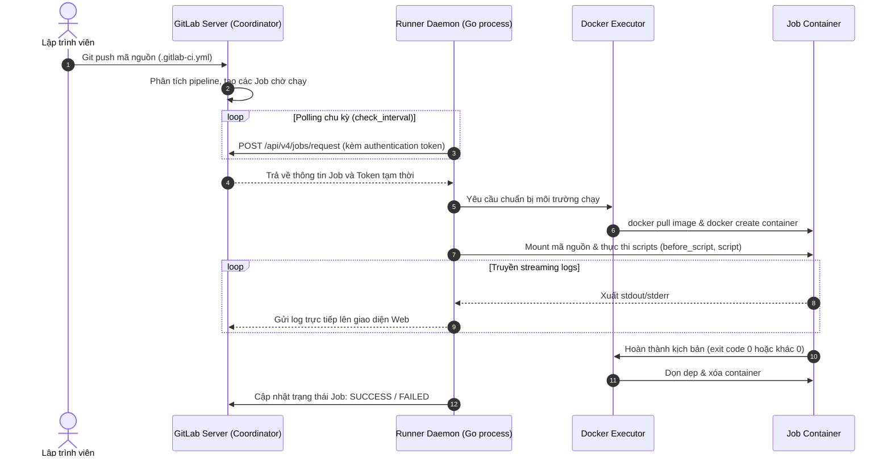
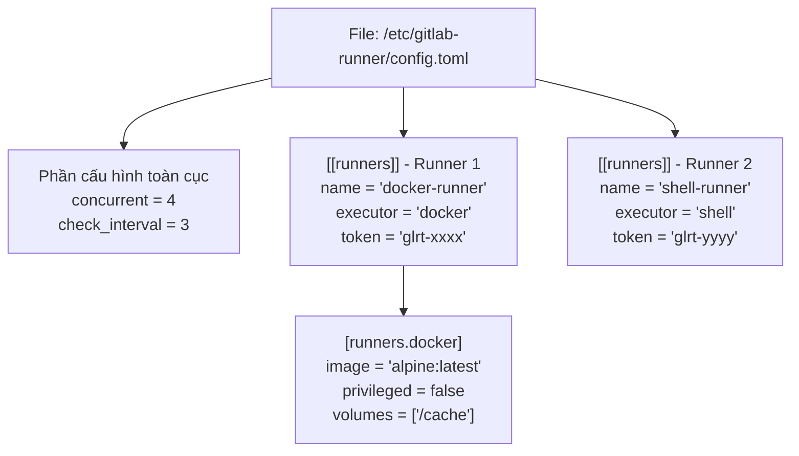

# 6_6_4 GitLab Runner Architecture and Registration

> **Khóa học**: Cloud DevOps Basic — Containers & Kubernetes
> **Phân nhóm**: 6 Domain 6 - Containers and Kubernetes › 6_6 GitLab CI-CD and Release Strategies
> **Chủ đề**: 6_6_4 GitLab Runner Architecture and Registration
> **Phiên bản áp dụng**: GitLab 16.x / 17.x, GitLab Runner 16.x / 17.x, Docker 26+, Kubernetes 1.30+
> **Trạng thái**: Bản nháp, chờ kiểm chứng
> **Phạm vi**: [Topic README](./README.md#6_6_4-gitlab-runner) · **Checkpoint của người học**: [CHECKLIST](../../CHECKLIST.md#6_6-gitlab-ci-cd-and-release-strategies)
> **Kiến thức liên quan**: [6_1_6 Container Runtimes and Ecosystem](<../6_1 Container Fundamentals/6_1_6 Container Runtimes and Ecosystem.md>) · [6_3_1 Kubernetes Cluster Architecture](<../6_3 Kubernetes Architecture and Core Workloads/6_3_1 Kubernetes Cluster Architecture.md>)

---

## 0. Tình Huống Mở Đầu: "Viết Xong .gitlab-ci.yml, Ai Là Người Thực Thi Các Dòng Lệnh Đó?"

Khi bạn viết một file cấu hình pipeline và đẩy mã nguồn lên kho chứa, giao diện web của GitLab hiển thị trạng thái chuyển dần từ chờ xử lý sang thành công hoặc thất bại. Nhưng bản thân máy chủ giao diện web của GitLab không trực tiếp chạy các câu lệnh biên dịch nặng nề như đóng gói ứng dụng hay chạy bộ kiểm thử. Nếu máy chủ web phải trực tiếp gánh toàn bộ khối lượng tính toán đó, hệ thống sẽ nhanh chóng cạn kiệt tài nguyên và đối mặt nguy cơ bảo mật nghiêm trọng khi chạy mã tùy ý.

Để giải quyết bài toán phân tải và an toàn, GitLab tách biệt hoàn toàn bộ não điều phối khỏi cánh tay thực thi: **GitLab Runner**. Bài học này giúp bạn làm chủ kiến trúc của GitLab Runner, hiểu rõ các cấp độ phân quyền, cơ chế cách ly của từng loại executor, nắm vững quy trình xác thực bằng runner authentication token mới và cách tinh chỉnh cấu hình để kết nối runner cục bộ với cụm Kubernetes kind.

---

## 1. Khái Niệm Cốt Lõi & Bản Chất Kỹ Thuật (Core Concepts & Technical Deep Dive)

### 1.1 Kiến Trúc Tổng Thể & Cơ Chế Polling (Long Polling Model)

GitLab Runner là một ứng dụng mã nguồn mở độc lập viết bằng Go, có nhiệm vụ nhận và thực thi các CI/CD job theo chỉ dẫn từ GitLab Server rồi gửi kết quả trả về. <!-- ev: C4.1 -->

<!-- ev: C4.2 -->
```text
[ GitLab Coordinator ]  <--- (HTTPS POST /api/v4/jobs/request - Long Polling) --- [ GitLab Runner Daemon ]
  (Server / SaaS)                                                                    |
                                                                                     +---> Khởi tạo Executor (Docker / Shell / K8s)
                                                                                     +---> Chạy build scripts & đẩy logs về GitLab
```

Runner hoạt động theo cơ chế kéo (pull model / long polling) qua HTTP/HTTPS API (`POST /api/v4/jobs/request`), do đó Runner không yêu cầu mở bất kỳ port inbound nào từ ngoài Internet vào máy chủ runner. <!-- ev: C4.2 -->

### 1.2 Phân Cấp Phạm Vi Runner (Runner Scopes)

Trong hệ sinh thái GitLab, runner được phân chia theo ba phạm vi quản trị:

- **Instance Runner (Shared Runner)**: Do quản trị viên thiết lập, phục vụ chung cho tất cả các group và project trên toàn bộ GitLab instance. <!-- ev: C4.3 -->
- **Group Runner**: Gán ở cấp Group, tự động có sẵn để thực thi job cho mọi project và subgroup trực thuộc group đó. <!-- ev: C4.4 -->
- **Project Runner**: Tạo riêng và gắn cố định với một project cụ thể, ngăn chặn rò rỉ môi trường hoặc mã nguồn giữa các dự án. <!-- ev: C4.5 -->
- **SaaS Runners vs Self-managed Runners**: GitLab.com cung cấp sẵn SaaS runners chạy trên máy ảo tự động co giãn do GitLab quản lý, trong khi Self-managed runners là các runner do người dùng tự cài đặt và quản lý tài nguyên trên máy chủ riêng hoặc cụm Kubernetes của mình. <!-- ev: C4.6 -->

### 1.3 Đánh Đổi Giữa Các Loại Executor: Shell, Docker, Kubernetes

Executor là thành phần của Runner quyết định môi trường mà kịch bản của job sẽ thực sự chạy:

- **Shell Executor**: Thực thi script trực tiếp trên hệ điều hành host bằng tài khoản người dùng của runner daemon; hiện ở trạng thái maintenance mode (chỉ nhận critical security updates) và chỉ cung cấp khả năng cách ly hạn chế (limited isolation) giữa các lần chạy job. <!-- ev: C4.7 -->
- **Docker Executor**: Khởi tạo một container mới từ Docker image được chỉ định cho mỗi job, cung cấp môi trường cách ly độc lập và bảo đảm tính tái lập sạch sẽ sau khi job kết thúc. <!-- ev: C4.8 -->
- **Kubernetes Executor**: Khởi tạo một Pod độc lập chứa container ứng dụng và các service container cho mỗi CI/CD job bên trong cluster, tận dụng khả năng tự động điều phối và co giãn theo tải của Kubernetes. <!-- ev: C4.9 -->

<!-- ev: C4.7 C4.8 C4.9 -->
| Tiêu chí | Shell Executor | Docker Executor | Kubernetes Executor |
| :--- | :--- | :--- | :--- |
| Mức độ cách ly | Thấp (dùng chung host) | Cao (container riêng) | Rất cao (Pod riêng) |
| Tốc độ khởi động | Tức thì | Nhanh | Phụ thuộc cluster scheduling |
| Quản lý công cụ | Cài thủ công trên host | Đóng gói trong container image | Đóng gói trong container image |
| Khả năng mở rộng | Giới hạn theo máy host | Giới hạn theo máy host | Tự động mở rộng theo cluster |

### 1.4 Luồng Đăng Ký Runner Mới (Runner Authentication Token Workflow)

Từ phiên bản GitLab 16.0, GitLab triển khai luồng đăng ký runner mới bằng cách tạo trước runner trong UI/API để lấy `runner authentication token` (có tiền tố `glrt-`), và tiến hành deprecate luồng legacy registration token. <!-- ev: C4.10 -->

Lệnh `gitlab-runner register` theo luồng xác thực mới vẫn nhận các tham số cấu hình cục bộ (`--executor`, `--docker-image`), chỉ loại bỏ `--registration-token` cũ và các cờ metadata (`--tag-list`, `--run-untagged`) vốn đã được chuyển lên cấu hình qua UI/API. <!-- ev: C4.11 -->

### 1.5 Định Tuyến Job Bằng Tags (Runner Tags)

Từ khóa `tags` trong `.gitlab-ci.yml` chỉ định các tag yêu cầu; mặc định runner có gắn tag sẽ nhận job nếu runner sở hữu toàn bộ các tag được khai báo trong job (runner có thể có thêm các tag khác ngoài danh sách của job). <!-- ev: C4.12 -->

---

## 2. Ví Dụ Đời Sống Thực Tế Dễ Hiểu (Intuitive Real-World Analogies)

Để hình dung toàn bộ hệ thống GitLab Runner, hãy liên tưởng tới mô hình tuyển dụng và phân công việc:

- **GitLab Server như Ban Điều Phối Trung Tâm**: Nơi tiếp nhận các dự án và phân phát đầu việc cho nhân viên. Ban điều phối không trực tiếp xuống xưởng sản xuất mà chỉ giao việc và theo dõi tiến độ.
- **GitLab Runner như Nhân Viên Nhận Việc Từ Xa**: Nhân viên chủ động gọi điện về tổng đài mỗi vài giây để hỏi xem có công việc mới hay không. Nhờ nhân viên chủ động liên hệ, tổng đài không cần biết địa chỉ nhà riêng hay gõ cửa phòng của nhân viên.
- **Shell Executor như Làm Việc Ngay Tại Sàn Nhà Riêng**: Mọi công cụ bày bừa trực tiếp ra sàn nhà. Tốc độ làm việc rất nhanh vì không cần chuẩn bị phòng ốc, nhưng sàn nhà dễ bị bẩn và công việc sau có thể bị ảnh hưởng bởi rác của công việc trước.
- **Docker Executor như Làm Việc Trong Phòng Thí Nghiệm Vô Trùng**: Mỗi khi nhận việc mới, nhân viên bước vào một phòng kính khử khuẩn riêng biệt. Khi xong việc, căn phòng được tiêu hủy và dọn dẹp sạch sẽ, bảo đảm không bao giờ để sót rác sang công việc tiếp theo.
- **Runner Authentication Token như Thư Mời Nhận Việc Đích Danh**: Thay vì dùng một chìa khóa vạn năng dùng chung cho mọi người, người quản lý cấp thẻ nhân viên có mã số định danh cụ thể, ghi rõ bạn thuộc phòng ban nào và chỉ định chính xác quyền hạn.

---

## 3. Kiến Trúc, Luồng Hoạt Động & Hình Ảnh Trực Quan (Architecture, Diagrams & Visual Media)

### 3.1 Luồng Tương Tác Giữa GitLab Server, Runner Daemon & Executor

Biểu đồ tuần tự dưới đây thể hiện vòng đời từ lúc Runner hỏi việc, nhận job, khởi tạo container và truyền log trực tiếp về giao diện người dùng:



### 3.2 Sơ Đồ Cấu Trúc Đa Tầng Của File Cấu Hình config.toml

Runner Daemon điều phối nhiều worker thông qua một file cấu hình duy nhất:



---

## 4. Code Mẫu Trực Quan Hoặc Dòng Lệnh Thực Chiến (Runnable Sample Code / CLI)

### 4.1 Quy Trình Đăng Ký Runner Mới Với Runner Authentication Token

Theo tiêu chuẩn mới từ GitLab, người quản trị tạo runner trong giao diện web để lấy token xác thực có tiền tố đặc thù, sau đó thực thi lệnh đăng ký không tương tác trên máy chủ: <!-- ev: C4.10 -->

<!-- ev: C4.11 -->
```bash
# Đăng ký runner với URL instance và authentication token được cấp từ UI
sudo gitlab-runner register \
  --non-interactive \
  --url "https://gitlab.com" \
  --token "glrt-t1_abcdef1234567890" \
  --executor "docker" \
  --docker-image "alpine:3.20" \
  --description "local-docker-runner"
```

Lệnh đăng ký nhận URL cùng token xác thực rồi ghi nhận thông tin cấu hình vào file hệ thống. <!-- ev: C4.11 -->

### 4.2 Cấu Trúc & Tinh Chỉnh File config.toml

File cấu hình tại `/etc/gitlab-runner/config.toml` điều khiển toàn bộ hành vi thực thi của tiến trình runner: <!-- ev: C4.13 -->

<!-- ev: C4.13 C4.14 C4.15 C4.16 -->
```toml
# Số lượng job tối đa toàn bộ runner trên máy này có thể chạy đồng thời
concurrent = 4
# Chu kỳ (giây) daemon kiểm tra job mới từ GitLab Server
check_interval = 3

[session_server]
  session_timeout = 1800

[[runners]]
  name = "local-docker-runner"
  url = "https://gitlab.com"
  id = 101
  token = "glrt-t1_abcdef1234567890"
  executor = "docker"

  [runners.custom_build_dir]
  [runners.docker]
    tls_verify = false
    image = "alpine:3.20"
    privileged = false
    volumes = ["/cache", "/var/run/docker.sock:/var/run/docker.sock"]
```

- Tham số toàn cục `concurrent` trong file `config.toml` quy định số lượng job tối đa mà toàn bộ các runner trên máy chủ có thể thực thi đồng thời tại một thời điểm. <!-- ev: C4.13 -->
- Tham số `check_interval` trong `config.toml` xác định khoảng thời gian chờ (tính bằng giây) giữa các lần runner gửi request lên GitLab để kiểm tra có job mới hay không (giá trị mặc định là 3 giây). <!-- ev: C4.14 -->
- Trong phần cấu hình `[runners.docker]`, tham số `image` đặt Docker image mặc định khi job không khai báo, và `privileged = true` cấp toàn bộ đặc quyền kernel máy chủ cho container của job. <!-- ev: C4.15 -->
- Tham số `volumes` trong `[runners.docker]` cho phép mount các thư mục hoặc socket từ host vào container của job, ví dụ `/var/run/docker.sock` hoặc thư mục lưu cache. <!-- ev: C4.16 -->

### 4.3 Khai Báo Job Định Tuyến Bằng Tags Trong .gitlab-ci.yml

File cấu hình pipeline sau đây minh họa cách định tuyến job tới đúng runner qua thẻ tag: <!-- ev: C4.12 -->

<!-- ev: C4.12 -->
```yaml
# .gitlab-ci.yml
stages:
  - build
  - test

build-job:
  stage: build
  image: maven:3.9-eclipse-temurin-17
  tags:
    - docker
    - local
  script:
    - mvn --version

lint-job:
  stage: test
  image: alpine:3.20
  tags:
    - docker
  script:
    - echo "Testing on clean container"
```

Job khai báo danh sách tag sẽ được điều phối tới runner có gắn nhãn tương ứng phù hợp. <!-- ev: C4.12 -->

### 4.4 Kết Nối Local Runner Với Cụm kind Cục Bộ Cho CI/CD

Với self-managed runner cài đặt trực tiếp trên máy cục bộ, job CI có thể truy cập cụm kind cục bộ thông qua file kubeconfig hoặc qua mạng nội bộ Docker kết nối tới API server của kind. <!-- ev: C4.17 -->

<!-- ev: C4.17 -->
```bash
# Trích xuất thông tin kubeconfig của kind với địa chỉ mạng phù hợp
KIND_IP=$(docker inspect -f '{{range .NetworkSettings.Networks}}{{.IPAddress}}{{end}}' kind-control-plane)
kubectl config view --raw --minify --flatten > /tmp/kind-ci-kubeconfig.yaml
sed -i "s|https://127.0.0.1:[0-9]*|https://${KIND_IP}:6443|g" /tmp/kind-ci-kubeconfig.yaml
```

<!-- ev: C4.17 -->
```yaml
deploy-to-kind:
  stage: deploy
  image: bitnami/kubectl:1.30
  tags:
    - local
  script:
    - kubectl cluster-info
    - kubectl get nodes -o wide
```

Kịch bản trên truyền cấu hình cluster để câu lệnh tương tác trực tiếp với cụm Kubernetes cục bộ. <!-- ev: C4.17 -->

---

## 5. Cạm Bẫy Thực Tế & Thực Tiễn Sản Xuất (Production Gotchas & Best Practices)

### 5.1 Cạm Bẫy Rủi Ro Khi Cấu Hình privileged = true

Cấu hình `privileged = true` cho phép container trong job có quyền truy cập root trên host, tiềm ẩn nguy cơ thoát khỏi container (container breakout) và xâm nhập toàn bộ máy chủ nếu chạy mã không tin cậy. <!-- ev: C4.18 -->

- Bật cờ đặc quyền tiềm ẩn nguy cơ mã nguồn chiếm quyền kiểm soát toàn bộ hệ điều hành host. <!-- ev: C4.18 -->
- Chỉ cho phép kích hoạt chế độ đặc quyền trên các project runner riêng biệt thuộc dự án hạ tầng tin cậy. <!-- ev: C4.18 -->

### 5.2 Xung Đột Tài Nguyên Khi Cấu Hình concurrent Quá Mức

- Thiết lập giá trị concurrent vượt quá ngưỡng chịu tải của CPU và RAM sẽ kích hoạt cơ chế dừng tiến trình đột ngột từ hệ điều hành. <!-- ev: C4.13 -->
- Cần tính toán thông số đồng thời dựa trên dung lượng bộ nhớ tối đa mà một công việc biên dịch tiêu thụ. <!-- ev: C4.13 -->

### 5.3 Nguy Cơ Rò Rỉ Môi Trường Khi Dùng Shell Executor

- Shell Executor không có ranh giới cách ly tiến trình giữa các lần chạy job của nhiều dự án khác nhau. <!-- ev: C4.7 -->
- Ưu tiên Docker Executor hoặc Kubernetes Executor để mỗi lần chạy job đều có không gian làm việc độc lập và an toàn. <!-- ev: C4.8 C4.9 -->

---

## 6. Câu Hỏi Củng Cố Kiến Thức (Active Recall Quiz)

### Câu hỏi 1: Cơ chế kết nối mạng của Runner
Một kỹ sư mới thắc mắc: *"Tại sao máy chủ GitLab đặt trên Cloud (GitLab.com) mà lại có thể ra lệnh cho Runner nằm sâu trong mạng nội bộ công ty (sau NAT và tường lửa) mà không cần cấu hình Port Forwarding hay mở Inbound IP?"*. Hãy giải thích bản chất kỹ thuật.

<details>
<summary>Đáp án</summary>

GitLab Runner sử dụng cơ chế kéo (pull model / long polling) qua giao thức HTTP/HTTPS (`POST /api/v4/jobs/request`). Chính Runner daemon là phía chủ động thiết lập kết nối Outbound (chiều đi) tới cổng 443 của GitLab Server để hỏi việc. Do đó, tường lửa và NAT chỉ cần cho phép lưu lượng mạng chiều đi (outbound) mà không yêu cầu mở bất kỳ cổng dịch vụ nào theo chiều đến (inbound) trên mạng nội bộ.
</details>

---

### Câu hỏi 2: Lựa chọn Executor cho môi trường đa dự án
Công ty bạn có nhiều dự án khác nhau cùng sử dụng một máy chủ Runner nội bộ. Nhóm phát triển đề xuất chuyển từ Docker Executor sang Shell Executor để tiết kiệm thời gian khởi động container và không tốn dung lượng ổ đĩa lưu image. Là một DevOps Engineer, bạn có đồng ý không? Vì sao?

<details>
<summary>Đáp án</summary>

Không đồng ý. Shell Executor không có ranh giới cách ly tiến trình và hệ thống tệp giữa các lần chạy job. Các dự án khác nhau sẽ dùng chung môi trường hệ điều hành host, dẫn đến nguy cơ xung đột phiên bản công cụ, nguy cơ rò rỉ dữ liệu hoặc file tạm, và mã lỗi của một job có thể vô tình làm ảnh hưởng cả hệ thống máy chủ. Trong môi trường chia sẻ đa dự án, Docker Executor hoặc Kubernetes Executor là lựa chọn bắt buộc để đảm bảo tính độc lập và an toàn.
</details>

---

### Câu hỏi 3: Khắc phục sự cố Job bị kẹt trạng thái Pending
Sau khi lập trình viên gắn thẻ tag yêu cầu vào một job trong file pipeline, job bị kẹt mãi ở trạng thái chờ với thông báo không tìm thấy runner phù hợp đang trực tuyến. Nguyên nhân do đâu và các bước xử lý thế nào?

<details>
<summary>Đáp án</summary>

Nguyên nhân: Mặc định, một job yêu cầu tag cụ thể sẽ chỉ được tiếp nhận bởi những runner đang online và có khai báo chính xác danh sách tag đó. Nếu trong hệ thống không có runner nào sở hữu thẻ tag tương ứng, job sẽ bị giữ ở hàng đợi.

Cách xử lý:
1. Kiểm tra lại danh sách Runner trong giao diện quản trị GitLab xem có runner nào mang đúng tag và đang trực tuyến hay không.
2. Nếu runner có sẵn nhưng chưa gắn tag: Chỉnh sửa cấu hình runner trong giao diện web để bổ sung tag còn thiếu.
3. Nếu do gõ nhầm tên tag trong file pipeline: Cập nhật lại tên tag cho khớp với runner hiện có.
</details>

---

## 7. 📚 Nguồn Tài Liệu Chính Thống (Tier-1 Official References)

- [GitLab Runner Documentation](https://docs.gitlab.com/runner/) - Tài liệu chính thức từ GitLab về kiến trúc và tài liệu tổng quan của Runner.
- [GitLab Runner Executors Overview](https://docs.gitlab.com/runner/executors/) - Chi tiết so sánh và hướng dẫn lựa chọn executor (Shell, Docker, Kubernetes).
- [Registering Runners (New Workflow)](https://docs.gitlab.com/runner/register/) - Hướng dẫn quy trình đăng ký runner mới bằng runner authentication token.
- [Migrating to the New Runner Registration Workflow](https://docs.gitlab.com/ee/ci/runners/new_creation_workflow.html) - Hướng dẫn chuyển đổi từ luồng registration token cũ sang runner authentication token.
- [Advanced Runner Configuration (config.toml)](https://docs.gitlab.com/runner/configuration/advanced-configuration.html) - Đặc tả chi tiết các tham số cấu hình toàn cục và executor trong `config.toml`.
