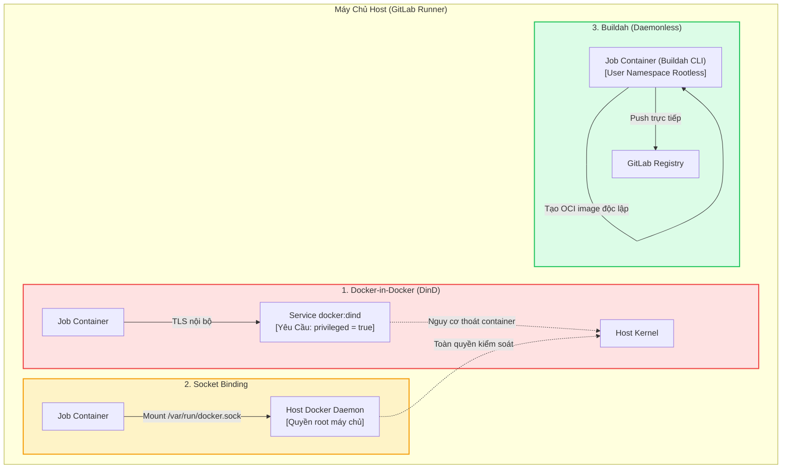
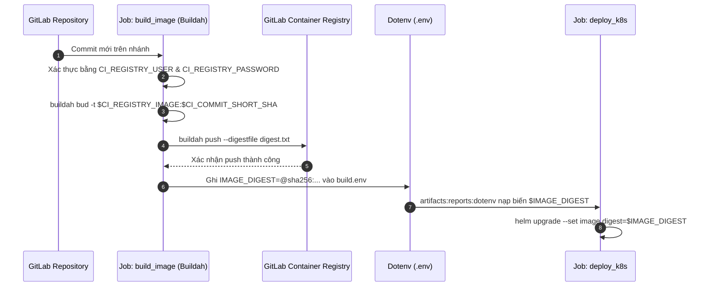

# 6_6_5 Building and Pushing Container Images in CI

> **Khóa học**: Cloud DevOps Basic — Containers & Kubernetes  
> **Phân nhóm**: 6 Domain 6 - Containers and Kubernetes › 6_6 GitLab CI-CD and Release Strategies  
> **Chủ đề**: 6_6_5 Building and Pushing Container Images in CI  
> **Trạng thái**: Đã kiểm chứng (verifier PASS, 21-11-2026)  
> **Lộ trình tổng**: [Topic README](./README.md#6_6_5-build-image-trong-ci) · **Checkpoint**: [CHECKLIST](../../CHECKLIST.md#6_6-gitlab-ci-cd-and-release-strategies)  
> **Kiến thức liên quan**: [6_2 Container Image Engineering](<../6_2 Container Image Engineering/README.md>) · [6_6 GitLab CI-CD and Release Strategies](./README.md)

---

## 0. Tình Huống Mở Đầu: "Build Container Bên Trong Container"

Trong quy trình CI/CD hiện đại, runner thường chạy bên trong một container (như Docker hoặc Kubernetes executor). Khi pipeline cần tạo container image cho ứng dụng, chúng ta đối mặt với bài toán: **làm thế nào một container có thể tạo ra container khác an toàn?**

Nhiều đội ngũ chọn giải pháp gắn socket máy chủ hoặc mở cờ đặc quyền để chạy lệnh quen thuộc, nhưng vô tình mở toang cánh cửa kiểm soát máy chủ vật lý. Bài học này phân tích ba phương pháp build image trong CI, tình trạng của Kaniko, giải pháp daemonless với Buildah, và chiến lược truyền image digest bất biến qua dotenv artifact.

---

## 1. Khái Niệm Cốt Lõi & Bản Chất Kỹ Thuật (Core Concepts & Technical Deep Dive)

### 1.1 Ba Phương Pháp Tiếp Cận Build Image trong CI

Khi chạy GitLab Runner với môi trường container, có ba phương pháp chính để đóng gói image:

#### Phương Pháp 1: Docker-in-Docker (DinD)
Docker-in-Docker khởi chạy một Docker daemon độc lập bên trong container phụ của job CI thông qua cấu hình `services: docker:dind`. <!-- ev: C5.1 -->  
Job container đóng vai trò Docker client và giao tiếp với daemon phụ này qua mạng nội bộ. <!-- ev: C5.1 -->  
Để Docker daemon con quản lý được filesystem overlay và cgroup bên trong container, GitLab Runner bắt buộc phải bật cờ đặc quyền `privileged = true` trong file cấu hình `config.toml`. <!-- ev: C5.2 -->  
Chế độ `privileged = true` cấp toàn bộ quyền truy cập thiết bị máy chủ cho container, tạo ra nguy cơ thoát container (container breakout) nghiêm trọng nếu mã lệnh trong job bị chiếm quyền. <!-- ev: C5.3 -->  
Từ phiên bản Docker 19.03, DinD mặc định bật chứng chỉ bảo mật TLS (`DOCKER_TLS_CERTDIR="/certs"`), yêu cầu volume chia sẻ thư mục chứng chỉ giữa job container và service dind. <!-- ev: C5.4 -->

#### Phương Pháp 2: Docker Socket Binding
Phương pháp này gắn trực tiếp file socket `/var/run/docker.sock` từ máy chủ host vào container của job CI qua volume mount. <!-- ev: C5.5 -->  
Tiến trình bên trong job container giao tiếp thẳng với Docker daemon của máy chủ host mà không cần service phụ. <!-- ev: C5.5 -->  
Tuy nhiên, việc gắn `/var/run/docker.sock` trao toàn quyền điều khiển Docker daemon của máy chủ cho container, tương đương quyền root trên host và tiềm ẩn nguy cơ xung đột tên container hoặc cổng mạng giữa các job đồng thời. <!-- ev: C5.6 -->

#### Phương Pháp 3: Daemonless Build (Buildah & Rootless BuildKit)
Mô hình hiện đại loại bỏ hoàn toàn kiến trúc daemon nền chạy ngầm. <!-- ev: C5.7 -->  
Buildah là công cụ mã nguồn mở cho phép xây dựng và đẩy OCI container image độc lập mà không cần bất kỳ Docker daemon nào (daemonless). <!-- ev: C5.7 -->  
Buildah và rootless BuildKit hoạt động hoàn toàn trong user namespace của Linux ở chế độ rootless, không đòi hỏi quyền root thực sự của máy chủ host hay cờ đặc quyền của runner. <!-- ev: C5.8 -->

<!-- ev: C5.1 C5.2 C5.3 C5.5 C5.6 C5.7 C5.8 -->
| Tiêu chí so sánh | Docker-in-Docker (DinD) | Docker Socket Binding | Buildah / Rootless BuildKit |
| :--- | :--- | :--- | :--- |
| **Kiến trúc** | Daemon riêng trong service container | Dùng chung Docker daemon của host | Không daemon (tiến trình CLI độc lập) |
| **Cấu hình Runner** | Yêu cầu `privileged = true` trong `config.toml` | Gắn volume `/var/run/docker.sock` | Runner thông thường (hỗ trợ user namespace) |
| **An ninh** | Thấp (nguy cơ container breakout) | Rất thấp (tương đương quyền root host) | Rất cao (cô lập an toàn, không cần root host) |
| **Bộ nhớ đệm (Cache)** | Mất khi container kết thúc (ephemeral) | Dùng chung cache host (dễ ô nhiễm) | Hỗ trợ cache linh hoạt từ OCI registry từ xa |
| **Khuyến nghị** | Runner riêng biệt cô lập | Chỉ thử nghiệm cá nhân cục bộ | Khuyến nghị cho CI/CD và Kubernetes runner |

---

### 1.2 Tình Trạng Bảo Trì của Kaniko và Khuyến Nghị CI Hiện Đại

Kaniko từng là giải pháp phổ biến để build image không cần daemon trên Kubernetes. <!-- ev: C5.9 -->  
Tuy nhiên, vào năm 2025, kho mã nguồn chính thức của Kaniko (`GoogleContainerTools/kaniko`) đã được Google chính thức chuyển sang trạng thái lưu trữ (archive / read-only). <!-- ev: C5.9 -->  
Khi bị archive, dự án không còn nhận bản vá bảo mật hay tính năng mới từ đội ngũ phát triển gốc. <!-- ev: C5.10 -->  
Tài liệu CI/CD hiện đại khuyến nghị không khởi tạo dự án mới với Kaniko, mà ưu tiên chuyển sang Buildah hoặc rootless BuildKit để đảm bảo khả năng bảo trì lâu dài. <!-- ev: C5.10 -->

---

### 1.3 Xác Thực với GitLab Container Registry

GitLab tích hợp sẵn GitLab Container Registry trong mỗi dự án để lưu trữ image nội bộ. <!-- ev: C5.11 -->  
GitLab CI tự động cung cấp các biến định sẵn phục vụ xác thực: `CI_REGISTRY_USER` mang tên người dùng và `CI_REGISTRY_PASSWORD` chứa token bảo mật `CI_JOB_TOKEN` có hiệu lực trong vòng đời của job. <!-- ev: C5.11 -->  
Cú pháp đăng nhập an toàn khuyến nghị truyền mật khẩu qua stdin để tránh lộ trong tiến trình hệ thống: <!-- ev: C5.12 -->

```bash
echo "$CI_REGISTRY_PASSWORD" | docker login "$CI_REGISTRY" -u "$CI_REGISTRY_USER" --password-stdin
```

Cú pháp tương tự khi sử dụng công cụ Buildah: <!-- ev: C5.12 -->

```bash
echo "$CI_REGISTRY_PASSWORD" | buildah login -u "$CI_REGISTRY_USER" --password-stdin "$CI_REGISTRY"
```

---

### 1.4 Chiến Lược Gắn Nhãn và Nguyên Tắc "Build Once, Deploy Many"

Trong quản lý container image, cần phân biệt rõ ràng giữa nhãn (Tag) và mã băm (Digest):

- **Image Tag (Nhãn có thể trôi - Mutable)**: Tag như `latest` hoặc `v1.0.0` chỉ là con trỏ tham chiếu đến image manifest. <!-- ev: C5.13 --> Tag có thể bị ghi đè sang một image khác qua các lần build, gây hiện tượng trôi phiên bản giữa các môi trường. <!-- ev: C5.13 -->
- **Image Digest (Định danh bất biến - Immutable)**: Digest dạng SHA-256 (`@sha256:...`) là mã băm mật mã học đại diện duy nhất cho nội dung manifest và các layer. <!-- ev: C5.14 --> Nếu nội dung image thay đổi dù chỉ một bit, mã digest sẽ thay đổi, đảm bảo tính bất biến tuyệt đối khi triển khai. <!-- ev: C5.14 -->

Chiến lược gắn nhãn chuẩn mực trong GitLab CI:
1. Mọi commit trên nhánh phát triển đều được gắn tag định danh ngắn `CI_COMMIT_SHORT_SHA` phục vụ kiểm thử và truy vết mã nguồn. <!-- ev: C5.15 -->
2. Khi phát hành git tag, gắn bổ sung nhãn phiên bản SemVer lấy từ biến `CI_COMMIT_TAG`. <!-- ev: C5.15 -->
3. Job build xuất bản image phải trích xuất mã SHA-256 digest và lưu trữ vào biến môi trường. <!-- ev: C5.16 -->

Cơ chế `artifacts:reports:dotenv` trong GitLab CI đọc các cặp key-value từ file `.env` do job build tạo ra và tự động nạp thành biến môi trường cho các job downstream trong pipeline. <!-- ev: C5.16 -->

---

### 1.5 Tối Ưu Hóa Bộ Nhớ Đệm (Build Cache) Giữa Các Job Độc Lập

Các container runner thường có tính chất tạm thời (ephemeral): dữ liệu cục bộ bị xóa sau khi job hoàn thành. <!-- ev: C5.17 -->  
Để tránh việc biên dịch lại từ đầu ở mọi pipeline, tùy chọn `--cache-from` hoặc inline cache (`--build-arg BUILDKIT_INLINE_CACHE=1`) cho phép tải các layer đã build trước đó từ container registry từ xa về làm bộ đệm. <!-- ev: C5.17 -->  
Khi sử dụng Buildah, tùy chọn `buildah push --digestfile` cho phép xuất trực tiếp chuỗi SHA-256 digest ra file đĩa để nạp vào dotenv artifact. <!-- ev: C5.18 -->

---

## 2. Ví Dụ Đời Sống Thực Tế Dễ Hiểu (Intuitive Real-World Analogies)

### Xưởng Đóng Gói Hàng Hóa và Niêm Phong An Toàn

Hãy hình dung quy trình build container trong CI giống như việc đóng gói và niêm phong các kiện hàng xuất khẩu:

1. **Docker-in-Docker giống như mang lò luyện kim vào phòng trọ**:  
   Để đúc thùng hàng, bạn mang cả lò lửa áp suất cao vào căn phòng thuê nhỏ. Chủ nhà phải cấp giấy "đặc quyền tối cao" (privileged) cho bạn. Nếu người thuê làm rò rỉ nhiệt hoặc nổ lò, toàn bộ tòa nhà của chủ trọ sẽ bị phá hủy.

2. **Docker Socket Binding giống như giao chìa khóa kho tổng cho nhân viên thời vụ**:  
   Thay vì mang lò vào phòng, bạn xin nối ống dẫn thẳng vào máy đúc trung tâm của chủ nhà (`/var/run/docker.sock`). Người công nhân trong phòng có thể điều khiển toàn bộ xưởng chính. Nếu nhân viên bất cẩn hoặc có ý đồ xấu, họ có thể mở cửa kho tổng và chiếm quyền sở hữu cả khu nhà.

3. **Buildah giống như máy ép nguội độc lập**:  
   Buildah là chiếc máy ép kiện cầm tay thế hệ mới. Nó không dùng lửa, không cần khói, và người thợ bình thường (người dùng non-root) có thể tự đóng thùng an toàn tại bàn làm việc mà không cần bất kỳ đặc quyền nào từ chủ nhà.

4. **Image Tag là nhãn dán giấy, còn Image Digest là mã QR khắc laser**:  
   Tag giống nhãn dán bằng keo ghi dòng chữ "Bản mới nhất", ai cũng có thể bóc dán sang thùng khác. Digest là mã QR khắc laser sâu vào vỏ kim loại dựa trên trọng lượng và linh kiện bên trong thùng. Chỉ cần thùng bị móp một vết nhỏ, mã QR laser sẽ không còn khớp.

5. **Dotenv Artifact là biên bản bàn giao niêm phong**:  
   Sau khi đóng gói xong, tổ đóng gói ghi mã QR khắc laser vào biên bản bàn giao niêm phong (`artifacts:reports:dotenv`). Đội vận chuyển (staging, production) chỉ cần đọc biên bản để chuyển đúng kiện hàng đã kiểm định đi triển khai.

---

## 3. Kiến Trúc, Luồng Hoạt Động & Hình Ảnh Trực Quan (Architecture, Diagrams & Visual Media)

### 3.1 Ranh Giới Bảo Mật Giữa Các Phương Pháp Build

<!-- ev: C5.1 C5.5 C5.7 -->
Sơ đồ so sánh ranh giới an ninh giữa ba phương pháp build container trong CI:



---

### 3.2 Luồng Vận Hành Pipeline Buildah và Truyền Digest

<!-- ev: C5.11 C5.15 C5.16 C5.18 -->
Quy trình thực thi chuẩn trong GitLab CI từ khâu build đến deploy bằng digest:



---

## 4. Code Mẫu Trực Quan Hoặc Dòng Lệnh Thực Chiến (Runnable Sample Code / CLI)

### 4.1 Cấu Hình Chuẩn: Xây Dựng Image Bằng Buildah (Khuyến Nghị Production)

<!-- ev: C5.7 C5.11 C5.12 C5.15 C5.16 C5.17 C5.18 -->
Dưới đây là file `.gitlab-ci.yml` chuẩn mực dùng Buildah daemonless, trích xuất digest và chuyển giao sang job deploy:

```yaml
stages:
  - build
  - deploy

variables:
  STORAGE_DRIVER: "vfs"
  BUILDAH_FORMAT: "docker"
  IMAGE_NAME: "$CI_REGISTRY_IMAGE"

build_image:
  stage: build
  image: quay.io/buildah/stable:v1.38.0
  before_script:
    - echo "$CI_REGISTRY_PASSWORD" | buildah login -u "$CI_REGISTRY_USER" --password-stdin "$CI_REGISTRY"
  script:
    - echo "Xây dựng container image cho commit $CI_COMMIT_SHORT_SHA..."
    - buildah bud
        --storage-driver "$STORAGE_DRIVER"
        --format "$BUILDAH_FORMAT"
        --cache-from "$IMAGE_NAME:latest"
        --layers
        -t "$IMAGE_NAME:$CI_COMMIT_SHORT_SHA"
        -t "$IMAGE_NAME:latest"
        .
    - buildah push
        --storage-driver "$STORAGE_DRIVER"
        --digestfile digest.txt
        "$IMAGE_NAME:$CI_COMMIT_SHORT_SHA"
    - buildah push
        --storage-driver "$STORAGE_DRIVER"
        "$IMAGE_NAME:latest"
    # Ghi nhận digest bất biến vào file dotenv artifact
    - DIGEST=$(cat digest.txt)
    - echo "IMAGE_DIGEST=$DIGEST" >> build.env
    - echo "IMAGE_REF=$IMAGE_NAME@$DIGEST" >> build.env
  artifacts:
    reports:
      dotenv: build.env
    expire_in: 1 day

deploy_to_kubernetes:
  stage: deploy
  image: dtzar/helm-kubectl:3.17.0
  script:
    # Biến $IMAGE_DIGEST được tự động nạp từ build.env của job build_image
    - echo "Triển khai ứng dụng với Image Digest bất biến: $IMAGE_REF"
    - helm upgrade --install my-app ./chart
        --set image.repository="$CI_REGISTRY_IMAGE"
        --set image.digest="$IMAGE_DIGEST"
```

---

### 4.2 Cấu Hình So Sánh: Docker-in-Docker Có Bật TLS

<!-- ev: C5.1 C5.2 C5.4 C5.11 C5.16 -->
Cấu hình DinD truyền thống yêu cầu runner có cờ `privileged = true` và thiết lập thư mục TLS:

```yaml
build_dind:
  stage: build
  image: docker:27.5.1
  services:
    - docker:27.5.1-dind
  variables:
    DOCKER_TLS_CERTDIR: "/certs"
  before_script:
    - echo "$CI_REGISTRY_PASSWORD" | docker login "$CI_REGISTRY" -u "$CI_REGISTRY_USER" --password-stdin
  script:
    - docker build --cache-from "$CI_REGISTRY_IMAGE:latest" -t "$CI_REGISTRY_IMAGE:$CI_COMMIT_SHORT_SHA" .
    - docker push "$CI_REGISTRY_IMAGE:$CI_COMMIT_SHORT_SHA"
    - DIGEST=$(docker inspect --format='{{index .RepoDigests 0}}' "$CI_REGISTRY_IMAGE:$CI_COMMIT_SHORT_SHA" | cut -d'@' -f2)
    - echo "IMAGE_DIGEST=$DIGEST" >> build.env
  artifacts:
    reports:
      dotenv: build.env
```

---

## 5. Cạm Bẫy Thực Tế & Thực Tiễn Sản Xuất (Production Gotchas & Best Practices)

### 5.1 Cạm Bẫy 1: Triển Khai Production Bằng Tag Thay Vì Digest
Triển khai bằng nhãn như `v1.2.0` hoặc `latest` khiến hệ thống dễ bị trôi cấu hình khi tag bị ghi đè trên registry. <!-- ev: C5.13 -->  
Khi gặp sự cố và thực hiện rollback, Kubernetes có thể tiếp tục kéo image lỗi do tag cũ đã bị trỏ sang nội dung mới. <!-- ev: C5.13 C5.14 -->  
**Thực tiễn sản xuất**: Luôn triển khai lên Production bằng Image Digest bất biến dạng `@sha256:...`. <!-- ev: C5.14 -->

### 5.2 Cạm Bẫy 2: Cấp Quyền `privileged = true` Cho Shared Runner
Bật cờ đặc quyền trên runner dùng chung cho phép bất kỳ ai có quyền commit mã nguồn chạy lệnh chiếm quyền điều khiển máy chủ host và đọc trộm dữ liệu các dự án khác. <!-- ev: C5.2 C5.3 -->  
**Thực tiễn sản xuất**: Không bật cờ privileged trên Shared Runner; chuyển sang dùng công cụ daemonless như Buildah trong user namespace. <!-- ev: C5.8 -->

### 5.3 Cạm Bẫy 3: Quên Khai Báo Biến `DOCKER_TLS_CERTDIR` Trong DinD
Từ bản Docker 19.03, DinD yêu cầu kết nối TLS. Nếu thiếu biến `DOCKER_TLS_CERTDIR: "/certs"`, Docker client sẽ cố kết nối qua cổng TCP 2375 không mã hóa và báo lỗi mất kết nối daemon. <!-- ev: C5.4 -->  
**Thực tiễn sản xuất**: Luôn khai báo biến `DOCKER_TLS_CERTDIR` khi sử dụng Docker-in-Docker. <!-- ev: C5.4 -->

### 5.4 Cạm Bẫy 4: Để Lộ Bí Mật Trong File Dotenv Artifact
File trong `artifacts:reports:dotenv` được lưu trữ như artifact thông thường và hiển thị cho người có quyền xem job. Ghi mật khẩu cơ sở dữ liệu hoặc API token vào file `.env` sẽ làm lộ secret trong toàn dự án. <!-- ev: C5.16 -->  
**Thực tiễn sản xuất**: Chỉ ghi các thông tin định danh không nhạy cảm như `IMAGE_DIGEST` vào file dotenv; sử dụng GitLab CI Variables hoặc Vault cho secret. <!-- ev: C5.16 -->

### 5.5 Cạm Bẫy 5: Tràn Ổ Đĩa Do Tích Tụ Layer Cũ Khi Dùng Cache
Tận dụng cache và volume cục bộ trên self-managed runner nếu không có cơ chế dọn dẹp sẽ gây lỗi hết dung lượng đĩa. <!-- ev: C5.17 -->  
**Thực tiễn sản xuất**: Cấu hình dọn dẹp định kỳ cho máy chủ runner và ưu tiên cache phân tán từ container registry. <!-- ev: C5.17 -->

---

## 6. Câu Hỏi Củng Cố Kiến Thức (Active Recall Quiz)

### Câu Hỏi 1: Vì Sao Gắn Socket `/var/run/docker.sock` Vào Job CI Bị Coi Là Lỗ Hổng Bảo Mật Nguy Hiểm?
<details>
<summary>Đáp án</summary>

Khi gắn `/var/run/docker.sock` vào container của job, container được trao quyền giao tiếp trực tiếp với Docker daemon của máy chủ host, vốn đang chạy với quyền root. Bất kỳ mã lệnh nào bên trong job container (kể cả dependencies độc hại từ bên thứ ba) đều có thể ra lệnh cho Docker daemon tạo container mới mount toàn bộ filesystem `/` của máy chủ, chiếm toàn quyền kiểm soát máy chủ vật lý. Ngoài ra, việc dùng chung daemon còn gây rủi ro ô nhiễm cache và xung đột cổng mạng giữa các job đồng thời.
</details>

### Câu Hỏi 2: Phân Biệt Image Tag Và Image Digest. Làm Thế Nào Truyền Digest An Toàn Giữa Các Job Trong GitLab CI?
<details>
<summary>Đáp án</summary>

- **Image Tag**: Là con trỏ có thể thay đổi (mutable pointer), có thể bị xóa hoặc ghi đè sang các bản build khác trên registry.
- **Image Digest**: Là mã băm mật mã học SHA-256 bất biến (immutable identifier) đại diện duy nhất cho nội dung manifest và các layer của image.
- **Cách truyền trong GitLab CI**: Job build đẩy image lên registry, xuất chuỗi SHA-256 digest bằng cờ `--digestfile` của Buildah và ghi vào file `.env` (ví dụ `IMAGE_DIGEST=@sha256:...`). Cấu hình `artifacts:reports:dotenv: build.env` giúp GitLab tự động nạp chuỗi digest này thành biến môi trường cho các job downstream mà không cần build lại.
</details>

### Câu Hỏi 3: Tình Trạng Hiện Tại Của Kaniko Là Gì Và Tại Sao Buildah Được Khuyến Nghị Cho CI Hiện Đại?
<details>
<summary>Đáp án</summary>

Kho lưu trữ chính thức của Kaniko (`GoogleContainerTools/kaniko`) đã được Google chính thức lưu trữ (archive / read-only) vào năm 2025 và không còn nhận được bản cập nhật tính năng hay vá lỗi bảo mật. Trong khi đó, Buildah là công cụ mã nguồn mở được phát triển tích cực thuộc dự án Containers (Red Hat), hoạt động hoàn toàn theo mô hình daemonless không cần tiến trình nền, hỗ trợ chuẩn OCI đầy đủ và có khả năng chạy an toàn ở chế độ rootless trong user namespace mà không đòi hỏi quyền root hay cờ `privileged = true`.
</details>

---

## 7. 📚 Nguồn Tài Liệu Chính Thống (Tier-1 Official References)

- [GitLab Docs: Use Docker to build Docker images](https://docs.gitlab.com/ci/docker/using_docker_build/) - Hướng dẫn chính thức từ GitLab về các phương pháp build Docker image (DinD, Docker socket, Buildah).
- [GitLab Docs: GitLab Container Registry](https://docs.gitlab.com/user/packages/container_registry/) - Hướng dẫn quản lý, xác thực với `CI_REGISTRY_USER` và `CI_JOB_TOKEN` trên GitLab Container Registry.
- [GitLab Docs: CI/CD YAML syntax reference - artifacts:reports:dotenv](https://docs.gitlab.com/ci/yaml/artifacts_reports/#artifactsreportsdotenv) - Tài liệu đặc tả cú pháp chia sẻ biến môi trường động giữa các job bằng dotenv artifact.
