# 6_6_5_1 Container Lifecycle and Daemonless Build Internals

> **Khóa học**: Cloud DevOps Basic — Containers & Kubernetes
> **Phân nhóm**: 6 Domain 6 - Containers and Kubernetes › 6_6 GitLab CI-CD and Release Strategies
> **Chủ đề**: Giải phẫu chuyên sâu vòng đời container (`docker build` → Image → `docker run` → Real Host Process) và cơ chế build không cần daemon (Buildah & Rootless BuildKit)
> **Trạng thái**: Đã kiểm chứng (verifier PASS, 21-11-2026)
> **Lộ trình**: [README Chủ đề 6_6](./README.md#6_6_5-build-image-trong-ci) · [Lộ trình tổng](../../README.md)

---

## 1. Khái Niệm Cốt Lõi & Bản Chất Kỹ Thuật (Core Concepts & Technical Deep Dive)

Nhiều người mới học hình dung container image như một máy ảo nhỏ và nghĩ build image bắt buộc phải có dịch vụ nền quyền quản trị tối cao chạy thường trực. Cách hiểu này dẫn đến thói quen rủi ro trong CI/CD là bật chế độ đặc quyền hoặc chia sẻ socket quản trị máy chủ vào job build. Thực tế, image chỉ là tập hợp file tĩnh theo chuẩn mở, còn container đang chạy chỉ là tiến trình Linux thông thường bị cách ly góc nhìn và giới hạn tài nguyên. Nhờ vậy, các công cụ hiện đại hoàn toàn có thể build và đẩy image mà không cần dịch vụ chạy ngầm quyền quản trị. <!-- ev: C51.102 -->

Xuyên suốt bài học, ta theo dõi một ví dụ thống nhất: đóng gói và chạy dịch vụ Java mẫu.

### 1.1. Chu trình `docker build`: Từ thư mục mã nguồn đến `dockerd`

Docker Engine dùng kiến trúc client-server: lệnh gõ trên terminal chỉ là CLI client gửi yêu cầu, không tự build hay chạy container. <!-- ev: C51.1 -->

- **Giao tiếp qua UNIX socket**: Trên Linux, CLI giao tiếp với tiến trình nền `dockerd` (Docker daemon) qua REST API thông qua UNIX socket `/var/run/docker.sock`. <!-- ev: C51.1 -->
- **Chuẩn bị build context**: Khi chạy `docker build`, CLI đọc file `.dockerignore` để loại bỏ file/thư mục khớp mẫu khỏi build context; với legacy builder (`DOCKER_BUILDKIT=0`), toàn bộ context còn lại được đóng gói thành tarball gửi lên daemon, còn với BuildKit mặc định (từ Docker Engine 23.0), client chỉ truyền các file cần thiết theo yêu cầu của builder. <!-- ev: C51.2 -->
- **Gửi yêu cầu build**: Với Docker Engine REST API truyền thống, CLI gửi luồng tarball context qua socket tới endpoint `POST /build` của `dockerd` (từ Docker Engine 23.0 trên Linux, BuildKit là builder mặc định giúp tối ưu hóa việc truyền context). <!-- ev: C51.3 -->

Quá trình xử lý bên trong máy chủ build diễn ra theo ba bước:

1. **Giải nén & thực thi `Dockerfile` (Legacy vs BuildKit)**: Ở legacy builder (`DOCKER_BUILDKIT=0`), `dockerd` giải nén build context, đọc tuần tự chỉ thị `Dockerfile` và tạo container trung gian tạm thời cho các bước như `RUN`; còn với BuildKit mặc định (từ Docker Engine 23.0), `Dockerfile` được giải qua đồ thị phụ thuộc LLB để chạy song song các nhánh độc lập và tối ưu bỏ bước không ảnh hưởng kết quả cuối. <!-- ev: C51.4 -->
2. **Lưu layer & xử lý xóa file**: Ở legacy builder, thay đổi sau `RUN` được commit thành layer chỉ đọc rồi xóa container trung gian (còn BuildKit lưu snapshot/cache theo đồ thị LLB và xuất layer blob như `tar`/`tar+gzip`/`tar+zstd`/`estargz` khi export hoặc push); khi xóa file ở `RUN` sau, file gốc vẫn nằm ở layer cũ (`lowerdir`), còn OverlayFS tạo whiteout trong `upperdir` (character device `0/0` hoặc xattr `trusted.overlay.whiteout`) và chỉ khi đóng gói thành OCI layer changeset tar mới dùng entry `.wh.<tên_file>` để ẩn file khỏi góc nhìn `merged`. <!-- ev: C51.5 -->
3. **Sinh metadata và Image ID**: Thông số chạy và danh sách `diff_ids` của các layer được ghi vào Image Config JSON; với classic storage driver của Docker, Image ID (`.Id`) là digest tính từ cấu hình image, nhưng theo OCI Image Spec hiện hành các công cụ đã phân kỳ (nhiều công cụ và `containerd` image store dùng digest của Image Manifest hoặc Image Index). <!-- ev: C51.6 -->

### 1.2. Bản chất tĩnh của OCI / Docker Image

Một image theo chuẩn **OCI Image Specification** (chuẩn mở chung để Docker, containerd, Podman và Buildah dùng chung định dạng) là tập hợp file lưu trữ tĩnh trên đĩa, không phải máy ảo và không chứa nhân hệ điều hành (kernel) riêng. <!-- ev: C51.7 -->

Cấu trúc tĩnh này gồm ba phần:
<!-- ev: C51.7 -->
- **Layer filesystem (`tar`, `tar+gzip`, hoặc `tar+zstd`)**: Các lớp file tăng thêm hoàn toàn chỉ đọc (read-only), có thể dùng chung giữa nhiều image.
- **Image Config JSON**: Lưu cấu hình mặc định (`Env`, `Cmd`, `Entrypoint`, `WorkingDir`) và `rootfs.diff_ids` (mã băm từng layer chưa nén).
- **Image Manifest JSON**: Danh mục liệt kê các layer (`tar`, `tar+gzip`, hoặc `tar+zstd`) và trỏ tới Image Config JSON tương ứng theo digest.

### 1.3. Chu trình `docker run`: Tách đôi `create` & `start`, OverlayFS và mạng

Lệnh `docker run` thực chất gửi tuần tự hai yêu cầu API tới `dockerd`: `POST /containers/create` (tạo cấu trúc container ở trạng thái `created`) và `POST /containers/{id}/start` (khởi chạy tiến trình). <!-- ev: C51.8 -->

Trước khi khởi chạy, máy chủ chuẩn bị ba lớp hạ tầng:

1. **Mount OverlayFS (`overlay2`)**: Storage driver `overlay2` xếp các layer image chỉ đọc làm `lowerdir`, tạo một thư mục ghi mới `upperdir` (cùng thư mục nháp `workdir`) và hợp nhất thành điểm mount `merged` cho container nhìn thấy. <!-- ev: C51.9 -->
2. **Thiết lập mạng (`bridge` mặc định)**: Trên bridge `docker0`, Docker tạo một cặp giao diện mạng ảo `veth` pair (một đầu vào container thành `eth0`, đầu kia nối vào `docker0`) và dùng `iptables` NAT để chuyển tiếp cổng (port forwarding) cũng như cấp đường ra mạng. <!-- ev: C51.10 -->
3. **Xuất file `config.json` chuẩn OCI**: Toàn bộ thông số container được xuất ra file `config.json` (kèm thư mục `rootfs`) tuân thủ chuẩn `opencontainers/runtime-spec`. <!-- ev: C51.11 -->

### 1.4. Chuỗi thực thi: `containerd` → `containerd-shim` → `runc` → Linux Kernel

Thay vì gọi thẳng vào nhân hệ điều hành, tầng quản lý ủy quyền qua các thành phần runtime chuyên biệt:

1. **`dockerd` gọi `containerd` qua gRPC**: `dockerd` gửi yêu cầu tạo và quản lý vòng đời container tới tiến trình `containerd` thông qua giao thức gRPC. <!-- ev: C51.12 -->
2. **`containerd` sinh tiến trình shim**: Với mỗi container, `containerd` khởi tạo tiến trình shim (trên Runtime v2 là `containerd-shim-runc-v2`) làm **tiến trình cha (parent process)** giữ I/O và exit status: `containerd` có thể khởi động lại mà container không chết, còn `dockerd` chỉ giữ container sống khi bật cấu hình `live-restore` (mặc định tắt `dockerd` sẽ dừng container). <!-- ev: C51.13 -->
3. **`containerd-shim` gọi `runc` rồi `runc` tự thoát**: `containerd-shim` gọi OCI runtime mặc định `runc` đọc `config.json` cùng `rootfs` để dựng container; ngay sau khi tiến trình ứng dụng khởi chạy xong, `runc` lập tức thoát (`exit`). <!-- ev: C51.14 -->
4. **Tương tác trực tiếp với nhân hệ điều hành**:
   - **Tạo không gian cách ly (`clone` + Linux Namespaces)**: Gọi `clone` kèm các cờ như `CLONE_NEWPID` (cô lập bảng tiến trình để ứng dụng thấy mình là `PID 1`), `CLONE_NEWNET` (cô lập card mạng/IP), `CLONE_NEWNS` (cô lập cây thư mục mount), `CLONE_NEWUTS` (cô lập hostname), `CLONE_NEWIPC` và `CLONE_NEWUSER`. <!-- ev: C51.15 -->
   - **Áp đặt hạn mức tài nguyên (`cgroups`)**: Ghi cấu hình giới hạn CPU, bộ nhớ RAM, I/O và số lượng tiến trình vào hệ thống file ảo Linux Control Groups tại `/sys/fs/cgroup/`. <!-- ev: C51.16 -->
   - **Tráo đổi thư mục gốc (`pivot_root`) và khởi chạy (`execve`)**: Gọi `pivot_root` để chuyển thư mục gốc `/` của tiến trình container sang thư mục `rootfs` đã mount từ OverlayFS (cô lập khỏi file hệ thống của host), sau đó gọi `execve` để nạp tiến trình ứng dụng (ví dụ `java -jar app.jar`). <!-- ev: C51.17 -->

**Kết luận bản chất động**: Một container đang chạy không phải máy ảo; nó **chính là một tiến trình Linux bình thường chạy trực tiếp trên nhân của máy host** (bạn có thể thấy rõ tiến trình `java -jar app.jar` khi chạy `ps aux` trên host), nhưng bị "đeo kính thực tế ảo" bởi **Namespaces** (chỉ thấy file, mạng, PID của riêng mình) và đặt trong "lồng giới hạn" bởi **Cgroups** (không thể ăn quá lượng RAM/CPU được cấp). <!-- ev: C51.18 -->

### 1.5. Phương pháp 3: Buildah & Rootless BuildKit (Daemonless)

Vì build image bản chất chỉ là nén layer + ghi JSON và chạy lệnh trong tiến trình cách ly, mô hình daemonless ra đời nhằm loại bỏ hoàn toàn daemon đặc quyền:

- **Kiến trúc Daemonless (`fork-and-exec`)**: Buildah chạy trực tiếp như lệnh CLI theo mô hình `fork-and-exec`, không cần `dockerd` hay `/var/run/docker.sock` chạy ngầm và thoát ngay khi build xong. <!-- ev: C51.19 -->
- **Root ảo qua User Namespaces (`userns`)**: Chế độ rootless (Buildah, Rootless BuildKit / Rootless Docker) dùng `CLONE_NEWUSER` kết hợp ánh xạ trong `/etc/subuid` và `/etc/subgid` để tiến trình mang `UID 0` ("root ảo") bên trong namespace trong khi vẫn là user thường trên host. <!-- ev: C51.20 -->
- **Rootless OverlayFS**: Khi không có quyền root toàn cục, cơ chế rootless dùng `fuse-overlayfs` ở user space (hoặc native rootless overlayfs trên nhân Linux ≥ 5.11) để ghép các layer. <!-- ev: C51.21 -->
- **Xuất thẳng chuẩn OCI**: Buildah tạo image theo chuẩn OCI và ghi trực tiếp ra đĩa hoặc push thẳng lên registry qua HTTPS mà không cần daemon trung gian. <!-- ev: C51.22 -->

---

## 2. Ví Dụ Đời Sống Thực Tế Dễ Hiểu (Intuitive Real-World Analogies)

Hãy hình dung toàn bộ vòng đời này qua việc đóng gói và nấu một **bát mì ăn liền**:

- **OCI Image = Gói mì ăn liền đóng gói sẵn**: Vắt mì và các gói gia vị ép chân không cố định là các lớp dữ liệu tĩnh chỉ đọc, còn bao bì in bảng thành phần và hướng dẫn nấu là các file mô tả cấu hình. Nằm yên trên kệ siêu thị, gói mì không tiêu tốn điện hay nước.
- **Running Container = Bát mì đang nấu sôi trên bếp**: Khi xé gói mì bỏ vào nồi và bật bếp, bát mì trở thành tiến trình đang sống tiêu thụ điện nước thật của căn bếp (nhân hệ điều hành máy chủ). Nắp nồi đậy kín giữ hương vị không lẫn sang nồi khác chính là cơ chế cách ly góc nhìn, còn núm vặn giới hạn công suất tối đa 1000W để tránh sập cầu dao chính là giới hạn tài nguyên.
- **Mô hình cũ vs mô hình không cần dịch vụ nền**: Cách làm cũ giống như muốn đóng gói một gói mì bạn phải thuê cả một nhà hàng và nhờ Bếp trưởng giữ chìa khóa tổng toàn tòa nhà làm hộ qua một ô cửa giao tiếp. Nếu kẻ xấu chạm được tới ô cửa đó, chúng có thể sai khiến Bếp trưởng mở khóa mọi căn phòng. Ngược lại, cách làm hiện đại giống một máy ép chân không mini cầm tay: bạn tự đóng gói đúng chuẩn quốc tế ngay tại bàn cá nhân, rồi bất kỳ căn bếp nào có nước sôi đều nấu ra được bát mì giống hệt nhau.

---

## 3. Kiến Trúc, Luồng Hoạt Động & Hình Ảnh Trực Quan (Architecture, Diagrams & Visual Media)

Sơ đồ luồng truyền lệnh giữa kiến trúc truyền thống và kiến trúc build không cần dịch vụ nền:

```mermaid
flowchart TB
    subgraph S1["Chuỗi Docker Daemonful (docker build & docker run)"]
        CLI["docker CLI"] -->|"REST API: POST /build, create, start<br/>qua /var/run/docker.sock"| DD["dockerd (Daemon quyền root)"]
        DD -->|"gRPC API"| CD["containerd"]
        CD -->|"tạo parent process"| SHIM["containerd-shim"]
        SHIM -->|"đọc config.json + rootfs"| RUNC["runc (tạo container rồi exit)"]
        RUNC -->|"clone (Namespaces), cgroups,<br/>pivot_root, execve"| PROC["Tiến trình ứng dụng trên Host Kernel"]
    end

    subgraph S2["Phương pháp 3: Daemonless & Rootless (Buildah / BuildKit)"]
        BCLI["buildah CLI (fork-and-exec, không daemon)"] -->|"User Namespace (userns)<br/>+ fuse-overlayfs / rootless overlay"| OCI["OCI Image (tarball layers + JSON)"]
        OCI -->|"Push trực tiếp qua HTTPS"| REG["Container Registry"]
    end
```



---

## 4. Code Mẫu Trực Quan Hoặc Dòng Lệnh Thực Chiến (Runnable Sample Code / CLI)

> **Phiên bản tham chiếu**: Các lệnh dưới đây áp dụng cho **Docker Engine 24+ / 27+** (BuildKit mặc định trên Linux), **Buildah 1.3x+** trên **Linux kernel ≥ 5.11** (hoặc có cài `fuse-overlayfs` cho chế độ rootless). <!-- ev: C51.101 -->

### Bước 1: Chuẩn bị bài toán `hello-svc` (Input)

Thư mục mẫu chứa file loại trừ và file đặc tả build: <!-- ev: C51.2 -->

<!-- ev: C51.2 -->
```text
# .dockerignore
.git
target/
*.md
```

```dockerfile
# Dockerfile
FROM eclipse-temurin:21-jre-alpine
WORKDIR /app
COPY app.jar /app/app.jar
EXPOSE 8080
CMD ["java", "-jar", "/app/app.jar"]
```

### Bước 2: Quan sát `docker build` và cấu trúc tĩnh của Image

Chạy build và kiểm tra Image ID SHA-256 cùng số layer: <!-- ev: C51.1 C51.2 C51.6 -->

<!-- ev: C51.1 C51.2 C51.6 -->
```bash
docker build -t hello-svc:1.0 .
docker image inspect hello-svc:1.0 --format '{{.Id}} | Layers: {{len .RootFS.Layers}}'
```

Đầu ra cho thấy mã băm cấu hình và số lớp dữ liệu: <!-- ev: C51.6 C51.7 -->

<!-- ev: C51.6 C51.7 -->
```text
sha256:9f8e7d... | Layers: 4
```

### Bước 3: Quan sát Running Container là tiến trình thật trên máy Host

Chạy container kèm giới hạn RAM và ánh xạ cổng: <!-- ev: C51.8 C51.9 C51.10 C51.16 -->

<!-- ev: C51.8 C51.9 C51.10 C51.16 -->
```bash
docker run -d --name hello-demo -p 8080:8080 --memory=256m hello-svc:1.0
```

Truy vấn PID thật của container ngay trên host và kiểm tra các namespace riêng: <!-- ev: C51.15 C51.16 C51.18 -->

<!-- ev: C51.15 C51.16 C51.18 -->
```bash
HOST_PID=$(docker inspect -f '{{.State.Pid}}' hello-demo)
ps -p "$HOST_PID" -o pid,ppid,user,cmd
ls -l /proc/"$HOST_PID"/ns/
```

Đầu ra trên host cho thấy tiến trình Java nằm dưới tiến trình cha `containerd-shim`: <!-- ev: C51.13 C51.15 C51.18 -->

<!-- ev: C51.13 C51.15 C51.18 -->
```text
  PID  PPID USER     CMD
18432 18410 root     java -jar /app/app.jar
```

### Bước 4: Build & Push không cần Daemon với Buildah (Rootless)

Kiểm tra bảng ánh xạ UID/GID rồi build và push trực tiếp chuẩn OCI không cần daemon: <!-- ev: C51.19 C51.20 C51.22 -->

<!-- ev: C51.19 C51.20 C51.22 -->
```bash
grep "$USER" /etc/subuid /etc/subgid
buildah build -t registry.example.com/team/hello-svc:1.0 .
buildah push registry.example.com/team/hello-svc:1.0
```

*(Nâng cao: có thể bỏ qua ở lần đọc đầu — nếu chạy Buildah bên trong container CI, cần cấp `/dev/fuse` cho `fuse-overlayfs` hoặc cấu hình `userns` phù hợp).* <!-- ev: C51.20 C51.21 -->

---

## 5. Cạm Bẫy Thực Tế & Thực Tiễn Sản Xuất (Production Gotchas & Best Practices)

1. **Gắn `/var/run/docker.sock` vào container CI**: Vì `dockerd` chạy quyền `root` và lắng nghe tại socket này, bất kỳ job nào ghi được vào socket đều có thể mount thư mục `/` của host, tương đương chiếm quyền `root` toàn máy; nên dùng Buildah hoặc Rootless BuildKit để đảm bảo least privilege. <!-- ev: C51.1 C51.19 -->
2. **Xóa file ở chỉ thị `RUN` sau không xóa dữ liệu khỏi image**: Mỗi lệnh `RUN` tạo một layer bất biến (read-only), nên file gốc vẫn nằm nguyên trong layer trước; layer sau chỉ tạo marker whiteout trong OverlayFS `upperdir` (character device `0/0`; chuyển thành entry `.wh.*` trong OCI tarball) để che khuất file khỏi góc nhìn `merged`. Hãy gộp tải–dùng–xóa trong một `RUN` hoặc dùng multi-stage build. <!-- ev: C51.5 C51.9 -->
3. **Nhầm lẫn restart `dockerd` làm chết container**: Nhờ `containerd-shim` làm tiến trình cha bảo bọc sau khi `runc` thoát, việc khởi động lại `dockerd` (khi bật live-restore) hoặc `containerd` không làm tắt container đang chạy. <!-- ev: C51.13 C51.14 -->
4. **Thiếu `/etc/subuid`, `/etc/subgid` hoặc `fuse-overlayfs` khi chạy rootless**: Nếu thiếu ánh xạ `userns` hoặc thiếu driver overlay hỗ trợ user space trên kernel cũ (< 5.11), build rootless sẽ lỗi quyền hoặc rơi về driver `vfs` rất chậm. <!-- ev: C51.20 C51.21 -->

---

## 6. Câu Hỏi Củng Cố Kiến Thức (Active Recall Quiz)

**Câu 1**: Khi chạy `ps aux` trên máy host, bạn thấy tiến trình `java -jar /app/app.jar` có PID `18432`, nhưng vào bên trong container lại thấy PID `1`. Cơ chế nào tạo ra khác biệt này và tiến trình nào làm cha trực tiếp của container trên host sau khi `runc` thoát?

<details>
<summary>Đáp án</summary>

Container là tiến trình Linux thật trên host (`PID 18432`) nhưng được `runc` tạo qua `clone` với cờ `CLONE_NEWPID` nên chỉ thấy bảng PID riêng bắt đầu từ `1`, và sau khi `runc` thoát thì `containerd-shim` làm tiến trình cha trực tiếp. <!-- ev: C51.13 C51.14 C51.15 C51.18 -->

</details>

**Câu 2**: Một `Dockerfile` chạy `RUN wget https://internal.example.com/secret.key` rồi ở dòng kế tiếp chạy `RUN rm -f /app/secret.key`. Liệu `secret.key` có biến mất khỏi OCI Image không?

<details>
<summary>Đáp án</summary>

Không. Layer thứ nhất vẫn lưu nguyên file `secret.key` dưới dạng layer chỉ đọc, còn layer thứ hai tạo whiteout trong OverlayFS `upperdir` (character device `0/0` hoặc xattr `trusted.overlay.whiteout`; khi đóng gói thành OCI layer archive là entry `.wh.secret.key`) để ẩn file khỏi góc nhìn `merged`, nên người tải image vẫn trích xuất lại được từ layer cũ. <!-- ev: C51.5 C51.7 C51.9 -->

</details>

**Câu 3**: Vì sao Buildah build được image chạy trên Kubernetes (`containerd`) mà không cần bật `dockerd` hay xin quyền `root` trên host?

<details>
<summary>Đáp án</summary>

Vì image chỉ là tập layer tarball tĩnh và file JSON theo chuẩn mở OCI tương thích với `containerd`, còn Buildah chạy dạng lệnh `fork-and-exec` kết hợp User Namespaces (`userns`) và `fuse-overlayfs` / rootless OverlayFS nên không cần daemon hay quyền root host. <!-- ev: C51.7 C51.19 C51.20 C51.21 C51.22 -->

</details>

---

## 7. 📚 Nguồn Tài Liệu Chính Thống (Tier-1 Official References)

- [Build context — Docker Docs](https://docs.docker.com/build/concepts/context/) - Cách Docker CLI đọc `.dockerignore` và truyền build context tới builder.
- [Docker Engine overview — Docker Docs](https://docs.docker.com/engine/) - Kiến trúc client-server, `dockerd`, REST API và giao tiếp với `containerd`.
- [Use the OverlayFS storage driver — Docker Docs](https://docs.docker.com/engine/storage/drivers/overlayfs-driver/) - Cơ chế `overlay2` với `lowerdir`, `upperdir`, `workdir` và `merged`.
- [Bridge network driver — Docker Docs](https://docs.docker.com/engine/network/drivers/bridge/) - Cơ chế `docker0`, `veth` pair và NAT/port forwarding.
- [Run the Docker daemon as a non-root user (Rootless mode) — Docker Docs](https://docs.docker.com/engine/security/rootless/) - Cách hoạt động của User Namespaces (`/etc/subuid`, `/etc/subgid`) và `fuse-overlayfs` / native overlayfs.
- [OCI Image Format Specification — Open Containers Initiative](https://github.com/opencontainers/image-spec/blob/main/spec.md) - Chuẩn cấu trúc Image Manifest, Image Config JSON, `diff_ids` và layer tarballs.
- [OCI Runtime Specification — Open Containers Initiative](https://github.com/opencontainers/runtime-spec/blob/main/spec.md) - Chuẩn `config.json`, Linux Namespaces, Cgroups và filesystem bundle.
- [Buildah Official Documentation — buildah-build(1)](https://github.com/containers/buildah/blob/main/docs/buildah-build.1.md) - Tài liệu chính thức về Buildah daemonless, rootless build và xuất OCI image.
