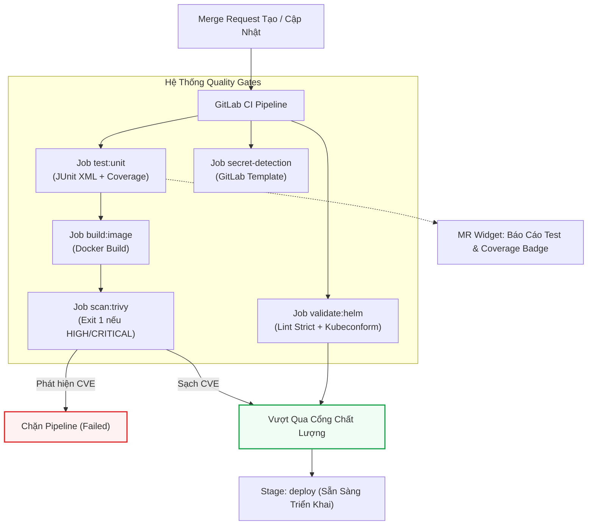

# 6_6_6 Testing and Quality Gates in CI

- **Khóa học**: Cloud DevOps Basic
- **Phân nhóm**: 6 Domain 6 - Containers and Kubernetes
- **Chủ đề**: 6_6 GitLab CI-CD and Release Strategies
- **Trạng thái**: Đã kiểm chứng (verifier PASS, 21-11-2026)
- **Checklist đối chiếu**: [CHECKLIST.md](../../CHECKLIST.md#6_6-gitlab-ci-cd-and-release-strategies)
- **Kiến thức liên quan**: [6_5_6 Validating Charts Before Deploy](<../6_5 Helm Package Management/6_5_6 Validating Charts Before Deploy.md>) (helm lint, values.schema.json, kubeconform) · [Topic README](./README.md#6_6_6-kiểm-thử-và-cổng-chất-lượng-quality-gate)

---

## 1. Khái Niệm Cốt Lõi & Bản Chất Kỹ Thuật (Core Concepts & Technical Deep Dive)

Trong quy trình phân phối phần mềm liên tục, mục tiêu của pipeline CI/CD không chỉ là biên dịch mã nguồn và đóng gói container image thành công. Trọng tâm cốt lõi là thiết lập các **Cổng chất lượng (Quality Gates)** tự động hóa đa tầng, ngăn chặn sớm lỗi logic, lỗ hổng bảo mật và sai sót cấu hình hạ tầng trước khi triển khai vào môi trường vận hành thực tế.

### 1.1 Kiểm Thử Đơn Vị & Tích Hợp Báo Cáo JUnit Trên Merge Request

Kiểm thử đơn vị (Unit Test) là lớp bảo vệ đầu tiên của mã nguồn nhằm đảm bảo các hàm và logic nghiệp vụ hoạt động đúng.

GitLab CI cung cấp thuộc tính `artifacts:reports:junit` chuyên dụng nhằm thu thập các tệp báo cáo kiểm thử XML định dạng chuẩn JUnit do framework kiểm thử sinh ra để GitLab hiển thị bảng tóm tắt kết quả kiểm thử trực tiếp trên giao diện Merge Request. <!-- ev: C6.1 -->

Thuộc tính `artifacts:reports:junit` hỗ trợ thu thập nhiều tệp báo cáo cùng lúc từ các thư mục con hoặc dự án đa module qua cú pháp wildcard như `target/surefire-reports/TEST-*.xml`. <!-- ev: C6.2 -->

### 1.2 Tỷ Lệ Bao Phủ Mã Nguồn (Code Coverage) & Regex Extraction

Độ bao phủ mã nguồn (Code Coverage) đo lường tỷ lệ phần trăm dòng mã được thực thi trong quá trình chạy kiểm thử tự động.

Từ khóa `coverage:` trong cấu hình job cho phép khai báo biểu thức chính quy (regular expression) để trích xuất tỷ lệ phần trăm bao phủ trực tiếp từ log console và hiển thị huy hiệu độ phủ trên Merge Request. <!-- ev: C6.3 -->

### 1.3 Bộ Quét Bảo Mật Tích Hợp Của GitLab & Phân Hạng Bản Quyền

Bảo mật hiện đại áp dụng chiến lược "Shift-Left" — rà soát an ninh ngay trong từng commit và merge request thay vì chờ đến khi vận hành trên production.

GitLab tích hợp sẵn các template bảo mật tĩnh nhúng vào pipeline thông qua cú pháp `include: { template: 'Jobs/<template-name>.gitlab-ci.yml' }`. <!-- ev: C6.4 -->

Các công cụ bảo mật gồm có:
- **Secret Detection**: Tự động rà quét mã nguồn và lịch sử commit git nhằm phát hiện khóa bí mật hoặc mã API token bị rò rỉ, hoạt động trên mọi gói bản quyền kể cả GitLab Free. <!-- ev: C6.5 -->
- **SAST (Static Application Security Testing)**: Phân tích mã nguồn tĩnh tìm kiếm lỗ hổng an ninh; khả năng quét cơ bản khả dụng trên gói Free, trong khi Vulnerability Report và widget bảo mật trên MR yêu cầu gói GitLab Ultimate. <!-- ev: C6.6 -->
- **Dependency Scanning**: Rà soát các tệp khóa định nghĩa gói phụ thuộc (như `pom.xml`, `package-lock.json`) để phát hiện lỗ hổng đã công bố trong chuỗi cung ứng phần mềm, yêu cầu gói GitLab Ultimate để quản lý tập trung. <!-- ev: C6.7 -->
- **Container Scanning**: Phân tích image container sau khi build nhằm phát hiện các mã lỗi CVE trong hệ điều hành cơ sở và thư viện hệ thống, yêu cầu bản quyền GitLab Ultimate để tích hợp bảng điều khiển. <!-- ev: C6.8 -->

### 1.4 Quét Lỗ Hổng Container Bằng Công Cụ Nguồn Mở Trivy

Đối với các dự án dùng bản Free hoặc muốn độc lập kiểm soát an ninh container, Aqua Security Trivy là công cụ quét nguồn mở hàng đầu.

Trivy được thực thi trực tiếp dưới dạng một job độc lập trong pipeline GitLab CI bằng lệnh CLI `trivy image`. <!-- ev: C6.9 -->

Tham số `--exit-code 1` kết hợp `--severity HIGH,CRITICAL` cấu hình Trivy làm chốt chặn chất lượng, trả về mã lỗi 1 và dừng pipeline ngay khi phát hiện lỗ hổng nguy hiểm. <!-- ev: C6.10 -->

Trivy hỗ trợ tham số `--format template --template '@/contrib/gitlab.tpl'` để kết xuất tệp JSON tương thích với GitLab và lưu vào `artifacts:reports:container_scanning`. <!-- ev: C6.11 -->

### 1.5 Cổng Chất Lượng Helm Chart (Helm Quality Gate)

Trước khi đóng gói và triển khai lên Kubernetes, việc thẩm định toàn diện cấu trúc chart là bước kiểm tra ngoại tuyến tối quan trọng. Helm Quality Gate được tổ chức thành một job độc lập chạy trước stage deployment để kiểm định mà không cần kết nối tới cụm Kubernetes. <!-- ev: C6.12 -->

Cổng kiểm định Helm ngoại tuyến kết hợp các công cụ:
1. `helm lint --strict`: Kiểm tra cấu trúc chart, cú pháp `Chart.yaml`, và chuyển đổi toàn bộ cảnh báo thành lỗi làm thất bại pipeline nếu vi phạm quy ước. <!-- ev: C6.13 -->
2. `helm template`: Render toàn bộ template Go sang manifest YAML hoàn chỉnh (`helm template <release> <chart> -f <values>`) nhằm phát hiện lỗi logic và cú pháp template trước khi gửi lên server. <!-- ev: C6.14 -->
3. `values.schema.json`: Tệp quy chuẩn tại thư mục gốc chart dùng JSON Schema Draft 7 tự động kiểm tra kiểu dữ liệu và ràng buộc của `values.yaml` khi chạy `helm lint` hoặc `helm template`. <!-- ev: C6.15 -->
4. `kubeconform -strict`: Thẩm định manifest render từ `helm template` (`helm template ... | kubeconform -strict -summary`) đối chiếu với OpenAPI schema chính thức của Kubernetes để chặn các trường sai chính tả hoặc tài nguyên không hợp lệ. <!-- ev: C6.16 -->

Từ khóa `allow_failure: true` cho phép một job kiểm tra an ninh hoặc chất lượng thực thi và cảnh báo kết quả mà không làm ngừng toàn bộ pipeline nếu có mã lỗi. <!-- ev: C6.17 -->

Từ khóa `needs:` cho phép các job kiểm thử hoặc quét bảo mật chạy song song theo mô hình DAG ngay khi job phụ thuộc hoàn thành thay vì chờ toàn bộ stage trước kết thúc. <!-- ev: C6.18 -->

---

## 2. Ví Dụ Đời Sống Thực Tế Dễ Hiểu (Intuitive Real-World Analogies)

Hệ thống Cổng chất lượng trong CI/CD tương tự quy trình làm thủ tục an ninh tại sân bay quốc tế:
- **Cân hành lý & Màn hình điện tử (Unit Test & JUnit Report)**: Từng kiện vali được cân kiểm tra trọng lượng như từng hàm chạy qua Unit Test. Dữ liệu tự động truyền lên màn hình điện tử cho tiếp viên trên MR theo dõi qua `artifacts:reports:junit`.
- **Cổng soi chiếu an ninh (SAST & Secret Detection)**: Máy quét tia X soi chiếu hành lý tìm vũ khí, chất cấm ẩn giấu bên trong mà không can thiệp vào hành khách, tương tự việc quét tĩnh tìm secret lộ hoặc lỗ hổng mã nguồn.
- **Kiểm định container hàng hóa (Trivy Container Scanning)**: Thùng hàng container sau khi đóng gói được chuyên viên kiểm định rà soát vỏ thùng và hàng hóa bên trong tìm rò rỉ hóa chất độc hại trước khi đưa lên máy bay.
- **Kiểm tra thị thực xuất cảnh (Helm Quality Gate)**: Nhân viên hải quan kiểm tra hộ chiếu, visa và giấy tờ tùy thân của hành khách trước khi cất cánh. Nếu visa sai định dạng, hành khách bị từ chối bay ngay tại mặt đất, tiết kiệm chi phí bị trục xuất tại nước đến.

---

## 3. Kiến Trúc, Luồng Hoạt Động & Hình Ảnh Trực Quan (Architecture, Diagrams & Visual Media)

Sơ đồ thể hiện luồng hoạt động của các Cổng chất lượng trong Merge Request Pipeline:



---

## 4. Code Mẫu Trực Quan Hoặc Dòng Lệnh Thực Chiến (Runnable Sample Code / CLI)

### 4.1 Cấu Hình Hoàn Chỉnh `.gitlab-ci.yml`

<!-- ev: C6.1 C6.2 C6.3 C6.4 C6.5 C6.9 C6.10 C6.11 C6.12 C6.13 C6.14 C6.16 C6.17 C6.18 -->
```yaml
# Phiên bản áp dụng: GitLab 17.x / 16.x, Trivy 0.50+, Helm 3.x / 4.x
stages:
  - test
  - security
  - build
  - scan
  - validate-helm

include:
  - template: Jobs/Secret-Detection.gitlab-ci.yml

test:unit:
  stage: test
  image: maven:3.9-eclipse-temurin-17-alpine
  script:
    - mvn clean test jacoco:report
  coverage: '/Total.*?([0-9]{1,3})%/'
  artifacts:
    when: always
    expire_in: 7 days
    reports:
      junit:
        - target/surefire-reports/TEST-*.xml

secret_detection:
  stage: security
  rules:
    - if: '$CI_PIPELINE_SOURCE == "merge_request_event"'

build:image:
  stage: build
  image: docker:24.0.5
  services:
    - docker:24.0.5-dind
  variables:
    IMAGE_TAG: $CI_REGISTRY_IMAGE:$CI_COMMIT_SHORT_SHA
  script:
    - docker login -u $CI_REGISTRY_USER -p $CI_REGISTRY_PASSWORD $CI_REGISTRY
    - docker build -t $IMAGE_TAG .
    - docker push $IMAGE_TAG

scan:container:trivy:
  stage: scan
  image:
    name: aquasec/trivy:0.50.1
    entrypoint: [""]
  variables:
    IMAGE_TAG: $CI_REGISTRY_IMAGE:$CI_COMMIT_SHORT_SHA
    TRIVY_CACHE_DIR: ".trivycache/"
  cache:
    key: trivy-cache
    paths:
      - .trivycache/
  script:
    - trivy image --format template --template '@/contrib/gitlab.tpl' -o gl-container-scanning-report.json $IMAGE_TAG
    - trivy image --exit-code 1 --severity HIGH,CRITICAL $IMAGE_TAG
  artifacts:
    when: always
    reports:
      container_scanning: gl-container-scanning-report.json

validate:helm-quality-gate:
  stage: validate-helm
  image: alpine/helm:3.14.3
  before_script:
    - apk add --no-cache curl
    - curl -sL https://github.com/yannh/kubeconform/releases/download/v0.6.4/kubeconform-linux-amd64.tar.gz | tar xz -C /usr/local/bin/
  script:
    - helm lint deploy/helm/web-app --strict
    - helm template check deploy/helm/web-app -f deploy/helm/web-app/values.yaml | kubeconform -strict -summary
```

### 4.2 Tệp Quy Chuẩn `values.schema.json`

Tệp `values.schema.json` đặt tại thư mục gốc chart để kiểm tra kiểu dữ liệu: <!-- ev: C6.15 -->

```json
{
  "$schema": "https://json-schema.org/draft-07/schema#",
  "title": "Values Schema",
  "type": "object",
  "required": ["replicaCount", "image"],
  "properties": {
    "replicaCount": { "type": "integer", "minimum": 1, "maximum": 50 },
    "image": {
      "type": "object",
      "required": ["repository", "tag"],
      "properties": {
        "repository": { "type": "string" },
        "tag": { "type": "string" }
      }
    }
  }
}
```

### 4.3 Dòng Lệnh Kiểm Tra Cục Bộ (CLI)

<!-- ev: C6.1 C6.10 C6.13 C6.14 C6.16 -->
```bash
# 1. Chạy unit test sinh XML báo cáo
mvn test

# 2. Thẩm định cấu trúc Chart
helm lint deploy/helm/web-app --strict

# 3. Kết xuất template và kiểm tra schema manifest với Kubeconform
helm template test-check deploy/helm/web-app | kubeconform -strict -summary

# 4. Quét bảo mật container image và dừng nếu có CVE nghiêm trọng
trivy image --exit-code 1 --severity HIGH,CRITICAL my-app:latest
```

---

## 5. Cạm Bẫy Thực Tế & Thực Tiễn Sản Xuất (Production Gotchas & Best Practices)

- **Cạm bẫy đường dẫn báo cáo XML**: Sai đường dẫn hoặc thiếu `artifacts:when: always` khiến GitLab không nạp được báo cáo khi test thất bại, làm mất widget kiểm thử trên Merge Request. <!-- ev: C6.1 C6.2 --> Khắc phục: dùng đường dẫn tương đối wildcard và luôn thêm `when: always`. <!-- ev: C6.1 C6.2 -->
- **Lạm dụng `allow_failure: true`**: Đặt cờ này trên mọi job bảo mật khiến các cảnh báo bị phớt lờ và lỗ hổng CRITICAL vẫn lọt vào production. <!-- ev: C6.17 --> Khắc phục: chỉ cho phép `allow_failure: true` ở mức cảnh báo thấp, bắt buộc dừng ở `HIGH` và `CRITICAL` bằng `--exit-code 1`. <!-- ev: C6.10 C6.17 -->
- **Nghẽn mạng do tải cơ sở dữ liệu Trivy**: Quét liên tục trong môi trường nhiều pipeline dễ chạm giới hạn tải DB lỗ hổng. <!-- ev: C6.9 --> Khắc phục: cấu hình `cache:` trong CI lưu thư mục `.trivycache/` hoặc dựng mirror nội bộ. <!-- ev: C6.9 -->
- **Ảo tưởng `helm template` là đủ**: Lệnh chỉ render chuỗi văn bản thuần túy, không thẩm định cấu trúc trường Kubernetes. <!-- ev: C6.14 --> Khắc phục: kết hợp `values.schema.json` kiểm soát kiểu dữ liệu và đưa output `helm template` qua `kubeconform -strict`. <!-- ev: C6.13 C6.15 C6.16 -->

---

## 6. Câu Hỏi Củng Cố Kiến Thức (Active Recall Quiz)

### Câu hỏi 1: Báo Cáo Kiểm Thử Không Hiển Thị Trên Merge Request

Một kỹ sư thêm job chạy kiểm thử Maven nhưng khi có bài test thất bại, trang Merge Request không hiển thị khung tóm tắt kiểm thử. Nguyên nhân và giải pháp là gì?

<details>
<summary>Đáp án</summary>

**Nguyên nhân**: Job CI thiếu thuộc tính `artifacts:reports:junit` hoặc không khai báo `artifacts:when: always`, khiến tệp XML không được nạp lên máy chủ khi bài test thất bại. <!-- ev: C6.1 C6.2 -->

**Giải pháp**: Khai báo `artifacts:reports:junit: [target/surefire-reports/TEST-*.xml]` cùng cấu hình `artifacts:when: always` để luôn nạp báo cáo XML kể cả khi test không đạt. <!-- ev: C6.1 C6.2 -->
</details>

---

### Câu hỏi 2: Thiết Lập Cổng Chặn Lỗ Hổng Container Trên GitLab Free

Vì sao template quét container mặc định của GitLab không tự động chặn merge trên bản Free, và giải pháp thay thế với Trivy hoạt động ra sao?

<details>
<summary>Đáp án</summary>

**Phân tích**: Widget bảo mật trên MR và cơ chế chặn merge tự động yêu cầu gói GitLab Ultimate; trên bản Free tệp quét chỉ là artifact thô. <!-- ev: C6.6 C6.8 -->

**Giải pháp**: Chạy Trivy trực tiếp với cờ `trivy image --exit-code 1 --severity CRITICAL <image>`, ép lệnh trả về mã lỗi 1 làm dừng pipeline ngay khi phát hiện lỗ hổng nghiêm trọng mà không cần gói Ultimate. <!-- ev: C6.9 C6.10 -->
</details>

---

### Câu hỏi 3: Ba Lớp Kiểm Định Ngoại Tuyến Cho Helm Chart

Tại sao chỉ chạy `helm lint --strict` là chưa đủ để đảm bảo manifest Kubernetes an toàn trước khi deploy?

<details>
<summary>Đáp án</summary>

`helm lint` chỉ kiểm tra cấu trúc chart và tệp `Chart.yaml`, không thẩm định manifest sau khi render logic hoặc sự tương thích với Kubernetes OpenAPI schema. <!-- ev: C6.13 C6.14 -->

Chuỗi kiểm định 3 lớp gồm:
1. `helm lint --strict`: Kiểm tra cấu trúc thư mục và quy ước chart. <!-- ev: C6.13 -->
2. `values.schema.json`: Xác thực kiểu dữ liệu và ràng buộc của `values.yaml` theo JSON Schema Draft 7. <!-- ev: C6.15 -->
3. `kubeconform -strict`: Thẩm định manifest render từ `helm template` đối chiếu với đặc tả OpenAPI của Kubernetes. <!-- ev: C6.14 C6.16 -->
</details>

---

## 7. 📚 Nguồn Tài Liệu Chính Thống (Tier-1 Official References)

- [GitLab Docs - Unit test reports](https://docs.gitlab.com/ci/testing/unit_test_reports/) - Hướng dẫn thu thập tệp báo cáo XML chuẩn JUnit bằng thuộc tính `artifacts:reports:junit` và hiển thị trên Merge Request.
- [GitLab Docs - Code coverage](https://docs.gitlab.com/ci/testing/code_coverage/) - Tài liệu cấu hình biểu thức chính quy (coverage regex) và hiển thị chỉ số bao phủ mã nguồn trong GitLab CI.
- [GitLab Docs - Secret Detection](https://docs.gitlab.com/user/application_security/secret_detection/) - Hướng dẫn kích hoạt quét phát hiện khóa bí mật và mã API bị rò rỉ trong kho mã nguồn trên các gói tài khoản GitLab.
- [GitLab Docs - Static Application Security Testing (SAST)](https://docs.gitlab.com/user/application_security/sast/) - Tài liệu quét an ninh mã nguồn tĩnh tìm kiếm lỗ hổng lập trình và phân định tính năng giữa bản Free và Ultimate.
- [GitLab Docs - Container Scanning](https://docs.gitlab.com/user/application_security/container_scanning/) - Đặc tả kỹ thuật về quét lỗ hổng image container và định dạng tệp báo cáo bảo mật trong GitLab CI.
- [GitLab Docs - Dependency Scanning](https://docs.gitlab.com/user/application_security/dependency_scanning/) - Hướng dẫn rà quét các tệp định nghĩa phụ thuộc bên thứ ba nhằm phát hiện lỗ hổng chuỗi cung ứng trong GitLab CI.
