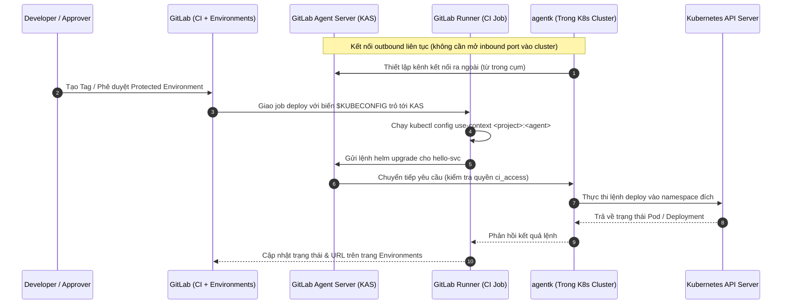

# 6_6_7 Deploy to Kubernetes

> **Khóa học**: Cloud DevOps Basic — Containers & Kubernetes
> **Phân nhóm**: 6 Domain 6 - Containers and Kubernetes › 6_6 GitLab CI-CD and Release Strategies
> **Chủ đề**: GitLab agent for Kubernetes (`agentk`), `ci_access`, `kubectl` context, `environment`, Protected environments, triển khai thủ công (`when: manual`) và Review Apps
> **Trạng thái**: Bản nháp, chờ kiểm chứng
> **Checklist đối chiếu**: [CHECKLIST.md](../../CHECKLIST.md#6_6-gitlab-ci-cd-and-release-strategies)

---

## 1. Khái Niệm Cốt Lõi & Bản Chất Kỹ Thuật (Core Concepts & Technical Deep Dive)

Sau khi pipeline CI đã đóng gói xong container image cho dịch vụ mẫu ở các bước trước, bài toán tiếp theo là đưa bản dựng đó vào cụm Kubernetes một cách an toàn và có kiểm soát. Thay vì chia sẻ khóa truy cập cố định ra ngoài để runner chọc thẳng vào cụm, ta cần một cơ chế kết nối bảo mật và một quy trình quản lý rõ ràng cho từng môi trường chạy ứng dụng. Bài học này trình bày ba trụ cột của GitLab phục vụ việc đó: **GitLab agent for Kubernetes**, **Environments** và **Protected environments**.

### 1.1 Kết nối cụm bằng GitLab Agent for Kubernetes (`agentk`)

**GitLab agent for Kubernetes** (`agentk`) là một thành phần nhẹ chạy trực tiếp dưới dạng Pod bên trong cụm Kubernetes của bạn. Thay vì chờ GitLab từ bên ngoài gọi vào, `agentk` chủ động mở một kết nối đi ra (outbound connection) tới **GitLab Agent Server (KAS)** trên máy chủ GitLab để nhận yêu cầu và chuyển tiếp lệnh tới Kubernetes API nội bộ. <!-- ev: C7.1 --> Nhờ cơ chế gọi ra này, bạn không cần mở public IP hay tường lửa cho Kubernetes API server chỉ để phục vụ pipeline CI/CD.

Mỗi agent được quản lý thông qua mã nguồn ngay trên GitLab bằng một file cấu hình chuẩn đặt tại `.gitlab/agents/<agent-name>/config.yaml` trong một project cấu hình agent. <!-- ev: C7.2 --> Trong file này, khối `ci_access` đóng vai trò danh sách cấp phép, cho phép bạn chỉ định chính xác những `projects` hoặc `groups` nào trên GitLab được quyền mượn đường ống của agent để triển khai vào cụm. <!-- ev: C7.3 -->

Khi một job CI/CD thuộc project được cấp phép bắt đầu chạy, GitLab tự động tạo một file cấu hình tạm và gắn đường dẫn vào biến môi trường `KUBECONFIG` bên trong job đó. <!-- ev: C7.4 --> File `KUBECONFIG` này chứa sẵn các **context** (ngữ cảnh kết nối gồm cụm đích và danh tính đại diện qua KAS) cho mọi agent mà project được phép dùng. Do đó, bước đầu tiên trong script triển khai là gọi lệnh chọn đúng context theo mẫu `kubectl config use-context <path/to/agent-project>:<agent-name>`. <!-- ev: C7.5 -->

### 1.2 Vì sao mô hình Certificate-based cũ bị deprecate & Phương án dự phòng

Trước khi có GitLab Agent, GitLab từng hỗ trợ kết nối cụm bằng cách nhập trực tiếp URL của Kubernetes API server cùng chứng chỉ CA và ServiceAccount token vào giao diện cấu hình (gọi là **certificate-based cluster integration**). Phương thức tích hợp cụm dựa trên chứng chỉ này hiện đã bị GitLab **deprecate** (ngừng khuyến khích và tiến tới loại bỏ). <!-- ev: C7.6 --> Nguyên nhân chính là cách cũ đòi hỏi lưu credential dài hạn bên ngoài cụm và yêu cầu Kubernetes API server phải mở kết nối để GitLab và Runner gọi thẳng vào, làm tăng bề mặt tấn công.

Trong tình huống khẩn cấp hoặc môi trường thử nghiệm đặc thù chưa cài được `agentk`, phương án dự phòng là tạo một biến CI/CD kiểu `File` tên `KUBECONFIG` chứa cấu hình của một `ServiceAccount` chỉ có quyền hẹp trong một namespace; tuy nhiên cách này kém an toàn hơn vì vẫn lưu credential tĩnh trong GitLab và buộc Runner phải có đường mạng truy cập trực tiếp tới Kubernetes API server. <!-- ev: C7.7 --> Việc thiết lập RBAC chi tiết để giới hạn quyền cho `ServiceAccount` sẽ được trình bày ở bài `6_7_1`.

### 1.3 Khai báo `environment` và theo dõi lịch sử triển khai

Trong file `.gitlab-ci.yml`, từ khóa `environment` giúp GitLab hiểu rằng một job không chỉ chạy script thông thường mà đang triển khai code lên một môi trường đích cụ thể (như `dev`, `staging`, `production`). Hai thuộc tính cơ bản nhất của khối `environment` là `name` (tên định danh của môi trường) và `url` (địa chỉ web của ứng dụng sau khi deploy, hiển thị thành nút truy cập nhanh trên giao diện GitLab). <!-- ev: C7.8 -->

Bên cạnh hai thuộc tính cơ bản trên, bạn có thể tinh chỉnh vòng đời và cách phân loại môi trường qua bảng thuộc tính sau:

<!-- ev: C7.9 C7.10 -->
| Thuộc tính | Ý nghĩa và công dụng | Ví dụ với `hello-svc` |
| :--- | :--- | :--- |
| `deployment_tier` | Phân loại tầng môi trường chuẩn (`production`, `staging`, `testing`, `development`, `other`) tách biệt với tên tùy chỉnh ở `name`. | `deployment_tier: production` dù `name: prod-vn` |
| `on_stop` | Chỉ định tên job dọn dẹp sẽ chạy khi môi trường này bị dừng (thủ công hoặc hết hạn). | `on_stop: stop_review` |
| `auto_stop_in` | Đặt khoảng thời gian tự động dừng môi trường tính từ lần triển khai thành công gần nhất. | `auto_stop_in: 1 week` |

Mọi lần triển khai có khai báo `environment` đều được ghi nhận tại trang **Environments** (`Operate > Environments`), nơi hiển thị trạng thái hiện tại, lịch sử các bản deploy và cung cấp nút **Re-deploy** để chạy lại một bản triển khai cũ khi cần. <!-- ev: C7.11 -->

### 1.4 Protected Environments và cổng phê duyệt Production

Với môi trường quan trọng như `production`, việc chỉ tách job deploy sang một stage riêng là chưa đủ, vì bất kỳ lập trình viên nào có quyền kích hoạt pipeline trên nhánh đó cũng có thể vô tình bấm chạy nhầm. Tính năng **Protected environments** cho phép bạn khóa môi trường `production` lại, chỉ định rõ những người dùng, nhóm hoặc vai trò nào được phép triển khai vào môi trường này. <!-- ev: C7.12 --> Ngoài việc giới hạn người chạy, Protected environments còn hỗ trợ cơ chế **deployment approvals** (phê duyệt triển khai), yêu cầu đủ số lượng người có thẩm quyền bấm chấp thuận trước khi job deploy được phép thực thi. <!-- ev: C7.13 -->

Trên tầng file cấu hình `.gitlab-ci.yml`, bạn kết hợp Protected environments với từ khóa `when: manual` trong khối `rules` (ví dụ chỉ xuất hiện khi có Git tag phát hành `$CI_COMMIT_TAG` hoặc trên nhánh mặc định) để tạo thành một cổng chặn thủ công trước khi đẩy bản dựng lên production. <!-- ev: C7.14 -->

### 1.5 Review Apps động cho từng Merge Request

Khi nhiều thành viên cùng phát triển các tính năng song song cho `hello-svc`, việc dùng chung một môi trường `dev` dễ gây ghi đè lẫn nhau trước khi code được review xong. **Review Apps** giải quyết vấn đề này bằng cách tự động dựng một môi trường xem trước riêng biệt cho từng merge request hoặc nhánh tính năng, sử dụng tên môi trường động như `environment: name: review/$CI_COMMIT_REF_SLUG`. <!-- ev: C7.15 --> Biến `$CI_COMMIT_REF_SLUG` tự động chuyển tên nhánh thành chuỗi chữ thường an toàn cho URL và tên release Helm.

Để tránh lãng phí tài nguyên cụm khi merge request đã đóng hoặc đã merge, bạn cần định nghĩa thêm một job dọn dẹp (ví dụ `stop_review`) khai báo trùng `environment: name` với job tạo, đặt `action: stop` và `when: manual` để GitLab tự động gọi khi nhánh bị xóa hoặc khi hết thời gian `auto_stop_in`. <!-- ev: C7.16 -->

*Nâng cao: có thể bỏ qua ở lần đọc đầu* — Trong job dọn dẹp `stop_review`, bạn nên khai báo thêm biến `GIT_STRATEGY: none` để Runner không cố clone lại mã nguồn từ một nhánh có thể đã bị xóa ngay sau khi merge request hoàn tất. <!-- ev: C7.17 -->

---

## 2. Ví Dụ Đời Sống Thực Tế Dễ Hiểu (Intuitive Real-World Analogies)

Hãy tưởng tượng cụm Kubernetes của bạn là một **khu nhà máy sản xuất khép kín** nằm sau nhiều lớp tường bảo vệ, còn GitLab là **trụ sở điều hành** ở ngoài thành phố.

- **Cách cũ (Certificate-based / Kubeconfig tĩnh)**: Giống như trụ sở giữ một chùm chìa khóa vạn năng và phải mở toang cổng bảo vệ nhà máy để nhân viên giao hàng từ ngoài đường chạy thẳng vào từng phân xưởng. Nếu chùm chìa khóa bị rơi ra ngoài, kẻ xấu có thể đi thẳng vào nhà máy.
- **GitLab Agent (`agentk`)**: Giống như việc nhà máy bố trí một **đại sứ thường trú** ngồi ngay bên trong khu vực an ninh. Thay vì đưa chìa khóa cho bên ngoài, vị đại sứ này chủ động gọi điện về trụ sở qua đường dây bảo mật, hỏi xem có lệnh nào dành cho dự án được cấp phép (`ci_access`) không, rồi tự tay thực thi lệnh đó ở nội bộ.
- **Protected environments & `when: manual`**: Giống như cửa kho thành phẩm (`production`) có ổ khóa hai lớp: dù xe hàng đã đỗ sẵn trước cửa (`when: manual`), chỉ những quản đốc nằm trong danh sách được duyệt (`Protected environments`) và có chữ ký phê duyệt mới được mở khóa cho hàng lên kệ.
- **Review Apps**: Giống như dựng một **gian hàng mẫu di động** ngay khi có bản thiết kế mới (Merge Request); khi khách xem xong và chốt đơn (merge hoặc đóng MR), đội dọn dẹp (`on_stop`) sẽ tháo dỡ gian hàng đó để trả lại mặt bằng.

---

## 3. Kiến Trúc, Luồng Hoạt Động & Hình Ảnh Trực Quan (Architecture, Diagrams & Visual Media)

Sơ đồ dưới đây mô tả luồng kết nối an toàn từ CI job tới cụm Kubernetes thông qua KAS và `agentk`, đồng thời thể hiện cổng kiểm soát khi triển khai vào `production`: <!-- ev: C7.1 C7.14 -->



**Điểm mấu chốt cần nhớ trên sơ đồ**:
- Luồng mạng từ `agentk` đi ra `KAS` (bước 1) giúp cụm Kubernetes không bao giờ phải phơi bày Kubernetes API Server ra internet. <!-- ev: C7.1 -->
- Runner chỉ giao tiếp với `KAS` thông qua context được cấp trong `$KUBECONFIG`, và `KAS` chỉ cho phép đi tiếp nếu project của job khớp với cấu hình `ci_access` của agent. <!-- ev: C7.3 C7.4 -->

---

## 4. Code Mẫu Trực Quan Hoặc Dòng Lệnh Thực Chiến (Runnable Sample Code / CLI)

Ví dụ xuyên suốt dưới đây minh họa quy trình triển khai cho dịch vụ mẫu (đóng gói bằng Helm chart) trên GitLab CI/CD.

### Bước 1: Cấp quyền CI/CD trong file cấu hình Agent (Input cấu hình)

Tạo file `.gitlab/agents/kind-dev/config.yaml` trong repository quản lý agent (ví dụ project `my-group/k8s-agents`) để cấp quyền `ci_access` cho project `my-group/hello-svc`: <!-- ev: C7.2 C7.3 -->

<!-- ev: C7.2 C7.3 -->
```yaml
# Đường dẫn bắt buộc: .gitlab/agents/kind-dev/config.yaml
ci_access:
  projects:
    - id: my-group/hello-svc
  # Hoặc cấp cho cả một group:
  # groups:
  #   - id: my-group
```

Trên giao diện GitLab tại **Operate > Kubernetes clusters**, bạn đăng ký agent theo đúng tên đã cấu hình rồi dùng lệnh Helm với chart `gitlab/gitlab-agent` (kèm registration token do GitLab sinh ra) để cài đặt `agentk` vào cụm Kubernetes. <!-- ev: C7.19 -->

### Bước 2: Triển khai Review App động và Production gate trong `.gitlab-ci.yml`

Đoạn cấu hình `.gitlab-ci.yml` dưới đây (minh họa với image `alpine/helm:3.14.4` tích hợp sẵn Helm 3.14 và `kubectl`) kết hợp hai luồng: dựng **Review App** cho Merge Request kèm job dọn dẹp và triển khai **Production** thủ công trên Git tag: <!-- ev: C7.14 C7.15 C7.16 -->

<!-- ev: C7.4 C7.5 C7.8 C7.10 C7.14 C7.15 C7.16 C7.17 -->
```yaml
stages:
  - deploy
  - cleanup

variables:
  KUBE_CONTEXT: "my-group/k8s-agents:kind-dev"

# 1. Review App động cho từng Merge Request
deploy_review:
  stage: deploy
  image: alpine/helm:3.14.4
  script:
    - kubectl config use-context "$KUBE_CONTEXT"
    - helm upgrade --install "hello-$CI_COMMIT_REF_SLUG" ./charts/hello-svc
        --namespace "review-$CI_COMMIT_REF_SLUG" --create-namespace
        --set image.tag="$CI_COMMIT_SHORT_SHA"
  environment:
    name: review/$CI_COMMIT_REF_SLUG
    url: https://$CI_COMMIT_REF_SLUG.review.example.com
    on_stop: stop_review
    auto_stop_in: 1 week
  rules:
    - if: $CI_PIPELINE_SOURCE == "merge_request_event"

# Job dọn dẹp Review App khi MR đóng hoặc hết hạn auto_stop_in
stop_review:
  stage: cleanup
  image: alpine/helm:3.14.4
  variables:
    GIT_STRATEGY: none
  script:
    - kubectl config use-context "$KUBE_CONTEXT"
    - helm uninstall "hello-$CI_COMMIT_REF_SLUG" --namespace "review-$CI_COMMIT_REF_SLUG" || true
    - kubectl delete namespace "review-$CI_COMMIT_REF_SLUG" --ignore-not-found
  environment:
    name: review/$CI_COMMIT_REF_SLUG
    action: stop
  rules:
    - if: $CI_PIPELINE_SOURCE == "merge_request_event"
      when: manual

# 2. Deploy Production thủ công trên Git Tag (kết hợp Protected Environment)
deploy_prod:
  stage: deploy
  image: alpine/helm:3.14.4
  resource_group: production
  script:
    - kubectl config use-context "$KUBE_CONTEXT"
    - helm upgrade --install hello-svc ./charts/hello-svc
        --namespace prod --create-namespace
        --set image.tag="$CI_COMMIT_SHORT_SHA"
  environment:
    name: production
    url: https://hello.example.com
    deployment_tier: production
  rules:
    - if: $CI_COMMIT_TAG
      when: manual
```

### Luồng biến đổi thực tế (Input → Command → Output)

- **Input**: Một lập trình viên mở Merge Request từ nhánh `feat/Add-HealthCheck` (khi đó biến `$CI_COMMIT_REF_SLUG` chuyển thành dạng URL-safe `feat-add-healthcheck`). <!-- ev: C7.15 -->
- **Command thực thi trong job**: Runner chọn context `my-group/k8s-agents:kind-dev` từ `$KUBECONFIG` rồi chạy lệnh `helm upgrade --install` vào namespace `review-feat-add-healthcheck`. <!-- ev: C7.4 C7.5 -->
- **Output quan sát được**:
  - Trên GitLab Merge Request xuất hiện liên kết tới `https://feat-add-healthcheck.review.example.com` theo thuộc tính `url`. <!-- ev: C7.8 -->
  - Tại **Operate > Environments** xuất hiện môi trường `review/feat-add-healthcheck`, có đồng hồ tự dừng sau `1 week` và nút **Stop** kích hoạt job `stop_review` để dọn dẹp. <!-- ev: C7.10 C7.11 C7.16 -->

---

## 5. Cạm Bẫy Thực Tế & Thực Tiễn Sản Xuất (Production Gotchas & Best Practices)

- **Quên `resource_group` khiến hai lần deploy đè nhau**: Khi nhiều commit hoặc tag được đẩy sát nhau, hai pipeline có thể chạy job `deploy_prod` song song gây xung đột Helm lock (`another operation is in progress`). Hãy thêm `resource_group: production` vào job deploy để ép buộc tại một thời điểm chỉ có duy nhất một job được triển khai vào cùng một môi trường. <!-- ev: C7.18 -->
- **Không có job dọn dẹp làm cạn tài nguyên cụm**: Nếu tạo Review App động mà quên khai báo `on_stop` và `auto_stop_in`, các namespace tạm thời sẽ tồn đọng sau khi merge request kết thúc, gây lãng phí tài nguyên cụm. <!-- ev: C7.10 C7.16 -->
- **Nhầm định dạng context trong `use-context`**: Lỗi phổ biến khi cấu hình `ci_access` là chỉ truyền tên agent mà thiếu đường dẫn đầy đủ của project cấu hình trong mẫu `kubectl config use-context <path/to/agent-project>:<agent-name>`. <!-- ev: C7.5 -->
- **Container của job thiếu CLI triển khai**: GitLab chỉ tự động cung cấp file cấu hình kết nối qua biến `$KUBECONFIG` khi dùng `ci_access`, nên image của job vẫn cần cài sẵn `kubectl` hoặc `helm`. <!-- ev: C7.4 -->
- **Phạm vi các bài tiếp theo**: Các chiến lược release nâng cao như Rolling update, Blue/Green hay Canary sẽ được phân tích ở bài 6_6_8, còn phân quyền RBAC chi tiết trong cụm nằm ở bài 6_7_1.

---

## 6. Câu Hỏi Củng Cố Kiến Thức (Active Recall Quiz)

**Câu 1**: Khi sử dụng GitLab agent for Kubernetes với `ci_access`, vì sao ta không cần mở public port cho Kubernetes API server trên internet để GitLab Runner từ bên ngoài gọi vào?

<details>
<summary>Đáp án</summary>

Vì thành phần `agentk` chạy ngay bên trong cụm Kubernetes và chủ động thiết lập kết nối đi ra (outbound connection) tới GitLab Agent Server (KAS) trên máy chủ GitLab. <!-- ev: C7.1 --> Nhờ vậy, Runner chỉ cần gửi lệnh tới KAS qua `$KUBECONFIG`, và `agentk` sẽ nhận lệnh rồi thực thi cục bộ tới Kubernetes API server nội bộ.

</details>

**Câu 2**: Nhóm phát triển muốn mỗi Merge Request có một bản xem trước riêng, tự động dọn dẹp sau 7 ngày hoặc ngay khi Merge Request được merge. Trong `.gitlab-ci.yml`, cần phối hợp các từ khóa nào cho job triển khai và job dọn dẹp?

<details>
<summary>Đáp án</summary>

- Job triển khai dùng tên môi trường động `environment: name: review/$CI_COMMIT_REF_SLUG`, kèm `on_stop: stop_review` và `auto_stop_in: 1 week`. <!-- ev: C7.10 C7.15 -->
- Job dọn dẹp `stop_review` khai báo cùng `environment: name: review/$CI_COMMIT_REF_SLUG`, đặt `action: stop`, `when: manual`, và nên thêm `GIT_STRATEGY: none` để tránh lỗi clone nhánh đã bị xóa sau khi merge. <!-- ev: C7.16 C7.17 -->

</details>

**Câu 3**: Đã có quy tắc `rules: - if: $CI_COMMIT_TAG` kèm `when: manual` trên job `deploy_prod`, tại sao trong môi trường doanh nghiệp vẫn cần cấu hình thêm **Protected environments**?

<details>
<summary>Đáp án</summary>

Từ khóa `when: manual` chỉ yêu cầu một thao tác bấm chạy thủ công trong pipeline, chưa giới hạn ai được quyền bấm nút đó. Khi kết hợp thêm **Protected environments**, hệ thống sẽ giới hạn chỉ những người dùng hoặc nhóm được chỉ định mới có quyền thực thi deploy và có thể bắt buộc đủ lượt phê duyệt hợp lệ (deployment approvals) trước khi đẩy bản dựng lên `production`. <!-- ev: C7.12 C7.13 C7.14 -->

</details>

---

## 7. 📚 Nguồn Tài Liệu Chính Thống (Tier-1 Official References)

- [Using GitLab CI/CD with a Kubernetes cluster (GitLab Agent)](https://docs.gitlab.com/user/clusters/agent/ci_cd_workflow/) - Hướng dẫn chính thức của GitLab về cấu hình `ci_access`, file `config.yaml` của agent và chọn `kubectl` context trong job CI/CD.
- [Environments and deployments](https://docs.gitlab.com/ci/environments/) - Tài liệu chính thức về cách khai báo, theo dõi lịch sử triển khai, `deployment_tier` và dừng môi trường trên GitLab.
- [Protected environments](https://docs.gitlab.com/ci/environments/protected_environments/) - Tài liệu chính thức về bảo vệ môi trường nhạy cảm và cơ chế deployment approvals.
- [Review Apps](https://docs.gitlab.com/ci/review_apps/) - Tài liệu chính thức về thiết lập môi trường xem trước động cho Merge Request và job `on_stop`.
- [GitLab CI/CD YAML syntax reference](https://docs.gitlab.com/ci/yaml/) - Tài liệu tham chiếu chuẩn về cú pháp `environment`, `rules`, `when: manual` và `resource_group`.
