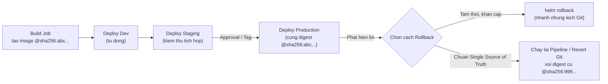
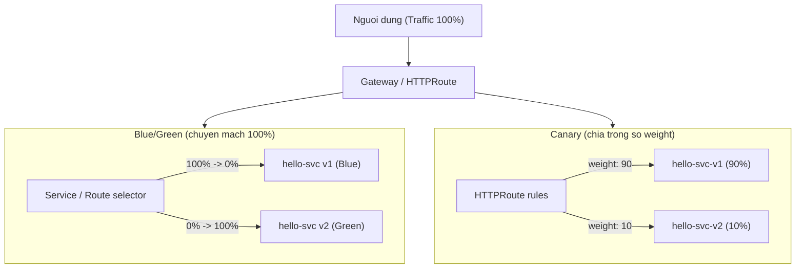

# 6_6_8 Release Strategies and Rollback

> **Khóa học**: Cloud DevOps Basic — Containers & Kubernetes
> **Phân nhóm**: 6 Domain 6 - Containers and Kubernetes › 6_6 GitLab CI-CD and Release Strategies
> **Chủ đề**: Chiến lược phát hành (Rolling Update, Blue/Green, Canary, Feature Flags), Promotion theo digest bất biến, cơ chế Rollback và Database Schema Migration an toàn
> **Trạng thái**: Bản nháp, chờ kiểm chứng
> **Checklist đối chiếu**: [CHECKLIST.md](../../CHECKLIST.md#6_6-gitlab-ci-cd-and-release-strategies)

---

## 1. Khái Niệm Cốt Lõi & Bản Chất Kỹ Thuật (Core Concepts & Technical Deep Dive)

Khi đưa phiên bản mới của một dịch vụ lên môi trường phục vụ người dùng thật, thách thức lớn nhất là **chuyển lưu lượng không gián đoạn** và **quay đầu an toàn** khi có lỗi. Nếu tắt bản cũ rồi mới bật bản mới, người dùng sẽ mất kết nối. Nếu đẩy toàn bộ lưu lượng sang bản mới cùng lúc mà không có đường lui, một lỗi nhỏ sẽ làm gián đoạn cả hệ thống. Bài học này trình bày các chiến lược phát hành trên Kubernetes và GitLab CI/CD, cùng nút thắt lớn nhất khi quay lui là dữ liệu trong cơ sở dữ liệu.

### 1.1. Rolling Update, Blue/Green và Canary

- **Rolling Update (Cập nhật cuốn chiếu)**: Trong Kubernetes, `Deployment` mặc định dùng chiến lược `RollingUpdate` (`spec.strategy.type: RollingUpdate`), tạo ReplicaSet mới và thay dần từng Pod cũ bằng Pod mới mà không cần tầng định tuyến riêng. <!-- ev: C8.1 -->
  - Tốc độ thay thế được kiểm soát qua `maxUnavailable` (số hoặc tỷ lệ Pod tối đa được phép vắng mặt) và `maxSurge` (số hoặc tỷ lệ Pod tối đa được phép tạo thêm vượt mức `replicas`). <!-- ev: C8.2 -->
- **Blue/Green (Xanh dương / Xanh lục)**: Mô hình này chạy song song hai phiên bản hoàn chỉnh (bản đang phục vụ và bản mới), rồi chuyển toàn bộ lưu lượng trong một thao tác bằng cách đổi `selector` của Kubernetes `Service` hoặc cập nhật đích trên router. <!-- ev: C8.3 -->
  - Blue/Green cho phép quay lui gần như tức thì bằng cách trỏ lại về bản cũ, nhưng đòi hỏi gấp đôi tài nguyên tính toán trong lúc cả hai bản cùng chạy. <!-- ev: C8.4 -->
- **Canary (Chim hoàng yến)**: Canary chuyển trước một tỷ lệ nhỏ lưu lượng thật (như 5%–10%) sang bản mới để kiểm tra lỗi rồi mới tăng dần lên 100%, giúp giới hạn bán kính ảnh hưởng mà không cần nhân đôi hạ tầng. <!-- ev: C8.5 -->
  - Với Kubernetes Gateway API (đã học ở bài trước), bạn chia tỷ lệ lưu lượng trên `HTTPRoute` qua trường `weight` ở mỗi `backendRefs`, trong đó tỷ lệ vào từng backend bằng `weight` của nó chia cho tổng `weight` trong rule. <!-- ev: C8.6 -->

<!-- ev: C8.1 C8.3 C8.4 C8.5 -->
| Tiêu chí | Rolling Update | Blue/Green | Canary |
| :--- | :--- | :--- | :--- |
| **Chuyển traffic** | Thay dần từng Pod | Đổi `Service` / route 1 lần | Chia `%` qua `HTTPRoute` / mesh |
| **Tài nguyên thêm** | Thấp (theo `maxSurge`) | Cao (~2x khi chuyển đổi) | Thấp đến trung bình |
| **Tốc độ rollback** | Trung bình | Gần như tức thì | Nhanh (đưa `weight` về `0`) |

> **Nâng cao (có thể bỏ qua ở lần đọc đầu) — Tự động hóa Canary**: Các công cụ tùy chọn như **Argo Rollouts** hoặc **Flagger** tự động tăng dần trọng số Canary theo metric lỗi/độ trễ và tự hủy (abort) khi vượt ngưỡng. <!-- ev: C8.7 -->

### 1.2. Feature Flags: Tách biệt Deploy và Release

Đừng nhầm lẫn giữa **Deploy** (đưa code mới lên server) và **Release** (bật tính năng cho người dùng).

- **Feature Flag** là công tắc điều khiển tại thời điểm chạy (runtime), tách biệt deploy khỏi release để bật/tắt hoặc mở dần tính năng theo tỷ lệ mà không cần build hay deploy lại. <!-- ev: C8.8 -->
- **GitLab Feature Flags**: Tính năng Feature Flags của GitLab tương thích với giao thức và SDK client của **Unleash**, giúp ứng dụng lấy trạng thái cờ qua API của GitLab bằng Project ID và Instance ID mà không cần dựng server riêng. <!-- ev: C8.9 -->
- **Đánh đổi**: Feature flag làm tăng nhánh điều kiện trong code và tạo nợ kỹ thuật nếu không dọn dẹp các cờ cũ sau khi tính năng ổn định. <!-- ev: C8.10 -->

### 1.3. Promotion theo Digest bất biến và Rollback

Để bản chạy ở môi trường sau giống hệt bản đã kiểm thử ở môi trường trước, pipeline cần tuân thủ nguyên tắc thăng cấp hiện vật (Promotion):

- **Promotion ("Build once, deploy many")**: Cùng một container image bất biến định danh bằng **SHA-256 digest** (`@sha256:...`) phải đi xuyên suốt từ `dev` sang `staging` rồi `prod`, thay vì build lại ở mỗi môi trường. <!-- ev: C8.11 -->
- **GitLab `environment`**: Từ khóa `environment` trong `.gitlab-ci.yml` giúp theo dõi lịch sử triển khai theo từng môi trường trên trang Environments và hỗ trợ Re-deploy hoặc quay lại bản cũ. <!-- ev: C8.12 -->
- **Rollback cục bộ (`helm rollback`)**: Lệnh `helm rollback <RELEASE> [REVISION]` khôi phục release về cấu hình cũ bằng cách tạo một **revision mới** mang manifest của revision trước, không xóa lịch sử cũ. <!-- ev: C8.13 -->
  - Tuy nhiên, chạy `helm rollback` bằng tay trên cluster sẽ gây lệch cấu hình so với kho Git (configuration drift) và có thể bị pipeline sau ghi đè lại. <!-- ev: C8.14 -->
- **Rollback qua Git (Single Source of Truth)**: Cách chuẩn là chạy lại pipeline triển khai với **image digest cũ** (hoặc `git revert` commit cấu hình trong Git để pipeline tự triển khai lại). <!-- ev: C8.15 -->

### 1.4. Nút thắt lớn nhất của Rollback: Database Schema Migration

Rollback ứng dụng thường thất bại vì trạng thái cơ sở dữ liệu không tự quay lui theo container:

- Nếu bản mới đã chạy schema migration phá vỡ tương thích ngược như xóa cột (`DROP COLUMN`) hoặc đổi kiểu dữ liệu, bản ứng dụng cũ sau khi rollback sẽ lỗi truy vấn SQL. <!-- ev: C8.16 -->
- **Mẫu Expand and Contract**: Chia thay đổi schema thành hai đợt tách biệt:
  1. **Expand (Mở rộng)**: Thêm cột/bảng mới và ghi song song cả cột cũ lẫn cột mới để bản ứng dụng cũ và mới đều chạy được cùng lúc. <!-- ev: C8.17 -->
  2. **Contract (Thu gọn)**: Chỉ xóa cột cũ ở đợt phát hành sau khi bản ứng dụng mới đã chạy ổn định và chắc chắn không cần rollback. <!-- ev: C8.18 -->

---

## 2. Ví Dụ Đời Sống Thực Tế Dễ Hiểu (Intuitive Real-World Analogies)

- **Rolling Update — Thay từng bóng đèn trong hành lang**: Thợ điện tắt và thay từng bóng đèn một dọc hành lang để không bao giờ bị tối om, chấp nhận trong lúc thay sẽ có bóng ánh sáng cũ xen lẫn bóng mới.
- **Blue/Green — Xây cầu song song rồi gạt cần chuyển làn**: Thành phố xây sẵn một cây cầu mới y hệt bên cạnh cầu cũ rồi gạt thanh chắn một nhịp cho toàn bộ xe đi qua; nếu cầu mới gặp sự cố, chỉ cần gạt ngược thanh chắn về cầu cũ, nhưng phải tốn diện tích và chi phí cho cả hai cây cầu.
- **Canary — Thợ mỏ và chim hoàng yến**: Trước khi cả đội xuống hầm sâu, người ta cho chim hoàng yến vào dò khí độc trước; nếu an toàn mới cho toàn đội tiến vào.
- **Feature Flag — Công tắc gắn sẵn trên tường**: Thợ điện đi dây xong từ tuần trước (Deploy) nhưng giữ công tắc tắt; đến giờ khai mạc chỉ cần gạt bật công tắc (Release) và có thể tắt ngay lập tức nếu đèn chói.
- **Expand and Contract — Mở làn đường mới trước khi phá làn cũ**: Bạn mở thêm làn mới chạy song song với làn cũ để xe đời cũ lẫn đời mới cùng đi được, và chỉ rào phá làn cũ sau khi toàn bộ xe đã chuyển hẳn sang làn mới.

---

## 3. Kiến Trúc, Luồng Hoạt Động & Hình Ảnh Trực Quan (Architecture, Diagrams & Visual Media)

Sơ đồ dưới đây mô tả hai luồng cốt lõi: (1) Promotion một image digest bất biến qua các môi trường và (2) cách các chiến lược triển khai xử lý lưu lượng + rollback.

### 3.1. Luồng Promotion bằng Digest bất biến và Rollback qua Pipeline

<!-- ev: C8.11 C8.12 C8.15 -->


### 3.2. Phân phối lưu lượng giữa Blue/Green và Canary (Gateway API)

<!-- ev: C8.3 C8.5 C8.6 -->


---

## 4. Code Mẫu Trực Quan Hoặc Dòng Lệnh Thực Chiến (Runnable Sample Code / CLI)

Các ví dụ dưới đây dùng chung một dịch vụ mẫu đang nâng cấp từ phiên bản đầu lên phiên bản tiếp theo.

### 4.1. Rolling Update mặc định trên Kubernetes Deployment

Lệnh `kubectl rollout status` theo dõi tiến trình thay thế Pod theo `maxSurge` và `maxUnavailable` cho tới khi tất cả replica mới sẵn sàng. <!-- ev: C8.1 C8.2 -->

<!-- ev: C8.1 C8.2 -->
```yaml
# Input: deployment.yaml của hello-svc
apiVersion: apps/v1
kind: Deployment
metadata:
  name: hello-svc
spec:
  replicas: 4
  strategy:
    type: RollingUpdate
    rollingUpdate:
      maxUnavailable: 1
      maxSurge: 1
  selector:
    matchLabels:
      app: hello-svc
  template:
    metadata:
      labels:
        app: hello-svc
    spec:
      containers:
        - name: hello-svc
          image: registry.gitlab.example.com/team/hello-svc@sha256:2222222222222222222222222222222222222222222222222222222222222222
```

<!-- ev: C8.1 C8.2 -->
```bash
# Command
kubectl apply -f deployment.yaml
kubectl rollout status deployment/hello-svc
# Output:
# deployment.apps/hello-svc configured
# Waiting for deployment "hello-svc" rollout to finish: 2 out of 4 new replicas have been updated...
# deployment "hello-svc" successfully rolled out
```

### 4.2. Chia traffic Canary 90/10 bằng Gateway API `HTTPRoute`

Khi hai Service ổn định và thử nghiệm chạy song song dưới cùng Gateway, `HTTPRoute` chia tỷ lệ lưu lượng theo `weight` của từng backend. <!-- ev: C8.5 C8.6 -->

<!-- ev: C8.5 C8.6 -->
```yaml
# Input: httproute-canary.yaml
apiVersion: gateway.networking.k8s.io/v1
kind: HTTPRoute
metadata:
  name: hello-svc-route
spec:
  parentRefs:
    - name: main-gateway
  rules:
    - backendRefs:
        - name: hello-svc-v1
          port: 8080
          weight: 90
        - name: hello-svc-v2
          port: 8080
          weight: 10
```

<!-- ev: C8.6 -->
```bash
# Command & Output
kubectl apply -f httproute-canary.yaml
kubectl get httproute hello-svc-route
# httproute.gateway.networking.k8s.io/hello-svc-route configured
# NAME              HOSTNAMES   AGE
# hello-svc-route               12s
```

*(Để chạy Blue/Green theo cùng cấu trúc trên, đặt `weight: 100` và `0` rồi đảo ngược trong một lần `kubectl apply`).* <!-- ev: C8.3 -->

### 4.3. GitLab CI/CD `environment` và Rollback

Cấu hình `.gitlab-ci.yml` dùng lại biến `IMAGE_DIGEST` từ job build và ghi nhận trạng thái lên môi trường `production` của GitLab. <!-- ev: C8.11 C8.12 -->

<!-- ev: C8.11 C8.12 C8.15 -->
```yaml
deploy_prod:
  stage: deploy
  environment:
    name: production
    url: https://hello-svc.example.com
  rules:
    - if: $CI_COMMIT_TAG
      when: manual
  script:
    - helm upgrade --install hello-svc ./charts/hello-svc
        --namespace prod
        --set image.digest="${IMAGE_DIGEST}"
        --wait
```

Khi bản mới gặp lỗi, bạn có thể cứu hỏa cục bộ bằng `helm rollback` (tạo revision mới mang nội dung revision 1), sau đó đồng bộ lại Git bằng cách Re-deploy bản cũ trên GitLab Environments hoặc chạy `git revert`. <!-- ev: C8.13 C8.14 C8.15 -->

<!-- ev: C8.13 -->
```bash
helm history hello-svc -n prod
helm rollback hello-svc 1 -n prod --wait
# REVISION  STATUS      CHART            APP VERSION  DESCRIPTION
# 1         superseded  hello-svc-0.1.0  1.0.0        Install complete
# 2         deployed    hello-svc-0.2.0  2.0.0        Upgrade complete
```

### 4.4. Database Migration theo mẫu Expand and Contract

Ví dụ đổi tên cột người dùng theo hai pha tách biệt để bản ứng dụng cũ vẫn chạy được nếu cần rollback. <!-- ev: C8.16 C8.17 C8.18 -->

<!-- ev: C8.16 C8.17 C8.18 -->
```sql
-- Pha 1 (Expand - chạy trước/cùng v2): thêm cột mới, giữ cột cũ để v1 không lỗi
ALTER TABLE users ADD COLUMN display_name VARCHAR(255);
UPDATE users SET display_name = full_name WHERE display_name IS NULL;

-- Pha 2 (Contract - chỉ chạy ở v3 sau khi v2 ổn định 100%, hết nhu cầu rollback)
ALTER TABLE users DROP COLUMN full_name;
```

---

## 5. Cạm Bẫy Thực Tế & Thực Tiễn Sản Xuất (Production Gotchas & Best Practices)

- **Configuration Drift do `helm rollback` bằng tay**: Rollback trực tiếp trên cluster mà quên cập nhật Git sẽ làm pipeline kế tiếp triển khai lại cấu hình lỗi đang nằm trên nhánh chính; vì vậy luôn đồng bộ lại bằng `git revert` hoặc chạy lại pipeline với digest cũ. <!-- ev: C8.14 C8.15 -->
- **Gộp `DROP COLUMN` chung đợt phát hành code mới**: Xóa cột hoặc đổi kiểu dữ liệu không tương thích ngược ngay khi deploy bản mới sẽ làm bản cũ lỗi SQL nếu cần rollback; luôn tách thành pha Expand và Contract. <!-- ev: C8.16 C8.17 C8.18 -->
- **Promote bằng tag thay đổi (như `:latest`)**: Tag có thể bị ghi đè giữa lúc deploy `dev` và `prod`; luôn truyền `@sha256:<digest>` bất biến xuyên suốt pipeline. <!-- ev: C8.11 -->
- **Tích tụ Feature Flag cũ**: Để tồn đọng cờ không còn dùng làm phức tạp logic và dễ gây lỗi khi bật nhầm; cần gắn lịch dọn dẹp cờ ngay sau khi tính năng ổn định. <!-- ev: C8.10 -->
- **Chi phí môi trường Blue/Green**: Không giữ song song hai cụm tải lớn quá lâu; hãy thu hồi môi trường cũ sau khi kết thúc cửa sổ theo dõi ổn định. <!-- ev: C8.4 -->

---

## 6. Câu Hỏi Củng Cố Kiến Thức (Active Recall Quiz)

**Câu 1**: Khi nâng cấp `hello-svc` từ `v1` lên `v2`, `v2` chạy lệnh `ALTER TABLE orders DROP COLUMN legacy_code;`. Sau 10 phút phát hiện lỗi logic và chạy `helm rollback` về `v1`, điều gì xảy ra và cách thiết kế đúng là gì?

<details>
<summary>Đáp án</summary>

- `helm rollback` chỉ đưa container về `v1`, không khôi phục cột `legacy_code` đã xóa nên `v1` sẽ lỗi SQL. <!-- ev: C8.16 -->
- Cần dùng mẫu **Expand and Contract**: giữ `legacy_code` ở `v2`, chỉ xóa ở `v3` sau khi `v2` ổn định và hết nhu cầu rollback. <!-- ev: C8.17 C8.18 -->

</details>

**Câu 2**: Yêu cầu đặt ra là: (a) chỉ cho 10% người dùng thử tính năng mới trên hạ tầng hiện tại mà không nhân đôi server; (b) tắt ngay giao diện mới trong 1 giây nếu có sự cố mà không cần deploy lại Pod. Nên kết hợp hai cơ chế nào?

<details>
<summary>Đáp án</summary>

- Kết hợp **Canary** (`weight: 90/10` trên `HTTPRoute`) để chia 10% traffic mà không tốn gấp đôi tài nguyên như Blue/Green. <!-- ev: C8.4 C8.5 C8.6 -->
- Kết hợp **Feature Flag** (như GitLab Feature Flags chuẩn Unleash) để tách deploy khỏi release, tắt tính năng tức thì ở runtime. <!-- ev: C8.8 C8.9 -->

</details>

**Câu 3**: Kỹ sư trực chạy `helm rollback hello-svc 4 -n prod` bằng tay để cứu lỗi. Sáng hôm sau một commit mới kích hoạt pipeline CI/CD và lỗi cũ tái diễn. Giải thích nguyên nhân và cách xử lý.

<details>
<summary>Đáp án</summary>

- `helm rollback` cục bộ gây configuration drift vì Git vẫn giữ digest/cấu hình lỗi, nên pipeline mới triển khai đè lại bản lỗi. <!-- ev: C8.13 C8.14 -->
- Để giữ Git làm Single Source of Truth, cần chạy lại pipeline với digest cũ (qua GitLab Environments Re-deploy hoặc `git revert`). <!-- ev: C8.12 C8.15 -->

</details>

---

## 7. 📚 Nguồn Tài Liệu Chính Thống (Tier-1 Official References)

- [Kubernetes Documentation — Deployments (Updating a Deployment & Strategy)](https://kubernetes.io/docs/concepts/workloads/controllers/deployment/) - Tài liệu chính thức của Kubernetes về cơ chế `RollingUpdate`, `maxSurge` và `maxUnavailable`.
- [Kubernetes Gateway API — Traffic Splitting Guide](https://gateway-api.sigs.k8s.io/guides/traffic-splitting/) - Hướng dẫn chính thức của Kubernetes SIG Network về chia tỷ lệ lưu lượng bằng `weight` trong `HTTPRoute`.
- [GitLab Documentation — Environments and Deployments](https://docs.gitlab.com/ci/environments/) - Tài liệu chính thức của GitLab CI/CD về từ khóa `environment`, lịch sử triển khai và re-deploy/rollback.
- [GitLab Documentation — Feature Flags](https://docs.gitlab.com/operations/feature_flags/) - Tài liệu chính thức của GitLab về quản lý Feature Flags tương thích Unleash.
- [Helm Documentation — Helm Rollback](https://helm.sh/docs/helm/helm_rollback/) - Tài liệu chính thức của Helm về cú pháp và cơ chế tạo revision mới khi `helm rollback`.
