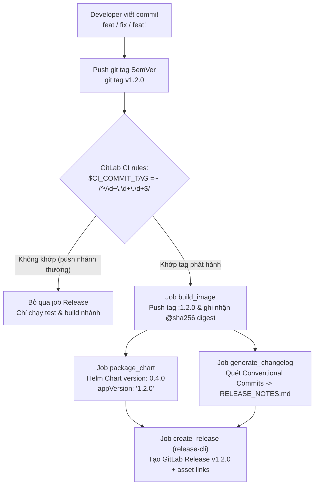

# 6_6_9 Versioning and Release Management (Quản Lý Phiên Bản & Phát Hành)

> **Khóa học**: Cloud DevOps Basic — Containers & Kubernetes
> **Phân nhóm**: 6 Domain 6 - Containers and Kubernetes › 6_6 GitLab CI-CD and Release Strategies
> **Chủ đề**: 6_6_9 Versioning and Release Management
> **Trạng thái**: Bản nháp, chờ kiểm chứng
> **Checklist đối chiếu**: [CHECKLIST.md](../../CHECKLIST.md#6_6-gitlab-ci-cd-and-release-strategies)

---

## 1. Khái Niệm Cốt Lõi & Bản Chất Kỹ Thuật (Core Concepts & Technical Deep Dive)

Khi làm việc với pipeline CI/CD, đưa được code chạy lên server mới chỉ giải quyết một nửa bài toán. Trong thực tế vận hành Kubernetes, đội ngũ phát triển luôn phải trả lời ba câu hỏi: bản đang chạy ngoài production thực chất là mã nguồn nào, nâng cấp lần này có làm hỏng hệ thống đang gọi API không, và khi gặp sự cố thì quay lại đúng trạng thái cũ bằng cách nào. Quản lý phiên bản (versioning) và phát hành (release management) giải quyết bài toán này bằng cách gắn định danh rõ ràng, bất biến cho từng thành phần từ mã nguồn, container image đến gói Helm chart.

### 1.1 Semantic Versioning (SemVer 2.0.0)

**Semantic Versioning (SemVer)** là quy ước đặt số phiên bản giúp cả con người lẫn công cụ tự động biết mức độ thay đổi của một bản phát hành chỉ qua tên phiên bản. Theo đặc tả SemVer 2.0.0, một số phiên bản chuẩn có dạng `MAJOR.MINOR.PATCH` gồm ba số nguyên không âm tăng dần và không có số `0` đứng đầu (ví dụ `1.4.2`, không viết `01.04.02`) <!-- ev: C9.1 -->.

- **MAJOR** (số đầu tiên): tăng lên khi bạn thay đổi API hoặc hành vi không tương thích ngược với phiên bản cũ, buộc người dùng hoặc dịch vụ khác phải chỉnh sửa mới chạy tiếp được <!-- ev: C9.2 -->.
- **MINOR** (số thứ hai): tăng lên khi bạn bổ sung tính năng mới nhưng vẫn đảm bảo tương thích ngược hoàn toàn với các phiên bản cùng `MAJOR` <!-- ev: C9.3 -->.
- **PATCH** (số thứ ba): tăng lên khi bạn chỉ sửa lỗi (bug fix) theo cách tương thích ngược, không thêm tính năng mới hay phá vỡ API <!-- ev: C9.4 -->.

Trong CI/CD, SemVer giúp pipeline và người vận hành tự động đánh giá rủi ro khi nâng cấp: bản `PATCH` có thể cân nhắc triển khai nhanh để vá lỗi, còn bản `MAJOR` cần thông báo và kiểm thử kỹ hơn với các bên liên quan <!-- ev: C9.2 C9.4 -->.

*Nâng cao (có thể bỏ qua ở lần đọc đầu)*: SemVer 2.0.0 cho phép gắn nhãn thử nghiệm (**pre-release**) sau dấu gạch ngang `-` (như `1.2.0-rc.1`) để đánh dấu bản chưa chính thức, và gắn thông tin bổ sung (**build metadata**) sau dấu cộng `+` (như `1.2.0+20261121`) vốn được bỏ qua khi so sánh độ mới cũ của phiên bản <!-- ev: C9.5 -->.

### 1.2 Phân Biệt 3 Loại Phiên Bản Trong Kiến Trúc Container & Kubernetes

Một sai lầm phổ biến của người mới học Kubernetes và Helm là gom chung mọi thứ vào một con số phiên bản duy nhất. Thực tế, một ứng dụng triển khai bằng Helm lên Kubernetes có ba lớp định danh phiên bản tách biệt nhau:

<!-- ev: C9.6 C9.7 C9.8 C9.9 -->
| Loại phiên bản | Nằm ở đâu | Vai trò & Ý nghĩa | Tính bất biến | Ví dụ với `hello-svc` |
| :--- | :--- | :--- | :--- | :--- |
| **Image tag / Image digest** | Container Registry & `values.yaml` | Định danh chính xác gói container image chứa mã thực thi | **Tag** có thể bị ghi đè; **Digest (`@sha256:...`)** bất biến tuyệt đối | `hello-svc:1.2.0` hoặc `hello-svc@sha256:9f86d0...` |
| **Helm chart `version`** | Trường `version` trong `Chart.yaml` | Phiên bản của chính gói đóng gói Helm chart (templates, `values.yaml`) | Bất biến cho mỗi gói `.tgz` đẩy lên chart repository | `version: 0.4.0` |
| **Helm chart `appVersion`** | Trường `appVersion` trong `Chart.yaml` | Phiên bản của ứng dụng chạy bên trong các Pod do chart tạo ra | Chỉ mang tính mô tả thông tin ứng dụng | `appVersion: "1.2.0"` |

Cụ thể hơn về từng thành phần:

1. **Image Tag và Image Digest**: Một container image tag (như `:1.2.0` hay `:latest`) chỉ là một nhãn trỏ tới image và hoàn toàn có thể bị push đè lên cùng tên tag đó trên registry; ngược lại, image digest (`@sha256:...`) là mã băm mật mã đại diện duy nhất cho nội dung manifest của image nên không thể bị thay đổi âm thầm <!-- ev: C9.9 -->. Vì vậy, môi trường production nên chốt triển khai theo digest thay vì chỉ tin vào tag <!-- ev: C9.9 -->.
2. **Chart `version`**: Trong file `Chart.yaml`, trường `version` là bắt buộc và phải tuân theo chuẩn SemVer 2, biểu thị phiên bản đóng gói của chính Helm chart đó <!-- ev: C9.6 -->.
3. **Chart `appVersion`**: Trường `appVersion` trong `Chart.yaml` là tùy chọn, cho biết phiên bản của ứng dụng được đóng gói bên trong, không bắt buộc phải theo SemVer và nên đặt trong dấu ngoặc kép (ví dụ `"1.2.0"`) để tránh bộ phân tích YAML hiểu nhầm thành số thực <!-- ev: C9.7 -->.

Điểm mấu chốt là `version` và `appVersion` trong `Chart.yaml` hoàn toàn độc lập với nhau: khi bạn chỉ sửa file template Kubernetes (ví dụ thêm `livenessProbe` hoặc chỉnh `resources`) mà ứng dụng Java bên trong vẫn giữ nguyên bản `1.2.0`, bạn chỉ tăng chart `version` (ví dụ `0.4.0` → `0.4.1`) và giữ nguyên `appVersion: "1.2.0"` <!-- ev: C9.8 -->.

### 1.3 Luồng Kích Hoạt Pipeline Dựa Trên Git Tag

Trong GitLab CI/CD, ta không muốn mỗi lần developer commit lên nhánh phát triển đều tạo ra một bản phát hành chính thức. Thay vào đó, **git tag** (một nhãn đánh dấu cố định tại một commit lịch sử) đóng vai trò chốt chặn kích hoạt quy trình release.

- Khi pipeline được kích hoạt bởi thao tác push một git tag, GitLab tự động cung cấp biến môi trường định sẵn `CI_COMMIT_TAG` mang tên tag đó; ngược lại, biến này không tồn tại khi chạy trên branch hay merge request <!-- ev: C9.10 -->.
- Bằng cách thêm điều kiện `rules: - if: $CI_COMMIT_TAG` vào một job (hoặc trong `workflow: rules`), GitLab chỉ đưa job phát hành vào pipeline khi sự kiện xuất phát từ git tag <!-- ev: C9.11 -->.
- Để tránh các tag thử nghiệm đặt tên tùy tiện vô tình phát hành ra production, ta kết hợp biểu thức chính quy (regex) trong `rules`, ví dụ `if: $CI_COMMIT_TAG =~ /^v\d+\.\d+\.\d+$/`, nhằm chỉ chạy job release khi tag khớp đúng định dạng SemVer có tiền tố `v` <!-- ev: C9.12 -->.

### 1.4 Tạo GitLab Release Tự Động Với Từ Khóa `release`

GitLab cung cấp trang **Releases** để lưu trữ bản chụp chính thức của mỗi lần phát hành, gắn liền với một git tag, hiển thị ghi chú phát hành (release notes) và các liên kết tải về tài nguyên (assets) <!-- ev: C9.17 -->. Thay vì bấm tay trên giao diện web, ta khai báo từ khóa `release` trực tiếp trong file `.gitlab-ci.yml`.

- Từ khóa `release` trong một job dùng để tự động tạo đối tượng GitLab Release cho project mỗi khi job chạy thành công <!-- ev: C9.13 -->.
- Bên trong khối `release:`, `tag_name` là trường bắt buộc (thường gán bằng `$CI_COMMIT_TAG`), đi kèm `description` chứa nội dung mô tả bản phát hành (có thể viết chuỗi trực tiếp hoặc trỏ tới đường dẫn một file markdown như `CHANGELOG_RELEASE.md`) <!-- ev: C9.14 -->.
- Khối `assets: links:` cho phép đính kèm danh sách liên kết tài nguyên của bản phát hành (như link container image trên registry hoặc gói Helm chart) bằng các thuộc tính `name`, `url` và tùy chọn `link_type` hoặc `filepath` <!-- ev: C9.15 -->.
- Một job khai báo `release:` vẫn bắt buộc phải có khối `script:` hợp lệ (dù chỉ là lệnh `echo`) và cần chạy trên image có công cụ CLI tạo release của GitLab (phổ biến là `registry.gitlab.com/gitlab-org/release-cli:latest`) <!-- ev: C9.16 -->.

### 1.5 Tự Động Hóa Changelog Với Conventional Commits

Viết ghi chú phát hành thủ công dễ sót thay đổi và tốn thời gian. Giải pháp tiêu chuẩn trong DevOps là chuẩn hóa thông điệp commit ngay từ lúc lập trình bằng **Conventional Commits** để máy tính có thể đọc hiểu lịch sử Git.

- Quy ước Conventional Commits yêu cầu commit message tuân theo mẫu `<type>[optional scope]: <description>` (ví dụ `feat(auth): add jwt login`) <!-- ev: C9.18 -->.
- Quy ước này ánh xạ trực tiếp sang chuẩn SemVer: commit loại `fix:` báo hiệu sửa lỗi và tương ứng với việc tăng `PATCH`, còn commit loại `feat:` báo hiệu thêm tính năng mới và tương ứng với việc tăng `MINOR` <!-- ev: C9.19 -->.
- Mọi thay đổi phá vỡ tương thích ngược (breaking change) được đánh dấu bằng dấu `!` ngay sau `type`/`scope` (ví dụ `feat!: drop v1 endpoint`) hoặc bằng dòng `BREAKING CHANGE:` ở phần footer của commit, tương ứng với việc tăng `MAJOR` <!-- ev: C9.20 -->.

Khi lịch sử commit tuân thủ quy ước này, pipeline có thể dùng công cụ tự động (hoặc API sinh changelog tích hợp của GitLab) để gom nhóm các commit theo loại (`Features`, `Bug Fixes`, `Breaking Changes`), suy ra số phiên bản SemVer tiếp theo và xuất ra file `CHANGELOG.md` để gán vào `release:description` <!-- ev: C9.21 -->.

---

## 2. Ví Dụ Đời Sống Thực Tế Dễ Hiểu (Intuitive Real-World Analogies)

Để không bao giờ nhầm lẫn giữa 3 loại phiên bản và vai trò của git tag, hãy hình dung quy trình xuất xưởng một chiếc điện thoại thông minh đóng hộp:

1. **Image Digest (`@sha256:...`) giống như số IMEI khắc chìm bằng laser trên thân máy**: Dù bạn có đổi vỏ hộp hay dán lại tem nhãn bên ngoài, số IMEI khắc chìm vẫn gắn chặt duy nhất với đúng phần cứng và phần mềm bên trong chiếc máy đó, không thể làm giả hay tráo đổi âm thầm. Trong khi đó, **Image Tag** (`:1.2.0`) giống như miếng tem giấy dán tạm bên ngoài — người ta hoàn toàn có thể bóc ra dán lại lên một chiếc máy khác.
2. **`appVersion` giống như mã đời máy của chiếc điện thoại bên trong hộp**: Chẳng hạn nhà sản xuất ra mắt mẫu điện thoại đời `1.2.0`, rồi nâng cấp lên đời `1.3.0`.
3. **Helm Chart `version` giống như số hiệu mẫu mã của chiếc hộp carton đóng hàng**: Cùng là chiếc điện thoại đời `1.2.0` (`appVersion: "1.2.0"`), nhưng tháng sau hãng phát hiện lớp xốp chống sốc chưa êm nên cải tiến lại thiết kế hộp từ mẫu `0.4.0` lên `0.4.1` (`version: 0.4.1`). Điện thoại bên trong không đổi, chỉ cách đóng gói thay đổi!
4. **Git Tag + GitLab Release giống như biên bản niêm phong xuất xưởng có đóng dấu đỏ**: Khi dây chuyền chốt xuất lô hàng `v1.2.0`, nhân viên đóng dấu niêm phong không thể tẩy xóa, kẹp chung phiếu liệt kê thay đổi (Changelog) và đường dẫn kiểm tra số IMEI/hộp đóng gói vào hồ sơ lưu trữ.

---

## 3. Kiến Trúc, Luồng Hoạt Động & Hình Ảnh Trực Quan (Architecture, Diagrams & Visual Media)

Sơ đồ dưới đây mô tả luồng đi khép kín của dịch vụ mẫu từ lúc lập trình viên viết commit theo quy ước, đẩy nhãn phiên bản lên GitLab cho đến khi bản phát hành hoàn chỉnh được tạo ra:



---

## 4. Code Mẫu Trực Quan Hoặc Dòng Lệnh Thực Chiến (Runnable Sample Code / CLI)

Xuyên suốt phần thực hành này, ta dùng bài toán ví dụ của dịch vụ mẫu hello-svc để theo dõi từ đầu vào, câu lệnh thực thi đến kết quả đầu ra.

### Bước 1: Ghi nhận lịch sử Conventional Commits và đẩy Git Tag

Giả sử nhánh `main` của `hello-svc` vừa nhận hai commit mới kể từ bản `v1.1.0`. Theo quy ước Conventional Commits, commit `feat:` sẽ làm tăng số `MINOR` từ `1.1.0` lên `1.2.0` <!-- ev: C9.18 C9.19 -->.

**Input (lịch sử commit trên Git)**:

<!-- ev: C9.18 C9.19 -->
```bash
git log v1.1.0..HEAD --oneline
# Đầu ra ví dụ:
# a1b2c3d feat(api): add /healthz readiness endpoint
# e4f5g6h fix(server): handle empty header without 500 error
```

**Command (tạo annotated tag theo SemVer và đẩy lên GitLab)**:

<!-- ev: C9.1 C9.10 -->
```bash
git tag -a v1.2.0 -m "Release v1.2.0 for hello-svc"
git push origin v1.2.0
```

**Output**: Khi tag `v1.2.0` được đẩy lên, GitLab khởi tạo một tag pipeline mới với biến `$CI_COMMIT_TAG` mang giá trị `v1.2.0` <!-- ev: C9.10 -->.

### Bước 2: Tách bạch `version` và `appVersion` trong Helm `Chart.yaml`

Trong thư mục `charts/hello-svc/Chart.yaml`, ta khai báo tách biệt phiên bản đóng gói chart và phiên bản ứng dụng `hello-svc` (đây là file mẫu dùng với Helm v3/v4) <!-- ev: C9.6 C9.7 C9.8 -->:

<!-- ev: C9.6 C9.7 C9.8 -->
```yaml
apiVersion: v2
name: hello-svc
description: Helm chart cho dịch vụ hello-svc
type: application
version: 0.4.0          # Phiên bản gói Helm chart (bắt buộc theo SemVer 2)
appVersion: "1.2.0"     # Phiên bản ứng dụng hello-svc bên trong (nên đặt trong ngoặc kép)
```

**Command & Output (đóng gói thử để kiểm chứng hai trường độc lập)**:

<!-- ev: C9.6 C9.7 -->
```bash
helm package charts/hello-svc
# Output: Successfully packaged chart and saved it to: /workspace/hello-svc-0.4.0.tgz

helm show chart hello-svc-0.4.0.tgz | grep -E "^(version|appVersion):"
# Output:
# appVersion: "1.2.0"
# version: 0.4.0
```

Quan sát thấy tên file gói là `hello-svc-0.4.0.tgz` đi theo `version` của chart, còn `appVersion` hiển thị rõ phiên bản ứng dụng bên trong <!-- ev: C9.6 C9.7 -->.

### Bước 3: Tự động tạo Changelog và GitLab Release trong `.gitlab-ci.yml`

Đoạn cấu hình `.gitlab-ci.yml` minh họa dưới đây (chạy trên GitLab CI/CD với `release-cli`) gom các commit kể từ tag trước đó thành file ghi chú `RELEASE_NOTES.md`, sau đó tạo GitLab Release gắn kèm liên kết tới container image và Helm chart <!-- ev: C9.13 C9.16 C9.21 -->:

<!-- ev: C9.11 C9.12 C9.13 C9.14 C9.15 C9.16 C9.21 -->
```yaml
stages:
  - changelog
  - release

generate_changelog:
  stage: changelog
  image: alpine/git:2.45.2
  rules:
    - if: $CI_COMMIT_TAG =~ /^v\d+\.\d+\.\d+$/
  script:
    - PREV_TAG=$(git describe --tags --abbrev=0 "${CI_COMMIT_TAG}^" 2>/dev/null || echo "")
    - |
      {
        echo "## Thay đổi trong bản ${CI_COMMIT_TAG}"
        echo ""
        if [ -n "$PREV_TAG" ]; then
          git log "${PREV_TAG}..${CI_COMMIT_TAG}" --pretty=format:"- %s (%h)"
        else
          git log "${CI_COMMIT_TAG}" --pretty=format:"- %s (%h)"
        fi
      } > RELEASE_NOTES.md
    - cat RELEASE_NOTES.md
  artifacts:
    paths:
      - RELEASE_NOTES.md
    expire_in: 1 day

create_release:
  stage: release
  image: registry.gitlab.com/gitlab-org/release-cli:latest
  needs:
    - job: generate_changelog
      artifacts: true
  rules:
    - if: $CI_COMMIT_TAG =~ /^v\d+\.\d+\.\d+$/
  script:
    - echo "Creating GitLab Release for $CI_COMMIT_TAG"
  release:
    tag_name: $CI_COMMIT_TAG
    name: "Release $CI_COMMIT_TAG"
    description: ./RELEASE_NOTES.md
    assets:
      links:
        - name: "Container Image (hello-svc)"
          url: "https://$CI_REGISTRY/$CI_PROJECT_PATH:${CI_COMMIT_TAG#v}"
          link_type: "image"
        - name: "Helm Chart Package"
          url: "https://$CI_REGISTRY/$CI_PROJECT_PATH/charts/hello-svc:0.4.0"
          link_type: "package"
```

**Output kỳ vọng**: Khi job `create_release` hoàn tất, mục **Deploy › Releases** trên GitLab xuất hiện bản phát hành `Release v1.2.0` kèm danh sách commit từ `RELEASE_NOTES.md` và 2 đường dẫn asset ở bên dưới <!-- ev: C9.14 C9.15 C9.17 -->.

---

## 5. Cạm Bẫy Thực Tế & Thực Tiễn Sản Xuất (Production Gotchas & Best Practices)

1. **Cạm bẫy đánh đồng `version` và `appVersion` của Helm**: Nhiều đội ép `version` của chart phải trùng với `appVersion` của code Java. Hậu quả là khi chỉ cần sửa một dòng trong `templates/deployment.yaml` (ví dụ tăng `memory` request), bạn hoặc không thể đẩy chart lên registry vì trùng số phiên bản cũ, hoặc phải tăng giả phiên bản ứng dụng dù code không hề đổi <!-- ev: C9.8 -->. Hãy giữ hai số này tiến hóa độc lập.
2. **Cạm bẫy triển khai production chỉ bằng tag thay vì digest**: Tag container image (như `:1.2.0` hoặc `:prod`) là tham chiếu có thể thay đổi; nếu ai đó hoặc một job lỗi ghi đè lên tag cũ, các node Kubernetes kéo lại image sẽ chạy hai phiên bản code khác nhau dưới cùng một tên tag <!-- ev: C9.9 -->. Luôn lưu và triển khai bằng digest `@sha256:...` ở môi trường production <!-- ev: C9.9 -->.
3. **Cạm bẫy quên lọc `$CI_COMMIT_TAG` trong `rules`**: Nếu quên `rules: - if: $CI_COMMIT_TAG` ở job `release`, GitLab sẽ đưa job này vào cả pipeline chạy trên nhánh `main` hoặc feature branch; khi đó biến `$CI_COMMIT_TAG` bị rỗng dẫn đến lệnh tạo release thất bại <!-- ev: C9.10 C9.11 -->.
4. **Cạm bẫy xóa tag và đẩy lại (force-push tag)**: Sửa đổi lại một git tag đã từng phát hành phá vỡ tính bất biến và làm lệch dữ liệu giữa GitLab Release, changelog và image đã chạy. Quy tắc sản xuất chuẩn là tuyệt đối không ghi đè tag cũ; nếu phát hiện lỗi sau khi phát hành `v1.2.0`, hãy sửa lỗi và phát hành bản `PATCH` mới `v1.2.1` <!-- ev: C9.4 -->.
5. **Best practice — Bảo vệ Git Tag (Protected Tags) và kiểm soát chi phí runner**: Trong thiết lập project GitLab, tính năng **Protected Tags** cho phép giới hạn quyền tạo hoặc xóa các tag khớp mẫu (ví dụ `v*`) chỉ dành cho những người có vai trò phù hợp như Maintainer <!-- ev: C9.22 -->. Cách làm này vừa ngăn thao tác nhầm gây phát hành sản phẩm chưa kiểm duyệt, vừa tránh lãng phí phút chạy CI runner cho các tag thử nghiệm.

---

## 6. Câu Hỏi Củng Cố Kiến Thức (Active Recall Quiz)

**Câu 1**: Dịch vụ `hello-svc` đang chạy ổn định ở `appVersion: "1.2.0"` và Helm chart `version: 0.4.0`. Đội vận hành chỉ cần chỉnh sửa file `templates/deployment.yaml` trong chart để bổ sung `topologySpreadConstraints`, hoàn toàn không sửa code ứng dụng. Bạn cần thay đổi giá trị nào trong `Chart.yaml`?

<details><summary>Đáp án</summary>

Chỉ tăng trường `version` của Helm chart lên `0.4.1` (theo SemVer `PATCH` vì chỉ điều chỉnh đóng gói chart), đồng thời giữ nguyên `appVersion: "1.2.0"` vì phiên bản ứng dụng bên trong không thay đổi <!-- ev: C9.6 C9.7 C9.8 -->.

</details>

**Câu 2**: Phiên bản hiện tại của `hello-svc` là `v2.3.1`. Trong đợt phát triển tiếp theo, lịch sử Git có ba commit:
- `fix(db): close leaked connection`
- `feat(metrics): expose prometheus endpoint`
- `feat!(api): change response payload from XML to JSON`

Theo chuẩn Conventional Commits kết hợp SemVer 2.0.0, phiên bản phát hành tiếp theo phải là số nào?

<details><summary>Đáp án</summary>

Phiên bản tiếp theo là `v3.0.0`. Lý do: dù có cả commit `fix:` (`PATCH`) và `feat:` (`MINOR`), sự xuất hiện của `feat!:` biểu thị một **breaking change** không tương thích ngược, bắt buộc phải tăng `MAJOR` từ `2` lên `3` và đặt lại `MINOR` và `PATCH` về `0` <!-- ev: C9.2 C9.19 C9.20 -->.

</details>

**Câu 3**: Trong `.gitlab-ci.yml`, bạn cấu hình job `create_release` nhưng không viết mục `rules:` cho job này. Điều gì xảy ra khi một developer push commit mới lên nhánh `feature/login`?

<details><summary>Đáp án</summary>

Job `create_release` sẽ được đưa vào chạy luôn trên pipeline của nhánh `feature/login` và thất bại khi thực thi khối `release:`, vì trên pipeline của branch biến `$CI_COMMIT_TAG` không tồn tại (rỗng) nên thiếu `tag_name` hợp lệ <!-- ev: C9.10 C9.11 C9.14 -->. Cách khắc phục là thêm `rules: - if: $CI_COMMIT_TAG =~ /^v\d+\.\d+\.\d+$/` <!-- ev: C9.12 -->.

</details>

---

## 7. 📚 Nguồn Tài Liệu Chính Thống (Tier-1 Official References)

- [Semantic Versioning 2.0.0 Specification](https://semver.org/spec/v2.0.0.html) - Đặc tả chính thức về định dạng `MAJOR.MINOR.PATCH`, pre-release và build metadata.
- [Helm Docs — The Chart.yaml File](https://helm.sh/docs/topics/charts/#the-chartyaml-file) - Tài liệu chính thức từ Helm định nghĩa trường `version`, `appVersion` và cách tách biệt hai phiên bản.
- [GitLab CI/CD YAML Reference — `release`](https://docs.gitlab.com/ci/yaml/#release) - Tài liệu chính thức về cú pháp từ khóa `release`, `tag_name`, `description`, `assets:links` và `release-cli`.
- [GitLab CI/CD YAML Reference — `rules`](https://docs.gitlab.com/ci/yaml/#rules) - Hướng dẫn cấu hình điều kiện `if: $CI_COMMIT_TAG` để kích hoạt job theo git tag.
- [GitLab User Docs — Releases](https://docs.gitlab.com/user/project/releases/) - Tài liệu chính thức về quản lý GitLab Releases, release notes và liên kết tài sản phát hành.
- [Conventional Commits v1.0.0](https://www.conventionalcommits.org/en/v1.0.0/) - Đặc tả chuẩn hóa commit message (`fix`, `feat`, `BREAKING CHANGE`) phục vụ tự động hóa SemVer và changelog.
