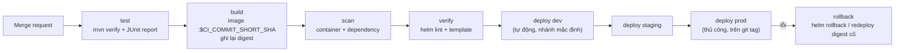

# 6_6 GitLab CI-CD and Release Strategies

> **Khóa học**: Cloud DevOps Basic — Containers & Kubernetes
> **Phân nhóm**: 6 Domain 6 - Containers and Kubernetes › 6_6 GitLab CI-CD and Release Strategies
> **Chủ đề**: Cú pháp `.gitlab-ci.yml`, runner, biến và secret, build/push image trong CI, deploy Helm vào Kubernetes qua GitLab agent, environment, chiến lược release (rolling, blue/green, canary) và rollback
> **Trạng thái**: Định nghĩa (nội dung cần học + đề bài lab + checkpoint), chưa chạy thử, 15-11-2026
> **Lộ trình tổng**: [container/README.md](../../README.md) · **Checkpoint**: [CHECKLIST.md](../../CHECKLIST.md#6_6-gitlab-ci-cd-and-release-strategies)

---

## 🎯 Mục Tiêu

Bạn đã dùng Azure DevOps và GitHub Actions: khái niệm pipeline/job/agent/secret giống nhau. Phần mới cần học là **cú pháp GitLab** (`rules`, `needs`, `environment`, `include`), **runner**, và **cách GitLab nói chuyện với Kubernetes**. Mục tiêu cuối: một pipeline "build once, deploy many" cho `hello-svc`.



---

## 📚 Những Gì Cần Học

### 6_6_1 Khái Niệm GitLab CI/CD
- [ ] Pipeline → stage → job; job cùng stage chạy song song; **runner** nhận và chạy job.
- [ ] Loại pipeline theo `$CI_PIPELINE_SOURCE`: `push`, `merge_request_event`, `schedule`, `web`, `trigger`, `parent_pipeline`; pipeline trên tag.
- [ ] Merge request pipeline vs branch pipeline, và lỗi "chạy 2 pipeline trùng nhau" → giải bằng `workflow:rules`.
- [ ] Bảng chuyển đổi từ kinh nghiệm cũ: Azure DevOps `stages/jobs/steps`, agent pool, variable group ↔ GitLab `stages/jobs/script`, runner + tags, CI/CD variables.

### 6_6_2 Cú Pháp `.gitlab-ci.yml`
- [ ] `stages`, `image`, `services`, `before_script` / `script` / `after_script`, `variables`, `default`.
- [ ] **`rules`** (`if`, `changes`, `exists`, `when: manual | never | on_success | always`, `allow_failure`): thay cho `only/except` cũ.
- [ ] **`needs`** (chạy theo đồ thị phụ thuộc, không chờ cả stage), `dependencies`.
- [ ] **`artifacts`** (kết quả truyền giữa job: `paths`, `expire_in`, `reports: junit | dotenv | coverage_report`) vs **`cache`** (tăng tốc, không đảm bảo: `key`, `key:files`, `policy: pull | push | pull-push`).
- [ ] Tái sử dụng: `extends`, YAML anchors, `!reference`, `include` (`local`, `project`, `remote`, `template`, **`component`**) và CI/CD Catalog.
- [ ] `parallel:matrix`, `retry`, `timeout`, `interruptible`, `resource_group` (chỉ một deploy chạy cùng lúc cho một môi trường).
- [ ] Parent-child pipeline (`trigger: include`) và multi-project pipeline (`trigger: project`) cho monorepo nhiều microservice.
- [ ] Công cụ kiểm tra: Pipeline Editor, CI Lint, xem "merged YAML".

### 6_6_3 Biến và Secret
- [ ] Biến định sẵn hay dùng: `CI_COMMIT_SHA`, `CI_COMMIT_SHORT_SHA`, `CI_COMMIT_REF_SLUG`, `CI_COMMIT_TAG`, `CI_DEFAULT_BRANCH`, `CI_REGISTRY`, `CI_REGISTRY_IMAGE`, `CI_REGISTRY_USER`, `CI_REGISTRY_PASSWORD`, `CI_JOB_TOKEN`, `CI_ENVIRONMENT_NAME`, `CI_PROJECT_DIR`.
- [ ] Biến CI/CD ở project/group: **protected** (chỉ nhánh/tag được bảo vệ), **masked** / masked and hidden, kiểu **File**, phạm vi theo **environment**.
- [ ] Thứ tự ưu tiên biến (biến của job/pipeline đè biến khai báo trong YAML...).
- [ ] Tránh lộ secret: không `echo`, cẩn thận `CI_DEBUG_TRACE` (in toàn bộ biến), không lưu secret vào artifact.
- [ ] ID token (OIDC, `id_tokens`) để đổi lấy credential ngắn hạn từ Vault/cloud thay vì lưu key lâu dài (khái niệm).

### 6_6_4 GitLab Runner
- [ ] Runner instance / group / project; runner của GitLab.com vs self-managed runner.
- [ ] Executor: `shell`, `docker`, `kubernetes` (mỗi job là một Pod), và đánh đổi về cách ly.
- [ ] Đăng ký runner bằng **runner authentication token** (luồng tạo runner trong UI); luồng registration token cũ đã bị deprecate. *Chi tiết thay đổi theo phiên bản GitLab, cần đối chiếu trang "Migrating to the new runner registration workflow".*
- [ ] `tags` để chọn runner; `config.toml` (`concurrent`, `privileged`, volume).
- [ ] Runner chạy trên máy bạn là cách đơn giản nhất để job CI nhìn thấy cluster kind cục bộ.

### 6_6_5 Build Image Trong CI
- [ ] Docker-in-Docker (`services: docker:dind`, cần runner `privileged`, bật TLS) vs Docker socket binding (chia sẻ daemon của host, rủi ro) vs build không cần daemon (Buildah, BuildKit rootless).
- [ ] Kaniko: repo gốc của Google đã được lưu trữ (archived) năm 2025; *cần đối chiếu tình trạng fork và khuyến nghị hiện tại trong tài liệu GitLab trước khi chọn*.
- [ ] Đăng nhập GitLab Container Registry bằng `CI_REGISTRY_USER` / `CI_REGISTRY_PASSWORD` (job token).
- [ ] Tag image bằng `CI_COMMIT_SHORT_SHA` (mọi build) + SemVer (khi có `CI_COMMIT_TAG`); **ghi lại digest** và truyền sang job deploy bằng `artifacts:reports:dotenv`.
- [ ] Cache build giữa các job (cache registry / `--cache-from`, liên hệ 6_2_3).

### 6_6_6 Kiểm Thử và Cổng Chất Lượng (Quality Gate)
- [ ] Unit test + `artifacts:reports:junit` hiển thị trong merge request; coverage.
- [ ] Template bảo mật của GitLab: SAST, Secret Detection, Dependency Scanning, Container Scanning. *Một số tính năng chỉ đầy đủ ở gói trả phí, cần đối chiếu trang tài liệu từng tính năng.*
- [ ] Quét image bằng Trivy (nguồn mở) nếu không dùng template của GitLab.
- [ ] `helm lint` + `helm template` + kiểm tra schema manifest như một job riêng.

### 6_6_7 Deploy vào Kubernetes
- [ ] **GitLab agent for Kubernetes**: cài agent vào cluster; file `.gitlab/agents/<agent-name>/config.yaml` với `ci_access` cấp quyền cho project/group; job chọn context `kubectl config use-context <path/to/agent-project>:<agent-name>`.
- [ ] Tích hợp cluster dạng certificate-based đã bị **deprecate**; phương án dự phòng đơn giản là biến kiểu File chứa kubeconfig của một ServiceAccount quyền hẹp (kém an toàn hơn, cần RBAC chặt, 6_7_1).
- [ ] `environment: name / url / on_stop / auto_stop_in / deployment_tier`; trang Environments, lịch sử deployment, nút re-deploy.
- [ ] **Protected environments** và approval cho prod; `when: manual` trên tag.
- [ ] Review app động cho mỗi merge request (`environment: name: review/$CI_COMMIT_REF_SLUG`) và job dọn dẹp.

### 6_6_8 Chiến Lược Release và Rollback
- [ ] **Rolling update** (mặc định của Deployment, 6_3_4).
- [ ] **Blue/Green**: hai bản đầy đủ, chuyển Service/route một lần; rollback = chuyển lại.
- [ ] **Canary**: chia % traffic (Gateway API `weight` ở 6_4_4, hoặc Argo Rollouts/Flagger tự động hóa theo metric) rồi tăng dần.
- [ ] Feature flag: tách "deploy" khỏi "release" (GitLab có Feature Flags theo chuẩn Unleash, khái niệm).
- [ ] Rollback: `helm rollback` vs redeploy digest cũ qua pipeline (giữ Git là nguồn sự thật); rollback DB migration là phần khó nhất.
- [ ] Promotion: cùng một digest qua dev → staging → prod (liên hệ 6_2_7).

### 6_6_9 Phiên Bản và Phát Hành
- [ ] Semantic Versioning; git tag kích hoạt pipeline release; `release` keyword tạo GitLab Release.
- [ ] Phân biệt 3 phiên bản: image tag/digest, chart `version`, chart `appVersion`.
- [ ] Changelog tự động (khái niệm, ví dụ Conventional Commits).

### 6_6_10 GitOps (Khái Niệm)
- [ ] Push-based (pipeline chạy `helm upgrade`) vs pull-based (Argo CD / Flux đọc repo cấu hình và đồng bộ).
- [ ] Mô hình hai repo: repo ứng dụng (build image) và repo môi trường (values/manifest); pipeline chỉ cập nhật tag/digest trong repo môi trường.
- [ ] GitLab có tích hợp với Flux qua agent (khái niệm, *cần đối chiếu tài liệu GitLab hiện tại*).

### 6_6_11 Tối Ưu và Gỡ Lỗi Pipeline
- [ ] Đọc log job, "retry", job artifacts; vì sao job `pending` (không có runner khớp `tags`, runner hết slot).
- [ ] Rút ngắn pipeline: `needs`, cache `key:files: [pom.xml]`, `rules:changes` cho monorepo, `interruptible` + auto-cancel pipeline cũ.
- [ ] Lỗi hay gặp: YAML sai thụt lề, `rules` loại hết job (pipeline không tạo), biến protected không có trên nhánh thường, hết quota phút CI.

---

## 🧾 Ví Dụ `.gitlab-ci.yml` (Minh Họa, Chưa Chạy Thử)

> Dùng làm khung cho các lab bên dưới. **Chưa chạy trên GitLab thật**: đường dẫn agent, image của job helm/kubectl và quyền runner phải chỉnh theo môi trường của bạn. Build bằng Buildah trong executor `docker` cần cấu hình runner phù hợp (thường là `privileged` hoặc các tùy chọn cho Buildah rootless), xem tài liệu GitLab về build image.

```yaml
workflow:
  rules:
    - if: $CI_PIPELINE_SOURCE == "merge_request_event"
    - if: $CI_COMMIT_BRANCH && $CI_OPEN_MERGE_REQUESTS   # tránh pipeline trùng khi đã có MR
      when: never
    - if: $CI_COMMIT_BRANCH
    - if: $CI_COMMIT_TAG

stages: [test, build, verify, deploy]

variables:
  MAVEN_OPTS: "-Dmaven.repo.local=$CI_PROJECT_DIR/.m2/repository"
  IMAGE: "$CI_REGISTRY_IMAGE:$CI_COMMIT_SHORT_SHA"
  KUBE_CONTEXT: "my-group/k8s-agents:lab-agent"           # <path/to/agent-project>:<agent-name>

unit-test:
  stage: test
  image: docker.io/library/maven:3.9-eclipse-temurin-21
  cache:
    key:
      files: [pom.xml]
    paths: [.m2/repository]
  script:
    - mvn -B verify
  artifacts:
    when: always
    reports:
      junit: target/surefire-reports/TEST-*.xml

build-image:
  stage: build
  image: quay.io/buildah/stable            # nên ghim version cụ thể
  script:
    - echo "$CI_REGISTRY_PASSWORD" | buildah login -u "$CI_REGISTRY_USER" --password-stdin "$CI_REGISTRY"
    - buildah build --build-arg APP_VERSION="$CI_COMMIT_SHORT_SHA" -t "$IMAGE" .
    - buildah push --digestfile digest.txt "$IMAGE"
    - echo "IMAGE_DIGEST=$(cat digest.txt)" >> build.env
  artifacts:
    reports:
      dotenv: build.env                    # job sau nhận biến IMAGE_DIGEST
  rules:
    - if: $CI_COMMIT_BRANCH == $CI_DEFAULT_BRANCH
    - if: $CI_COMMIT_TAG

helm-verify:
  stage: verify
  image: <image-có-helm-4>                 # tự chọn và ghim version
  needs: []
  script:
    - helm lint --strict ./chart
    - helm template hello-svc ./chart -f ./chart/values-prod.yaml --set image.tag=ci > rendered.yaml
  artifacts:
    paths: [rendered.yaml]
    expire_in: 1 week

.deploy-template:
  stage: deploy
  image: <image-có-helm-4-và-kubectl>
  script:
    - kubectl config use-context "$KUBE_CONTEXT"
    - >
      helm upgrade --install hello-svc ./chart
      -n "$CI_ENVIRONMENT_NAME" --create-namespace
      -f "./chart/values-$CI_ENVIRONMENT_NAME.yaml"
      --set image.repository="$CI_REGISTRY_IMAGE"
      --set image.digest="$IMAGE_DIGEST"
      --wait --timeout 5m --rollback-on-failure
  needs: [build-image, helm-verify]

deploy-dev:
  extends: .deploy-template
  resource_group: dev                      # không cho 2 deploy cùng môi trường chạy song song
  environment:
    name: dev
    url: http://hello-dev.lab.test
  rules:
    - if: $CI_COMMIT_BRANCH == $CI_DEFAULT_BRANCH

deploy-prod:
  extends: .deploy-template
  resource_group: prod
  environment:
    name: prod
    url: http://hello.lab.test
  rules:
    - if: $CI_COMMIT_TAG
      when: manual
```

Câu hỏi đọc hiểu: vì sao `helm-verify` có `needs: []`? Biến `IMAGE_DIGEST` đi từ đâu tới `deploy-dev`? Điều gì xảy ra với `deploy-prod` nếu không có `resource_group`? Nếu runner dùng Helm 3 thì phải đổi cờ nào?

---

## 🧪 Labs

> **Bản định nghĩa**: chưa tạo thư mục `labs/`, chưa chạy thử. Hai lựa chọn môi trường: (A) project trên GitLab.com + project runner cài trên máy bạn (khuyến nghị); (B) GitLab CE trong container (nặng, cần nhiều RAM). Lab 6_6_6 là **lab trên giấy**, không cần môi trường.

| Lab | Nội dung | Thời gian | Trạng thái |
| :--- | :--- | :---: | :--- |
| lab-6_6_1-runner-and-first-pipeline | Cài project runner, pipeline test Maven + JUnit report + cache | 60 phút | Định nghĩa |
| lab-6_6_2-build-push-image-with-digest | Build image trong CI, push GitLab registry, truyền digest qua dotenv | 60–90 phút | Định nghĩa |
| lab-6_6_3-rules-needs-and-reuse | `workflow:rules`, MR pipeline, `needs`, `extends`, `include: local` | 60 phút | Định nghĩa |
| lab-6_6_4-deploy-with-agent-and-environments | GitLab agent vào kind, deploy dev tự động, prod thủ công trên tag | 90–120 phút | Định nghĩa |
| lab-6_6_5-canary-and-rollback-pipeline | Job canary 10% (Gateway API), promote hoặc rollback thủ công | 90 phút | Định nghĩa (nâng cao) |
| lab-6_6_6-paper-lab-release-design | Thiết kế trên giấy: pipeline cho 10 microservice + chiến lược release | 45 phút | Định nghĩa |

### lab-6_6_1-runner-and-first-pipeline
- **Các bước chính**: tạo project chứa `hello-svc`; tạo project runner trong UI, cài `gitlab-runner` (executor `docker` với Podman socket hoặc Docker), gắn tag `local`; viết job `unit-test` như ví dụ; cố ý làm hỏng 1 test để thấy báo cáo trong MR; chạy lại để thấy cache `.m2` được dùng.
- **Checkpoint**:
  - [ ] Pipeline xanh trên runner của bạn (kiểm tra tên runner trong log job).
  - [ ] Test lỗi hiển thị trong tab Tests của merge request.
  - [ ] Giải thích được khác biệt `cache` và `artifacts`.

### lab-6_6_2-build-push-image-with-digest
- **Các bước chính**: thêm job `build-image` (Buildah hoặc DinD, chọn một và ghi lý do); push `$CI_REGISTRY_IMAGE:$CI_COMMIT_SHORT_SHA`; thêm tag SemVer khi pipeline chạy trên git tag; job kế tiếp `echo $IMAGE_DIGEST` để xác nhận dotenv hoạt động; `podman pull` digest về máy.
- **Checkpoint**:
  - [ ] Thấy image trong Container Registry với cả tag SHA và tag SemVer trỏ cùng digest.
  - [ ] Giải thích đánh đổi bảo mật giữa DinD privileged và Buildah.

### lab-6_6_3-rules-needs-and-reuse
- **Các bước chính**: mở MR và quan sát có 1 hay 2 pipeline; thêm `workflow:rules` như ví dụ; dùng `rules:changes: [chart/**/*]` để `helm-verify` chỉ chạy khi chart đổi; dùng `needs` để `helm-verify` chạy song song với test; tách job dùng chung sang `ci/templates.yml` và `include: local`.
- **Checkpoint**:
  - [ ] Không còn pipeline trùng khi push vào nhánh đã có MR.
  - [ ] Vẽ được đồ thị DAG của pipeline từ trang Pipeline.

### lab-6_6_4-deploy-with-agent-and-environments
- **Các bước chính**:
  1. Đăng ký agent trong project, cài agent vào kind bằng lệnh Helm mà GitLab hiển thị khi đăng ký; thêm `ci_access` trong `.gitlab/agents/<name>/config.yaml`.
  2. Job thử `kubectl config get-contexts` và `kubectl get ns`.
  3. Thêm `deploy-dev` và `deploy-prod` như ví dụ; namespace `dev` và `prod`.
  4. Tạo git tag `v1.0.0` → bấm chạy `deploy-prod` thủ công; xem trang Environments.
  5. Đẩy commit làm `/ready` luôn trả 503 → job deploy fail sau `--timeout`, release tự rollback.
  6. Dùng nút re-deploy của deployment cũ trong Environments, so sánh với `helm rollback`.
- **Checkpoint**:
  - [ ] Deploy dev tự động sau merge, prod chỉ chạy khi có tag và bấm tay.
  - [ ] Job deploy fail đúng khi bản mới không Ready, và prod vẫn chạy bản cũ.
  - [ ] Nêu được quyền tối thiểu agent/ServiceAccount cần (liên hệ lab 6_7_1).

### lab-6_6_5-canary-and-rollback-pipeline
- **Các bước chính**: tái dùng Gateway API của lab 6_4_3; job `deploy-canary` cài bản mới với release riêng (`hello-svc-canary`) và đặt `HTTPRoute` weight 90/10; job thủ công `promote` (100% sang bản mới, gỡ bản cũ) và `abort` (về 100/0, gỡ canary); trong lúc canary chạy, gọi `/order?id=7` để giả lập lỗi và đọc log.
- **Checkpoint**:
  - [ ] Canary nhận đúng khoảng 10% traffic; `abort` đưa traffic về bản cũ trong < 1 phút.

### lab-6_6_6-paper-lab-release-design
- **Đề bài**: Công ty có 10 microservice Java trong một monorepo, chạy Kafka và Cassandra trên Kubernetes, 3 môi trường. Viết 1 trang thiết kế: cấu trúc pipeline (parent-child hay mỗi service một pipeline), quy ước tag image và version chart, cách promote, chính sách approval cho prod, chiến lược release cho service thường và cho service có migration schema Cassandra, cách rollback, và bảo vệ secret.
- **Checkpoint**:
  - [ ] Trình bày thiết kế trong 5 phút và trả lời được câu "nếu deploy prod hỏng lúc 2 giờ sáng thì làm gì".

---

## 📚 Nguồn Tài Liệu Chính Thống (Official References)
- [GitLab CI/CD](https://docs.gitlab.com/ci/) - Tổng quan GitLab CI/CD.
- [CI/CD YAML syntax reference](https://docs.gitlab.com/ci/yaml/) - Toàn bộ keyword: `rules`, `needs`, `artifacts`, `cache`, `environment`, `include`, `resource_group`.
- [Choose when to run jobs (rules)](https://docs.gitlab.com/ci/jobs/job_rules/) và [workflow](https://docs.gitlab.com/ci/yaml/workflow/) - Điều kiện chạy job và pipeline.
- [Predefined CI/CD variables](https://docs.gitlab.com/ci/variables/predefined_variables/) và [CI/CD variables](https://docs.gitlab.com/ci/variables/) - Biến định sẵn, protected/masked.
- [CI/CD components](https://docs.gitlab.com/ci/components/) - Component và CI/CD Catalog.
- [GitLab Runner](https://docs.gitlab.com/runner/) và [Executors](https://docs.gitlab.com/runner/executors/) - Runner và executor.
- [Migrating to the new runner registration workflow](https://docs.gitlab.com/ci/runners/new_creation_workflow/) - Luồng đăng ký runner mới.
- [Use Docker to build Docker images](https://docs.gitlab.com/ci/docker/using_docker_build/) - DinD, socket binding và các lựa chọn khác.
- [GitLab Container Registry](https://docs.gitlab.com/user/packages/container_registry/) - Registry tích hợp.
- [Using GitLab CI/CD with a Kubernetes cluster](https://docs.gitlab.com/user/clusters/agent/ci_cd_workflow/) - Agent, `ci_access`, chọn context trong job.
- [Environments](https://docs.gitlab.com/ci/environments/) và [Protected environments](https://docs.gitlab.com/ci/environments/protected_environments/) - Môi trường, deployment, approval.
- [Unit test reports](https://docs.gitlab.com/ci/testing/unit_test_reports/) - JUnit report trong merge request.
- [Kubernetes - Deployments](https://kubernetes.io/docs/concepts/workloads/controllers/deployment/) - Rolling update làm nền cho chiến lược release.
