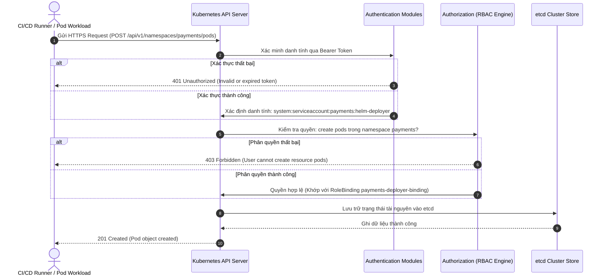

# 6_7_1 Xác Thực, RBAC và ServiceAccount

> **Khóa học**: Cloud DevOps Basic — Containers & Kubernetes
> **Phân nhóm**: 6 Domain 6 - Containers and Kubernetes › 6_7 Kubernetes Security Scheduling and Scaling
> **Chủ đề**: Xác thực (AuthN), Phân quyền RBAC (AuthZ), ServiceAccount, TokenRequest & Projected Token, Least Privilege cho CI Deployer với Helm
> **Trạng thái**: Bản nháp, chờ kiểm chứng
> **Checklist đối chiếu**: [CHECKLIST.md](../../CHECKLIST.md#6_7-kubernetes-security-scheduling-and-scaling)

---

## 1. Khái Niệm Cốt Lõi & Bản Chất Kỹ Thuật (Core Concepts & Technical Deep Dive)

Trong một hệ sinh thái microservices, mọi thao tác điều khiển hạ tầng từ kỹ sư vận hành, pipeline CI/CD hay các Pod nội bộ đều phải đi qua Kubernetes API server. Để bảo vệ cụm, hệ thống thực hiện hai bước kiểm soát an ninh độc lập: Xác thực (Authentication - AuthN) để nhận diện người gọi là ai, và Phân quyền (Authorization - AuthZ) để xác định người đó được phép thực hiện thao tác gì.

### 1.1. Phân Biệt User Account và ServiceAccount

Kubernetes phân chia rạch ròi giữa danh tính con người và danh tính dành cho máy móc:

<!-- ev: C1.1 -->
Kubernetes không có đối tượng lưu trữ người dùng (User Account) trong cơ sở dữ liệu etcd; việc xác thực danh tính con người được ủy quyền hoàn toàn cho các cơ chế bên ngoài như chứng chỉ số X.509 client certificate hoặc OpenID Connect (OIDC).

<!-- ev: C1.2 -->
Ngược lại, ServiceAccount là một tài nguyên cấp namespace (namespaced resource) được tạo và quản lý trực tiếp bên trong Kubernetes API nhằm cung cấp danh tính bảo mật cho Pod workload và các pipeline CI/CD runner.

<!-- ev: C1.16 -->
Khi tham gia vào hệ thống phân quyền của Kubernetes, mỗi ServiceAccount được định danh duy nhất thông qua một chuỗi username chuẩn hóa có định dạng `system:serviceaccount:<namespace>:<serviceaccount-name>`.

### 1.2. Cấu Trúc Phân Quyền Dựa Trên Vai Trò (RBAC)

RBAC (Role-Based Access Control) là cơ chế chuẩn giúp quản trị viên cấp phát quyền hạn theo nguyên tắc đặc quyền tối thiểu:

<!-- ev: C1.14 -->
Một quy tắc phân quyền (rule) trong Kubernetes RBAC được định hình bởi bộ ba thành phần cốt lõi: apiGroups (nhóm API chứa tài nguyên), resources (loại tài nguyên), và verbs (hành động được phép như get, list, watch, create, update, delete).

Hệ thống cung cấp hai cấp độ định nghĩa quyền và hai cấp độ liên kết:

<!-- ev: C1.3 -->
- **Role**: Là tài nguyên thuộc phạm vi namespace (namespaced), định nghĩa danh sách các quy tắc quyền hạn chỉ có giá trị hiệu lực bên trong namespace chứa chính nó.
<!-- ev: C1.4 -->
- **ClusterRole**: Là tài nguyên thuộc phạm vi toàn cụm (cluster-scoped), định nghĩa các quyền hạn áp dụng cho tài nguyên phi namespace (như Node, PersistentVolume, Namespace) hoặc dùng làm khuôn mẫu quyền chuẩn trên toàn bộ các namespace.
<!-- ev: C1.5 -->
- **RoleBinding**: Cấp phát các quyền của Role hoặc ClusterRole cho đối tượng người dùng hoặc ServiceAccount trong phạm vi một namespace; khi gắn kết một ClusterRole qua RoleBinding, các quyền được cấp chỉ có hiệu lực giới hạn bên trong namespace của RoleBinding đó.
<!-- ev: C1.6 -->
- **ClusterRoleBinding**: Cấp phát quyền hạn của ClusterRole cho đối tượng trên phạm vi toàn cụm, cho phép danh tính đó thao tác trên tất cả các namespace hiện có và sẽ tạo trong tương lai.

### 1.3. Kiểm Tra Quyền Hạn Nhanh Với `kubectl auth can-i`

Kubernetes hỗ trợ cơ chế giả lập kiểm tra quyền trực tiếp tại API server:

<!-- ev: C1.7 -->
Lệnh `kubectl auth can-i <verb> <resource> --as=system:serviceaccount:<ns>:<sa> -n <ns>` cho phép kiểm tra một ServiceAccount có quyền thực thi thao tác cụ thể hay không mà không cần đăng nhập thực tế.

| Thành phần | Ý nghĩa kỹ thuật |
| --- | --- |
| `kubectl auth can-i` | Lệnh truy vấn quyền kiểm soát truy cập (RBAC Authorization Review). |
| `<verb>` | Hành động cần kiểm tra (ví dụ: `get`, `list`, `create`, `update`, `delete`, `watch` hoặc `*`). |
| `<resource>` | Loại tài nguyên cần tác động (ví dụ: `pods`, `deployments`, `secrets`, `configmaps`). |
| `--as=...` | Tính năng Impersonation (Mạo danh / Đóng vai): Cho phép Admin đứng ở góc nhìn của danh tính đó để kiểm tra quyền mà không cần phải lấy token của họ. |
| `system:serviceaccount:<ns>:<sa>` | Tên Username chuẩn hóa của ServiceAccount trong hệ thống RBAC của Kubernetes. |
| `-n <ns>` | Phạm vi Namespace diễn ra hành động cần kiểm tra. |

<!-- ev: C1.8 -->
Khi kết hợp với tham số `--list`, cú pháp `kubectl auth can-i --list --as=system:serviceaccount:<ns>:<sa> -n <ns>` sẽ hiển thị toàn bộ danh sách quyền hạn (verbs, resources, apiGroups) mà danh tính đó sở hữu trong namespace chỉ định.

### 1.4. Cơ Chế Token Của ServiceAccount (TokenRequest API & Projected Token)

Cơ chế cấp phát credential cho ServiceAccount đã được cải tiến toàn diện nhằm loại bỏ rủi ro rò rỉ token tĩnh:

<!-- ev: C1.9 -->
Kể từ phiên bản Kubernetes v1.24, hệ thống không còn tự động tạo ra đối tượng Secret chứa token vĩnh viễn khi một ServiceAccount mới được khởi tạo.

<!-- ev: C1.10 -->
Token cấp phát cho Pod hiện nay được tạo động thông qua TokenRequest API và gắn vào container dưới dạng projected volume (`serviceAccountToken`) với thời hạn sử dụng ngắn hạn và được kubelet tự động xoay vòng trước khi hết hạn.

<!-- ev: C1.11 -->
Thiết lập trường `automountServiceAccountToken: false` tại cấu hình Pod spec hoặc ServiceAccount spec sẽ ngăn chặn kubelet tự động gắn credential token vào thư mục `/var/run/secrets/kubernetes.io/serviceaccount` bên trong container.

<!-- ev: C1.17 -->
Để cấp token tĩnh phục vụ các hệ thống bên ngoài như CI/CD runner trên Kubernetes v1.24 trở lên, kỹ sư cần chủ động tạo một Secret thuộc loại `kubernetes.io/service-account-token` kèm annotation `kubernetes.io/service-account.name`.

### 1.5. Quyền Tối Thiểu Cho CI Deployer Với Helm

Khi triển khai ứng dụng bằng Helm trong pipeline CI/CD, việc lạm dụng tài khoản toàn quyền quản trị cụm tiềm ẩn rủi ro an ninh rất lớn:

<!-- ev: C1.12 -->
Helm 3 lưu trữ toàn bộ trạng thái release và lịch sử revision dưới dạng Kubernetes Secret (mặc định) trong chính namespace nơi ứng dụng được triển khai.

<!-- ev: C1.13 -->
Tài khoản CI deployer chạy lệnh `helm upgrade --install --wait` yêu cầu quyền tối thiểu đối với các tài nguyên ứng dụng (Deployments, Services, ConfigMaps, Secrets) và bắt buộc phải có quyền get, list, watch trên Pods để theo dõi trạng thái sẵn sàng khi bật cờ `--wait`.

### 1.6. Bảng Đối Chiếu Tư Duy: Kubernetes RBAC vs Azure RBAC

<!-- ev: C1.15 -->
| Tiêu chí | Kubernetes RBAC | Microsoft Azure Cloud RBAC |
| :--- | :--- | :--- |
| **Định danh workload** | `ServiceAccount` trong namespace | `Service Principal` / `Managed Identity` trong Microsoft Entra ID |
| **Tập hợp quyền** | `Role` (namespace) hoặc `ClusterRole` (cụm) | `Role Definition` (Built-in hoặc Custom Role) |
| **Gán quyền** | `RoleBinding` hoặc `ClusterRoleBinding` | `Role Assignment` gắn với Scope (Resource Group, Subscription) |
| **Lỗi khi thiếu quyền** | Trả về mã HTTP `403 Forbidden` kèm thông báo chi tiết verb và resource bị chặn | Trả về lỗi `AuthorizationFailed` (mã HTTP `403`) từ Azure Resource Manager |

---

## 2. Ví Dụ Đời Sống Thực Tế Dễ Hiểu (Intuitive Real-World Analogies)

Hãy hình dung mô hình bảo mật của một **Tòa nhà văn phòng phức hợp**:

1. **Khách hàng vs Robot vệ sinh (User vs ServiceAccount)**:
   - Một lập trình viên đến làm việc xuất trình thẻ Căn cước công dân hoặc hộ chiếu do cơ quan nhà nước cấp. Tòa nhà không tự in căn cước công dân, chỉ xác nhận thẻ có hợp lệ hay không. Đây là **User Account** được xác thực qua nhà cung cấp danh tính bên ngoài (OIDC, X.509 cert).
   - Ngược lại, robot lau dọn tự động hoạt động ban đêm không có căn cước công dân. Ban Quản lý cấp riêng cho nó một chiếc thẻ từ nội bộ chỉ có giá trị trong tòa nhà. Đây chính là **ServiceAccount** gắn liền với workload.

2. **Nội quy phòng ban vs Quy chuẩn an toàn tòa nhà (Role vs ClusterRole)**:
   - Bản phân công của "Phòng Kế toán Tầng 5" chỉ có giá trị tại Tầng 5, không thể dùng để mở cửa Tầng 8. Đó là **Role** (bị giới hạn trong một namespace).
   - Ngược lại, văn bản "Quy chuẩn an toàn phòng cháy chữa cháy" có hiệu lực ở mọi tầng, từ tầng hầm đến sân thượng. Đó là **ClusterRole**.

3. **Bổ nhiệm nhân sự vs Thẻ chủ Master Key (RoleBinding vs ClusterRoleBinding)**:
   - Khi ký quyết định bổ nhiệm một nhân sự làm việc tại Tầng 5, người đó được hưởng quyền của Tầng 5. Đây là **RoleBinding**. Nếu lấy quy chuẩn an toàn toàn tòa nhà (ClusterRole) giao cho nhân sự này qua quyết định Tầng 5, nhân sự đó cũng chỉ được kiểm tra an toàn tại Tầng 5 mà thôi.
   - Nhưng nếu trao cho Trưởng ban An ninh chiếc thẻ chủ vạn năng (Master Key) cấp toàn tòa nhà, người đó có thể ra vào bất kỳ phòng ban nào. Đó chính là **ClusterRoleBinding**.

---

## 3. Kiến Trúc, Luồng Hoạt Động & Hình Ảnh Trực Quan (Architecture, Diagrams & Visual Media)

Mọi yêu cầu gửi tới API server đều trải qua chuỗi kiểm soát tuần tự và nghiêm ngặt:



---

## 4. Code Mẫu Trực Quan Hoặc Dòng Lệnh Thực Chiến (Runnable Sample Code / CLI)

> **Mục tiêu thực chiến**: Cấu hình tài khoản deployer trong namespace payments với quyền hạn tối thiểu để chạy Helm pipeline, không dùng quyền quản trị cụm.
> **Phiên bản áp dụng**: Kubernetes v1.28+, Helm v3.14+.

### Bước 1: Khởi Tạo Namespace Và ServiceAccount

Tạo không gian làm việc và danh tính cho tiến trình triển khai:

```bash
# Tạo namespace riêng biệt cho dịch vụ thanh toán
kubectl create namespace payments

# Tạo ServiceAccount cho pipeline CI/CD
kubectl create serviceaccount helm-deployer -n payments
```

### Bước 2: Định Nghĩa Role Quyền Tối Thiểu Cho Helm

Tạo manifest định nghĩa quyền hạn cần thiết:

```yaml
# helm-deployer-role.yaml
apiVersion: rbac.authorization.k8s.io/v1
kind: Role
metadata:
  namespace: payments
  name: payments-deployer-role
rules:
  # 1. Quản lý workload ứng dụng
  - apiGroups: ["apps"]
    resources: ["deployments", "statefulsets", "replicasets"]
    verbs: ["get", "list", "watch", "create", "update", "patch", "delete"]

  # 2. Quản lý network và cấu hình ứng dụng
  - apiGroups: [""]
    resources: ["services", "configmaps"]
    verbs: ["get", "list", "watch", "create", "update", "patch", "delete"]

  # 3. Helm 3 lưu release metadata vào Secret trong namespace deploy
  - apiGroups: [""]
    resources: ["secrets"]
    verbs: ["get", "list", "watch", "create", "update", "patch", "delete"]

  # 4. Helm --wait cần đọc Pod để theo dõi điều kiện Ready
  - apiGroups: [""]
    resources: ["pods", "pods/log"]
    verbs: ["get", "list", "watch"]
```

Áp dụng Role vào cụm:

```bash
kubectl apply -f helm-deployer-role.yaml
```

### Bước 3: Gắn Quyền Bằng RoleBinding

Tạo manifest liên kết danh tính với vai trò vừa tạo:

```yaml
# helm-deployer-binding.yaml
apiVersion: rbac.authorization.k8s.io/v1
kind: RoleBinding
metadata:
  namespace: payments
  name: payments-deployer-binding
subjects:
  - kind: ServiceAccount
    name: helm-deployer
    namespace: payments
roleRef:
  kind: Role
  name: payments-deployer-role
  apiGroup: rbac.authorization.k8s.io
```

Áp dụng RoleBinding:

```bash
kubectl apply -f helm-deployer-binding.yaml
```

### Bước 4: Kiểm Chứng Quyền Bằng `kubectl auth can-i`

Kiểm tra trực tiếp các quyền hạn để đảm bảo thiết lập chính xác:

```bash
# Kiểm tra quyền tạo deployment trong namespace payments (Kết quả: yes)
kubectl auth can-i create deployments \
  --as=system:serviceaccount:payments:helm-deployer \
  -n payments

# Kiểm tra quyền thao tác secrets trong namespace payments (Kết quả: yes)
kubectl auth can-i create secrets \
  --as=system:serviceaccount:payments:helm-deployer \
  -n payments

# Kiểm tra thao tác ngoài namespace được cấp (Kết quả: no)
kubectl auth can-i create deployments \
  --as=system:serviceaccount:payments:helm-deployer \
  -n default

# Liệt kê toàn bộ quyền trong namespace payments
kubectl auth can-i --list \
  --as=system:serviceaccount:payments:helm-deployer \
  -n payments
```

### Bước 5: Cấu Hình Tắt Tự Động Gắn Token Cho Pod

Áp dụng thực tiễn tốt nhất cho các Pod nghiệp vụ không gọi API server:

```yaml
# payment-api-pod.yaml
apiVersion: v1
kind: Pod
metadata:
  name: payment-api
  namespace: payments
spec:
  automountServiceAccountToken: false
  containers:
    - name: api
      image: registry.example.com/payment-api:1.0.0
      ports:
        - containerPort: 8080
```

### Bước 6: Tạo Token Tĩnh Cho CI Runner Bên Ngoài (Kubernetes v1.24+)

Trường hợp pipeline runner nằm ngoài cụm cần credential cố định:

```yaml
# helm-deployer-token.yaml
apiVersion: v1
kind: Secret
metadata:
  name: helm-deployer-static-token
  namespace: payments
  annotations:
    kubernetes.io/service-account.name: "helm-deployer"
type: kubernetes.io/service-account-token
```

Lấy token đã sinh để đưa vào CI secret:

```bash
kubectl apply -f helm-deployer-token.yaml
DEPLOYER_TOKEN=$(kubectl get secret helm-deployer-static-token -n payments -o jsonpath='{.data.token}' | base64 --decode)
```

---

## 5. Cạm Bẫy Thực Tế & Thực Tiễn Sản Xuất (Production Gotchas & Best Practices)

> [!WARNING]
> **Cạm bẫy 1: Quên cấp quyền thao tác trên Secrets khiến Helm thất bại**
> Helm 3 không sử dụng thành phần máy chủ trung gian mà lưu trữ toàn bộ trạng thái release và lịch sử revision vào Kubernetes Secret trong namespace deploy. Nếu Role thiếu quyền đối với `secrets`, lệnh `helm upgrade` hoặc `helm install` sẽ lập tức báo lỗi cấm truy cập (`403 Forbidden`).

> [!WARNING]
> **Cạm bẫy 2: Helm chạy kèm cờ chờ bị timeout do thiếu quyền đọc Pods**
> Khi kích hoạt cờ chờ `--wait`, Helm bắt buộc phải truy vấn trạng thái sẵn sàng của các Pod bên trong Deployment. Nếu ServiceAccount chỉ có quyền tạo Deployment mà thiếu quyền `get`, `list`, `watch` trên `pods`, Helm sẽ bị treo chờ đến khi hết hạn thời gian (thường là 5 phút) rồi báo lỗi timeout dù ứng dụng đã chạy.

> [!CAUTION]
> **Cạm bẫy 3: Tiện tay sử dụng ClusterRoleBinding cho pipeline CI/CD**
> Việc gán quyền quản trị cụm toàn quyền qua `ClusterRoleBinding` để giải quyết nhanh lỗi phân quyền vi phạm nghiêm trọng nguyên tắc đặc quyền tối thiểu. Khi token CI bị rò rỉ, toàn bộ tài nguyên và bí mật của tất cả các dự án trong cụm sẽ bị chiếm đoạt.

> [!TIP]
> **Cạm bẫy 4: Để Pod mặc định tự động gắn ServiceAccount token**
> Mặc định mọi Pod đều được tự động mount token của ServiceAccount vào hệ thống tập tin nội bộ. Với các ứng dụng web thông thường không giao tiếp với API server, cần thiết lập `automountServiceAccountToken: false` để triệt tiêu nguy cơ kẻ tấn công lợi dụng lỗ hổng ứng dụng nhằm do thám cụm.

---

## 6. Câu Hỏi Củng Cố Kiến Thức (Active Recall Quiz)

### Câu hỏi 1: Lỗi Phân Quyền Khi Deploy Helm Trong CI
Pipeline CI deploy microservice vào namespace `production` bằng lệnh `helm upgrade --install payment-svc ./charts/payment -n production --wait`. Job chạy bằng ServiceAccount `gitlab-deployer` và thất bại với thông báo: `Error: timed out waiting for the condition`. Tuy nhiên, lệnh `kubectl get deployment` cho thấy các Pod đã ở trạng thái `Running 1/1`. Nguyên nhân là gì và cần bổ sung quyền nào?

<details>
<summary>Đáp án</summary>

**Nguyên nhân**: Khi dùng cờ `--wait`, Helm cần liên tục thăm dò trạng thái sẵn sàng của các Pod. Mặc dù có quyền tạo Deployment, ServiceAccount bị thiếu quyền `get`, `list`, `watch` trên tài nguyên `pods`. Do không đọc được trạng thái Pod, Helm chờ cho đến khi hết hạn thời gian rồi kết luận thất bại.

**Khắc phục**: Thêm quyền đọc tài nguyên `pods` vào quy tắc của Role:
```yaml
- apiGroups: [""]
  resources: ["pods"]
  verbs: ["get", "list", "watch"]
```
</details>

---

### Câu hỏi 2: Phạm Vi Hiệu Lực Của ClusterRole Khi Gắn Qua RoleBinding
Một quản trị viên tạo một `ClusterRole` cấp toàn quyền trên `deployments` và `services`. Sau đó, quản trị viên tạo một `RoleBinding` trong namespace `dev` và trỏ `roleRef` tới `ClusterRole` này cho ServiceAccount `lead-dev`.
Hỏi: ServiceAccount `lead-dev` có thể xóa một Service trong namespace `staging` hay không?

<details>
<summary>Đáp án</summary>

**Trả lời**: Hoàn toàn **KHÔNG**.

**Bản chất**: Đối tượng liên kết được sử dụng ở đây là `RoleBinding` nằm trong namespace `dev`. Khi một `ClusterRole` được liên kết qua `RoleBinding`, các quyền hạn chỉ có giá trị hiệu lực giới hạn bên trong namespace chứa `RoleBinding` đó. Muốn có quyền ở `staging`, cần tạo thêm một `RoleBinding` tại namespace `staging` hoặc sử dụng `ClusterRoleBinding` nếu muốn cấp quyền trên toàn cụm.
</details>

---

### Câu hỏi 3: Vòng Đời Token Của ServiceAccount Trên Kubernetes v1.24+
Kỹ sư tạo một ServiceAccount mới bằng lệnh `kubectl create serviceaccount app-reader -n default`, sau đó kiểm tra bằng `kubectl get secret` nhưng không thấy Secret nào được sinh ra. Kỹ sư kết luận cluster v1.28 bị lỗi. Nhận định này đúng hay sai?

<details>
<summary>Đáp án</summary>

**Nhận định**: Nhận định của kỹ sư là **SAI**. Cluster hoạt động hoàn toàn chính xác theo cơ chế bảo mật mới.

**Bản chất**:
1. Từ Kubernetes v1.24, cơ chế tự động tạo Secret chứa token vĩnh viễn đã bị bãi bỏ để loại bỏ nguy cơ lộ lọt credential tĩnh.
2. Pod trong cluster nhận token động qua TokenRequest API dưới dạng projected volume có thời hạn ngắn và được tự động xoay vòng.
3. Nếu cần token tĩnh cho CI runner bên ngoài, kỹ sư phải chủ động tạo Secret loại `kubernetes.io/service-account-token` kèm annotation chỉ định tên ServiceAccount.
</details>

---

## 7. 📚 Nguồn Tài Liệu Chính Thống (Tier-1 Official References)

- [Kubernetes Documentation: Controlling Access to the Kubernetes API](https://kubernetes.io/docs/reference/access-authn-authz/controlling-access/) - Luồng xác thực (AuthN), phân quyền (AuthZ) và admission control chính thức.
- [Kubernetes Documentation: Using RBAC Authorization](https://kubernetes.io/docs/reference/access-authn-authz/rbac/) - Đặc tả cấu trúc Role, ClusterRole, RoleBinding, ClusterRoleBinding và các quy tắc verbs/resources.
- [Kubernetes Documentation: Managing Service Accounts](https://kubernetes.io/docs/reference/access-authn-authz/service-accounts-admin/) - Hướng dẫn quản trị ServiceAccount, TokenRequest API và thay đổi từ v1.24.
- [Kubernetes Documentation: Configure Service Accounts for Pods](https://kubernetes.io/docs/tasks/configure-pod-container/configure-service-account/) - Hướng dẫn cấu hình projected token, quyền truy cập API và thiết lập `automountServiceAccountToken`.
- [Helm Documentation: Helm Architecture](https://helm.sh/docs/topics/architecture/) - Kiến trúc Helm 3, cơ chế lưu trữ release state và revision history vào Kubernetes Secret.
