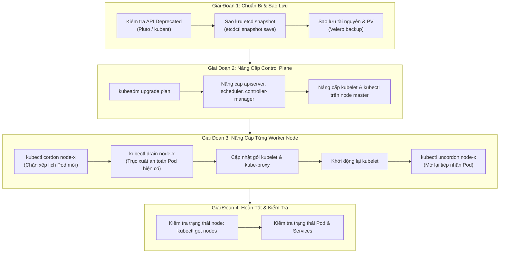

# 6_7_10 Vòng Đời Cluster

> **Khóa học**: Cloud DevOps Basic — Containers & Kubernetes  
> **Phân nhóm**: 6 Domain 6 - Containers and Kubernetes › 6_7 Kubernetes Security Scheduling and Scaling  
> **Chủ đề**: 6_7_10 Vòng Đời Cluster  
> **Trạng thái**: Bản nháp, chờ kiểm chứng  
> **Checklist đối chiếu**: [CHECKLIST](../../CHECKLIST.md#6_7-kubernetes-security-scheduling-and-scaling)  
> **Kiến thức liên quan**: [6_7_7 Sẵn Sàng Khi Bảo Trì](./README.md#6_7_7-sẵn-sàng-khi-bảo-trì-pdb-drain) (PDB và drain)

---

## 0. Bối Cảnh Mở Đầu: Vận Hành Hệ Thống 24/7

Triển khai ứng dụng lên Kubernetes chỉ là bước khởi đầu. Trong thực tế vận hành, các bản vá bảo mật và phiên bản tính năng mới của Kubernetes được cộng đồng phát hành liên tục. Việc bảo trì và nâng cấp một cụm máy chủ đang phục vụ người dùng mà không gây gián đoạn dịch vụ đòi hỏi quy trình kỹ thuật nghiêm ngặt.

Để làm chủ vòng đời cụm (Cluster Lifecycle Management), kỹ sư DevOps cần hiểu rõ nguyên tắc nâng cấp tuần tự theo minor version, chính sách chênh lệch phiên bản (Version Skew Policy), kỹ thuật rà soát API bị deprecate và phương án sao lưu etcd cùng PersistentVolume.

---

## 1. Khái Niệm Cốt Lõi & Bản Chất Kỹ Thuật (Core Concepts & Technical Deep Dive)

Quản trị vòng đời cluster bao gồm quy trình nâng cấp tuần tự, chính sách tương thích phiên bản, rà soát API cũ và sao lưu khôi phục dữ liệu.

### 1.1 Quy Tắc Nâng Cấp Tuần Tự Từng Minor Version

Nâng cấp Kubernetes bắt buộc phải thực hiện tuần tự từng minor version (ví dụ từ 1.30 lên 1.31 rồi lên 1.32) mà không được phép nhảy cóc bỏ qua bất kỳ minor version nào. <!-- ev: C10.1 -->

Quy trình nâng cấp trong một cụm tuân thủ nguyên tắc phân cấp rõ ràng:

Trình tự nâng cấp trong một cụm Kubernetes luôn bắt đầu từ việc nâng cấp các thành phần Control Plane trước khi tiến hành nâng cấp các Node Worker. <!-- ev: C10.2 -->

Sau khi Control Plane hoàn tất, các node công nhân được nâng cấp tuần tự theo ba bước:

Khi nâng cấp từng Node Worker, kỹ sư vận hành thực hiện cô lập node bằng lệnh `kubectl cordon` để ngăn chặn Scheduler điều phối Pod mới tới node. <!-- ev: C10.3 -->

Lệnh `kubectl drain` được sử dụng để trục xuất (evict) an toàn các Pod hiện có ra khỏi node sang các node khác trước khi thực hiện nâng cấp kubelet và kube-proxy. <!-- ev: C10.4 -->

Sau khi nâng cấp gói nhị phân và khởi động lại dịch vụ kubelet thành công, chạy lệnh `kubectl uncordon` để đưa node trở lại trạng thái sẵn sàng tiếp nhận Pod. <!-- ev: C10.5 -->

### 1.2 Kubernetes Version Skew Policy (Chính Sách Chênh Lệch Phiên Bản)

Trong quá trình nâng cấp, các thành phần tạm thời hoạt động ở các phiên bản khác nhau.

Theo Kubernetes Version Skew Policy, các phiên bản kube-apiserver trong cụm độ sẵn sàng cao (HA) có thể chênh lệch tối đa 1 minor version với nhau. <!-- ev: C10.6 -->

Các thành phần kube-controller-manager và kube-scheduler không được phép có phiên bản mới hơn kube-apiserver mà chúng kết nối tới, và có thể cũ hơn tối đa 1 minor version. <!-- ev: C10.7 -->

Đối với máy chủ công nhân, thành phần vận hành trên node giao tiếp trực tiếp với bộ điều khiển:

Từ Kubernetes 1.28 trở đi, kubelet được hỗ trợ chênh lệch tối đa 3 minor version cũ hơn so với kube-apiserver (ví dụ kube-apiserver 1.32 hỗ trợ kubelet từ 1.29 đến 1.32). <!-- ev: C10.8 -->

Phiên bản kubelet tuyệt đối không được phép cao hơn (mới hơn) phiên bản kube-apiserver đang điều khiển nó. <!-- ev: C10.9 -->

Công cụ dòng lệnh `kubectl` được hỗ trợ chênh lệch trong phạm vi 1 minor version cũ hơn hoặc mới hơn so với kube-apiserver (`k-1`, `k`, `k+1`). <!-- ev: C10.10 -->

### 1.3 Rà Soát API Bị Deprecate Và Gỡ Bỏ Giữa Các Phiên Bản

Khi một tính năng được cải tiến, phiên bản cũ của API sẽ chuyển sang trạng thái cảnh báo trước khi bị loại bỏ hoàn toàn:

Trước khi nâng cấp cluster, quản trị viên cần đối chiếu tài liệu Deprecated API Migration Guide để xác định các API version đã bị deprecate hoặc gỡ bỏ trong bản phát hành mục tiêu. <!-- ev: C10.11 -->

Để tránh rà soát thủ công, quản trị viên sử dụng các công cụ kiểm tra tự động:

Công cụ Pluto kiểm tra các file manifest hoặc Helm release để phát hiện các phiên bản Kubernetes API đã bị deprecate hoặc xóa bỏ. <!-- ev: C10.12 -->

Công cụ `kubent` (kube-no-trouble) quét trực tiếp các tài nguyên đang chạy trong cluster hoặc manifest tĩnh để tìm các đối tượng sử dụng API version bị deprecated. <!-- ev: C10.13 -->

### 1.4 Chiến Lược Sao Lưu Và Phục Hồi (Backup & Disaster Recovery)

Trước mọi đợt bảo trì, việc sao lưu dữ liệu cụm là yêu cầu bắt buộc:

Đối với cluster tự dựng, etcd là cơ sở dữ liệu duy nhất lưu trữ toàn bộ trạng thái của cluster và cần được sao lưu định kỳ bằng lệnh `etcdctl snapshot save`. <!-- ev: C10.14 -->

Lệnh `etcdctl snapshot restore` phục hồi dữ liệu từ bản snapshot vào một thư mục dữ liệu mới (`--data-dir`) trước khi cấu hình etcd trỏ tới thư mục này. <!-- ev: C10.15 -->

Bên cạnh cơ sở dữ liệu cốt lõi, quản trị viên cần sao lưu cấu hình ứng dụng và dữ liệu lưu trữ:

Velero là giải pháp sao lưu và phục hồi thảm họa mã nguồn mở cho Kubernetes, hỗ trợ sao lưu tài nguyên cluster dạng manifest lên object storage và chụp snapshot PersistentVolume qua chuẩn CSI (Container Storage Interface). <!-- ev: C10.16 -->

---

## 2. Ví Dụ Đời Sống Thực Tế Dễ Hiểu (Intuitive Real-World Analogies)

Để hình dung quy trình nâng cấp và các giới hạn kỹ thuật của Kubernetes, hãy liên tưởng tới quy trình bảo dưỡng đoàn tàu siêu tốc chở khách đang di chuyển liên tục trên hành trình dài.

Đầu tàu là buồng lái điều khiển trung tâm nơi hoa tiêu chỉ huy toàn bộ tốc độ và lịch trình. Các toa chở khách phía sau là các toa lao động nơi hành khách ngồi làm việc.

Đoàn tàu không thể dừng lại giữa đường ray để bảo dưỡng đồng loạt, vì như vậy hành khách sẽ bị lỡ chuyến đi. Thay vào đó, quy trình cần thực hiện từng bước:
- Đầu tiên, đội ngũ kỹ thuật tập trung vào buồng lái trung tâm. Họ sao lưu toàn bộ thông số hành trình vào hộp đen dự phòng. Sau đó, họ nâng cấp hệ thống máy tính buồng lái lên thế hệ mới. Trong lúc buồng lái đang cập nhật phần mềm, các toa khách phía sau vẫn lăn bánh ổn định.
- Khi buồng lái mới đã hoạt động hoàn toàn trơn tru, kỹ sư mới lần lượt xử lý từng toa hành khách.
- Kỹ sư không thể sửa tất cả các toa cùng lúc vì khách sẽ không có chỗ ngồi. Họ bước tới toa đầu tiên, treo biển tạm ngưng đón thêm khách vào toa. Tiếp theo, họ nhẹ nhàng hướng dẫn hành khách trong toa di chuyển sang các toa kế bên còn chỗ trống.
- Khi toa đã hoàn toàn trống, kỹ sư đóng cửa để thay thế phụ tùng bánh xe và kiểm tra hệ thống điện. Xong xuôi, biển cách ly được gỡ bỏ và hành khách được mời quay trở lại. Kỹ sư tiếp tục lặp lại quy trình đó với các toa tiếp theo.
- Nhà sản xuất đưa ra quy định nghiêm ngặt về sự tương thích: máy tính buồng lái đời mới có thể phối hợp nhịp nhàng với bánh xe đời cũ hơn một chút, nhưng độ chênh lệch thế hệ không được vượt quá giới hạn an toàn kỹ thuật để tránh nguy cơ trật bánh.

---

## 3. Kiến Trúc, Luồng Hoạt Động & Hình Ảnh Trực Quan (Architecture, Diagrams & Visual Media)

### 3.1 Luồng Nâng Cấp Cluster Tuần Tự

Sơ đồ dưới đây mô tả các giai đoạn chuẩn trong một chiến dịch nâng cấp cụm Kubernetes:



### 3.2 Bảng Đối Chiếu Kubernetes Version Skew Policy

Bảng dưới đây tổng hợp biên độ chênh lệch phiên bản hợp lệ giữa apiserver và các thành phần khác trong cụm:

| Thành phần | Phiên bản cho phép so với `kube-apiserver` (`x`) | Quy tắc bất di bất dịch |
| :--- | :--- | :--- |
| **`kube-apiserver`** (trong cụm HA) | `x - 1`, `x` | Các phiên bản apiserver có thể chênh lệch tối đa 1 minor trong quá trình rolling upgrade. |
| **`kube-controller-manager`** | `x - 1`, `x` | Không được mới hơn apiserver; có thể cũ hơn tối đa 1 minor version. |
| **`kube-scheduler`** | `x - 1`, `x` | Không được mới hơn apiserver; có thể cũ hơn tối đa 1 minor version. |
| **`kubelet`** | `x - 3`, `x - 2`, `x - 1`, `x` | Từ bản 1.28 hỗ trợ cũ hơn tới 3 minor; tuyệt đối không được mới hơn apiserver. |
| **`kube-proxy`** | `x - 3`, `x - 2`, `x - 1`, `x` | Tương thích cùng biên độ với kubelet; không được mới hơn apiserver. |
| **`kubectl`** | `x - 1`, `x`, `x + 1` | Hỗ trợ trong phạm vi 1 minor cũ hơn hoặc mới hơn so với apiserver. |

---

## 4. Code Mẫu Trực Quan Hoặc Dòng Lệnh Thực Chiến (Runnable Sample Code / CLI)

Quy trình nâng cấp cụm được thực hiện qua các bước lệnh chuẩn hóa dưới đây.

### 4.1 Bước 1: Sao Lưu etcd Snapshot Trước Khi Can Thiệp Cụm

Thực hiện trên máy chủ điều khiển để tạo bản sao lưu toàn bộ dữ liệu trạng thái của cluster:

<!-- ev: C10.14 -->
```bash
# Thiết lập biến môi trường sử dụng etcd API v3
export ETCDCTL_API=3

# Thực hiện snapshot etcd ra tệp lưu trữ
sudo etcdctl snapshot save /var/backups/etcd-snapshot-pre-upgrade.db \
  --endpoints=https://127.0.0.1:2379 \
  --cacert=/etc/kubernetes/pki/etcd/ca.crt \
  --cert=/etc/kubernetes/pki/etcd/server.crt \
  --key=/etc/kubernetes/pki/etcd/server.key

# Kiểm tra tính toàn vẹn của tệp snapshot vừa tạo
sudo etcdctl snapshot status /var/backups/etcd-snapshot-pre-upgrade.db --write-out=table
```

Khi cần khôi phục thảm họa, sử dụng lệnh restore ra một thư mục dữ liệu mới:

<!-- ev: C10.15 -->
```bash
# Khôi phục dữ liệu snapshot sang thư mục mới
sudo etcdctl snapshot restore /var/backups/etcd-snapshot-pre-upgrade.db \
  --data-dir=/var/lib/etcd-restored
```

### 4.2 Bước 2: Rà Soát API Deprecated Với kubent Và Pluto

Kiểm tra manifest và cấu hình trước khi tiến hành nâng cấp để phát hiện các tài nguyên sử dụng API cũ:

<!-- ev: C10.13 -->
```bash
# Cài đặt và quét cụm bằng công cụ kubent
sh -c "$(curl -sSL https://git.io/install-kubent)"
kubent
```

<!-- ev: C10.12 -->
```bash
# Quét thư mục manifest tĩnh bằng Pluto
pluto detect-files -d ./manifests/ -t k8s=v1.32.0

# Quét các Helm release trong cluster bằng Pluto
pluto detect-helm -t k8s=v1.32.0
```

### 4.3 Bước 3: Nâng Cấp Control Plane (Ví Dụ Với kubeadm)

Trên máy chủ điều khiển đầu tiên, kiểm tra kế hoạch nâng cấp và áp dụng phiên bản mới:

<!-- ev: C10.1 C10.2 -->
```bash
# Cập nhật danh sách gói và cài đặt phiên bản kubeadm mục tiêu
sudo apt-get update
sudo apt-get install -y --allow-change-held-packages kubeadm=1.32.0-1.1

# Kiểm tra kế hoạch nâng cấp
sudo kubeadm upgrade plan

# Áp dụng nâng cấp cho Control Plane
sudo kubeadm upgrade apply v1.32.0 -y

# Cập nhật kubelet và kubectl trên node Control Plane
sudo apt-get install -y --allow-change-held-packages kubelet=1.32.0-1.1 kubectl=1.32.0-1.1
sudo systemctl daemon-reload
sudo systemctl restart kubelet
```

### 4.4 Bước 4: Bảo Dưỡng Và Nâng Cấp Từng Worker Node

Thực hiện lần lượt trên từng máy chủ công nhân để đảm bảo dịch vụ không bị gián đoạn:

Từ máy trạm quản trị, cô lập node để chặn Pod mới:

<!-- ev: C10.3 -->
```bash
kubectl cordon worker-node-1
```

Trục xuất an toàn các Pod đang hoạt động sang các node khác trong cụm:

<!-- ev: C10.4 -->
```bash
kubectl drain worker-node-1 --ignore-daemonsets --delete-emptydir-data --force
```

Đăng nhập vào máy chủ công nhân để nâng cấp phần mềm:

<!-- ev: C10.8 -->
```bash
# Nâng cấp gói kubeadm và áp dụng cấu hình node
sudo apt-get update
sudo apt-get install -y --allow-change-held-packages kubeadm=1.32.0-1.1
sudo kubeadm upgrade node

# Nâng cấp kubelet và khởi động lại dịch vụ
sudo apt-get install -y --allow-change-held-packages kubelet=1.32.0-1.1
sudo systemctl daemon-reload
sudo systemctl restart kubelet
```

Kích hoạt lại node để tiếp nhận Pod:

<!-- ev: C10.5 -->
```bash
kubectl uncordon worker-node-1
```

### 4.5 Bước 5: Sao Lưu Mức Ứng Dụng Và PersistentVolume Với Velero

Thực hiện sao lưu dự phòng toàn bộ ứng dụng cùng dữ liệu đĩa lưu trữ:

<!-- ev: C10.16 -->
```bash
# Tạo bản sao lưu cho namespace production kèm snapshot volume
velero backup create backup-prod-pre-upgrade \
  --include-namespaces production \
  --snapshot-volumes \
  --wait

# Xem thông tin chi tiết của bản sao lưu
velero backup describe backup-prod-pre-upgrade --details
```

---

## 5. Cạm Bẫy Thực Tế & Thực Tiễn Sản Xuất (Production Gotchas & Best Practices)

Trong thực tế vận hành, quản trị viên cần lưu ý các cạm bẫy sau đây:

### 5.1 Cạm Bẫy Cố Tình Nhảy Cóc Phiên Bản (Skip-Level Upgrade)
Nâng cấp trực tiếp bỏ qua một minor version (ví dụ từ 1.30 lên thẳng 1.32) sẽ khiến công cụ nâng cấp từ chối thực hiện hoặc gây lỗi đọc dữ liệu etcd. Luôn tuân thủ quy tắc nâng cấp tuần tự từng minor version một. <!-- ev: C10.1 -->

### 5.2 Cạm Bẫy Nâng Cấp Worker Node Trước Control Plane
Cập nhật gói phần mềm trên worker nodes trước khi nâng cấp Control Plane sẽ khiến kubelet mới hơn apiserver, vi phạm chính sách Version Skew Policy và làm node chuyển sang trạng thái NotReady. <!-- ev: C10.9 -->

### 5.3 Cạm Bẫy Ứng Dụng Bị Gián Đoạn Do API Bị Gỡ Bỏ
Ứng dụng sử dụng các phiên bản API đã bị xóa bỏ ở phiên bản mới sẽ không thể khởi tạo hoặc cập nhật sau khi nâng cấp apiserver. Quản trị viên bắt buộc phải rà soát bằng Pluto hoặc kubent trước ngày bảo trì. <!-- ev: C10.11 C10.12 C10.13 -->

### 5.4 Cạm Bẫy Lệnh Drain Bị Treo Do PodDisruptionBudget Quá Ngặt Nghèo
Khi chạy lệnh drain, nếu cấu hình PDB đặt điều kiện quá chặt chẽ thì API eviction sẽ từ chối trục xuất Pod, khiến lệnh drain bị treo và quy trình nâng cấp node không thể tiếp tục. <!-- ev: C10.4 -->

### 5.5 Thực Tiễn Tốt Nhất: Lưu Trữ Bản Sao Lưu Độc Lập
Bản snapshot etcd cần được chuyển ngay sang hệ thống lưu trữ ngoài độc lập thay vì chỉ lưu trên đĩa cứng cục bộ của máy chủ điều khiển, nhằm đảm bảo khả năng phục hồi khi xảy ra hỏng hóc phần cứng. <!-- ev: C10.14 -->

---

## 6. Câu Hỏi Củng Cố Kiến Thức (Active Recall Quiz)

Dưới đây là các câu hỏi tình huống thực tế giúp bạn củng cố kiến thức về vòng đời cluster Kubernetes:

### Tình huống 1: Kế Hoạch Nâng Cấp Rút Gọn
Một kỹ sư phụ trách hạ tầng đề xuất kế hoạch: Do cụm Kubernetes hiện tại đang ở phiên bản 1.30 và bản phát hành mới nhất là 1.32, nhóm sẽ chạy lệnh nâng cấp thẳng lên 1.32 vào đêm Chủ Nhật để tiết kiệm 50% thời gian bảo trì. Kế hoạch này có khả thi theo chuẩn vận hành của Kubernetes không? Giải thích lý do và hậu quả nếu cố tình thực hiện.

<details>
<summary>Đáp án</summary>

Kế hoạch này **hoàn toàn không khả thi** và vi phạm nguyên tắc vận hành cốt lõi của Kubernetes.

1. **Quy tắc tuần tự**: Kubernetes không hỗ trợ nâng cấp nhảy cóc qua một minor version (ví dụ từ 1.30 lên thẳng 1.32).
2. **Hậu quả kỹ thuật**: Các công cụ quản lý như `kubeadm` sẽ chặn lệnh và báo lỗi không tương thích. Nếu cố tình can thiệp bằng cách thay thế file nhị phân thủ công, `kube-apiserver` sẽ thất bại khi đọc dữ liệu từ etcd do cấu trúc lưu trữ và các trường dữ liệu nội bộ của phiên bản 1.30 khác biệt so với 1.32.
3. **Quy trình đúng**: Nhóm bắt buộc phải chia thành hai giai đoạn độc lập: nâng cấp cụm từ 1.30 lên 1.31, kiểm tra toàn diện sức khỏe hệ thống, sau đó mới tiếp tục nâng cấp từ 1.31 lên 1.32.

</details>

### Tình huống 2: Đánh Giá Tính Tương Thích Version Skew
Cụm Kubernetes của công ty bạn vừa hoàn tất nâng cấp Control Plane lên phiên bản `1.32`. Do số lượng Worker Node rất lớn (hơn 500 nodes), nhóm dự kiến chia thành nhiều đợt nâng cấp kéo dài trong 3 tuần. Hiện tại một số Worker Node vẫn đang chạy `kubelet` phiên bản `1.29`. Theo chính sách Kubernetes Version Skew Policy hiện hành (áp dụng từ Kubernetes 1.28 trở đi):
- Worker Node phiên bản `1.29` có tiếp tục hoạt động bình thường với Control Plane `1.32` không?
- Nếu có một node thử nghiệm cài nhầm `kubelet` phiên bản `1.33` thì node đó có được hỗ trợ kết nối tới Control Plane `1.32` không?

<details>
<summary>Đáp án</summary>

1. **Đối với Worker Node chạy kubelet 1.29**:
   - **Được hỗ trợ chính thức**. Từ Kubernetes 1.28 trở đi, chính sách Version Skew Policy mở rộng biên độ cho phép `kubelet` có thể cũ hơn `kube-apiserver` tối đa **3 minor versions**. Với apiserver 1.32, các worker node chạy kubelet từ bản 1.29, 1.30, 1.31 đến 1.32 đều nằm trong vùng hỗ trợ và hoạt động bình thường.
2. **Đối với Worker Node cài kubelet 1.33**:
   - **Tuyệt đối không được hỗ trợ**. Quy tắc cơ bản của Kubernetes là phiên bản `kubelet` không bao giờ được phép mới hơn phiên bản `kube-apiserver` mà nó kết nối tới. Việc chạy kubelet 1.33 với apiserver 1.32 là cấu hình không hợp lệ, có thể gây lỗi đồng bộ trạng thái Pod và node bị lỗi `NotReady`.

</details>

### Tình huống 3: Ứng Dụng Gặp Lỗi Sau Khi Nâng Cấp Control Plane
Sau khi nâng cấp Control Plane lên phiên bản mới, các Pod đang chạy vẫn hoạt động bình thường nhưng pipeline CI/CD bất ngờ báo lỗi thất bại khi triển khai bản vá mới cho một microservice. Kiểm tra logs cho thấy thông báo lỗi từ Kubernetes API: `the server could not find the requested resource`. Quản trị viên nghi ngờ nguyên nhân bắt nguồn từ việc một API bị xóa bỏ. Bạn hãy chỉ ra công cụ và quy trình kiểm tra để ngăn ngừa sự cố này trong tương lai.

<details>
<summary>Đáp án</summary>

1. **Nguyên nhân gốc rễ**: Manifest hoặc Helm chart của microservice đang khai báo một phiên bản API đã bị deprecate từ các bản trước và chính thức bị gỡ bỏ (removed) trong bản phát hành Kubernetes vừa nâng cấp.
2. **Quy trình phòng ngừa chuẩn**:
   - Trước khi nâng cấp, luôn tra cứu tài liệu **Deprecated API Migration Guide** của phiên bản mục tiêu để biết danh sách các API bị gỡ bỏ.
   - Sử dụng công cụ **`kubent`** (kube-no-trouble) để quét toàn bộ các đối tượng đang lưu trữ trong cụm nhằm phát hiện tài nguyên dùng API cũ.
   - Tích hợp công cụ **Pluto** vào pipeline CI/CD hoặc quét các thư mục manifest và Helm release tĩnh để cảnh báo các trường `apiVersion` lỗi thời.
   - Cập nhật manifest của ứng dụng sang `apiVersion` mới tương ứng (ví dụ chuyển sang `networking.k8s.io/v1` thay cho bản beta) trước ngày tiến hành nâng cấp cụm.

</details>

---

## 7. 📚 Nguồn Tài Liệu Chính Thống (Tier-1 Official References)

- [Kubernetes Version Skew Policy](https://kubernetes.io/releases/version-skew-policy/) - Chính sách tương thích phiên bản chính thức giữa kube-apiserver, kubelet, controller-manager, scheduler và kubectl.
- [Upgrading kubeadm clusters](https://kubernetes.io/docs/tasks/administer-cluster/kubeadm/kubeadm-upgrade/) - Hướng dẫn quy trình chuẩn từng bước nâng cấp Control Plane và Worker Nodes sử dụng kubeadm.
- [Operating etcd clusters for Kubernetes - Backing up an etcd cluster](https://kubernetes.io/docs/tasks/administer-cluster/configure-upgrade-etcd/) - Tài liệu chính thức về kỹ thuật cấu hình, bảo trì và sao lưu snapshot cơ sở dữ liệu etcd.
- [Deprecated API Migration Guide](https://kubernetes.io/docs/reference/using-api/deprecation-guide/) - Cẩm nang tra cứu và lộ trình chuyển đổi các API bị deprecate hoặc loại bỏ qua các phiên bản Kubernetes.
