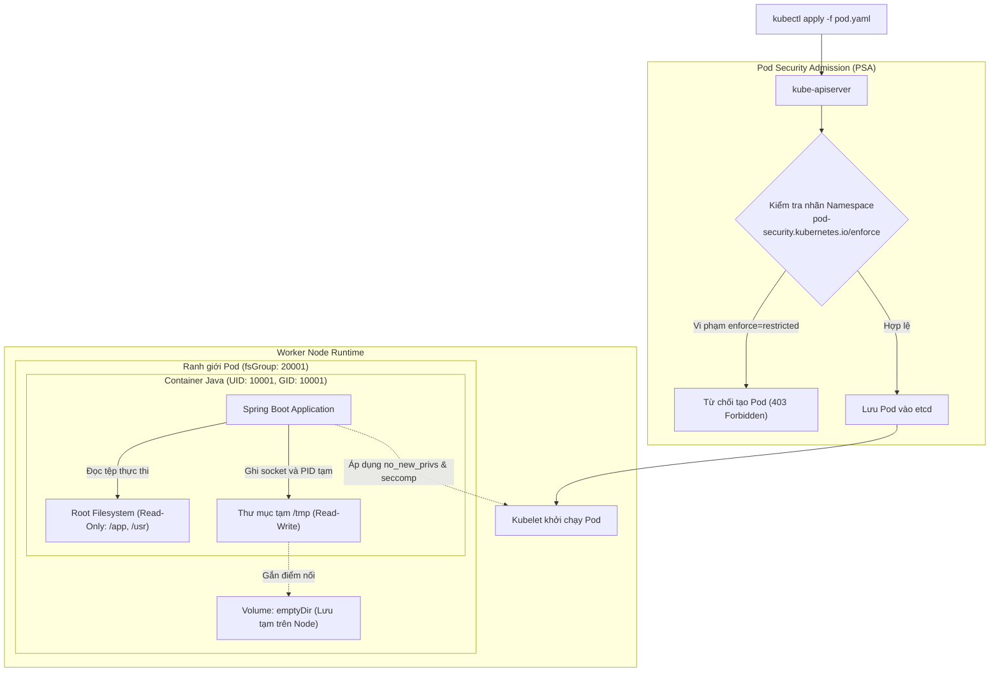

# 6_7_2 Bảo Mật Pod (Pod Security & Hardening)

> **Khóa học**: Cloud DevOps Basic  
> **Phân nhóm**: 6 Domain 6 - Containers and Kubernetes / 6_7 Kubernetes Security Scheduling and Scaling  
> **Chủ đề**: 6_7_2 Bảo Mật Pod  
> **Trạng thái**: Bản nháp, chờ kiểm chứng  
> **Checklist đối chiếu**: [CHECKLIST.md](../../CHECKLIST.md)

---

## 1. Khái Niệm Cốt Lõi & Bản Chất Kỹ Thuật (Core Concepts & Technical Deep Dive)

Trong môi trường container hóa, container thực chất là một tiến trình chạy trực tiếp trên nhân Linux của máy chủ host, được cô lập thông qua cgroups và namespaces. Mặc định, nếu không cấu hình bảo vệ, tiến trình container thường chạy bằng quyền quản trị viên tối cao, tự do ghi đè hệ thống tệp và giữ nhiều quyền hạn nhân nguy hiểm. Nếu ứng dụng phát sinh lỗ hổng thực thi mã từ xa, kẻ tấn công có thể chèn mã độc vào file thực thi hoặc khai thác nhân Linux để vượt rào chiếm quyền điều khiển máy chủ. Để ngăn chặn rủi ro này, Kubernetes cung cấp cơ chế bảo vệ phân tầng từ Namespace đến từng Pod.

### 1.1 Lịch Sử Tiến Hóa: Từ PodSecurityPolicy (PSP) Sang Pod Security Admission (PSA)

Cơ chế PodSecurityPolicy (PSP) từng được dùng ở các phiên bản trước nhưng đã bị đánh dấu deprecate ở bản v1.21 và chính thức bị gỡ bỏ hoàn toàn từ Kubernetes v1.25 <!-- ev: C2.1 -->. Để thay thế hoàn toàn cho PSP, Kubernetes giới thiệu cơ chế Pod Security Admission (PSA) tích hợp sẵn trong API Server kết hợp cùng bộ tiêu chuẩn Pod Security Standards (PSS) <!-- ev: C2.6 -->.

### 1.2 Ba Cấp Độ Pod Security Standards (PSS)

Kubernetes chuẩn hóa các chính sách an ninh thành 3 cấp độ Pod Security Standards (PSS) <!-- ev: C2.2 -->:

| Cấp Độ (Level) | Phạm Vi Áp Dụng | Đặc Tính Kỹ Thuật |
| :--- | :--- | :--- |
| **Privileged** | Cung cấp phạm vi quyền hạn rộng nhất, hoàn toàn không áp đặt giới hạn bảo mật <!-- ev: C2.3 -->. | Cho phép các cấu hình leo thang đặc quyền đã biết như privileged hoặc dùng chung tài nguyên host <!-- ev: C2.3 -->. Dành riêng cho CNI plugin, storage driver hoặc pod hệ thống. |
| **Baseline** | Ngăn chặn các lỗ hổng leo thang đặc quyền cơ bản đã biết với cấu hình mặc định tối thiểu <!-- ev: C2.4 -->. | Chặn container privileged và các cổng chia sẻ host, nhưng vẫn cho phép container chạy dưới quyền root nếu image mặc định như vậy <!-- ev: C2.4 -->. |
| **Restricted** | Thắt chặt an ninh tối đa theo các thực tiễn phòng thủ chuyên sâu dành cho các ứng dụng trọng yếu <!-- ev: C2.5 -->. | Bắt buộc chạy non-root, cấm leo thang quyền hạn, yêu cầu seccomp profile, tước bỏ toàn bộ capabilities và khuyến nghị khóa hệ thống tệp gốc <!-- ev: C2.5 -->. |

### 1.3 Cơ Chế Kiểm Soát Namespace Với Pod Security Admission (PSA)

Pod Security Admission (PSA) là admission controller tích hợp sẵn trong Kubernetes, kiểm tra tính hợp lệ của Pod dựa trên các nhãn gắn trực tiếp trên Namespace <!-- ev: C2.6 -->.

PSA cung cấp 3 chế độ kiểm soát có thể kết hợp trên cùng một Namespace <!-- ev: C2.7 -->:
- `enforce`: Từ chối tạo Pod nếu Pod vi phạm tiêu chuẩn PSS đã định cấu hình <!-- ev: C2.7 -->.
- `audit`: Vẫn cho phép tạo Pod vi phạm nhưng ghi nhận sự kiện vi phạm vào Kubernetes Audit Log <!-- ev: C2.7 -->.
- `warn`: Vẫn cho phép tạo Pod vi phạm nhưng hiển thị thông điệp cảnh báo cho người dùng thực thi lệnh <!-- ev: C2.7 -->.

Quản trị viên có thể ghim chính xác phiên bản PSS áp dụng cho Namespace qua nhãn `pod-security.kubernetes.io/<mode>-version` (ví dụ `enforce-version: latest` hoặc theo phiên bản cụm) <!-- ev: C2.8 -->.

### 1.4 Thiết Lập Cốt Lõi Trong `securityContext`

Trường `securityContext` trong PodSpec và ContainerSpec định nghĩa các thiết lập đặc quyền và quyền hạn truy cập hệ thống của tiến trình <!-- ev: C2.9 -->:

| Thuộc Tính (Field) | Cấp Áp Dụng | Ý Nghĩa & Cơ Chế Hoạt Động |
| :--- | :--- | :--- |
| `runAsNonRoot: true` | Pod & Container | Bắt buộc tiến trình chạy với UID khác 0; kubelet từ chối khởi động container nếu image cố chạy bằng UID root <!-- ev: C2.10 -->. |
| `runAsUser` | Pod & Container | Xác định cụ thể mã số người dùng (numeric UID) cho tiến trình container <!-- ev: C2.11 -->. |
| `runAsGroup` | Pod & Container | Xác định cụ thể mã số nhóm (numeric GID) cho tiến trình container <!-- ev: C2.11 -->. |
| `fsGroup` | Pod | Xác định mã số nhóm bổ sung áp dụng cho Pod và tự động gán quyền sở hữu nhóm cho các volume được mount <!-- ev: C2.12 -->. |
| `allowPrivilegeEscalation: false` | Container | Kích hoạt cờ `no_new_privs` của nhân Linux, ngăn tiến trình con giành thêm quyền hạn cao hơn tiến trình cha <!-- ev: C2.13 -->. |
| `capabilities: drop: ["ALL"]` | Container | Tước bỏ toàn bộ các Linux capabilities mặc định để thu hẹp tối đa bề mặt tấn công <!-- ev: C2.14 -->. |
| `seccompProfile: type: RuntimeDefault` | Pod & Container | Áp dụng cấu hình lọc lệnh gọi hệ thống mặc định của container runtime nhằm chặn các syscall nguy hiểm <!-- ev: C2.15 -->. |
| `readOnlyRootFilesystem: true` | Container | Khóa toàn bộ hệ thống tệp gốc của container ở chế độ chỉ đọc, cấm mọi hành vi ghi hoặc chỉnh sửa file <!-- ev: C2.16 -->. |

### 1.5 Mô Hình `readOnlyRootFilesystem` Kết Hợp `emptyDir` Cho Ứng Dụng Java

Khi kích hoạt `readOnlyRootFilesystem: true`, toàn bộ hệ thống tệp gốc bị khóa chỉ đọc, ngăn kẻ tấn công ghi mã độc vào hệ thống <!-- ev: C2.16 -->. Tuy nhiên, các ứng dụng Java hoặc Spring Boot chạy máy chủ web nhúng bắt buộc cần quyền ghi vào thư mục `/tmp` để tạo file PID, domain socket và xử lý tệp tạm <!-- ev: C2.17 -->. Để đáp ứng yêu cầu này, giải pháp sản xuất là kết hợp `readOnlyRootFilesystem: true` với một volume `emptyDir` có quyền ghi mount riêng vào `/tmp` <!-- ev: C2.17 -->. Volume `emptyDir` được khởi tạo rỗng khi Pod được tạo và vòng đời của nó gắn liền hoàn toàn với Pod trên máy chủ <!-- ev: C2.18 -->.

---

## 2. Ví Dụ Đời Sống Thực Tế Dễ Hiểu (Intuitive Real-World Analogies)

Hãy hình dung cụm Kubernetes giống như một Viện Nghiên Cứu Vi Sinh Học Cấp Cao:

- **Phòng Nghiên Cứu Vi Sinh (Container)**: Các nhà khoa học vào phòng thí nghiệm làm việc với các mẫu thử. Nếu ai cũng mặc thường phục, mang vũ khí và tự do mang đồ đạc từ ngoài vào trong, nguy cơ lây nhiễm mầm bệnh ra toàn bộ tòa nhà là cực kỳ lớn.
- **Trang phục bảo hộ vô trùng, không mang áo lãnh đạo (`runAsNonRoot: true`, `runAsUser: 10001`)**: Nhà nghiên cứu không được mặc lễ phục giám đốc quyền lực tối cao, mà phải mặc trang phục bảo hộ tiêu chuẩn của nhân viên kỹ thuật có mã số định danh rõ ràng.
- **Tước bỏ mọi vũ khí cá nhân (`capabilities: drop: ["ALL"]`)**: Trước khi vào phòng vi sinh, tất cả dao kéo, bật lửa hay đồ kim loại cá nhân đều phải để lại tủ đồ bên ngoài, chỉ giữ lại những dụng cụ vô trùng chuyên dụng tối thiểu.
- **Không được tự ý mượn chìa khóa kho đặc biệt (`allowPrivilegeEscalation: false`)**: Dù trợ lý thí nghiệm có muốn mở tủ tài liệu mật của viện trưởng thì hệ thống khóa từ cũng từ chối cấp thêm quyền vượt mức quy định ban đầu.
- **Tài liệu gốc niêm phong sau kính (`readOnlyRootFilesystem: true`)**: Sách hướng dẫn và quy trình chuẩn trong phòng thí nghiệm được ép plastic và khóa sau tủ kính chịu lực; không ai được dùng bút tẩy xóa hay viết đè lên quy trình gốc.
- **Cuốn sổ tay nháp tạm thời (`emptyDir` mount vào `/tmp`)**: Để ghi chép số liệu đo đạc hàng ngày, nhà nghiên cứu được phát một cuốn sổ tay nháp tạm thời. Khi kết thúc ca làm việc và rời khỏi phòng, cuốn sổ nháp này được đưa thẳng vào lò đốt rác tiêu hủy hoàn toàn, không lưu lại dấu vết gì.
- **Nhân viên soát cổng bảo vệ (Pod Security Admission - PSA)**: Tại cổng vào từng khu vực, đội bảo vệ túc trực với danh sách kiểm tra:
  - Nếu khu vực gắn biển Restricted: Bất kỳ ai không tuân thủ đầy đủ đồ bảo hộ và niêm phong tài liệu sẽ bị từ chối bước qua cửa ngay lập tức.
  - Nếu khu vực gắn biển Baseline: Bảo vệ chỉ kiểm tra các vật dụng nguy hiểm cơ bản, cho phép nhân viên mặc đồng phục thường ngày.
  - Nếu khu vực gắn biển Privileged: Khu bảo trì kỹ thuật ngầm, cho phép thợ mang máy hàn xì chuyên dụng vào làm việc.

---

## 3. Kiến Trúc, Luồng Hoạt Động & Hình Ảnh Trực Quan (Architecture, Diagrams & Visual Media)

Sơ đồ dưới đây minh họa luồng kiểm soát từ khâu tiếp nhận yêu cầu tại API Server qua Pod Security Admission đến ranh giới cách ly an toàn của Pod trên máy chủ:



---

## 4. Code Mẫu Trực Quan Hoặc Dòng Lệnh Thực Chiến (Runnable Sample Code / CLI)

### Bước 1: Gắn Nhãn Pod Security Admission Cho Namespace

Áp dụng chính sách bảo mật ở cấp độ restricted cho cả 3 chế độ enforce, audit, và warn trên Namespace <!-- ev: C2.7 -->:

<!-- ev: C2.6 C2.7 C2.8 -->
```bash
# Tạo namespace dành cho ứng dụng yêu cầu bảo mật cao
kubectl create namespace secure-apps

# Thiết lập PSA: Từ chối Pod vi phạm chuẩn restricted
kubectl label namespace secure-apps \
  pod-security.kubernetes.io/enforce=restricted \
  pod-security.kubernetes.io/enforce-version=latest

# Thiết lập PSA: Ghi log kiểm toán khi vi phạm
kubectl label namespace secure-apps \
  pod-security.kubernetes.io/audit=restricted \
  pod-security.kubernetes.io/audit-version=latest

# Thiết lập PSA: Trả về cảnh báo trên terminal khi vi phạm
kubectl label namespace secure-apps \
  pod-security.kubernetes.io/warn=restricted \
  pod-security.kubernetes.io/warn-version=latest
```

### Bước 2: Tạo Manifest Pod Java Spring Boot Đạt Chuẩn Restricted

Tệp manifest cấu hình đầy đủ securityContext, khóa hệ thống tệp chỉ đọc và mount volume emptyDir vào /tmp <!-- ev: C2.9 C2.17 -->:

<!-- ev: C2.9 C2.10 C2.11 C2.12 C2.13 C2.14 C2.15 C2.16 C2.17 C2.18 -->
```yaml
apiVersion: v1
kind: Pod
metadata:
  name: springboot-secure-app
  namespace: secure-apps
  labels:
    app: springboot-secure
spec:
  securityContext:
    runAsNonRoot: true
    seccompProfile:
      type: RuntimeDefault
    fsGroup: 20001
  containers:
    - name: spring-app
      image: eclipse-temurin:17-jre-alpine
      command: ["/bin/sh", "-c"]
      args:
        - |
          echo "Ứng dụng Java khởi chạy với UID: $(id -u)";
          touch /tmp/app-runtime.pid && echo "Ghi file /tmp thành công!";
          sleep 3600
      securityContext:
        allowPrivilegeEscalation: false
        readOnlyRootFilesystem: true
        runAsUser: 10001
        runAsGroup: 10001
        capabilities:
          drop:
            - ALL
      resources:
        limits:
          memory: "512Mi"
          cpu: "500m"
        requests:
          memory: "256Mi"
          cpu: "250m"
      volumeMounts:
        - name: temp-storage
          mountPath: /tmp
  volumes:
    - name: temp-storage
      emptyDir: {}
```

Triển khai Pod vào cụm:

<!-- ev: C2.6 -->
```bash
kubectl apply -f java-restricted-pod.yaml
```

### Bước 3: Kiểm Chứng Tính Năng Bảo Vệ Bằng Dòng Lệnh

Kiểm tra hành vi chặn ghi tại thư mục gốc và cho phép ghi tại thư mục tạm:

<!-- ev: C2.16 C2.17 -->
```bash
# Thử ghi file vào thư mục gốc /app (Lệnh sẽ thất bại do Read-Only)
kubectl exec -it springboot-secure-app -n secure-apps -- touch /app/hack.sh

# Thử ghi file vào thư mục /tmp (Lệnh thành công nhờ volume emptyDir)
kubectl exec -it springboot-secure-app -n secure-apps -- touch /tmp/valid-temp.log
```

### Bước 4: Kiểm Chứng Cơ Chế Chặn Của Pod Security Admission

Chạy thử một Pod vi phạm chuẩn để quan sát phản hồi từ API Server:

<!-- ev: C2.6 C2.7 -->
```bash
kubectl run privileged-test \
  --image=busybox:1.36 \
  --namespace=secure-apps \
  --restart=Never \
  --overrides='{"spec":{"containers":[{"name":"test","image":"busybox:1.36","securityContext":{"privileged":true}}]}}'
```

Lệnh trên lập tức bị API Server từ chối tiếp nhận vì vi phạm chính sách `restricted` được thực thi bởi PSA <!-- ev: C2.6 C2.7 -->.

---

## 5. Cạm Bẫy Thực Tế & Thực Tiễn Sản Xuất (Production Gotchas & Best Practices)

### 5.1 Cạm Bẫy Ứng Dụng Java Sập Khi Thiếu Thư Mục `/tmp`

Khi Spring Boot chạy với tomcat nhúng, tomcat tạo thư mục làm việc tạm thời mặc định tại `/tmp` để ghi socket và bung file nén. Nếu chỉ bật `readOnlyRootFilesystem: true` mà quên mount `emptyDir` vào `/tmp`, ứng dụng Java sẽ sập ngay khi khởi động vì không thể ghi tệp tạm <!-- ev: C2.16 C2.17 -->.

### 5.2 Sử Dụng Tên Người Dùng Chuỗi Thay Vì Số Nguyên

Khai báo tên người dùng dạng chuỗi như `runAsUser: "appuser"` sẽ bị PSA từ chối trong chuẩn restricted <!-- ev: C2.11 -->. Tiêu chuẩn PSS cấp độ restricted bắt buộc `runAsUser` phải là mã số nguyên vì API Server không thể đọc file phân giải người dùng bên trong container image tại thời điểm xét duyệt <!-- ev: C2.11 -->.

### 5.3 Phân Tách Phạm Vi Cấu Hình Giữa Pod Và Container

Trường `fsGroup` chỉ tồn tại ở `spec.securityContext` cấp Pod nhằm quản lý quyền volume chung <!-- ev: C2.12 -->. Ngược lại, `readOnlyRootFilesystem` và `allowPrivilegeEscalation` chỉ tồn tại ở `spec.containers[*].securityContext` cấp Container <!-- ev: C2.13 C2.16 -->. Khai báo sai vị trí sẽ dẫn tới lỗi từ chối cấu hình khi gửi manifest đến cụm.

### 5.4 Mối Quan Hệ Giữa `runAsNonRoot` Và `allowPrivilegeEscalation`

Việc thiết lập `runAsNonRoot: true` không thể ngăn chặn hoàn toàn việc tiến trình con kích hoạt file thực thi mang cờ setuid để nâng quyền <!-- ev: C2.10 C2.13 -->. Do đó, cần kết hợp `allowPrivilegeEscalation: false` để kích hoạt cờ `no_new_privs` của nhân Linux, loại bỏ hoàn toàn nguy cơ leo thang quyền hạn <!-- ev: C2.13 -->.

---

## 6. Câu Hỏi Củng Cố Kiến Thức (Active Recall Quiz)

<details>
<summary><b>Câu hỏi 1:</b> Tại sao một cụm Kubernetes phiên bản v1.28 không thể sử dụng tài nguyên PodSecurityPolicy (PSP), và quản trị viên phải dùng giải pháp thay thế nào?</summary>

**Đáp án:**  
Kể từ Kubernetes v1.25, đối tượng `PodSecurityPolicy` (PSP) đã bị gỡ bỏ hoàn toàn khỏi mã nguồn Kubernetes sau khi bị deprecate từ phiên bản v1.21 <!-- ev: C2.1 -->. Trên phiên bản v1.28, giải pháp chính thức thay thế được tích hợp sẵn là **Pod Security Admission (PSA)** phối hợp cùng bộ quy chuẩn **Pod Security Standards (PSS)**, được áp dụng thông qua các nhãn gắn trên từng Namespace <!-- ev: C2.2 C2.6 -->.
</details>

<details>
<summary><b>Câu hỏi 2:</b> Một kỹ sư triển khai ứng dụng Spring Boot lên Namespace có nhãn enforce=restricted. Dù image đã chạy với non-root user (UID 10001) và không dùng privileged, Pod vẫn rơi vào trạng thái CrashLoopBackOff ngay khi bật `readOnlyRootFilesystem: true`. Nguyên nhân cốt lõi là gì và cách khắc phục?</summary>

**Đáp án:**  
Nguyên nhân cốt lõi là JVM và embedded web server của Spring Boot bắt buộc cần quyền ghi tệp tạm vào thư mục `/tmp` để khởi tạo socket và ghi dữ liệu tạm <!-- ev: C2.17 -->. Khi bật `readOnlyRootFilesystem: true`, toàn bộ hệ thống tệp gốc bị khóa chỉ đọc khiến các lệnh ghi file tạm này ném ngoại lệ lỗi tệp chỉ đọc dẫn tới ứng dụng sập <!-- ev: C2.16 -->.  
**Cách khắc phục:** Cấu hình một volume `emptyDir: {}` và mount vào đường dẫn `/tmp` của container để cung cấp một không gian ghi tạm thời độc lập <!-- ev: C2.17 -->.
</details>

<details>
<summary><b>Câu hỏi 3:</b> Phân biệt cơ chế hoạt động của `runAsNonRoot: true` và `runAsUser: 10001`. Nếu manifest chỉ đặt `runAsNonRoot: true` nhưng container image mặc định chứa chỉ thị chạy quyền root, điều gì sẽ xảy ra?</summary>

**Đáp án:**  
- `runAsUser: 10001` chủ động ép buộc tiến trình bên trong container phải chạy với User ID cụ thể là `10001` <!-- ev: C2.11 -->.
- `runAsNonRoot: true` đóng vai trò là một điều kiện kiểm tra, yêu cầu tiến trình không được mang User ID bằng `0` <!-- ev: C2.10 -->.
- Nếu manifest chỉ cấu hình `runAsNonRoot: true` nhưng container image mặc định khởi chạy với quyền root (UID 0), Kubelet tại node sẽ kiểm tra và lập tức từ chối khởi động container, báo lỗi cấu hình không hợp lệ <!-- ev: C2.10 -->.
</details>

---

## 7. 📚 Nguồn Tài Liệu Chính Thống (Tier-1 Official References)

- [Kubernetes Documentation: Pod Security Standards](https://kubernetes.io/docs/concepts/security/pod-security-standards/) - Tài liệu chính thức về 3 cấp độ bảo mật Privileged, Baseline và Restricted.
- [Kubernetes Documentation: Pod Security Admission](https://kubernetes.io/docs/concepts/security/pod-security-admission/) - Hướng dẫn quản trị và cấu hình nhãn Namespace cho Pod Security Admission.
- [Kubernetes Documentation: Configure a Security Context for a Pod or Container](https://kubernetes.io/docs/tasks/configure-pod-container/security-context/) - Hướng dẫn chi tiết thiết lập các thuộc tính runAsUser, capabilities, seccomp, và readOnlyRootFilesystem.
- [Kubernetes Documentation: Volumes - emptyDir](https://kubernetes.io/docs/concepts/storage/volumes/#emptydir) - Tài liệu đặc tả kỹ thuật về vòng đời và cơ chế lưu trữ của volume emptyDir.
