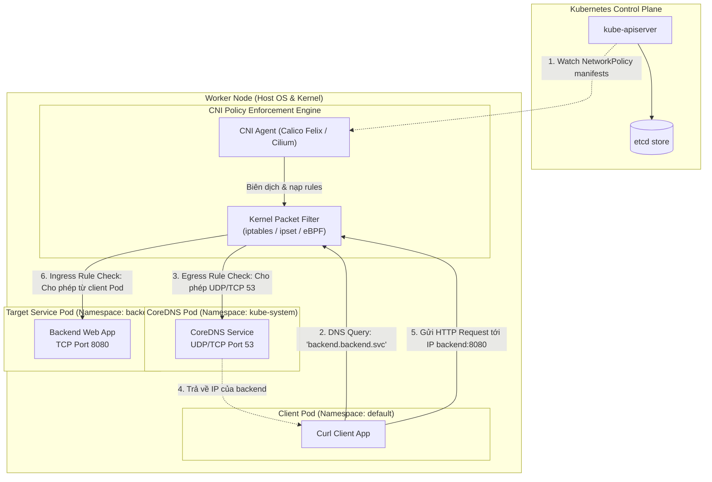

# 6_7_3 NetworkPolicy

> **Khóa học**: Cloud DevOps Basic — Containers and Kubernetes  
> **Phân nhóm**: 6 Domain 6 - Containers and Kubernetes › 6_7 Kubernetes Security Scheduling and Scaling  
> **Chủ đề**: 6_7_3 NetworkPolicy  
> **Phiên bản áp dụng**: Kubernetes 1.37  
> **Trạng thái**: Bản nháp, chờ kiểm chứng  
> **Checklist đối chiếu**: [CHECKLIST](../../CHECKLIST.md#6_7-kubernetes-security-scheduling-and-scaling)  
> **Kiến thức liên quan**: [6_4_1 Kubernetes Network Model and CNI](<../6_4 Kubernetes Networking Configuration and Storage/6_4_1 Kubernetes Network Model and CNI.md>) · [6_4_3 Cluster DNS and Service Discovery](<../6_4 Kubernetes Networking Configuration and Storage/6_4_3 Cluster DNS and Service Discovery.md>)

---

## 1. Khái Niệm Cốt Lõi & Bản Chất Kỹ Thuật (Core Concepts & Technical Deep Dive)

### 1.1 Vì Sao Cần NetworkPolicy? Bản Chất Mạng Mặc Định (Flat Network)

Trong một cụm Kubernetes tiêu chuẩn, mô hình mạng mặc định được thiết kế theo nguyên tắc mạng phẳng và không cô lập (non-isolated / flat network): mọi Pod có thể tự do gửi và nhận lưu lượng mạng tới mọi Pod khác trong toàn cụm mà không gặp bất kỳ rào cản nào. <!-- ev: C3.1 -->

Thiết kế này giúp việc triển khai và kết nối giữa các microservice diễn ra dễ dàng, nhưng lại tiềm ẩn rủi ro an ninh mạng rất lớn khi triển khai trên môi trường sản xuất hoặc môi trường đa người dùng (multi tenant):
- Nếu một Pod frontend tiếp xúc với Internet bị tấn công khai thác lỗ hổng (RCE), kẻ tấn công có thể quét dải mạng nội bộ và kết nối trực tiếp tới cơ sở dữ liệu hoặc các dịch vụ nội bộ nhạy cảm (kỹ thuật lateral movement).
- Các Pod thuộc môi trường thử nghiệm (development / staging) có thể vô tình gửi gói tin sang môi trường sản xuất (production) nếu cấu hình sai địa chỉ Service.

Để phân vùng và kiểm soát lưu lượng mạng ở cấp độ Pod, Kubernetes cung cấp tài nguyên NetworkPolicy. NetworkPolicy là tài nguyên cấu hình mạng chuẩn thuộc API group `networking.k8s.io/v1` và hoạt động theo phạm vi từng namespace (namespaced resource). <!-- ev: C3.2 -->

NetworkPolicy hoạt động ở Tầng 3 (Network Layer - địa chỉ IP) và Tầng 4 (Transport Layer - cổng và giao thức mạng) của mô hình OSI. Bằng cách định nghĩa NetworkPolicy, quản trị viên có thể thiết lập tường lửa phần mềm điều khiển lưu lượng đi vào (Ingress) và lưu lượng đi ra (Egress) của từng nhóm Pod cụ thể.

### 1.2 Kiến Trúc Thực Thi Của CNI Plugin

Một đặc điểm kỹ thuật cốt lõi người vận hành cần nắm vững là sự phân chia trách nhiệm giữa Kubernetes API Server và CNI plugin:

Bản thân Kubernetes API server chỉ lưu trữ và phân phối cấu hình NetworkPolicy trong etcd chứ không trực tiếp lọc hay can thiệp vào các gói tin mạng trên máy chủ. <!-- ev: C3.3 -->

Chính vì vậy, NetworkPolicy chỉ có hiệu lực thực tế khi cụm Kubernetes sử dụng một CNI (Container Network Interface) plugin hỗ trợ thực thi chính sách mạng (như Calico, Cilium, Antrea, hoặc Kube-router). <!-- ev: C3.4 -->

Khi một NetworkPolicy được tạo ra, quy trình thực thi diễn ra như sau:

<!-- ev: C3.4 -->
1. Máy chủ kube-apiserver lưu manifest vào etcd.
2. Agent của CNI chạy trên từng worker node phát hiện thay đổi thông qua cơ chế Kubernetes Watch API.
3. CNI Agent biên dịch cấu hình khai báo thành các quy tắc lọc gói tin cấp nhân hệ điều hành Linux: Calico sử dụng iptables hoặc ipsets, còn Cilium biên dịch thành chương trình eBPF gắn vào các giao diện mạng ảo.

CNI mặc định `kindnetd` trong công cụ kind không hỗ trợ thực thi NetworkPolicy; để sử dụng NetworkPolicy trên kind, người dùng cần cấu hình `networking.disableDefaultCNI: true` và cài đặt một CNI plugin có hỗ trợ như Calico hoặc Cilium. <!-- ev: C3.5 -->

### 1.3 Cơ Chế Kích Hoạt Trạng Thái Cô Lập (Pod Isolation) Và Tính Chất Cộng Dồn (Additive)

Cơ chế lọc gói tin của NetworkPolicy tuân theo quy tắc kích hoạt trạng thái cô lập:

Khi chưa có NetworkPolicy nào chọn một Pod, Pod đó ở trạng thái non-isolated đối với cả hai chiều Ingress và Egress. <!-- ev: C3.6 -->

Một Pod trở thành isolated đối với một hướng lưu lượng (Ingress hoặc Egress) ngay khi có ít nhất một NetworkPolicy chọn Pod đó trong trường `podSelector` và liệt kê hướng đó trong `policyTypes`. <!-- ev: C3.7 -->

Khi một Pod đã chuyển sang trạng thái isolated đối với một hướng lưu lượng, tất cả các kết nối theo hướng đó sẽ bị CNI từ chối, trừ khi kết nối đó khớp với ít nhất một quy tắc cho phép (allow rule).

Các NetworkPolicy có tính chất cộng dồn (additive): nếu nhiều NetworkPolicy cùng áp dụng lên một Pod, tập hợp các quy tắc cho phép (allow rules) là phép hợp logic (union / logical OR) của các quy tắc đó. <!-- ev: C3.8 -->

Điều này có nghĩa là Kubernetes không có quy tắc từ chối tường minh (explicit deny): mọi quy tắc khai báo trong ingress hoặc egress đều là các quy tắc cấp quyền (allow list). <!-- ev: C3.8 -->

Ngoài ra, NetworkPolicy không can thiệp và không chặn các kết nối mạng loopback nội bộ (`localhost` hoặc `127.0.0.1`) giữa các container chạy bên trong cùng một Pod. <!-- ev: C3.9 -->

---

## 2. Ví Dụ Đời Sống Thực Tế Dễ Hiểu (Intuitive Real-World Analogies)

Hãy tưởng tượng một tòa nhà làm việc thiết kế theo phong cách không gian mở (Open Space Office):
- **Giai đoạn đầu (Flat Network)**: Tòa nhà không có vách ngăn, không có cửa khóa. Nhân viên phòng marketing, lập trình viên, kế toán và khách vãng lai có thể tự do bước vào bàn làm việc của nhau để nói chuyện. Mọi thứ ban đầu rất thuận lợi, nhưng khi công ty mở rộng, bất kỳ ai cũng có thể ngó vào màn hình phòng kế toán để xem dữ liệu tài chính.
- **Lắp đặt thẻ từ và cửa ngăn (CNI Enforcement)**: Ban quản lý quyết định xây tường và lắp hệ thống khóa cửa điện tử. Việc chỉ ban hành nội quy trên giấy (Kubernetes API) sẽ vô nghĩa nếu không có nhân viên bảo vệ và khóa từ thực tế tại từng cửa (CNI Agent Calico/Cilium).
- **Thiết lập Default-Deny**: Ban quản lý áp dụng chính sách giới nghiêm: tất cả các cửa ra vào phòng ban đều bị khóa tự động. Người bên ngoài không thể tự tiện bước vào phòng kế toán (Ingress Deny), và nhân viên trong phòng cũng không được tự ý đi ra ngoài các khu vực khác (Egress Deny).
- **Cạm bẫy tổng đài nội bộ (CoreDNS Port 53)**: Sau khi khóa chặt cửa chiều ra, nhân viên trong phòng kế toán cần chuyển báo cáo tài chính tới ngân hàng đối tác. Họ cầm điện thoại bàn lên để gọi hỏi số fax, nhưng phát hiện đường dây nội bộ tới phòng tổng đài viễn thông (CoreDNS) đã bị cắt đứt do lệnh cấm Egress. Nhân viên bị cô lập hoàn toàn, không thể tra cứu số máy của bất kỳ ai, khiến toàn bộ công việc bị tê liệt dù cửa gửi hồ sơ tới ngân hàng đã được phê duyệt.

Bài học rút ra: Khi thiết lập khóa cửa chiều ra (Egress Default-Deny), điều đầu tiên bắt buộc phải làm là nối lại đường dây liên lạc tới phòng tổng đài CoreDNS trên cổng 53.

---

## 3. Kiến Trúc, Luồng Hoạt Động & Hình Ảnh Trực Quan (Architecture, Diagrams & Visual Media)

Sơ đồ dưới đây minh họa luồng xử lý gói tin và tương tác giữa các thành phần khi một Pod gửi yêu cầu mạng qua bộ lọc NetworkPolicy do CNI thực thi:



---

## 4. Code Mẫu Trực Quan Hoặc Dòng Lệnh Thực Chiến (Runnable Sample Code / CLI)

### 4.1 Cấu Hình Mẫu Default-Deny Cho Namespace

Quy tắc bảo mật tốt nhất là áp dụng chính sách Default-Deny cho cả hai chiều Ingress và Egress ngay khi tạo namespace mới:

<!-- ev: C3.10 -->
```yaml
# default-deny-ingress.yaml
apiVersion: networking.k8s.io/v1
kind: NetworkPolicy
metadata:
  name: default-deny-ingress
  namespace: production
spec:
  podSelector: {}
  policyTypes:
  - Ingress
```

Khối cấu hình trên sử dụng `podSelector: {}` để áp dụng lên toàn bộ Pod trong namespace `production`. Việc chỉ định `policyTypes: ["Ingress"]` mà không khai báo khối `ingress:` khiến mọi lưu lượng đi vào tất cả Pod trong namespace đều bị từ chối. <!-- ev: C3.10 -->

<!-- ev: C3.11 -->
```yaml
# default-deny-egress.yaml
apiVersion: networking.k8s.io/v1
kind: NetworkPolicy
metadata:
  name: default-deny-egress
  namespace: production
spec:
  podSelector: {}
  policyTypes:
  - Egress
```

Tương tự, file manifest trên khóa toàn bộ lưu lượng đi ra từ tất cả Pod trong namespace `production` bằng cách đặt `policyTypes: ["Egress"]` mà không khai báo khối `egress:`. <!-- ev: C3.11 -->

### 4.2 Cú Pháp Mở Dần Lưu Lượng (Allow Rules)

Sau khi đã khóa toàn bộ, quản trị viên sử dụng các tiêu chí chọn lọc để mở dần các luồng truy cập cần thiết:

- **podSelector**: Trường `podSelector` trong quy tắc `from` hoặc `to` chọn các Pod làm nguồn hoặc đích nằm trong cùng namespace với tài nguyên NetworkPolicy. <!-- ev: C3.12 -->
- **namespaceSelector**: Trường `namespaceSelector` trong quy tắc `from` hoặc `to` chọn tất cả các Pod thuộc các namespace có nhãn phù hợp với điều kiện selector. <!-- ev: C3.13 -->
- **Phép AND giữa namespaceSelector và podSelector**: Khi `namespaceSelector` và `podSelector` cùng nằm trong một phần tử từ điển (dictionary item) trong khối `from` hoặc `to`, CNI kết hợp chúng theo phép AND logic: chỉ chấp nhận Pod có nhãn chỉ định nằm bên trong namespace có nhãn chỉ định. <!-- ev: C3.14 -->
- **Phép OR giữa namespaceSelector và podSelector**: Khi `namespaceSelector` và `podSelector` được khai báo thành hai phần tử danh sách riêng biệt (mỗi phần tử bắt đầu bằng một dấu gạch đầu dòng `-`) trong khối `from` hoặc `to`, CNI kết hợp chúng theo phép OR logic. <!-- ev: C3.15 -->
- **ipBlock**: Khối `ipBlock` cho phép xác định dải địa chỉ IP nguồn hoặc đích bằng trường `cidr` (Classless Inter-Domain Routing). <!-- ev: C3.16 -->
- **except trong ipBlock**: Trường `except` bên trong khối `ipBlock` cho phép loại trừ một hoặc nhiều dải IP con nằm trong dải `cidr` đã chỉ định. <!-- ev: C3.17 -->
- **ports**: Trường `ports` trong các quy tắc `ingress` hoặc `egress` hỗ trợ các giao thức mạng `TCP`, `UDP`, và `SCTP`, trong đó giao thức mặc định nếu không khai báo là `TCP`. <!-- ev: C3.18 -->

Dưới đây là ví dụ manifest hoàn chỉnh mở Ingress cho backend Pod:

```yaml
# allow-ingress-backend.yaml
apiVersion: networking.k8s.io/v1
kind: NetworkPolicy
metadata:
  name: allow-ingress-backend
  namespace: production
spec:
  podSelector:
    matchLabels:
      app: backend
  policyTypes:
  - Ingress
  ingress:
  - from:
    # 1. Logic AND: Chỉ Pod có nhãn role=frontend nằm trong namespace có nhãn role=ingress-tier
    - namespaceSelector:
        matchLabels:
          role: ingress-tier
      podSelector:
        matchLabels:
          role: frontend
    # 2. ipBlock: Cho phép lưu lượng từ dải mạng nội bộ văn phòng, loại trừ subnet VPN cũ
    - ipBlock:
        cidr: 10.100.0.0/16
        except:
        - 10.100.50.0/24
    ports:
    - protocol: TCP
      port: 8080
```

### 4.3 Khôi Phục Phân Giải Tên Miền DNS Khi Sử Dụng Egress Default-Deny

Khi áp dụng Egress Default-Deny, bắt buộc phải có một NetworkPolicy mở kết nối tới CoreDNS:

Để khôi phục khả năng phân giải DNS cho Pod khi bật Egress Default-Deny, cần tạo quy tắc Egress cho phép gửi gói tin qua giao thức UDP và TCP tới cổng 53 của các Pod CoreDNS trong namespace `kube-system`. <!-- ev: C3.20 -->

```yaml
# allow-dns-egress.yaml
apiVersion: networking.k8s.io/v1
kind: NetworkPolicy
metadata:
  name: allow-dns-egress
  namespace: production
spec:
  podSelector: {}
  policyTypes:
  - Egress
  egress:
  - to:
    - namespaceSelector:
        matchLabels:
          kubernetes.io/metadata.name: kube-system
      podSelector:
        matchLabels:
          k8s-app: kube-dns
    ports:
    - protocol: UDP
      port: 53
    - protocol: TCP
      port: 53
```

### 4.4 Các Dòng Lệnh Kiểm Thử Trên Cụm Kind

Quy trình thiết lập cụm thử nghiệm hỗ trợ NetworkPolicy bằng Calico trên kind:

```bash
# Bước 1: Tạo file cấu hình kind vô hiệu hóa CNI mặc định
cat <<EOF > kind-calico-config.yaml
kind: Cluster
apiVersion: kind.x-k8s.io/v1alpha4
networking:
  disableDefaultCNI: true
  podSubnet: "192.168.0.0/16"
EOF

# Bước 2: Khởi tạo cluster kind với cấu hình trên
kind create cluster --name netpol-lab --config kind-calico-config.yaml

# Bước 3: Cài đặt Tigera Operator và Calico CNI
kubectl create -f https://raw.githubusercontent.com/projectcalico/calico/v3.28.0/manifests/tigera-operator.yaml
kubectl create -f https://raw.githubusercontent.com/projectcalico/calico/v3.28.0/manifests/custom-resources.yaml

# Bước 4: Chờ toàn bộ Pod hệ thống và Calico Node đạt trạng thái Ready
kubectl wait --namespace calico-system --for=condition=Ready pods --all --timeout=300s
kubectl wait --namespace kube-system --for=condition=Ready pods --all --timeout=300s

# Bước 5: Kiểm tra kết nối từ Pod client tới Pod backend
kubectl run client -n production --image=curlimages/curl -- sleep 3600
kubectl exec -it client -n production -- curl --connect-timeout 2 http://backend:8080
```

---

## 5. Cạm Bẫy Thực Tế & Thực Tiễn Sản Xuất (Production Gotchas & Best Practices)

- **Cạm bẫy chặn CoreDNS khi bật Egress Default-Deny**:  
  Khi chính sách Egress Default-Deny có hiệu lực trên một Pod, mọi yêu cầu phân giải tên miền DNS nội bộ của Pod đều thất bại do lưu lượng gửi ra bên ngoài tới dịch vụ CoreDNS bị chặn. <!-- ev: C3.19 -->  
  Triệu chứng thường gặp là ứng dụng khởi động thất bại hoặc báo lỗi không thể phân giải tên miền dịch vụ ("Could not resolve host"). Các lập trình viên thường nhầm tưởng rằng cơ sở dữ liệu bị sập hoặc policy Ingress của database bị sai, nhưng thực tế gói tin truy vấn DNS tới CoreDNS đã bị chặn ngay tại card mạng của Pod phát ra.  
  *Khắc phục*: Luôn tạo NetworkPolicy mở Egress UDP và TCP cổng 53 tới namespace kube-system song song với manifest default-deny. <!-- ev: C3.20 -->

- **Ảo tưởng an toàn khi sử dụng CNI không hỗ trợ thực thi**:  
  Kubernetes chấp nhận manifest NetworkPolicy hoàn toàn hợp lệ mà không phát sinh bất kỳ lỗi nào dù CNI plugin của cụm không hỗ trợ thực thi. Nếu người vận hành chạy trên cụm kind mặc định hoặc các môi trường dùng flannel đơn thuần, lệnh xem cấu hình vẫn hiển thị policy đang chạy, nhưng các gói tin mạng vẫn đi qua tự do mà không bị chặn. <!-- ev: C3.4 --> Luôn xác minh khả năng thực thi của CNI trên môi trường staging trước khi áp dụng vào production.

- **Sai sót logic AND và OR trong cú pháp YAML**:  
  Sự hiện diện của dấu gạch đầu dòng trong mảng from hoặc to thay đổi hoàn toàn ngữ nghĩa bảo mật:
  ```yaml
  # CẢNH BÁO: Phép OR (Mở rộng phạm vi ngoài ý muốn)
  from:
  - namespaceSelector:
      matchLabels:
        env: prod
  - podSelector:
      matchLabels:
        role: frontend
  ```
  Cấu hình trên cho phép: mọi Pod trong namespace env: prod HOẶC bất kỳ Pod nào có nhãn role: frontend nằm trong namespace hiện tại. Nếu mục đích là chỉ nhận từ frontend của namespace prod, người cấu hình phải bỏ dấu gạch đầu dòng thứ hai để gộp thành phép AND. <!-- ev: C3.15 -->

- **Thực tiễn sản xuất (Best Practices)**:
  1. **Nguyên tắc đặc quyền tối thiểu (Least Privilege)**: Luôn áp dụng Ingress và Egress Default-Deny cho từng namespace, sau đó chỉ mở đích danh các cổng và Pod cần thiết.
  2. **Dán nhãn định danh cho Namespace**: Từ Kubernetes bản 1.21 trở đi, nhãn chuẩn kubernetes.io/metadata.name được tự động gán cho mọi namespace; hãy ưu tiên sử dụng nhãn này trong namespaceSelector thay vì tự đặt nhãn thủ công. <!-- ev: C3.13 -->
  3. **Không bao giờ dùng ipBlock cho IP của Pod**: Địa chỉ IP của Pod trong Kubernetes mang tính biến động; chỉ sử dụng ipBlock cho các dải mạng bên ngoài cụm, còn giữa các Pod trong cụm hãy luôn sử dụng podSelector và namespaceSelector. <!-- ev: C3.16 -->

---

## 6. Câu Hỏi Củng Cố Kiến Thức (Active Recall Quiz)

### Câu hỏi 1: Lỗi Phân Giải Tên Miền Sau Khi Kích Hoạt NetworkPolicy
Một nhóm phát triển triển khai ứng dụng `api-service` và áp dụng một NetworkPolicy để bảo vệ:
```yaml
spec:
  podSelector:
    matchLabels:
      app: api-service
  policyTypes:
  - Egress
  egress:
  - to:
    - podSelector:
        matchLabels:
          app: postgresql
    ports:
    - protocol: TCP
      port: 5432
```
Ngay sau đó, `api-service` không thể kết nối tới cơ sở dữ liệu qua địa chỉ `postgresql.production.svc.cluster.local`, dù Pod `postgresql` đang hoạt động bình thường. Nguyên nhân là gì và cần bổ sung cấu hình gì?

<details>
<summary>Đáp án</summary>

**Nguyên nhân**: Khi khai báo `policyTypes: ["Egress"]`, `api-service` chuyển sang trạng thái isolated chiều đi. Do danh sách `egress:` chỉ mở cổng 5432 tới `postgresql` mà không có quy tắc mở cổng 53 tới CoreDNS, `api-service` bị chặn hoàn toàn truy vấn phân giải tên miền DNS. Vì vậy, ứng dụng không thể phân giải tên `postgresql.production.svc.cluster.local` thành IP.

**Khắc phục**: Bổ sung thêm một quy tắc trong khối `egress:` cho phép gửi gói tin qua giao thức UDP và TCP tới cổng 53 tới các Pod CoreDNS trong namespace `kube-system`.
</details>

### Câu hỏi 2: Phân Biệt Phép Kết Hợp AND và OR Trong Selector
Hãy phân tích sự khác nhau về quyền truy cập giữa hai đoạn cấu hình sau:
```yaml
# Đoạn A
ingress:
- from:
  - namespaceSelector:
      matchLabels:
        tenant: payment
    podSelector:
      matchLabels:
        app: checkout

# Đoạn B
ingress:
- from:
  - namespaceSelector:
      matchLabels:
        tenant: payment
  - podSelector:
      matchLabels:
        app: checkout
```

<details>
<summary>Đáp án</summary>

- **Đoạn A (Phép AND logic)**: `namespaceSelector` và `podSelector` nằm trong cùng một phần tử từ điển (dictionary item). Chỉ các Pod có nhãn `app: checkout` **đồng thời nằm bên trong** namespace có nhãn `tenant: payment` mới được phép gửi gói tin đến.
- **Đoạn B (Phép OR logic)**: Có hai dấu gạch ngang riêng biệt tạo thành hai phần tử trong danh sách. Lưu lượng được cho phép nếu thỏa mãn một trong hai điều kiện: hoặc đến từ **bất kỳ Pod nào** nằm trong namespace có nhãn `tenant: payment`, hoặc đến từ Pod có nhãn `app: checkout` **nằm trong namespace hiện tại** của NetworkPolicy.
</details>

### Câu hỏi 3: Triển Khai NetworkPolicy Trên Cụm Kind
Một kỹ sư tạo cụm thử nghiệm bằng lệnh `kind create cluster --name test`. Sau đó kỹ sư áp dụng Ingress Default-Deny vào namespace `demo`. Tuy nhiên, khi dùng `curl` từ một Pod bên ngoài gọi vào Pod trong namespace `demo`, kết nối vẫn thành công bình thường. Tại sao?

<details>
<summary>Đáp án</summary>

**Nguyên nhân**: CNI mặc định của kind là `kindnetd`, vốn không có tính năng thực thi NetworkPolicy. `kube-apiserver` vẫn nhận và lưu trữ file YAML, nhưng không có agent CNI nào trên worker node chuyển đổi cấu hình thành iptables hoặc eBPF rules để chặn gói tin.

**Khắc phục**: Cần tạo lại cụm kind với file cấu hình có `networking.disableDefaultCNI: true`, sau đó cài đặt một CNI plugin hỗ trợ NetworkPolicy như Calico hoặc Cilium.
</details>

---

## 7. 📚 Nguồn Tài Liệu Chính Thống (Tier-1 Official References)

- [Kubernetes Documentation: Network Policies](https://kubernetes.io/docs/concepts/services-networking/network-policies/) - Tài liệu chính thức từ Kubernetes về mô hình bảo mật và đặc tả kỹ thuật của NetworkPolicy.
- [Kubernetes Documentation: Declare Network Policy](https://kubernetes.io/docs/tasks/administer-cluster/declare-network-policy/) - Hướng dẫn từng bước cấu hình và kiểm thử NetworkPolicy trên cụm Kubernetes.
- [kind Documentation: Initial Cluster Configuration](https://kind.sigs.k8s.io/docs/user/configuration/) - Hướng dẫn chính thức về cấu hình cụm kind và tùy chọn tắt CNI mặc định (`disableDefaultCNI`).
