# 6_7_4 Bảo Vệ Secret và Chuỗi Cung Ứng

> **Khóa học**: Cloud DevOps Basic — Containers & Kubernetes  
> **Phân nhóm**: 6 Domain 6 - Containers and Kubernetes › 6_7 Kubernetes Security Scheduling and Scaling  
> **Chủ đề**: Bảo vệ dữ liệu nhạy cảm Secret và an toàn chuỗi cung ứng container: Encryption at rest trong etcd, rủi ro RBAC với Secret, ký và xác thực image với Cosign  
> **Phiên bản áp dụng**: Kubernetes v1.28+, Sigstore Cosign v2.x  
> **Trạng thái**: Bản nháp, chờ kiểm chứng  
> **Phạm vi**: [Topic README](./README.md#6_7_4-bảo-vệ-secret-và-chuỗi-cung-ứng) · **Checkpoint của người học**: [CHECKLIST](../../CHECKLIST.md#6_7-kubernetes-security-scheduling-and-scaling)

---

## 1. Khái Niệm Cốt Lõi & Bản Chất Kỹ Thuật (Core Concepts & Technical Deep Dive)

Trong Kubernetes, việc quản lý thông tin nhạy cảm và bảo đảm nguồn gốc container image là hai mắt xích then chốt của an toàn hệ thống. Nhiều kỹ sư DevOps mới tiếp cận thường mặc định rằng việc cất dữ liệu vào đối tượng Secret là đã an toàn, và việc kéo image từ registry công cộng về cụm là đương nhiên tin cậy. Tuy nhiên, ở cấu hình mặc định, Kubernetes bộc lộ hai lỗ hổng kiến trúc nghiêm trọng: dữ liệu Secret hoàn toàn không được mã hóa cryptographic khi lưu trữ trên đĩa, và cụm chấp nhận nạp bất kỳ image nào mà không kiểm tra tính toàn vẹn.

### 1.1 Bản Chất Của Kubernetes Secret Và Rủi Ro Lưu Trữ etcd Mặc Định
- Kubernetes Secret lưu trữ dữ liệu nhạy cảm dưới dạng key-value, nhưng mặc định dữ liệu chỉ được mã hóa Base64 chứ không phải mã hóa cryptographic. <!-- ev: C4.1 -->
- Khi lưu vào kho dữ liệu etcd của cụm, Kubernetes API server mặc định ghi các Secret dưới dạng văn bản thô (plaintext). <!-- ev: C4.2 -->
- Bất kỳ ai có quyền truy cập trực tiếp vào ổ đĩa host của etcd hoặc file snapshot backup của etcd đều có thể đọc toàn bộ Secret mà không cần thông qua xác thực RBAC của API server. <!-- ev: C4.3 -->

### 1.2 Mã Hóa Dữ Liệu Tĩnh Trong etcd (Encryption at Rest)
- Để bảo vệ Secret trong etcd, Kubernetes cung cấp cơ chế Encryption at rest thông qua cấu hình `EncryptionConfiguration`. <!-- ev: C4.4 -->
- File `EncryptionConfiguration` được truyền vào `kube-apiserver` thông qua cờ dòng lệnh `--encryption-provider-config`. <!-- ev: C4.5 -->
- Trong `EncryptionConfiguration`, Kubernetes hỗ trợ nhiều loại provider mã hóa như `aescbc`, `secretbox`, `aesgcm` và `identity` (đại diện cho dữ liệu không mã hóa). <!-- ev: C4.6 -->
- Thứ tự các provider trong danh sách `providers` xác định provider đầu tiên được dùng để mã hóa khi ghi dữ liệu mới vào etcd, trong khi các provider phía sau được dùng để giải mã dữ liệu đã ghi trước đó. <!-- ev: C4.7 -->
- Với môi trường sản xuất, Kubernetes khuyến nghị sử dụng provider `kms` (Key Management Service) để ủy quyền việc quản lý và lưu trữ khóa mã hóa cho hệ thống KMS chuyên dụng bên ngoài cụm. <!-- ev: C4.8 -->
- Kiến trúc KMS v2 (hỗ trợ ổn định từ Kubernetes v1.29) cải thiện hiệu năng giải mã, hỗ trợ cache khóa DEK cục bộ và tự động xoay vòng khóa (key rotation) mà không cần khởi động lại API server. <!-- ev: C4.9 -->
- Các dịch vụ managed Kubernetes như AKS, EKS và GKE cung cấp tùy chọn mã hóa etcd tích hợp sẵn với dịch vụ quản lý khóa đám mây tương ứng như Azure Key Vault, AWS KMS hoặc Google Cloud KMS. <!-- ev: C4.10 -->

### 1.3 Rủi Ro Phân Quyền RBAC Với Secret (get vs list/watch)
- Trong hệ thống phân quyền Kubernetes RBAC, tài nguyên `secrets` thuộc core API group (được định nghĩa bằng chuỗi rỗng `""`). <!-- ev: C4.11 -->
- Quyền `get` trên tài nguyên Secret có thể giới hạn cho từng secret cụ thể bằng cách khai báo danh sách `resourceNames` trong định nghĩa `Role`. <!-- ev: C4.12 -->
- Quyền `list` hoặc `watch` trên tài nguyên Secret cho phép đọc và tải về toàn bộ nội dung của tất cả Secret trong namespace đó mà không thể hạn chế theo `resourceNames`. <!-- ev: C4.13 -->
- Kubernetes RBAC không hỗ trợ phân quyền ở mức trường dữ liệu (field-level authorization) hay hạn chế quyền truy cập vào các key cụ thể bên trong trường `data` của Secret. <!-- ev: C4.14 -->

### 1.4 Bảo Vệ Chuỗi Cung Ứng Container (Container Supply Chain Security)
- Tấn công chuỗi cung ứng container (container supply chain attack) có thể xảy ra khi kẻ tấn công can thiệp sửa đổi image trên registry hoặc đánh tráo tag image (`image tampering`). <!-- ev: C4.15 -->
- Cosign là công cụ dòng lệnh thuộc dự án nguồn mở Sigstore, được dùng để ký số và xác thực chữ ký cho OCI container image. <!-- ev: C4.16 -->
- Cosign lưu trữ chữ ký số trực tiếp vào OCI registry dưới dạng một OCI artifact liên kết với mã băm digest (SHA256) của container image mà không làm thay đổi image gốc. <!-- ev: C4.17 -->
- Kubernetes sử dụng Admission Controller (như admission webhook hoặc ValidatingAdmissionPolicy kết hợp cùng Kyverno/Gatekeeper) để kiểm tra chữ ký số của container image trước khi cho phép Pod được tạo. <!-- ev: C4.18 -->

---

## 2. Ví Dụ Đời Sống Thực Tế Dễ Hiểu (Intuitive Real-World Analogies)

Để hình dung trọn vẹn hai cơ chế bảo vệ này, hãy liên tưởng tới hệ thống an ninh của một ngân hàng thương mại quốc tế:

1. **Secret mặc định và Base64 giống như tờ giấy viết tiếng nước ngoài đặt trong tủ kính**:
   Nhiều người nghĩ rằng viết mật khẩu bằng tiếng nước ngoài (Base64) thì người đi qua không hiểu ngay. Nhưng bất kỳ ai biết tra từ điển đều dịch ra trong vài giây. Nếu tủ kính đặt ở sảnh (etcd không bật mã hóa tĩnh), kẻ gian đột nhập vào phòng máy là đọc được toàn bộ bí mật kinh doanh mà không cần chìa khóa cửa chính.

2. **Encryption at rest với KMS như két sắt chống cháy có khóa điện tử từ xa**:
   Khi bật cơ chế mã hóa tĩnh với KMS bên ngoài, mọi tài liệu trước khi cất vào ngăn tủ etcd đều được mã hóa thành các chuỗi ký tự vô nghĩa (ciphertext). Khóa mở két không nằm trên máy chủ ngân hàng mà được gửi nhờ tại một trung tâm bảo mật chuyên dụng độc lập (KMS). Kẻ trộm có tháo rời ổ đĩa etcd mang về nhà cũng chỉ thấy dữ liệu rác, không thể giải mã nếu không có khóa từ KMS.

3. **Quyền "list Secret" như phát chìa khóa vạn năng cho nhân viên lưu trữ**:
   Nếu bạn cấp quyền `get` Secret kèm tên cụ thể, nhân viên chỉ được phép yêu cầu đúng tập hồ sơ mang mã số đã đăng ký. Ngược lại, nếu bạn cấp quyền `list Secret`, điều đó tương đương với việc cho phép nhân viên photocopy toàn bộ mọi ngăn tủ trong phòng lưu trữ mang về nhà. Một ServiceAccount bị chiếm đoạt có quyền `list Secret` sẽ làm lộ sạch toàn bộ mật khẩu, token và khóa bí mật của cả namespace.

4. **Ký image Cosign như tem niêm phong chống hàng giả của cục kiểm định**:
   Một kiện hàng (container image) gửi từ nhà máy đến kho hàng có thể bị kẻ xấu tráo ruột trên đường đi nếu bao bì chỉ ghi nhãn thông thường (mutable tag). Tem niêm phong có chữ ký số điện tử (Cosign) dán chặt vào cấu trúc kiện hàng (digest SHA256). Người gác cổng ngân hàng (Admission Controller) dùng máy quét kiểm tra tem niêm phong: kiện hàng nào không có tem hợp lệ của nhà sản xuất tin cậy sẽ bị chặn ngay tại cổng, tuyệt đối không cho phép đưa vào hoạt động.

---

## 3. Kiến Trúc, Luồng Hoạt Động & Hình Ảnh Trực Quan (Architecture, Diagrams & Visual Media)

Kiến trúc bảo mật hai lớp: bảo vệ dữ liệu nhạy cảm tĩnh trong etcd và bảo vệ chuỗi cung ứng container trước khi Pod khởi tạo.

```mermaid
flowchart TD
    subgraph SECRET_SECURITY["Lớp 1: Bảo Vệ Secret Trong etcd & Kiểm Soát RBAC"]
        USER["Kỹ sư / CI ServiceAccount"] -->|"Yêu cầu API"| APISRV["kube-apiserver"]
        APISRV --> RBAC{"Kiểm Tra RBAC"}
        RBAC -->|"Verb: list secrets"| DANGER["Lấy toàn bộ Secret trong namespace<br/>(Rủi ro cao)"]
        RBAC -->|"Verb: get secret + resourceNames"| SAFE["Chỉ đọc đúng Secret được chỉ định"]
        SAFE --> ENC_CONF{"EncryptionConfiguration"}
        ENC_CONF -->|"Provider: kms (v1 / v2)"| EXT_KMS["KMS Plugin / External KMS<br/>(AWS KMS, Azure Key Vault, Vault)"]
        EXT_KMS -->|"Dữ liệu đã mã hóa (DEK)"| ETCD_ENC[("etcd Storage<br/>(Lưu Ciphertext an toàn)")]
        ENC_CONF -->|"Provider: identity (Mặc định)"| ETCD_PLAIN[("etcd Storage<br/>(Lưu Plaintext Base64)")]
    end

    subgraph SUPPLY_CHAIN["Lớp 2: Bảo Vệ Chuỗi Cung Ứng Container Với Cosign"]
        DEV["Lập trình viên / Pipeline"] -->|"1. Build container image"| BLD["Container Image"]
        BLD -->|"2. Ký digest bằng private key"| CS_SIGN["cosign sign"]
        CS_SIGN -->|"3. Đẩy image và signature artifact"| REG[("OCI Registry<br/>(Harbor, ACR, ECR, Docker Hub)")]
        DEPLOY["Triển khai Deployment / Pod"] -->|"4. Gửi Pod Spec"| ADM{"Admission Controller<br/>(ValidatingWebhook / Policy)"}
        REG -.->|"5. Tải chữ ký và public key"| ADM
        ADM -->|"6a. Chữ ký hợp lệ và khớp digest"| ALLOW["Cho phép Pod khởi tạo"]
        ADM -->|"6b. Không có chữ ký hoặc sai chữ ký"| DENY["Từ chối tạo Pod (Admission Denied)"]
    end
```



### Giải Thích Luồng Xử Lý Kiến Trúc
<!-- ev: C4.8 C4.18 -->
- **Luồng Secret**: Khi yêu cầu gửi tới `kube-apiserver`, RBAC thẩm định quyền. Nếu người gọi có quyền đọc và dữ liệu được ghi vào `etcd`, `EncryptionConfiguration` sẽ dùng KMS plugin bên ngoài để mã hóa payload với Data Encryption Key (DEK). Dữ liệu nằm trong `etcd` hoàn toàn là bản mã (ciphertext).
- **Luồng Image**: Khi image được build xong, `cosign sign` tạo chữ ký số dựa trên digest SHA256 và tải metadata chữ ký lên OCI Registry. Khi Pod yêu cầu chạy image đó, Admission Controller sẽ chặn lại, kiểm tra chữ ký với khóa công khai (public key); chỉ khi chữ ký hợp lệ thì Pod mới được lập lịch chạy.

---

## 4. Code Mẫu Trực Quan Hoặc Dòng Lệnh Thực Chiến (Runnable Sample Code / CLI)

### 4.1 Cấu Hình EncryptionConfiguration Cho kube-apiserver

Dưới đây là file cấu hình mẫu `encryption-config.yaml` áp dụng chuẩn `apiserver.config.k8s.io/v1` để kích hoạt mã hóa dữ liệu tĩnh cho Secret: <!-- ev: C4.4 C4.6 -->

```yaml
apiVersion: apiserver.config.k8s.io/v1
kind: EncryptionConfiguration
resources:
  - resources:
      - secrets
    providers:
      - aescbc:
          keys:
            - name: key1
              secret: c2VjcmV0IGlzIHNlY3VyZSBmb3Igazg= # Khóa 32-byte Base64
      - identity: {} # Cho phép đọc các Secret cũ chưa kịp mã hóa
```

Để áp dụng file cấu hình này, tham số sau được bổ sung vào cờ khởi động của tiến trình `kube-apiserver`: <!-- ev: C4.5 -->

```bash
# Bổ sung cờ cấu hình mã hóa vào manifest /etc/kubernetes/manifests/kube-apiserver.yaml
--encryption-provider-config=/etc/kubernetes/enc/encryption-config.yaml
```

### 4.2 Thiết Lập RBAC An Toàn Cho Secret: `get` Có Giới Hạn vs `list` Nguy Hiểm

Ví dụ sau minh họa sự khác biệt giữa cấu hình Role an toàn (chỉ cho phép `get` secret cụ thể) và cấu hình Role nguy hiểm (cấp quyền `list`): <!-- ev: C4.12 C4.13 -->

```yaml
# CẤU HÌNH AN TOÀN: Chỉ cho phép đọc đúng secret "payment-api-token"
apiVersion: rbac.authorization.k8s.io/v1
kind: Role
metadata:
  namespace: backend
  name: payment-secret-reader
rules:
  - apiGroups: [""] # Core API group
    resources: ["secrets"]
    verbs: ["get"]
    resourceNames: ["payment-api-token"] # Bắt buộc chỉ định đích danh tên Secret
---
# CẤU HÌNH NGUY HIỂM: Cho phép đọc sạch toàn bộ Secret trong namespace!
apiVersion: rbac.authorization.k8s.io/v1
kind: Role
metadata:
  namespace: backend
  name: dangerous-secret-lister
rules:
  - apiGroups: [""]
    resources: ["secrets"]
    verbs: ["list", "watch"] # Không thể áp dụng resourceNames cho verb list/watch!
```

Kiểm tra quyền truy cập bằng lệnh `kubectl auth can-i`: <!-- ev: C4.12 C4.13 -->

```bash
# Kiểm tra xem ServiceAccount có đọc được secret cụ thể hay không
kubectl auth can-i get secret/payment-api-token --as=system:serviceaccount:backend:payment-sa -n backend
# Kết quả mong đợi: yes

# Kiểm tra xem ServiceAccount có thể list toàn bộ secret hay không
kubectl auth can-i list secrets --as=system:serviceaccount:backend:payment-sa -n backend
# Kết quả mong đợi: no (nếu đã giới hạn quyền an toàn)
```

### 4.3 Ký Và Xác Thực Container Image Bằng Cosign (Sigstore)

Quy trình thực chiến tạo cặp khóa, ký image và xác thực trước khi triển khai: <!-- ev: C4.16 C4.17 -->

```bash
# Bước 1: Tạo cặp khóa bí mật và khóa công khai với cosign
cosign generate-key-pair
# Lệnh tạo ra file cosign.key (private key) và cosign.pub (public key)

# Bước 2: Ký image container theo digest SHA256 cố định
cosign sign --key cosign.key myregistry.io/myorg/payment-service@sha256:7b5d1e2f3a4b...

# Bước 3: Xác thực chữ ký số của container image trước khi deploy
cosign verify --key cosign.pub myregistry.io/myorg/payment-service@sha256:7b5d1e2f3a4b...
```

Đầu ra mẫu khi lệnh xác thực `cosign verify` thành công: <!-- ev: C4.16 C4.17 -->

```json
Verification for myregistry.io/myorg/payment-service@sha256:7b5d1e2f3a4b... --
The following checks were performed on each of these signatures:
  - The cosign claims were validated
  - The signatures were successfully verified against the specified public key
[{"critical":{"identity":{"docker-reference":"myregistry.io/myorg/payment-service"},"image":{"docker-manifest-digest":"sha256:7b5d1e2f3a4b..."},"type":"cosign container image signature"},"optional":null}]
```

---

## 5. Cạm Bẫy Thực Tế & Thực Tiễn Sản Xuất (Production Gotchas & Best Practices)

### 5.1 Cạm Bẫy: Bật EncryptionConfiguration Nhưng Không Mã Hóa Lại Secret Cũ
- **Hiện tượng**: Quản trị viên cấu hình thành công `EncryptionConfiguration` cho `kube-apiserver`, nhưng các Secret cũ tạo từ trước vẫn tồn tại dưới dạng plaintext trong file lưu trữ etcd. <!-- ev: C4.2 C4.4 -->
- **Bản chất**: Kubernetes API server chỉ thực hiện mã hóa khi một đối tượng được ghi mới hoặc cập nhật. Các bản ghi có sẵn trong etcd không tự động được mã hóa lại. <!-- ev: C4.7 -->
- **Thực tiễn sản xuất**: Ngay sau khi bật encryption provider, bắt buộc phải chạy lệnh cập nhật đồng loạt toàn bộ Secret để API server đọc ra và ghi lại dưới dạng bản mã: <!-- ev: C4.4 -->
  ```bash
  kubectl get secrets -A -o json | kubectl replace -f -
  ```

### 5.2 Cạm Bẫy: Cấp Nhầm Quyền `list` Secret Cho Pipeline CI/CD Hoặc Ứng Dụng
- **Hiện tượng**: Pipeline deploy hoặc ServiceAccount của ứng dụng yêu cầu quyền đọc secret, kỹ sư cấp quyền `verbs: ["get", "list"]` cho `resources: ["secrets"]`. <!-- ev: C4.13 -->
- **Hệ quả**: Quyền `list` cho phép tải về toàn bộ nội dung của tất cả Secret trong namespace, vô hiệu hóa hoàn toàn nguyên tắc đặc quyền tối thiểu. <!-- ev: C4.13 C4.14 -->
- **Thực tiễn sản xuất**: Tuyệt đối không cấp quyền `list` Secret trừ khi thực sự cần thiết (như các controller hệ thống sao lưu). Đối với ứng dụng thông thường, chỉ cấp quyền `get` và luôn sử dụng `resourceNames` để giới hạn đích danh Secret được phép đọc. <!-- ev: C4.12 C4.13 -->

### 5.3 Cạm Bẫy: Ký Image Dựa Trên Mutable Tag Thay Vì Immutable Digest
- **Hiện tượng**: Kỹ sư thực hiện `cosign sign` trên tag mutable như `myimage:latest` hoặc `myimage:v1.0.0`. <!-- ev: C4.15 -->
- **Hệ quả**: Tag trên OCI registry có thể bị kẻ tấn công hoặc quy trình build khác ghi đè (tag overwrite) bằng một image chứa mã độc, dẫn tới việc chạy sai image mà chữ ký cũ vẫn hiển thị hợp lệ trên registry. <!-- ev: C4.15 C4.17 -->
- **Thực tiễn sản xuất**: Luôn thực hiện ký số và định nghĩa Pod Spec tham chiếu theo digest bất biến (`image@sha256:...`) để đảm bảo mã chạy trên cụm khớp chính xác với mã đã được phê duyệt và kiểm tra chất lượng. <!-- ev: C4.17 C4.18 -->

---

## 6. Câu Hỏi Củng Cố Kiến Thức (Active Recall Quiz)

### Câu Hỏi 1: Vì sao nói Kubernetes Secret mặc định chưa an toàn khi lưu trữ trong etcd, và giải pháp kỹ thuật là gì?

<details>
<summary>Đáp án</summary>

Mặc định Kubernetes Secret chỉ encode dữ liệu dạng Base64 (thuật toán mã hóa ký tự đảo ngược được) chứ không hề mã hóa bảo mật (cryptographic encryption), và API server lưu Secret vào etcd dưới dạng văn bản thô (plaintext). Người có quyền truy cập ổ đĩa host hoặc file snapshot backup của etcd có thể đọc toàn bộ Secret mà không qua RBAC. Giải pháp kỹ thuật là kích hoạt **Encryption at rest** cho Secret bằng file `EncryptionConfiguration` gắn vào `kube-apiserver`, kết hợp với KMS provider để quản lý khóa mã hóa bên ngoài cụm.
</details>

### Câu Hỏi 2: Phân biệt sự khác nhau về mức độ rủi ro giữa quyền `get` Secret và quyền `list` Secret trong RBAC?

<details>
<summary>Đáp án</summary>

Quyền `get` Secret có thể hạn chế bằng `resourceNames` trong định nghĩa Role, giúp ServiceAccount chỉ đọc được đúng một Secret cụ thể theo nhu cầu. Ngược lại, quyền `list` (hoặc `watch`) không hỗ trợ `resourceNames`, cho phép đọc và tải về toàn bộ nội dung của tất cả Secret trong namespace đó, tạo ra rủi ro lộ dữ liệu nhạy cảm cực kỳ lớn nếu tài khoản bị xâm nhập.
</details>

### Câu Hỏi 3: Tại sao chữ ký số Cosign cần được gắn với digest SHA256 của image thay vì image tag?

<details>
<summary>Đáp án</summary>

Image tag (như `latest`, `v1.2`) mang tính khả biến (mutable), có thể bị ghi đè hoặc đẩy đè image mới lên cùng tag trên registry. Trong khi đó, digest SHA256 là hàm băm mật mã học đại diện bất biến cho nội dung chính xác của image. Ký trên digest đảm bảo tính toàn vẹn tuyệt đối của container image trong suốt chuỗi cung ứng từ CI đến runtime Kubernetes, ngăn chặn triệt để hành vi tráo đổi nội dung container.
</details>

---

## 7. 📚 Nguồn Tài Liệu Chính Thống (Tier-1 Official References)

- [Kubernetes Documentation — Encrypting Confidential Data at Rest](https://kubernetes.io/docs/tasks/administer-cluster/encrypt-data-at-rest/) — Cấu hình `EncryptionConfiguration` và các provider mã hóa dữ liệu tĩnh trong etcd.
- [Kubernetes Documentation — Using a KMS provider for data encryption](https://kubernetes.io/docs/tasks/administer-cluster/kms-provider/) — Kiến trúc tích hợp KMS v1/v2 và ủy quyền quản lý khóa ngoài cho etcd.
- [Kubernetes Documentation — Secrets](https://kubernetes.io/docs/concepts/configuration/secret/) — Bản chất encoding Base64 và các phương thức bảo vệ đối tượng Secret.
- [Kubernetes Documentation — Using RBAC Authorization](https://kubernetes.io/docs/reference/access-authn-authz/rbac/) — Cấu hình quyền RBAC, phân biệt `get` với `resourceNames` và `list/watch`.
- [Kubernetes Documentation — Overview of Cloud Native Security](https://kubernetes.io/docs/concepts/security/overview-of-cloud-native-security/) — Các lớp bảo vệ 4C và an toàn chuỗi cung ứng container trong Kubernetes.
- [Sigstore Documentation — Cosign Overview](https://docs.sigstore.dev/cosign/overview/) — Tài liệu chính thức về ký số OCI container image và lưu trữ chữ ký trong registry.
