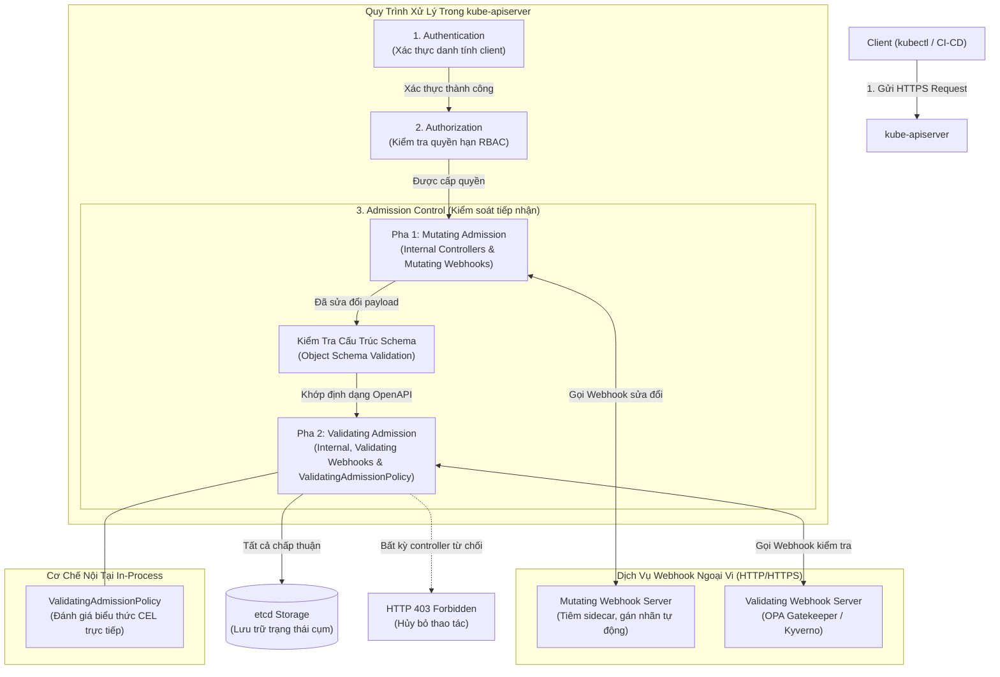

# 6.7.5 Admission Control và Policy

- **Khóa học**: Cloud DevOps Cơ Bản
- **Phân nhóm**: Domain 6 - Containers and Kubernetes
- **Chủ đề**: 6.7 Kubernetes Security, Scheduling và Scaling
- **Trạng thái**: Bản nháp, chờ kiểm chứng
- **Checklist đối chiếu**: [CHECKLIST.md](../../CHECKLIST.md)

---

## 1. Khái Niệm Cốt Lõi & Bản Chất Kỹ Thuật (Core Concepts & Technical Deep Dive)

Khi một kỹ sư DevOps hay hệ thống tự động gửi yêu cầu đến cụm Kubernetes để khởi tạo hoặc chỉnh sửa tài nguyên, yêu cầu đó phải vượt qua nhiều tầng kiểm soát an ninh nghiêm ngặt trước khi dữ liệu được ghi nhận vào hệ thống lưu trữ tập trung. Cửa ngõ trung tâm tiếp nhận và điều phối toàn bộ các yêu cầu này chính là máy chủ giao tiếp lập trình Kubernetes API Server.

Mọi request gửi đến kube-apiserver đều phải tuần tự trải qua ba giai đoạn kiểm soát trước khi được ghi nhận vào etcd: Authentication, Authorization, và Admission Control. <!-- ev: C5.1 -->

Tại sao cơ chế phân quyền RBAC là chưa đủ để bảo vệ hệ thống? Phân quyền RBAC chỉ xác định được danh tính người gửi và kiểm tra xem người đó có quyền thực hiện hành vi trên tài nguyên cụ thể hay không. Tuy nhiên, RBAC hoàn toàn không thể phân tích nội dung chi tiết bên trong cấu hình mà người dùng gửi lên. Chẳng hạn, RBAC cho phép một kỹ sư tạo Pod trong môi trường làm việc, nhưng không thể phát hiện liệu cấu hình Pod đó có yêu cầu chạy quyền quản trị tối cao, có gắn giới hạn tài nguyên CPU hay có đang kéo các hình ảnh chứa mã độc từ bên ngoài về hay không.

Admission Control chỉ can thiệp vào các yêu cầu ghi hoặc sửa đổi trạng thái tài nguyên như Create, Update, Delete, Connect mà không áp dụng cho các thao tác đọc như Get, List hoặc Watch. <!-- ev: C5.2 -->

Quá trình Admission Control được chia làm hai pha chính có thứ tự cố định: pha Mutating Admission chạy trước, tiếp theo là kiểm tra tính hợp lệ của cấu trúc đối tượng (Schema Validation), và sau cùng là pha Validating Admission. <!-- ev: C5.3 -->

Nếu bất kỳ admission controller nào trong pha Validating Admission từ chối request, toàn bộ thao tác sẽ bị hủy bỏ ngay lập tức và kube-apiserver trả về phản hồi từ chối kèm mã trạng thái HTTP 403 Forbidden. <!-- ev: C5.4 -->

### Cơ Chế Mở Rộng Webhook (Dynamic Admission Control)

Để đáp ứng các yêu cầu kiểm soát đặc thù của doanh nghiệp mà các bộ điều khiển tích hợp sẵn chưa hỗ trợ, Kubernetes cung cấp cơ chế kiểm soát động cho phép chuyển tiếp request đến các dịch vụ kiểm duyệt tùy biến bên ngoài.

Dynamic Admission Control cho phép mở rộng khả năng kiểm duyệt của Kubernetes apiserver qua giao thức HTTP/HTTPS với hai tài nguyên cấu hình là MutatingWebhookConfiguration và ValidatingWebhookConfiguration. <!-- ev: C5.5 -->

MutatingWebhookConfiguration có khả năng sửa đổi nội dung payload của đối tượng trước khi được lưu, thường được dùng để tự động tiêm sidecar proxy container, gắn nhãn mặc định hoặc thiết lập tham số bảo mật. <!-- ev: C5.6 -->

ValidatingWebhookConfiguration chỉ có quyền đưa ra quyết định chấp thuận hoặc từ chối request dựa trên nội dung đối tượng và không thể sửa đổi manifest của request đó. <!-- ev: C5.7 -->

Cấu hình `failurePolicy` trong Webhook Configuration quy định hành vi của apiserver khi webhook server không phản hồi hoặc gặp sự cố: giá trị `Fail` sẽ từ chối toàn bộ request bị ảnh hưởng, còn `Ignore` sẽ bỏ qua lỗi webhook và cho phép request tiếp tục xử lý. <!-- ev: C5.8 -->

Tham số `timeoutSeconds` của Admission Webhook xác định thời gian chờ phản hồi tối đa của apiserver trước khi kích hoạt `failurePolicy`, nhận giá trị từ 1 đến 30 giây với mặc định là 10 giây. <!-- ev: C5.9 -->

### Kiểm Soát Chính Sách Tích Hợp Sẵn: ValidatingAdmissionPolicy (CEL)

Mặc dù Webhook mang lại sự linh hoạt cao, việc duy trì một máy chủ Webhook riêng biệt bên ngoài thường tạo ra gánh nặng vận hành lớn và tiềm ẩn nguy cơ làm tê liệt cụm nếu đường truyền mạng nội bộ bị nghẽn hoặc máy chủ Webhook bị sự cố. Để giải quyết triệt để vấn đề này, Kubernetes đã bổ sung giải pháp thực thi chính sách gốc chạy ngay trong bộ nhớ của API Server.

ValidatingAdmissionPolicy là cơ chế kiểm soát chính sách nội tại của Kubernetes sử dụng ngôn ngữ biểu thức Common Expression Language (CEL), chính thức đạt trạng thái Generally Available (GA) từ phiên bản Kubernetes v1.30. <!-- ev: C5.10 -->

ValidatingAdmissionPolicy chạy in-process trực tiếp bên trong `kube-apiserver`, giúp loại bỏ hoàn toàn độ trễ mạng và nguy cơ sập cluster do phụ thuộc vào webhook server ngoại vi. <!-- ev: C5.11 -->

Một tài nguyên ValidatingAdmissionPolicy bao gồm phần `spec.matchConstraints` định nghĩa phạm vi tài nguyên áp dụng và `spec.validations` chứa danh sách các biểu thức CEL (`expression`) cùng câu thông báo lỗi (`message` hoặc `messageExpression`). <!-- ev: C5.12 -->

Trong biểu thức CEL của ValidatingAdmissionPolicy, biến `object` đại diện cho đối tượng đang được tạo hoặc cập nhật, trong khi biến `oldObject` đại diện cho trạng thái hiện tại của đối tượng trước khi cập nhật. <!-- ev: C5.13 -->

Biểu thức CEL trong trường `validations[].expression` bắt buộc phải trả về giá trị kiểu boolean `true` để request được chấp thuận; nếu biểu thức trả về `false` hoặc gặp lỗi cú pháp khi đánh giá, request sẽ bị coi là vi phạm chính sách. <!-- ev: C5.14 -->

Để áp dụng một ValidatingAdmissionPolicy vào thực tế, người quản trị bắt buộc phải tạo tài nguyên `ValidatingAdmissionPolicyBinding` liên kết policy với phạm vi tài nguyên cụ thể và quy định hành vi xử lý qua trường `validationActions` gồm `Deny`, `Warn`, hoặc `Audit`. <!-- ev: C5.15 -->

### Các Công Cụ Quản Trị Chính Sách Nguồn Mở (Third-Party Policy Engines)

Bên cạnh giải pháp gốc của Kubernetes, cộng đồng Cloud Native đã phát triển các bộ máy thực thi chính sách chuyên biệt giúp đơn giản hóa việc quản trị trên quy mô nhiều cụm máy chủ phân tán.

OPA Gatekeeper là một policy engine mã nguồn mở cho Kubernetes, hoạt động dựa trên ngôn ngữ truy vấn Rego và tích hợp với Kubernetes apiserver thông qua ValidatingWebhookConfiguration để thực thi các ConstraintTemplate và Constraint. <!-- ev: C5.16 -->

Kyverno là một policy engine mã nguồn mở thiết kế dành riêng cho Kubernetes, cho phép định nghĩa các chính sách validate, mutate và generate tài nguyên trực tiếp bằng cú pháp YAML tiêu chuẩn mà không đòi hỏi phải học thêm ngôn ngữ lập trình chính sách riêng biệt. <!-- ev: C5.17 -->

---

## 2. Ví Dụ Đời Sống Thực Tế Dễ Hiểu (Intuitive Real-World Analogies)

Quy trình Admission Control tương tự thủ tục kiểm soát an ninh tại sân bay quốc tế:

1. **Kiểm tra hộ chiếu (Authentication)**: Nhân viên sân bay xác minh danh tính hành khách xem hộ chiếu có hợp lệ hay không.
2. **Kiểm tra vé máy bay (Authorization RBAC)**: Nhân viên đối chiếu vé để kiểm tra quyền lên chuyến bay. Tuy nhiên, họ chỉ biết hành khách có vé mà không rõ bên trong hành lý có gì.
3. **Khu vực soi chiếu an ninh (Admission Control)**:
   - **Hải quan dán tem (Mutating Webhook)**: Dán thẻ hành lý dễ vỡ hoặc niêm phong dây kéo, tức bổ sung hoặc sửa đổi thông tin kiện hàng trước khi chuyển tiếp.
   - **Máy quét an ninh X-quang (Validating Webhook & ValidatingAdmissionPolicy)**: Quét toàn bộ hành lý. Nếu phát hiện đồ cấm nguy hiểm (như container cấu hình chạy root hoặc thiếu nhãn an toàn), hệ thống lập tức phát cảnh báo và từ chối cho hành khách lên chuyến bay.

---

## 3. Kiến Trúc, Luồng Hoạt Động & Hình Ảnh Trực Quan (Architecture, Diagrams & Visual Media)

Sơ đồ tuần tự dưới đây mô tả chi tiết đường đi của một yêu cầu gửi đến API Server và thứ tự xử lý của từng pha kiểm duyệt trước khi đối tượng được ghi nhận bền vững vào cơ sở dữ liệu:



### Bảng So Sánh Chi Tiết Các Cơ Chế Admission Control

| Tiêu chí so sánh | Mutating Webhook | Validating Webhook | ValidatingAdmissionPolicy |
| :--- | :--- | :--- | :--- |
| **Pha thực thi** | Mutating Admission (Pha 1) | Validating Admission (Pha 2) | Validating Admission (Pha 2) |
| **Khả năng sửa đổi manifest** | Có (thêm trường, tiêm container) | Không (chỉ allow hoặc deny) | Không (chỉ allow hoặc deny) |
| **Vị trí thực thi** | Máy chủ Webhook chạy ngoài | Máy chủ Webhook chạy ngoài | Trực tiếp trong kube-apiserver |
| **Độ trễ xử lý (Latency)** | Phụ thuộc kết nối mạng nội bộ | Phụ thuộc kết nối mạng nội bộ | Cực thấp (in-process) |
| **Ngôn ngữ định nghĩa** | Tùy ý (Go, Python, NodeJS...) | Tùy ý (Go, Rego...) | Common Expression Language (CEL) |
| **Rủi ro sập cụm khi gặp lỗi** | Cao nếu failurePolicy đặt là Fail | Cao nếu failurePolicy đặt là Fail | Không có rủi ro nghẽn mạng |

---

## 4. Code Mẫu Trực Quan Hoặc Dòng Lệnh Thực Chiến (Runnable Sample Code / CLI)

Dưới đây là các ví dụ cấu hình hoàn chỉnh có thể áp dụng trực tiếp trên cụm Kubernetes nhằm ngăn chặn rủi ro bảo mật và ép buộc các chuẩn mực vận hành tốt nhất.

### 4.1. Khởi Tạo ValidatingAdmissionPolicy Ngăn Chặn Tag Hình Ảnh Không An Toàn

Chính sách sau đây sử dụng biểu thức CEL để kiểm tra danh sách container trong Pod, từ chối mọi cấu hình sử dụng nhãn hình ảnh mặc định hoặc bỏ trống nhãn phiên bản:

<!-- ev: C5.10 C5.12 C5.14 -->
```yaml
apiVersion: admissionregistration.k8s.io/v1
kind: ValidatingAdmissionPolicy
metadata:
  name: "disallow-latest-tag-policy"
spec:
  failurePolicy: Fail
  matchConstraints:
    resourceRules:
      - apiGroups:   [""]
        apiVersions: ["v1"]
        operations:  ["CREATE", "UPDATE"]
        resources:   ["pods"]
  validations:
    - expression: >-
        object.spec.containers.all(c,
          !c.image.endsWith(':latest') &&
          c.image.contains(':')
        )
      message: "Lỗi bảo mật: Không được phép sử dụng hình ảnh có nhãn ':latest' hoặc thiếu nhãn phiên bản cụ thể."
```

### 4.2. Khởi Tạo ValidatingAdmissionPolicyBinding Để Kích Hoạt Chính Sách

Để chính sách trên thực sự có hiệu lực trên các không gian làm việc của ứng dụng, người quản trị tạo tài nguyên liên kết:

<!-- ev: C5.13 C5.15 -->
```yaml
apiVersion: admissionregistration.k8s.io/v1
kind: ValidatingAdmissionPolicyBinding
metadata:
  name: "disallow-latest-binding"
spec:
  policyName: "disallow-latest-tag-policy"
  validationActions: [Deny]
  matchResources:
    namespaceSelector:
      matchExpressions:
        - key: kubernetes.io/metadata.name
          operator: NotIn
          values: ["kube-system", "kube-public"]
```

### 4.3. Cấu Hình ValidatingWebhookConfiguration Tham Chiếu Dịch Vụ Ngoài

Khi cần kiểm tra các điều kiện nghiệp vụ phức tạp mà CEL chưa hỗ trợ, người quản trị có thể khai báo Webhook ngoại vi:

<!-- ev: C5.8 C5.9 -->
```yaml
apiVersion: admissionregistration.k8s.io/v1
kind: ValidatingWebhookConfiguration
metadata:
  name: "strict-security-check"
webhooks:
  - name: "validator.corp.local"
    rules:
      - apiGroups:   [""]
        apiVersions: ["v1"]
        operations:  ["CREATE"]
        resources:   ["pods"]
        scope:       "Namespaced"
    clientConfig:
      service:
        namespace: "security-system"
        name:      "policy-checker-svc"
        path:      "/validate"
        port:      443
    admissionReviewVersions: ["v1"]
    sideEffects: None
    timeoutSeconds: 10
    failurePolicy: Fail
```

### 4.4. Thao Tác Thực Chiến Với Dòng Lệnh kubectl

Quản trị viên có thể triển khai và kiểm tra phản hồi từ chối của chính sách bằng các dòng lệnh sau:

<!-- ev: C5.1 C5.4 -->
```bash
# 1. Kiểm tra tài nguyên ValidatingAdmissionPolicy hỗ trợ trên cụm
kubectl api-resources --api-group=admissionregistration.k8s.io

# 2. Áp dụng chính sách kiểm tra nhãn hình ảnh và liên kết ràng buộc
kubectl apply -f disallow-latest-policy.yaml
kubectl apply -f disallow-latest-binding.yaml

# 3. Thử nghiệm tạo Pod vi phạm chính sách để quan sát phản hồi từ chối
kubectl run insecure-pod --image=nginx:latest
```

---

## 5. Cạm Bẫy Thực Tế & Thực Tiễn Sản Xuất (Production Gotchas & Best Practices)

Trong môi trường triển khai thực tế của doanh nghiệp, các cấu hình Admission Control không chuẩn xác có thể dẫn đến sự cố gián đoạn nghiêm trọng trên toàn bộ cụm máy chủ. Dưới đây là những kinh nghiệm xương máu cần lưu ý:

### Cạm Bẫy Khóa Chết Cụm Do Webhook Sập (Deadlock & Cluster Outage)
Khi một Webhook được thiết lập thuộc tính bảo vệ ở mức tối đa và áp dụng cho toàn bộ các không gian tên:
- Nếu máy chủ Webhook được triển khai dưới dạng một Pod chạy ngay trong chính cụm máy chủ đó và gặp sự cố sập nguồn hoặc khởi động lại cùng với các nút tính toán.
- Lúc này, API Server cần tạo lại Pod chứa máy chủ Webhook, nhưng yêu cầu tạo Pod mới lại phải chờ chính máy chủ Webhook đó phê duyệt trước khi được ghi vào cơ sở dữ liệu.
- Toàn bộ cụm rơi vào trạng thái khóa chết dây chuyền: không một Pod nào có thể khởi tạo được.
- Giải pháp phòng tránh: Tuyệt đối không áp dụng Webhook kiểm tra đối với các không gian tên hệ thống nòng cốt. Hãy luôn định nghĩa bộ lọc không gian tên rõ ràng để loại trừ các thành phần hạ tầng quan trọng.

### Quy Trình Triển Khai Chính Sách An Toàn Bằng Chế Độ Cảnh Báo
Khi áp dụng một quy định kiểm duyệt mới lên hệ thống đang vận hành:
- Không bao giờ đặt hành động chặn trực tiếp ngay từ ngày đầu tiên.
- Hãy thiết lập hành vi sang chế độ cảnh báo và ghi nhận nhật ký trước nhằm quan sát tác động thực tế trên các ứng dụng đang chạy. Sau khi xác nhận không có ứng dụng hợp lệ nào bị ảnh hưởng ngoài ý muốn, người quản trị mới chuyển sang chế độ chặn nghiêm ngặt.

### Đảm Bảo Tính Bất Biến Lặp Lại Của Mutating Webhook (Idempotency)
Nếu một Mutating Webhook được gọi nhiều lần trên cùng một đối tượng:
- Payload sau khi sửa đổi phải đạt trạng thái ổn định và không tiếp tục thay đổi nội dung ở các lần gọi kế tiếp.
- Việc thiếu tính bất biến sẽ gây ra hiện tượng xung đột vòng lặp vô tận giữa các bộ điều khiển nội bộ, làm gia tăng tải đột biến trên máy chủ tiếp nhận yêu cầu.

### Ưu Tiên Chuyển Dịch Sang ValidatingAdmissionPolicy Gốc
Với các cụm máy chủ Kubernetes hiện đại:
- Hãy chủ động thay thế các dịch vụ Webhook đơn giản bằng ValidatingAdmissionPolicy sử dụng biểu thức CEL.
- Việc thực thi nội tại giúp loại bỏ hoàn toàn độ trễ truyền gói tin qua mạng, loại bỏ chi phí quản lý chứng chỉ bảo mật TLS giữa API Server và Webhook, đồng thời triệt tiêu hoàn toàn nguy cơ sập cụm do lỗi dịch vụ ngoại vi.

---

## 6. Câu Hỏi Củng Cố Kiến Thức (Active Recall Quiz)

<details>
<summary><b>Câu 1:</b> Một nhóm vận hành cấu hình ValidatingWebhookConfiguration với thuộc tính thất bại là từ chối mọi yêu cầu và không áp dụng bộ lọc loại trừ không gian tên. Sau sự cố khởi động lại toàn bộ cụm, không một ứng dụng nào có thể tạo mới được, kể cả Pod của chính dịch vụ Webhook. Nguyên nhân cốt lõi là gì và cần làm gì để giải cứu cụm?</summary>

**Đáp án:**
- **Nguyên nhân**: Xảy ra hiện tượng khóa chết vòng tròn (Circular Dependency Deadlock). Khi cụm khởi động lại, API Server tiếp nhận yêu cầu tạo Pod cho Webhook, nhưng vì Webhook này áp dụng trên toàn cụm với thuộc tính Fail, API Server gửi yêu cầu kiểm tra tới dịch vụ Webhook chưa chạy và từ chối tạo Pod đó.
- **Cách khắc phục**: Tạm thời can thiệp từ máy chủ điều khiển để chuyển cấu hình Webhook sang chế độ bỏ qua lỗi (`Ignore`) hoặc xóa Webhook, sau đó bổ sung bộ lọc loại trừ các không gian tên hệ thống.
</details>

<details>
<summary><b>Câu 2:</b> Khi nào bạn nên ưu tiên sử dụng ValidatingAdmissionPolicy (với biểu thức CEL) thay vì tự viết một Validating Webhook Server truyền thống bằng ngôn ngữ Go?</summary>

**Đáp án:**
- Nên ưu tiên ValidatingAdmissionPolicy cho các quy tắc kiểm tra cấu trúc dữ liệu của manifest (như bắt buộc giới hạn tài nguyên CPU/bộ nhớ, cấm nhãn hình ảnh không an toàn, cấm đặc quyền quản trị).
- **Lý do**: Thực thi trực tiếp trong bộ nhớ của API Server, loại bỏ hoàn toàn độ trễ mạng, không đòi hỏi vận hành dịch vụ ngoài và không gây nguy cơ sập cụm. Chỉ dùng Webhook ngoài khi cần truy vấn dữ liệu từ cơ sở dữ liệu ngoại vi.
</details>

<details>
<summary><b>Câu 3:</b> Trong quy trình tiếp nhận yêu cầu, nếu bạn muốn hệ thống tự động bổ sung một vùng lưu trữ tạm thời và gắn thêm nhãn quản lý môi trường vào tất cả các Pod được tạo mới, bạn phải sử dụng loại bộ điều khiển nào? Validating Admission Controller có thể thực hiện được việc này không?</summary>

**Đáp án:**
- Bắt buộc phải sử dụng **Mutating Admission Controller** (hoặc MutatingWebhookConfiguration).
- **Giải thích**: Pha Mutating Admission chạy đầu tiên và là pha duy nhất được phép thay đổi hoặc tiêm thêm dữ liệu vào payload. Validating Admission Controller chạy ở pha sau chỉ có quyền đọc và đưa ra quyết định chấp thuận hay từ chối chứ không thể sửa đổi manifest.
</details>

---

## 7. 📚 Nguồn Tài Liệu Chính Thống (Tier-1 Official References)

- [Kubernetes Documentation: A Guide to Kubernetes Admission Controllers](https://kubernetes.io/docs/reference/access-authn-authz/admission-controllers/) - Hướng dẫn chi tiết từ Kubernetes về vòng đời xử lý yêu cầu và các bộ điều khiển tiếp nhận tích hợp sẵn.
- [Kubernetes Documentation: Dynamic Admission Control](https://kubernetes.io/docs/reference/access-authn-authz/extensible-admission-controllers/) - Tài liệu chính thức về cấu hình và vận hành MutatingWebhookConfiguration cùng ValidatingWebhookConfiguration.
- [Kubernetes Documentation: Validating Admission Policy](https://kubernetes.io/docs/reference/access-authn-authz/validating-admission-policy/) - Hướng dẫn kỹ thuật chính thức về khai báo chính sách nội tại sử dụng ngôn ngữ biểu thức CEL từ Kubernetes v1.30 GA.
