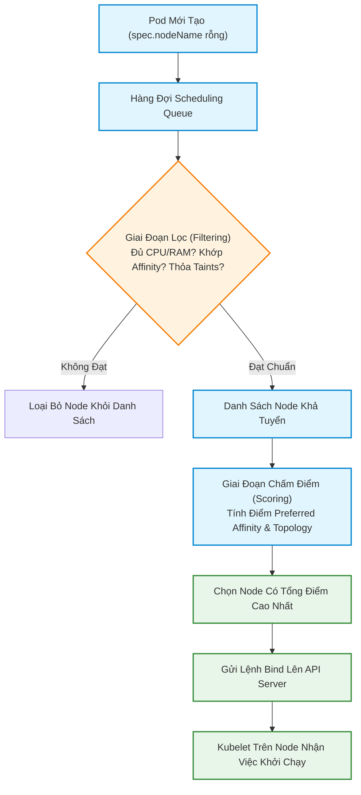

# 6_7_6 Xếp Lịch (Scheduling)

> **Khóa học**: Cloud DevOps Basic — Containers & Kubernetes  
> **Phân nhóm**: 6 Domain 6 - Containers and Kubernetes › 6_7 Kubernetes Security Scheduling and Scaling  
> **Chủ đề**: 6_7_6 Xếp Lịch (Scheduling)  
> **Phiên bản áp dụng**: Kubernetes 1.30+  
> **Trạng thái**: Bản nháp, chờ kiểm chứng  
> **Lộ trình tổng**: [Lộ trình tổng](../../README.md) · **Phạm vi**: [Topic README](./README.md#6_7_6-xếp-lịch-scheduling) · **Checkpoint của người học**: [CHECKLIST](../../CHECKLIST.md#6_7-kubernetes-security-scheduling-and-scaling)  
> **Kiến thức liên quan**: [6_4_1 Pods and ReplicaSets](<../6_4 Kubernetes Networking Configuration and Storage/README.md>) · [6_7_7 Sẵn Sàng Khi Bảo Trì PDB Drain](<./README.md#6_7_7-sẵn-sàng-khi-bảo-trì-pdb-drain>)

---

## 0. Tình Huống Mở Đầu: Pod Kẹt Ở Trạng Thái Pending

Khi triển khai ứng dụng lên cụm Kubernetes, một trong những sự cố phổ biến nhất là Pod bị kẹt ở trạng thái Pending. Khác với các sự cố dừng tiến trình bên trong container, trạng thái này xảy ra khi bộ điều phối kube-scheduler không tìm được máy chủ phù hợp để gán Pod. Nắm vững cơ chế lọc và chấm điểm của scheduler cùng các công cụ định vị workload giúp kỹ sư DevOps kiểm soát chính xác vị trí chạy của ứng dụng và xử lý nhanh chóng các lỗi ách tắc tài nguyên.

---

## 1. Khái Niệm Cốt Lõi & Bản Chất Kỹ Thuật (Core Concepts & Technical Deep Dive)

Trong kiến trúc Kubernetes, khi một Pod được tạo ra mà chưa gán máy chủ, bộ điều phối kube-scheduler trong Control Plane sẽ lựa chọn Node tối ưu nhất trong cụm để gán Pod vào chạy. <!-- ev: C6.1 -->

### 1.1 Chu Kỳ Lập Lịch: Filtering và Scoring

Chu kỳ lập lịch cho một Pod của bộ điều phối diễn ra tuần tự qua hai giai đoạn kỹ thuật chính:

`kube-scheduler` thực hiện chu kỳ lập lịch (scheduling cycle) cho Pod qua 2 giai đoạn chính: Filtering (lọc các Node không đáp ứng điều kiện) và Scoring (chấm điểm các Node còn lại để chọn Node phù hợp nhất). <!-- ev: C6.1 -->

- **Giai đoạn Lọc (Filtering / Predicates)**: Scheduler kiểm tra toàn bộ danh sách Node trong cụm để loại bỏ các Node không đáp ứng yêu cầu của Pod. Các điều kiện lọc bao gồm: mức tài nguyên CPU và bộ nhớ trống có đủ theo khai báo requests hay không, các ràng buộc nhãn máy chủ có thỏa mãn hay không, và Node có chứa Taint nào mà Pod chưa chấp nhận hay không. Các Node không đạt chuẩn sẽ bị loại bỏ ngay lập tức. Nếu không còn Node nào vượt qua vòng lọc, Pod sẽ ở lại trạng thái Pending. <!-- ev: C6.1 -->
- **Giai đoạn Chấm Điểm (Scoring / Priorities)**: Các Node vượt qua vòng lọc sẽ được chấm điểm theo thang điểm từ 0 đến 100. Scheduler tính điểm dựa trên các tiêu chí ưu tiên mềm, mức độ phân bổ đồng đều tài nguyên, và độ sẵn có của image trên Node. Node có tổng điểm cao nhất sẽ được chọn để thực hiện hành động Binding nhằm ghi nhận tên máy chủ vào Pod spec. <!-- ev: C6.1 -->

### 1.2 Lựa Chọn Node: nodeSelector và Node Affinity

Kubernetes hỗ trợ nhiều cấp độ để quản trị viên điều khiển vị trí chạy của Pod dựa trên nhãn của máy chủ:

Trường `spec.nodeSelector` trong Pod manifest là cơ chế chọn Node đơn giản nhất bằng cách so khớp chính xác cặp key-value với nhãn (labels) trên Node. <!-- ev: C6.2 -->

`nodeAffinity` dạng `requiredDuringSchedulingIgnoredDuringExecution` quy định điều kiện bắt buộc mà Node phải thỏa mãn tại thời điểm lập lịch thì Pod mới được xếp vào Node đó. <!-- ev: C6.3 -->

`nodeAffinity` dạng `preferredDuringSchedulingIgnoredDuringExecution` cho phép định nghĩa độ ưu tiên mềm với trọng số `weight` từ 1 đến 100 cho mỗi tiêu chí. <!-- ev: C6.4 -->

Hậu tố `IgnoredDuringExecution` trong Node Affinity biểu thị rằng nếu nhãn trên Node thay đổi sau khi Pod đã chạy thì Pod vẫn tiếp tục hoạt động mà không bị đẩy ra khỏi Node. <!-- ev: C6.5 -->

### 1.3 Phân Tán Workload: Pod Anti-Affinity và topologySpreadConstraints

Nhằm bảo đảm tính sẵn sàng cao cho dịch vụ phân tán, vị trí của Pod có thể được quyết định dựa trên mối tương quan với các Pod khác:

Pod Anti-Affinity (`podAntiAffinity`) sử dụng `topologyKey` (như `kubernetes.io/hostname` hoặc `topology.kubernetes.io/zone`) để ngăn các Pod có cùng nhãn được xếp lịch vào cùng một đơn vị topology. <!-- ev: C6.6 -->

`topologySpreadConstraints` kiểm soát mức độ phân tán của Pod trên các vùng topology thông qua tham số `maxSkew`, xác định độ chênh lệch tối đa cho phép về số lượng Pod giữa hai nhóm topology bất kỳ. <!-- ev: C6.7 -->

Trường `whenUnsatisfiable` trong `topologySpreadConstraints` hỗ trợ hai giá trị: `DoNotSchedule` (không xếp lịch Pod nếu vi phạm maxSkew) và `ScheduleAnyway` (vẫn xếp lịch nhưng ưu tiên Node giảm thiểu độ lệch). <!-- ev: C6.8 -->

### 1.4 Taints và Tolerations: Cơ Chế Xua Đuổi Workload

Trái ngược với Affinity dùng để thu hút Pod về Node, Taint cho phép Node chủ động xua đuổi các Pod không phù hợp:

Taint được gán trên Node theo định dạng `<key>=<value>:<effect>` hoặc `<key>:<effect>` bằng lệnh `kubectl taint nodes`. <!-- ev: C6.9 -->

Effect `NoSchedule` của Taint ngăn chặn các Pod không có Toleration tương ứng được xếp lịch vào Node, nhưng không ảnh hưởng đến các Pod đang chạy sẵn trên Node. <!-- ev: C6.10 -->

Effect `PreferNoSchedule` là phiên bản mềm của Taint, khiến scheduler cố gắng tránh xếp Pod không có Toleration vào Node đó nhưng vẫn xếp nếu không còn lựa chọn khác. <!-- ev: C6.11 -->

Effect `NoExecute` của Taint sẽ trục xuất (evict) ngay lập tức các Pod đang chạy trên Node nếu Pod đó không có Toleration khớp với Taint. <!-- ev: C6.12 -->

Đối với Taint effect `NoExecute`, trường `tolerationSeconds` trong Pod spec chỉ định khoảng thời gian Pod được phép tiếp tục chạy trên Node sau khi Node bị gán Taint trước khi bị trục xuất. <!-- ev: C6.13 -->

### 1.5 PriorityClass và Chiếm Dụng Tài Nguyên (Preemption)

Resource `PriorityClass` là một đối tượng không gian tên cụm (cluster-scoped) định nghĩa mức độ ưu tiên của Pod thông qua một số nguyên integer trong trường `value` (giá trị càng lớn thì độ ưu tiên càng cao). <!-- ev: C6.14 -->

Khi cụm không đủ tài nguyên để xếp lịch cho một Pod có độ ưu tiên cao, cơ chế Preemption (chiếm dụng) của kube-scheduler sẽ tìm và trục xuất các Pod có độ ưu tiên thấp hơn để giải phóng tài nguyên. <!-- ev: C6.15 -->

### 1.6 Chẩn Đoán Pod Bị Kẹt Pending Qua kubectl describe

Lệnh `kubectl describe pod <tên-pod>` hiển thị phần `Events` ở cuối đầu ra, là nơi chính yếu để xác định lý do scheduler không thể xếp lịch Pod (như `0/N nodes available`). <!-- ev: C6.16 -->

Thông báo lỗi phổ biến trong Events khi không đủ tài nguyên là `Insufficient cpu` hoặc `Insufficient memory`. <!-- ev: C6.17 -->

Thông báo lỗi `node(s) had untolerated taint` xuất hiện trong Events khi các Node có Taint mà Pod không khai báo Toleration tương ứng để chịu đựng. <!-- ev: C6.18 -->

Thông báo lỗi `didn't match PodTopologySpread` hoặc `didn't match Pod anti-affinity rules` xuất hiện trong Events khi vị trí của Pod vi phạm ràng buộc phân tán cụm hoặc chống chạy chung node. <!-- ev: C6.19 -->

---

## 2. Ví Dụ Đời Sống Thực Tế Dễ Hiểu (Intuitive Real-World Analogies)

Hãy liên tưởng quy trình điều phối của kube-scheduler như việc phân phối chỗ ngồi cho đoàn khách trên tàu hỏa cao tốc:

- **Node Affinity (Yêu cầu của hành khách)**: Khách yêu cầu: "Tôi bắt buộc phải ngồi toa có ổ điện y tế" là ràng buộc cứng; nếu không có toa nào đáp ứng, khách ở lại phòng chờ. Khách yêu cầu: "Tôi muốn ngồi toa ngắm biển nếu còn chỗ" là ưu tiên mềm; nếu hết chỗ ngắm biển, khách vẫn vui vẻ ngồi toa thường.
- **Pod Anti-Affinity và Topology Spread (Nguyên tắc bảo vệ yếu nhân)**: Ban an ninh quy định hai lãnh đạo chủ chốt không bao giờ ngồi chung một toa tàu để tránh rủi ro sập cả hệ thống khi sự cố xảy ra. Quy tắc Topology Spread chia đều 12 nhân viên vào ba cụm toa tàu với độ chênh lệch không quá một người.
- **Taint và Toleration (Biển báo toa chuyên dụng)**: Toa chở hàng đông lạnh âm độ mang biển cảnh báo xua đuổi. Hành khách thông thường mặc áo sơ mi không được phép bước vào; chỉ chuyên viên mang theo áo khoác chuyên dụng giữ nhiệt mới được vào làm việc. Khi toa gặp sự cố rò rỉ khí độc, lệnh sơ tán tức thì trục xuất mọi người không có đồ bảo hộ ra ngoài.
- **PriorityClass và Preemption (Thẻ cấp cứu khẩn cấp)**: Tàu đã kín chỗ nhưng kíp bác sĩ mang thiết bị ghép tạng cần lên tàu khẩn cấp. Trưởng tàu dùng quyền ưu tiên mời hành khách vé phổ thông nhường ghế tại ga trung gian để kíp bác sĩ tiếp tục hành trình cứu người.

---

## 3. Kiến Trúc, Luồng Hoạt Động & Hình Ảnh Trực Quan (Architecture, Diagrams & Visual Media)

Sơ đồ dưới đây minh họa luồng xử lý của bộ lập lịch từ khi tiếp nhận Pod đến khi hoàn tất quyết định gán Node:



---

## 4. Code Mẫu Trực Quan Hoặc Dòng Lệnh Thực Chiến (Runnable Sample Code / CLI)

Toàn bộ các ví dụ dưới đây đều được chuẩn hóa cho cụm Kubernetes và có thể thực thi trực tiếp bằng công cụ dòng lệnh.

### 4.1 Thiết Lập Nhãn Và Taint Trên Máy Chủ

Thiết lập nhãn vùng và Taint xua đuổi trên máy chủ worker để chuẩn bị môi trường thử nghiệm:

<!-- ev: C6.9 -->
```bash
kubectl label nodes node-1 topology.kubernetes.io/zone=zone-a disktype=ssd
kubectl taint nodes node-1 dedicated=gpu:NoSchedule
```

### 4.2 Cấu Hình Pod Kết Hợp Node Affinity Và Tolerations

Tạo file manifest kết hợp điều kiện ổ đĩa bắt buộc, ưu tiên khu vực địa lý và khả năng chịu đựng Taint:

<!-- ev: C6.3 C6.4 C6.10 -->
```yaml
apiVersion: v1
kind: Pod
metadata:
  name: payment-processor
  labels:
    app: payment
spec:
  affinity:
    nodeAffinity:
      requiredDuringSchedulingIgnoredDuringExecution:
        nodeSelectorTerms:
          - matchExpressions:
              - key: disktype
                operator: In
                values:
                  - ssd
      preferredDuringSchedulingIgnoredDuringExecution:
        - weight: 80
          preference:
            matchExpressions:
              - key: topology.kubernetes.io/zone
                operator: In
                values:
                  - zone-a
  tolerations:
    - key: "dedicated"
      operator: "Equal"
      value: "gpu"
      effect: "NoSchedule"
  containers:
    - name: app
      image: registry.k8s.io/pause:3.9
      resources:
        requests:
          cpu: "100m"
          memory: "128Mi"
```

Triển khai manifest và xác nhận Pod được gán vào máy chủ phù hợp:

<!-- ev: C6.3 -->
```bash
kubectl apply -f payment-processor.yaml
kubectl get pod payment-processor -o wide
```

### 4.3 Phân Tán Workload Bằng topologySpreadConstraints

Manifest Deployment phân bổ đều các bản sao trên các vùng khả dụng với giới hạn chênh lệch:

<!-- ev: C6.6 C6.7 C6.8 -->
```yaml
apiVersion: apps/v1
kind: Deployment
metadata:
  name: web-frontend
spec:
  replicas: 3
  selector:
    matchLabels:
      app: web-frontend
  template:
    metadata:
      labels:
        app: web-frontend
    spec:
      topologySpreadConstraints:
        - maxSkew: 1
          topologyKey: topology.kubernetes.io/zone
          whenUnsatisfiable: DoNotSchedule
          labelSelector:
            matchLabels:
              app: web-frontend
      containers:
        - name: web
          image: registry.k8s.io/pause:3.9
```

<!-- ev: C6.7 -->
```bash
kubectl apply -f web-frontend.yaml
kubectl get pods -l app=web-frontend -o wide
```

### 4.4 Khai Báo Mức Ưu Tiên Bằng PriorityClass

Tạo đối tượng xác lập mức ưu tiên cho các dịch vụ cốt lõi:

<!-- ev: C6.14 -->
```yaml
apiVersion: scheduling.k8s.io/v1
kind: PriorityClass
metadata:
  name: high-priority-workload
value: 1000000
globalDefault: false
description: "Mức ưu tiên cao cho dịch vụ quan trọng"
```

<!-- ev: C6.14 -->
```bash
kubectl apply -f priority-class.yaml
```

### 4.5 Kịch Bản Chẩn Đoán Pod Bị Kẹt Pending

Tạo một Pod yêu cầu tài nguyên vượt mức đáp ứng của toàn bộ máy chủ trong cụm:

<!-- ev: C6.16 -->
```bash
kubectl run oversized-pod --image=registry.k8s.io/pause:3.9 --requests='cpu=128,memory=256Gi'
```

Kiểm tra trạng thái của Pod và phân tích chi tiết các lý do trong phần sự kiện:

<!-- ev: C6.16 -->
```bash
kubectl describe pod oversized-pod
```

Thông điệp sự kiện xuất hiện ở cuối kết quả kiểm tra:

<!-- ev: C6.16 C6.17 C6.18 -->
```text
Events:
  Type     Reason            Age   From               Message
  ----     ------            ----  ----               -------
  Warning  FailedScheduling  15s   default-scheduler  0/3 nodes available: 1 node(s) had untolerated taint {dedicated: gpu}, 2 Insufficient cpu.
```

- Dòng thông điệp chỉ ra toàn bộ máy chủ trong cụm đều bị loại bỏ ở giai đoạn lọc ban đầu. <!-- ev: C6.16 -->
- Máy chủ thứ nhất bị loại do mang Taint mà Pod không khai báo khả năng chịu đựng. <!-- ev: C6.18 -->
- Các máy chủ còn lại bị loại do không đáp ứng đủ lượng CPU theo yêu cầu. <!-- ev: C6.17 -->

Lệnh dọn dẹp các tài nguyên sau khi thử nghiệm:

<!-- ev: C6.16 -->
```bash
kubectl delete pod oversized-pod payment-processor --ignore-not-found
kubectl delete deployment web-frontend --ignore-not-found
kubectl delete priorityclass high-priority-workload --ignore-not-found
```

---

## 5. Cạm Bẫy Thực Tế & Thực Tiễn Sản Xuất (Production Gotchas & Best Practices)

Trong vận hành thực tế, các sự cố lập lịch thường phát sinh khi hệ thống mở rộng quy mô:

- **Lạm dụng ràng buộc cứng gây tắc nghẽn**: Việc đặt điều kiện cứng cho quá nhiều tiêu chí khiến Pod mới không thể lập lịch khi một vài máy chủ gặp sự cố. Trừ các đòi hỏi phần cứng đặc thù như GPU, hãy luôn ưu tiên sử dụng điều kiện mềm kết hợp trọng số để bảo đảm tính sẵn sàng.
- **Quá tải bộ điều phối khi dùng Pod Anti-Affinity**: Quy tắc chống chạy chung máy chủ ở mức cứng đòi hỏi scheduler tính toán so khớp chéo trên toàn bộ tập hợp Pod trong cụm lớn. Giải pháp tối ưu hơn là chuyển sang sử dụng tính năng phân tán vùng để giảm thiểu tải tính toán cho bộ điều phối.
- **Quên cấu hình chấp nhận Taint cho DaemonSet hạ tầng**: Khi bổ sung máy chủ chuyên dụng mang Taint xua đuổi, nếu các thành phần mạng và thu thập log không có cấu hình dung thứ, máy chủ sẽ không thể kết nối mạng. Hãy luôn bổ sung cấu hình dung thứ toàn năng cho các tiến trình nền tảng hệ thống.
- **Tranh chấp tài nguyên do cấu hình ưu tiên không chuẩn**: Cấp quyền ưu tiên quá cao mà thiếu khai báo giới hạn tài nguyên chính xác có thể dẫn đến việc liên tục trục xuất các dịch vụ khác, gây bất ổn định dây chuyền trong toàn cụm.

---

## 6. Câu Hỏi Củng Cố Kiến Thức (Active Recall Quiz)

### Tình Huống 1: Pod Bị Kẹt Pending Do Máy Chủ Chứa Taint
Khi triển khai ứng dụng, Pod rơi vào trạng thái Pending và bảng sự kiện ghi nhận thông báo không có máy chủ khả dụng do máy chủ chứa Taint chuyên dụng. Bạn cần xử lý thế nào để Pod được phép chạy?

<details>
<summary>Đáp án</summary>

Nguyên nhân là do máy chủ mang Taint xua đuổi mà Pod chưa khai báo quyền dung thứ. Bạn cần bổ sung khối cấu hình Toleration tương ứng vào Pod spec với khóa, giá trị và hiệu lực trùng khớp với Taint trên máy chủ để vượt qua vòng lọc của scheduler.
</details>

---

### Tình Huống 2: Phân Biệt Ứng Xử Giữa Ràng Buộc Cứng Và Ràng Buộc Mềm
Khi khu vực máy chủ chính bị đầy tài nguyên bộ nhớ, hành vi của Pod sử dụng ràng buộc cứng khác gì so với Pod sử dụng ràng buộc mềm?

<details>
<summary>Đáp án</summary>

Pod sử dụng ràng buộc cứng sẽ bị từ chối lập lịch và giữ nguyên trạng thái Pending vì không có máy chủ nào vừa thuộc vùng chỉ định vừa đủ bộ nhớ. Ngược lại, Pod sử dụng ràng buộc mềm chỉ coi tiêu chí vùng là điểm cộng ưu tiên; khi vùng đó hết tài nguyên, scheduler sẽ tự động chọn máy chủ ở vùng khác còn trống để kích hoạt Pod chạy bình thường.
</details>

---

### Tình Huống 3: Phân Bổ Đồng Đều 6 Bản Sao Workload Trên 3 Vùng Khả Dụng
Hệ thống cần chia đều 6 bản sao của dịch vụ trên 3 vùng khả dụng với chênh lệch tối đa không quá 1 bản sao. Vì sao nên dùng cơ chế phân tán vùng thay vì chống trùng máy chủ?

<details>
<summary>Đáp án</summary>

Quy tắc chống trùng lặp Pod chỉ mang tính nhị phân cho phép tối đa một Pod duy nhất trên mỗi vùng, khiến các Pod còn lại bị kẹt Pending khi số lượng bản sao vượt quá số vùng. Trong khi đó, cơ chế phân tán vùng với tham số giới hạn chênh lệch cho phép chia đều số lượng Pod theo tỷ lệ cân bằng giữa các khu vực mà không gây ách tắc lập lịch.
</details>

---

## 7. 📚 Nguồn Tài Liệu Chính Thống (Tier-1 Official References)

Để tra cứu sâu hơn về các cơ chế lập lịch nâng cao và cập nhật mới nhất từ tài liệu chính thức Kubernetes:

- [Kubernetes Documentation: kube-scheduler](https://kubernetes.io/docs/concepts/scheduling-eviction/kube-scheduler/) - Tài liệu chính thức về kiến trúc, chu kỳ lập lịch (filtering và scoring) của kube-scheduler.
- [Kubernetes Documentation: Assigning Pods to Nodes](https://kubernetes.io/docs/concepts/scheduling-eviction/assign-pod-node/) - Hướng dẫn chi tiết về cấu hình nodeSelector, Node Affinity và Pod Affinity/Anti-Affinity.
- [Kubernetes Documentation: Pod Topology Spread Constraints](https://kubernetes.io/docs/concepts/scheduling-eviction/topology-spread-constraints/) - Tài liệu chuẩn về cơ chế phân tán Pod trên các failure domain với maxSkew và whenUnsatisfiable.
- [Kubernetes Documentation: Taints and Tolerations](https://kubernetes.io/docs/concepts/scheduling-eviction/taint-and-toleration/) - Hướng dẫn quản lý Taint trên Node và Toleration trên Pod spec với các Effect NoSchedule, PreferNoSchedule và NoExecute.
- [Kubernetes Documentation: Pod Priority and Preemption](https://kubernetes.io/docs/concepts/scheduling-eviction/pod-priority-preemption/) - Nguyên lý hoạt động của PriorityClass và cơ chế chiếm dụng tài nguyên của kube-scheduler.
