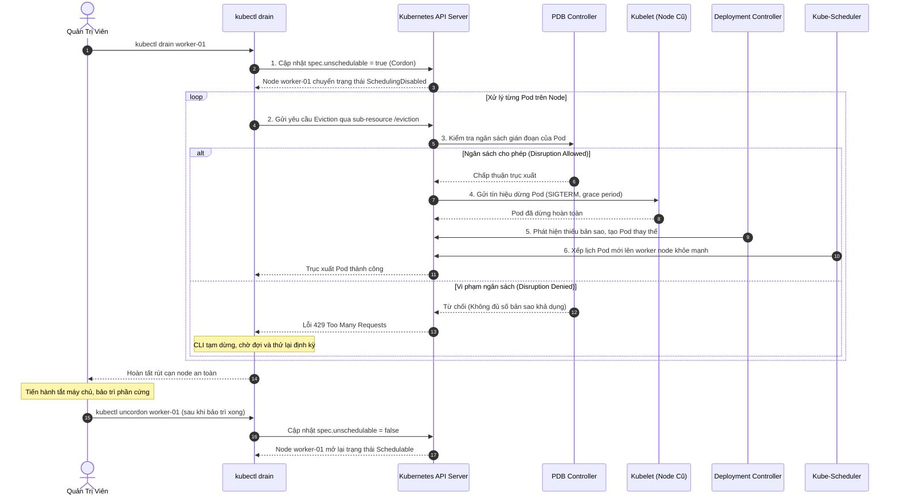

# 6_7_7 Sẵn Sàng Khi Bảo Trì: PDB, Drain

> **Khóa học**: Cloud DevOps Basic — Containers & Kubernetes  
> **Phân nhóm**: 6 Domain 6 - Containers and Kubernetes › 6_7 Kubernetes Security Scheduling and Scaling  
> **Chủ đề**: Đảm bảo tính sẵn sàng cao khi bảo trì hạ tầng: lệnh kubectl cordon, uncordon, drain, Eviction API, PodDisruptionBudget (PDB), phân biệt Voluntary vs Involuntary Disruption  
> **Phiên bản áp dụng**: Kubernetes 1.25+ (`policy/v1`), kubectl v1.25+  
> **Trạng thái**: Bản nháp, chờ kiểm chứng  
> **Checklist đối chiếu**: [CHECKLIST.md](../../CHECKLIST.md#6_7-kubernetes-security-scheduling-and-scaling) · **Topic**: [README.md](./README.md#6_7_7-sẵn-sàng-khi-bảo-trì-pdb-drain)

---

## 1. Khái Niệm Cốt Lõi & Bản Chất Kỹ Thuật (Core Concepts & Technical Deep Dive)

Trong môi trường vận hành hạ tầng thực tế, các máy chủ vật lý hoặc máy ảo định kỳ cần phải tạm dừng để nâng cấp hệ điều hành, vá lỗi bảo mật hạt nhân hoặc bảo trì thiết bị phần cứng. Nếu người vận hành tắt máy chủ hoặc xóa máy ảo một cách đột ngột, toàn bộ tiến trình ứng dụng đang chạy trên máy chủ đó sẽ bị ngắt kết nối bất ngờ, dẫn tới suy giảm chất lượng dịch vụ hoặc đánh mất giao dịch của khách hàng. Kubernetes giải quyết triệt để bài toán này bằng quy trình cô lập máy chủ, di dời ứng dụng có kiểm soát và thiết lập rào chắn ngân sách gián đoạn để đảm bảo thỏa thuận mức độ dịch vụ.

### 1.1 Vòng Đời Bảo Trì Node: Cordon, Uncordon và Drain

Quy trình đưa một máy chủ ra khỏi cụm để bảo dưỡng và đưa trở lại hoạt động gồm ba thao tác chính:

- Lệnh `kubectl cordon` được sử dụng để đánh dấu một node chuyển sang trạng thái Unschedulable (không thể xếp lịch), ngăn không cho kube-scheduler gán thêm bất kỳ Pod mới nào vào node này. <!-- ev: C7.1 -->
- Khi một node bị đánh dấu cordon, tất cả các Pod hiện có đang chạy trên node đó vẫn tiếp tục duy trì hoạt động bình thường mà không bị dừng hay tự động xóa bỏ. <!-- ev: C7.2 -->
- Lệnh `kubectl uncordon` thực hiện thao tác hoàn tác, chuyển trạng thái node trở lại khả dụng để kube-scheduler tiếp tục phân bổ các Pod mới. <!-- ev: C7.3 -->
- Lệnh `kubectl drain` kết hợp việc đánh dấu cordon node và thực hiện trục xuất (evict) toàn bộ các Pod đang hoạt động trên node để giải phóng máy chủ an toàn. <!-- ev: C7.4 -->
- Quá trình trục xuất của lệnh drain được thực hiện thông qua Kubernetes Eviction API thay vì gọi trực tiếp thao tác xóa Pod của DELETE API. <!-- ev: C7.5 -->

### 1.2 Phân Biệt Voluntary Disruption và Involuntary Disruption

Hệ thống phân loại các sự cố làm gián đoạn hoạt động của Pod thành hai nhóm bản chất khác nhau:

- Involuntary disruption là nhóm gián đoạn không tự nguyện sinh ra từ các sự cố bất khả kháng như phần cứng hư hỏng, máy chủ sập nguồn, kernel panic hoặc đứt kết nối mạng vật lý. <!-- ev: C7.6 -->
- Voluntary disruption là nhóm gián đoạn có chủ đích do người vận hành hoặc hệ thống quản lý kích hoạt như thao tác drain node, bảo trì hệ điều hành máy chủ hoặc Cluster Autoscaler thu hẹp quy mô cụm. <!-- ev: C7.7 -->
- Tài nguyên PodDisruptionBudget chỉ áp dụng và bảo vệ ứng dụng trước các gián đoạn có chủ đích (voluntary disruptions), không thể ngăn ngừa hay can thiệp vào các sự cố ngoài ý muốn (involuntary disruptions). <!-- ev: C7.8 -->

Khi một node bị mất nguồn đột ngột, máy chủ vật lý đã chết hoàn toàn nên không có cơ chế phần mềm nào có thể giữ cho Pod trên máy đó tiếp tục chạy. Ngược lại, khi quản trị viên chủ động rút cạn máy chủ để bảo trì, hệ thống có toàn quyền điều tiết tốc độ di dời từng Pod một để không làm sập ứng dụng.

### 1.3 Cơ Chế Eviction API và PodDisruptionBudget (PDB)

Eviction API là một giao diện lập trình cấp cao trong cụm cho phép tạo ra các đối tượng trục xuất Pod có kiểm soát. Khi nhận được yêu cầu trục xuất từ lệnh bảo trì, máy chủ API sẽ chuyển tiếp yêu cầu tới bộ điều khiển PodDisruptionBudget để kiểm tra xem việc dừng Pod đó tại thời điểm hiện tại có làm số lượng bản sao khả dụng tụt xuống dưới ngưỡng an toàn hay không.

- Trong hệ thống Kubernetes, PodDisruptionBudget là tài nguyên chuẩn thuộc nhóm `policy/v1`. <!-- ev: C7.9 -->
- Trường `spec.selector` trong cấu hình PodDisruptionBudget chịu trách nhiệm xác định danh sách các Pod thuộc phạm vi áp dụng ngân sách bảo vệ dựa trên nhãn. <!-- ev: C7.10 -->
- Trong một cấu hình PodDisruptionBudget, người quản trị chỉ được phép lựa chọn định nghĩa một trong hai trường `spec.minAvailable` hoặc `spec.maxUnavailable`, việc khai báo đồng thời cả hai trường là không hợp lệ. <!-- ev: C7.11 -->
- Các chỉ số quy định trong trường `spec.minAvailable` và `spec.maxUnavailable` có thể được khai báo dưới dạng một số nguyên tuyệt đối hoặc theo tỉ lệ phần trăm. <!-- ev: C7.12 -->

---

## 2. Ví Dụ Đời Sống Thực Tế Dễ Hiểu (Intuitive Real-World Analogies)

Hãy hình dung một phòng giao dịch của ngân hàng trung tâm với bốn quầy phục vụ khách hàng.

Nhằm bảo đảm chất lượng phục vụ và tránh tình trạng khách hàng phải chờ đợi quá lâu gây ùn tắc, Ban Giám đốc ngân hàng ban hành một nội quy nghiêm ngặt (tương đương với một PodDisruptionBudget): *"Trong suốt khung giờ làm việc, chi nhánh bắt buộc phải duy trì tối thiểu ba quầy mở cửa phục vụ"* (`minAvailable: 3`).

Một ngày nọ, đội ngũ kỹ thuật tòa nhà cần tiến hành sơn sửa và nâng cấp hệ thống dây điện tại quầy giao dịch số một (tương đương với việc bảo trì một máy chủ worker node):

1. **Căng dây giới hạn (Cordon)**: Người quản lý chi nhánh tiến hành kéo dây chắn trước quầy số một. Khách hàng mới bước vào ngân hàng sẽ được nhân viên lễ tân điều phối sang các quầy số hai, ba và bốn. Tuyệt đối không ai được phép xếp hàng mới vào quầy số một.
2. **Phục vụ nốt khách hiện tại (Graceful Termination)**: Khách hàng đang ngồi làm thủ tục dang dở tại quầy số một vẫn được nhân viên tiếp tục hỗ trợ cho đến khi giao dịch hoàn tất. Quản lý không được giật tập hồ sơ hay đuổi khách ra ngoài giữa chừng.
3. **Đối chiếu quy chế an toàn (Eviction & PDB Check)**: Người quản lý nhìn sang ba quầy còn lại. Vì cả ba quầy kia đều đang hoạt động tốt, điều kiện duy trì tối thiểu ba quầy được đáp ứng trọn vẹn. Nhân viên quầy số một dọn dẹp bàn làm việc và di chuyển sang quầy dự phòng ở tầng trên để tiếp tục làm việc. Quá trình di dời quầy số một hoàn tất an toàn.

**Nguy cơ kẹt cứng do quy định quá ngặt nghèo (PDB Deadlock)**:
Giả sử trước đó Ban Giám đốc ban hành quy chế: *"Bắt buộc bốn trên bốn quầy phải luôn luôn mở cửa cùng lúc"* (`minAvailable: 4` hoặc `minAvailable: 100%`). Khi đội kỹ thuật đến xin phép sửa chữa quầy số một, người quản lý đối chiếu quy chế và thấy rằng: nếu đóng quầy số một thì chỉ còn lại ba quầy, vi phạm quy định tối thiểu bốn quầy. Người quản lý kiên quyết từ chối đóng cửa. Đội kỹ thuật đứng chờ vô tận ngoài sảnh, toàn bộ kế hoạch sửa chữa ngân hàng bị tê liệt hoàn toàn cho tới khi cấp trên sửa đổi quy chế.

---

## 3. Kiến Trúc, Luồng Hoạt Động & Hình Ảnh Trực Quan (Architecture, Diagrams & Visual Media)

Sơ đồ tuần tự dưới đây mô tả chi tiết tương tác giữa người quản trị, máy chủ API, bộ điều khiển ngân sách gián đoạn và Kubelet trong quá trình rút cạn một máy chủ:



---

## 4. Code Mẫu Trực Quan Hoặc Dòng Lệnh Thực Chiến (Runnable Sample Code / CLI)

Để thực hành bảo trì an toàn không gián đoạn dịch vụ, chúng ta triển khai một ứng dụng web ba bản sao kèm theo định nghĩa ngân sách gián đoạn tối thiểu hai bản sao khả dụng.

### 4.1 Khai Báo Ứng Dụng Mẫu Và PodDisruptionBudget

> Ví dụ tệp cấu hình triển khai ứng dụng:

```yaml
apiVersion: apps/v1
kind: Deployment
metadata:
  name: web-store
  namespace: default
spec:
  replicas: 3
  selector:
    matchLabels:
      app: web-store
  template:
    metadata:
      labels:
        app: web-store
    spec:
      containers:
      - name: nginx
        image: nginx:1.25-alpine
        ports:
        - containerPort: 80
        resources:
          requests:
            cpu: 100m
            memory: 128Mi
```

> Ví dụ tệp cấu hình ngân sách gián đoạn:

```yaml
apiVersion: policy/v1
kind: PodDisruptionBudget
metadata:
  name: web-store-pdb
  namespace: default
spec:
  minAvailable: 2
  selector:
    matchLabels:
      app: web-store
```

Áp dụng cấu hình và kiểm tra trạng thái ngân sách:

```bash
# Áp dụng các tệp cấu hình vào cụm
kubectl apply -f web-store-deployment.yaml
kubectl apply -f web-store-pdb.yaml

# Kiểm tra trạng thái ngân sách gián đoạn
kubectl get pdb web-store-pdb
```

Kết quả hiển thị từ cụm:

```text
NAME            MIN AVAILABLE   MAX UNAVAILABLE   ALLOWED DISRUPTIONS   AGE
web-store-pdb   2               N/A               1                     35s
```

> **Ghi chú**: Chỉ số ALLOWED DISRUPTIONS bằng 1 cho biết hệ thống chỉ cho phép tối đa một Pod thuộc ứng dụng này được gián đoạn tại một thời điểm, vì tổng số bản sao là ba và số tối thiểu cần duy trì là hai.

### 4.2 Thao Tác Cordon, Drain Và Uncordon Node

Bước một: Thực hiện cách ly node khỏi bộ xếp lịch:

```bash
# Đánh dấu node không nhận thêm Pod mới
kubectl cordon worker-01

# Kiểm tra trạng thái node trong danh sách
kubectl get nodes
```

Kết quả hiển thị:

```text
NAME          STATUS                     ROLES    AGE   VERSION
worker-01     Ready,SchedulingDisabled   <none>   14d   v1.28.2
worker-02     Ready                      <none>   14d   v1.28.2
worker-03     Ready                      <none>   14d   v1.28.2
```

Bước hai: Thực hiện rút cạn các Pod sang node khác:

```bash
# Rút cạn node kèm các cờ xử lý an toàn
kubectl drain worker-01 --ignore-daemonsets --delete-emptydir-data
```

Nhật ký quá trình trục xuất hiển thị trên màn hình:

```text
node/worker-01 already cordoned
WARNING: ignoring DaemonSet-managed Pods: kube-system/kube-proxy-abc, kube-system/flannel-xyz
evicting pod default/web-store-6f68c4d5d9-4k2ln
pod/web-store-6f68c4d5d9-4k2ln evicted
node/worker-01 drained successfully
```

Bước ba: Sau khi hoàn tất công tác bảo dưỡng máy chủ, mở lại khả năng xếp lịch cho node:

```bash
# Đưa node trở lại hoạt động bình thường
kubectl uncordon worker-01

# Xác nhận trạng thái node
kubectl get nodes
```

Kết quả hiển thị:

```text
NAME          STATUS   ROLES    AGE   VERSION
worker-01     Ready    <none>   14d   v1.28.2
worker-02     Ready    <none>   14d   v1.28.2
worker-03     Ready    <none>   14d   v1.28.2
```

---

## 5. Cạm Bẫy Thực Tế & Thực Tiễn Sản Xuất (Production Gotchas & Best Practices)

Quá trình rút cạn node và cấu hình ngân sách gián đoạn đòi hỏi sự cẩn trọng cao độ để tránh làm tê liệt các tiến trình tự động hóa hạ tầng.

### 5.1 Cạm Bẫy Cấu Hình PDB Quá Chặt Khiến Drain Bị Treo

- Nếu cấu hình PodDisruptionBudget với `minAvailable` bằng toàn bộ số lượng bản sao hiện có hoặc `maxUnavailable` bằng không, Eviction API sẽ liên tục từ chối yêu cầu trục xuất khiến tiến trình drain bị khóa và rơi vào trạng thái treo vô tận. <!-- ev: C7.16 -->
> **Ví dụ điển hình**: Đối với ứng dụng có một bản sao đơn lẻ (replicas bằng 1) nhưng lại cấu hình minAvailable bằng 1, việc trục xuất bản sao duy nhất này sẽ kéo số lượng khả dụng về mức 0 và khiến tiến trình drain chờ đợi vô tận.
- Cờ `--timeout` cho phép người quản trị thiết lập thời gian chờ tối đa cho tiến trình drain, giúp lệnh tự động thoát kèm mã lỗi nếu quá trình trục xuất Pod không thể hoàn tất. <!-- ev: C7.17 -->

Ví dụ thêm giới hạn thời gian để tránh treo đường ống CI/CD:

```bash
kubectl drain worker-01 --ignore-daemonsets --delete-emptydir-data --timeout=5m
```

### 5.2 Xử Lý Các Loại Pod Gây Chặn Lệnh Drain

Theo thiết kế mặc định, lệnh drain sẽ dừng lại ngay lập tức nếu gặp phải các loại Pod có rủi ro cao sau:

- Lệnh `kubectl drain` mặc định sẽ dừng lại và trả về lỗi nếu trên node tồn tại Pod do DaemonSet quản lý, trừ khi người dùng cung cấp cờ `--ignore-daemonsets`. <!-- ev: C7.13 -->
- Lệnh `kubectl drain` mặc định sẽ từ chối trục xuất các Pod đang gắn ổ đĩa tạm thời `emptyDir` do nguy cơ mất mát dữ liệu, trừ khi có cờ bổ sung `--delete-emptydir-data`. <!-- ev: C7.14 -->
- Đối với các Pod chạy độc lập không thuộc sự quản lý của bất kỳ controller nào, lệnh drain mặc định sẽ từ chối xử lý trừ khi quản trị viên chỉ định cờ `--force`. <!-- ev: C7.15 -->

### 5.3 Nguyên Tắc Thiết Kế Ngân Sách Gián Đoạn Trong Môi Trường Sản Xuất

> [!TIP]
> Không bao giờ tạo PodDisruptionBudget cho ứng dụng chỉ chạy một bản sao đơn lẻ, trừ khi bạn chấp nhận việc máy chủ chứa Pod đó không thể bị rút cạn tự động.

- **Luôn bảo đảm số lượng bản sao lớn hơn một**: Để có thể vừa nâng cấp máy chủ vừa đảm bảo dịch vụ không gián đoạn, ứng dụng cần tối thiểu hai bản sao được phân bổ trên các node khác nhau.
- **Ưu tiên cấu hình theo tỉ lệ phần trăm khi kết hợp Autoscaling**: Khi ứng dụng sử dụng Horizontal Pod Autoscaler (HPA) co giãn số lượng bản sao liên tục, việc khai báo tỉ lệ phần trăm cho maxUnavailable hoặc minAvailable sẽ linh hoạt hơn so với việc đặt số lượng cố định.
- **Xác lập cờ giới hạn thời gian trong kịch bản tự động hóa**: Khi tích hợp lệnh drain vào các kịch bản tự động thay thế máy chủ, luôn luôn chỉ định thời gian timeout tối đa để kịp thời phát hiện và cảnh báo các cấu hình PDB bị khóa.

---

## 6. Câu Hỏi Củng Cố Kiến Thức (Active Recall Quiz)

Để kiểm tra mức độ nắm bắt bài học, bạn hãy tự trả lời các câu hỏi tình huống thực tế sau trước khi mở phần đáp án:

### Câu Hỏi 1
Một kỹ sư vận hành nhận thấy máy chủ `worker-02` có hiện tượng quá tải CPU và muốn tạm thời không cho các ứng dụng mới được phân bổ lên máy chủ này, nhưng đồng thời muốn giữ nguyên các Pod hiện tại đang xử lý giao dịch. Lệnh nào phù hợp nhất trong tình huống này, `kubectl cordon` hay `kubectl drain`?

<details>
<summary>Đáp án</summary>

**Đáp án chính xác**: Sử dụng lệnh `kubectl cordon worker-02`.

**Giải thích**: Lệnh `kubectl cordon` chỉ đánh dấu node chuyển sang trạng thái Unschedulable để ngăn kube-scheduler xếp lịch các Pod mới vào node, trong khi toàn bộ các Pod đang chạy trên node vẫn được giữ nguyên hoạt động bình thường. Nếu dùng `kubectl drain`, hệ thống sẽ trục xuất toàn bộ các Pod hiện có sang node khác, làm gián đoạn các phiên làm việc hiện tại không cần thiết.
</details>

---

### Câu Hỏi 2
Trong quy trình tự động nâng cấp cụm Kubernetes, kịch bản CI/CD chạy lệnh `kubectl drain worker-03 --ignore-daemonsets` nhưng tiến trình bị treo hơn 30 phút mà không thể kết thúc. Khi kiểm tra, bạn thấy thông báo lỗi liên tục xuất hiện: `Cannot evict pod ... Cannot violate PodDisruptionBudget`. Bạn cần kiểm tra và xử lý nguyên nhân này như thế nào?

<details>
<summary>Đáp án</summary>

**Giải thích & Khắc phục**:
1. **Nguyên nhân**: Trên node `worker-03` đang chứa Pod của một ứng dụng có cấu hình PodDisruptionBudget quá chặt. Các nguyên nhân phổ biến gồm:
   - Ứng dụng chỉ có một bản sao (`replicas: 1`) nhưng lại đặt `minAvailable: 1`.
   - Ứng dụng có nhiều bản sao nhưng các bản sao ở node khác đang bị lỗi (CrashLoopBackOff hoặc chưa sẵn sàng), khiến số bản sao khỏe mạnh hiện tại chạm đúng ngưỡng `minAvailable`.
   - Cấu hình `minAvailable: 100%` hoặc `maxUnavailable: 0`.
2. **Cách xử lý**:
   - Kiểm tra `kubectl get pdb -A` để xác định PDB nào đang có `ALLOWED DISRUPTIONS: 0`.
   - Tăng số bản sao của Deployment tương ứng hoặc điều chỉnh lại cấu hình PDB cho hợp lý hơn.
   - Luôn thêm cờ `--timeout` trong kịch bản CI/CD để ngăn đường ống tự động bị kẹt vô hạn.
</details>

---

### Câu Hỏi 3
Một trung tâm dữ liệu bất ngờ bị mất điện trên thanh phân phối nguồn, khiến một máy chủ worker vật lý bị tắt nguồn ngay lập tức. Các Pod đang chạy trên máy chủ này có được bảo vệ bởi PodDisruptionBudget để tránh bị gián đoạn hay không? Tại sao?

<details>
<summary>Đáp án</summary>

**Đáp án chính xác**: Không. PodDisruptionBudget hoàn toàn không thể bảo vệ ứng dụng trong trường hợp này.

**Giải thích**: Sự cố sập nguồn đột ngột là một gián đoạn không tự nguyện (involuntary disruption). Khi phần cứng máy chủ mất điện, toàn bộ tiến trình trên máy chủ đó dừng hoạt động ngay lập tức mà không thông qua bất kỳ cơ chế phần mềm nào. PDB và Eviction API chỉ có tác dụng bảo vệ ứng dụng trước các gián đoạn có chủ đích (voluntary disruptions) như các lệnh drain, nâng cấp hệ điều hành hoặc co cụm tự động.
</details>

---

## 7. 📚 Nguồn Tài Liệu Chính Thống (Tier-1 Official References)

- [Safely Drain a Node - Kubernetes Documentation](https://kubernetes.io/docs/tasks/administer-cluster/safely-drain-node/) - Tài liệu chính thức từ Kubernetes hướng dẫn chi tiết quy trình rút cạn node an toàn bằng kubectl drain.
- [Disruptions - Kubernetes Documentation](https://kubernetes.io/docs/concepts/workloads/pods/disruptions/) - Phân tích cốt lõi về sự khác biệt giữa Voluntary và Involuntary Disruptions cùng cơ chế hoạt động của PodDisruptionBudget.
- [kubectl drain Command Reference - Kubernetes Documentation](https://kubernetes.io/docs/reference/generated/kubectl/kubectl-commands#drain) - Cẩm nang tra cứu cú pháp và tất cả các cờ tham số của lệnh kubectl drain.
- [PodDisruptionBudget v1 Policy - Kubernetes API Reference](https://kubernetes.io/docs/reference/kubernetes-api/policy-resources/pod-disruption-budget-v1/) - Tài liệu tham chiếu API chính thức về cấu trúc đối tượng PodDisruptionBudget v1.
